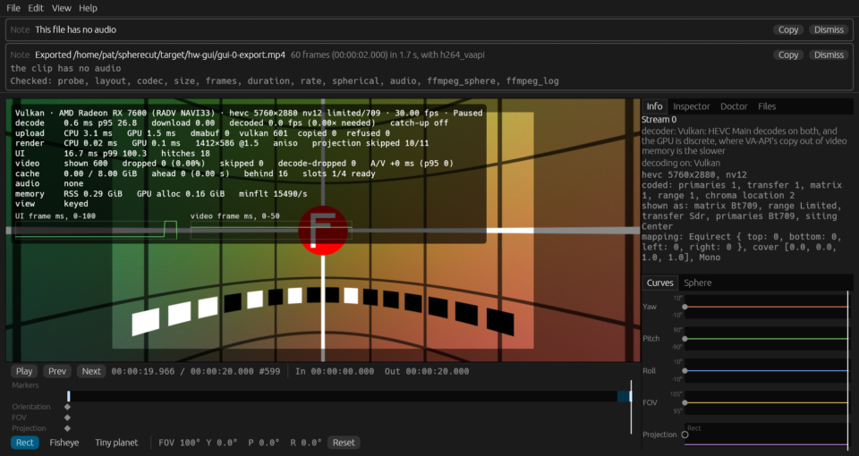
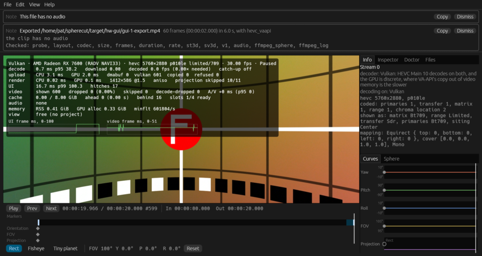
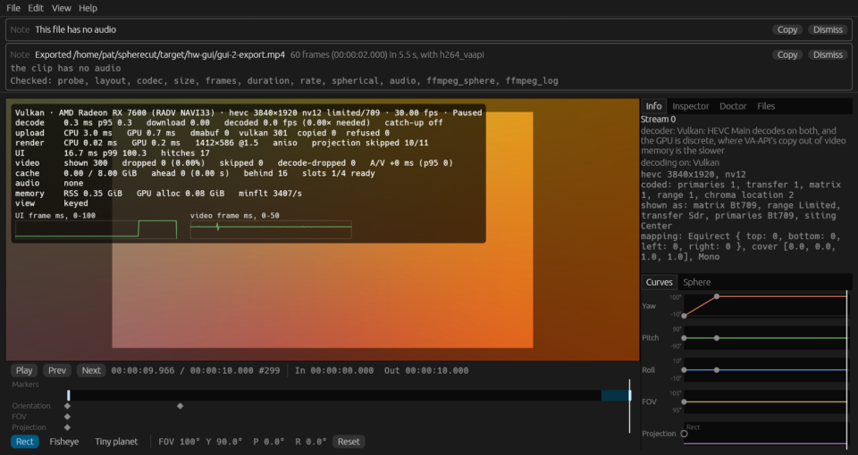
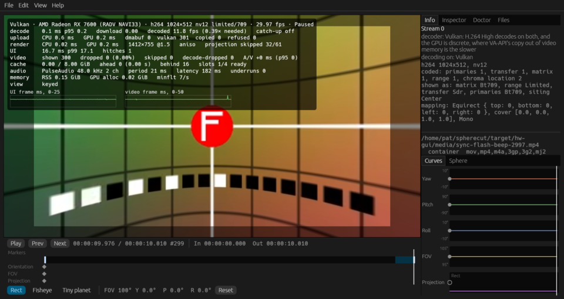
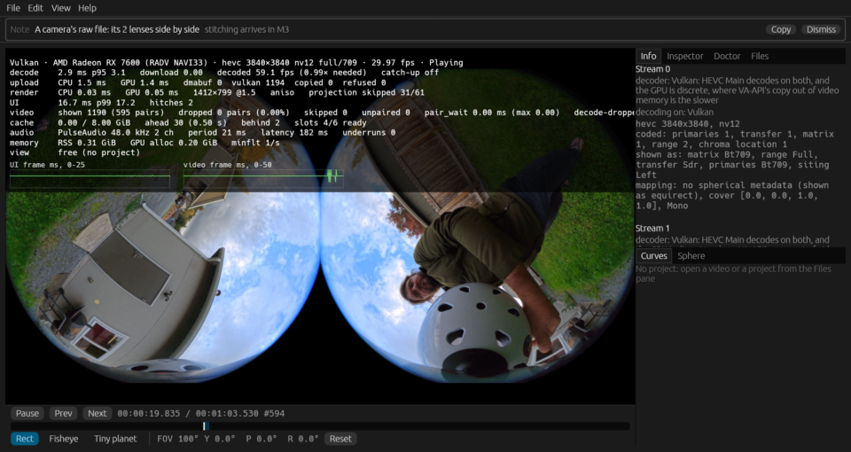
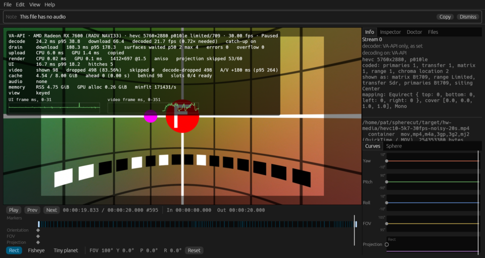
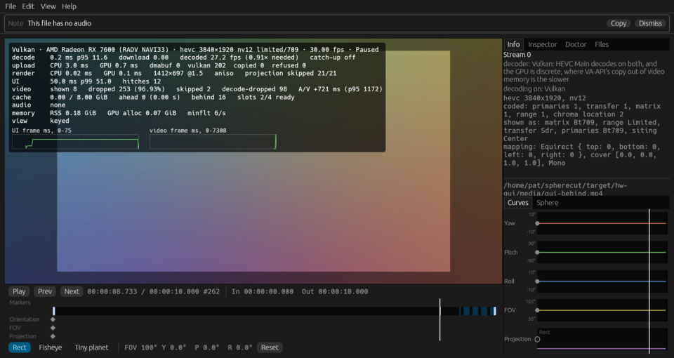
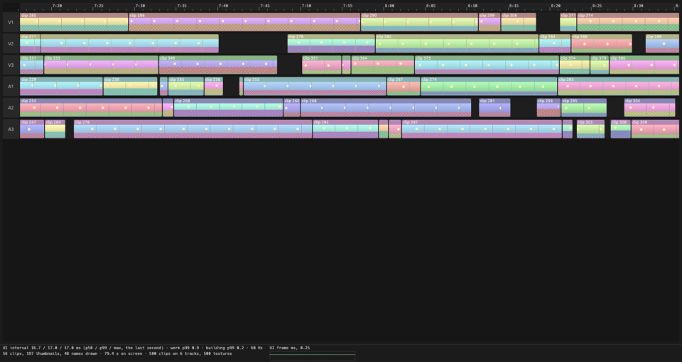
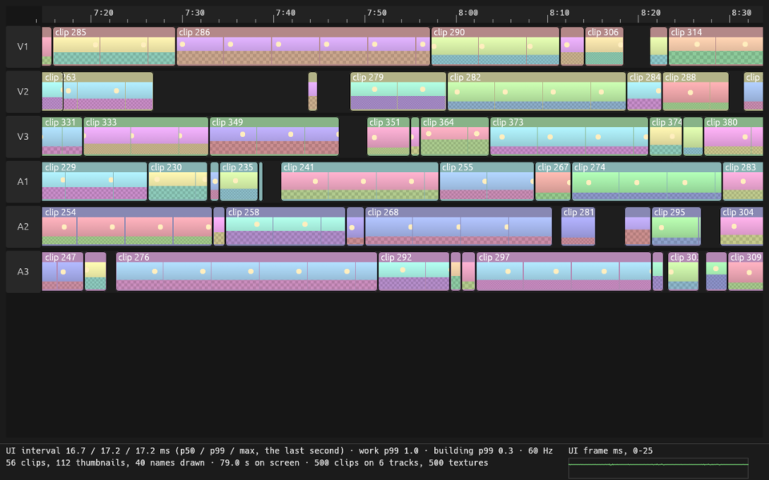
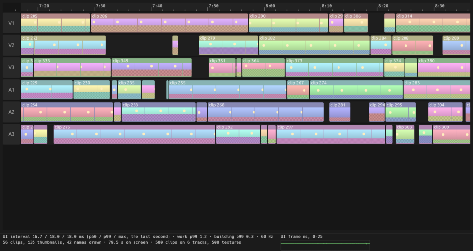

# Hardware report: odin @ 1a7a64ea1a

Generated by `cargo xtask hw-test` in 8682 s.

## Summary

| | |
|---|---|
| Host | odin |
| OS | Fedora Linux 44 (Workstation Edition) |
| Kernel | Linux 7.2.9-200.fc44.x86_64 #1 SMP PREEMPT_DYNAMIC Sat Oct  3 19:59:55 UTC 2026 x86_64 |
| Session | wayland / GNOME |
| GUI display | WAYLAND_DISPLAY set: WAYLAND_DISPLAY=wayland-0 |
| Screen locked at the end | no |
| Audio server | PulseAudio (on PipeWire 1.6.9) |
| GNOME mutter experimental features | @as [] |
| GPU (Vulkan) | AMD Radeon RX 7600 (RADV NAVI33) |
| Mesa | Mesa 26.2.5 |
| FFmpeg | ffmpeg version 8.1.3 Copyright (c) 2000-2026 the FFmpeg developers |
| FFmpeg libs | 62.28.103, 62.12.103, 60.26.103, 9.5.103, 6.3.103 |
| x265 | 4.1+1-1d117be (build 215) (the info SEI of a frame hw-test coded; `pkg-config` has no x265) |
| Rust | rustc 1.99.0 (b940084d7 2026-09-28) |
| VA-API HEVC | decode: yes, encode: yes |
| FFmpeg hwaccels | vdpau, cuda, vaapi, qsv, drm, opencl, vulkan, amf |
| Samples dir | /home/pat/spherecut/samples (present) |

**Tier 2: 62 passed, 2 failed, 1 skipped, 0 did not run (65 tests).**

**Tier 1 on this machine: left out by `--no-tier1`.**

**This run FAILED:** 2 Tier 2 test(s) failed.

## Prerequisites

Nothing missing.

## Build

Succeeded (release) in 97 s.

## Power profile

Read once, before the build, and never changed: decode speed moves with these.

| Setting | Value |
|---|---|
| power-profiles-daemon | not available (no `powerprofilesctl`) |
| ACPI platform profile | not available (no /sys/firmware/acpi/platform_profile) |
| CPU frequency driver | amd-pstate-epp |
| CPU governor | performance |
| CPU energy preference | performance |
| card0 (amdgpu) performance level | auto |
| card0 (amdgpu) power profile | not available (unreadable) |

## Render nodes

| Node | PCI slot | Vendor | Device | Driver | Opens |
|---|---|---|---|---|---|
| renderD128 | 0000:0c:00.0 | AMD (0x1002) | 0x7480 | amdgpu | yes |

## Perf clips

synth's noisy grid in HEVC at about a camera's bitrate, made once and kept in `/home/pat/spherecut/target/hw-media` for the playback benchmarks. Software decode over 150 fps would make a clip too easy to say anything about footage. A two-track clip has a row a lens: its bitrate from that lens's samples, its decode that lens's alone, and its coding read back from the file, its IDR interval from `stss` and its pictures by NAL type, in bold where a picture is neither an IDR nor a TRAIL_R, an IDR is off the interval, a place on it has none, or `stss` and the coding disagree.

| Clip | Size | Bitrate | Made | Software decode | Coding |
|---|---:|---:|---|---|---|
| `hevc8-5k7-30fps-noisy-20s.mp4` | 254 MB | 101.7 Mbit/s | cached | 47.3 fps |  |
| `hevc10-5k7-30fps-noisy-20s.mp4` | 254 MB | 101.7 Mbit/s | cached | 38.6 fps |  |
| `hevc8-8k-30fps-noisy-20s.mp4` | 305 MB | 122.1 Mbit/s | cached | 29.3 fps |  |
| `pair-hevc8-3840-2997-noisy-20s.mp4` lens 0 | 163 MB | 65.3 Mbit/s | cached | 66.2 fps | IDR every 60; TRAIL_R 590, IDR_N_LP 10 |
| `pair-hevc8-3840-2997-noisy-20s.mp4` lens 1 | 163 MB | 65.3 Mbit/s | cached | 66.7 fps | IDR every 60; TRAIL_R 590, IDR_N_LP 10 |
| `pair-hevc8-2880-5994-noisy-10s.mp4` lens 0 | 100 MB | 80.2 Mbit/s | cached | 116.6 fps | IDR every 120; TRAIL_R 595, IDR_N_LP 5; P only: the X5 codes TSA_N on every other picture, and every picture here but the IDRs is a reference P frame |
| `pair-hevc8-2880-5994-noisy-10s.mp4` lens 1 | 100 MB | 80.2 Mbit/s | cached | 116.5 fps | IDR every 120; TRAIL_R 595, IDR_N_LP 5; P only: the X5 codes TSA_N on every other picture, and every picture here but the IDRs is a reference P frame |
| `pair-hevc8-2880-2997-noisy-20s.mp4` lens 0 | 201 MB | 80.2 Mbit/s | cached | 83.2 fps | IDR every 60; TRAIL_R 590, IDR_N_LP 10 |
| `pair-hevc8-2880-2997-noisy-20s.mp4` lens 1 | 201 MB | 80.2 Mbit/s | cached | 83.2 fps | IDR every 60; TRAIL_R 590, IDR_N_LP 10 |

## Tier 2 tests

| Test | Result |
|---|---|
| `adapters::list_adapters_and_features` | pass |
| `geometry::samples_calibrations_build_rigs` | pass |
| `goldens::goldens_on_gpu_match_reference` | **FAIL** |
| `goldens::goldens_on_host_llvmpipe` | pass |
| `goldens::rung2::rung2_on_radv` | **FAIL** |
| `samples_roles::samples_every_present_role_resolves` | pass |
| `spherecut-agent/project::project_create_x5` | pass |
| `spherecut-camera/tier2_samples::samples_calib_print_is_identity` | pass |
| `spherecut-camera/tier2_samples::samples_insv_trailer_parses` | pass |
| `spherecut-media/doctor::doctor_decodes_hevc_main_on_vaapi` | pass |
| `spherecut-media/tier2_samples::bench_samples_realtime_decode` | pass |
| `spherecut-media/tier2_samples::samples_probe_cleanly` | pass |
| `spherecut-media/tier2_samples::samples_vaapi_decode_matches_software` | pass |
| `spherecut-media/tier2_samples::samples_vulkan_decode_matches_software` | pass |
| `spherecut_synth::lens::tests::bench_render_lens_x5_like_pair` | pass |
| `tier2_backend::bench_seek_latency` | pass |
| `tier2_backend::vaapi_colorinfo_matches_software` | pass |
| `tier2_backend::vaapi_exports_match_downloads` | pass |
| `tier2_backend::vaapi_seek_matches_software` | pass |
| `tier2_backend::vulkan_colorinfo_matches_software` | pass |
| `tier2_backend::vulkan_seek_matches_software` | pass |
| `tier2_device::audio_output_device_plays` | pass |
| `tier2_download_pool::vaapi_download_pool_reuses_buffers` | pass |
| `tier2_download_pool::vulkan_download_pool_reuses_buffers` | pass |
| `tier2_export::bench_export_4k30_vaapi` | pass |
| `tier2_export::bench_export_vaapi_levels` | pass |
| `tier2_export::export_360_8k_vaapi` | pass |
| `tier2_export::export_vaapi_matches_software` | pass |
| `tier2_frame::doctor_and_the_renderer_agree_on_sharing` | pass |
| `tier2_frame::samples_frame_clip8_renders` | pass |
| `tier2_frame::shared_vulkan_frame_matches_the_copy` | pass |
| `tier2_frame::shared_vulkan_pair_frame_matches_the_copy` | pass |
| `tier2_frame::vaapi_render_matches_software` | pass |
| `tier2_frame::vulkan_render_matches_software` | pass |
| `tier2_frame::zero_copy_frame_matches_the_copy` | pass |
| `tier2_frame::zero_copy_pair_frame_matches_the_copy` | pass |
| `tier2_gui::gui_decode_behind` | pass |
| `tier2_gui::gui_proto` | pass |
| `tier2_gui::gui_smoke` | pass |
| `tier2_hw_decode::bench_decode_hevc_4k_and_5k7` | pass |
| `tier2_hw_decode::vaapi_h264_matches_software` | pass |
| `tier2_hw_decode::vaapi_hevc_main10_matches_software` | pass |
| `tier2_hw_decode::vaapi_hevc_main_matches_software` | pass |
| `tier2_hw_decode::vulkan_h264_matches_software` | pass |
| `tier2_hw_decode::vulkan_hevc_main10_matches_software` | pass |
| `tier2_hw_decode::vulkan_hevc_main_matches_software` | pass |
| `tier2_mcp::mcp_render_vaapi` | pass |
| `tier2_mcp::mcp_session_decodes_with_vaapi` | pass |
| `tier2_pair_decode::bench_export_pair_decode` | pass |
| `tier2_playback::bench_perf_clips_software_decode` | pass |
| `tier2_playback::bench_playback_realtime_5k7_10bit` | pass |
| `tier2_playback::bench_playback_realtime_5k7_8bit` | pass |
| `tier2_playback::bench_playback_realtime_8k_8bit` | pass |
| `tier2_playback::bench_playback_stitched_samples` | skipped: no stitched equirect among the samples under /home/pat/spherecut/samples: clip 12 is still to come (docs/SAMPLES.md) |
| `tier2_playback::bench_playback_x5_raw` | pass |
| `tier2_playback::bench_x5_8k30_zero_copy_vs_copy` | pass |
| `tier2_playback::samples_lens_pairs_frame_locked` | pass |
| `tier2_playback::shared_vulkan_matches_copy_path` | pass |
| `tier2_playback::zero_copy_matches_copy_path` | pass |
| `tier2_playback::zero_copy_pair_matches_copy` | pass |
| `tier2_probe::samples_probe_names_the_camera` | pass |
| `tier2_tracks::samples_x5_tracks_equal` | pass |
| `upload::bench_stitch_pass` | pass |
| `upload::bench_upload_5k7` | pass |
| `yuv::yuv_on_gpu_matches_reference` | pass |

### FAIL `goldens::goldens_on_gpu_match_reference`

```
dfish_lens_only_0: control_cx_2px_under_ssim_floor = 0.0888
dfish_lens_only_0: 0.13 s
dfish_lens_only_1: ideal_psnr_db = 26.2672
dfish_lens_only_1: ideal_ssim = 0.8063
dfish_lens_only_1: control_cx_2px_ideal_psnr_db = 24.4766
dfish_lens_only_1: control_cx_2px_ideal_ssim = 0.7097
dfish_lens_only_1: control_cx_2px_under_floor_db = 0.7834
dfish_lens_only_1: control_cx_2px_under_ssim_floor = 0.0916
dfish_lens_only_1: 0.03 s
dfish_hifreq_tinyplanet: ideal_pixels = 1267.0000
dfish_hifreq_tinyplanet: ideal_psnr_db = 32.2336
dfish_hifreq_tinyplanet: control_level0_ideal_psnr_db = 14.1006
dfish_hifreq_tinyplanet: ideal_over_level0_db = 18.1329
dfish_hifreq_tinyplanet: cpu_psnr_db = 58.6707
dfish_hifreq_tinyplanet: cpu_max_channel = 0.0036
dfish_hifreq_tinyplanet: control_level0_cpu_psnr_db = 18.3976
dfish_hifreq_tinyplanet: control_level0_cpu_max_channel = 0.4612
dfish_hifreq_tinyplanet: 0.10 s
dfish_lod_heatmap: max_level_error = 0.0020
dfish_lod_heatmap: levels_off_by_more_than_half = 0.0000
dfish_lod_heatmap: control_block_0_levels_off_by_more_than_half = 21135.0000
dfish_lod_heatmap: 0.03 s
dfish_mask_margin: lens_0_ring_pixels = 36.0000
dfish_mask_margin: lens_0_ring_lod_min = 4.3266
dfish_mask_margin: lens_0_ring_lod_max = 4.4604
dfish_mask_margin: lens_0_ring_black_pixels = 0.0000
dfish_mask_margin: lens_0_ring_luma_off_lsb = 0.4167
dfish_mask_margin: control_margin_0_lens_0_ring_pixels = 64.0000
dfish_mask_margin: control_margin_0_lens_0_dip_lsb = 28.7500
dfish_mask_margin: lens_1_ring_pixels = 34.0000
dfish_mask_margin: lens_1_ring_lod_min = 4.3398
dfish_mask_margin: lens_1_ring_lod_max = 4.4698
dfish_mask_margin: lens_1_ring_black_pixels = 0.0000
dfish_mask_margin: lens_1_ring_luma_off_lsb = 0.4412
dfish_mask_margin: control_margin_0_lens_1_ring_pixels = 65.0000
dfish_mask_margin: control_margin_0_lens_1_dip_lsb = 29.9154
dfish_mask_margin: lens_0_wide_edge_pixels = 737.0000
dfish_mask_margin: lens_0_wide_edge_black_pixels = 0.0000
dfish_mask_margin: lens_0_wide_edge_luma_off_lsb = 0.2504
dfish_mask_margin: control_frame_term_off_pixels_outside = 157.0000
dfish_mask_margin: control_frame_term_off_streaks_lsb = 56.0595
dfish_mask_margin: 0.14 s
dfish_kb_rig: cpu_equidistant_psnr_db = 59.6140
dfish_kb_rig: cpu_equidistant_max_channel = 0.0028
dfish_kb_rig: cpu_equisolid_psnr_db = 59.7543
dfish_kb_rig: cpu_equisolid_max_channel = 0.0026
dfish_kb_rig: cpu_stereographic_psnr_db = 59.2996
dfish_kb_rig: cpu_stereographic_max_channel = 0.0028
dfish_kb_rig: cpu_orthographic_psnr_db = 61.3813
dfish_kb_rig: cpu_orthographic_max_channel = 0.0028
dfish_kb_rig: control_equisolid_cpu_psnr_db = 27.0081
dfish_kb_rig: control_equisolid_cpu_max_channel = 0.4237
dfish_kb_rig: 0.35 s

thread 'goldens_on_gpu_match_reference' (1434389) panicked at crates/render/tests/goldens.rs:4572:5:
2 checks failed:
  dfish_zenith: control_implicit_bad_pixels is 0.0000, not over 0 [on AMD Radeon RX 7600 (RADV NAVI33) (radv Mesa 26.2.5)]
  dfish_nadir: control_implicit_bad_pixels is 0.0000, not over 0 [on AMD Radeon RX 7600 (RADV NAVI33) (radv Mesa 26.2.5)]
note: run with `RUST_BACKTRACE=1` environment variable to display a backtrace

```

### FAIL `goldens::rung2::rung2_on_radv`

```
x5_seamlines_modes_6_and_7: pos_x_weights_psnr_db = 101.5770
x5_seamlines_modes_6_and_7: pos_x_weights_max_channel = 0.0005
x5_seamlines_modes_6_and_7: pos_x_seam_difference_psnr_db = 79.1351
x5_seamlines_modes_6_and_7: pos_x_seam_difference_max_channel = 0.0015
x5_seamlines_modes_6_and_7: neg_x_weights_psnr_db = 101.4399
x5_seamlines_modes_6_and_7: neg_x_weights_max_channel = 0.0005
x5_seamlines_modes_6_and_7: neg_x_seam_difference_psnr_db = 71.7444
x5_seamlines_modes_6_and_7: neg_x_seam_difference_max_channel = 0.0016
x5_seamlines_modes_6_and_7: pos_y_weights_psnr_db = 102.6757
x5_seamlines_modes_6_and_7: pos_y_weights_max_channel = 0.0005
x5_seamlines_modes_6_and_7: pos_y_seam_difference_psnr_db = 74.8420
x5_seamlines_modes_6_and_7: pos_y_seam_difference_max_channel = 0.0016
x5_seamlines_modes_6_and_7: neg_y_weights_psnr_db = 103.1304
x5_seamlines_modes_6_and_7: neg_y_weights_max_channel = 0.0005
x5_seamlines_modes_6_and_7: neg_y_seam_difference_psnr_db = 74.7847
x5_seamlines_modes_6_and_7: neg_y_seam_difference_max_channel = 0.0019
x5_seamlines_modes_6_and_7: seam_45_weights_psnr_db = 100.5788
x5_seamlines_modes_6_and_7: seam_45_weights_max_channel = 0.0005
x5_seamlines_modes_6_and_7: seam_45_seam_difference_psnr_db = 84.3134
x5_seamlines_modes_6_and_7: seam_45_seam_difference_max_channel = 0.0020
x5_seamlines_unlike_gains: equirect_stitch_psnr_db = 59.1777
x5_seamlines_unlike_gains: equirect_stitch_max_channel = 0.0027
x5_seamlines_unlike_gains: equirect_lens_0_psnr_db = 61.2095
x5_seamlines_unlike_gains: equirect_lens_0_max_channel = 0.0027
x5_seamlines_unlike_gains: equirect_lens_1 ties at its mask at [(165, 22)]
x5_seamlines_unlike_gains: equirect_lens_1_mask_ties = 1.0000
x5_seamlines_unlike_gains: equirect_lens_1_psnr_db = 61.2340
x5_seamlines_unlike_gains: equirect_lens_1_max_channel = 0.0027
x5_seamlines_unlike_gains: pos_x_stitch_psnr_db = 58.8809
x5_seamlines_unlike_gains: pos_x_stitch_max_channel = 0.0027
x5_seamlines_unlike_gains: pos_x_lens_0_psnr_db = 59.1618
x5_seamlines_unlike_gains: pos_x_lens_0_max_channel = 0.0026
x5_seamlines_unlike_gains: pos_x_lens_1_psnr_db = 59.1351
x5_seamlines_unlike_gains: pos_x_lens_1_max_channel = 0.0028
x5_seamlines_unlike_gains: neg_x_stitch_psnr_db = 58.7761
x5_seamlines_unlike_gains: neg_x_stitch_max_channel = 0.0027
x5_seamlines_unlike_gains: neg_x_lens_0_psnr_db = 58.9738
x5_seamlines_unlike_gains: neg_x_lens_0_max_channel = 0.0026
x5_seamlines_unlike_gains: neg_x_lens_1_psnr_db = 59.0340
x5_seamlines_unlike_gains: neg_x_lens_1_max_channel = 0.0027
x5_seamlines_unlike_gains: pos_y_stitch_psnr_db = 58.8229
x5_seamlines_unlike_gains: pos_y_stitch_max_channel = 0.0026
x5_seamlines_unlike_gains: pos_y_lens_0_psnr_db = 58.9869
x5_seamlines_unlike_gains: pos_y_lens_0_max_channel = 0.0026
x5_seamlines_unlike_gains: pos_y_lens_1_psnr_db = 59.1172
x5_seamlines_unlike_gains: pos_y_lens_1_max_channel = 0.0026
x5_seamlines_unlike_gains: neg_y_stitch_psnr_db = 58.8147
x5_seamlines_unlike_gains: neg_y_stitch_max_channel = 0.0025
x5_seamlines_unlike_gains: neg_y_lens_0_psnr_db = 59.0809
x5_seamlines_unlike_gains: neg_y_lens_0_max_channel = 0.0025
x5_seamlines_unlike_gains: neg_y_lens_1_psnr_db = 59.0007
x5_seamlines_unlike_gains: neg_y_lens_1_max_channel = 0.0028
rung2_on_radv: 2.369 s on 1 GPU

thread 'rung2::rung2_on_radv' (1436709) panicked at crates/render/tests/dfish/rung2.rs:1133:5:
2 checks failed:
  x5_seamlines_modes_6_and_7 equirect_seam_difference against lavapipe: outside the other-driver tolerance (PSNR ≥ 48 dB, SSIM ≥ 0.995, at most 4 pixels more than 4 LSB off, none more than 8): PSNR 60.73 dB, SSIM 0.99947, 6 pixels more than 4 LSB off, max 6 LSB [on AMD Radeon RX 7600 (RADV NAVI33) (radv Mesa 26.2.5)]
  x5_seamlines_modes_6_and_7 neg_x_seam_difference against lavapipe: outside the other-driver tolerance (PSNR ≥ 48 dB, SSIM ≥ 0.995, at most 4 pixels more than 4 LSB off, none more than 8): PSNR 51.55 dB, SSIM 0.99555, 7 pixels more than 4 LSB off, max 5 LSB [on AMD Radeon RX 7600 (RADV NAVI33) (radv Mesa 26.2.5)]


```

## Benchmarks

Release build. Each benchmark runs once to warm up, then 3 times (`SPHERECUT_BENCH_RUNS`); the result is the median. Spread is the range over the median: over 10% means the machine was busy or changing clocks, so take that result with care. A row marked "per second" is one run's seconds instead: Runs counts the seconds, and the range is the slowest and the fastest.

| Benchmark | Median | Range | Runs | Spread |
|---|---:|---:|---:|---:|
| audio clock over 2 s of Instant | 2.00 s | | 1 | |
| audio latency (median) | 181.88 ms | | 1 | |
| audio callback gap, worst (× its buffer) | 1.02 x | | 1 | |
| export 4k30 h264_vaapi high | 33.92 fps | 32.76 to 33.93 | 3 | 3% |
| export 4k30 h264_vaapi high: decode | 28.65 ms/frame | 28.63 to 29.60 | 3 | 3% |
| export 4k30 h264_vaapi high: render | 10.07 ms/frame | 9.97 to 10.34 | 3 | 4% |
| export 4k30 h264_vaapi high: readback | 3.31 ms/frame | 3.26 to 4.04 | 3 | 24% **unstable** |
| export 4k30 h264_vaapi high: encode | 6.86 ms/frame | 6.85 to 13.79 | 3 | 101% **unstable** |
| export 4k30 h264_vaapi high: finish | 0.36 ms/frame | 0.35 to 0.37 | 3 | 6% |
| export 4k30 hevc_vaapi high | 44.30 fps | 44.21 to 44.39 | 3 | 0% |
| export 4k30 hevc_vaapi high: decode | 22.08 ms/frame | 21.99 to 22.11 | 3 | 1% |
| export 4k30 hevc_vaapi high: render | 10.50 ms/frame | 10.39 to 10.58 | 3 | 2% |
| export 4k30 hevc_vaapi high: readback | 3.05 ms/frame | 3.02 to 3.07 | 3 | 1% |
| export 4k30 hevc_vaapi high: encode | 6.87 ms/frame | 6.83 to 6.88 | 3 | 1% |
| export 4k30 hevc_vaapi high: finish | 0.17 ms/frame | 0.16 to 0.17 | 3 | 4% |
| export 4k30 h264_vaapi draft | 54.32 fps | 54.02 to 54.32 | 3 | 1% |
| export 4k30 h264_vaapi draft: decode | 18.00 ms/frame | 17.99 to 18.11 | 3 | 1% |
| export 4k30 h264_vaapi draft: render | 7.97 ms/frame | 7.93 to 8.01 | 3 | 1% |
| export 4k30 h264_vaapi draft: readback | 1.23 ms/frame | 1.20 to 1.24 | 3 | 4% |
| export 4k30 h264_vaapi draft: encode | 1.99 ms/frame | 1.96 to 2.04 | 3 | 4% |
| export 4k30 h264_vaapi draft: finish | 0.11 ms/frame | 0.09 to 0.11 | 3 | 15% **unstable** |
| export 4k30 from lrv h264_vaapi high | 46.95 fps | 46.83 to 47.62 | 3 | 2% |
| export 4k30 from lrv h264_vaapi high: decode | 15.42 ms/frame | 15.34 to 15.55 | 3 | 1% |
| export 4k30 from lrv h264_vaapi high: render | 8.00 ms/frame | 5.69 to 8.25 | 3 | 32% **unstable** |
| export 4k30 from lrv h264_vaapi high: readback | 11.27 ms/frame | 11.06 to 13.37 | 3 | 21% **unstable** |
| export 4k30 from lrv h264_vaapi high: encode | 15.81 ms/frame | 15.73 to 15.86 | 3 | 1% |
| export 4k30 from lrv h264_vaapi high: finish | 0.62 ms/frame | 0.59 to 0.62 | 3 | 5% |
| export levels h264_vaapi speed (1): speed | 35.58 fps | | 1 | |
| export levels h264_vaapi speed (1): worst luma PSNR | 45.20 dB | | 1 | |
| export levels h264_vaapi speed (1): bitrate | 36.60 Mb/s | | 1 | |
| export levels h264_vaapi balanced (3): speed | 36.99 fps | | 1 | |
| export levels h264_vaapi balanced (3): worst luma PSNR | 44.71 dB | | 1 | |
| export levels h264_vaapi balanced (3): bitrate | 28.52 Mb/s | | 1 | |
| export levels h264_vaapi balanced vbaq (19): speed | 36.44 fps | | 1 | |
| export levels h264_vaapi balanced vbaq (19): worst luma PSNR | 45.20 dB | | 1 | |
| export levels h264_vaapi balanced vbaq (19): bitrate | 33.50 Mb/s | | 1 | |
| export levels h264_vaapi quality (5): speed | 30.16 fps | | 1 | |
| export levels h264_vaapi quality (5): worst luma PSNR | 44.71 dB | | 1 | |
| export levels h264_vaapi quality (5): bitrate | 28.59 Mb/s | | 1 | |
| export levels h264_vaapi quality pre-encode (13): speed | 29.89 fps | | 1 | |
| export levels h264_vaapi quality pre-encode (13): worst luma PSNR | 44.71 dB | | 1 | |
| export levels h264_vaapi quality pre-encode (13): bitrate | 26.66 Mb/s | | 1 | |
| export levels h264_vaapi quality pre-encode vbaq (29): speed | 29.64 fps | | 1 | |
| export levels h264_vaapi quality pre-encode vbaq (29): worst luma PSNR | 45.20 dB | | 1 | |
| export levels h264_vaapi quality pre-encode vbaq (29): bitrate | 36.20 Mb/s | | 1 | |
| export levels h264_vaapi high quality pre-encode vbaq (31): speed | 29.94 fps | | 1 | |
| export levels h264_vaapi high quality pre-encode vbaq (31): worst luma PSNR | 45.20 dB | | 1 | |
| export levels h264_vaapi high quality pre-encode vbaq (31): bitrate | 36.20 Mb/s | | 1 | |
| export levels hevc_vaapi speed (1): speed | 37.99 fps | | 1 | |
| export levels hevc_vaapi speed (1): worst luma PSNR | 47.16 dB | | 1 | |
| export levels hevc_vaapi speed (1): bitrate | 28.91 Mb/s | | 1 | |
| export levels hevc_vaapi balanced (3): speed | 34.92 fps | | 1 | |
| export levels hevc_vaapi balanced (3): worst luma PSNR | 46.44 dB | | 1 | |
| export levels hevc_vaapi balanced (3): bitrate | 25.70 Mb/s | | 1 | |
| export levels hevc_vaapi balanced vbaq (19): speed | 39.48 fps | | 1 | |
| export levels hevc_vaapi balanced vbaq (19): worst luma PSNR | 47.16 dB | | 1 | |
| export levels hevc_vaapi balanced vbaq (19): bitrate | 27.98 Mb/s | | 1 | |
| export levels hevc_vaapi quality (5): speed | 38.83 fps | | 1 | |
| export levels hevc_vaapi quality (5): worst luma PSNR | 46.44 dB | | 1 | |
| export levels hevc_vaapi quality (5): bitrate | 25.60 Mb/s | | 1 | |
| export levels hevc_vaapi quality pre-encode (13): speed | 31.52 fps | | 1 | |
| export levels hevc_vaapi quality pre-encode (13): worst luma PSNR | 46.44 dB | | 1 | |
| export levels hevc_vaapi quality pre-encode (13): bitrate | 26.19 Mb/s | | 1 | |
| export levels hevc_vaapi quality pre-encode vbaq (29): speed | 37.12 fps | | 1 | |
| export levels hevc_vaapi quality pre-encode vbaq (29): worst luma PSNR | 47.16 dB | | 1 | |
| export levels hevc_vaapi quality pre-encode vbaq (29): bitrate | 27.44 Mb/s | | 1 | |
| export levels hevc_vaapi high quality pre-encode vbaq (31): speed | 37.21 fps | | 1 | |
| export levels hevc_vaapi high quality pre-encode vbaq (31): worst luma PSNR | 47.16 dB | | 1 | |
| export levels hevc_vaapi high quality pre-encode vbaq (31): bitrate | 27.90 Mb/s | | 1 | |
| export levels av1_vaapi speed (1): speed | 38.66 fps | | 1 | |
| export levels av1_vaapi speed (1): worst luma PSNR | 43.02 dB | | 1 | |
| export levels av1_vaapi speed (1): bitrate | 15.04 Mb/s | | 1 | |
| export levels av1_vaapi balanced (3): speed | 38.95 fps | | 1 | |
| export levels av1_vaapi balanced (3): worst luma PSNR | 43.55 dB | | 1 | |
| export levels av1_vaapi balanced (3): bitrate | 20.61 Mb/s | | 1 | |
| export levels av1_vaapi balanced vbaq (19): speed | 37.90 fps | | 1 | |
| export levels av1_vaapi balanced vbaq (19): worst luma PSNR | 43.65 dB | | 1 | |
| export levels av1_vaapi balanced vbaq (19): bitrate | 20.77 Mb/s | | 1 | |
| export levels av1_vaapi quality (5): speed | 31.85 fps | | 1 | |
| export levels av1_vaapi quality (5): worst luma PSNR | 43.56 dB | | 1 | |
| export levels av1_vaapi quality (5): bitrate | 20.66 Mb/s | | 1 | |
| export levels av1_vaapi quality pre-encode (13): speed | 29.65 fps | | 1 | |
| export levels av1_vaapi quality pre-encode (13): worst luma PSNR | 43.00 dB | | 1 | |
| export levels av1_vaapi quality pre-encode (13): bitrate | 14.84 Mb/s | | 1 | |
| export levels av1_vaapi quality pre-encode vbaq (29): speed | 29.35 fps | | 1 | |
| export levels av1_vaapi quality pre-encode vbaq (29): worst luma PSNR | 43.03 dB | | 1 | |
| export levels av1_vaapi quality pre-encode vbaq (29): bitrate | 15.74 Mb/s | | 1 | |
| export levels av1_vaapi high quality pre-encode vbaq (31): speed | 20.24 fps | | 1 | |
| export levels av1_vaapi high quality pre-encode vbaq (31): worst luma PSNR | 43.03 dB | | 1 | |
| export levels av1_vaapi high quality pre-encode vbaq (31): bitrate | 16.36 Mb/s | | 1 | |
| 360 8k export av1_vaapi | 10.16 fps | | 1 | |
| 360 8k export av1_vaapi: bitrate | 35.30 Mb/s | | 1 | |
| pair decode X5 8K30 clip 9, VA-API download, serial: slower lens beside the encode | 18.49 fps | 18.43 to 18.49 | 3 | 0% |
| pair decode X5 8K30 clip 9, VA-API download, serial: opening | 234.44 ms | 233.65 to 235.12 | 3 | 1% |
| pair decode X5 8K30 clip 9, VA-API download, serial: the encode beside, in the decode's window | 30.00 fps | 30.00 to 30.01 | 3 | 0% |
| pair decode X5 8K30 clip 9, VA-API download, serial: peak RSS growth beside the encode | 325.04 MiB | 324.70 to 325.16 | 3 | 0% |
| pair decode X5 8K30 clip 9, VA-API download, a thread a lens: slower lens beside the encode | 14.32 fps | 14.15 to 16.08 | 3 | 14% **unstable** |
| pair decode X5 8K30 clip 9, VA-API download, a thread a lens: opening | 187.70 ms | 187.21 to 188.99 | 3 | 1% |
| pair decode X5 8K30 clip 9, VA-API download, a thread a lens: the encode beside, in the decode's window | 29.99 fps | 29.99 to 30.00 | 3 | 0% |
| pair decode X5 8K30 clip 9, VA-API download, a thread a lens: peak RSS growth beside the encode | 385.45 MiB | 385.32 to 427.31 | 3 | 11% **unstable** |
| pair decode X5 8K30 clip 9, VA-API download, lens 0 only, for K3: lens 0 alone | 28.62 fps | | 1 | |
| pair decode X5 8K30 clip 9, VA-API download, lens 0 only, for K3: opening | 123.77 ms | | 1 | |
| pair decode X5 8K30 clip 9, VA-API download, lens 0 only, for K3: peak RSS growth alone | 246.35 MiB | | 1 | |
| pair decode X5 8K30 clip 9, VA-API download, serial, for K3: slower lens alone | 41.52 fps | | 1 | |
| pair decode X5 8K30 clip 9, VA-API download, serial, for K3: opening | 194.04 ms | | 1 | |
| pair decode X5 8K30 clip 9, VA-API download, serial, for K3: peak RSS growth alone | 422.82 MiB | | 1 | |
| pair decode X5 8K30 clip 9, VA-API download, a thread a lens, for K3: slower lens alone | 12.81 fps | | 1 | |
| pair decode X5 8K30 clip 9, VA-API download, a thread a lens, for K3: opening | 158.44 ms | | 1 | |
| pair decode X5 8K30 clip 9, VA-API download, a thread a lens, for K3: peak RSS growth alone | 443.05 MiB | | 1 | |
| pair decode X5 8K30 clip 9, Vulkan Video download, serial: slower lens beside the encode | 32.93 fps | 32.93 to 32.98 | 3 | 0% |
| pair decode X5 8K30 clip 9, Vulkan Video download, serial: opening | 180.55 ms | 180.46 to 180.71 | 3 | 0% |
| pair decode X5 8K30 clip 9, Vulkan Video download, serial: the encode beside, in the decode's window | 29.97 fps | 29.96 to 30.01 | 3 | 0% |
| pair decode X5 8K30 clip 9, Vulkan Video download, serial: peak RSS growth beside the encode | 319.60 MiB | 319.53 to 319.71 | 3 | 0% |
| pair decode X5 8K30 clip 9, Vulkan Video download, a thread a lens: slower lens beside the encode | 31.74 fps | 31.72 to 31.75 | 3 | 0% |
| pair decode X5 8K30 clip 9, Vulkan Video download, a thread a lens: opening | 150.50 ms | 148.63 to 155.31 | 3 | 4% |
| pair decode X5 8K30 clip 9, Vulkan Video download, a thread a lens: the encode beside, in the decode's window | 30.04 fps | 30.03 to 30.06 | 3 | 0% |
| pair decode X5 8K30 clip 9, Vulkan Video download, a thread a lens: peak RSS growth beside the encode | 347.95 MiB | 347.28 to 348.04 | 3 | 0% |
| pair decode X5 8K30 clip 9, Vulkan Video download, lens 0 only, for K3: lens 0 alone | 154.66 fps | | 1 | |
| pair decode X5 8K30 clip 9, Vulkan Video download, lens 0 only, for K3: opening | 123.14 ms | | 1 | |
| pair decode X5 8K30 clip 9, Vulkan Video download, lens 0 only, for K3: peak RSS growth alone | 225.52 MiB | | 1 | |
| pair decode X5 8K30 clip 9, Vulkan Video download, serial, for K3: slower lens alone | 77.34 fps | | 1 | |
| pair decode X5 8K30 clip 9, Vulkan Video download, serial, for K3: opening | 177.11 ms | | 1 | |
| pair decode X5 8K30 clip 9, Vulkan Video download, serial, for K3: peak RSS growth alone | 410.29 MiB | | 1 | |
| pair decode X5 8K30 clip 9, Vulkan Video download, a thread a lens, for K3: slower lens alone | 78.99 fps | | 1 | |
| pair decode X5 8K30 clip 9, Vulkan Video download, a thread a lens, for K3: opening | 142.20 ms | | 1 | |
| pair decode X5 8K30 clip 9, Vulkan Video download, a thread a lens, for K3: peak RSS growth alone | 406.20 MiB | | 1 | |
| pair decode X5 8K30 clip 9, software, serial: slower lens beside the encode | 13.55 fps | 13.48 to 13.55 | 3 | 1% |
| pair decode X5 8K30 clip 9, software, serial: opening | 1188.23 ms | 1182.94 to 1197.57 | 3 | 1% |
| pair decode X5 8K30 clip 9, software, serial: the encode beside, in the decode's window | 30.23 fps | 30.05 to 30.24 | 3 | 1% |
| pair decode X5 8K30 clip 9, software, serial: peak RSS growth beside the encode | 2397.64 MiB | 2397.45 to 2417.12 | 3 | 1% |
| pair decode X5 8K30 clip 9, software, a thread a lens: slower lens beside the encode | 13.68 fps | 13.68 to 13.68 | 3 | 0% |
| pair decode X5 8K30 clip 9, software, a thread a lens: opening | 649.39 ms | 647.86 to 650.05 | 3 | 0% |
| pair decode X5 8K30 clip 9, software, a thread a lens: the encode beside, in the decode's window | 29.82 fps | 29.80 to 30.03 | 3 | 1% |
| pair decode X5 8K30 clip 9, software, a thread a lens: peak RSS growth beside the encode | 2481.97 MiB | 2481.91 to 2481.99 | 3 | 0% |
| pair decode X5 8K30 clip 9, software, lens 0 only, for K3: lens 0 alone | 14.49 fps | | 1 | |
| pair decode X5 8K30 clip 9, software, lens 0 only, for K3: opening | 558.57 ms | | 1 | |
| pair decode X5 8K30 clip 9, software, lens 0 only, for K3: peak RSS growth alone | 1229.92 MiB | | 1 | |
| pair decode X5 8K30 clip 9, software, serial, for K3: slower lens alone | 13.86 fps | | 1 | |
| pair decode X5 8K30 clip 9, software, serial, for K3: opening | 1172.96 ms | | 1 | |
| pair decode X5 8K30 clip 9, software, serial, for K3: peak RSS growth alone | 2451.58 MiB | | 1 | |
| pair decode X5 8K30 clip 9, software, a thread a lens, for K3: slower lens alone | 13.90 fps | | 1 | |
| pair decode X5 8K30 clip 9, software, a thread a lens, for K3: opening | 645.55 ms | | 1 | |
| pair decode X5 8K30 clip 9, software, a thread a lens, for K3: peak RSS growth alone | 2450.61 MiB | | 1 | |
| pair decode perf clip pair-hevc8-2880-2997-noisy-20s, VA-API download, serial: slower lens beside the encode | 26.58 fps | 26.54 to 26.61 | 3 | 0% |
| pair decode perf clip pair-hevc8-2880-2997-noisy-20s, VA-API download, serial: opening | 157.83 ms | 157.40 to 158.24 | 3 | 1% |
| pair decode perf clip pair-hevc8-2880-2997-noisy-20s, VA-API download, serial: the encode beside, in the decode's window | 29.99 fps | 29.99 to 30.00 | 3 | 0% |
| pair decode perf clip pair-hevc8-2880-2997-noisy-20s, VA-API download, serial: peak RSS growth beside the encode | 226.48 MiB | 226.11 to 226.51 | 3 | 0% |
| pair decode perf clip pair-hevc8-2880-2997-noisy-20s, VA-API download, a thread a lens: slower lens beside the encode | 29.33 fps | 29.18 to 29.54 | 3 | 1% |
| pair decode perf clip pair-hevc8-2880-2997-noisy-20s, VA-API download, a thread a lens: opening | 142.80 ms | 142.23 to 143.24 | 3 | 1% |
| pair decode perf clip pair-hevc8-2880-2997-noisy-20s, VA-API download, a thread a lens: the encode beside, in the decode's window | 29.96 fps | 29.96 to 29.98 | 3 | 0% |
| pair decode perf clip pair-hevc8-2880-2997-noisy-20s, VA-API download, a thread a lens: peak RSS growth beside the encode | 239.50 MiB | 239.17 to 239.57 | 3 | 0% |
| pair decode perf clip pair-hevc8-2880-2997-noisy-20s, Vulkan Video download, serial: slower lens beside the encode | 46.96 fps | 46.96 to 46.99 | 3 | 0% |
| pair decode perf clip pair-hevc8-2880-2997-noisy-20s, Vulkan Video download, serial: opening | 145.63 ms | 145.49 to 148.23 | 3 | 2% |
| pair decode perf clip pair-hevc8-2880-2997-noisy-20s, Vulkan Video download, serial: the encode beside, in the decode's window | 29.95 fps | 29.94 to 29.97 | 3 | 0% |
| pair decode perf clip pair-hevc8-2880-2997-noisy-20s, Vulkan Video download, serial: peak RSS growth beside the encode | 219.83 MiB | 219.77 to 219.88 | 3 | 0% |
| pair decode perf clip pair-hevc8-2880-2997-noisy-20s, Vulkan Video download, a thread a lens: slower lens beside the encode | 45.23 fps | 45.13 to 45.24 | 3 | 0% |
| pair decode perf clip pair-hevc8-2880-2997-noisy-20s, Vulkan Video download, a thread a lens: opening | 126.34 ms | 126.24 to 127.03 | 3 | 1% |
| pair decode perf clip pair-hevc8-2880-2997-noisy-20s, Vulkan Video download, a thread a lens: the encode beside, in the decode's window | 29.98 fps | 29.98 to 29.99 | 3 | 0% |
| pair decode perf clip pair-hevc8-2880-2997-noisy-20s, Vulkan Video download, a thread a lens: peak RSS growth beside the encode | 235.38 MiB | 235.08 to 235.56 | 3 | 0% |
| pair decode perf clip pair-hevc8-2880-2997-noisy-20s, software, serial: slower lens beside the encode | 60.42 fps | 60.06 to 60.99 | 3 | 2% |
| pair decode perf clip pair-hevc8-2880-2997-noisy-20s, software, serial: opening | 814.63 ms | 809.93 to 816.03 | 3 | 1% |
| pair decode perf clip pair-hevc8-2880-2997-noisy-20s, software, serial: the encode beside, in the decode's window | 28.75 fps | 28.38 to 29.73 | 3 | 5% |
| pair decode perf clip pair-hevc8-2880-2997-noisy-20s, software, serial: peak RSS growth beside the encode | 1187.28 MiB | 1186.78 to 1187.79 | 3 | 0% |
| pair decode perf clip pair-hevc8-2880-2997-noisy-20s, software, a thread a lens: slower lens beside the encode | 60.12 fps | 59.66 to 61.07 | 3 | 2% |
| pair decode perf clip pair-hevc8-2880-2997-noisy-20s, software, a thread a lens: opening | 425.64 ms | 425.18 to 426.49 | 3 | 0% |
| pair decode perf clip pair-hevc8-2880-2997-noisy-20s, software, a thread a lens: the encode beside, in the decode's window | 28.88 fps | 28.70 to 29.46 | 3 | 3% |
| pair decode perf clip pair-hevc8-2880-2997-noisy-20s, software, a thread a lens: peak RSS growth beside the encode | 1236.65 MiB | 1232.41 to 1237.62 | 3 | 0% |
| pair decode X5 8K25 clip 2, VA-API download, serial: slower lens alone | 32.76 fps | | 1 | |
| pair decode X5 8K25 clip 2, VA-API download, serial: opening | 209.13 ms | | 1 | |
| pair decode X5 8K25 clip 2, VA-API download, serial: peak RSS growth alone | 300.19 MiB | | 1 | |
| pair decode X5 8K25 clip 2, VA-API download, a thread a lens: slower lens alone | 20.19 fps | | 1 | |
| pair decode X5 8K25 clip 2, VA-API download, a thread a lens: opening | 176.32 ms | | 1 | |
| pair decode X5 8K25 clip 2, VA-API download, a thread a lens: peak RSS growth alone | 382.29 MiB | | 1 | |
| pair decode X5 8K25 clip 2, Vulkan Video download, serial: slower lens alone | 75.89 fps | | 1 | |
| pair decode X5 8K25 clip 2, Vulkan Video download, serial: opening | 200.44 ms | | 1 | |
| pair decode X5 8K25 clip 2, Vulkan Video download, serial: peak RSS growth alone | 280.58 MiB | | 1 | |
| pair decode X5 8K25 clip 2, Vulkan Video download, a thread a lens: slower lens alone | 76.44 fps | | 1 | |
| pair decode X5 8K25 clip 2, Vulkan Video download, a thread a lens: opening | 146.75 ms | | 1 | |
| pair decode X5 8K25 clip 2, Vulkan Video download, a thread a lens: peak RSS growth alone | 299.68 MiB | | 1 | |
| pair decode X5 8K25 clip 2, software, serial: slower lens alone | 14.24 fps | | 1 | |
| pair decode X5 8K25 clip 2, software, serial: opening | 1456.16 ms | | 1 | |
| pair decode X5 8K25 clip 2, software, serial: peak RSS growth alone | 2329.78 MiB | | 1 | |
| pair decode X5 8K25 clip 2, software, a thread a lens: slower lens alone | 14.36 fps | | 1 | |
| pair decode X5 8K25 clip 2, software, a thread a lens: opening | 750.36 ms | | 1 | |
| pair decode X5 8K25 clip 2, software, a thread a lens: peak RSS growth alone | 2395.02 MiB | | 1 | |
| pair decode X5 5.7K60 clip 3, VA-API download, serial: slower lens alone | 65.25 fps | | 1 | |
| pair decode X5 5.7K60 clip 3, VA-API download, serial: opening | 126.27 ms | | 1 | |
| pair decode X5 5.7K60 clip 3, VA-API download, serial: peak RSS growth alone | 194.56 MiB | | 1 | |
| pair decode X5 5.7K60 clip 3, VA-API download, a thread a lens: slower lens alone | 73.00 fps | | 1 | |
| pair decode X5 5.7K60 clip 3, VA-API download, a thread a lens: opening | 101.89 ms | | 1 | |
| pair decode X5 5.7K60 clip 3, VA-API download, a thread a lens: peak RSS growth alone | 215.87 MiB | | 1 | |
| pair decode X5 5.7K60 clip 3, Vulkan Video download, serial: slower lens alone | 132.03 fps | | 1 | |
| pair decode X5 5.7K60 clip 3, Vulkan Video download, serial: opening | 122.39 ms | | 1 | |
| pair decode X5 5.7K60 clip 3, Vulkan Video download, serial: peak RSS growth alone | 184.73 MiB | | 1 | |
| pair decode X5 5.7K60 clip 3, Vulkan Video download, a thread a lens: slower lens alone | 136.12 fps | | 1 | |
| pair decode X5 5.7K60 clip 3, Vulkan Video download, a thread a lens: opening | 104.74 ms | | 1 | |
| pair decode X5 5.7K60 clip 3, Vulkan Video download, a thread a lens: peak RSS growth alone | 197.73 MiB | | 1 | |
| pair decode X5 5.7K60 clip 3, software, serial: slower lens alone | 42.70 fps | | 1 | |
| pair decode X5 5.7K60 clip 3, software, serial: opening | 635.39 ms | | 1 | |
| pair decode X5 5.7K60 clip 3, software, serial: peak RSS growth alone | 1161.35 MiB | | 1 | |
| pair decode X5 5.7K60 clip 3, software, a thread a lens: slower lens alone | 42.03 fps | | 1 | |
| pair decode X5 5.7K60 clip 3, software, a thread a lens: opening | 323.82 ms | | 1 | |
| pair decode X5 5.7K60 clip 3, software, a thread a lens: peak RSS growth alone | 1199.09 MiB | | 1 | |
| pair decode X5 4K120 clip 4, VA-API download, serial: slower lens alone | 142.46 fps | | 1 | |
| pair decode X5 4K120 clip 4, VA-API download, serial: opening | 89.96 ms | | 1 | |
| pair decode X5 4K120 clip 4, VA-API download, serial: peak RSS growth alone | 116.16 MiB | | 1 | |
| pair decode X5 4K120 clip 4, VA-API download, a thread a lens: slower lens alone | 151.95 fps | | 1 | |
| pair decode X5 4K120 clip 4, VA-API download, a thread a lens: opening | 77.22 ms | | 1 | |
| pair decode X5 4K120 clip 4, VA-API download, a thread a lens: peak RSS growth alone | 125.75 MiB | | 1 | |
| pair decode X5 4K120 clip 4, Vulkan Video download, serial: slower lens alone | 254.91 fps | | 1 | |
| pair decode X5 4K120 clip 4, Vulkan Video download, serial: opening | 102.00 ms | | 1 | |
| pair decode X5 4K120 clip 4, Vulkan Video download, serial: peak RSS growth alone | 109.49 MiB | | 1 | |
| pair decode X5 4K120 clip 4, Vulkan Video download, a thread a lens: slower lens alone | 259.32 fps | | 1 | |
| pair decode X5 4K120 clip 4, Vulkan Video download, a thread a lens: opening | 91.99 ms | | 1 | |
| pair decode X5 4K120 clip 4, Vulkan Video download, a thread a lens: peak RSS growth alone | 115.57 MiB | | 1 | |
| pair decode X5 4K120 clip 4, software, serial: slower lens alone | 89.83 fps | | 1 | |
| pair decode X5 4K120 clip 4, software, serial: opening | 365.24 ms | | 1 | |
| pair decode X5 4K120 clip 4, software, serial: peak RSS growth alone | 527.39 MiB | | 1 | |
| pair decode X5 4K120 clip 4, software, a thread a lens: slower lens alone | 88.68 fps | | 1 | |
| pair decode X5 4K120 clip 4, software, a thread a lens: opening | 191.71 ms | | 1 | |
| pair decode X5 4K120 clip 4, software, a thread a lens: peak RSS growth alone | 538.48 MiB | | 1 | |
| pair decode perf clip pair-hevc8-3840-2997-noisy-20s, VA-API download, serial: slower lens alone | 41.28 fps | | 1 | |
| pair decode perf clip pair-hevc8-3840-2997-noisy-20s, VA-API download, serial: opening | 208.59 ms | | 1 | |
| pair decode perf clip pair-hevc8-3840-2997-noisy-20s, VA-API download, serial: peak RSS growth alone | 304.37 MiB | | 1 | |
| pair decode perf clip pair-hevc8-3840-2997-noisy-20s, VA-API download, a thread a lens: slower lens alone | 41.69 fps | | 1 | |
| pair decode perf clip pair-hevc8-3840-2997-noisy-20s, VA-API download, a thread a lens: opening | 166.17 ms | | 1 | |
| pair decode perf clip pair-hevc8-3840-2997-noisy-20s, VA-API download, a thread a lens: peak RSS growth alone | 365.09 MiB | | 1 | |
| pair decode perf clip pair-hevc8-3840-2997-noisy-20s, Vulkan Video download, serial: slower lens alone | 79.29 fps | | 1 | |
| pair decode perf clip pair-hevc8-3840-2997-noisy-20s, Vulkan Video download, serial: opening | 160.51 ms | | 1 | |
| pair decode perf clip pair-hevc8-3840-2997-noisy-20s, Vulkan Video download, serial: peak RSS growth alone | 262.83 MiB | | 1 | |
| pair decode perf clip pair-hevc8-3840-2997-noisy-20s, Vulkan Video download, a thread a lens: slower lens alone | 79.61 fps | | 1 | |
| pair decode perf clip pair-hevc8-3840-2997-noisy-20s, Vulkan Video download, a thread a lens: opening | 144.26 ms | | 1 | |
| pair decode perf clip pair-hevc8-3840-2997-noisy-20s, Vulkan Video download, a thread a lens: peak RSS growth alone | 305.65 MiB | | 1 | |
| pair decode perf clip pair-hevc8-3840-2997-noisy-20s, software, serial: slower lens alone | 44.50 fps | | 1 | |
| pair decode perf clip pair-hevc8-3840-2997-noisy-20s, software, serial: opening | 1012.34 ms | | 1 | |
| pair decode perf clip pair-hevc8-3840-2997-noisy-20s, software, serial: peak RSS growth alone | 1927.61 MiB | | 1 | |
| pair decode perf clip pair-hevc8-3840-2997-noisy-20s, software, a thread a lens: slower lens alone | 44.73 fps | | 1 | |
| pair decode perf clip pair-hevc8-3840-2997-noisy-20s, software, a thread a lens: opening | 532.68 ms | | 1 | |
| pair decode perf clip pair-hevc8-3840-2997-noisy-20s, software, a thread a lens: peak RSS growth alone | 2012.42 MiB | | 1 | |
| pair decode perf clip pair-hevc8-2880-5994-noisy-10s, VA-API download, serial: slower lens alone | 65.60 fps | | 1 | |
| pair decode perf clip pair-hevc8-2880-5994-noisy-10s, VA-API download, serial: opening | 116.41 ms | | 1 | |
| pair decode perf clip pair-hevc8-2880-5994-noisy-10s, VA-API download, serial: peak RSS growth alone | 191.11 MiB | | 1 | |
| pair decode perf clip pair-hevc8-2880-5994-noisy-10s, VA-API download, a thread a lens: slower lens alone | 74.16 fps | | 1 | |
| pair decode perf clip pair-hevc8-2880-5994-noisy-10s, VA-API download, a thread a lens: opening | 91.33 ms | | 1 | |
| pair decode perf clip pair-hevc8-2880-5994-noisy-10s, VA-API download, a thread a lens: peak RSS growth alone | 209.28 MiB | | 1 | |
| pair decode perf clip pair-hevc8-2880-5994-noisy-10s, Vulkan Video download, serial: slower lens alone | 132.71 fps | | 1 | |
| pair decode perf clip pair-hevc8-2880-5994-noisy-10s, Vulkan Video download, serial: opening | 107.02 ms | | 1 | |
| pair decode perf clip pair-hevc8-2880-5994-noisy-10s, Vulkan Video download, serial: peak RSS growth alone | 174.50 MiB | | 1 | |
| pair decode perf clip pair-hevc8-2880-5994-noisy-10s, Vulkan Video download, a thread a lens: slower lens alone | 133.47 fps | | 1 | |
| pair decode perf clip pair-hevc8-2880-5994-noisy-10s, Vulkan Video download, a thread a lens: opening | 94.72 ms | | 1 | |
| pair decode perf clip pair-hevc8-2880-5994-noisy-10s, Vulkan Video download, a thread a lens: peak RSS growth alone | 187.63 MiB | | 1 | |
| pair decode perf clip pair-hevc8-2880-5994-noisy-10s, software, serial: slower lens alone | 82.12 fps | | 1 | |
| pair decode perf clip pair-hevc8-2880-5994-noisy-10s, software, serial: opening | 431.27 ms | | 1 | |
| pair decode perf clip pair-hevc8-2880-5994-noisy-10s, software, serial: peak RSS growth alone | 1093.69 MiB | | 1 | |
| pair decode perf clip pair-hevc8-2880-5994-noisy-10s, software, a thread a lens: slower lens alone | 81.62 fps | | 1 | |
| pair decode perf clip pair-hevc8-2880-5994-noisy-10s, software, a thread a lens: opening | 260.41 ms | | 1 | |
| pair decode perf clip pair-hevc8-2880-5994-noisy-10s, software, a thread a lens: peak RSS growth alone | 1142.77 MiB | | 1 | |
| Insta360DualFisheye 2× 1920x1920 @ 119.88: VA-API decode | 1.07 × real time | 1.03 to 1.09 | 3 | 5% |
| Insta360DualFisheye 2× 1920x1920 @ 119.88: software decode | 0.72 × real time | 0.72 to 0.72 | 3 | 0% |
| Insta360DualFisheye 2× 1920x1920 @ 119.88: Vulkan Video decode | 1.67 × real time | 1.67 to 1.67 | 3 | 0% |
| Insta360DualFisheye 2× 2880x2880 @ 59.94: VA-API decode | 1.01 × real time | 1.01 to 1.01 | 3 | 0% |
| Insta360DualFisheye 2× 2880x2880 @ 59.94: software decode | 0.65 × real time | 0.65 to 0.65 | 3 | 0% |
| Insta360DualFisheye 2× 2880x2880 @ 59.94: Vulkan Video decode | 1.61 × real time | 1.61 to 1.61 | 3 | 0% |
| Insta360DualFisheye 2× 3840x3840 @ 25.00: VA-API decode | 1.34 × real time | 1.32 to 1.36 | 3 | 3% |
| Insta360DualFisheye 2× 3840x3840 @ 25.00: software decode | 0.52 × real time | 0.52 to 0.52 | 3 | 0% |
| Insta360DualFisheye 2× 3840x3840 @ 25.00: Vulkan Video decode | 2.23 × real time | 2.22 to 2.23 | 3 | 1% |
| Insta360DualFisheye 2× 3840x3840 @ 29.97: VA-API decode | 0.96 × real time | 0.96 to 1.00 | 3 | 4% |
| Insta360DualFisheye 2× 3840x3840 @ 29.97: software decode | 0.44 × real time | 0.44 to 0.44 | 3 | 0% |
| Insta360DualFisheye 2× 3840x3840 @ 29.97: Vulkan Video decode | 1.94 × real time | 1.94 to 1.94 | 3 | 0% |
| LowResCompanion 1× 1664x832 @ 25.00: VA-API decode | 24.45 × real time | 24.07 to 24.51 | 3 | 2% |
| LowResCompanion 1× 1664x832 @ 25.00: software decode | 27.22 × real time | 27.15 to 27.48 | 3 | 1% |
| LowResCompanion 1× 1664x832 @ 25.00: Vulkan Video decode | 30.97 × real time | 30.84 to 31.66 | 3 | 3% |
| LowResCompanion 1× 1664x832 @ 29.97: VA-API decode | 25.57 × real time | 24.85 to 25.63 | 3 | 3% |
| LowResCompanion 1× 1664x832 @ 29.97: software decode | 31.60 × real time | 31.45 to 31.65 | 3 | 1% |
| LowResCompanion 1× 1664x832 @ 29.97: Vulkan Video decode | 34.56 × real time | 34.38 to 34.90 | 3 | 2% |
| perf clip hevc8-5k7-30fps-noisy-20s: software decode | 47.34 fps | 46.98 to 47.41 | 3 | 1% |
| perf clip hevc10-5k7-30fps-noisy-20s: software decode | 38.56 fps | 38.31 to 38.87 | 3 | 1% |
| perf clip hevc8-8k-30fps-noisy-20s: software decode | 29.33 fps | 28.69 to 29.47 | 3 | 3% |
| perf clip pair-hevc8-3840-2997-noisy-20s lens 0: software decode | 66.15 fps | 66.09 to 66.68 | 3 | 1% |
| perf clip pair-hevc8-3840-2997-noisy-20s lens 1: software decode | 66.74 fps | 65.91 to 66.86 | 3 | 1% |
| perf clip pair-hevc8-2880-5994-noisy-10s lens 0: software decode | 116.61 fps | 115.55 to 117.25 | 3 | 1% |
| perf clip pair-hevc8-2880-5994-noisy-10s lens 1: software decode | 116.46 fps | 116.34 to 116.80 | 3 | 0% |
| perf clip pair-hevc8-2880-2997-noisy-20s lens 0: software decode | 83.24 fps | 82.90 to 83.73 | 3 | 1% |
| perf clip pair-hevc8-2880-2997-noisy-20s lens 1: software decode | 83.20 fps | 82.80 to 83.25 | 3 | 1% |
| hevc10-5k7-30fps-noisy-20s, Vulkan (Auto, zero copy): decoded per second, unthrottled | 129.00 fps | 128.00 to 130.00 | 4 | 2% |
| hevc10-5k7-30fps-noisy-20s, Vulkan (Auto, zero copy): decoded per second, real time | 30.00 fps | 12.00 to 46.00 | 60 | 113% **unstable** |
| hevc10-5k7-30fps-noisy-20s, Vulkan (Auto, zero copy): shown per second, real time | 30.00 fps | 20.00 to 31.00 | 60 | 37% **unstable** |
| hevc10-5k7-30fps-noisy-20s, Vulkan (Auto, zero copy): dropped after 1 s | 0.00 frames | | 1 | |
| hevc10-5k7-30fps-noisy-20s, Vulkan (Auto, zero copy): skipped after 1 s | 0.00 frames | | 1 | |
| hevc10-5k7-30fps-noisy-20s, Vulkan (Auto, zero copy): decode-dropped after 1 s | 0.00 frames | | 1 | |
| hevc10-5k7-30fps-noisy-20s, Vulkan (Auto, zero copy): late presents after 1 s | 0.00 presents | | 1 | |
| hevc10-5k7-30fps-noisy-20s, Vulkan (Auto): decoded per second, unthrottled | 13.00 fps | 9.00 to 98.00 | 15 | 685% **unstable** |
| hevc10-5k7-30fps-noisy-20s, Vulkan (Auto): decoded per second, real time | 27.50 fps | 0.00 to 64.00 | 20 | 233% **unstable** |
| hevc10-5k7-30fps-noisy-20s, Vulkan (Auto): shown per second, real time | 30.00 fps | 4.00 to 30.00 | 20 | 87% **unstable** |
| hevc10-5k7-30fps-noisy-20s, Vulkan (Auto): dropped after 1 s | 167.00 frames | | 1 | |
| hevc10-5k7-30fps-noisy-20s, Vulkan (Auto): skipped after 1 s | 0.00 frames | | 1 | |
| hevc10-5k7-30fps-noisy-20s, Vulkan (Auto): decode-dropped after 1 s | 167.00 frames | | 1 | |
| hevc10-5k7-30fps-noisy-20s, Vulkan (Auto): late presents after 1 s | 414.00 presents | | 1 | |
| hevc10-5k7-30fps-noisy-20s, VA-API: decoded per second, unthrottled | 10.00 fps | 9.00 to 12.00 | 20 | 30% **unstable** |
| hevc10-5k7-30fps-noisy-20s, VA-API: decoded per second, real time | 22.50 fps | 18.00 to 33.00 | 20 | 67% **unstable** |
| hevc10-5k7-30fps-noisy-20s, VA-API: shown per second, real time | 5.00 fps | 3.00 to 9.00 | 20 | 120% **unstable** |
| hevc10-5k7-30fps-noisy-20s, VA-API: dropped after 1 s | 473.00 frames | | 1 | |
| hevc10-5k7-30fps-noisy-20s, VA-API: skipped after 1 s | 0.00 frames | | 1 | |
| hevc10-5k7-30fps-noisy-20s, VA-API: decode-dropped after 1 s | 473.00 frames | | 1 | |
| hevc10-5k7-30fps-noisy-20s, VA-API: late presents after 1 s | 1138.00 presents | | 1 | |
| hevc10-5k7-30fps-noisy-20s, software: decoded per second, unthrottled | 36.00 fps | 29.00 to 44.00 | 17 | 42% **unstable** |
| hevc10-5k7-30fps-noisy-20s, software: decoded per second, real time | 30.00 fps | 0.00 to 38.00 | 20 | 127% **unstable** |
| hevc10-5k7-30fps-noisy-20s, software: shown per second, real time | 30.00 fps | 29.00 to 30.00 | 20 | 3% |
| hevc10-5k7-30fps-noisy-20s, software: dropped after 1 s | 0.00 frames | | 1 | |
| hevc10-5k7-30fps-noisy-20s, software: skipped after 1 s | 0.00 frames | | 1 | |
| hevc10-5k7-30fps-noisy-20s, software: decode-dropped after 1 s | 0.00 frames | | 1 | |
| hevc10-5k7-30fps-noisy-20s, software: late presents after 1 s | 0.00 presents | | 1 | |
| hevc8-5k7-30fps-noisy-20s, Vulkan (Auto, zero copy): decoded per second, unthrottled | 130.00 fps | 129.00 to 131.00 | 4 | 2% |
| hevc8-5k7-30fps-noisy-20s, Vulkan (Auto, zero copy): decoded per second, real time | 30.00 fps | 12.00 to 46.00 | 60 | 113% **unstable** |
| hevc8-5k7-30fps-noisy-20s, Vulkan (Auto, zero copy): shown per second, real time | 30.00 fps | 22.00 to 30.00 | 60 | 27% **unstable** |
| hevc8-5k7-30fps-noisy-20s, Vulkan (Auto, zero copy): dropped after 1 s | 0.00 frames | | 1 | |
| hevc8-5k7-30fps-noisy-20s, Vulkan (Auto, zero copy): skipped after 1 s | 0.00 frames | | 1 | |
| hevc8-5k7-30fps-noisy-20s, Vulkan (Auto, zero copy): decode-dropped after 1 s | 0.00 frames | | 1 | |
| hevc8-5k7-30fps-noisy-20s, Vulkan (Auto, zero copy): late presents after 1 s | 0.00 presents | | 1 | |
| hevc8-5k7-30fps-noisy-20s, Vulkan (Auto): decoded per second, unthrottled | 39.00 fps | 13.00 to 128.00 | 8 | 295% **unstable** |
| hevc8-5k7-30fps-noisy-20s, Vulkan (Auto): decoded per second, real time | 29.00 fps | 0.00 to 65.00 | 20 | 224% **unstable** |
| hevc8-5k7-30fps-noisy-20s, Vulkan (Auto): shown per second, real time | 30.00 fps | 13.00 to 30.00 | 20 | 57% **unstable** |
| hevc8-5k7-30fps-noisy-20s, Vulkan (Auto): dropped after 1 s | 23.00 frames | | 1 | |
| hevc8-5k7-30fps-noisy-20s, Vulkan (Auto): skipped after 1 s | 0.00 frames | | 1 | |
| hevc8-5k7-30fps-noisy-20s, Vulkan (Auto): decode-dropped after 1 s | 23.00 frames | | 1 | |
| hevc8-5k7-30fps-noisy-20s, Vulkan (Auto): late presents after 1 s | 106.00 presents | | 1 | |
| hevc8-5k7-30fps-noisy-20s, VA-API: decoded per second, unthrottled | 18.00 fps | 17.00 to 26.00 | 20 | 50% **unstable** |
| hevc8-5k7-30fps-noisy-20s, VA-API: decoded per second, real time | 25.00 fps | 23.00 to 30.00 | 20 | 28% **unstable** |
| hevc8-5k7-30fps-noisy-20s, VA-API: shown per second, real time | 9.00 fps | 8.00 to 21.00 | 20 | 144% **unstable** |
| hevc8-5k7-30fps-noisy-20s, VA-API: dropped after 1 s | 396.00 frames | | 1 | |
| hevc8-5k7-30fps-noisy-20s, VA-API: skipped after 1 s | 0.00 frames | | 1 | |
| hevc8-5k7-30fps-noisy-20s, VA-API: decode-dropped after 1 s | 396.00 frames | | 1 | |
| hevc8-5k7-30fps-noisy-20s, VA-API: late presents after 1 s | 1138.00 presents | | 1 | |
| hevc8-5k7-30fps-noisy-20s, software: decoded per second, unthrottled | 48.50 fps | 41.00 to 53.00 | 12 | 25% **unstable** |
| hevc8-5k7-30fps-noisy-20s, software: decoded per second, real time | 30.00 fps | 0.00 to 52.00 | 20 | 173% **unstable** |
| hevc8-5k7-30fps-noisy-20s, software: shown per second, real time | 30.00 fps | 29.00 to 30.00 | 20 | 3% |
| hevc8-5k7-30fps-noisy-20s, software: dropped after 1 s | 0.00 frames | | 1 | |
| hevc8-5k7-30fps-noisy-20s, software: skipped after 1 s | 0.00 frames | | 1 | |
| hevc8-5k7-30fps-noisy-20s, software: decode-dropped after 1 s | 0.00 frames | | 1 | |
| hevc8-5k7-30fps-noisy-20s, software: late presents after 1 s | 0.00 presents | | 1 | |
| hevc8-8k-30fps-noisy-20s, Vulkan (Auto): decoded per second, unthrottled | 67.00 fps | 13.00 to 83.00 | 9 | 104% **unstable** |
| hevc8-8k-30fps-noisy-20s, Vulkan (Auto): decoded per second, real time | 29.50 fps | 0.00 to 73.00 | 20 | 247% **unstable** |
| hevc8-8k-30fps-noisy-20s, Vulkan (Auto): shown per second, real time | 30.00 fps | 2.00 to 30.00 | 20 | 93% **unstable** |
| hevc8-8k-30fps-noisy-20s, Vulkan (Auto): dropped after 1 s | 78.00 frames | | 1 | |
| hevc8-8k-30fps-noisy-20s, Vulkan (Auto): skipped after 1 s | 0.00 frames | | 1 | |
| hevc8-8k-30fps-noisy-20s, Vulkan (Auto): decode-dropped after 1 s | 78.00 frames | | 1 | |
| hevc8-8k-30fps-noisy-20s, Vulkan (Auto): late presents after 1 s | 183.00 presents | | 1 | |
| hevc8-8k-30fps-noisy-20s, VA-API: decoded per second, unthrottled | 9.00 fps | 8.00 to 13.00 | 20 | 56% **unstable** |
| hevc8-8k-30fps-noisy-20s, VA-API: decoded per second, real time | 22.00 fps | 14.00 to 40.00 | 20 | 118% **unstable** |
| hevc8-8k-30fps-noisy-20s, VA-API: shown per second, real time | 5.00 fps | 2.00 to 9.00 | 20 | 140% **unstable** |
| hevc8-8k-30fps-noisy-20s, VA-API: dropped after 1 s | 483.00 frames | | 1 | |
| hevc8-8k-30fps-noisy-20s, VA-API: skipped after 1 s | 0.00 frames | | 1 | |
| hevc8-8k-30fps-noisy-20s, VA-API: decode-dropped after 1 s | 483.00 frames | | 1 | |
| hevc8-8k-30fps-noisy-20s, VA-API: late presents after 1 s | 1138.00 presents | | 1 | |
| hevc8-8k-30fps-noisy-20s, software: decoded per second, unthrottled | 30.00 fps | 25.00 to 37.00 | 19 | 40% **unstable** |
| hevc8-8k-30fps-noisy-20s, software: decoded per second, real time | 30.00 fps | 0.00 to 36.00 | 20 | 120% **unstable** |
| hevc8-8k-30fps-noisy-20s, software: shown per second, real time | 24.00 fps | 13.00 to 31.00 | 20 | 75% **unstable** |
| hevc8-8k-30fps-noisy-20s, software: dropped after 1 s | 137.00 frames | | 1 | |
| hevc8-8k-30fps-noisy-20s, software: skipped after 1 s | 0.00 frames | | 1 | |
| hevc8-8k-30fps-noisy-20s, software: decode-dropped after 1 s | 102.00 frames | | 1 | |
| hevc8-8k-30fps-noisy-20s, software: late presents after 1 s | 547.00 presents | | 1 | |
| X5 raw 2× 1920x1920 at 119.88 fps, Vulkan (Auto): decoded per second, unthrottled | 235.25 fps | 231.00 to 239.50 | 2 | 4% |
| X5 raw 2× 1920x1920 at 119.88 fps, Vulkan (Auto): decoded per second, real time | 0.00 fps | 0.00 to 238.00 | 20 | n/a |
| X5 raw 2× 1920x1920 at 119.88 fps, Vulkan (Auto): shown per second, real time | 60.00 fps | 60.00 to 60.00 | 20 | 0% |
| X5 raw 2× 1920x1920 at 119.88 fps, Vulkan (Auto): dropped after 1 s | 0.00 frames | | 1 | |
| X5 raw 2× 1920x1920 at 119.88 fps, Vulkan (Auto): skipped after 1 s | 2248.00 frames | | 1 | |
| X5 raw 2× 1920x1920 at 119.88 fps, Vulkan (Auto): decode-dropped after 1 s | 0.00 frames | | 1 | |
| X5 raw 2× 1920x1920 at 119.88 fps, Vulkan (Auto): late presents after 1 s | 1128.00 presents | | 1 | |
| X5 raw 2× 1920x1920 at 119.88 fps, Vulkan (Auto): unpaired presents | 5342.00 presents | | 1 | |
| X5 raw 2× 1920x1920 at 119.88 fps, Vulkan (Auto): lens 0 decoded since the open, real time | 586.00 frames | | 1 | |
| X5 raw 2× 1920x1920 at 119.88 fps, Vulkan (Auto): lens 1 decoded since the open, real time | 586.00 frames | | 1 | |
| X5 raw 2× 1920x1920 at 119.88 fps, Vulkan (Auto): slots | 4.00 slots | | 1 | |
| X5 raw 2× 1920x1920 at 119.88 fps, Vulkan (Auto): presented after 1 s | 100.35 % | | 1 | |
| X5 raw 2× 1920x1920 at 119.88 fps, Vulkan (Auto): dropped a lens after 1 s | 0.00 % | | 1 | |
| X5 raw 2× 1920x1920 at 119.88 fps, Vulkan (Auto): skipped a lens after 1 s | 98.94 % | | 1 | |
| X5 raw 2× 1920x1920 at 119.88 fps, Vulkan (Auto): MemAvailable as the real-time pass began | 45425.84 MiB | | 1 | |
| X5 raw 2× 1920x1920 at 119.88 fps, Vulkan (Auto, zero copy): decoded per second, unthrottled | 277.00 fps | 276.00 to 278.00 | 2 | 1% |
| X5 raw 2× 1920x1920 at 119.88 fps, Vulkan (Auto, zero copy): decoded per second, real time | 120.00 fps | 111.50 to 135.50 | 20 | 20% **unstable** |
| X5 raw 2× 1920x1920 at 119.88 fps, Vulkan (Auto, zero copy): shown per second, real time | 60.00 fps | 60.00 to 60.00 | 20 | 0% |
| X5 raw 2× 1920x1920 at 119.88 fps, Vulkan (Auto, zero copy): dropped after 1 s | 0.00 frames | | 1 | |
| X5 raw 2× 1920x1920 at 119.88 fps, Vulkan (Auto, zero copy): skipped after 1 s | 2248.00 frames | | 1 | |
| X5 raw 2× 1920x1920 at 119.88 fps, Vulkan (Auto, zero copy): decode-dropped after 1 s | 0.00 frames | | 1 | |
| X5 raw 2× 1920x1920 at 119.88 fps, Vulkan (Auto, zero copy): late presents after 1 s | 1128.00 presents | | 1 | |
| X5 raw 2× 1920x1920 at 119.88 fps, Vulkan (Auto, zero copy): unpaired presents | 2944.00 presents | | 1 | |
| X5 raw 2× 1920x1920 at 119.88 fps, Vulkan (Auto, zero copy): lens 0 decoded since the open, real time | 2402.00 frames | | 1 | |
| X5 raw 2× 1920x1920 at 119.88 fps, Vulkan (Auto, zero copy): lens 1 decoded since the open, real time | 2402.00 frames | | 1 | |
| X5 raw 2× 1920x1920 at 119.88 fps, Vulkan (Auto, zero copy): path B pool, lens 0, real time | 89.65 MiB | | 1 | |
| X5 raw 2× 1920x1920 at 119.88 fps, Vulkan (Auto, zero copy): path B pool, lens 1, real time | 84.38 MiB | | 1 | |
| X5 raw 2× 1920x1920 at 119.88 fps, Vulkan (Auto, zero copy): slots | 4.00 slots | | 1 | |
| X5 raw 2× 1920x1920 at 119.88 fps, Vulkan (Auto, zero copy): presented after 1 s | 100.35 % | | 1 | |
| X5 raw 2× 1920x1920 at 119.88 fps, Vulkan (Auto, zero copy): dropped a lens after 1 s | 0.00 % | | 1 | |
| X5 raw 2× 1920x1920 at 119.88 fps, Vulkan (Auto, zero copy): skipped a lens after 1 s | 98.94 % | | 1 | |
| X5 raw 2× 1920x1920 at 119.88 fps, Vulkan (Auto, zero copy): MemAvailable as the real-time pass began | 45598.59 MiB | | 1 | |
| X5 raw 2× 1920x1920 at 119.88 fps, Vulkan (Auto, zero copy), locked: decoded per second, unthrottled | 275.75 fps | 275.00 to 276.50 | 2 | 1% |
| X5 raw 2× 1920x1920 at 119.88 fps, Vulkan (Auto, zero copy), locked: decoded per second, real time | 120.00 fps | 112.00 to 136.00 | 20 | 20% **unstable** |
| X5 raw 2× 1920x1920 at 119.88 fps, Vulkan (Auto, zero copy), locked: shown per second, real time | 60.00 fps | 58.00 to 60.00 | 20 | 3% |
| X5 raw 2× 1920x1920 at 119.88 fps, Vulkan (Auto, zero copy), locked: dropped after 1 s | 0.00 frames | | 1 | |
| X5 raw 2× 1920x1920 at 119.88 fps, Vulkan (Auto, zero copy), locked: skipped after 1 s | 1124.00 frames | | 1 | |
| X5 raw 2× 1920x1920 at 119.88 fps, Vulkan (Auto, zero copy), locked: decode-dropped after 1 s | 0.00 frames | | 1 | |
| X5 raw 2× 1920x1920 at 119.88 fps, Vulkan (Auto, zero copy), locked: late presents after 1 s | 232.00 presents | | 1 | |
| X5 raw 2× 1920x1920 at 119.88 fps, Vulkan (Auto, zero copy), locked: unpaired presents | 0.00 presents | | 1 | |
| X5 raw 2× 1920x1920 at 119.88 fps, Vulkan (Auto, zero copy), locked: lens 0 decoded since the open, real time | 2394.00 frames | | 1 | |
| X5 raw 2× 1920x1920 at 119.88 fps, Vulkan (Auto, zero copy), locked: lens 1 decoded since the open, real time | 2394.00 frames | | 1 | |
| X5 raw 2× 1920x1920 at 119.88 fps, Vulkan (Auto, zero copy), locked: path B pool, lens 0, real time | 94.92 MiB | | 1 | |
| X5 raw 2× 1920x1920 at 119.88 fps, Vulkan (Auto, zero copy), locked: path B pool, lens 1, real time | 94.92 MiB | | 1 | |
| X5 raw 2× 1920x1920 at 119.88 fps, Vulkan (Auto, zero copy), locked: slots | 6.00 slots | | 1 | |
| X5 raw 2× 1920x1920 at 119.88 fps, Vulkan (Auto, zero copy), locked: presented after 1 s | 100.09 % | | 1 | |
| X5 raw 2× 1920x1920 at 119.88 fps, Vulkan (Auto, zero copy), locked: dropped a lens after 1 s | 0.00 % | | 1 | |
| X5 raw 2× 1920x1920 at 119.88 fps, Vulkan (Auto, zero copy), locked: skipped a lens after 1 s | 99.29 % | | 1 | |
| X5 raw 2× 1920x1920 at 119.88 fps, Vulkan (Auto, zero copy), locked: MemAvailable as the real-time pass began | 45554.13 MiB | | 1 | |
| X5 raw 2× 1920x1920 at 119.88 fps, Vulkan (Auto, zero copy), locked: pair resyncs | 0.00 resyncs | | 1 | |
| X5 raw 2× 1920x1920 at 119.88 fps, Vulkan (Auto, zero copy), locked: pairs presented, real time | 1193.00 pairs | | 1 | |
| X5 raw 2× 1920x1920 at 119.88 fps, Vulkan (Auto, zero copy), locked: pair_wait p50, real time | 0.00 ms | | 1 | |
| X5 raw 2× 1920x1920 at 119.88 fps, Vulkan (Auto, zero copy), locked: pair_wait p95, real time | 7.13 ms | | 1 | |
| X5 raw 2× 1920x1920 at 119.88 fps, VA-API: decoded per second, unthrottled | 93.50 fps | 92.50 to 94.50 | 6 | 2% |
| X5 raw 2× 1920x1920 at 119.88 fps, VA-API: decoded per second, real time | 110.75 fps | 0.00 to 194.50 | 20 | 176% **unstable** |
| X5 raw 2× 1920x1920 at 119.88 fps, VA-API: shown per second, real time | 58.50 fps | 46.00 to 60.00 | 20 | 24% **unstable** |
| X5 raw 2× 1920x1920 at 119.88 fps, VA-API: dropped after 1 s | 521.00 frames | | 1 | |
| X5 raw 2× 1920x1920 at 119.88 fps, VA-API: skipped after 1 s | 1861.00 frames | | 1 | |
| X5 raw 2× 1920x1920 at 119.88 fps, VA-API: decode-dropped after 1 s | 372.00 frames | | 1 | |
| X5 raw 2× 1920x1920 at 119.88 fps, VA-API: late presents after 1 s | 1128.00 presents | | 1 | |
| X5 raw 2× 1920x1920 at 119.88 fps, VA-API: unpaired presents | 8527.00 presents | | 1 | |
| X5 raw 2× 1920x1920 at 119.88 fps, VA-API: lens 0 decoded since the open, real time | 1706.00 frames | | 1 | |
| X5 raw 2× 1920x1920 at 119.88 fps, VA-API: lens 1 decoded since the open, real time | 1714.00 frames | | 1 | |
| X5 raw 2× 1920x1920 at 119.88 fps, VA-API: slots | 4.00 slots | | 1 | |
| X5 raw 2× 1920x1920 at 119.88 fps, VA-API: presented after 1 s | 93.66 % | | 1 | |
| X5 raw 2× 1920x1920 at 119.88 fps, VA-API: dropped a lens after 1 s | 22.93 % | | 1 | |
| X5 raw 2× 1920x1920 at 119.88 fps, VA-API: skipped a lens after 1 s | 81.91 % | | 1 | |
| X5 raw 2× 1920x1920 at 119.88 fps, VA-API: MemAvailable as the real-time pass began | 44251.81 MiB | | 1 | |
| X5 raw 2× 1920x1920 at 119.88 fps, software: decoded per second, unthrottled | 88.50 fps | 81.00 to 92.00 | 6 | 12% **unstable** |
| X5 raw 2× 1920x1920 at 119.88 fps, software: decoded per second, real time | 55.25 fps | 0.00 to 91.00 | 20 | 165% **unstable** |
| X5 raw 2× 1920x1920 at 119.88 fps, software: shown per second, real time | 4.00 fps | 0.00 to 12.00 | 20 | 300% **unstable** |
| X5 raw 2× 1920x1920 at 119.88 fps, software: dropped after 1 s | 2658.00 frames | | 1 | |
| X5 raw 2× 1920x1920 at 119.88 fps, software: skipped after 1 s | 165.00 frames | | 1 | |
| X5 raw 2× 1920x1920 at 119.88 fps, software: decode-dropped after 1 s | 2719.00 frames | | 1 | |
| X5 raw 2× 1920x1920 at 119.88 fps, software: late presents after 1 s | 1127.00 presents | | 1 | |
| X5 raw 2× 1920x1920 at 119.88 fps, software: unpaired presents | 19133.00 presents | | 1 | |
| X5 raw 2× 1920x1920 at 119.88 fps, software: lens 0 decoded since the open, real time | 1074.00 frames | | 1 | |
| X5 raw 2× 1920x1920 at 119.88 fps, software: lens 1 decoded since the open, real time | 1203.00 frames | | 1 | |
| X5 raw 2× 1920x1920 at 119.88 fps, software: slots | 4.00 slots | | 1 | |
| X5 raw 2× 1920x1920 at 119.88 fps, software: presented after 1 s | 7.14 % | | 1 | |
| X5 raw 2× 1920x1920 at 119.88 fps, software: dropped a lens after 1 s | 117.09 % | | 1 | |
| X5 raw 2× 1920x1920 at 119.88 fps, software: skipped a lens after 1 s | 7.27 % | | 1 | |
| X5 raw 2× 1920x1920 at 119.88 fps, software: MemAvailable as the real-time pass began | 40570.42 MiB | | 1 | |
| X5 raw 2× 2880x2880 at 59.94 fps, Vulkan (Auto): decoded per second, unthrottled | 128.00 fps | | 1 | |
| X5 raw 2× 2880x2880 at 59.94 fps, Vulkan (Auto): decoded per second, real time | 0.00 fps | 0.00 to 119.50 | 20 | n/a |
| X5 raw 2× 2880x2880 at 59.94 fps, Vulkan (Auto): shown per second, real time | 60.00 fps | 58.00 to 60.00 | 20 | 3% |
| X5 raw 2× 2880x2880 at 59.94 fps, Vulkan (Auto): dropped after 1 s | 0.00 frames | | 1 | |
| X5 raw 2× 2880x2880 at 59.94 fps, Vulkan (Auto): skipped after 1 s | 0.00 frames | | 1 | |
| X5 raw 2× 2880x2880 at 59.94 fps, Vulkan (Auto): decode-dropped after 1 s | 0.00 frames | | 1 | |
| X5 raw 2× 2880x2880 at 59.94 fps, Vulkan (Auto): late presents after 1 s | 129.00 presents | | 1 | |
| X5 raw 2× 2880x2880 at 59.94 fps, Vulkan (Auto): unpaired presents | 2119.00 presents | | 1 | |
| X5 raw 2× 2880x2880 at 59.94 fps, Vulkan (Auto): lens 0 decoded since the open, real time | 190.00 frames | | 1 | |
| X5 raw 2× 2880x2880 at 59.94 fps, Vulkan (Auto): lens 1 decoded since the open, real time | 190.00 frames | | 1 | |
| X5 raw 2× 2880x2880 at 59.94 fps, Vulkan (Auto): slots | 4.00 slots | | 1 | |
| X5 raw 2× 2880x2880 at 59.94 fps, Vulkan (Auto): presented after 1 s | 100.09 % | | 1 | |
| X5 raw 2× 2880x2880 at 59.94 fps, Vulkan (Auto): dropped a lens after 1 s | 0.00 % | | 1 | |
| X5 raw 2× 2880x2880 at 59.94 fps, Vulkan (Auto): skipped a lens after 1 s | 0.00 % | | 1 | |
| X5 raw 2× 2880x2880 at 59.94 fps, Vulkan (Auto): MemAvailable as the real-time pass began | 43907.14 MiB | | 1 | |
| X5 raw 2× 2880x2880 at 59.94 fps, Vulkan (Auto, zero copy): decoded per second, unthrottled | 142.50 fps | | 1 | |
| X5 raw 2× 2880x2880 at 59.94 fps, Vulkan (Auto, zero copy): decoded per second, real time | 59.75 fps | 44.50 to 75.00 | 20 | 51% **unstable** |
| X5 raw 2× 2880x2880 at 59.94 fps, Vulkan (Auto, zero copy): shown per second, real time | 60.00 fps | 57.00 to 60.00 | 20 | 5% |
| X5 raw 2× 2880x2880 at 59.94 fps, Vulkan (Auto, zero copy): dropped after 1 s | 0.00 frames | | 1 | |
| X5 raw 2× 2880x2880 at 59.94 fps, Vulkan (Auto, zero copy): skipped after 1 s | 0.00 frames | | 1 | |
| X5 raw 2× 2880x2880 at 59.94 fps, Vulkan (Auto, zero copy): decode-dropped after 1 s | 0.00 frames | | 1 | |
| X5 raw 2× 2880x2880 at 59.94 fps, Vulkan (Auto, zero copy): late presents after 1 s | 1.00 presents | | 1 | |
| X5 raw 2× 2880x2880 at 59.94 fps, Vulkan (Auto, zero copy): unpaired presents | 1905.00 presents | | 1 | |
| X5 raw 2× 2880x2880 at 59.94 fps, Vulkan (Auto, zero copy): lens 0 decoded since the open, real time | 1199.00 frames | | 1 | |
| X5 raw 2× 2880x2880 at 59.94 fps, Vulkan (Auto, zero copy): lens 1 decoded since the open, real time | 1200.00 frames | | 1 | |
| X5 raw 2× 2880x2880 at 59.94 fps, Vulkan (Auto, zero copy): path B pool, lens 0, real time | 213.57 MiB | | 1 | |
| X5 raw 2× 2880x2880 at 59.94 fps, Vulkan (Auto, zero copy): path B pool, lens 1, real time | 213.57 MiB | | 1 | |
| X5 raw 2× 2880x2880 at 59.94 fps, Vulkan (Auto, zero copy): slots | 4.00 slots | | 1 | |
| X5 raw 2× 2880x2880 at 59.94 fps, Vulkan (Auto, zero copy): presented after 1 s | 100.09 % | | 1 | |
| X5 raw 2× 2880x2880 at 59.94 fps, Vulkan (Auto, zero copy): dropped a lens after 1 s | 0.00 % | | 1 | |
| X5 raw 2× 2880x2880 at 59.94 fps, Vulkan (Auto, zero copy): skipped a lens after 1 s | 0.00 % | | 1 | |
| X5 raw 2× 2880x2880 at 59.94 fps, Vulkan (Auto, zero copy): MemAvailable as the real-time pass began | 43955.11 MiB | | 1 | |
| X5 raw 2× 2880x2880 at 59.94 fps, Vulkan (Auto, zero copy), locked: decoded per second, unthrottled | 142.50 fps | | 1 | |
| X5 raw 2× 2880x2880 at 59.94 fps, Vulkan (Auto, zero copy), locked: decoded per second, real time | 60.00 fps | 48.00 to 75.00 | 20 | 45% **unstable** |
| X5 raw 2× 2880x2880 at 59.94 fps, Vulkan (Auto, zero copy), locked: shown per second, real time | 60.00 fps | 56.00 to 60.00 | 20 | 7% |
| X5 raw 2× 2880x2880 at 59.94 fps, Vulkan (Auto, zero copy), locked: dropped after 1 s | 0.00 frames | | 1 | |
| X5 raw 2× 2880x2880 at 59.94 fps, Vulkan (Auto, zero copy), locked: skipped after 1 s | 0.00 frames | | 1 | |
| X5 raw 2× 2880x2880 at 59.94 fps, Vulkan (Auto, zero copy), locked: decode-dropped after 1 s | 0.00 frames | | 1 | |
| X5 raw 2× 2880x2880 at 59.94 fps, Vulkan (Auto, zero copy), locked: late presents after 1 s | 0.00 presents | | 1 | |
| X5 raw 2× 2880x2880 at 59.94 fps, Vulkan (Auto, zero copy), locked: unpaired presents | 0.00 presents | | 1 | |
| X5 raw 2× 2880x2880 at 59.94 fps, Vulkan (Auto, zero copy), locked: lens 0 decoded since the open, real time | 1194.00 frames | | 1 | |
| X5 raw 2× 2880x2880 at 59.94 fps, Vulkan (Auto, zero copy), locked: lens 1 decoded since the open, real time | 1194.00 frames | | 1 | |
| X5 raw 2× 2880x2880 at 59.94 fps, Vulkan (Auto, zero copy), locked: path B pool, lens 0, real time | 213.57 MiB | | 1 | |
| X5 raw 2× 2880x2880 at 59.94 fps, Vulkan (Auto, zero copy), locked: path B pool, lens 1, real time | 213.57 MiB | | 1 | |
| X5 raw 2× 2880x2880 at 59.94 fps, Vulkan (Auto, zero copy), locked: slots | 6.00 slots | | 1 | |
| X5 raw 2× 2880x2880 at 59.94 fps, Vulkan (Auto, zero copy), locked: presented after 1 s | 100.00 % | | 1 | |
| X5 raw 2× 2880x2880 at 59.94 fps, Vulkan (Auto, zero copy), locked: dropped a lens after 1 s | 0.00 % | | 1 | |
| X5 raw 2× 2880x2880 at 59.94 fps, Vulkan (Auto, zero copy), locked: skipped a lens after 1 s | 0.00 % | | 1 | |
| X5 raw 2× 2880x2880 at 59.94 fps, Vulkan (Auto, zero copy), locked: MemAvailable as the real-time pass began | 43982.73 MiB | | 1 | |
| X5 raw 2× 2880x2880 at 59.94 fps, Vulkan (Auto, zero copy), locked: pair resyncs | 0.00 resyncs | | 1 | |
| X5 raw 2× 2880x2880 at 59.94 fps, Vulkan (Auto, zero copy), locked: pairs presented, real time | 1176.00 pairs | | 1 | |
| X5 raw 2× 2880x2880 at 59.94 fps, Vulkan (Auto, zero copy), locked: pair_wait p50, real time | 0.00 ms | | 1 | |
| X5 raw 2× 2880x2880 at 59.94 fps, Vulkan (Auto, zero copy), locked: pair_wait p95, real time | 0.00 ms | | 1 | |
| X5 raw 2× 2880x2880 at 59.94 fps, VA-API: decoded per second, unthrottled | 42.25 fps | 42.00 to 45.00 | 4 | 7% |
| X5 raw 2× 2880x2880 at 59.94 fps, VA-API: decoded per second, real time | 6.50 fps | 0.00 to 89.50 | 20 | 1377% **unstable** |
| X5 raw 2× 2880x2880 at 59.94 fps, VA-API: shown per second, real time | 58.00 fps | 43.00 to 60.00 | 20 | 29% **unstable** |
| X5 raw 2× 2880x2880 at 59.94 fps, VA-API: dropped after 1 s | 136.00 frames | | 1 | |
| X5 raw 2× 2880x2880 at 59.94 fps, VA-API: skipped after 1 s | 0.00 frames | | 1 | |
| X5 raw 2× 2880x2880 at 59.94 fps, VA-API: decode-dropped after 1 s | 106.00 frames | | 1 | |
| X5 raw 2× 2880x2880 at 59.94 fps, VA-API: late presents after 1 s | 283.00 presents | | 1 | |
| X5 raw 2× 2880x2880 at 59.94 fps, VA-API: unpaired presents | 5783.00 presents | | 1 | |
| X5 raw 2× 2880x2880 at 59.94 fps, VA-API: lens 0 decoded since the open, real time | 553.00 frames | | 1 | |
| X5 raw 2× 2880x2880 at 59.94 fps, VA-API: lens 1 decoded since the open, real time | 558.00 frames | | 1 | |
| X5 raw 2× 2880x2880 at 59.94 fps, VA-API: slots | 4.00 slots | | 1 | |
| X5 raw 2× 2880x2880 at 59.94 fps, VA-API: presented after 1 s | 93.79 % | | 1 | |
| X5 raw 2× 2880x2880 at 59.94 fps, VA-API: dropped a lens after 1 s | 6.03 % | | 1 | |
| X5 raw 2× 2880x2880 at 59.94 fps, VA-API: skipped a lens after 1 s | 0.00 % | | 1 | |
| X5 raw 2× 2880x2880 at 59.94 fps, VA-API: MemAvailable as the real-time pass began | 43174.30 MiB | | 1 | |
| X5 raw 2× 2880x2880 at 59.94 fps, software: decoded per second, unthrottled | 37.00 fps | 36.00 to 48.50 | 4 | 34% **unstable** |
| X5 raw 2× 2880x2880 at 59.94 fps, software: decoded per second, real time | 27.25 fps | 0.00 to 40.00 | 20 | 147% **unstable** |
| X5 raw 2× 2880x2880 at 59.94 fps, software: shown per second, real time | 2.50 fps | 0.00 to 14.00 | 20 | 560% **unstable** |
| X5 raw 2× 2880x2880 at 59.94 fps, software: dropped after 1 s | 1135.00 frames | | 1 | |
| X5 raw 2× 2880x2880 at 59.94 fps, software: skipped after 1 s | 0.00 frames | | 1 | |
| X5 raw 2× 2880x2880 at 59.94 fps, software: decode-dropped after 1 s | 730.00 frames | | 1 | |
| X5 raw 2× 2880x2880 at 59.94 fps, software: late presents after 1 s | 1092.00 presents | | 1 | |
| X5 raw 2× 2880x2880 at 59.94 fps, software: unpaired presents | 12615.00 presents | | 1 | |
| X5 raw 2× 2880x2880 at 59.94 fps, software: lens 0 decoded since the open, real time | 432.00 frames | | 1 | |
| X5 raw 2× 2880x2880 at 59.94 fps, software: lens 1 decoded since the open, real time | 522.00 frames | | 1 | |
| X5 raw 2× 2880x2880 at 59.94 fps, software: slots | 4.00 slots | | 1 | |
| X5 raw 2× 2880x2880 at 59.94 fps, software: presented after 1 s | 7.75 % | | 1 | |
| X5 raw 2× 2880x2880 at 59.94 fps, software: dropped a lens after 1 s | 50.58 % | | 1 | |
| X5 raw 2× 2880x2880 at 59.94 fps, software: skipped a lens after 1 s | 0.00 % | | 1 | |
| X5 raw 2× 2880x2880 at 59.94 fps, software: MemAvailable as the real-time pass began | 43339.41 MiB | | 1 | |
| X5 raw 2× 3840x3840 at 25.00 fps, Vulkan (Auto): decoded per second, unthrottled | 70.50 fps | | 1 | |
| X5 raw 2× 3840x3840 at 25.00 fps, Vulkan (Auto): decoded per second, real time | 0.00 fps | 0.00 to 50.50 | 20 | n/a |
| X5 raw 2× 3840x3840 at 25.00 fps, Vulkan (Auto): shown per second, real time | 25.00 fps | 24.00 to 25.00 | 20 | 4% |
| X5 raw 2× 3840x3840 at 25.00 fps, Vulkan (Auto): dropped after 1 s | 0.00 frames | | 1 | |
| X5 raw 2× 3840x3840 at 25.00 fps, Vulkan (Auto): skipped after 1 s | 0.00 frames | | 1 | |
| X5 raw 2× 3840x3840 at 25.00 fps, Vulkan (Auto): decode-dropped after 1 s | 0.00 frames | | 1 | |
| X5 raw 2× 3840x3840 at 25.00 fps, Vulkan (Auto): late presents after 1 s | 0.00 presents | | 1 | |
| X5 raw 2× 3840x3840 at 25.00 fps, Vulkan (Auto): unpaired presents | 2228.00 presents | | 1 | |
| X5 raw 2× 3840x3840 at 25.00 fps, Vulkan (Auto): lens 0 decoded since the open, real time | 116.00 frames | | 1 | |
| X5 raw 2× 3840x3840 at 25.00 fps, Vulkan (Auto): lens 1 decoded since the open, real time | 116.00 frames | | 1 | |
| X5 raw 2× 3840x3840 at 25.00 fps, Vulkan (Auto): slots | 4.00 slots | | 1 | |
| X5 raw 2× 3840x3840 at 25.00 fps, Vulkan (Auto): presented after 1 s | 100.00 % | | 1 | |
| X5 raw 2× 3840x3840 at 25.00 fps, Vulkan (Auto): dropped a lens after 1 s | 0.00 % | | 1 | |
| X5 raw 2× 3840x3840 at 25.00 fps, Vulkan (Auto): skipped a lens after 1 s | 0.00 % | | 1 | |
| X5 raw 2× 3840x3840 at 25.00 fps, Vulkan (Auto): MemAvailable as the real-time pass began | 43625.46 MiB | | 1 | |
| X5 raw 2× 3840x3840 at 25.00 fps, Vulkan (Auto, zero copy): decoded per second, unthrottled | 78.00 fps | | 1 | |
| X5 raw 2× 3840x3840 at 25.00 fps, Vulkan (Auto, zero copy): decoded per second, real time | 25.00 fps | 4.50 to 42.50 | 20 | 152% **unstable** |
| X5 raw 2× 3840x3840 at 25.00 fps, Vulkan (Auto, zero copy): shown per second, real time | 25.00 fps | 11.00 to 26.00 | 20 | 60% **unstable** |
| X5 raw 2× 3840x3840 at 25.00 fps, Vulkan (Auto, zero copy): dropped after 1 s | 19.00 frames | | 1 | |
| X5 raw 2× 3840x3840 at 25.00 fps, Vulkan (Auto, zero copy): skipped after 1 s | 0.00 frames | | 1 | |
| X5 raw 2× 3840x3840 at 25.00 fps, Vulkan (Auto, zero copy): decode-dropped after 1 s | 18.00 frames | | 1 | |
| X5 raw 2× 3840x3840 at 25.00 fps, Vulkan (Auto, zero copy): late presents after 1 s | 108.00 presents | | 1 | |
| X5 raw 2× 3840x3840 at 25.00 fps, Vulkan (Auto, zero copy): unpaired presents | 2304.00 presents | | 1 | |
| X5 raw 2× 3840x3840 at 25.00 fps, Vulkan (Auto, zero copy): lens 0 decoded since the open, real time | 478.00 frames | | 1 | |
| X5 raw 2× 3840x3840 at 25.00 fps, Vulkan (Auto, zero copy): lens 1 decoded since the open, real time | 480.00 frames | | 1 | |
| X5 raw 2× 3840x3840 at 25.00 fps, Vulkan (Auto, zero copy): path B pool, lens 0, real time | 400.78 MiB | | 1 | |
| X5 raw 2× 3840x3840 at 25.00 fps, Vulkan (Auto, zero copy): path B pool, lens 1, real time | 400.78 MiB | | 1 | |
| X5 raw 2× 3840x3840 at 25.00 fps, Vulkan (Auto, zero copy): slots | 4.00 slots | | 1 | |
| X5 raw 2× 3840x3840 at 25.00 fps, Vulkan (Auto, zero copy): presented after 1 s | 96.49 % | | 1 | |
| X5 raw 2× 3840x3840 at 25.00 fps, Vulkan (Auto, zero copy): dropped a lens after 1 s | 2.08 % | | 1 | |
| X5 raw 2× 3840x3840 at 25.00 fps, Vulkan (Auto, zero copy): skipped a lens after 1 s | 0.00 % | | 1 | |
| X5 raw 2× 3840x3840 at 25.00 fps, Vulkan (Auto, zero copy): MemAvailable as the real-time pass began | 43980.58 MiB | | 1 | |
| X5 raw 2× 3840x3840 at 25.00 fps, Vulkan (Auto, zero copy), locked: decoded per second, unthrottled | 78.00 fps | | 1 | |
| X5 raw 2× 3840x3840 at 25.00 fps, Vulkan (Auto, zero copy), locked: decoded per second, real time | 25.00 fps | 6.00 to 41.50 | 20 | 142% **unstable** |
| X5 raw 2× 3840x3840 at 25.00 fps, Vulkan (Auto, zero copy), locked: shown per second, real time | 25.00 fps | 15.00 to 25.00 | 20 | 40% **unstable** |
| X5 raw 2× 3840x3840 at 25.00 fps, Vulkan (Auto, zero copy), locked: dropped after 1 s | 4.00 frames | | 1 | |
| X5 raw 2× 3840x3840 at 25.00 fps, Vulkan (Auto, zero copy), locked: skipped after 1 s | 0.00 frames | | 1 | |
| X5 raw 2× 3840x3840 at 25.00 fps, Vulkan (Auto, zero copy), locked: decode-dropped after 1 s | 3.00 frames | | 1 | |
| X5 raw 2× 3840x3840 at 25.00 fps, Vulkan (Auto, zero copy), locked: late presents after 1 s | 57.00 presents | | 1 | |
| X5 raw 2× 3840x3840 at 25.00 fps, Vulkan (Auto, zero copy), locked: unpaired presents | 0.00 presents | | 1 | |
| X5 raw 2× 3840x3840 at 25.00 fps, Vulkan (Auto, zero copy), locked: lens 0 decoded since the open, real time | 492.00 frames | | 1 | |
| X5 raw 2× 3840x3840 at 25.00 fps, Vulkan (Auto, zero copy), locked: lens 1 decoded since the open, real time | 492.00 frames | | 1 | |
| X5 raw 2× 3840x3840 at 25.00 fps, Vulkan (Auto, zero copy), locked: path B pool, lens 0, real time | 400.78 MiB | | 1 | |
| X5 raw 2× 3840x3840 at 25.00 fps, Vulkan (Auto, zero copy), locked: path B pool, lens 1, real time | 400.78 MiB | | 1 | |
| X5 raw 2× 3840x3840 at 25.00 fps, Vulkan (Auto, zero copy), locked: slots | 6.00 slots | | 1 | |
| X5 raw 2× 3840x3840 at 25.00 fps, Vulkan (Auto, zero copy), locked: presented after 1 s | 99.11 % | | 1 | |
| X5 raw 2× 3840x3840 at 25.00 fps, Vulkan (Auto, zero copy), locked: dropped a lens after 1 s | 0.89 % | | 1 | |
| X5 raw 2× 3840x3840 at 25.00 fps, Vulkan (Auto, zero copy), locked: skipped a lens after 1 s | 0.00 % | | 1 | |
| X5 raw 2× 3840x3840 at 25.00 fps, Vulkan (Auto, zero copy), locked: MemAvailable as the real-time pass began | 44036.57 MiB | | 1 | |
| X5 raw 2× 3840x3840 at 25.00 fps, Vulkan (Auto, zero copy), locked: pair resyncs | 0.00 resyncs | | 1 | |
| X5 raw 2× 3840x3840 at 25.00 fps, Vulkan (Auto, zero copy), locked: pairs presented, real time | 470.00 pairs | | 1 | |
| X5 raw 2× 3840x3840 at 25.00 fps, Vulkan (Auto, zero copy), locked: pair_wait p50, real time | 0.00 ms | | 1 | |
| X5 raw 2× 3840x3840 at 25.00 fps, Vulkan (Auto, zero copy), locked: pair_wait p95, real time | 0.00 ms | | 1 | |
| X5 raw 2× 3840x3840 at 25.00 fps, VA-API: decoded per second, unthrottled | 21.50 fps | 18.00 to 26.50 | 5 | 40% **unstable** |
| X5 raw 2× 3840x3840 at 25.00 fps, VA-API: decoded per second, real time | 0.00 fps | 0.00 to 26.50 | 20 | n/a |
| X5 raw 2× 3840x3840 at 25.00 fps, VA-API: shown per second, real time | 25.00 fps | 20.00 to 25.00 | 20 | 20% **unstable** |
| X5 raw 2× 3840x3840 at 25.00 fps, VA-API: dropped after 1 s | 16.00 frames | | 1 | |
| X5 raw 2× 3840x3840 at 25.00 fps, VA-API: skipped after 1 s | 0.00 frames | | 1 | |
| X5 raw 2× 3840x3840 at 25.00 fps, VA-API: decode-dropped after 1 s | 16.00 frames | | 1 | |
| X5 raw 2× 3840x3840 at 25.00 fps, VA-API: late presents after 1 s | 138.00 presents | | 1 | |
| X5 raw 2× 3840x3840 at 25.00 fps, VA-API: unpaired presents | 3900.00 presents | | 1 | |
| X5 raw 2× 3840x3840 at 25.00 fps, VA-API: lens 0 decoded since the open, real time | 182.00 frames | | 1 | |
| X5 raw 2× 3840x3840 at 25.00 fps, VA-API: lens 1 decoded since the open, real time | 182.00 frames | | 1 | |
| X5 raw 2× 3840x3840 at 25.00 fps, VA-API: slots | 4.00 slots | | 1 | |
| X5 raw 2× 3840x3840 at 25.00 fps, VA-API: presented after 1 s | 98.31 % | | 1 | |
| X5 raw 2× 3840x3840 at 25.00 fps, VA-API: dropped a lens after 1 s | 1.69 % | | 1 | |
| X5 raw 2× 3840x3840 at 25.00 fps, VA-API: skipped a lens after 1 s | 0.00 % | | 1 | |
| X5 raw 2× 3840x3840 at 25.00 fps, VA-API: MemAvailable as the real-time pass began | 43241.06 MiB | | 1 | |
| X5 raw 2× 3840x3840 at 25.00 fps, software: decoded per second, unthrottled | 10.50 fps | 9.00 to 24.00 | 8 | 143% **unstable** |
| X5 raw 2× 3840x3840 at 25.00 fps, software: decoded per second, real time | 0.00 fps | 0.00 to 31.00 | 20 | n/a |
| X5 raw 2× 3840x3840 at 25.00 fps, software: shown per second, real time | 1.00 fps | 0.00 to 5.00 | 20 | 500% **unstable** |
| X5 raw 2× 3840x3840 at 25.00 fps, software: dropped after 1 s | 364.00 frames | | 1 | |
| X5 raw 2× 3840x3840 at 25.00 fps, software: skipped after 1 s | 0.00 frames | | 1 | |
| X5 raw 2× 3840x3840 at 25.00 fps, software: decode-dropped after 1 s | 77.00 frames | | 1 | |
| X5 raw 2× 3840x3840 at 25.00 fps, software: late presents after 1 s | 1095.00 presents | | 1 | |
| X5 raw 2× 3840x3840 at 25.00 fps, software: unpaired presents | 5887.00 presents | | 1 | |
| X5 raw 2× 3840x3840 at 25.00 fps, software: lens 0 decoded since the open, real time | 132.00 frames | | 1 | |
| X5 raw 2× 3840x3840 at 25.00 fps, software: lens 1 decoded since the open, real time | 131.00 frames | | 1 | |
| X5 raw 2× 3840x3840 at 25.00 fps, software: slots | 4.00 slots | | 1 | |
| X5 raw 2× 3840x3840 at 25.00 fps, software: presented after 1 s | 5.14 % | | 1 | |
| X5 raw 2× 3840x3840 at 25.00 fps, software: dropped a lens after 1 s | 38.97 % | | 1 | |
| X5 raw 2× 3840x3840 at 25.00 fps, software: skipped a lens after 1 s | 0.00 % | | 1 | |
| X5 raw 2× 3840x3840 at 25.00 fps, software: MemAvailable as the real-time pass began | 43583.50 MiB | | 1 | |
| X5 raw 2× 3840x3840 at 29.97 fps, Vulkan (Auto): decoded per second, unthrottled | 76.00 fps | 10.00 to 80.00 | 20 | 92% **unstable** |
| X5 raw 2× 3840x3840 at 29.97 fps, Vulkan (Auto): decoded per second, real time | 30.00 fps | 10.00 to 59.50 | 20 | 165% **unstable** |
| X5 raw 2× 3840x3840 at 29.97 fps, Vulkan (Auto): shown per second, real time | 30.00 fps | 2.00 to 30.00 | 20 | 93% **unstable** |
| X5 raw 2× 3840x3840 at 29.97 fps, Vulkan (Auto): dropped after 1 s | 173.00 frames | | 1 | |
| X5 raw 2× 3840x3840 at 29.97 fps, Vulkan (Auto): skipped after 1 s | 0.00 frames | | 1 | |
| X5 raw 2× 3840x3840 at 29.97 fps, Vulkan (Auto): decode-dropped after 1 s | 171.00 frames | | 1 | |
| X5 raw 2× 3840x3840 at 29.97 fps, Vulkan (Auto): late presents after 1 s | 249.00 presents | | 1 | |
| X5 raw 2× 3840x3840 at 29.97 fps, Vulkan (Auto): unpaired presents | 32407.00 presents | | 1 | |
| X5 raw 2× 3840x3840 at 29.97 fps, Vulkan (Auto): lens 0 decoded since the open, real time | 631.00 frames | | 1 | |
| X5 raw 2× 3840x3840 at 29.97 fps, Vulkan (Auto): lens 1 decoded since the open, real time | 631.00 frames | | 1 | |
| X5 raw 2× 3840x3840 at 29.97 fps, Vulkan (Auto): slots | 4.00 slots | | 1 | |
| X5 raw 2× 3840x3840 at 29.97 fps, Vulkan (Auto): presented after 1 s | 84.71 % | | 1 | |
| X5 raw 2× 3840x3840 at 29.97 fps, Vulkan (Auto): dropped a lens after 1 s | 15.20 % | | 1 | |
| X5 raw 2× 3840x3840 at 29.97 fps, Vulkan (Auto): skipped a lens after 1 s | 0.00 % | | 1 | |
| X5 raw 2× 3840x3840 at 29.97 fps, Vulkan (Auto): MemAvailable as the real-time pass began | 43588.36 MiB | | 1 | |
| X5 raw 2× 3840x3840 at 29.97 fps, Vulkan (Auto, zero copy): decoded per second, unthrottled | 81.00 fps | 80.00 to 82.50 | 20 | 3% |
| X5 raw 2× 3840x3840 at 29.97 fps, Vulkan (Auto, zero copy): decoded per second, real time | 30.00 fps | 29.50 to 45.00 | 20 | 52% **unstable** |
| X5 raw 2× 3840x3840 at 29.97 fps, Vulkan (Auto, zero copy): shown per second, real time | 30.00 fps | 29.00 to 30.00 | 20 | 3% |
| X5 raw 2× 3840x3840 at 29.97 fps, Vulkan (Auto, zero copy): dropped after 1 s | 0.00 frames | | 1 | |
| X5 raw 2× 3840x3840 at 29.97 fps, Vulkan (Auto, zero copy): skipped after 1 s | 0.00 frames | | 1 | |
| X5 raw 2× 3840x3840 at 29.97 fps, Vulkan (Auto, zero copy): decode-dropped after 1 s | 0.00 frames | | 1 | |
| X5 raw 2× 3840x3840 at 29.97 fps, Vulkan (Auto, zero copy): late presents after 1 s | 0.00 presents | | 1 | |
| X5 raw 2× 3840x3840 at 29.97 fps, Vulkan (Auto, zero copy): unpaired presents | 27981.00 presents | | 1 | |
| X5 raw 2× 3840x3840 at 29.97 fps, Vulkan (Auto, zero copy): lens 0 decoded since the open, real time | 617.00 frames | | 1 | |
| X5 raw 2× 3840x3840 at 29.97 fps, Vulkan (Auto, zero copy): lens 1 decoded since the open, real time | 617.00 frames | | 1 | |
| X5 raw 2× 3840x3840 at 29.97 fps, Vulkan (Auto, zero copy): path B pool, lens 0, real time | 379.69 MiB | | 1 | |
| X5 raw 2× 3840x3840 at 29.97 fps, Vulkan (Auto, zero copy): path B pool, lens 1, real time | 379.69 MiB | | 1 | |
| X5 raw 2× 3840x3840 at 29.97 fps, Vulkan (Auto, zero copy): slots | 4.00 slots | | 1 | |
| X5 raw 2× 3840x3840 at 29.97 fps, Vulkan (Auto, zero copy): presented after 1 s | 100.00 % | | 1 | |
| X5 raw 2× 3840x3840 at 29.97 fps, Vulkan (Auto, zero copy): dropped a lens after 1 s | 0.00 % | | 1 | |
| X5 raw 2× 3840x3840 at 29.97 fps, Vulkan (Auto, zero copy): skipped a lens after 1 s | 0.00 % | | 1 | |
| X5 raw 2× 3840x3840 at 29.97 fps, Vulkan (Auto, zero copy): MemAvailable as the real-time pass began | 43896.89 MiB | | 1 | |
| X5 raw 2× 3840x3840 at 29.97 fps, Vulkan (Auto, zero copy), locked: decoded per second, unthrottled | 81.00 fps | 80.00 to 82.50 | 20 | 3% |
| X5 raw 2× 3840x3840 at 29.97 fps, Vulkan (Auto, zero copy), locked: decoded per second, real time | 30.00 fps | 29.50 to 45.00 | 20 | 52% **unstable** |
| X5 raw 2× 3840x3840 at 29.97 fps, Vulkan (Auto, zero copy), locked: shown per second, real time | 30.00 fps | 29.00 to 30.00 | 20 | 3% |
| X5 raw 2× 3840x3840 at 29.97 fps, Vulkan (Auto, zero copy), locked: dropped after 1 s | 0.00 frames | | 1 | |
| X5 raw 2× 3840x3840 at 29.97 fps, Vulkan (Auto, zero copy), locked: skipped after 1 s | 0.00 frames | | 1 | |
| X5 raw 2× 3840x3840 at 29.97 fps, Vulkan (Auto, zero copy), locked: decode-dropped after 1 s | 0.00 frames | | 1 | |
| X5 raw 2× 3840x3840 at 29.97 fps, Vulkan (Auto, zero copy), locked: late presents after 1 s | 0.00 presents | | 1 | |
| X5 raw 2× 3840x3840 at 29.97 fps, Vulkan (Auto, zero copy), locked: unpaired presents | 0.00 presents | | 1 | |
| X5 raw 2× 3840x3840 at 29.97 fps, Vulkan (Auto, zero copy), locked: lens 0 decoded since the open, real time | 617.00 frames | | 1 | |
| X5 raw 2× 3840x3840 at 29.97 fps, Vulkan (Auto, zero copy), locked: lens 1 decoded since the open, real time | 617.00 frames | | 1 | |
| X5 raw 2× 3840x3840 at 29.97 fps, Vulkan (Auto, zero copy), locked: path B pool, lens 0, real time | 379.69 MiB | | 1 | |
| X5 raw 2× 3840x3840 at 29.97 fps, Vulkan (Auto, zero copy), locked: path B pool, lens 1, real time | 379.69 MiB | | 1 | |
| X5 raw 2× 3840x3840 at 29.97 fps, Vulkan (Auto, zero copy), locked: slots | 6.00 slots | | 1 | |
| X5 raw 2× 3840x3840 at 29.97 fps, Vulkan (Auto, zero copy), locked: presented after 1 s | 100.00 % | | 1 | |
| X5 raw 2× 3840x3840 at 29.97 fps, Vulkan (Auto, zero copy), locked: dropped a lens after 1 s | 0.00 % | | 1 | |
| X5 raw 2× 3840x3840 at 29.97 fps, Vulkan (Auto, zero copy), locked: skipped a lens after 1 s | 0.00 % | | 1 | |
| X5 raw 2× 3840x3840 at 29.97 fps, Vulkan (Auto, zero copy), locked: MemAvailable as the real-time pass began | 43814.79 MiB | | 1 | |
| X5 raw 2× 3840x3840 at 29.97 fps, Vulkan (Auto, zero copy), locked: pair resyncs | 0.00 resyncs | | 1 | |
| X5 raw 2× 3840x3840 at 29.97 fps, Vulkan (Auto, zero copy), locked: pairs presented, real time | 599.00 pairs | | 1 | |
| X5 raw 2× 3840x3840 at 29.97 fps, Vulkan (Auto, zero copy), locked: pair_wait p50, real time | 0.00 ms | | 1 | |
| X5 raw 2× 3840x3840 at 29.97 fps, Vulkan (Auto, zero copy), locked: pair_wait p95, real time | 0.00 ms | | 1 | |
| X5 raw 2× 3840x3840 at 29.97 fps, VA-API: decoded per second, unthrottled | 16.00 fps | 14.50 to 27.00 | 20 | 78% **unstable** |
| X5 raw 2× 3840x3840 at 29.97 fps, VA-API: decoded per second, real time | 30.00 fps | 27.00 to 31.50 | 20 | 15% **unstable** |
| X5 raw 2× 3840x3840 at 29.97 fps, VA-API: shown per second, real time | 19.00 fps | 16.00 to 27.00 | 20 | 58% **unstable** |
| X5 raw 2× 3840x3840 at 29.97 fps, VA-API: dropped after 1 s | 400.00 frames | | 1 | |
| X5 raw 2× 3840x3840 at 29.97 fps, VA-API: skipped after 1 s | 0.00 frames | | 1 | |
| X5 raw 2× 3840x3840 at 29.97 fps, VA-API: decode-dropped after 1 s | 400.00 frames | | 1 | |
| X5 raw 2× 3840x3840 at 29.97 fps, VA-API: late presents after 1 s | 1140.00 presents | | 1 | |
| X5 raw 2× 3840x3840 at 29.97 fps, VA-API: unpaired presents | 7429.00 presents | | 1 | |
| X5 raw 2× 3840x3840 at 29.97 fps, VA-API: lens 0 decoded since the open, real time | 600.00 frames | | 1 | |
| X5 raw 2× 3840x3840 at 29.97 fps, VA-API: lens 1 decoded since the open, real time | 599.00 frames | | 1 | |
| X5 raw 2× 3840x3840 at 29.97 fps, VA-API: slots | 4.00 slots | | 1 | |
| X5 raw 2× 3840x3840 at 29.97 fps, VA-API: presented after 1 s | 65.91 % | | 1 | |
| X5 raw 2× 3840x3840 at 29.97 fps, VA-API: dropped a lens after 1 s | 35.15 % | | 1 | |
| X5 raw 2× 3840x3840 at 29.97 fps, VA-API: skipped a lens after 1 s | 0.00 % | | 1 | |
| X5 raw 2× 3840x3840 at 29.97 fps, VA-API: MemAvailable as the real-time pass began | 43820.45 MiB | | 1 | |
| X5 raw 2× 3840x3840 at 29.97 fps, software: decoded per second, unthrottled | 11.25 fps | 10.50 to 24.00 | 20 | 120% **unstable** |
| X5 raw 2× 3840x3840 at 29.97 fps, software: decoded per second, real time | 0.00 fps | 0.00 to 101.50 | 20 | n/a |
| X5 raw 2× 3840x3840 at 29.97 fps, software: shown per second, real time | 0.00 fps | 0.00 to 3.00 | 20 | n/a |
| X5 raw 2× 3840x3840 at 29.97 fps, software: dropped after 1 s | 355.00 frames | | 1 | |
| X5 raw 2× 3840x3840 at 29.97 fps, software: skipped after 1 s | 0.00 frames | | 1 | |
| X5 raw 2× 3840x3840 at 29.97 fps, software: decode-dropped after 1 s | 355.00 frames | | 1 | |
| X5 raw 2× 3840x3840 at 29.97 fps, software: late presents after 1 s | 1140.00 presents | | 1 | |
| X5 raw 2× 3840x3840 at 29.97 fps, software: unpaired presents | 49530.00 presents | | 1 | |
| X5 raw 2× 3840x3840 at 29.97 fps, software: lens 0 decoded since the open, real time | 175.00 frames | | 1 | |
| X5 raw 2× 3840x3840 at 29.97 fps, software: lens 1 decoded since the open, real time | 203.00 frames | | 1 | |
| X5 raw 2× 3840x3840 at 29.97 fps, software: slots | 4.00 slots | | 1 | |
| X5 raw 2× 3840x3840 at 29.97 fps, software: presented after 1 s | 0.70 % | | 1 | |
| X5 raw 2× 3840x3840 at 29.97 fps, software: dropped a lens after 1 s | 31.20 % | | 1 | |
| X5 raw 2× 3840x3840 at 29.97 fps, software: skipped a lens after 1 s | 0.00 % | | 1 | |
| X5 raw 2× 3840x3840 at 29.97 fps, software: MemAvailable as the real-time pass began | 40433.63 MiB | | 1 | |
| perf clip pair-hevc8-3840-2997-noisy-20s, Vulkan (Auto, zero copy): decoded per second, unthrottled | 84.00 fps | 82.00 to 84.50 | 7 | 3% |
| perf clip pair-hevc8-3840-2997-noisy-20s, Vulkan (Auto, zero copy): unpaired presents | 10443.00 presents | | 1 | |
| perf clip pair-hevc8-3840-2997-noisy-20s, Vulkan (Auto, zero copy): lens 0 decoded since the open, unthrottled | 600.00 frames | | 1 | |
| perf clip pair-hevc8-3840-2997-noisy-20s, Vulkan (Auto, zero copy): lens 1 decoded since the open, unthrottled | 600.00 frames | | 1 | |
| perf clip pair-hevc8-3840-2997-noisy-20s, Vulkan (Auto, zero copy): path B pool, lens 0, unthrottled | 379.69 MiB | | 1 | |
| perf clip pair-hevc8-3840-2997-noisy-20s, Vulkan (Auto, zero copy): path B pool, lens 1, unthrottled | 379.69 MiB | | 1 | |
| perf clip pair-hevc8-3840-2997-noisy-20s, Vulkan (Auto, zero copy): slots | 4.00 slots | | 1 | |
| perf clip pair-hevc8-3840-2997-noisy-20s, Vulkan (Auto, zero copy), locked: decoded per second, unthrottled | 84.00 fps | 81.50 to 85.00 | 7 | 4% |
| perf clip pair-hevc8-3840-2997-noisy-20s, Vulkan (Auto, zero copy), locked: unpaired presents | 0.00 presents | | 1 | |
| perf clip pair-hevc8-3840-2997-noisy-20s, Vulkan (Auto, zero copy), locked: lens 0 decoded since the open, unthrottled | 600.00 frames | | 1 | |
| perf clip pair-hevc8-3840-2997-noisy-20s, Vulkan (Auto, zero copy), locked: lens 1 decoded since the open, unthrottled | 600.00 frames | | 1 | |
| perf clip pair-hevc8-3840-2997-noisy-20s, Vulkan (Auto, zero copy), locked: path B pool, lens 0, unthrottled | 379.69 MiB | | 1 | |
| perf clip pair-hevc8-3840-2997-noisy-20s, Vulkan (Auto, zero copy), locked: path B pool, lens 1, unthrottled | 379.69 MiB | | 1 | |
| perf clip pair-hevc8-3840-2997-noisy-20s, Vulkan (Auto, zero copy), locked: slots | 6.00 slots | | 1 | |
| perf clip pair-hevc8-3840-2997-noisy-20s, Vulkan (Auto, zero copy), locked: pair resyncs | 0.00 resyncs | | 1 | |
| perf clip pair-hevc8-3840-2997-noisy-20s, Vulkan (Auto, zero copy), locked: pairs presented, unthrottled | 599.00 pairs | | 1 | |
| perf clip pair-hevc8-3840-2997-noisy-20s, Vulkan (Auto, zero copy), locked: pair_wait p50, unthrottled | 0.00 ms | | 1 | |
| perf clip pair-hevc8-3840-2997-noisy-20s, Vulkan (Auto, zero copy), locked: pair_wait p95, unthrottled | 0.00 ms | | 1 | |
| perf clip pair-hevc8-2880-5994-noisy-10s, Vulkan (Auto, zero copy): decoded per second, unthrottled | 145.50 fps | 144.50 to 146.00 | 4 | 1% |
| perf clip pair-hevc8-2880-5994-noisy-10s, Vulkan (Auto, zero copy): unpaired presents | 5811.00 presents | | 1 | |
| perf clip pair-hevc8-2880-5994-noisy-10s, Vulkan (Auto, zero copy): lens 0 decoded since the open, unthrottled | 600.00 frames | | 1 | |
| perf clip pair-hevc8-2880-5994-noisy-10s, Vulkan (Auto, zero copy): lens 1 decoded since the open, unthrottled | 600.00 frames | | 1 | |
| perf clip pair-hevc8-2880-5994-noisy-10s, Vulkan (Auto, zero copy): path B pool, lens 0, unthrottled | 213.57 MiB | | 1 | |
| perf clip pair-hevc8-2880-5994-noisy-10s, Vulkan (Auto, zero copy): path B pool, lens 1, unthrottled | 213.57 MiB | | 1 | |
| perf clip pair-hevc8-2880-5994-noisy-10s, Vulkan (Auto, zero copy): slots | 4.00 slots | | 1 | |
| perf clip pair-hevc8-2880-5994-noisy-10s, Vulkan (Auto, zero copy), locked: decoded per second, unthrottled | 145.50 fps | 144.00 to 145.50 | 4 | 1% |
| perf clip pair-hevc8-2880-5994-noisy-10s, Vulkan (Auto, zero copy), locked: unpaired presents | 0.00 presents | | 1 | |
| perf clip pair-hevc8-2880-5994-noisy-10s, Vulkan (Auto, zero copy), locked: lens 0 decoded since the open, unthrottled | 600.00 frames | | 1 | |
| perf clip pair-hevc8-2880-5994-noisy-10s, Vulkan (Auto, zero copy), locked: lens 1 decoded since the open, unthrottled | 600.00 frames | | 1 | |
| perf clip pair-hevc8-2880-5994-noisy-10s, Vulkan (Auto, zero copy), locked: path B pool, lens 0, unthrottled | 213.57 MiB | | 1 | |
| perf clip pair-hevc8-2880-5994-noisy-10s, Vulkan (Auto, zero copy), locked: path B pool, lens 1, unthrottled | 213.57 MiB | | 1 | |
| perf clip pair-hevc8-2880-5994-noisy-10s, Vulkan (Auto, zero copy), locked: slots | 6.00 slots | | 1 | |
| perf clip pair-hevc8-2880-5994-noisy-10s, Vulkan (Auto, zero copy), locked: pair resyncs | 0.00 resyncs | | 1 | |
| perf clip pair-hevc8-2880-5994-noisy-10s, Vulkan (Auto, zero copy), locked: pairs presented, unthrottled | 599.00 pairs | | 1 | |
| perf clip pair-hevc8-2880-5994-noisy-10s, Vulkan (Auto, zero copy), locked: pair_wait p50, unthrottled | 0.00 ms | | 1 | |
| perf clip pair-hevc8-2880-5994-noisy-10s, Vulkan (Auto, zero copy), locked: pair_wait p95, unthrottled | 0.00 ms | | 1 | |
| perf clip pair-hevc8-2880-2997-noisy-20s, Vulkan (Auto, zero copy): decoded per second, unthrottled | 119.50 fps | 117.00 to 120.00 | 5 | 3% |
| perf clip pair-hevc8-2880-2997-noisy-20s, Vulkan (Auto, zero copy): unpaired presents | 7282.00 presents | | 1 | |
| perf clip pair-hevc8-2880-2997-noisy-20s, Vulkan (Auto, zero copy): lens 0 decoded since the open, unthrottled | 600.00 frames | | 1 | |
| perf clip pair-hevc8-2880-2997-noisy-20s, Vulkan (Auto, zero copy): lens 1 decoded since the open, unthrottled | 600.00 frames | | 1 | |
| perf clip pair-hevc8-2880-2997-noisy-20s, Vulkan (Auto, zero copy): path B pool, lens 0, unthrottled | 213.57 MiB | | 1 | |
| perf clip pair-hevc8-2880-2997-noisy-20s, Vulkan (Auto, zero copy): path B pool, lens 1, unthrottled | 213.57 MiB | | 1 | |
| perf clip pair-hevc8-2880-2997-noisy-20s, Vulkan (Auto, zero copy): slots | 4.00 slots | | 1 | |
| perf clip pair-hevc8-2880-2997-noisy-20s, Vulkan (Auto, zero copy), locked: decoded per second, unthrottled | 119.50 fps | 117.50 to 120.00 | 5 | 2% |
| perf clip pair-hevc8-2880-2997-noisy-20s, Vulkan (Auto, zero copy), locked: unpaired presents | 0.00 presents | | 1 | |
| perf clip pair-hevc8-2880-2997-noisy-20s, Vulkan (Auto, zero copy), locked: lens 0 decoded since the open, unthrottled | 600.00 frames | | 1 | |
| perf clip pair-hevc8-2880-2997-noisy-20s, Vulkan (Auto, zero copy), locked: lens 1 decoded since the open, unthrottled | 600.00 frames | | 1 | |
| perf clip pair-hevc8-2880-2997-noisy-20s, Vulkan (Auto, zero copy), locked: path B pool, lens 0, unthrottled | 213.57 MiB | | 1 | |
| perf clip pair-hevc8-2880-2997-noisy-20s, Vulkan (Auto, zero copy), locked: path B pool, lens 1, unthrottled | 213.57 MiB | | 1 | |
| perf clip pair-hevc8-2880-2997-noisy-20s, Vulkan (Auto, zero copy), locked: slots | 6.00 slots | | 1 | |
| perf clip pair-hevc8-2880-2997-noisy-20s, Vulkan (Auto, zero copy), locked: pair resyncs | 0.00 resyncs | | 1 | |
| perf clip pair-hevc8-2880-2997-noisy-20s, Vulkan (Auto, zero copy), locked: pairs presented, unthrottled | 599.00 pairs | | 1 | |
| perf clip pair-hevc8-2880-2997-noisy-20s, Vulkan (Auto, zero copy), locked: pair_wait p50, unthrottled | 0.00 ms | | 1 | |
| perf clip pair-hevc8-2880-2997-noisy-20s, Vulkan (Auto, zero copy), locked: pair_wait p95, unthrottled | 0.00 ms | | 1 | |
| X5 raw 2× 1920x1920 at 119.88 fps, VA-API: decoded per second, unthrottled | 78.00 fps | 77.00 to 80.00 | 7 | 4% |
| X5 raw 2× 1920x1920 at 119.88 fps, VA-API: decoded per second, real time | 109.75 fps | 0.00 to 149.50 | 20 | 136% **unstable** |
| X5 raw 2× 1920x1920 at 119.88 fps, VA-API: shown per second, real time | 55.50 fps | 46.00 to 60.00 | 20 | 25% **unstable** |
| X5 raw 2× 1920x1920 at 119.88 fps, VA-API: dropped after 1 s | 666.00 frames | | 1 | |
| X5 raw 2× 1920x1920 at 119.88 fps, VA-API: skipped after 1 s | 1722.00 frames | | 1 | |
| X5 raw 2× 1920x1920 at 119.88 fps, VA-API: decode-dropped after 1 s | 687.00 frames | | 1 | |
| X5 raw 2× 1920x1920 at 119.88 fps, VA-API: late presents after 1 s | 1128.00 presents | | 1 | |
| X5 raw 2× 1920x1920 at 119.88 fps, VA-API: unpaired presents | 19557.00 presents | | 1 | |
| X5 raw 2× 1920x1920 at 119.88 fps, VA-API: lens 0 decoded since the open, real time | 1875.00 frames | | 1 | |
| X5 raw 2× 1920x1920 at 119.88 fps, VA-API: lens 1 decoded since the open, real time | 1788.00 frames | | 1 | |
| X5 raw 2× 1920x1920 at 119.88 fps, VA-API: slots | 4.00 slots | | 1 | |
| X5 raw 2× 1920x1920 at 119.88 fps, VA-API: presented after 1 s | 91.99 % | | 1 | |
| X5 raw 2× 1920x1920 at 119.88 fps, VA-API: dropped a lens after 1 s | 29.31 % | | 1 | |
| X5 raw 2× 1920x1920 at 119.88 fps, VA-API: skipped a lens after 1 s | 75.79 % | | 1 | |
| X5 raw 2× 1920x1920 at 119.88 fps, VA-API: MemAvailable as the real-time pass began | 41087.82 MiB | | 1 | |
| X5 raw 2× 1920x1920 at 119.88 fps, VA-API: upload_cpu p50 | 1.41 ms | | 1 | |
| X5 raw 2× 1920x1920 at 119.88 fps, VA-API: upload_cpu p99 | 2.24 ms | | 1 | |
| X5 raw 2× 1920x1920 at 119.88 fps, VA-API: upload_gpu p50 | 0.32 ms | | 1 | |
| X5 raw 2× 1920x1920 at 119.88 fps, VA-API: upload_gpu p99 | 0.72 ms | | 1 | |
| X5 raw 2× 1920x1920 at 119.88 fps, VA-API, zero copy: decoded per second, unthrottled | 267.75 fps | 266.00 to 269.50 | 2 | 1% |
| X5 raw 2× 1920x1920 at 119.88 fps, VA-API, zero copy: decoded per second, real time | 120.00 fps | 111.00 to 136.00 | 20 | 21% **unstable** |
| X5 raw 2× 1920x1920 at 119.88 fps, VA-API, zero copy: shown per second, real time | 60.00 fps | 56.00 to 60.00 | 20 | 7% |
| X5 raw 2× 1920x1920 at 119.88 fps, VA-API, zero copy: dropped after 1 s | 0.00 frames | | 1 | |
| X5 raw 2× 1920x1920 at 119.88 fps, VA-API, zero copy: skipped after 1 s | 2246.00 frames | | 1 | |
| X5 raw 2× 1920x1920 at 119.88 fps, VA-API, zero copy: decode-dropped after 1 s | 0.00 frames | | 1 | |
| X5 raw 2× 1920x1920 at 119.88 fps, VA-API, zero copy: late presents after 1 s | 1128.00 presents | | 1 | |
| X5 raw 2× 1920x1920 at 119.88 fps, VA-API, zero copy: unpaired presents | 3034.00 presents | | 1 | |
| X5 raw 2× 1920x1920 at 119.88 fps, VA-API, zero copy: lens 0 decoded since the open, real time | 2402.00 frames | | 1 | |
| X5 raw 2× 1920x1920 at 119.88 fps, VA-API, zero copy: lens 1 decoded since the open, real time | 2402.00 frames | | 1 | |
| X5 raw 2× 1920x1920 at 119.88 fps, VA-API, zero copy: slots | 4.00 slots | | 1 | |
| X5 raw 2× 1920x1920 at 119.88 fps, VA-API, zero copy: presented after 1 s | 100.35 % | | 1 | |
| X5 raw 2× 1920x1920 at 119.88 fps, VA-API, zero copy: dropped a lens after 1 s | 0.00 % | | 1 | |
| X5 raw 2× 1920x1920 at 119.88 fps, VA-API, zero copy: skipped a lens after 1 s | 98.86 % | | 1 | |
| X5 raw 2× 1920x1920 at 119.88 fps, VA-API, zero copy: MemAvailable as the real-time pass began | 41653.75 MiB | | 1 | |
| X5 raw 2× 1920x1920 at 119.88 fps, VA-API, zero copy: upload_cpu p50 | 0.30 ms | | 1 | |
| X5 raw 2× 1920x1920 at 119.88 fps, VA-API, zero copy: upload_cpu p99 | 0.52 ms | | 1 | |
| X5 raw 2× 1920x1920 at 119.88 fps, VA-API, zero copy: upload_gpu p50 | 0.40 ms | | 1 | |
| X5 raw 2× 1920x1920 at 119.88 fps, VA-API, zero copy: upload_gpu p99 | 0.67 ms | | 1 | |
| X5 raw 2× 1920x1920 at 119.88 fps, Vulkan: decoded per second, unthrottled | 227.50 fps | 220.50 to 234.50 | 2 | 6% |
| X5 raw 2× 1920x1920 at 119.88 fps, Vulkan: decoded per second, real time | 0.00 fps | 0.00 to 238.50 | 20 | n/a |
| X5 raw 2× 1920x1920 at 119.88 fps, Vulkan: shown per second, real time | 60.00 fps | 60.00 to 60.00 | 20 | 0% |
| X5 raw 2× 1920x1920 at 119.88 fps, Vulkan: dropped after 1 s | 0.00 frames | | 1 | |
| X5 raw 2× 1920x1920 at 119.88 fps, Vulkan: skipped after 1 s | 2248.00 frames | | 1 | |
| X5 raw 2× 1920x1920 at 119.88 fps, Vulkan: decode-dropped after 1 s | 0.00 frames | | 1 | |
| X5 raw 2× 1920x1920 at 119.88 fps, Vulkan: late presents after 1 s | 1128.00 presents | | 1 | |
| X5 raw 2× 1920x1920 at 119.88 fps, Vulkan: unpaired presents | 3563.00 presents | | 1 | |
| X5 raw 2× 1920x1920 at 119.88 fps, Vulkan: lens 0 decoded since the open, real time | 586.00 frames | | 1 | |
| X5 raw 2× 1920x1920 at 119.88 fps, Vulkan: lens 1 decoded since the open, real time | 586.00 frames | | 1 | |
| X5 raw 2× 1920x1920 at 119.88 fps, Vulkan: slots | 4.00 slots | | 1 | |
| X5 raw 2× 1920x1920 at 119.88 fps, Vulkan: presented after 1 s | 100.35 % | | 1 | |
| X5 raw 2× 1920x1920 at 119.88 fps, Vulkan: dropped a lens after 1 s | 0.00 % | | 1 | |
| X5 raw 2× 1920x1920 at 119.88 fps, Vulkan: skipped a lens after 1 s | 98.94 % | | 1 | |
| X5 raw 2× 1920x1920 at 119.88 fps, Vulkan: MemAvailable as the real-time pass began | 42718.75 MiB | | 1 | |
| X5 raw 2× 1920x1920 at 119.88 fps, Vulkan: upload_cpu p50 | 1.11 ms | | 1 | |
| X5 raw 2× 1920x1920 at 119.88 fps, Vulkan: upload_cpu p99 | 2.11 ms | | 1 | |
| X5 raw 2× 1920x1920 at 119.88 fps, Vulkan: upload_gpu p50 | 0.32 ms | | 1 | |
| X5 raw 2× 1920x1920 at 119.88 fps, Vulkan: upload_gpu p99 | 0.56 ms | | 1 | |
| X5 raw 2× 1920x1920 at 119.88 fps, Vulkan, zero copy: decoded per second, unthrottled | 275.50 fps | 275.00 to 276.00 | 2 | 0% |
| X5 raw 2× 1920x1920 at 119.88 fps, Vulkan, zero copy: decoded per second, real time | 120.00 fps | 111.50 to 136.00 | 20 | 20% **unstable** |
| X5 raw 2× 1920x1920 at 119.88 fps, Vulkan, zero copy: shown per second, real time | 60.00 fps | 60.00 to 60.00 | 20 | 0% |
| X5 raw 2× 1920x1920 at 119.88 fps, Vulkan, zero copy: dropped after 1 s | 0.00 frames | | 1 | |
| X5 raw 2× 1920x1920 at 119.88 fps, Vulkan, zero copy: skipped after 1 s | 2248.00 frames | | 1 | |
| X5 raw 2× 1920x1920 at 119.88 fps, Vulkan, zero copy: decode-dropped after 1 s | 0.00 frames | | 1 | |
| X5 raw 2× 1920x1920 at 119.88 fps, Vulkan, zero copy: late presents after 1 s | 1128.00 presents | | 1 | |
| X5 raw 2× 1920x1920 at 119.88 fps, Vulkan, zero copy: unpaired presents | 2977.00 presents | | 1 | |
| X5 raw 2× 1920x1920 at 119.88 fps, Vulkan, zero copy: lens 0 decoded since the open, real time | 2402.00 frames | | 1 | |
| X5 raw 2× 1920x1920 at 119.88 fps, Vulkan, zero copy: lens 1 decoded since the open, real time | 2402.00 frames | | 1 | |
| X5 raw 2× 1920x1920 at 119.88 fps, Vulkan, zero copy: path B pool, lens 0, real time | 89.65 MiB | | 1 | |
| X5 raw 2× 1920x1920 at 119.88 fps, Vulkan, zero copy: path B pool, lens 1, real time | 84.38 MiB | | 1 | |
| X5 raw 2× 1920x1920 at 119.88 fps, Vulkan, zero copy: slots | 4.00 slots | | 1 | |
| X5 raw 2× 1920x1920 at 119.88 fps, Vulkan, zero copy: presented after 1 s | 100.35 % | | 1 | |
| X5 raw 2× 1920x1920 at 119.88 fps, Vulkan, zero copy: dropped a lens after 1 s | 0.00 % | | 1 | |
| X5 raw 2× 1920x1920 at 119.88 fps, Vulkan, zero copy: skipped a lens after 1 s | 98.94 % | | 1 | |
| X5 raw 2× 1920x1920 at 119.88 fps, Vulkan, zero copy: MemAvailable as the real-time pass began | 44730.51 MiB | | 1 | |
| X5 raw 2× 1920x1920 at 119.88 fps, Vulkan, zero copy: upload_cpu p50 | 0.55 ms | | 1 | |
| X5 raw 2× 1920x1920 at 119.88 fps, Vulkan, zero copy: upload_cpu p99 | 1.10 ms | | 1 | |
| X5 raw 2× 1920x1920 at 119.88 fps, Vulkan, zero copy: upload_gpu p50 | 0.38 ms | | 1 | |
| X5 raw 2× 1920x1920 at 119.88 fps, Vulkan, zero copy: upload_gpu p99 | 0.51 ms | | 1 | |
| X5 raw 2× 2880x2880 at 59.94 fps, VA-API: decoded per second, unthrottled | 43.50 fps | 41.50 to 44.00 | 4 | 6% |
| X5 raw 2× 2880x2880 at 59.94 fps, VA-API: decoded per second, real time | 44.00 fps | 0.00 to 89.00 | 20 | 202% **unstable** |
| X5 raw 2× 2880x2880 at 59.94 fps, VA-API: shown per second, real time | 58.50 fps | 30.00 to 60.00 | 20 | 51% **unstable** |
| X5 raw 2× 2880x2880 at 59.94 fps, VA-API: dropped after 1 s | 281.00 frames | | 1 | |
| X5 raw 2× 2880x2880 at 59.94 fps, VA-API: skipped after 1 s | 0.00 frames | | 1 | |
| X5 raw 2× 2880x2880 at 59.94 fps, VA-API: decode-dropped after 1 s | 264.00 frames | | 1 | |
| X5 raw 2× 2880x2880 at 59.94 fps, VA-API: late presents after 1 s | 482.00 presents | | 1 | |
| X5 raw 2× 2880x2880 at 59.94 fps, VA-API: unpaired presents | 6188.00 presents | | 1 | |
| X5 raw 2× 2880x2880 at 59.94 fps, VA-API: lens 0 decoded since the open, real time | 611.00 frames | | 1 | |
| X5 raw 2× 2880x2880 at 59.94 fps, VA-API: lens 1 decoded since the open, real time | 721.00 frames | | 1 | |
| X5 raw 2× 2880x2880 at 59.94 fps, VA-API: slots | 4.00 slots | | 1 | |
| X5 raw 2× 2880x2880 at 59.94 fps, VA-API: presented after 1 s | 87.76 % | | 1 | |
| X5 raw 2× 2880x2880 at 59.94 fps, VA-API: dropped a lens after 1 s | 12.47 % | | 1 | |
| X5 raw 2× 2880x2880 at 59.94 fps, VA-API: skipped a lens after 1 s | 0.00 % | | 1 | |
| X5 raw 2× 2880x2880 at 59.94 fps, VA-API: MemAvailable as the real-time pass began | 44029.42 MiB | | 1 | |
| X5 raw 2× 2880x2880 at 59.94 fps, VA-API: upload_cpu p50 | 2.53 ms | | 1 | |
| X5 raw 2× 2880x2880 at 59.94 fps, VA-API: upload_cpu p99 | 4.72 ms | | 1 | |
| X5 raw 2× 2880x2880 at 59.94 fps, VA-API: upload_gpu p50 | 0.63 ms | | 1 | |
| X5 raw 2× 2880x2880 at 59.94 fps, VA-API: upload_gpu p99 | 1.53 ms | | 1 | |
| X5 raw 2× 2880x2880 at 59.94 fps, VA-API, zero copy: decoded per second, unthrottled | 132.50 fps | | 1 | |
| X5 raw 2× 2880x2880 at 59.94 fps, VA-API, zero copy: decoded per second, real time | 60.00 fps | 42.00 to 76.50 | 20 | 57% **unstable** |
| X5 raw 2× 2880x2880 at 59.94 fps, VA-API, zero copy: shown per second, real time | 60.00 fps | 55.00 to 60.00 | 20 | 8% |
| X5 raw 2× 2880x2880 at 59.94 fps, VA-API, zero copy: dropped after 1 s | 5.00 frames | | 1 | |
| X5 raw 2× 2880x2880 at 59.94 fps, VA-API, zero copy: skipped after 1 s | 0.00 frames | | 1 | |
| X5 raw 2× 2880x2880 at 59.94 fps, VA-API, zero copy: decode-dropped after 1 s | 0.00 frames | | 1 | |
| X5 raw 2× 2880x2880 at 59.94 fps, VA-API, zero copy: late presents after 1 s | 307.00 presents | | 1 | |
| X5 raw 2× 2880x2880 at 59.94 fps, VA-API, zero copy: unpaired presents | 2053.00 presents | | 1 | |
| X5 raw 2× 2880x2880 at 59.94 fps, VA-API, zero copy: lens 0 decoded since the open, real time | 1202.00 frames | | 1 | |
| X5 raw 2× 2880x2880 at 59.94 fps, VA-API, zero copy: lens 1 decoded since the open, real time | 1202.00 frames | | 1 | |
| X5 raw 2× 2880x2880 at 59.94 fps, VA-API, zero copy: slots | 4.00 slots | | 1 | |
| X5 raw 2× 2880x2880 at 59.94 fps, VA-API, zero copy: presented after 1 s | 100.27 % | | 1 | |
| X5 raw 2× 2880x2880 at 59.94 fps, VA-API, zero copy: dropped a lens after 1 s | 0.22 % | | 1 | |
| X5 raw 2× 2880x2880 at 59.94 fps, VA-API, zero copy: skipped a lens after 1 s | 0.00 % | | 1 | |
| X5 raw 2× 2880x2880 at 59.94 fps, VA-API, zero copy: MemAvailable as the real-time pass began | 42889.36 MiB | | 1 | |
| X5 raw 2× 2880x2880 at 59.94 fps, VA-API, zero copy: upload_cpu p50 | 0.33 ms | | 1 | |
| X5 raw 2× 2880x2880 at 59.94 fps, VA-API, zero copy: upload_cpu p99 | 0.55 ms | | 1 | |
| X5 raw 2× 2880x2880 at 59.94 fps, VA-API, zero copy: upload_gpu p50 | 0.82 ms | | 1 | |
| X5 raw 2× 2880x2880 at 59.94 fps, VA-API, zero copy: upload_gpu p99 | 1.12 ms | | 1 | |
| X5 raw 2× 2880x2880 at 59.94 fps, Vulkan: decoded per second, unthrottled | 131.00 fps | | 1 | |
| X5 raw 2× 2880x2880 at 59.94 fps, Vulkan: decoded per second, real time | 0.00 fps | 0.00 to 119.50 | 20 | n/a |
| X5 raw 2× 2880x2880 at 59.94 fps, Vulkan: shown per second, real time | 60.00 fps | 58.00 to 60.00 | 20 | 3% |
| X5 raw 2× 2880x2880 at 59.94 fps, Vulkan: dropped after 1 s | 0.00 frames | | 1 | |
| X5 raw 2× 2880x2880 at 59.94 fps, Vulkan: skipped after 1 s | 0.00 frames | | 1 | |
| X5 raw 2× 2880x2880 at 59.94 fps, Vulkan: decode-dropped after 1 s | 0.00 frames | | 1 | |
| X5 raw 2× 2880x2880 at 59.94 fps, Vulkan: late presents after 1 s | 129.00 presents | | 1 | |
| X5 raw 2× 2880x2880 at 59.94 fps, Vulkan: unpaired presents | 2181.00 presents | | 1 | |
| X5 raw 2× 2880x2880 at 59.94 fps, Vulkan: lens 0 decoded since the open, real time | 190.00 frames | | 1 | |
| X5 raw 2× 2880x2880 at 59.94 fps, Vulkan: lens 1 decoded since the open, real time | 190.00 frames | | 1 | |
| X5 raw 2× 2880x2880 at 59.94 fps, Vulkan: slots | 4.00 slots | | 1 | |
| X5 raw 2× 2880x2880 at 59.94 fps, Vulkan: presented after 1 s | 100.09 % | | 1 | |
| X5 raw 2× 2880x2880 at 59.94 fps, Vulkan: dropped a lens after 1 s | 0.00 % | | 1 | |
| X5 raw 2× 2880x2880 at 59.94 fps, Vulkan: skipped a lens after 1 s | 0.00 % | | 1 | |
| X5 raw 2× 2880x2880 at 59.94 fps, Vulkan: MemAvailable as the real-time pass began | 43837.50 MiB | | 1 | |
| X5 raw 2× 2880x2880 at 59.94 fps, Vulkan: upload_cpu p50 | 2.44 ms | | 1 | |
| X5 raw 2× 2880x2880 at 59.94 fps, Vulkan: upload_cpu p99 | 3.99 ms | | 1 | |
| X5 raw 2× 2880x2880 at 59.94 fps, Vulkan: upload_gpu p50 | 0.62 ms | | 1 | |
| X5 raw 2× 2880x2880 at 59.94 fps, Vulkan: upload_gpu p99 | 1.73 ms | | 1 | |
| X5 raw 2× 2880x2880 at 59.94 fps, Vulkan, zero copy: decoded per second, unthrottled | 142.50 fps | | 1 | |
| X5 raw 2× 2880x2880 at 59.94 fps, Vulkan, zero copy: decoded per second, real time | 59.75 fps | 44.50 to 76.00 | 20 | 53% **unstable** |
| X5 raw 2× 2880x2880 at 59.94 fps, Vulkan, zero copy: shown per second, real time | 60.00 fps | 57.00 to 60.00 | 20 | 5% |
| X5 raw 2× 2880x2880 at 59.94 fps, Vulkan, zero copy: dropped after 1 s | 0.00 frames | | 1 | |
| X5 raw 2× 2880x2880 at 59.94 fps, Vulkan, zero copy: skipped after 1 s | 0.00 frames | | 1 | |
| X5 raw 2× 2880x2880 at 59.94 fps, Vulkan, zero copy: decode-dropped after 1 s | 0.00 frames | | 1 | |
| X5 raw 2× 2880x2880 at 59.94 fps, Vulkan, zero copy: late presents after 1 s | 0.00 presents | | 1 | |
| X5 raw 2× 2880x2880 at 59.94 fps, Vulkan, zero copy: unpaired presents | 1928.00 presents | | 1 | |
| X5 raw 2× 2880x2880 at 59.94 fps, Vulkan, zero copy: lens 0 decoded since the open, real time | 1200.00 frames | | 1 | |
| X5 raw 2× 2880x2880 at 59.94 fps, Vulkan, zero copy: lens 1 decoded since the open, real time | 1200.00 frames | | 1 | |
| X5 raw 2× 2880x2880 at 59.94 fps, Vulkan, zero copy: path B pool, lens 0, real time | 213.57 MiB | | 1 | |
| X5 raw 2× 2880x2880 at 59.94 fps, Vulkan, zero copy: path B pool, lens 1, real time | 213.57 MiB | | 1 | |
| X5 raw 2× 2880x2880 at 59.94 fps, Vulkan, zero copy: slots | 4.00 slots | | 1 | |
| X5 raw 2× 2880x2880 at 59.94 fps, Vulkan, zero copy: presented after 1 s | 100.00 % | | 1 | |
| X5 raw 2× 2880x2880 at 59.94 fps, Vulkan, zero copy: dropped a lens after 1 s | 0.00 % | | 1 | |
| X5 raw 2× 2880x2880 at 59.94 fps, Vulkan, zero copy: skipped a lens after 1 s | 0.00 % | | 1 | |
| X5 raw 2× 2880x2880 at 59.94 fps, Vulkan, zero copy: MemAvailable as the real-time pass began | 44615.64 MiB | | 1 | |
| X5 raw 2× 2880x2880 at 59.94 fps, Vulkan, zero copy: upload_cpu p50 | 0.83 ms | | 1 | |
| X5 raw 2× 2880x2880 at 59.94 fps, Vulkan, zero copy: upload_cpu p99 | 1.34 ms | | 1 | |
| X5 raw 2× 2880x2880 at 59.94 fps, Vulkan, zero copy: upload_gpu p50 | 0.80 ms | | 1 | |
| X5 raw 2× 2880x2880 at 59.94 fps, Vulkan, zero copy: upload_gpu p99 | 1.16 ms | | 1 | |
| X5 raw 2× 3840x3840 at 25.00 fps, VA-API: decoded per second, unthrottled | 14.00 fps | 12.00 to 23.00 | 7 | 79% **unstable** |
| X5 raw 2× 3840x3840 at 25.00 fps, VA-API: decoded per second, real time | 0.00 fps | 0.00 to 27.50 | 20 | n/a |
| X5 raw 2× 3840x3840 at 25.00 fps, VA-API: shown per second, real time | 25.00 fps | 19.00 to 25.00 | 20 | 24% **unstable** |
| X5 raw 2× 3840x3840 at 25.00 fps, VA-API: dropped after 1 s | 12.00 frames | | 1 | |
| X5 raw 2× 3840x3840 at 25.00 fps, VA-API: skipped after 1 s | 0.00 frames | | 1 | |
| X5 raw 2× 3840x3840 at 25.00 fps, VA-API: decode-dropped after 1 s | 12.00 frames | | 1 | |
| X5 raw 2× 3840x3840 at 25.00 fps, VA-API: late presents after 1 s | 136.00 presents | | 1 | |
| X5 raw 2× 3840x3840 at 25.00 fps, VA-API: unpaired presents | 1355.00 presents | | 1 | |
| X5 raw 2× 3840x3840 at 25.00 fps, VA-API: lens 0 decoded since the open, real time | 182.00 frames | | 1 | |
| X5 raw 2× 3840x3840 at 25.00 fps, VA-API: lens 1 decoded since the open, real time | 182.00 frames | | 1 | |
| X5 raw 2× 3840x3840 at 25.00 fps, VA-API: slots | 4.00 slots | | 1 | |
| X5 raw 2× 3840x3840 at 25.00 fps, VA-API: presented after 1 s | 98.30 % | | 1 | |
| X5 raw 2× 3840x3840 at 25.00 fps, VA-API: dropped a lens after 1 s | 1.27 % | | 1 | |
| X5 raw 2× 3840x3840 at 25.00 fps, VA-API: skipped a lens after 1 s | 0.00 % | | 1 | |
| X5 raw 2× 3840x3840 at 25.00 fps, VA-API: MemAvailable as the real-time pass began | 43174.93 MiB | | 1 | |
| X5 raw 2× 3840x3840 at 25.00 fps, VA-API: upload_cpu p50 | 3.17 ms | | 1 | |
| X5 raw 2× 3840x3840 at 25.00 fps, VA-API: upload_cpu p99 | 5.82 ms | | 1 | |
| X5 raw 2× 3840x3840 at 25.00 fps, VA-API: upload_gpu p50 | 1.00 ms | | 1 | |
| X5 raw 2× 3840x3840 at 25.00 fps, VA-API: upload_gpu p99 | 2.60 ms | | 1 | |
| X5 raw 2× 3840x3840 at 25.00 fps, VA-API, zero copy: decoded per second, unthrottled | 75.50 fps | | 1 | |
| X5 raw 2× 3840x3840 at 25.00 fps, VA-API, zero copy: decoded per second, real time | 25.00 fps | 4.00 to 41.50 | 20 | 150% **unstable** |
| X5 raw 2× 3840x3840 at 25.00 fps, VA-API, zero copy: shown per second, real time | 25.00 fps | 14.00 to 25.00 | 20 | 44% **unstable** |
| X5 raw 2× 3840x3840 at 25.00 fps, VA-API, zero copy: dropped after 1 s | 29.00 frames | | 1 | |
| X5 raw 2× 3840x3840 at 25.00 fps, VA-API, zero copy: skipped after 1 s | 0.00 frames | | 1 | |
| X5 raw 2× 3840x3840 at 25.00 fps, VA-API, zero copy: decode-dropped after 1 s | 29.00 frames | | 1 | |
| X5 raw 2× 3840x3840 at 25.00 fps, VA-API, zero copy: late presents after 1 s | 83.00 presents | | 1 | |
| X5 raw 2× 3840x3840 at 25.00 fps, VA-API, zero copy: unpaired presents | 2289.00 presents | | 1 | |
| X5 raw 2× 3840x3840 at 25.00 fps, VA-API, zero copy: lens 0 decoded since the open, real time | 481.00 frames | | 1 | |
| X5 raw 2× 3840x3840 at 25.00 fps, VA-API, zero copy: lens 1 decoded since the open, real time | 479.00 frames | | 1 | |
| X5 raw 2× 3840x3840 at 25.00 fps, VA-API, zero copy: slots | 4.00 slots | | 1 | |
| X5 raw 2× 3840x3840 at 25.00 fps, VA-API, zero copy: presented after 1 s | 96.28 % | | 1 | |
| X5 raw 2× 3840x3840 at 25.00 fps, VA-API, zero copy: dropped a lens after 1 s | 3.17 % | | 1 | |
| X5 raw 2× 3840x3840 at 25.00 fps, VA-API, zero copy: skipped a lens after 1 s | 0.00 % | | 1 | |
| X5 raw 2× 3840x3840 at 25.00 fps, VA-API, zero copy: MemAvailable as the real-time pass began | 44508.63 MiB | | 1 | |
| X5 raw 2× 3840x3840 at 25.00 fps, VA-API, zero copy: upload_cpu p50 | 0.37 ms | | 1 | |
| X5 raw 2× 3840x3840 at 25.00 fps, VA-API, zero copy: upload_cpu p99 | 0.71 ms | | 1 | |
| X5 raw 2× 3840x3840 at 25.00 fps, VA-API, zero copy: upload_gpu p50 | 1.59 ms | | 1 | |
| X5 raw 2× 3840x3840 at 25.00 fps, VA-API, zero copy: upload_gpu p99 | 1.76 ms | | 1 | |
| X5 raw 2× 3840x3840 at 25.00 fps, Vulkan: decoded per second, unthrottled | 71.00 fps | | 1 | |
| X5 raw 2× 3840x3840 at 25.00 fps, Vulkan: decoded per second, real time | 0.00 fps | 0.00 to 50.50 | 20 | n/a |
| X5 raw 2× 3840x3840 at 25.00 fps, Vulkan: shown per second, real time | 25.00 fps | 24.00 to 25.00 | 20 | 4% |
| X5 raw 2× 3840x3840 at 25.00 fps, Vulkan: dropped after 1 s | 0.00 frames | | 1 | |
| X5 raw 2× 3840x3840 at 25.00 fps, Vulkan: skipped after 1 s | 0.00 frames | | 1 | |
| X5 raw 2× 3840x3840 at 25.00 fps, Vulkan: decode-dropped after 1 s | 0.00 frames | | 1 | |
| X5 raw 2× 3840x3840 at 25.00 fps, Vulkan: late presents after 1 s | 0.00 presents | | 1 | |
| X5 raw 2× 3840x3840 at 25.00 fps, Vulkan: unpaired presents | 1951.00 presents | | 1 | |
| X5 raw 2× 3840x3840 at 25.00 fps, Vulkan: lens 0 decoded since the open, real time | 116.00 frames | | 1 | |
| X5 raw 2× 3840x3840 at 25.00 fps, Vulkan: lens 1 decoded since the open, real time | 116.00 frames | | 1 | |
| X5 raw 2× 3840x3840 at 25.00 fps, Vulkan: slots | 4.00 slots | | 1 | |
| X5 raw 2× 3840x3840 at 25.00 fps, Vulkan: presented after 1 s | 100.00 % | | 1 | |
| X5 raw 2× 3840x3840 at 25.00 fps, Vulkan: dropped a lens after 1 s | 0.00 % | | 1 | |
| X5 raw 2× 3840x3840 at 25.00 fps, Vulkan: skipped a lens after 1 s | 0.00 % | | 1 | |
| X5 raw 2× 3840x3840 at 25.00 fps, Vulkan: MemAvailable as the real-time pass began | 44308.63 MiB | | 1 | |
| X5 raw 2× 3840x3840 at 25.00 fps, Vulkan: upload_cpu p50 | 3.31 ms | | 1 | |
| X5 raw 2× 3840x3840 at 25.00 fps, Vulkan: upload_cpu p99 | 5.83 ms | | 1 | |
| X5 raw 2× 3840x3840 at 25.00 fps, Vulkan: upload_gpu p50 | 1.01 ms | | 1 | |
| X5 raw 2× 3840x3840 at 25.00 fps, Vulkan: upload_gpu p99 | 1.51 ms | | 1 | |
| X5 raw 2× 3840x3840 at 25.00 fps, Vulkan, zero copy: decoded per second, unthrottled | 78.00 fps | | 1 | |
| X5 raw 2× 3840x3840 at 25.00 fps, Vulkan, zero copy: decoded per second, real time | 25.00 fps | 3.50 to 41.50 | 20 | 152% **unstable** |
| X5 raw 2× 3840x3840 at 25.00 fps, Vulkan, zero copy: shown per second, real time | 25.00 fps | 15.00 to 25.00 | 20 | 40% **unstable** |
| X5 raw 2× 3840x3840 at 25.00 fps, Vulkan, zero copy: dropped after 1 s | 25.00 frames | | 1 | |
| X5 raw 2× 3840x3840 at 25.00 fps, Vulkan, zero copy: skipped after 1 s | 0.00 frames | | 1 | |
| X5 raw 2× 3840x3840 at 25.00 fps, Vulkan, zero copy: decode-dropped after 1 s | 24.00 frames | | 1 | |
| X5 raw 2× 3840x3840 at 25.00 fps, Vulkan, zero copy: late presents after 1 s | 81.00 presents | | 1 | |
| X5 raw 2× 3840x3840 at 25.00 fps, Vulkan, zero copy: unpaired presents | 2307.00 presents | | 1 | |
| X5 raw 2× 3840x3840 at 25.00 fps, Vulkan, zero copy: lens 0 decoded since the open, real time | 499.00 frames | | 1 | |
| X5 raw 2× 3840x3840 at 25.00 fps, Vulkan, zero copy: lens 1 decoded since the open, real time | 499.00 frames | | 1 | |
| X5 raw 2× 3840x3840 at 25.00 fps, Vulkan, zero copy: path B pool, lens 0, real time | 400.78 MiB | | 1 | |
| X5 raw 2× 3840x3840 at 25.00 fps, Vulkan, zero copy: path B pool, lens 1, real time | 400.78 MiB | | 1 | |
| X5 raw 2× 3840x3840 at 25.00 fps, Vulkan, zero copy: slots | 4.00 slots | | 1 | |
| X5 raw 2× 3840x3840 at 25.00 fps, Vulkan, zero copy: presented after 1 s | 96.93 % | | 1 | |
| X5 raw 2× 3840x3840 at 25.00 fps, Vulkan, zero copy: dropped a lens after 1 s | 2.74 % | | 1 | |
| X5 raw 2× 3840x3840 at 25.00 fps, Vulkan, zero copy: skipped a lens after 1 s | 0.00 % | | 1 | |
| X5 raw 2× 3840x3840 at 25.00 fps, Vulkan, zero copy: MemAvailable as the real-time pass began | 44528.12 MiB | | 1 | |
| X5 raw 2× 3840x3840 at 25.00 fps, Vulkan, zero copy: upload_cpu p50 | 1.06 ms | | 1 | |
| X5 raw 2× 3840x3840 at 25.00 fps, Vulkan, zero copy: upload_cpu p99 | 2.40 ms | | 1 | |
| X5 raw 2× 3840x3840 at 25.00 fps, Vulkan, zero copy: upload_gpu p50 | 1.42 ms | | 1 | |
| X5 raw 2× 3840x3840 at 25.00 fps, Vulkan, zero copy: upload_gpu p99 | 1.69 ms | | 1 | |
| X5 raw 2× 3840x3840 at 29.97 fps, VA-API: decoded per second, unthrottled | 14.00 fps | 12.50 to 23.00 | 20 | 75% **unstable** |
| X5 raw 2× 3840x3840 at 29.97 fps, VA-API: decoded per second, real time | 30.00 fps | 28.00 to 31.50 | 20 | 12% **unstable** |
| X5 raw 2× 3840x3840 at 29.97 fps, VA-API: shown per second, real time | 19.00 fps | 16.00 to 29.00 | 20 | 68% **unstable** |
| X5 raw 2× 3840x3840 at 29.97 fps, VA-API: dropped after 1 s | 386.00 frames | | 1 | |
| X5 raw 2× 3840x3840 at 29.97 fps, VA-API: skipped after 1 s | 0.00 frames | | 1 | |
| X5 raw 2× 3840x3840 at 29.97 fps, VA-API: decode-dropped after 1 s | 386.00 frames | | 1 | |
| X5 raw 2× 3840x3840 at 29.97 fps, VA-API: late presents after 1 s | 1140.00 presents | | 1 | |
| X5 raw 2× 3840x3840 at 29.97 fps, VA-API: unpaired presents | 6239.00 presents | | 1 | |
| X5 raw 2× 3840x3840 at 29.97 fps, VA-API: lens 0 decoded since the open, real time | 600.00 frames | | 1 | |
| X5 raw 2× 3840x3840 at 29.97 fps, VA-API: lens 1 decoded since the open, real time | 599.00 frames | | 1 | |
| X5 raw 2× 3840x3840 at 29.97 fps, VA-API: slots | 4.00 slots | | 1 | |
| X5 raw 2× 3840x3840 at 29.97 fps, VA-API: presented after 1 s | 67.31 % | | 1 | |
| X5 raw 2× 3840x3840 at 29.97 fps, VA-API: dropped a lens after 1 s | 33.92 % | | 1 | |
| X5 raw 2× 3840x3840 at 29.97 fps, VA-API: skipped a lens after 1 s | 0.00 % | | 1 | |
| X5 raw 2× 3840x3840 at 29.97 fps, VA-API: MemAvailable as the real-time pass began | 42391.18 MiB | | 1 | |
| X5 raw 2× 3840x3840 at 29.97 fps, VA-API: upload_cpu p50 | 3.99 ms | | 1 | |
| X5 raw 2× 3840x3840 at 29.97 fps, VA-API: upload_cpu p99 | 5.86 ms | | 1 | |
| X5 raw 2× 3840x3840 at 29.97 fps, VA-API: upload_gpu p50 | 1.01 ms | | 1 | |
| X5 raw 2× 3840x3840 at 29.97 fps, VA-API: upload_gpu p99 | 2.64 ms | | 1 | |
| X5 raw 2× 3840x3840 at 29.97 fps, VA-API, zero copy: decoded per second, unthrottled | 78.25 fps | 76.50 to 80.00 | 20 | 4% |
| X5 raw 2× 3840x3840 at 29.97 fps, VA-API, zero copy: decoded per second, real time | 30.00 fps | 29.50 to 45.00 | 20 | 52% **unstable** |
| X5 raw 2× 3840x3840 at 29.97 fps, VA-API, zero copy: shown per second, real time | 30.00 fps | 29.00 to 30.00 | 20 | 3% |
| X5 raw 2× 3840x3840 at 29.97 fps, VA-API, zero copy: dropped after 1 s | 0.00 frames | | 1 | |
| X5 raw 2× 3840x3840 at 29.97 fps, VA-API, zero copy: skipped after 1 s | 0.00 frames | | 1 | |
| X5 raw 2× 3840x3840 at 29.97 fps, VA-API, zero copy: decode-dropped after 1 s | 0.00 frames | | 1 | |
| X5 raw 2× 3840x3840 at 29.97 fps, VA-API, zero copy: late presents after 1 s | 0.00 presents | | 1 | |
| X5 raw 2× 3840x3840 at 29.97 fps, VA-API, zero copy: unpaired presents | 26846.00 presents | | 1 | |
| X5 raw 2× 3840x3840 at 29.97 fps, VA-API, zero copy: lens 0 decoded since the open, real time | 617.00 frames | | 1 | |
| X5 raw 2× 3840x3840 at 29.97 fps, VA-API, zero copy: lens 1 decoded since the open, real time | 617.00 frames | | 1 | |
| X5 raw 2× 3840x3840 at 29.97 fps, VA-API, zero copy: slots | 4.00 slots | | 1 | |
| X5 raw 2× 3840x3840 at 29.97 fps, VA-API, zero copy: presented after 1 s | 100.00 % | | 1 | |
| X5 raw 2× 3840x3840 at 29.97 fps, VA-API, zero copy: dropped a lens after 1 s | 0.00 % | | 1 | |
| X5 raw 2× 3840x3840 at 29.97 fps, VA-API, zero copy: skipped a lens after 1 s | 0.00 % | | 1 | |
| X5 raw 2× 3840x3840 at 29.97 fps, VA-API, zero copy: MemAvailable as the real-time pass began | 39987.53 MiB | | 1 | |
| X5 raw 2× 3840x3840 at 29.97 fps, VA-API, zero copy: upload_cpu p50 | 0.40 ms | | 1 | |
| X5 raw 2× 3840x3840 at 29.97 fps, VA-API, zero copy: upload_cpu p99 | 0.67 ms | | 1 | |
| X5 raw 2× 3840x3840 at 29.97 fps, VA-API, zero copy: upload_gpu p50 | 1.60 ms | | 1 | |
| X5 raw 2× 3840x3840 at 29.97 fps, VA-API, zero copy: upload_gpu p99 | 1.72 ms | | 1 | |
| X5 raw 2× 3840x3840 at 29.97 fps, Vulkan: decoded per second, unthrottled | 73.00 fps | 9.00 to 78.00 | 20 | 95% **unstable** |
| X5 raw 2× 3840x3840 at 29.97 fps, Vulkan: decoded per second, real time | 30.00 fps | 16.00 to 59.50 | 20 | 145% **unstable** |
| X5 raw 2× 3840x3840 at 29.97 fps, Vulkan: shown per second, real time | 30.00 fps | 13.00 to 30.00 | 20 | 57% **unstable** |
| X5 raw 2× 3840x3840 at 29.97 fps, Vulkan: dropped after 1 s | 50.00 frames | | 1 | |
| X5 raw 2× 3840x3840 at 29.97 fps, Vulkan: skipped after 1 s | 0.00 frames | | 1 | |
| X5 raw 2× 3840x3840 at 29.97 fps, Vulkan: decode-dropped after 1 s | 23.00 frames | | 1 | |
| X5 raw 2× 3840x3840 at 29.97 fps, Vulkan: late presents after 1 s | 66.00 presents | | 1 | |
| X5 raw 2× 3840x3840 at 29.97 fps, Vulkan: unpaired presents | 33574.00 presents | | 1 | |
| X5 raw 2× 3840x3840 at 29.97 fps, Vulkan: lens 0 decoded since the open, real time | 632.00 frames | | 1 | |
| X5 raw 2× 3840x3840 at 29.97 fps, Vulkan: lens 1 decoded since the open, real time | 632.00 frames | | 1 | |
| X5 raw 2× 3840x3840 at 29.97 fps, Vulkan: slots | 4.00 slots | | 1 | |
| X5 raw 2× 3840x3840 at 29.97 fps, Vulkan: presented after 1 s | 96.28 % | | 1 | |
| X5 raw 2× 3840x3840 at 29.97 fps, Vulkan: dropped a lens after 1 s | 4.42 % | | 1 | |
| X5 raw 2× 3840x3840 at 29.97 fps, Vulkan: skipped a lens after 1 s | 0.00 % | | 1 | |
| X5 raw 2× 3840x3840 at 29.97 fps, Vulkan: MemAvailable as the real-time pass began | 40414.82 MiB | | 1 | |
| X5 raw 2× 3840x3840 at 29.97 fps, Vulkan: upload_cpu p50 | 3.84 ms | | 1 | |
| X5 raw 2× 3840x3840 at 29.97 fps, Vulkan: upload_cpu p99 | 6.00 ms | | 1 | |
| X5 raw 2× 3840x3840 at 29.97 fps, Vulkan: upload_gpu p50 | 1.03 ms | | 1 | |
| X5 raw 2× 3840x3840 at 29.97 fps, Vulkan: upload_gpu p99 | 2.04 ms | | 1 | |
| X5 raw 2× 3840x3840 at 29.97 fps, Vulkan, zero copy: decoded per second, unthrottled | 81.00 fps | 79.50 to 82.50 | 20 | 4% |
| X5 raw 2× 3840x3840 at 29.97 fps, Vulkan, zero copy: decoded per second, real time | 30.00 fps | 29.50 to 45.00 | 20 | 52% **unstable** |
| X5 raw 2× 3840x3840 at 29.97 fps, Vulkan, zero copy: shown per second, real time | 30.00 fps | 29.00 to 30.00 | 20 | 3% |
| X5 raw 2× 3840x3840 at 29.97 fps, Vulkan, zero copy: dropped after 1 s | 0.00 frames | | 1 | |
| X5 raw 2× 3840x3840 at 29.97 fps, Vulkan, zero copy: skipped after 1 s | 0.00 frames | | 1 | |
| X5 raw 2× 3840x3840 at 29.97 fps, Vulkan, zero copy: decode-dropped after 1 s | 0.00 frames | | 1 | |
| X5 raw 2× 3840x3840 at 29.97 fps, Vulkan, zero copy: late presents after 1 s | 0.00 presents | | 1 | |
| X5 raw 2× 3840x3840 at 29.97 fps, Vulkan, zero copy: unpaired presents | 27996.00 presents | | 1 | |
| X5 raw 2× 3840x3840 at 29.97 fps, Vulkan, zero copy: lens 0 decoded since the open, real time | 617.00 frames | | 1 | |
| X5 raw 2× 3840x3840 at 29.97 fps, Vulkan, zero copy: lens 1 decoded since the open, real time | 617.00 frames | | 1 | |
| X5 raw 2× 3840x3840 at 29.97 fps, Vulkan, zero copy: path B pool, lens 0, real time | 379.69 MiB | | 1 | |
| X5 raw 2× 3840x3840 at 29.97 fps, Vulkan, zero copy: path B pool, lens 1, real time | 379.69 MiB | | 1 | |
| X5 raw 2× 3840x3840 at 29.97 fps, Vulkan, zero copy: slots | 4.00 slots | | 1 | |
| X5 raw 2× 3840x3840 at 29.97 fps, Vulkan, zero copy: presented after 1 s | 100.00 % | | 1 | |
| X5 raw 2× 3840x3840 at 29.97 fps, Vulkan, zero copy: dropped a lens after 1 s | 0.00 % | | 1 | |
| X5 raw 2× 3840x3840 at 29.97 fps, Vulkan, zero copy: skipped a lens after 1 s | 0.00 % | | 1 | |
| X5 raw 2× 3840x3840 at 29.97 fps, Vulkan, zero copy: MemAvailable as the real-time pass began | 44499.67 MiB | | 1 | |
| X5 raw 2× 3840x3840 at 29.97 fps, Vulkan, zero copy: upload_cpu p50 | 1.07 ms | | 1 | |
| X5 raw 2× 3840x3840 at 29.97 fps, Vulkan, zero copy: upload_cpu p99 | 1.62 ms | | 1 | |
| X5 raw 2× 3840x3840 at 29.97 fps, Vulkan, zero copy: upload_gpu p50 | 1.41 ms | | 1 | |
| X5 raw 2× 3840x3840 at 29.97 fps, Vulkan, zero copy: upload_gpu p99 | 1.70 ms | | 1 | |
| stitch 3840x3840 8-bit NV12 pair, rectilinear 90° on the +X seam to 1920x1080: GPU | 0.49 ms | 0.49 to 0.50 | 3 | 1% |
| project 5760x2880 8-bit NV12, rectilinear 90° on the +X seam to 1920x1080: GPU | 0.21 ms | 0.20 to 0.21 | 3 | 2% |
| stitch 3840x3840 8-bit NV12 pair, rectilinear 90° on the +X seam to 3840x2160: GPU | 1.90 ms | 1.85 to 1.94 | 3 | 5% |
| project 5760x2880 8-bit NV12, rectilinear 90° on the +X seam to 3840x2160: GPU | 0.77 ms | 0.76 to 0.78 | 3 | 2% |
| upload 5760x2880 8-bit NV12, WriteTexture: CPU per step | 2.63 ms | 2.63 to 2.65 | 3 | 1% |
| upload 5760x2880 8-bit NV12, WriteTexture: GPU ingest and mips | 1.09 ms | 1.09 to 1.09 | 3 | 0% |
| upload 5760x2880 8-bit NV12, WriteTexture: steps that made or freed allocator blocks | 0.00 steps | 0.00 to 0.00 | 3 | n/a |
| upload 5760x2880 8-bit NV12, WriteTexture, 2 in flight: CPU per step | 2.70 ms | 2.69 to 2.71 | 3 | 1% |
| upload 5760x2880 8-bit NV12, WriteTexture, 2 in flight: steps that made or freed allocator blocks | 0.00 steps | 0.00 to 0.00 | 3 | n/a |
| upload 5760x2880 8-bit NV12, StagingBelt: CPU per step | 15.44 ms | 15.42 to 15.50 | 3 | 0% |
| upload 5760x2880 8-bit NV12, StagingBelt: GPU ingest and mips | 1.11 ms | 1.11 to 1.11 | 3 | 0% |
| upload 5760x2880 8-bit NV12, StagingBelt: steps that made or freed allocator blocks | 300.00 steps | 300.00 to 300.00 | 3 | 0% |
| upload 5760x2880 8-bit NV12, StagingBelt, 2 in flight: CPU per step | 3.63 ms | 3.61 to 3.64 | 3 | 1% |
| upload 5760x2880 8-bit NV12, StagingBelt, 2 in flight: steps that made or freed allocator blocks | 0.00 steps | 0.00 to 0.00 | 3 | n/a |
| upload 5760x2880 10-bit P010, WriteTexture: CPU per step | 4.25 ms | 4.23 to 4.27 | 3 | 1% |
| upload 5760x2880 10-bit P010, WriteTexture: GPU ingest and mips | 1.18 ms | 1.18 to 1.18 | 3 | 0% |
| upload 5760x2880 10-bit P010, WriteTexture: steps that made or freed allocator blocks | 0.00 steps | 0.00 to 0.00 | 3 | n/a |
| upload 5760x2880 10-bit P010, WriteTexture, 2 in flight: CPU per step | 5.75 ms | 5.72 to 5.77 | 3 | 1% |
| upload 5760x2880 10-bit P010, WriteTexture, 2 in flight: steps that made or freed allocator blocks | 0.00 steps | 0.00 to 0.00 | 3 | n/a |
| upload 5760x2880 10-bit P010, StagingBelt: CPU per step | 4.27 ms | 4.25 to 4.28 | 3 | 1% |
| upload 5760x2880 10-bit P010, StagingBelt: GPU ingest and mips | 1.19 ms | 1.19 to 1.19 | 3 | 0% |
| upload 5760x2880 10-bit P010, StagingBelt: steps that made or freed allocator blocks | 0.00 steps | 0.00 to 0.00 | 3 | n/a |
| upload 5760x2880 10-bit P010, StagingBelt, 2 in flight: CPU per step | 6.08 ms | 6.06 to 6.19 | 3 | 2% |
| upload 5760x2880 10-bit P010, StagingBelt, 2 in flight: steps that made or freed allocator blocks | 0.00 steps | 0.00 to 0.00 | 3 | n/a |
| upload 3840x3840 8-bit NV12 pair, WriteTexture: CPU per step | 5.75 ms | 5.72 to 5.76 | 3 | 1% |
| upload 3840x3840 8-bit NV12 pair, WriteTexture: GPU ingest and mips per frame | 0.95 ms | 0.95 to 0.95 | 3 | 0% |
| upload 3840x3840 8-bit NV12 pair, WriteTexture: steps that made or freed allocator blocks | 0.00 steps | 0.00 to 0.00 | 3 | n/a |
| upload 3840x3840 8-bit NV12 pair, WriteTexture, 2 in flight: CPU per step | 6.47 ms | 6.47 to 6.48 | 3 | 0% |
| upload 3840x3840 8-bit NV12 pair, WriteTexture, 2 in flight: steps that made or freed allocator blocks | 0.00 steps | 0.00 to 0.00 | 3 | n/a |
| upload 3840x3840 8-bit NV12 pair, StagingBelt: CPU per step | 5.66 ms | 5.66 to 5.69 | 3 | 1% |
| upload 3840x3840 8-bit NV12 pair, StagingBelt: GPU ingest and mips per frame | 0.95 ms | 0.95 to 0.95 | 3 | 0% |
| upload 3840x3840 8-bit NV12 pair, StagingBelt: steps that made or freed allocator blocks | 0.00 steps | 0.00 to 0.00 | 3 | n/a |
| upload 3840x3840 8-bit NV12 pair, StagingBelt, 2 in flight: CPU per step | 6.52 ms | 6.51 to 6.56 | 3 | 1% |
| upload 3840x3840 8-bit NV12 pair, StagingBelt, 2 in flight: steps that made or freed allocator blocks | 0.00 steps | 0.00 to 0.00 | 3 | n/a |
| upload 3840x3840 10-bit P010 pair, WriteTexture: CPU per step | 9.11 ms | 9.10 to 9.15 | 3 | 1% |
| upload 3840x3840 10-bit P010 pair, WriteTexture: GPU ingest and mips per frame | 1.04 ms | 1.04 to 1.04 | 3 | 0% |
| upload 3840x3840 10-bit P010 pair, WriteTexture: steps that made or freed allocator blocks | 0.00 steps | 0.00 to 0.00 | 3 | n/a |
| upload 3840x3840 10-bit P010 pair, WriteTexture, 2 in flight: CPU per step | 10.11 ms | 10.11 to 10.36 | 3 | 3% |
| upload 3840x3840 10-bit P010 pair, WriteTexture, 2 in flight: steps that made or freed allocator blocks | 0.00 steps | 0.00 to 0.00 | 3 | n/a |
| upload 3840x3840 10-bit P010 pair, StagingBelt: CPU per step | 9.10 ms | 9.06 to 9.13 | 3 | 1% |
| upload 3840x3840 10-bit P010 pair, StagingBelt: GPU ingest and mips per frame | 1.07 ms | 1.06 to 1.07 | 3 | 0% |
| upload 3840x3840 10-bit P010 pair, StagingBelt: steps that made or freed allocator blocks | 0.00 steps | 0.00 to 0.00 | 3 | n/a |
| upload 3840x3840 10-bit P010 pair, StagingBelt, 2 in flight: CPU per step | 10.27 ms | 10.26 to 10.28 | 3 | 0% |
| upload 3840x3840 10-bit P010 pair, StagingBelt, 2 in flight: steps that made or freed allocator blocks | 0.00 steps | 0.00 to 0.00 | 3 | n/a |
| mips 5760x2880 8-bit NV12: GPU | 0.70 ms | 0.68 to 0.73 | 3 | 8% |
| project 5760x2880 8-bit NV12, rectilinear 90° to 1920x1080: GPU | 0.22 ms | 0.21 to 0.22 | 3 | 6% |
| project 5760x2880 8-bit NV12, tiny planet 300° to 1920x1080: GPU | 0.24 ms | 0.24 to 0.25 | 3 | 4% |
| project 5760x2880 8-bit NV12, rectilinear 90° to 3840x2160: GPU | 0.77 ms | 0.76 to 0.77 | 3 | 1% |
| project 5760x2880 8-bit NV12, tiny planet 300° to 3840x2160: GPU | 0.77 ms | 0.76 to 0.77 | 3 | 1% |
| mips 5760x2880 10-bit P010: GPU | 0.48 ms | 0.47 to 0.48 | 3 | 2% |
| project 5760x2880 10-bit P010, rectilinear 90° to 1920x1080: GPU | 0.21 ms | 0.21 to 0.22 | 3 | 6% |
| project 5760x2880 10-bit P010, tiny planet 300° to 1920x1080: GPU | 0.24 ms | 0.23 to 0.24 | 3 | 5% |
| project 5760x2880 10-bit P010, rectilinear 90° to 3840x2160: GPU | 0.77 ms | 0.76 to 0.77 | 3 | 1% |
| project 5760x2880 10-bit P010, tiny planet 300° to 3840x2160: GPU | 0.77 ms | 0.76 to 0.77 | 3 | 1% |
| render_lens: X5-like, 2 × 768², ss 2 | 0.25 s | 0.24 to 0.25 | 3 | 4% |
| exact seek, noisy 5760x2880 HEVC 8-bit, software: median | 633.24 ms | 622.00 to 640.57 | 3 | 3% |
| exact seek, noisy 5760x2880 HEVC 8-bit, software: p95 | 860.77 ms | 852.40 to 876.70 | 3 | 3% |
| exact seek, noisy 5760x2880 HEVC 8-bit, VA-API: median | 128.21 ms | 127.92 to 133.12 | 3 | 4% |
| exact seek, noisy 5760x2880 HEVC 8-bit, VA-API: p95 | 243.99 ms | 243.72 to 244.05 | 3 | 0% |
| exact seek, noisy 5760x2880 HEVC 8-bit, VA-API drained: median | 147.31 ms | 147.02 to 148.76 | 3 | 1% |
| exact seek, noisy 5760x2880 HEVC 8-bit, VA-API drained: p95 | 261.89 ms | 261.86 to 262.94 | 3 | 0% |
| exact seek, noisy 5760x2880 HEVC 8-bit, Vulkan Video: median | 118.90 ms | 118.82 to 119.13 | 3 | 0% |
| exact seek, noisy 5760x2880 HEVC 8-bit, Vulkan Video: p95 | 242.87 ms | 242.84 to 243.04 | 3 | 0% |
| keyframe seek, noisy 5760x2880 HEVC 8-bit, software: median | 584.65 ms | 583.29 to 584.70 | 3 | 0% |
| keyframe seek, noisy 5760x2880 HEVC 8-bit, software: p95 | 686.55 ms | 682.81 to 687.92 | 3 | 1% |
| keyframe seek, noisy 5760x2880 HEVC 8-bit, VA-API: median | 55.09 ms | 49.56 to 55.36 | 3 | 11% **unstable** |
| keyframe seek, noisy 5760x2880 HEVC 8-bit, VA-API: p95 | 57.40 ms | 56.96 to 57.43 | 3 | 1% |
| keyframe seek, noisy 5760x2880 HEVC 8-bit, VA-API drained: median | 58.71 ms | 58.44 to 58.74 | 3 | 1% |
| keyframe seek, noisy 5760x2880 HEVC 8-bit, VA-API drained: p95 | 67.77 ms | 67.64 to 67.84 | 3 | 0% |
| keyframe seek, noisy 5760x2880 HEVC 8-bit, Vulkan Video: median | 45.34 ms | 44.73 to 45.56 | 3 | 2% |
| keyframe seek, noisy 5760x2880 HEVC 8-bit, Vulkan Video: p95 | 50.42 ms | 50.34 to 50.52 | 3 | 0% |
| exact seek, Insta360 X5 3840x3840 hevc at 29.97 fps (stream 0 of VID_20261022_170245_00_009.insv), software: median | 3579.99 ms | 3558.80 to 3614.38 | 3 | 2% |
| exact seek, Insta360 X5 3840x3840 hevc at 29.97 fps (stream 0 of VID_20261022_170245_00_009.insv), software: p95 | 6583.50 ms | 6575.60 to 6607.48 | 3 | 0% |
| exact seek, Insta360 X5 3840x3840 hevc at 29.97 fps (stream 0 of VID_20261022_170245_00_009.insv), VA-API: median | 182.04 ms | 181.90 to 182.09 | 3 | 0% |
| exact seek, Insta360 X5 3840x3840 hevc at 29.97 fps (stream 0 of VID_20261022_170245_00_009.insv), VA-API: p95 | 369.93 ms | 369.90 to 370.02 | 3 | 0% |
| exact seek, Insta360 X5 3840x3840 hevc at 29.97 fps (stream 0 of VID_20261022_170245_00_009.insv), VA-API drained: median | 188.02 ms | 188.01 to 188.26 | 3 | 0% |
| exact seek, Insta360 X5 3840x3840 hevc at 29.97 fps (stream 0 of VID_20261022_170245_00_009.insv), VA-API drained: p95 | 376.17 ms | 376.14 to 376.84 | 3 | 0% |
| exact seek, Insta360 X5 3840x3840 hevc at 29.97 fps (stream 0 of VID_20261022_170245_00_009.insv), Vulkan Video: median | 183.03 ms | 182.83 to 183.08 | 3 | 0% |
| exact seek, Insta360 X5 3840x3840 hevc at 29.97 fps (stream 0 of VID_20261022_170245_00_009.insv), Vulkan Video: p95 | 378.26 ms | 377.95 to 378.45 | 3 | 0% |
| keyframe seek, Insta360 X5 3840x3840 hevc at 29.97 fps (stream 0 of VID_20261022_170245_00_009.insv), software: median | 1604.55 ms | 1602.18 to 1607.61 | 3 | 0% |
| keyframe seek, Insta360 X5 3840x3840 hevc at 29.97 fps (stream 0 of VID_20261022_170245_00_009.insv), software: p95 | 1642.47 ms | 1640.50 to 1731.87 | 3 | 6% |
| keyframe seek, Insta360 X5 3840x3840 hevc at 29.97 fps (stream 0 of VID_20261022_170245_00_009.insv), VA-API: median | 21.67 ms | 21.34 to 21.96 | 3 | 3% |
| keyframe seek, Insta360 X5 3840x3840 hevc at 29.97 fps (stream 0 of VID_20261022_170245_00_009.insv), VA-API: p95 | 35.41 ms | 35.20 to 35.43 | 3 | 1% |
| keyframe seek, Insta360 X5 3840x3840 hevc at 29.97 fps (stream 0 of VID_20261022_170245_00_009.insv), VA-API drained: median | 30.00 ms | 29.71 to 30.84 | 3 | 4% |
| keyframe seek, Insta360 X5 3840x3840 hevc at 29.97 fps (stream 0 of VID_20261022_170245_00_009.insv), VA-API drained: p95 | 42.24 ms | 41.68 to 42.43 | 3 | 2% |
| keyframe seek, Insta360 X5 3840x3840 hevc at 29.97 fps (stream 0 of VID_20261022_170245_00_009.insv), Vulkan Video: median | 16.87 ms | 16.83 to 16.89 | 3 | 0% |
| keyframe seek, Insta360 X5 3840x3840 hevc at 29.97 fps (stream 0 of VID_20261022_170245_00_009.insv), Vulkan Video: p95 | 28.16 ms | 27.86 to 28.29 | 3 | 2% |
| exact seek, Insta360 X5 1664x832 h264 at 29.97 fps (stream 0 of LRV_20261022_170245_01_009.lrv), software: median | 41.63 ms | 40.78 to 42.28 | 3 | 4% |
| exact seek, Insta360 X5 1664x832 h264 at 29.97 fps (stream 0 of LRV_20261022_170245_01_009.lrv), software: p95 | 49.89 ms | 48.80 to 50.60 | 3 | 4% |
| exact seek, Insta360 X5 1664x832 h264 at 29.97 fps (stream 0 of LRV_20261022_170245_01_009.lrv), VA-API: median | 17.55 ms | 17.47 to 17.59 | 3 | 1% |
| exact seek, Insta360 X5 1664x832 h264 at 29.97 fps (stream 0 of LRV_20261022_170245_01_009.lrv), VA-API: p95 | 22.46 ms | 22.38 to 22.47 | 3 | 0% |
| exact seek, Insta360 X5 1664x832 h264 at 29.97 fps (stream 0 of LRV_20261022_170245_01_009.lrv), VA-API drained: median | 18.55 ms | 18.49 to 18.60 | 3 | 1% |
| exact seek, Insta360 X5 1664x832 h264 at 29.97 fps (stream 0 of LRV_20261022_170245_01_009.lrv), VA-API drained: p95 | 23.28 ms | 23.25 to 23.29 | 3 | 0% |
| exact seek, Insta360 X5 1664x832 h264 at 29.97 fps (stream 0 of LRV_20261022_170245_01_009.lrv), Vulkan Video: median | 16.85 ms | 16.73 to 16.93 | 3 | 1% |
| exact seek, Insta360 X5 1664x832 h264 at 29.97 fps (stream 0 of LRV_20261022_170245_01_009.lrv), Vulkan Video: p95 | 21.39 ms | 21.26 to 21.41 | 3 | 1% |
| keyframe seek, Insta360 X5 1664x832 h264 at 29.97 fps (stream 0 of LRV_20261022_170245_01_009.lrv), software: median | 25.91 ms | 25.91 to 26.23 | 3 | 1% |
| keyframe seek, Insta360 X5 1664x832 h264 at 29.97 fps (stream 0 of LRV_20261022_170245_01_009.lrv), software: p95 | 29.13 ms | 28.63 to 29.40 | 3 | 3% |
| keyframe seek, Insta360 X5 1664x832 h264 at 29.97 fps (stream 0 of LRV_20261022_170245_01_009.lrv), VA-API: median | 4.30 ms | 4.29 to 4.36 | 3 | 2% |
| keyframe seek, Insta360 X5 1664x832 h264 at 29.97 fps (stream 0 of LRV_20261022_170245_01_009.lrv), VA-API: p95 | 4.98 ms | 4.94 to 5.07 | 3 | 3% |
| keyframe seek, Insta360 X5 1664x832 h264 at 29.97 fps (stream 0 of LRV_20261022_170245_01_009.lrv), VA-API drained: median | 5.11 ms | 5.05 to 5.18 | 3 | 3% |
| keyframe seek, Insta360 X5 1664x832 h264 at 29.97 fps (stream 0 of LRV_20261022_170245_01_009.lrv), VA-API drained: p95 | 5.80 ms | 5.77 to 5.84 | 3 | 1% |
| keyframe seek, Insta360 X5 1664x832 h264 at 29.97 fps (stream 0 of LRV_20261022_170245_01_009.lrv), Vulkan Video: median | 3.64 ms | 3.61 to 3.66 | 3 | 1% |
| keyframe seek, Insta360 X5 1664x832 h264 at 29.97 fps (stream 0 of LRV_20261022_170245_01_009.lrv), Vulkan Video: p95 | 5.68 ms | 4.81 to 6.19 | 3 | 24% **unstable** |
| decode 3840x1920 HEVC 8-bit, software | 221.15 fps | 187.41 to 232.53 | 3 | 20% **unstable** |
| decode 3840x1920 HEVC 8-bit, VA-API (incl. copy to RAM) | 126.31 fps | 124.66 to 126.60 | 3 | 2% |
| decode 3840x1920 HEVC 8-bit, Vulkan Video (incl. copy to RAM) | 276.56 fps | 271.85 to 278.17 | 3 | 2% |
| decode 5760x2880 HEVC 8-bit, software | 100.79 fps | 95.25 to 100.88 | 3 | 6% |
| decode 5760x2880 HEVC 8-bit, VA-API (incl. copy to RAM) | 48.31 fps | 44.54 to 48.55 | 3 | 8% |
| decode 5760x2880 HEVC 8-bit, Vulkan Video (incl. copy to RAM) | 131.19 fps | 130.12 to 137.08 | 3 | 5% |

Notes from the benchmarks:

- audio output: host PulseAudio, device EDIFIER R1700BTs, f32 at 48000 Hz, 2 channels, buffer asked 1024 frames, last period 1024 frames, latency 181.9 ms (median; 169.6 to 182.5), 94 callbacks, 0 host xruns
- export on AMD Radeon RX 7600 (RADV NAVI33)
- export 4k30 h264_vaapi high: 300 frames at 3840x2160 through h264_vaapi, decoded on vaapi
- export 4k30 hevc_vaapi high: 300 frames at 3840x2160 through hevc_vaapi, decoded on vaapi
- export 4k30 h264_vaapi draft: 300 frames at 1920x1080 through h264_vaapi, decoded on vaapi
- the LRV is /home/pat/spherecut/samples/insta360-x5/LRV_20261022_165451_01_004.lrv
- export 4k30 from lrv h264_vaapi high: 114 frames at 3840x2160 through h264_vaapi, decoded on vaapi
- VA-API quality levels on AMD Radeon RX 7600 (RADV NAVI33): not []
- export parity on AMD Radeon RX 7600 (RADV NAVI33): VA-API encodes ["H.264", "HEVC Main", "HEVC Main 10", "AV1"]; not []
- H.264 from 8-bit through h264_vaapi: worst luma PSNR 50.78 dB, SSIM 0.99729 over 60 frames, 5.9 Mb/s
- H.264 from 8-bit through libx264: worst luma PSNR 52.32 dB, SSIM 0.99817 over 60 frames, 2.6 Mb/s
- HEVC Main from 8-bit through hevc_vaapi: worst luma PSNR 53.15 dB, SSIM 0.99808 over 60 frames, 5.8 Mb/s
- HEVC Main from 8-bit through libx265: worst luma PSNR 53.07 dB, SSIM 0.99834 over 60 frames, 1.0 Mb/s
- HEVC Main 10 from 10-bit through hevc_vaapi: worst luma PSNR 54.30 dB, SSIM 0.99914 over 15 frames, 9.3 Mb/s
- HEVC Main 10 from 10-bit through libx265: worst luma PSNR 58.95 dB, SSIM 0.99962 over 15 frames, 1.7 Mb/s
- AV1 from 8-bit through av1_vaapi: worst luma PSNR 49.95 dB, SSIM 0.99673 over 15 frames, 2.4 Mb/s
- AV1 from 8-bit through libsvtav1: worst luma PSNR 51.60 dB, SSIM 0.99778 over 15 frames, 1.6 Mb/s
- AV1 from 10-bit through av1_vaapi: worst luma PSNR 47.28 dB, SSIM 0.99663 over 15 frames, 2.5 Mb/s
- AV1 from 10-bit through libsvtav1: worst luma PSNR 60.37 dB, SSIM 0.99969 over 15 frames, 1.6 Mb/s
- pair decode: devices on /dev/dri/renderD128; the encode beside is h264_vaapi at 3840×2160, 30 fps, 45 Mbit/s
- pair decode: doctor says VA-API download decodes HEVC Main here; doctor says Vulkan Video download decodes HEVC Main here
- pair decode X5 8K25 clip 2: 116 frames a lens, all the clip holds
- pair decode X5 5.7K60 clip 3: 190 frames a lens, all the clip holds
- pair decode X5 4K120 clip 4: 586 frames a lens, all the clip holds
- pair decode perf clip pair-hevc8-2880-5994-noisy-10s: P only: the X5 codes TSA_N on every other picture, and every picture here but the IDRs is a reference P frame
- K1's rule (odin's export), on this machine, X5 8K30 clip 9 beside the encode: Redirect 2 (M3.11b: the export decodes onto its own device through path B or A, never through RAM): VA-API download: serial: the median 18.5 fps a lens < 36 (runs 18.5, 18.4, 18.5; the encode beside at 30.0, 30.0, 30.0); a thread a lens: the median 14.3 fps a lens < 36 (runs 14.1, 16.1, 14.3; the encode beside at 30.0, 30.0, 30.0); Vulkan Video download: serial: the median 32.9 fps a lens < 36 (runs 33.0, 32.9, 32.9; the encode beside at 30.0, 30.0, 30.0); a thread a lens: the median 31.7 fps a lens < 36 (runs 31.8, 31.7, 31.7; the encode beside at 30.1, 30.0, 30.0)
- K2's rule for its export half (huginn's 5.7K30; its engine half is bench_playback_x5_raw's), on this machine, perf clip pair-hevc8-2880-2997-noisy-20s beside the encode: Redirect 1 (D52's update: pairs decode with Vulkan Video download wherever doctor says it decodes HEVC): VA-API download: serial: the median 26.6 fps a lens < 36 (runs 26.5, 26.6, 26.6; the encode beside at 30.0, 30.0, 30.0); a thread a lens: the median 29.3 fps a lens < 36 (runs 29.5, 29.2, 29.3; the encode beside at 30.0, 30.0, 30.0); Vulkan Video download, serial, 47.0 fps a lens ≥ 36 (the median of 47.0, 47.0, 47.0), no run under 30, the encode beside at 29.9, 30.0, 29.9
- K3 (memory) on VA-API download, on this machine, X5 8K30 clip 9 alone: Pass: the pair grew serial 423 MiB and a thread a lens 443 MiB against 2.2 × lens 0's 246 MiB = 542 MiB; at its peak each pair run had 10 frames alive at once, 211 MiB (221 MB) of its growth, and lens 0 by itself had 5, 105 MiB (111 MB)
- K3 (memory) on Vulkan Video download, on this machine, X5 8K30 clip 9 alone: Pass: the pair grew serial 410 MiB and a thread a lens 406 MiB against 2.2 × lens 0's 226 MiB = 496 MiB; at its peak each pair run had 10 frames alive at once, 211 MiB (221 MB) of its growth, and lens 0 by itself had 5, 105 MiB (111 MB)
- K3 (memory) on software, on this machine, X5 8K30 clip 9 alone: Pass: the pair grew serial 2452 MiB and a thread a lens 2451 MiB against 2.2 × lens 0's 1230 MiB = 2706 MiB; at its peak each pair run had 10 frames alive at once, 211 MiB (221 MB) of its growth, and lens 0 by itself had 5, 105 MiB (111 MB)
- K4's rule (huginn's 8K30 export), on this machine, X5 8K30 clip 9 beside the encode: Redirect (M3.11b gains this machine's row: the export decodes through path A onto its own device): VA-API download: a thread a lens: the median 14.3 fps a lens < 36 (runs 14.1, 16.1, 14.3; the encode beside at 30.0, 30.0, 30.0); Vulkan Video download: serial: the median 32.9 fps a lens < 36 (runs 33.0, 32.9, 32.9; the encode beside at 30.0, 30.0, 30.0); a thread a lens: the median 31.7 fps a lens < 36 (runs 31.8, 31.7, 31.7; the encode beside at 30.1, 30.0, 30.0)
- VA-API on /dev/dri/renderD128, as given: 116.0 minor faults per 3840x1920 NV12 frame (10.5 per MB, transparent huge pages [madvise]), over 60 frames after 30; the download pool allocated 2 buffers in those 30 and 0 after
- VA-API on /dev/dri/renderD128, as given: 227.0 minor faults per 3840x1920 P010 frame (10.3 per MB, transparent huge pages [madvise]), over 60 frames after 30; the download pool allocated 2 buffers in those 30 and 0 after
- VA-API on /dev/dri/renderD128, as given: 509.1 minor faults per 5760x2880 P010 frame (10.2 per MB, transparent huge pages [madvise]), over 60 frames after 30; the download pool allocated 2 buffers in those 30 and 0 after
- Vulkan on AMD Radeon RX 7600 (RADV NAVI33) (discrete GPU, driver radv), the GPU behind /dev/dri/renderD128: 0.0 minor faults per 3840x1920 NV12 frame (0.0 per MB, transparent huge pages [madvise]), over 60 frames after 30; the download pool allocated 2 buffers in those 30 and 0 after
- Vulkan on AMD Radeon RX 7600 (RADV NAVI33) (discrete GPU, driver radv), the GPU behind /dev/dri/renderD128: 0.0 minor faults per 3840x1920 P010 frame (0.0 per MB, transparent huge pages [madvise]), over 60 frames after 30; the download pool allocated 2 buffers in those 30 and 0 after
- Vulkan on AMD Radeon RX 7600 (RADV NAVI33) (discrete GPU, driver radv), the GPU behind /dev/dri/renderD128: 0.0 minor faults per 5760x2880 P010 frame (0.0 per MB, transparent huge pages [madvise]), over 60 frames after 30; the download pool allocated 2 buffers in those 30 and 0 after
- Vulkan Video rows ran on AMD Radeon RX 7600 (RADV NAVI33) (discrete GPU, driver radv), the GPU behind /dev/dri/renderD128
- hevc10-5k7-30fps-noisy-20s: rendered on AMD Radeon RX 7600 (RADV NAVI33) (radv Mesa 26.2.5), decoded on /dev/dri/renderD128, the GPU at PCI 0000:0c:00.0
- hevc10-5k7-30fps-noisy-20s, Vulkan (Auto, zero copy): 60 s in real time, 2 loops, 0 UI ticks missed; stream 0 on Vulkan; stage p50/p95 ms: decode 0.64/25.35, download 0.00/0.00, upload_cpu 1.68/2.04, upload_gpu 2.59/3.04, render_cpu 0.33/0.46, render_gpu 0.96/1.16, ui_frame 16.67/16.67, shown_interval 33.33/50.00, av_offset 0.00/0.00
- hevc10-5k7-30fps-noisy-20s, Vulkan (Auto, zero copy): 2385 frames taken on the GPU, 0 refused
- hevc10-5k7-30fps-noisy-20s, Vulkan (Auto): 20 s in real time, 1 loops, 1 UI ticks missed; stream 0 on Vulkan; stage p50/p95 ms: decode 1.22/25.32, download 10.18/69.74, upload_cpu 5.84/7.65, upload_gpu 1.75/3.91, render_cpu 0.55/0.91, render_gpu 0.33/1.76, ui_frame 16.67/16.67, shown_interval 33.33/166.66, av_offset 0.00/429.27
- hevc10-5k7-30fps-noisy-20s, VA-API: 20 s in real time, 1 loops, 0 UI ticks missed; stream 0 on VA-API; stage p50/p95 ms: decode 6.10/43.57, download 65.72/68.36, upload_cpu 5.62/6.17, upload_gpu 1.84/2.13, render_cpu 0.25/0.37, render_gpu 0.32/0.56, ui_frame 16.67/16.67, shown_interval 183.34/283.33, av_offset 283.40/483.39, drain 102.95/137.25
- hevc10-5k7-30fps-noisy-20s, software: 20 s in real time, 1 loops, 0 UI ticks missed; stream 0 in software; stage p50/p95 ms: decode 0.39/38.93, upload_cpu 9.61/13.03, upload_gpu 1.43/1.45, render_cpu 1.04/1.44, render_gpu 0.33/0.33, ui_frame 16.67/16.86, shown_interval 33.33/33.44, av_offset 0.00/0.00
- hevc8-5k7-30fps-noisy-20s: rendered on AMD Radeon RX 7600 (RADV NAVI33) (radv Mesa 26.2.5), decoded on /dev/dri/renderD128, the GPU at PCI 0000:0c:00.0
- hevc8-5k7-30fps-noisy-20s, Vulkan (Auto, zero copy): 60 s in real time, 2 loops, 0 UI ticks missed; stream 0 on Vulkan; stage p50/p95 ms: decode 0.65/30.43, download 0.00/0.00, upload_cpu 1.31/1.54, upload_gpu 1.89/1.99, render_cpu 0.35/0.49, render_gpu 0.55/0.65, ui_frame 16.67/16.67, shown_interval 33.33/49.99, av_offset 0.00/0.00
- hevc8-5k7-30fps-noisy-20s, Vulkan (Auto, zero copy): 2388 frames taken on the GPU, 0 refused
- hevc8-5k7-30fps-noisy-20s, Vulkan (Auto): 20 s in real time, 1 loops, 0 UI ticks missed; stream 0 on Vulkan; stage p50/p95 ms: decode 1.36/24.03, download 6.62/45.58, upload_cpu 3.62/4.42, upload_gpu 1.15/2.53, render_cpu 0.66/0.93, render_gpu 0.33/0.91, ui_frame 16.67/16.67, shown_interval 33.33/33.34, av_offset 0.00/66.73
- hevc8-5k7-30fps-noisy-20s, VA-API: 20 s in real time, 1 loops, 0 UI ticks missed; stream 0 on VA-API; stage p50/p95 ms: decode 0.94/2.89, download 22.65/31.16, upload_cpu 3.89/4.35, upload_gpu 1.40/1.69, render_cpu 0.26/0.39, render_gpu 0.33/0.34, ui_frame 16.67/16.67, shown_interval 100.01/150.00, av_offset 133.39/216.74, drain 81.93/124.71
- hevc8-5k7-30fps-noisy-20s, software: 20 s in real time, 1 loops, 0 UI ticks missed; stream 0 in software; stage p50/p95 ms: decode 0.13/15.85, upload_cpu 5.46/7.64, upload_gpu 1.33/1.50, render_cpu 0.75/1.02, render_gpu 0.32/0.32, ui_frame 16.67/16.67, shown_interval 33.33/33.34, av_offset 0.00/0.00
- hevc8-8k-30fps-noisy-20s: rendered on AMD Radeon RX 7600 (RADV NAVI33) (radv Mesa 26.2.5), decoded on /dev/dri/renderD128, the GPU at PCI 0000:0c:00.0
- hevc8-8k-30fps-noisy-20s, Vulkan (Auto): 20 s in real time, 1 loops, 0 UI ticks missed; stream 0 on Vulkan; stage p50/p95 ms: decode 1.96/20.52, download 4.89/31.22, upload_cpu 5.29/6.20, upload_gpu 1.89/2.77, render_cpu 0.61/0.96, render_gpu 0.33/0.81, ui_frame 16.67/16.67, shown_interval 33.33/33.34, av_offset 0.00/483.39
- hevc8-8k-30fps-noisy-20s, VA-API: 20 s in real time, 1 loops, 0 UI ticks missed; stream 0 on VA-API; stage p50/p95 ms: decode 1.79/44.23, download 58.37/60.40, upload_cpu 5.72/6.22, upload_gpu 1.89/2.17, render_cpu 0.34/0.44, render_gpu 0.33/0.56, ui_frame 16.67/16.67, shown_interval 166.67/500.00, av_offset 316.75/900.06, drain 87.15/179.50
- hevc8-8k-30fps-noisy-20s, software: 20 s in real time, 1 loops, 0 UI ticks missed; stream 0 in software; stage p50/p95 ms: decode 21.95/146.98, upload_cpu 9.31/12.71, upload_gpu 2.16/2.23, render_cpu 0.77/1.32, render_gpu 0.33/0.33, ui_frame 16.67/17.32, shown_interval 33.33/116.67, av_offset 0.00/266.74
- X5 raw: rendered on AMD Radeon RX 7600 (RADV NAVI33) (radv Mesa 26.2.5), decoded on /dev/dri/renderD128, the GPU at PCI 0000:0c:00.0
- X5 raw 2× 1920x1920 at 119.88 fps: VID_20261022_165613_00_007.insv
- X5 raw 2× 1920x1920 at 119.88 fps, Vulkan (Auto): 20 s in real time, 4 loops, 0 UI ticks missed; stream 0 on Vulkan; stream 1 on Vulkan; stage p50/p95 ms: decode 0.34/1.01, download 2.95/5.31, upload_cpu 1.12/1.84, upload_gpu 0.31/0.32, render_cpu 0.31/0.55, render_gpu 0.35/0.36, ui_frame 16.67/16.67, shown_interval 16.67/16.67, av_offset 14.19/16.41
- X5 raw 2× 1920x1920 at 119.88 fps, Vulkan (Auto): MemAvailable as each pass began: 45342 MiB unthrottled, 45425 MiB real time
- X5 raw 2× 1920x1920 at 119.88 fps, Vulkan (Auto, zero copy): 20 s in real time, 4 loops, 0 UI ticks missed; stream 0 on Vulkan; stream 1 on Vulkan; stage p50/p95 ms: decode 2.18/4.47, download 0.00/0.00, upload_cpu 0.58/1.01, upload_gpu 0.39/0.49, render_cpu 0.30/0.55, render_gpu 0.38/0.69, ui_frame 16.67/16.67, shown_interval 16.67/16.67, av_offset 14.19/16.41
- X5 raw 2× 1920x1920 at 119.88 fps, Vulkan (Auto, zero copy): 3573 frames taken on the GPU, 0 refused
- X5 raw 2× 1920x1920 at 119.88 fps, Vulkan (Auto, zero copy): MemAvailable as each pass began: 45607 MiB unthrottled, 45598 MiB real time
- X5 raw 2× 1920x1920 at 119.88 fps, Vulkan (Auto, zero copy): lens 0's frames shown were in 17 Vulkan images, real time
- X5 raw 2× 1920x1920 at 119.88 fps, Vulkan (Auto, zero copy): lens 1's frames shown were in 16 Vulkan images, real time
- X5 raw 2× 1920x1920 at 119.88 fps, Vulkan (Auto, zero copy), locked: 20 s in real time, 4 loops, 0 UI ticks missed; stream 0 on Vulkan; stream 1 on Vulkan; stage p50/p95 ms: decode 2.12/4.38, download 0.00/0.00, upload_cpu 0.48/0.74, upload_gpu 0.46/0.78, render_cpu 0.33/0.52, render_gpu 0.36/0.66, ui_frame 16.67/16.67, shown_interval 16.67/16.67, av_offset 0.00/7.13, pair_wait 0.00/7.13
- X5 raw 2× 1920x1920 at 119.88 fps, Vulkan (Auto, zero copy), locked: 5924 frames taken on the GPU, 0 refused
- X5 raw 2× 1920x1920 at 119.88 fps, Vulkan (Auto, zero copy), locked: MemAvailable as each pass began: 45545 MiB unthrottled, 45554 MiB real time
- X5 raw 2× 1920x1920 at 119.88 fps, Vulkan (Auto, zero copy), locked: lens 0's frames shown were in 18 Vulkan images, real time
- X5 raw 2× 1920x1920 at 119.88 fps, Vulkan (Auto, zero copy), locked: lens 1's frames shown were in 18 Vulkan images, real time
- X5 raw 2× 1920x1920 at 119.88 fps, Vulkan (Auto, zero copy), locked: the lock held; 6 slots in use, 0 dead, at the end
- X5 raw 2× 1920x1920 at 119.88 fps, VA-API: 20 s in real time, 4 loops, 0 UI ticks missed; stream 0 on VA-API; stream 1 on VA-API; stage p50/p95 ms: decode 0.33/0.63, download 5.94/8.90, upload_cpu 1.43/2.04, upload_gpu 0.32/0.68, render_cpu 0.44/0.82, render_gpu 0.35/0.48, ui_frame 16.67/16.67, shown_interval 16.67/33.33, av_offset 15.26/32.55, drain 2.89/5.90
- X5 raw 2× 1920x1920 at 119.88 fps, VA-API: MemAvailable as each pass began: 45468 MiB unthrottled, 44251 MiB real time
- X5 raw 2× 1920x1920 at 119.88 fps, software: 20 s in real time, 4 loops, 0 UI ticks missed; stream 0 in software; stream 1 in software; stage p50/p95 ms: decode 11.64/61.04, upload_cpu 1.45/1.88, upload_gpu 0.40/0.61, render_cpu 0.41/0.59, render_gpu 0.35/0.45, ui_frame 16.67/16.67, shown_interval 116.66/616.66, av_offset 282.69/1605.40
- X5 raw 2× 1920x1920 at 119.88 fps, software: MemAvailable as each pass began: 42156 MiB unthrottled, 40570 MiB real time
- X5 raw 2× 2880x2880 at 59.94 fps: VID_20261022_165545_00_006.insv
- X5 raw 2× 2880x2880 at 59.94 fps, Vulkan (Auto): 20 s in real time, 6 loops, 0 UI ticks missed; stream 0 on Vulkan; stream 1 on Vulkan; stage p50/p95 ms: decode 0.78/1.90, download 6.47/8.74, upload_cpu 2.44/3.48, upload_gpu 0.63/0.64, render_cpu 0.32/0.60, render_gpu 0.35/0.36, ui_frame 16.67/16.67, shown_interval 16.67/16.67, av_offset 0.00/15.47
- X5 raw 2× 2880x2880 at 59.94 fps, Vulkan (Auto): MemAvailable as each pass began: 43767 MiB unthrottled, 43907 MiB real time
- X5 raw 2× 2880x2880 at 59.94 fps, Vulkan (Auto, zero copy): 20 s in real time, 6 loops, 0 UI ticks missed; stream 0 on Vulkan; stream 1 on Vulkan; stage p50/p95 ms: decode 0.47/7.20, download 0.00/0.00, upload_cpu 0.82/1.13, upload_gpu 0.80/1.13, render_cpu 0.37/0.59, render_gpu 0.38/0.65, ui_frame 16.67/16.69, shown_interval 16.67/16.69, av_offset 0.00/0.00
- X5 raw 2× 2880x2880 at 59.94 fps, Vulkan (Auto, zero copy): 2748 frames taken on the GPU, 0 refused
- X5 raw 2× 2880x2880 at 59.94 fps, Vulkan (Auto, zero copy): MemAvailable as each pass began: 43953 MiB unthrottled, 43955 MiB real time
- X5 raw 2× 2880x2880 at 59.94 fps, Vulkan (Auto, zero copy): lens 0's frames shown were in 18 Vulkan images, real time
- X5 raw 2× 2880x2880 at 59.94 fps, Vulkan (Auto, zero copy): lens 1's frames shown were in 18 Vulkan images, real time
- X5 raw 2× 2880x2880 at 59.94 fps, Vulkan (Auto, zero copy), locked: 20 s in real time, 6 loops, 0 UI ticks missed; stream 0 on Vulkan; stream 1 on Vulkan; stage p50/p95 ms: decode 0.44/7.23, download 0.00/0.00, upload_cpu 0.83/1.14, upload_gpu 0.80/1.14, render_cpu 0.36/0.57, render_gpu 0.38/0.65, ui_frame 16.67/16.67, shown_interval 16.67/16.67, av_offset 0.00/0.00, pair_wait 0.00/0.00
- X5 raw 2× 2880x2880 at 59.94 fps, Vulkan (Auto, zero copy), locked: 2738 frames taken on the GPU, 0 refused
- X5 raw 2× 2880x2880 at 59.94 fps, Vulkan (Auto, zero copy), locked: MemAvailable as each pass began: 43978 MiB unthrottled, 43982 MiB real time
- X5 raw 2× 2880x2880 at 59.94 fps, Vulkan (Auto, zero copy), locked: lens 0's frames shown were in 18 Vulkan images, real time
- X5 raw 2× 2880x2880 at 59.94 fps, Vulkan (Auto, zero copy), locked: lens 1's frames shown were in 18 Vulkan images, real time
- X5 raw 2× 2880x2880 at 59.94 fps, Vulkan (Auto, zero copy), locked: the lock held; 6 slots in use, 0 dead, at the end
- X5 raw 2× 2880x2880 at 59.94 fps, VA-API: 20 s in real time, 6 loops, 0 UI ticks missed; stream 0 on VA-API; stream 1 on VA-API; stage p50/p95 ms: decode 0.73/1.20, download 13.11/18.95, upload_cpu 2.45/3.84, upload_gpu 0.63/0.65, render_cpu 0.37/0.87, render_gpu 0.35/0.64, ui_frame 16.67/16.67, shown_interval 16.67/33.33, av_offset 0.00/47.22, drain 4.10/10.47
- X5 raw 2× 2880x2880 at 59.94 fps, VA-API: MemAvailable as each pass began: 43885 MiB unthrottled, 43174 MiB real time
- X5 raw 2× 2880x2880 at 59.94 fps, software: 20 s in real time, 6 loops, 0 UI ticks missed; stream 0 in software; stream 1 in software; stage p50/p95 ms: decode 42.02/66.16, upload_cpu 2.69/3.50, upload_gpu 0.76/0.99, render_cpu 0.39/0.61, render_gpu 0.35/0.35, ui_frame 16.67/16.67, shown_interval 83.34/650.00, av_offset 281.42/1165.46
- X5 raw 2× 2880x2880 at 59.94 fps, software: MemAvailable as each pass began: 43599 MiB unthrottled, 43339 MiB real time
- X5 raw 2× 3840x3840 at 25.00 fps: VID_20261022_165513_00_005.insv
- X5 raw 2× 3840x3840 at 25.00 fps, Vulkan (Auto): 20 s in real time, 4 loops, 0 UI ticks missed; stream 0 on Vulkan; stream 1 on Vulkan; stage p50/p95 ms: decode 1.55/3.23, download 10.81/26.28, upload_cpu 3.31/5.13, upload_gpu 1.00/1.17, render_cpu 0.55/1.02, render_gpu 0.35/0.36, ui_frame 16.67/16.67, shown_interval 33.34/50.00, av_offset 0.00/0.00
- X5 raw 2× 3840x3840 at 25.00 fps, Vulkan (Auto): MemAvailable as each pass began: 43656 MiB unthrottled, 43625 MiB real time
- X5 raw 2× 3840x3840 at 25.00 fps, Vulkan (Auto, zero copy): 20 s in real time, 4 loops, 0 UI ticks missed; stream 0 on Vulkan; stream 1 on Vulkan; stage p50/p95 ms: decode 0.83/48.75, download 0.00/0.00, upload_cpu 1.07/1.40, upload_gpu 1.41/1.61, render_cpu 0.49/0.71, render_gpu 0.42/0.62, ui_frame 16.67/16.67, shown_interval 33.34/50.00, av_offset 0.00/60.00
- X5 raw 2× 3840x3840 at 25.00 fps, Vulkan (Auto, zero copy): 1170 frames taken on the GPU, 0 refused
- X5 raw 2× 3840x3840 at 25.00 fps, Vulkan (Auto, zero copy): MemAvailable as each pass began: 43974 MiB unthrottled, 43980 MiB real time
- X5 raw 2× 3840x3840 at 25.00 fps, Vulkan (Auto, zero copy): lens 0's frames shown were in 19 Vulkan images, real time
- X5 raw 2× 3840x3840 at 25.00 fps, Vulkan (Auto, zero copy): lens 1's frames shown were in 19 Vulkan images, real time
- X5 raw 2× 3840x3840 at 25.00 fps, Vulkan (Auto, zero copy), locked: 20 s in real time, 4 loops, 0 UI ticks missed; stream 0 on Vulkan; stream 1 on Vulkan; stage p50/p95 ms: decode 0.85/49.18, download 0.00/0.00, upload_cpu 1.08/1.43, upload_gpu 1.41/1.66, render_cpu 0.51/0.75, render_gpu 0.45/0.61, ui_frame 16.67/16.67, shown_interval 33.34/50.00, av_offset 0.00/0.00, pair_wait 0.00/0.00
- X5 raw 2× 3840x3840 at 25.00 fps, Vulkan (Auto, zero copy), locked: 1182 frames taken on the GPU, 0 refused
- X5 raw 2× 3840x3840 at 25.00 fps, Vulkan (Auto, zero copy), locked: MemAvailable as each pass began: 44030 MiB unthrottled, 44036 MiB real time
- X5 raw 2× 3840x3840 at 25.00 fps, Vulkan (Auto, zero copy), locked: lens 0's frames shown were in 19 Vulkan images, real time
- X5 raw 2× 3840x3840 at 25.00 fps, Vulkan (Auto, zero copy), locked: lens 1's frames shown were in 19 Vulkan images, real time
- X5 raw 2× 3840x3840 at 25.00 fps, Vulkan (Auto, zero copy), locked: the lock held; 6 slots in use, 0 dead, at the end
- X5 raw 2× 3840x3840 at 25.00 fps, VA-API: 20 s in real time, 4 loops, 0 UI ticks missed; stream 0 on VA-API; stream 1 on VA-API; stage p50/p95 ms: decode 1.27/4.90, download 24.35/29.80, upload_cpu 3.20/4.28, upload_gpu 1.00/1.04, render_cpu 0.50/0.86, render_gpu 0.35/0.76, ui_frame 16.67/16.68, shown_interval 33.34/50.00, av_offset 0.00/63.39, drain 14.63/34.43
- X5 raw 2× 3840x3840 at 25.00 fps, VA-API: MemAvailable as each pass began: 44006 MiB unthrottled, 43241 MiB real time
- X5 raw 2× 3840x3840 at 25.00 fps, software: 20 s in real time, 4 loops, 0 UI ticks missed; stream 0 in software; stream 1 in software; stage p50/p95 ms: decode 131.38/268.48, upload_cpu 3.11/4.96, upload_gpu 1.35/1.66, render_cpu 0.46/0.67, render_gpu 0.35/0.35, ui_frame 16.67/16.67, shown_interval 566.65/2400.01, av_offset 836.74/2686.74
- X5 raw 2× 3840x3840 at 25.00 fps, software: MemAvailable as each pass began: 43501 MiB unthrottled, 43583 MiB real time
- X5 raw 2× 3840x3840 at 29.97 fps: VID_20261022_170245_00_009.insv
- X5 raw 2× 3840x3840 at 29.97 fps, Vulkan (Auto): 20 s in real time, 0 loops, 0 UI ticks missed; stream 0 on Vulkan; stream 1 on Vulkan; stage p50/p95 ms: decode 1.43/10.77, download 7.75/72.07, upload_cpu 3.78/5.61, upload_gpu 1.02/1.05, render_cpu 0.82/1.25, render_gpu 0.36/1.06, ui_frame 16.67/16.67, shown_interval 33.33/83.33, av_offset 0.00/359.90
- X5 raw 2× 3840x3840 at 29.97 fps, Vulkan (Auto): MemAvailable as each pass began: 43465 MiB unthrottled, 43588 MiB real time
- X5 raw 2× 3840x3840 at 29.97 fps, Vulkan (Auto, zero copy): 20 s in real time, 0 loops, 0 UI ticks missed; stream 0 on Vulkan; stream 1 on Vulkan; stage p50/p95 ms: decode 0.79/1.14, download 0.00/0.00, upload_cpu 1.08/1.48, upload_gpu 1.41/1.56, render_cpu 0.52/0.76, render_gpu 0.44/0.68, ui_frame 16.67/16.67, shown_interval 33.33/33.34, av_offset 0.00/0.00
- X5 raw 2× 3840x3840 at 29.97 fps, Vulkan (Auto, zero copy): 4441 frames taken on the GPU, 0 refused
- X5 raw 2× 3840x3840 at 29.97 fps, Vulkan (Auto, zero copy): MemAvailable as each pass began: 43860 MiB unthrottled, 43896 MiB real time
- X5 raw 2× 3840x3840 at 29.97 fps, Vulkan (Auto, zero copy): lens 0's frames shown were in 18 Vulkan images, real time
- X5 raw 2× 3840x3840 at 29.97 fps, Vulkan (Auto, zero copy): lens 1's frames shown were in 18 Vulkan images, real time
- X5 raw 2× 3840x3840 at 29.97 fps, Vulkan (Auto, zero copy), locked: 20 s in real time, 0 loops, 0 UI ticks missed; stream 0 on Vulkan; stream 1 on Vulkan; stage p50/p95 ms: decode 0.80/1.23, download 0.00/0.00, upload_cpu 1.08/1.53, upload_gpu 1.41/1.43, render_cpu 0.50/0.77, render_gpu 0.47/0.72, ui_frame 16.67/16.70, shown_interval 33.33/33.36, av_offset 0.00/0.00, pair_wait 0.00/0.00
- X5 raw 2× 3840x3840 at 29.97 fps, Vulkan (Auto, zero copy), locked: 4441 frames taken on the GPU, 0 refused
- X5 raw 2× 3840x3840 at 29.97 fps, Vulkan (Auto, zero copy), locked: MemAvailable as each pass began: 43869 MiB unthrottled, 43814 MiB real time
- X5 raw 2× 3840x3840 at 29.97 fps, Vulkan (Auto, zero copy), locked: lens 0's frames shown were in 18 Vulkan images, real time
- X5 raw 2× 3840x3840 at 29.97 fps, Vulkan (Auto, zero copy), locked: lens 1's frames shown were in 18 Vulkan images, real time
- X5 raw 2× 3840x3840 at 29.97 fps, Vulkan (Auto, zero copy), locked: the lock held; 6 slots in use, 0 dead, at the end
- X5 raw 2× 3840x3840 at 29.97 fps, VA-API: 20 s in real time, 0 loops, 0 UI ticks missed; stream 0 on VA-API; stream 1 on VA-API; stage p50/p95 ms: decode 1.66/2.23, download 25.40/43.88, upload_cpu 4.03/5.40, upload_gpu 1.02/1.03, render_cpu 0.39/0.74, render_gpu 0.35/0.96, ui_frame 16.67/16.69, shown_interval 50.00/83.33, av_offset 69.23/126.63, drain 17.02/49.98
- X5 raw 2× 3840x3840 at 29.97 fps, VA-API: MemAvailable as each pass began: 43921 MiB unthrottled, 43820 MiB real time
- X5 raw 2× 3840x3840 at 29.97 fps, software: 20 s in real time, 0 loops, 0 UI ticks missed; stream 0 in software; stream 1 in software; stage p50/p95 ms: decode 91.05/171.76, upload_cpu 3.96/7.50, upload_gpu 1.44/1.70, render_cpu 0.42/0.61, render_gpu 0.35/0.52, ui_frame 16.67/16.67, shown_interval 600.01/7366.68, av_offset 7314.03/13210.93
- X5 raw 2× 3840x3840 at 29.97 fps, software: the real-time pass stood still: no new frame for 5.016662445s while the clock ran, at 10.800 s
- X5 raw 2× 3840x3840 at 29.97 fps, software: MemAvailable as each pass began: 39645 MiB unthrottled, 40433 MiB real time
- perf clip pair-hevc8-3840-2997-noisy-20s, SPHERECUT_ZERO_COPY=1: not measured: the same as the default: it imports only VA-API's frames, and Auto decodes on Vulkan
- perf clip pair-hevc8-3840-2997-noisy-20s, Vulkan (Auto, zero copy): 600 frames a lens shown in 7.1 s unthrottled; stream 0 on Vulkan; stream 1 on Vulkan; stage p50/p95 ms: decode 11.51/11.99, download 0.00/0.00, upload_cpu 0.82/1.00, upload_gpu 1.19/1.19, ui_frame 0.37/0.38, shown_interval 11.52/12.03, av_offset 0.00/0.00
- perf clip pair-hevc8-3840-2997-noisy-20s, Vulkan (Auto, zero copy): 1198 frames taken on the GPU, 0 refused
- perf clip pair-hevc8-3840-2997-noisy-20s, Vulkan (Auto, zero copy): MemAvailable as each pass began: 40652 MiB unthrottled
- perf clip pair-hevc8-3840-2997-noisy-20s, Vulkan (Auto, zero copy): lens 0's frames shown were in 18 Vulkan images, unthrottled
- perf clip pair-hevc8-3840-2997-noisy-20s, Vulkan (Auto, zero copy): lens 1's frames shown were in 18 Vulkan images, unthrottled
- perf clip pair-hevc8-3840-2997-noisy-20s, Vulkan (Auto, zero copy), locked: 600 frames a lens shown in 7.1 s unthrottled; stream 0 on Vulkan; stream 1 on Vulkan; stage p50/p95 ms: decode 11.51/11.97, download 0.00/0.00, upload_cpu 0.83/1.06, upload_gpu 1.19/1.19, ui_frame 0.37/0.38, shown_interval 11.55/12.17, av_offset 0.00/0.00, pair_wait 0.00/0.00
- perf clip pair-hevc8-3840-2997-noisy-20s, Vulkan (Auto, zero copy), locked: 1198 frames taken on the GPU, 0 refused
- perf clip pair-hevc8-3840-2997-noisy-20s, Vulkan (Auto, zero copy), locked: MemAvailable as each pass began: 40648 MiB unthrottled
- perf clip pair-hevc8-3840-2997-noisy-20s, Vulkan (Auto, zero copy), locked: lens 0's frames shown were in 18 Vulkan images, unthrottled
- perf clip pair-hevc8-3840-2997-noisy-20s, Vulkan (Auto, zero copy), locked: lens 1's frames shown were in 18 Vulkan images, unthrottled
- perf clip pair-hevc8-3840-2997-noisy-20s, Vulkan (Auto, zero copy), locked: the lock held; 6 slots in use, 0 dead, at the end
- perf clip pair-hevc8-3840-2997-noisy-20s, Vulkan (Auto, zero copy), locked: P-LOCK recorded: 0 unpaired, the lock held
- perf clip pair-hevc8-2880-5994-noisy-10s: P only: the X5 codes TSA_N on every other picture, and every picture here but the IDRs is a reference P frame
- perf clip pair-hevc8-2880-5994-noisy-10s, SPHERECUT_ZERO_COPY=1: not measured: the same as the default: it imports only VA-API's frames, and Auto decodes on Vulkan
- perf clip pair-hevc8-2880-5994-noisy-10s, Vulkan (Auto, zero copy): 600 frames a lens shown in 4.1 s unthrottled; stream 0 on Vulkan; stream 1 on Vulkan; stage p50/p95 ms: decode 6.74/6.93, download 0.00/0.00, upload_cpu 0.65/0.76, upload_gpu 0.73/0.73, ui_frame 0.37/0.38, shown_interval 6.73/7.12, av_offset 0.00/0.00
- perf clip pair-hevc8-2880-5994-noisy-10s, Vulkan (Auto, zero copy): 1198 frames taken on the GPU, 0 refused
- perf clip pair-hevc8-2880-5994-noisy-10s, Vulkan (Auto, zero copy): MemAvailable as each pass began: 40696 MiB unthrottled
- perf clip pair-hevc8-2880-5994-noisy-10s, Vulkan (Auto, zero copy): lens 0's frames shown were in 18 Vulkan images, unthrottled
- perf clip pair-hevc8-2880-5994-noisy-10s, Vulkan (Auto, zero copy): lens 1's frames shown were in 18 Vulkan images, unthrottled
- perf clip pair-hevc8-2880-5994-noisy-10s, Vulkan (Auto, zero copy), locked: 600 frames a lens shown in 4.1 s unthrottled; stream 0 on Vulkan; stream 1 on Vulkan; stage p50/p95 ms: decode 6.74/6.92, download 0.00/0.00, upload_cpu 0.66/0.81, upload_gpu 0.73/0.73, ui_frame 0.37/0.39, shown_interval 6.75/7.15, av_offset 0.00/0.00, pair_wait 0.00/0.00
- perf clip pair-hevc8-2880-5994-noisy-10s, Vulkan (Auto, zero copy), locked: 1198 frames taken on the GPU, 0 refused
- perf clip pair-hevc8-2880-5994-noisy-10s, Vulkan (Auto, zero copy), locked: MemAvailable as each pass began: 40688 MiB unthrottled
- perf clip pair-hevc8-2880-5994-noisy-10s, Vulkan (Auto, zero copy), locked: lens 0's frames shown were in 18 Vulkan images, unthrottled
- perf clip pair-hevc8-2880-5994-noisy-10s, Vulkan (Auto, zero copy), locked: lens 1's frames shown were in 18 Vulkan images, unthrottled
- perf clip pair-hevc8-2880-5994-noisy-10s, Vulkan (Auto, zero copy), locked: the lock held; 6 slots in use, 0 dead, at the end
- perf clip pair-hevc8-2880-5994-noisy-10s, Vulkan (Auto, zero copy), locked: P-LOCK recorded: 0 unpaired, the lock held
- perf clip pair-hevc8-2880-2997-noisy-20s, SPHERECUT_ZERO_COPY=1: not measured: the same as the default: it imports only VA-API's frames, and Auto decodes on Vulkan
- perf clip pair-hevc8-2880-2997-noisy-20s, Vulkan (Auto, zero copy): 600 frames a lens shown in 5.0 s unthrottled; stream 0 on Vulkan; stream 1 on Vulkan; stage p50/p95 ms: decode 8.05/9.18, download 0.00/0.00, upload_cpu 0.66/0.91, upload_gpu 0.73/0.73, ui_frame 0.37/0.38, shown_interval 8.10/9.30, av_offset 0.00/0.00
- perf clip pair-hevc8-2880-2997-noisy-20s, Vulkan (Auto, zero copy): 1199 frames taken on the GPU, 0 refused
- perf clip pair-hevc8-2880-2997-noisy-20s, Vulkan (Auto, zero copy): MemAvailable as each pass began: 40805 MiB unthrottled
- perf clip pair-hevc8-2880-2997-noisy-20s, Vulkan (Auto, zero copy): lens 0's frames shown were in 18 Vulkan images, unthrottled
- perf clip pair-hevc8-2880-2997-noisy-20s, Vulkan (Auto, zero copy): lens 1's frames shown were in 18 Vulkan images, unthrottled
- perf clip pair-hevc8-2880-2997-noisy-20s, Vulkan (Auto, zero copy), locked: 600 frames a lens shown in 5.0 s unthrottled; stream 0 on Vulkan; stream 1 on Vulkan; stage p50/p95 ms: decode 8.05/9.16, download 0.00/0.00, upload_cpu 0.66/0.84, upload_gpu 0.73/0.74, ui_frame 0.37/0.39, shown_interval 8.10/9.38, av_offset 0.00/0.00, pair_wait 0.00/0.00
- perf clip pair-hevc8-2880-2997-noisy-20s, Vulkan (Auto, zero copy), locked: 1198 frames taken on the GPU, 0 refused
- perf clip pair-hevc8-2880-2997-noisy-20s, Vulkan (Auto, zero copy), locked: MemAvailable as each pass began: 40807 MiB unthrottled
- perf clip pair-hevc8-2880-2997-noisy-20s, Vulkan (Auto, zero copy), locked: lens 0's frames shown were in 18 Vulkan images, unthrottled
- perf clip pair-hevc8-2880-2997-noisy-20s, Vulkan (Auto, zero copy), locked: lens 1's frames shown were in 18 Vulkan images, unthrottled
- perf clip pair-hevc8-2880-2997-noisy-20s, Vulkan (Auto, zero copy), locked: the lock held; 6 slots in use, 0 dead, at the end
- perf clip pair-hevc8-2880-2997-noisy-20s, Vulkan (Auto, zero copy), locked: P-LOCK recorded: 0 unpaired, the lock held
- K2's rule for its engine half (huginn's 5.7K30), on this machine: not decided here: Auto plays perf clip pair-hevc8-2880-2997-noisy-20s on Vulkan (Auto, zero copy), and K2 asks VA-API's with its frames copied
- P-LOCK, X5 raw 2× 1920x1920 at 119.88 fps, Vulkan (Auto, zero copy), locked: Pass: 0 unpaired, presented 100.09 % of the presents that owed a frame after 1 s against 100.35 % unlocked, dropped 0.00 % a lens against 0.00 % (skipped 99.29 % against 98.94 %); 6 slots locked, 4 unlocked
- P-LOCK, X5 raw 2× 2880x2880 at 59.94 fps, Vulkan (Auto, zero copy), locked: Pass: 0 unpaired, presented 100.00 % of the presents that owed a frame after 1 s against 100.09 % unlocked, dropped 0.00 % a lens against 0.00 % (skipped 0.00 % against 0.00 %); 6 slots locked, 4 unlocked
- P-LOCK, X5 raw 2× 3840x3840 at 25.00 fps, Vulkan (Auto, zero copy), locked: Pass: 0 unpaired, the pacing rule met (Paced { pairs: 70, handed_out: 70, trailed: 0 }); second 5: 3.0 dropped a lens (1.5 decode-dropped a lens), 22 pairs, pair_wait 166.7 ms at most, second 15: 1.0 dropped a lens (0.0 decode-dropped a lens), 25 pairs, pair_wait 90.0 ms at most; 6 slots locked, 4 unlocked
- P-LOCK, X5 raw 2× 3840x3840 at 29.97 fps, Vulkan (Auto, zero copy), locked: Pass: 0 unpaired, presented 100.00 % of the presents that owed a frame after 1 s against 100.00 % unlocked, dropped 0.00 % a lens against 0.00 % (skipped 0.00 % against 0.00 %); 6 slots locked, 4 unlocked
- P-LOCK on this machine: X5 raw 2× 1920x1920 at 119.88 fps Pass, X5 raw 2× 2880x2880 at 59.94 fps Pass, X5 raw 2× 3840x3840 at 25.00 fps Pass, X5 raw 2× 3840x3840 at 29.97 fps Pass
- X5 zero copy against the copy: rendered on AMD Radeon RX 7600 (RADV NAVI33) (radv Mesa 26.2.5), decoded on /dev/dri/renderD128, the GPU at PCI 0000:0c:00.0
- X5 raw 2× 1920x1920 at 119.88 fps, VA-API: 20 s in real time, 4 loops, 0 UI ticks missed; stream 0 on VA-API; stream 1 on VA-API; stage p50/p95 ms: decode 0.30/0.61, download 6.09/10.43, upload_cpu 1.41/2.02, upload_gpu 0.32/0.68, render_cpu 0.51/0.82, render_gpu 0.35/0.57, ui_frame 16.67/16.67, shown_interval 16.67/33.33, av_offset 15.58/39.72, drain 3.39/7.63
- X5 raw 2× 1920x1920 at 119.88 fps, VA-API: MemAvailable as each pass began: 45124 MiB unthrottled, 41087 MiB real time
- X5 raw 2× 1920x1920 at 119.88 fps, VA-API, zero copy: 20 s in real time, 4 loops, 4 UI ticks missed; stream 0 on VA-API; stream 1 on VA-API; stage p50/p95 ms: decode 0.34/0.57, download 1.72/4.37, upload_cpu 0.30/0.43, upload_gpu 0.40/0.41, render_cpu 0.55/0.79, render_gpu 0.35/0.35, ui_frame 16.67/16.69, shown_interval 16.67/16.69, av_offset 14.27/16.46
- X5 raw 2× 1920x1920 at 119.88 fps, VA-API, zero copy: 3571 frames taken on the GPU, 0 refused
- X5 raw 2× 1920x1920 at 119.88 fps, VA-API, zero copy: MemAvailable as each pass began: 41684 MiB unthrottled, 41653 MiB real time
- X5 raw 2× 1920x1920 at 119.88 fps, Vulkan: 20 s in real time, 4 loops, 0 UI ticks missed; stream 0 on Vulkan; stream 1 on Vulkan; stage p50/p95 ms: decode 0.34/1.05, download 2.94/5.22, upload_cpu 1.11/1.86, upload_gpu 0.32/0.33, render_cpu 0.31/0.61, render_gpu 0.35/0.36, ui_frame 16.67/16.67, shown_interval 16.67/16.67, av_offset 14.20/16.41
- X5 raw 2× 1920x1920 at 119.88 fps, Vulkan: MemAvailable as each pass began: 42638 MiB unthrottled, 42718 MiB real time
- X5 raw 2× 1920x1920 at 119.88 fps, Vulkan, zero copy: 20 s in real time, 4 loops, 0 UI ticks missed; stream 0 on Vulkan; stream 1 on Vulkan; stage p50/p95 ms: decode 2.19/4.47, download 0.00/0.00, upload_cpu 0.55/0.97, upload_gpu 0.38/0.48, render_cpu 0.30/0.49, render_gpu 0.38/0.69, ui_frame 16.67/16.69, shown_interval 16.67/16.69, av_offset 14.20/16.41
- X5 raw 2× 1920x1920 at 119.88 fps, Vulkan, zero copy: 3574 frames taken on the GPU, 0 refused
- X5 raw 2× 1920x1920 at 119.88 fps, Vulkan, zero copy: MemAvailable as each pass began: 44722 MiB unthrottled, 44730 MiB real time
- X5 raw 2× 1920x1920 at 119.88 fps, Vulkan, zero copy: lens 0's frames shown were in 17 Vulkan images, real time
- X5 raw 2× 1920x1920 at 119.88 fps, Vulkan, zero copy: lens 1's frames shown were in 16 Vulkan images, real time
- X5 raw 2× 2880x2880 at 59.94 fps, VA-API: 20 s in real time, 6 loops, 0 UI ticks missed; stream 0 on VA-API; stream 1 on VA-API; stage p50/p95 ms: decode 0.67/1.23, download 14.29/22.70, upload_cpu 2.53/3.93, upload_gpu 0.63/0.64, render_cpu 0.42/0.94, render_gpu 0.35/0.57, ui_frame 16.67/16.68, shown_interval 16.67/33.34, av_offset 0.00/49.14, drain 6.51/18.62
- X5 raw 2× 2880x2880 at 59.94 fps, VA-API: MemAvailable as each pass began: 44531 MiB unthrottled, 44029 MiB real time
- X5 raw 2× 2880x2880 at 59.94 fps, VA-API, zero copy: 20 s in real time, 6 loops, 3 UI ticks missed; stream 0 on VA-API; stream 1 on VA-API; stage p50/p95 ms: decode 0.59/0.93, download 0.02/7.46, upload_cpu 0.33/0.49, upload_gpu 0.82/1.09, render_cpu 0.61/0.88, render_gpu 0.34/0.64, ui_frame 16.67/16.71, shown_interval 16.67/16.71, av_offset 0.00/8.54
- X5 raw 2× 2880x2880 at 59.94 fps, VA-API, zero copy: 2745 frames taken on the GPU, 0 refused
- X5 raw 2× 2880x2880 at 59.94 fps, VA-API, zero copy: MemAvailable as each pass began: 42874 MiB unthrottled, 42889 MiB real time
- X5 raw 2× 2880x2880 at 59.94 fps, Vulkan: 20 s in real time, 6 loops, 0 UI ticks missed; stream 0 on Vulkan; stream 1 on Vulkan; stage p50/p95 ms: decode 0.84/2.20, download 5.56/9.60, upload_cpu 2.44/3.65, upload_gpu 0.62/0.63, render_cpu 0.33/0.67, render_gpu 0.34/0.35, ui_frame 16.67/16.67, shown_interval 16.67/16.67, av_offset 0.00/15.49
- X5 raw 2× 2880x2880 at 59.94 fps, Vulkan: MemAvailable as each pass began: 43820 MiB unthrottled, 43837 MiB real time
- X5 raw 2× 2880x2880 at 59.94 fps, Vulkan, zero copy: 20 s in real time, 6 loops, 0 UI ticks missed; stream 0 on Vulkan; stream 1 on Vulkan; stage p50/p95 ms: decode 0.49/7.20, download 0.00/0.00, upload_cpu 0.83/1.17, upload_gpu 0.80/1.12, render_cpu 0.40/0.57, render_gpu 0.37/0.67, ui_frame 16.67/16.67, shown_interval 16.67/16.67, av_offset 0.00/0.00
- X5 raw 2× 2880x2880 at 59.94 fps, Vulkan, zero copy: 2746 frames taken on the GPU, 0 refused
- X5 raw 2× 2880x2880 at 59.94 fps, Vulkan, zero copy: MemAvailable as each pass began: 44616 MiB unthrottled, 44615 MiB real time
- X5 raw 2× 2880x2880 at 59.94 fps, Vulkan, zero copy: lens 0's frames shown were in 18 Vulkan images, real time
- X5 raw 2× 2880x2880 at 59.94 fps, Vulkan, zero copy: lens 1's frames shown were in 18 Vulkan images, real time
- X5 raw 2× 3840x3840 at 25.00 fps, VA-API: 20 s in real time, 4 loops, 0 UI ticks missed; stream 0 on VA-API; stream 1 on VA-API; stage p50/p95 ms: decode 1.31/2.21, download 23.15/35.90, upload_cpu 3.17/4.12, upload_gpu 1.00/1.04, render_cpu 0.50/0.86, render_gpu 0.35/0.84, ui_frame 16.67/16.67, shown_interval 33.34/50.00, av_offset 0.00/66.73, drain 14.72/41.74
- X5 raw 2× 3840x3840 at 25.00 fps, VA-API: MemAvailable as each pass began: 44376 MiB unthrottled, 43174 MiB real time
- X5 raw 2× 3840x3840 at 25.00 fps, VA-API, zero copy: 20 s in real time, 4 loops, 0 UI ticks missed; stream 0 on VA-API; stream 1 on VA-API; stage p50/p95 ms: decode 1.02/1.46, download 0.03/47.71, upload_cpu 0.37/0.62, upload_gpu 1.59/1.65, render_cpu 0.78/1.01, render_gpu 0.36/0.36, ui_frame 16.67/16.67, shown_interval 33.34/50.00, av_offset 0.00/53.33
- X5 raw 2× 3840x3840 at 25.00 fps, VA-API, zero copy: 1162 frames taken on the GPU, 0 refused
- X5 raw 2× 3840x3840 at 25.00 fps, VA-API, zero copy: MemAvailable as each pass began: 44443 MiB unthrottled, 44508 MiB real time
- X5 raw 2× 3840x3840 at 25.00 fps, Vulkan: 20 s in real time, 4 loops, 0 UI ticks missed; stream 0 on Vulkan; stream 1 on Vulkan; stage p50/p95 ms: decode 1.57/3.16, download 10.83/28.75, upload_cpu 3.31/5.29, upload_gpu 1.01/1.17, render_cpu 0.56/1.00, render_gpu 0.35/0.36, ui_frame 16.67/16.67, shown_interval 33.34/50.00, av_offset 0.00/0.00
- X5 raw 2× 3840x3840 at 25.00 fps, Vulkan: MemAvailable as each pass began: 44346 MiB unthrottled, 44308 MiB real time
- X5 raw 2× 3840x3840 at 25.00 fps, Vulkan, zero copy: 20 s in real time, 4 loops, 0 UI ticks missed; stream 0 on Vulkan; stream 1 on Vulkan; stage p50/p95 ms: decode 0.86/48.42, download 0.00/0.00, upload_cpu 1.06/1.41, upload_gpu 1.42/1.66, render_cpu 0.53/0.72, render_gpu 0.42/0.61, ui_frame 16.67/16.67, shown_interval 33.34/50.00, av_offset 0.00/50.00
- X5 raw 2× 3840x3840 at 25.00 fps, Vulkan, zero copy: 1173 frames taken on the GPU, 0 refused
- X5 raw 2× 3840x3840 at 25.00 fps, Vulkan, zero copy: MemAvailable as each pass began: 44545 MiB unthrottled, 44528 MiB real time
- X5 raw 2× 3840x3840 at 25.00 fps, Vulkan, zero copy: lens 0's frames shown were in 19 Vulkan images, real time
- X5 raw 2× 3840x3840 at 25.00 fps, Vulkan, zero copy: lens 1's frames shown were in 19 Vulkan images, real time
- X5 raw 2× 3840x3840 at 29.97 fps, VA-API: 20 s in real time, 0 loops, 0 UI ticks missed; stream 0 on VA-API; stream 1 on VA-API; stage p50/p95 ms: decode 1.58/2.15, download 26.18/47.27, upload_cpu 3.99/5.32, upload_gpu 1.01/2.57, render_cpu 0.39/0.76, render_gpu 0.35/0.88, ui_frame 16.67/16.69, shown_interval 50.00/83.33, av_offset 66.12/117.77, drain 16.24/44.81
- X5 raw 2× 3840x3840 at 29.97 fps, VA-API: MemAvailable as each pass began: 44342 MiB unthrottled, 42391 MiB real time
- X5 raw 2× 3840x3840 at 29.97 fps, VA-API, zero copy: 20 s in real time, 0 loops, 0 UI ticks missed; stream 0 on VA-API; stream 1 on VA-API; stage p50/p95 ms: decode 1.07/1.38, download 0.02/0.29, upload_cpu 0.40/0.60, upload_gpu 1.60/1.66, render_cpu 0.79/1.02, render_gpu 0.35/0.36, ui_frame 16.67/16.67, shown_interval 33.33/33.34, av_offset 0.00/0.00
- X5 raw 2× 3840x3840 at 29.97 fps, VA-API, zero copy: 4328 frames taken on the GPU, 0 refused
- X5 raw 2× 3840x3840 at 29.97 fps, VA-API, zero copy: MemAvailable as each pass began: 39639 MiB unthrottled, 39987 MiB real time
- X5 raw 2× 3840x3840 at 29.97 fps, Vulkan: 20 s in real time, 0 loops, 10 UI ticks missed; stream 0 on Vulkan; stream 1 on Vulkan; stage p50/p95 ms: decode 1.42/4.73, download 4.26/42.28, upload_cpu 3.84/5.53, upload_gpu 1.03/1.04, render_cpu 0.81/1.21, render_gpu 0.36/1.14, ui_frame 16.67/16.70, shown_interval 33.33/33.37, av_offset 0.00/23.05
- X5 raw 2× 3840x3840 at 29.97 fps, Vulkan: MemAvailable as each pass began: 40402 MiB unthrottled, 40414 MiB real time
- X5 raw 2× 3840x3840 at 29.97 fps, Vulkan, zero copy: 20 s in real time, 0 loops, 0 UI ticks missed; stream 0 on Vulkan; stream 1 on Vulkan; stage p50/p95 ms: decode 0.80/1.19, download 0.00/0.00, upload_cpu 1.07/1.49, upload_gpu 1.41/1.56, render_cpu 0.55/0.76, render_gpu 0.43/0.66, ui_frame 16.67/16.67, shown_interval 33.33/33.34, av_offset 0.00/0.00
- X5 raw 2× 3840x3840 at 29.97 fps, Vulkan, zero copy: 4440 frames taken on the GPU, 0 refused
- X5 raw 2× 3840x3840 at 29.97 fps, Vulkan, zero copy: MemAvailable as each pass began: 44515 MiB unthrottled, 44499 MiB real time
- X5 raw 2× 3840x3840 at 29.97 fps, Vulkan, zero copy: lens 0's frames shown were in 18 Vulkan images, real time
- X5 raw 2× 3840x3840 at 29.97 fps, Vulkan, zero copy: lens 1's frames shown were in 18 Vulkan images, real time
- rendered on AMD Radeon RX 7600 (RADV NAVI33) (radv Mesa 26.2.5), decoded on /dev/dri/renderD128, the GPU at PCI 0000:0c:00.0
- clip 9 (handheld_flips): the truth, 64 and 64 frames a lens decoded in software in 6.2 s
- perf clip pair-hevc8-3840-2997-noisy-20s: the truth, 64 and 64 frames a lens decoded in software in 2.4 s
- zero-copy pair check: file, path, variant, pass: frames, wrong, verdict; the engine's counts
- clip 9 (handheld_flips), path B, locked, copy 1: 96 frames, 0 wrong: right; resyncs 0, unpaired 0, decoded 79+79, uploaded 100 (0 copied, 0 imported, 100 downloaded, 0 refused), shown twice: none; 2.7 s
- clip 9 (handheld_flips), path B, locked, kept 1: 96 frames, 0 wrong: right; resyncs 0, unpaired 0, decoded 65+65, uploaded 100 (100 copied, 0 imported, 0 downloaded, 0 refused), shown twice: none; 1.7 s
- clip 9 (handheld_flips), path B, locked, copy 2: 96 frames, 0 wrong: right; resyncs 0, unpaired 0, decoded 79+79, uploaded 100 (0 copied, 0 imported, 100 downloaded, 0 refused), shown twice: none; 2.7 s
- clip 9 (handheld_flips), path B, locked, kept 2: 96 frames, 0 wrong: right; resyncs 0, unpaired 0, decoded 65+65, uploaded 100 (100 copied, 0 imported, 0 downloaded, 0 refused), shown twice: none; 1.7 s
- clip 9 (handheld_flips), path B, locked: copy 1 against copy 2: the same 96 frames; kept 1 against kept 2: the same 96 frames
- clip 9 (handheld_flips), path B, unlocked, copy 1: 96 frames, 0 wrong: right; resyncs 0, unpaired 0, decoded 79+79, uploaded 98 (0 copied, 0 imported, 98 downloaded, 0 refused), shown twice: none; 2.6 s
- clip 9 (handheld_flips), path B, unlocked, kept 1: 96 frames, 0 wrong: right; resyncs 0, unpaired 0, decoded 65+65, uploaded 98 (98 copied, 0 imported, 0 downloaded, 0 refused), shown twice: none; 1.7 s
- clip 9 (handheld_flips), path B, unlocked, copy 2: 96 frames, 0 wrong: right; resyncs 0, unpaired 0, decoded 79+79, uploaded 98 (0 copied, 0 imported, 98 downloaded, 0 refused), shown twice: none; 2.7 s
- clip 9 (handheld_flips), path B, unlocked, kept 2: 96 frames, 0 wrong: right; resyncs 0, unpaired 0, decoded 65+65, uploaded 98 (98 copied, 0 imported, 0 downloaded, 0 refused), shown twice: none; 1.7 s
- clip 9 (handheld_flips), path B, unlocked: copy 1 against copy 2: the same 96 frames; kept 1 against kept 2: the same 96 frames
- clip 9 (handheld_flips), path B, lens 0 alone, copy 1: 48 frames, 0 wrong: right; resyncs 0, unpaired 0, decoded 79, uploaded 51 (0 copied, 0 imported, 51 downloaded, 0 refused), shown twice: none; 1.2 s
- clip 9 (handheld_flips), path B, lens 0 alone, kept 1: 48 frames, 0 wrong: right; resyncs 0, unpaired 0, decoded 65, uploaded 51 (51 copied, 0 imported, 0 downloaded, 0 refused), shown twice: none; 0.9 s
- clip 9 (handheld_flips), path B, lens 0 alone, copy 2: 48 frames, 0 wrong: right; resyncs 0, unpaired 0, decoded 79, uploaded 51 (0 copied, 0 imported, 51 downloaded, 0 refused), shown twice: none; 1.2 s
- clip 9 (handheld_flips), path B, lens 0 alone, kept 2: 48 frames, 0 wrong: right; resyncs 0, unpaired 0, decoded 65, uploaded 51 (51 copied, 0 imported, 0 downloaded, 0 refused), shown twice: none; 0.9 s
- clip 9 (handheld_flips), path B, lens 0 alone: copy 1 against copy 2: the same 48 frames; kept 1 against kept 2: the same 48 frames
- clip 9 (handheld_flips), path B, lens 1 alone, copy 1: 48 frames, 0 wrong: right; resyncs 0, unpaired 0, decoded 79, uploaded 51 (0 copied, 0 imported, 51 downloaded, 0 refused), shown twice: none; 1.2 s
- clip 9 (handheld_flips), path B, lens 1 alone, kept 1: 48 frames, 0 wrong: right; resyncs 0, unpaired 0, decoded 65, uploaded 51 (51 copied, 0 imported, 0 downloaded, 0 refused), shown twice: none; 1.0 s
- clip 9 (handheld_flips), path B, lens 1 alone, copy 2: 48 frames, 0 wrong: right; resyncs 0, unpaired 0, decoded 79, uploaded 51 (0 copied, 0 imported, 51 downloaded, 0 refused), shown twice: none; 1.3 s
- clip 9 (handheld_flips), path B, lens 1 alone, kept 2: 48 frames, 0 wrong: right; resyncs 0, unpaired 0, decoded 65, uploaded 51 (51 copied, 0 imported, 0 downloaded, 0 refused), shown twice: none; 0.9 s
- clip 9 (handheld_flips), path B, lens 1 alone: copy 1 against copy 2: the same 48 frames; kept 1 against kept 2: the same 48 frames
- clip 9 (handheld_flips), path B, locked, read idle, copy 1: 96 frames, 0 wrong: right; resyncs 0, unpaired 0, decoded 79+79, uploaded 100 (0 copied, 0 imported, 100 downloaded, 0 refused), shown twice: none; 2.5 s
- clip 9 (handheld_flips), path B, locked, read idle, kept 1: 96 frames, 0 wrong: right; resyncs 0, unpaired 0, decoded 65+65, uploaded 100 (100 copied, 0 imported, 0 downloaded, 0 refused), shown twice: none; 1.7 s
- clip 9 (handheld_flips), path B, locked, read idle, copy 2: 96 frames, 0 wrong: right; resyncs 0, unpaired 0, decoded 79+79, uploaded 100 (0 copied, 0 imported, 100 downloaded, 0 refused), shown twice: none; 2.6 s
- clip 9 (handheld_flips), path B, locked, read idle, kept 2: 96 frames, 0 wrong: right; resyncs 0, unpaired 0, decoded 65+65, uploaded 100 (100 copied, 0 imported, 0 downloaded, 0 refused), shown twice: none; 1.7 s
- clip 9 (handheld_flips), path B, locked, read idle: copy 1 against copy 2: the same 96 frames; kept 1 against kept 2: the same 96 frames
- clip 9 (handheld_flips), path B, locked, read quiet, copy 1: 96 frames, 0 wrong: right; resyncs 0, unpaired 0, decoded 79+79, uploaded 100 (0 copied, 0 imported, 100 downloaded, 0 refused), shown twice: none, quiet 48 of 48; 5.4 s
- clip 9 (handheld_flips), path B, locked, read quiet, kept 1: 96 frames, 0 wrong: right; resyncs 0, unpaired 0, decoded 65+65, uploaded 100 (100 copied, 0 imported, 0 downloaded, 0 refused), shown twice: none, quiet 48 of 48; 1.9 s
- clip 9 (handheld_flips), path B, locked, read quiet, copy 2: 96 frames, 0 wrong: right; resyncs 0, unpaired 0, decoded 79+79, uploaded 100 (0 copied, 0 imported, 100 downloaded, 0 refused), shown twice: none, quiet 48 of 48; 3.3 s
- clip 9 (handheld_flips), path B, locked, read quiet, kept 2: 96 frames, 0 wrong: right; resyncs 0, unpaired 0, decoded 65+65, uploaded 100 (100 copied, 0 imported, 0 downloaded, 0 refused), shown twice: none, quiet 48 of 48; 2.0 s
- clip 9 (handheld_flips), path B, locked, read quiet: copy 1 against copy 2: the same 96 frames; kept 1 against kept 2: the same 96 frames
- clip 9 (handheld_flips), path B, locked, pool watched, copy 1: 96 frames, 0 wrong: right; resyncs 0, unpaired 0, decoded 79+79, uploaded 100 (0 copied, 0 imported, 100 downloaded, 0 refused), shown twice: none; 2.6 s
- clip 9 (handheld_flips), path B, locked, pool watched, kept 1: 96 frames, 0 wrong: right; resyncs 0, unpaired 0, decoded 65+65, uploaded 100 (100 copied, 0 imported, 0 downloaded, 0 refused), shown twice: none, pool 18+18 images; 1.8 s
- clip 9 (handheld_flips), path B, locked, pool watched, copy 2: 96 frames, 0 wrong: right; resyncs 0, unpaired 0, decoded 79+79, uploaded 100 (0 copied, 0 imported, 100 downloaded, 0 refused), shown twice: none; 2.5 s
- clip 9 (handheld_flips), path B, locked, pool watched, kept 2: 96 frames, 0 wrong: right; resyncs 0, unpaired 0, decoded 65+65, uploaded 100 (100 copied, 0 imported, 0 downloaded, 0 refused), shown twice: none, pool 18+18 images; 1.7 s
- clip 9 (handheld_flips), path B, locked, pool watched: copy 1 against copy 2: the same 96 frames; kept 1 against kept 2: the same 96 frames
- clip 9 (handheld_flips), path A, locked, copy 1: 96 frames, 0 wrong: right; resyncs 0, unpaired 0, decoded 50+49, uploaded 97 (0 copied, 0 imported, 97 downloaded, 0 refused), shown twice: none; 3.3 s
- clip 9 (handheld_flips), path A, locked, kept 1: 96 frames, 0 wrong: right; resyncs 0, unpaired 0, decoded 65+65, uploaded 100 (0 copied, 100 imported, 0 downloaded, 0 refused), shown twice: none; 3.2 s
- clip 9 (handheld_flips), path A, locked, copy 2: 96 frames, 0 wrong: right; resyncs 0, unpaired 0, decoded 50+49, uploaded 97 (0 copied, 0 imported, 97 downloaded, 0 refused), shown twice: none; 3.3 s
- clip 9 (handheld_flips), path A, locked, kept 2: 96 frames, 0 wrong: right; resyncs 0, unpaired 0, decoded 65+65, uploaded 100 (0 copied, 100 imported, 0 downloaded, 0 refused), shown twice: none; 3.0 s
- clip 9 (handheld_flips), path A, locked: copy 1 against copy 2: the same 96 frames; kept 1 against kept 2: the same 96 frames
- perf clip pair-hevc8-3840-2997-noisy-20s, path B, locked, copy 1: 96 frames, 0 wrong: right; resyncs 0, unpaired 0, decoded 79+79, uploaded 100 (0 copied, 0 imported, 100 downloaded, 0 refused), shown twice: none; 2.7 s
- perf clip pair-hevc8-3840-2997-noisy-20s, path B, locked, kept 1: 96 frames, 0 wrong: right; resyncs 0, unpaired 0, decoded 65+65, uploaded 100 (100 copied, 0 imported, 0 downloaded, 0 refused), shown twice: none; 1.8 s
- perf clip pair-hevc8-3840-2997-noisy-20s, path B, locked, copy 2: 96 frames, 0 wrong: right; resyncs 0, unpaired 0, decoded 79+79, uploaded 100 (0 copied, 0 imported, 100 downloaded, 0 refused), shown twice: none; 2.7 s
- perf clip pair-hevc8-3840-2997-noisy-20s, path B, locked, kept 2: 96 frames, 0 wrong: right; resyncs 0, unpaired 0, decoded 65+65, uploaded 100 (100 copied, 0 imported, 0 downloaded, 0 refused), shown twice: none; 1.8 s
- perf clip pair-hevc8-3840-2997-noisy-20s, path B, locked: copy 1 against copy 2: the same 96 frames; kept 1 against kept 2: the same 96 frames
- perf clip pair-hevc8-3840-2997-noisy-20s, path A, locked, copy 1: 96 frames, 0 wrong: right; resyncs 0, unpaired 0, decoded 50+49, uploaded 97 (0 copied, 0 imported, 97 downloaded, 0 refused), shown twice: none; 3.3 s
- perf clip pair-hevc8-3840-2997-noisy-20s, path A, locked, kept 1: 96 frames, 0 wrong: right; resyncs 0, unpaired 0, decoded 65+65, uploaded 100 (0 copied, 100 imported, 0 downloaded, 0 refused), shown twice: none; 3.2 s
- perf clip pair-hevc8-3840-2997-noisy-20s, path A, locked, copy 2: 96 frames, 0 wrong: right; resyncs 0, unpaired 0, decoded 50+49, uploaded 97 (0 copied, 0 imported, 97 downloaded, 0 refused), shown twice: none; 3.3 s
- perf clip pair-hevc8-3840-2997-noisy-20s, path A, locked, kept 2: 96 frames, 0 wrong: right; resyncs 0, unpaired 0, decoded 65+65, uploaded 100 (0 copied, 100 imported, 0 downloaded, 0 refused), shown twice: none; 3.1 s
- perf clip pair-hevc8-3840-2997-noisy-20s, path A, locked: copy 1 against copy 2: the same 96 frames; kept 1 against kept 2: the same 96 frames
- the zero-copy pair check took 100 s
- adapter AMD Radeon RX 7600 (RADV NAVI33) (DiscreteGpu): driver radv Mesa 26.2.5, vendor 0x1002, device 0x7480, PCI bus id 0000:0c:00.0, backend Vulkan; timestamp period: 10 ns per tick, timestamps true and inside encoders true
- adapter AMD Radeon RX 7600 (RADV NAVI33) (DiscreteGpu) formats: R8Unorm: TextureUsages(COPY_SRC | COPY_DST | TEXTURE_BINDING | STORAGE_BINDING | RENDER_ATTACHMENT | TRANSIENT_ATTACHMENT), TextureFormatFeatureFlags(FILTERABLE | MULTISAMPLE_X2 | MULTISAMPLE_X4 | MULTISAMPLE_X8 | MULTISAMPLE_RESOLVE | STORAGE_READ_ONLY | STORAGE_WRITE_ONLY | STORAGE_READ_WRITE | BLENDABLE); Rg8Unorm: TextureUsages(COPY_SRC | COPY_DST | TEXTURE_BINDING | STORAGE_BINDING | RENDER_ATTACHMENT | TRANSIENT_ATTACHMENT), TextureFormatFeatureFlags(FILTERABLE | MULTISAMPLE_X2 | MULTISAMPLE_X4 | MULTISAMPLE_X8 | MULTISAMPLE_RESOLVE | STORAGE_READ_ONLY | STORAGE_WRITE_ONLY | STORAGE_READ_WRITE | BLENDABLE); R16Uint: TextureUsages(COPY_SRC | COPY_DST | TEXTURE_BINDING | STORAGE_BINDING | RENDER_ATTACHMENT | TRANSIENT_ATTACHMENT), TextureFormatFeatureFlags(MULTISAMPLE_X2 | MULTISAMPLE_X4 | MULTISAMPLE_X8 | MULTISAMPLE_RESOLVE | STORAGE_READ_ONLY | STORAGE_WRITE_ONLY | STORAGE_READ_WRITE); R16Float: TextureUsages(COPY_SRC | COPY_DST | TEXTURE_BINDING | STORAGE_BINDING | RENDER_ATTACHMENT | TRANSIENT_ATTACHMENT), TextureFormatFeatureFlags(FILTERABLE | MULTISAMPLE_X2 | MULTISAMPLE_X4 | MULTISAMPLE_X8 | MULTISAMPLE_RESOLVE | STORAGE_READ_ONLY | STORAGE_WRITE_ONLY | STORAGE_READ_WRITE | BLENDABLE); Rg16Float: TextureUsages(COPY_SRC | COPY_DST | TEXTURE_BINDING | STORAGE_BINDING | RENDER_ATTACHMENT | TRANSIENT_ATTACHMENT), TextureFormatFeatureFlags(FILTERABLE | MULTISAMPLE_X2 | MULTISAMPLE_X4 | MULTISAMPLE_X8 | MULTISAMPLE_RESOLVE | STORAGE_READ_ONLY | STORAGE_WRITE_ONLY | STORAGE_READ_WRITE | BLENDABLE); Rgba16Float: TextureUsages(COPY_SRC | COPY_DST | TEXTURE_BINDING | STORAGE_BINDING | RENDER_ATTACHMENT | TRANSIENT_ATTACHMENT), TextureFormatFeatureFlags(FILTERABLE | MULTISAMPLE_X2 | MULTISAMPLE_X4 | MULTISAMPLE_X8 | MULTISAMPLE_RESOLVE | STORAGE_READ_ONLY | STORAGE_WRITE_ONLY | STORAGE_READ_WRITE | BLENDABLE); NV12: TextureUsages(COPY_SRC | COPY_DST | TEXTURE_BINDING), TextureFormatFeatureFlags(FILTERABLE | MULTISAMPLE_X2 | MULTISAMPLE_X4 | MULTISAMPLE_X8 | MULTISAMPLE_RESOLVE); P010: TextureUsages(COPY_SRC | COPY_DST | TEXTURE_BINDING), TextureFormatFeatureFlags(FILTERABLE | MULTISAMPLE_X2 | MULTISAMPLE_X4 | MULTISAMPLE_X8 | MULTISAMPLE_RESOLVE)
- adapter AMD Radeon RX 7600 (RADV NAVI33) (DiscreteGpu) features: Features { features_wgpu: FeaturesWGPU(SHADER_FLOAT32_ATOMIC | TEXTURE_FORMAT_16BIT_NORM | TEXTURE_ADAPTER_SPECIFIC_FORMAT_FEATURES | PIPELINE_STATISTICS_QUERY | TIMESTAMP_QUERY_INSIDE_ENCODERS | TIMESTAMP_QUERY_INSIDE_PASSES | MAPPABLE_PRIMARY_BUFFERS | TEXTURE_BINDING_ARRAY | BUFFER_BINDING_ARRAY | STORAGE_RESOURCE_BINDING_ARRAY | SAMPLED_TEXTURE_AND_STORAGE_BUFFER_ARRAY_NON_UNIFORM_INDEXING | STORAGE_TEXTURE_ARRAY_NON_UNIFORM_INDEXING | PARTIALLY_BOUND_BINDING_ARRAY | MULTI_DRAW_INDIRECT_COUNT | ADDRESS_MODE_CLAMP_TO_ZERO | ADDRESS_MODE_CLAMP_TO_BORDER | POLYGON_MODE_LINE | POLYGON_MODE_POINT | CONSERVATIVE_RASTERIZATION | VERTEX_WRITABLE_STORAGE | CLEAR_TEXTURE | MULTIVIEW | TEXTURE_ATOMIC | TEXTURE_FORMAT_NV12 | TEXTURE_FORMAT_P010 | EXPERIMENTAL_RAY_QUERY | SHADER_F64 | SHADER_I16 | SHADER_EARLY_DEPTH_TEST | SHADER_INT64 | SUBGROUP | SUBGROUP_VERTEX | SUBGROUP_BARRIER | PIPELINE_CACHE | SHADER_INT64_ATOMIC_MIN_MAX | SHADER_INT64_ATOMIC_ALL_OPS | VULKAN_EXTERNAL_MEMORY_FD | VULKAN_EXTERNAL_MEMORY_DMA_BUF | TEXTURE_INT64_ATOMIC | EXPERIMENTAL_MESH_SHADER | EXPERIMENTAL_RAY_HIT_VERTEX_RETURN | EXPERIMENTAL_MESH_SHADER_MULTIVIEW | EXTENDED_ACCELERATION_STRUCTURE_VERTEX_FORMATS | PASSTHROUGH_SHADERS | SHADER_BARYCENTRICS | SELECTIVE_MULTIVIEW | EXPERIMENTAL_MESH_SHADER_POINTS | MULTISAMPLE_ARRAY | EXPERIMENTAL_COOPERATIVE_MATRIX | SHADER_PER_VERTEX | SHADER_DRAW_INDEX | ACCELERATION_STRUCTURE_BINDING_ARRAY | MEMORY_DECORATION_COHERENT | MEMORY_DECORATION_VOLATILE | EXPERIMENTAL_RAY_TRACING_PIPELINES), features_webgpu: FeaturesWebGPU(DEPTH_CLIP_CONTROL | DEPTH32FLOAT_STENCIL8 | TEXTURE_COMPRESSION_BC | TEXTURE_COMPRESSION_BC_SLICED_3D | TIMESTAMP_QUERY | INDIRECT_FIRST_INSTANCE | SHADER_F16 | RG11B10UFLOAT_RENDERABLE | BGRA8UNORM_STORAGE | FLOAT32_FILTERABLE | FLOAT32_BLENDABLE | DUAL_SOURCE_BLENDING | CLIP_DISTANCES | IMMEDIATES | PRIMITIVE_INDEX) }
- adapter AMD Radeon RX 7600 (RADV NAVI33) (DiscreteGpu) downlevel: DownlevelFlags(COMPUTE_SHADERS | FRAGMENT_WRITABLE_STORAGE | INDIRECT_EXECUTION | BASE_VERTEX | READ_ONLY_DEPTH_STENCIL | NON_POWER_OF_TWO_MIPMAPPED_TEXTURES | CUBE_ARRAY_TEXTURES | COMPARISON_SAMPLERS | INDEPENDENT_BLEND | VERTEX_STORAGE | ANISOTROPIC_FILTERING | FRAGMENT_STORAGE | MULTISAMPLED_SHADING | DEPTH_TEXTURE_AND_BUFFER_COPIES | WEBGPU_TEXTURE_FORMAT_SUPPORT | BUFFER_BINDINGS_NOT_16_BYTE_ALIGNED | UNRESTRICTED_INDEX_BUFFER | FULL_DRAW_INDEX_UINT32 | DEPTH_BIAS_CLAMP | VIEW_FORMATS | UNRESTRICTED_EXTERNAL_TEXTURE_COPIES | SURFACE_VIEW_FORMATS | NONBLOCKING_QUERY_RESOLVE | SHADER_F16_IN_F32 | MSL2_1 | TEXTURE_COMPRESSION), shader model Sm5
- adapter AMD Radeon RX 7600 (RADV NAVI33) (DiscreteGpu) limits: Limits { max_texture_dimension_1d: 16384, max_texture_dimension_2d: 16384, max_texture_dimension_3d: 8192, max_texture_array_layers: 8192, max_bind_groups: 8, max_bind_groups_plus_vertex_buffers: 24, max_bindings_per_bind_group: 22369621, max_dynamic_uniform_buffers_per_pipeline_layout: 16, max_dynamic_storage_buffers_per_pipeline_layout: 8, max_sampled_textures_per_shader_stage: 1864135, max_samplers_per_shader_stage: 1864135, max_storage_buffers_per_shader_stage: 1864135, max_storage_textures_per_shader_stage: 1864135, max_uniform_buffers_per_shader_stage: 1864135, max_binding_array_elements_per_shader_stage: 8388606, max_binding_array_acceleration_structure_elements_per_shader_stage: 1864135, max_binding_array_sampler_elements_per_shader_stage: 8388606, max_uniform_buffer_binding_size: 2147483647, max_storage_buffer_binding_size: 2147483644, max_vertex_buffers: 16, max_buffer_size: 2147483647, max_vertex_attributes: 32, max_vertex_buffer_array_stride: 2048, max_inter_stage_shader_variables: 31, min_uniform_buffer_offset_alignment: 32, min_storage_buffer_offset_alignment: 32, max_color_attachments: 8, max_color_attachment_bytes_per_sample: 128, max_compute_workgroup_storage_size: 65536, max_compute_invocations_per_workgroup: 1024, max_compute_workgroup_size_x: 1024, max_compute_workgroup_size_y: 1024, max_compute_workgroup_size_z: 1024, max_compute_workgroups_per_dimension: 65535, max_immediate_size: 256, max_non_sampler_bindings: 4294967295, max_task_workgroup_total_count: 4194304, max_task_workgroups_per_dimension: 65535, max_mesh_workgroup_total_count: 4194304, max_mesh_workgroups_per_dimension: 65535, max_task_invocations_per_workgroup: 1024, max_task_invocations_per_dimension: 1024, max_mesh_invocations_per_workgroup: 256, max_mesh_invocations_per_dimension: 256, max_task_payload_size: 16384, max_mesh_output_vertices: 256, max_mesh_output_primitives: 256, max_mesh_output_layers: 8, max_mesh_multiview_view_count: 8, max_blas_primitive_count: 536870911, max_blas_geometry_count: 16777215, max_tlas_instance_count: 16777215, max_acceleration_structures_per_shader_stage: 1864135, max_buffers_and_acceleration_structures_per_shader_stage: 4294967295, max_multiview_view_count: 8, max_ray_dispatch_count: 1073741824, max_ray_recursion_depth: 31 }
- adapter llvmpipe (LLVM 22.1.8, 256 bits) (Cpu): driver llvmpipe Mesa 26.2.5 (LLVM 22.1.8), vendor 0x10005, device 0x0000, PCI bus id (none), backend Vulkan; timestamp period: 1 ns per tick, timestamps true and inside encoders true
- adapter llvmpipe (LLVM 22.1.8, 256 bits) (Cpu) formats: R8Unorm: TextureUsages(COPY_SRC | COPY_DST | TEXTURE_BINDING | STORAGE_BINDING | RENDER_ATTACHMENT | TRANSIENT_ATTACHMENT), TextureFormatFeatureFlags(FILTERABLE | MULTISAMPLE_X4 | MULTISAMPLE_X8 | MULTISAMPLE_RESOLVE | STORAGE_READ_ONLY | STORAGE_WRITE_ONLY | STORAGE_READ_WRITE | BLENDABLE); Rg8Unorm: TextureUsages(COPY_SRC | COPY_DST | TEXTURE_BINDING | STORAGE_BINDING | RENDER_ATTACHMENT | TRANSIENT_ATTACHMENT), TextureFormatFeatureFlags(FILTERABLE | MULTISAMPLE_X4 | MULTISAMPLE_X8 | MULTISAMPLE_RESOLVE | STORAGE_READ_ONLY | STORAGE_WRITE_ONLY | STORAGE_READ_WRITE | BLENDABLE); R16Uint: TextureUsages(COPY_SRC | COPY_DST | TEXTURE_BINDING | STORAGE_BINDING | RENDER_ATTACHMENT | TRANSIENT_ATTACHMENT), TextureFormatFeatureFlags(MULTISAMPLE_X4 | MULTISAMPLE_X8 | MULTISAMPLE_RESOLVE | STORAGE_READ_ONLY | STORAGE_WRITE_ONLY | STORAGE_READ_WRITE); R16Float: TextureUsages(COPY_SRC | COPY_DST | TEXTURE_BINDING | STORAGE_BINDING | RENDER_ATTACHMENT | TRANSIENT_ATTACHMENT), TextureFormatFeatureFlags(FILTERABLE | MULTISAMPLE_X4 | MULTISAMPLE_X8 | MULTISAMPLE_RESOLVE | STORAGE_READ_ONLY | STORAGE_WRITE_ONLY | STORAGE_READ_WRITE | BLENDABLE); Rg16Float: TextureUsages(COPY_SRC | COPY_DST | TEXTURE_BINDING | STORAGE_BINDING | RENDER_ATTACHMENT | TRANSIENT_ATTACHMENT), TextureFormatFeatureFlags(FILTERABLE | MULTISAMPLE_X4 | MULTISAMPLE_X8 | MULTISAMPLE_RESOLVE | STORAGE_READ_ONLY | STORAGE_WRITE_ONLY | STORAGE_READ_WRITE | BLENDABLE); Rgba16Float: TextureUsages(COPY_SRC | COPY_DST | TEXTURE_BINDING | STORAGE_BINDING | RENDER_ATTACHMENT | TRANSIENT_ATTACHMENT), TextureFormatFeatureFlags(FILTERABLE | MULTISAMPLE_X4 | MULTISAMPLE_X8 | MULTISAMPLE_RESOLVE | STORAGE_READ_ONLY | STORAGE_WRITE_ONLY | STORAGE_READ_WRITE | BLENDABLE); NV12: TextureUsages(COPY_SRC | COPY_DST | TEXTURE_BINDING), TextureFormatFeatureFlags(FILTERABLE | MULTISAMPLE_X4 | MULTISAMPLE_X8 | MULTISAMPLE_RESOLVE); P010: TextureUsages(COPY_SRC | COPY_DST | TEXTURE_BINDING), TextureFormatFeatureFlags(FILTERABLE | MULTISAMPLE_X4 | MULTISAMPLE_X8 | MULTISAMPLE_RESOLVE)
- adapter llvmpipe (LLVM 22.1.8, 256 bits) (Cpu) features: Features { features_wgpu: FeaturesWGPU(SHADER_FLOAT32_ATOMIC | TEXTURE_FORMAT_16BIT_NORM | TEXTURE_ADAPTER_SPECIFIC_FORMAT_FEATURES | PIPELINE_STATISTICS_QUERY | TIMESTAMP_QUERY_INSIDE_ENCODERS | TIMESTAMP_QUERY_INSIDE_PASSES | MAPPABLE_PRIMARY_BUFFERS | TEXTURE_BINDING_ARRAY | BUFFER_BINDING_ARRAY | STORAGE_RESOURCE_BINDING_ARRAY | SAMPLED_TEXTURE_AND_STORAGE_BUFFER_ARRAY_NON_UNIFORM_INDEXING | STORAGE_TEXTURE_ARRAY_NON_UNIFORM_INDEXING | PARTIALLY_BOUND_BINDING_ARRAY | MULTI_DRAW_INDIRECT_COUNT | ADDRESS_MODE_CLAMP_TO_ZERO | ADDRESS_MODE_CLAMP_TO_BORDER | POLYGON_MODE_LINE | POLYGON_MODE_POINT | VERTEX_WRITABLE_STORAGE | CLEAR_TEXTURE | MULTIVIEW | TEXTURE_ATOMIC | TEXTURE_FORMAT_NV12 | TEXTURE_FORMAT_P010 | EXPERIMENTAL_RAY_QUERY | SHADER_F64 | SHADER_I16 | SHADER_EARLY_DEPTH_TEST | SHADER_INT64 | SUBGROUP | SUBGROUP_BARRIER | PIPELINE_CACHE | SHADER_INT64_ATOMIC_MIN_MAX | SHADER_INT64_ATOMIC_ALL_OPS | VULKAN_EXTERNAL_MEMORY_FD | VULKAN_EXTERNAL_MEMORY_DMA_BUF | TEXTURE_INT64_ATOMIC | EXPERIMENTAL_MESH_SHADER | EXPERIMENTAL_RAY_HIT_VERTEX_RETURN | EXTENDED_ACCELERATION_STRUCTURE_VERTEX_FORMATS | PASSTHROUGH_SHADERS | SELECTIVE_MULTIVIEW | EXPERIMENTAL_MESH_SHADER_POINTS | MULTISAMPLE_ARRAY | EXPERIMENTAL_COOPERATIVE_MATRIX | SHADER_DRAW_INDEX | ACCELERATION_STRUCTURE_BINDING_ARRAY | MEMORY_DECORATION_COHERENT | MEMORY_DECORATION_VOLATILE | EXPERIMENTAL_RAY_TRACING_PIPELINES), features_webgpu: FeaturesWebGPU(DEPTH_CLIP_CONTROL | DEPTH32FLOAT_STENCIL8 | TEXTURE_COMPRESSION_BC | TEXTURE_COMPRESSION_BC_SLICED_3D | TIMESTAMP_QUERY | INDIRECT_FIRST_INSTANCE | SHADER_F16 | RG11B10UFLOAT_RENDERABLE | BGRA8UNORM_STORAGE | FLOAT32_FILTERABLE | FLOAT32_BLENDABLE | DUAL_SOURCE_BLENDING | CLIP_DISTANCES | IMMEDIATES | PRIMITIVE_INDEX) }
- adapter llvmpipe (LLVM 22.1.8, 256 bits) (Cpu) downlevel: DownlevelFlags(COMPUTE_SHADERS | FRAGMENT_WRITABLE_STORAGE | INDIRECT_EXECUTION | BASE_VERTEX | READ_ONLY_DEPTH_STENCIL | NON_POWER_OF_TWO_MIPMAPPED_TEXTURES | CUBE_ARRAY_TEXTURES | COMPARISON_SAMPLERS | INDEPENDENT_BLEND | VERTEX_STORAGE | ANISOTROPIC_FILTERING | FRAGMENT_STORAGE | MULTISAMPLED_SHADING | DEPTH_TEXTURE_AND_BUFFER_COPIES | WEBGPU_TEXTURE_FORMAT_SUPPORT | BUFFER_BINDINGS_NOT_16_BYTE_ALIGNED | UNRESTRICTED_INDEX_BUFFER | FULL_DRAW_INDEX_UINT32 | DEPTH_BIAS_CLAMP | VIEW_FORMATS | UNRESTRICTED_EXTERNAL_TEXTURE_COPIES | SURFACE_VIEW_FORMATS | NONBLOCKING_QUERY_RESOLVE | SHADER_F16_IN_F32 | MSL2_1 | TEXTURE_COMPRESSION), shader model Sm5
- adapter llvmpipe (LLVM 22.1.8, 256 bits) (Cpu) limits: Limits { max_texture_dimension_1d: 16384, max_texture_dimension_2d: 16384, max_texture_dimension_3d: 4096, max_texture_array_layers: 2048, max_bind_groups: 8, max_bind_groups_plus_vertex_buffers: 24, max_bindings_per_bind_group: 1015808, max_dynamic_uniform_buffers_per_pipeline_layout: 126952, max_dynamic_storage_buffers_per_pipeline_layout: 48, max_sampled_textures_per_shader_stage: 126952, max_samplers_per_shader_stage: 126952, max_storage_buffers_per_shader_stage: 48, max_storage_textures_per_shader_stage: 48, max_uniform_buffers_per_shader_stage: 126952, max_binding_array_elements_per_shader_stage: 1015808, max_binding_array_acceleration_structure_elements_per_shader_stage: 126952, max_binding_array_sampler_elements_per_shader_stage: 1015808, max_uniform_buffer_binding_size: 65536, max_storage_buffer_binding_size: 134217728, max_vertex_buffers: 16, max_buffer_size: 2147483647, max_vertex_attributes: 32, max_vertex_buffer_array_stride: 2048, max_inter_stage_shader_variables: 31, min_uniform_buffer_offset_alignment: 32, min_storage_buffer_offset_alignment: 32, max_color_attachments: 8, max_color_attachment_bytes_per_sample: 128, max_compute_workgroup_storage_size: 32768, max_compute_invocations_per_workgroup: 1024, max_compute_workgroup_size_x: 1024, max_compute_workgroup_size_y: 1024, max_compute_workgroup_size_z: 1024, max_compute_workgroups_per_dimension: 65535, max_immediate_size: 256, max_non_sampler_bindings: 4294967295, max_task_workgroup_total_count: 4194304, max_task_workgroups_per_dimension: 65536, max_mesh_workgroup_total_count: 4194304, max_mesh_workgroups_per_dimension: 65536, max_task_invocations_per_workgroup: 1024, max_task_invocations_per_dimension: 1024, max_mesh_invocations_per_workgroup: 1024, max_mesh_invocations_per_dimension: 1024, max_task_payload_size: 16384, max_mesh_output_vertices: 256, max_mesh_output_primitives: 256, max_mesh_output_layers: 9, max_mesh_multiview_view_count: 1, max_blas_primitive_count: 536870911, max_blas_geometry_count: 16777215, max_tlas_instance_count: 16777215, max_acceleration_structures_per_shader_stage: 126952, max_buffers_and_acceleration_structures_per_shader_stage: 4294967295, max_multiview_view_count: 6, max_ray_dispatch_count: 1073741824, max_ray_recursion_depth: 31 }
- golden rect_forward on AMD Radeon RX 7600 (RADV NAVI33) (radv Mesa 26.2.5): cpu_lod_1_to_2.5_error_share 0.0, cpu_lod_1_to_2.5_pixels 0.0, cpu_lod_below_1_error_share 1.0, cpu_lod_below_1_pixels 36864.0, cpu_lod_below_1_psnr_db 59.0987, cpu_lod_from_2.5_error_share 0.0, cpu_lod_from_2.5_pixels 0.0, cpu_max_channel 0.0033, cpu_psnr_db 59.0987
- golden rect_ypr on AMD Radeon RX 7600 (RADV NAVI33) (radv Mesa 26.2.5): control_signs_misplaced 3.0, cpu_lod_1_to_2.5_error_share 0.0, cpu_lod_1_to_2.5_pixels 0.0, cpu_lod_below_1_error_share 1.0, cpu_lod_below_1_pixels 36864.0, cpu_lod_below_1_psnr_db 58.8998, cpu_lod_from_2.5_error_share 0.0, cpu_lod_from_2.5_pixels 0.0, cpu_max_channel 0.0034, cpu_psnr_db 58.8998, markers_found 3.0
- golden fisheye_180 on AMD Radeon RX 7600 (RADV NAVI33) (radv Mesa 26.2.5): cpu_lod_1_to_2.5_error_share 0.9204, cpu_lod_1_to_2.5_pixels 33920.0, cpu_lod_1_to_2.5_psnr_db 58.9014, cpu_lod_below_1_error_share 0.0, cpu_lod_below_1_pixels 0.0, cpu_lod_from_2.5_error_share 0.0796, cpu_lod_from_2.5_pixels 2944.0, cpu_lod_from_2.5_psnr_db 58.9187, cpu_max_channel 0.0029, cpu_psnr_db 58.9027, pixels_past_pi 0.0, pixels_past_pi_not_black 0.0
- golden fisheye_360 on AMD Radeon RX 7600 (RADV NAVI33) (radv Mesa 26.2.5): cpu_lod_1_to_2.5_error_share 0.5879, cpu_lod_1_to_2.5_pixels 17098.0, cpu_lod_1_to_2.5_psnr_db 58.9019, cpu_lod_below_1_error_share 0.0, cpu_lod_below_1_pixels 0.0, cpu_lod_from_2.5_error_share 0.4121, cpu_lod_from_2.5_pixels 11878.0, cpu_lod_from_2.5_psnr_db 58.8636, cpu_max_channel 0.0035, cpu_psnr_db 59.9318, pixels_past_pi 7888.0, pixels_past_pi_checked 7888.0, pixels_past_pi_not_black 0.0
- golden stereo_tinyplanet on AMD Radeon RX 7600 (RADV NAVI33) (radv Mesa 26.2.5): control_level0_ideal_psnr_db 23.8635, cpu_lod_1_to_2.5_error_share 0.2552, cpu_lod_1_to_2.5_pixels 16604.0, cpu_lod_1_to_2.5_psnr_db 58.8711, cpu_lod_below_1_error_share 0.7052, cpu_lod_below_1_pixels 46332.0, cpu_lod_below_1_psnr_db 58.9129, cpu_lod_from_2.5_error_share 0.0396, cpu_lod_from_2.5_pixels 2600.0, cpu_lod_from_2.5_psnr_db 58.9134, cpu_max_channel 0.0034, cpu_psnr_db 58.9023, ideal_over_level0_db 6.8957, ideal_pixels 2600.0, ideal_psnr_db 30.7593
- golden morph_half on AMD Radeon RX 7600 (RADV NAVI33) (radv Mesa 26.2.5): cpu_lod_1_to_2.5_error_share 0.3997, cpu_lod_1_to_2.5_pixels 14808.0, cpu_lod_1_to_2.5_psnr_db 58.899, cpu_lod_below_1_error_share 0.6003, cpu_lod_below_1_pixels 22056.0, cpu_lod_below_1_psnr_db 58.863, cpu_lod_from_2.5_error_share 0.0, cpu_lod_from_2.5_pixels 0.0, cpu_max_channel 0.0029, cpu_psnr_db 58.8775
- golden seam_quad on AMD Radeon RX 7600 (RADV NAVI33) (radv Mesa 26.2.5): bad_pixels 0.0, bad_pixels_max_lsb 1.0, control_implicit_bad_pixels 288.0, control_implicit_bad_pixels_max_lsb 88.0, yaw_deg 179.5524
- golden zenith_quad on AMD Radeon RX 7600 (RADV NAVI33) (radv Mesa 26.2.5): bad_pixels 0.0, bad_pixels_max_lsb 1.0, control_implicit_bad_pixels 181.0, control_implicit_bad_pixels_max_lsb 54.0
- golden nadir_quad on AMD Radeon RX 7600 (RADV NAVI33) (radv Mesa 26.2.5): bad_pixels 0.0, bad_pixels_max_lsb 1.0, control_implicit_bad_pixels 181.0, control_implicit_bad_pixels_max_lsb 54.0
- golden tinyplanet_pole on AMD Radeon RX 7600 (RADV NAVI33) (radv Mesa 26.2.5): bad_pixels 0.0, bad_pixels_max_lsb 1.0, control_implicit_bad_pixels 176.0, control_implicit_bad_pixels_max_lsb 101.0
- golden shimmer_tinyplanet on AMD Radeon RX 7600 (RADV NAVI33) (radv Mesa 26.2.5): control_level0_rms_change_over_ideal 5.0043, ideal_over_level0_db_worst 14.2987, ideal_pixels 10044.0, ideal_psnr_db 25.3053, ideal_rms_change_lsb 19.6523, rms_change_lsb 7.2845, rms_change_over_ideal_lsb_worst -11.8129
- golden shimmer_fisheye360 on AMD Radeon RX 7600 (RADV NAVI33) (radv Mesa 26.2.5): control_level0_rms_change_over_ideal 3.2632, ideal_over_level0_db_worst 9.3282, ideal_pixels 28532.0, ideal_psnr_db 19.5235, ideal_rms_change_lsb 30.1603, rms_change_lsb 2.1681, rms_change_over_ideal_lsb_worst -27.8856
- golden tenbit_ramp on AMD Radeon RX 7600 (RADV NAVI33) (radv Mesa 26.2.5): cpu_max_diff_10bit_codes 0.1411, decreasing_steps 0.0, layouts_identical 1.0, rise_per_row_codes 48.6956
- golden layout_invariance on AMD Radeon RX 7600 (RADV NAVI33) (radv Mesa 26.2.5): renders_not_identical 0.0
- golden passthrough_exact on AMD Radeon RX 7600 (RADV NAVI33) (radv Mesa 26.2.5): fields_seen 512.0, full_range_not_k 0.0, limited_one_code_off [86,159,165], model_ambiguous 0.0, off_the_model 0.0, problems 0.0
- golden range_full_vs_limited on AMD Radeon RX 7600 (RADV NAVI33) (radv Mesa 26.2.5): control_full_as_limited_max_lsb 21.0, max_lsb 1.0, nv12_control_full_as_limited_max_lsb 21.0, nv12_max_lsb 2.0
- golden matrix_601_709 on AMD Radeon RX 7600 (RADV NAVI33) (radv Mesa 26.2.5): 601_vs_709_max_lsb 13.0, 601_vs_709_psnr_db 47.9774, control_601_as_709_below_tolerance_db 19.4863, control_601_as_709_psnr_db 30.8537, cpu_601_lod_1_to_2.5_error_share 0.0, cpu_601_lod_1_to_2.5_pixels 0.0, cpu_601_lod_below_1_error_share 1.0, cpu_601_lod_below_1_pixels 36864.0, cpu_601_lod_below_1_psnr_db 58.9138, cpu_601_lod_from_2.5_error_share 0.0, cpu_601_lod_from_2.5_pixels 0.0, cpu_601_max_channel 0.0032, cpu_601_psnr_db 58.9138, cpu_709_lod_1_to_2.5_error_share 0.0, cpu_709_lod_1_to_2.5_pixels 0.0, cpu_709_lod_below_1_error_share 1.0, cpu_709_lod_below_1_pixels 36864.0, cpu_709_lod_below_1_psnr_db 58.9499, cpu_709_lod_from_2.5_error_share 0.0, cpu_709_lod_from_2.5_pixels 0.0, cpu_709_max_channel 0.0035, cpu_709_psnr_db 58.9499
- golden siting_left_center on AMD Radeon RX 7600 (RADV NAVI33) (radv Mesa 26.2.5): center_cpu_max_lsb 0.7728, control_left_as_center_max_lsb 53.0143, control_swing_center_as_other_psnr_db 34.0969, control_swing_left_as_other_psnr_db 33.827, left_cpu_max_lsb 0.881, nv12_center_cpu_max_lsb 0.7985, nv12_control_left_as_center_max_lsb 53.5713, nv12_left_cpu_max_lsb 0.8049, swing_center_max_lsb 2.0, swing_center_over_control_db 17.4453, swing_center_psnr_db 51.5422, swing_left_max_lsb 2.0, swing_left_over_control_db 17.6511, swing_left_psnr_db 51.4781
- golden crop_half on AMD Radeon RX 7600 (RADV NAVI33) (radv Mesa 26.2.5): cpu_lod_1_to_2.5_error_share 0.3164, cpu_lod_1_to_2.5_pixels 7560.0, cpu_lod_1_to_2.5_psnr_db 58.8632, cpu_lod_below_1_error_share 0.6836, cpu_lod_below_1_pixels 17064.0, cpu_lod_below_1_psnr_db 59.054, cpu_lod_from_2.5_error_share 0.0, cpu_lod_from_2.5_pixels 0.0, cpu_max_channel 0.0033, cpu_psnr_db 60.7469, pixels_outside 12096.0, pixels_outside_not_black 0.0
- golden lod_heatmap on AMD Radeon RX 7600 (RADV NAVI33) (radv Mesa 26.2.5): levels_off_by_more_than_half 0.0, max_level_error 0.002
- golden equirect_identity on AMD Radeon RX 7600 (RADV NAVI33) (radv Mesa 26.2.5): cpu_lod_1_to_2.5_error_share 1.0, cpu_lod_1_to_2.5_pixels 131072.0, cpu_lod_1_to_2.5_psnr_db 59.3407, cpu_lod_below_1_error_share 0.0, cpu_lod_below_1_pixels 0.0, cpu_lod_from_2.5_error_share 0.0, cpu_lod_from_2.5_pixels 0.0, cpu_max_channel 0.0022, cpu_psnr_db 59.3407, flat_max_codes 0.0
- golden equirect_yaw90 on AMD Radeon RX 7600 (RADV NAVI33) (radv Mesa 26.2.5): control_wrong_way_max_codes 255.0, cpu_lod_1_to_2.5_error_share 1.0, cpu_lod_1_to_2.5_pixels 131072.0, cpu_lod_1_to_2.5_psnr_db 59.3407, cpu_lod_below_1_error_share 0.0, cpu_lod_below_1_pixels 0.0, cpu_lod_from_2.5_error_share 0.0, cpu_lod_from_2.5_pixels 0.0, cpu_max_channel 0.0022, cpu_psnr_db 59.3407, quarter_turn_max_codes 0.0
- golden equirect_roll30 on AMD Radeon RX 7600 (RADV NAVI33) (radv Mesa 26.2.5): centre_red 1.0, cpu_lod_1_to_2.5_error_share 0.9484, cpu_lod_1_to_2.5_pixels 124300.0, cpu_lod_1_to_2.5_psnr_db 58.8743, cpu_lod_below_1_error_share 0.0, cpu_lod_below_1_pixels 0.0, cpu_lod_from_2.5_error_share 0.0516, cpu_lod_from_2.5_pixels 6772.0, cpu_lod_from_2.5_psnr_db 58.8801, cpu_max_channel 0.0041, cpu_psnr_db 58.8746
- golden blur_pan on AMD Radeon RX 7600 (RADV NAVI33) (radv Mesa 26.2.5): control_half_samples_fail 1.0, control_half_samples_psnr_db 51.4681, control_unblurred_psnr_db 20.3127, cpu_lod_1_to_2.5_error_share 0.0, cpu_lod_1_to_2.5_pixels 0.0, cpu_lod_below_1_error_share 1.0, cpu_lod_below_1_pixels 36864.0, cpu_lod_below_1_psnr_db 58.9034, cpu_lod_from_2.5_error_share 0.0, cpu_lod_from_2.5_pixels 0.0, cpu_max_channel 0.003, cpu_psnr_db 58.9034, samples 21.0, still_identical 1.0
- golden dfish_rect_seam_left on AMD Radeon RX 7600 (RADV NAVI33) (radv Mesa 26.2.5): band_over_better_db 0.4664, band_pixels 6902.0, control_no_turn_apart_deg 90.0, control_no_turn_apart_least_deg 0.0, control_no_turn_apart_most_deg 180.0, control_no_turn_bins_predicted 0.0, control_no_turn_ideal_band_psnr_db 18.3483, control_no_turn_median_ncc 0.9655, control_no_turn_misregistration_px 16.1697, control_no_turn_under_ideal_floor_db 6.0917, control_yawed_band_over_better_db -4.4774, control_yawed_under_band_rule_db 3.4774, cpu_max_channel 0.0027, cpu_psnr_db 61.3764, ideal_band_psnr_db 25.4296, lens_0_band_psnr_db 24.9388, lens_1_band_psnr_db 24.9632
- golden dfish_rect_seam_right on AMD Radeon RX 7600 (RADV NAVI33) (radv Mesa 26.2.5): band_over_better_db 0.3754, band_pixels 6298.0, control_no_turn_apart_deg 90.0, control_no_turn_apart_least_deg 0.0, control_no_turn_apart_most_deg 180.0, control_no_turn_bins_predicted 0.0, control_no_turn_ideal_band_psnr_db 12.8293, control_no_turn_median_ncc 0.9655, control_no_turn_misregistration_px 16.1697, control_no_turn_under_ideal_floor_db 11.3807, control_yawed_band_over_better_db -4.0921, control_yawed_under_band_rule_db 3.0921, cpu_max_channel 0.0027, cpu_psnr_db 61.2935, ideal_band_psnr_db 25.2047, lens_0_band_psnr_db 24.7302, lens_1_band_psnr_db 24.8293
- golden dfish_seam_registration on AMD Radeon RX 7600 (RADV NAVI33) (radv Mesa 26.2.5): a0_deg 0.0018, a1_deg 0.001, a2_deg 0.0, b1_deg 0.0003, b2_deg 0.0003, bins_measured 72.0, c0_deg -0.0001, c1_deg 0.0, control_centre_a0_deg 0.0012, control_centre_a1_deg 0.5238, control_centre_a2_deg 0.0011, control_centre_attributed 1.0, control_centre_b1_deg 0.0067, control_centre_b2_deg 0.0024, control_centre_bins_predicted 72.0, control_centre_bins_unmeasured 0.0, control_centre_c0_deg 0.002, control_centre_c1_deg 0.0043, control_centre_d1_deg -0.3308, control_centre_largest_term_deg 0.5238, control_centre_misregistration_px 1.6697, control_centre_off_prediction_px 0.0229, control_focal_a0_deg -2.1395, control_focal_a1_deg -0.0138, control_focal_a2_deg 0.0004, control_focal_attributed 1.0, control_focal_b1_deg -0.0019, control_focal_b2_deg 0.0004, control_focal_bins_predicted 72.0, control_focal_bins_unmeasured 0.0, control_focal_c0_deg -0.0002, control_focal_c1_deg -0.0102, control_focal_d1_deg -0.0022, control_focal_largest_term_deg 2.1395, control_focal_misregistration_px 8.1564, control_focal_off_prediction_px 0.0212, control_gpu_strips_not_seam_of 1.0, control_roll_a0_deg 0.0018, control_roll_a1_deg 0.0009, control_roll_a2_deg -0.0, control_roll_attributed 1.0, control_roll_b1_deg 0.0002, control_roll_b2_deg 0.0003, control_roll_bins_predicted 72.0, control_roll_bins_unmeasured 0.0, control_roll_c0_deg 0.5, control_roll_c1_deg -0.0001, control_roll_d1_deg 0.0004, control_roll_largest_term_deg 0.5, control_roll_misregistration_px 1.9059, control_roll_off_prediction_px 0.0225, control_tilt_a0_deg 0.0018, control_tilt_a1_deg 0.0011, control_tilt_a2_deg -0.0001, control_tilt_attributed 1.0, control_tilt_b1_deg 0.5001, control_tilt_b2_deg 0.0006, control_tilt_bins_predicted 72.0, control_tilt_bins_unmeasured 0.0, control_tilt_c0_deg -0.0002, control_tilt_c1_deg -0.0016, control_tilt_d1_deg 0.0004, control_tilt_largest_term_deg 0.5001, control_tilt_misregistration_px 1.3482, control_tilt_off_prediction_px 0.0224, control_v6_reading_a0_deg -0.0275, control_v6_reading_a1_deg -0.2095, control_v6_reading_a2_deg -0.0268, control_v6_reading_attributed 1.0, control_v6_reading_b1_deg 0.4421, control_v6_reading_b2_deg 0.0364, control_v6_reading_bins_predicted 72.0, control_v6_reading_bins_unmeasured 20.0, control_v6_reading_c0_deg -0.0077, control_v6_reading_c1_deg -0.3825, control_v6_reading_d1_deg -1.814, control_v6_reading_largest_term_deg 1.814, control_v6_reading_misregistration_px 5.4909, d1_deg 0.0005, gpu_against_strips_of_largest_term_deg 0.0, lands_nowhere 1.0, largest_term_deg 0.0018, median_ncc 0.9877, misregistration_px 0.0226, off_prediction_px 0.0226, seam_of_is_seam_of 1.0, strips_of_a0_deg 0.0018, strips_of_a1_deg 0.001, strips_of_a2_deg 0.0, strips_of_b1_deg 0.0003, strips_of_b2_deg 0.0003, strips_of_c0_deg -0.0001, strips_of_c1_deg 0.0, strips_of_d1_deg 0.0005, strips_of_median_ncc 0.9878, strips_of_misregistration_px 0.0226, v6_as_rendered_bins_unmeasured 6.0, v6_as_rendered_lands_nowhere 1.0, v6_as_rendered_misregistration_px 0.0476
- golden dfish_stitch_distance on AMD Radeon RX 7600 (RADV NAVI33) (radv Mesa 26.2.5): a0_deg 0.0014, a1_deg -0.0006, a2_deg -0.0005, b1_deg 0.0011, b2_deg 0.0009, bins_measured 72.0, c0_deg -0.0, c1_deg 0.0001, control_q0_a0_deg 1.2227, control_q0_a0_off_1_20_deg 0.0227, control_q0_a1_deg -0.0029, control_q0_a2_deg 0.0002, control_q0_attributed 1.0, control_q0_b1_deg 0.0006, control_q0_b2_deg 0.0006, control_q0_c0_deg -0.0001, control_q0_c1_deg 0.0067, control_q0_d1_deg -0.1641, control_q0_d1_of_a0 -0.1342, control_q0_largest_term_deg 1.2227, control_q0_misregistration_px 4.6823, control_q0_predicted_d1_of_a0 -0.1342, d1_deg 0.0004, lands_nowhere 1.0, largest_term_deg 0.0014, median_ncc 0.9878, misregistration_px 0.0182, off_prediction_px 0.0182
- golden dfish_exposure_match on AMD Radeon RX 7600 (RADV NAVI33) (radv Mesa 26.2.5): control_gains_off_step_b_lsb 19.6681, control_gains_off_step_g_lsb 18.9005, control_gains_off_step_lsb 22.2644, control_gains_off_step_r_lsb 22.2644, step_b_lsb 0.5416, step_g_lsb -0.086, step_lsb 0.5416, step_pixels 30374.0, step_r_lsb 0.1939
- golden dfish_feather on AMD Radeon RX 7600 (RADV NAVI33) (radv Mesa 26.2.5): control_h0_neg_x_ring_max_channel 0.7896, control_h0_neg_x_ring_psnr_db 17.6214, control_h0_neg_x_ring_under_cpu_floor_db 34.3286, control_h0_neg_x_step_lsb 5.9136, control_h0_neg_x_two_bins_lsb 9.1291, control_h0_neg_y_ring_max_channel 0.7657, control_h0_neg_y_ring_psnr_db 19.9274, control_h0_neg_y_ring_under_cpu_floor_db 32.5426, control_h0_neg_y_step_lsb 7.39, control_h0_neg_y_two_bins_lsb 9.1408, control_h0_pos_x_ring_max_channel 0.6985, control_h0_pos_x_ring_psnr_db 23.785, control_h0_pos_x_ring_under_cpu_floor_db 28.255, control_h0_pos_x_step_lsb 6.2857, control_h0_pos_x_two_bins_lsb 6.2857, control_h0_pos_y_ring_max_channel 0.7736, control_h0_pos_y_ring_psnr_db 19.9774, control_h0_pos_y_ring_under_cpu_floor_db 32.5026, control_h0_pos_y_step_lsb 8.159, control_h0_pos_y_two_bins_lsb 9.0456, h0_neg_x_cpu_max_channel 0.0027, h0_neg_x_cpu_psnr_db 58.7678, h0_neg_x_halves_pixels 315.0, h0_neg_x_nearer_pixels 0.0, h0_neg_y_cpu_max_channel 0.0026, h0_neg_y_cpu_psnr_db 58.817, h0_neg_y_halves_pixels 138.0, h0_neg_y_nearer_pixels 63.0, h0_pos_x_cpu_max_channel 0.0029, h0_pos_x_cpu_psnr_db 58.8891, h0_pos_x_halves_pixels 0.0, h0_pos_x_nearer_pixels 315.0, h0_pos_y_cpu_max_channel 0.0025, h0_pos_y_cpu_psnr_db 58.7894, h0_pos_y_halves_pixels 63.0, h0_pos_y_nearer_pixels 138.0, neg_x_across_lsb 12.146, neg_x_against_ideal_step_lsb 1.8093, neg_x_pixels_a_bin 269.0, neg_x_step_lsb 0.8228, neg_y_across_lsb 9.1733, neg_y_against_ideal_step_lsb 0.9601, neg_y_pixels_a_bin 256.0, neg_y_step_lsb 0.7561, pos_x_across_lsb 6.0839, pos_x_against_ideal_step_lsb 1.1681, pos_x_pixels_a_bin 269.0, pos_x_step_lsb 0.529, pos_y_across_lsb 9.202, pos_y_against_ideal_step_lsb 1.4052, pos_y_pixels_a_bin 256.0, pos_y_step_lsb 0.7002
- golden dfish_fullrange_left on AMD Radeon RX 7600 (RADV NAVI33) (radv Mesa 26.2.5): coded_full_bt709_left 1.0, control_limited_db_off 31.1866, control_limited_not_full_bt709_left 1.0, control_limited_psnr_db 30.1069, cpu_max_channel 0.0027, cpu_psnr_db 61.2935
- golden dfish_layout_invariance on AMD Radeon RX 7600 (RADV NAVI33) (radv Mesa 26.2.5): nv12_against_p010le_max_channel 0.0078, nv12_against_p010le_psnr_db 57.7732, nv12_against_yuv420p_identical 1.0, nv12_against_yuv420p_max_channel 0.0, yuv420p_against_p010le_max_channel 0.0078, yuv420p_against_p010le_psnr_db 57.7732
- golden dfish_equirect_identity on AMD Radeon RX 7600 (RADV NAVI33) (radv Mesa 26.2.5): control_equidistant_ideal_off_seam_psnr_db 21.88, control_equidistant_ideal_off_seam_ssim 0.6536, control_equidistant_under_ssim_floor 0.2677, control_equidistant_worse_db 6.5322, cpu_max_channel 0.0036, cpu_psnr_db 59.0343, ideal_off_seam_psnr_db 28.4123, ideal_off_seam_ssim 0.9268
- golden dfish_zenith on AMD Radeon RX 7600 (RADV NAVI33) (radv Mesa 26.2.5): bad_pixels 0.0, bad_pixels_max_lsb 0.0, control_implicit_against_analytic_bad_pixels 2723.0, control_implicit_against_analytic_bad_pixels_max_lsb 10.0, control_implicit_bad_pixels 0.0, control_implicit_bad_pixels_max_lsb 1.0
- golden dfish_nadir on AMD Radeon RX 7600 (RADV NAVI33) (radv Mesa 26.2.5): bad_pixels 0.0, bad_pixels_max_lsb 0.0, control_implicit_against_analytic_bad_pixels 753.0, control_implicit_against_analytic_bad_pixels_max_lsb 5.0, control_implicit_bad_pixels 0.0, control_implicit_bad_pixels_max_lsb 1.0
- golden dfish_lens_only_0 on AMD Radeon RX 7600 (RADV NAVI33) (radv Mesa 26.2.5): control_cx_2px_ideal_psnr_db 24.4702, control_cx_2px_ideal_ssim 0.7166, control_cx_2px_under_floor_db 0.7498, control_cx_2px_under_ssim_floor 0.0888, ideal_psnr_db 26.2191, ideal_ssim 0.8103
- golden dfish_lens_only_1 on AMD Radeon RX 7600 (RADV NAVI33) (radv Mesa 26.2.5): control_cx_2px_ideal_psnr_db 24.4766, control_cx_2px_ideal_ssim 0.7097, control_cx_2px_under_floor_db 0.7834, control_cx_2px_under_ssim_floor 0.0916, ideal_psnr_db 26.2672, ideal_ssim 0.8063
- golden dfish_hifreq_tinyplanet on AMD Radeon RX 7600 (RADV NAVI33) (radv Mesa 26.2.5): control_level0_cpu_max_channel 0.4612, control_level0_cpu_psnr_db 18.3976, control_level0_ideal_psnr_db 14.1006, cpu_max_channel 0.0036, cpu_psnr_db 58.6707, ideal_over_level0_db 18.1329, ideal_pixels 1267.0, ideal_psnr_db 32.2336
- golden dfish_lod_heatmap on AMD Radeon RX 7600 (RADV NAVI33) (radv Mesa 26.2.5): control_block_0_levels_off_by_more_than_half 21135.0, levels_off_by_more_than_half 0.0, max_level_error 0.002
- golden dfish_mask_margin on AMD Radeon RX 7600 (RADV NAVI33) (radv Mesa 26.2.5): control_frame_term_off_pixels_outside 157.0, control_frame_term_off_streaks_lsb 56.0595, control_margin_0_lens_0_dip_lsb 28.75, control_margin_0_lens_0_ring_pixels 64.0, control_margin_0_lens_1_dip_lsb 29.9154, control_margin_0_lens_1_ring_pixels 65.0, lens_0_ring_black_pixels 0.0, lens_0_ring_lod_max 4.4604, lens_0_ring_lod_min 4.3266, lens_0_ring_luma_off_lsb 0.4167, lens_0_ring_pixels 36.0, lens_0_wide_edge_black_pixels 0.0, lens_0_wide_edge_luma_off_lsb 0.2504, lens_0_wide_edge_pixels 737.0, lens_1_ring_black_pixels 0.0, lens_1_ring_lod_max 4.4698, lens_1_ring_lod_min 4.3398, lens_1_ring_luma_off_lsb 0.4412, lens_1_ring_pixels 34.0
- golden dfish_kb_rig on AMD Radeon RX 7600 (RADV NAVI33) (radv Mesa 26.2.5): control_equisolid_cpu_max_channel 0.4237, control_equisolid_cpu_psnr_db 27.0081, cpu_equidistant_max_channel 0.0028, cpu_equidistant_psnr_db 59.614, cpu_equisolid_max_channel 0.0026, cpu_equisolid_psnr_db 59.7543, cpu_orthographic_max_channel 0.0028, cpu_orthographic_psnr_db 61.3813, cpu_stereographic_max_channel 0.0028, cpu_stereographic_psnr_db 59.2996
- golden dfish_rect_seam_left on llvmpipe (LLVM 22.1.8, 256 bits) (llvmpipe Mesa 26.2.5 (LLVM 22.1.8)): band_over_better_db 0.4727, band_pixels 6902.0, control_no_turn_apart_deg 90.0, control_no_turn_apart_least_deg 0.0, control_no_turn_apart_most_deg 180.0, control_no_turn_bins_predicted 0.0, control_no_turn_ideal_band_psnr_db 18.3504, control_no_turn_median_ncc 0.9655, control_no_turn_misregistration_px 16.1697, control_no_turn_under_ideal_floor_db 6.0896, control_yawed_band_over_better_db -4.4933, control_yawed_under_band_rule_db 3.4933, cpu_max_channel 0.0117, cpu_psnr_db 57.3568, golden_identical 0.0, golden_max_lsb 3.0, golden_pixels_past_4_lsb 0.0, golden_psnr_db 68.7419, golden_ssim 1.0, ideal_band_psnr_db 25.4449, lens_0_band_psnr_db 24.9496, lens_1_band_psnr_db 24.9722
- golden dfish_rect_seam_right on llvmpipe (LLVM 22.1.8, 256 bits) (llvmpipe Mesa 26.2.5 (LLVM 22.1.8)): band_over_better_db 0.3762, band_pixels 6298.0, control_no_turn_apart_deg 90.0, control_no_turn_apart_least_deg 0.0, control_no_turn_apart_most_deg 180.0, control_no_turn_bins_predicted 0.0, control_no_turn_ideal_band_psnr_db 12.8292, control_no_turn_median_ncc 0.9655, control_no_turn_misregistration_px 16.1697, control_no_turn_under_ideal_floor_db 11.3808, control_yawed_band_over_better_db -4.1062, control_yawed_under_band_rule_db 3.1062, cpu_max_channel 0.0106, cpu_psnr_db 57.3593, golden_identical 0.0, golden_max_lsb 3.0, golden_pixels_past_4_lsb 0.0, golden_psnr_db 68.937, golden_ssim 1.0, ideal_band_psnr_db 25.2147, lens_0_band_psnr_db 24.7435, lens_1_band_psnr_db 24.8385
- golden dfish_seam_registration on llvmpipe (LLVM 22.1.8, 256 bits) (llvmpipe Mesa 26.2.5 (LLVM 22.1.8)): a0_deg 0.0017, a1_deg 0.0011, a2_deg 0.0001, b1_deg 0.0002, b2_deg 0.0003, bins_measured 72.0, c0_deg -0.0002, c1_deg 0.0, control_centre_a0_deg 0.0011, control_centre_a1_deg 0.5239, control_centre_a2_deg 0.0012, control_centre_attributed 1.0, control_centre_b1_deg 0.0066, control_centre_b2_deg 0.0025, control_centre_bins_predicted 72.0, control_centre_bins_unmeasured 0.0, control_centre_c0_deg 0.002, control_centre_c1_deg 0.0043, control_centre_d1_deg -0.3308, control_centre_largest_term_deg 0.5239, control_centre_misregistration_px 1.6701, control_centre_off_prediction_px 0.0227, control_focal_a0_deg -2.1396, control_focal_a1_deg -0.0138, control_focal_a2_deg 0.0004, control_focal_attributed 1.0, control_focal_b1_deg -0.0019, control_focal_b2_deg 0.0004, control_focal_bins_predicted 72.0, control_focal_bins_unmeasured 0.0, control_focal_c0_deg -0.0002, control_focal_c1_deg -0.0102, control_focal_d1_deg -0.0022, control_focal_largest_term_deg 2.1396, control_focal_misregistration_px 8.1566, control_focal_off_prediction_px 0.021, control_gpu_strips_not_seam_of 1.0, control_roll_a0_deg 0.0016, control_roll_a1_deg 0.0009, control_roll_a2_deg 0.0001, control_roll_attributed 1.0, control_roll_b1_deg 0.0001, control_roll_b2_deg 0.0003, control_roll_bins_predicted 72.0, control_roll_bins_unmeasured 0.0, control_roll_c0_deg 0.4999, control_roll_c1_deg -0.0001, control_roll_d1_deg 0.0004, control_roll_largest_term_deg 0.4999, control_roll_misregistration_px 1.9057, control_roll_off_prediction_px 0.0223, control_tilt_a0_deg 0.0016, control_tilt_a1_deg 0.0012, control_tilt_a2_deg -0.0001, control_tilt_attributed 1.0, control_tilt_b1_deg 0.5001, control_tilt_b2_deg 0.0005, control_tilt_bins_predicted 72.0, control_tilt_bins_unmeasured 0.0, control_tilt_c0_deg -0.0001, control_tilt_c1_deg -0.0017, control_tilt_d1_deg 0.0003, control_tilt_largest_term_deg 0.5001, control_tilt_misregistration_px 1.3483, control_tilt_off_prediction_px 0.0221, control_v6_reading_a0_deg -0.0279, control_v6_reading_a1_deg -0.2102, control_v6_reading_a2_deg -0.0274, control_v6_reading_attributed 1.0, control_v6_reading_b1_deg 0.4422, control_v6_reading_b2_deg 0.0365, control_v6_reading_bins_predicted 72.0, control_v6_reading_bins_unmeasured 20.0, control_v6_reading_c0_deg -0.0076, control_v6_reading_c1_deg -0.3824, control_v6_reading_d1_deg -1.8142, control_v6_reading_largest_term_deg 1.8142, control_v6_reading_misregistration_px 5.4916, d1_deg 0.0004, gpu_against_strips_of_largest_term_deg 0.0001, lands_nowhere 1.0, largest_term_deg 0.0017, median_ncc 0.9879, misregistration_px 0.0223, off_prediction_px 0.0223, seam_of_is_seam_of 1.0, strips_of_a0_deg 0.0018, strips_of_a1_deg 0.001, strips_of_a2_deg 0.0, strips_of_b1_deg 0.0003, strips_of_b2_deg 0.0003, strips_of_c0_deg -0.0001, strips_of_c1_deg 0.0, strips_of_d1_deg 0.0005, strips_of_median_ncc 0.9878, strips_of_misregistration_px 0.0226, v6_as_rendered_bins_unmeasured 5.0, v6_as_rendered_lands_nowhere 1.0, v6_as_rendered_misregistration_px 0.0475
- golden dfish_stitch_distance on llvmpipe (LLVM 22.1.8, 256 bits) (llvmpipe Mesa 26.2.5 (LLVM 22.1.8)): a0_deg 0.0013, a1_deg -0.0006, a2_deg -0.0005, b1_deg 0.0011, b2_deg 0.0009, bins_measured 72.0, c0_deg 0.0, c1_deg 0.0001, control_q0_a0_deg 1.2227, control_q0_a0_off_1_20_deg 0.0227, control_q0_a1_deg -0.003, control_q0_a2_deg 0.0001, control_q0_attributed 1.0, control_q0_b1_deg 0.0006, control_q0_b2_deg 0.0006, control_q0_c0_deg -0.0001, control_q0_c1_deg 0.0067, control_q0_d1_deg -0.164, control_q0_d1_of_a0 -0.1342, control_q0_largest_term_deg 1.2227, control_q0_misregistration_px 4.6823, control_q0_predicted_d1_of_a0 -0.1342, d1_deg 0.0004, lands_nowhere 1.0, largest_term_deg 0.0013, median_ncc 0.9876, misregistration_px 0.018, off_prediction_px 0.018
- golden dfish_exposure_match on llvmpipe (LLVM 22.1.8, 256 bits) (llvmpipe Mesa 26.2.5 (LLVM 22.1.8)): control_gains_off_step_b_lsb 19.664, control_gains_off_step_g_lsb 19.0254, control_gains_off_step_lsb 22.3423, control_gains_off_step_r_lsb 22.3423, step_b_lsb 0.5495, step_g_lsb -0.0903, step_lsb 0.5495, step_pixels 30374.0, step_r_lsb 0.1891
- golden dfish_feather on llvmpipe (LLVM 22.1.8, 256 bits) (llvmpipe Mesa 26.2.5 (LLVM 22.1.8)): control_h0_neg_x_ring_max_channel 0.7896, control_h0_neg_x_ring_psnr_db 17.621, control_h0_neg_x_ring_under_cpu_floor_db 34.329, control_h0_neg_x_step_lsb 5.8758, control_h0_neg_x_two_bins_lsb 9.1284, control_h0_neg_y_ring_max_channel 0.7657, control_h0_neg_y_ring_psnr_db 19.9268, control_h0_neg_y_ring_under_cpu_floor_db 32.5432, control_h0_neg_y_step_lsb 7.4012, control_h0_neg_y_two_bins_lsb 9.0439, control_h0_pos_x_ring_max_channel 0.6985, control_h0_pos_x_ring_psnr_db 23.7832, control_h0_pos_x_ring_under_cpu_floor_db 28.2568, control_h0_pos_x_step_lsb 6.2938, control_h0_pos_x_two_bins_lsb 6.2938, control_h0_pos_y_ring_max_channel 0.7736, control_h0_pos_y_ring_psnr_db 19.9768, control_h0_pos_y_ring_under_cpu_floor_db 32.5032, control_h0_pos_y_step_lsb 8.1942, control_h0_pos_y_two_bins_lsb 9.0833, h0_neg_x_cpu_max_channel 0.0117, h0_neg_x_cpu_psnr_db 54.974, h0_neg_x_halves_pixels 315.0, h0_neg_x_nearer_pixels 0.0, h0_neg_y_cpu_max_channel 0.0099, h0_neg_y_cpu_psnr_db 55.4759, h0_neg_y_halves_pixels 138.0, h0_neg_y_nearer_pixels 63.0, h0_pos_x_cpu_max_channel 0.0098, h0_pos_x_cpu_psnr_db 55.0623, h0_pos_x_halves_pixels 0.0, h0_pos_x_nearer_pixels 315.0, h0_pos_y_cpu_max_channel 0.0091, h0_pos_y_cpu_psnr_db 55.4902, h0_pos_y_halves_pixels 63.0, h0_pos_y_nearer_pixels 138.0, neg_x_across_lsb 12.1672, neg_x_against_ideal_step_lsb 1.8071, neg_x_pixels_a_bin 269.0, neg_x_step_lsb 0.8089, neg_y_across_lsb 9.15, neg_y_against_ideal_step_lsb 0.9485, neg_y_pixels_a_bin 256.0, neg_y_step_lsb 0.6619, pos_x_across_lsb 6.0962, pos_x_against_ideal_step_lsb 1.1196, pos_x_pixels_a_bin 269.0, pos_x_step_lsb 0.4965, pos_y_across_lsb 9.1459, pos_y_against_ideal_step_lsb 1.3579, pos_y_pixels_a_bin 256.0, pos_y_step_lsb 0.7127
- golden dfish_fullrange_left on llvmpipe (LLVM 22.1.8, 256 bits) (llvmpipe Mesa 26.2.5 (LLVM 22.1.8)): coded_full_bt709_left 1.0, control_limited_db_off 27.2596, control_limited_not_full_bt709_left 1.0, control_limited_psnr_db 30.0997, cpu_max_channel 0.0106, cpu_psnr_db 57.3593
- golden dfish_layout_invariance on llvmpipe (LLVM 22.1.8, 256 bits) (llvmpipe Mesa 26.2.5 (LLVM 22.1.8)): nv12_against_p010le_max_channel 0.0118, nv12_against_p010le_psnr_db 55.1817, nv12_against_yuv420p_identical 1.0, nv12_against_yuv420p_max_channel 0.0, yuv420p_against_p010le_max_channel 0.0118, yuv420p_against_p010le_psnr_db 55.1817
- golden dfish_equirect_identity on llvmpipe (LLVM 22.1.8, 256 bits) (llvmpipe Mesa 26.2.5 (LLVM 22.1.8)): control_equidistant_ideal_off_seam_psnr_db 21.8747, control_equidistant_ideal_off_seam_ssim 0.653, control_equidistant_under_ssim_floor 0.2683, control_equidistant_worse_db 6.5369, cpu_max_channel 0.0126, cpu_psnr_db 52.5672, golden_identical 0.0, golden_max_lsb 3.0, golden_pixels_past_4_lsb 0.0, golden_psnr_db 65.3901, golden_ssim 1.0, ideal_off_seam_psnr_db 28.4116, ideal_off_seam_ssim 0.9264
- golden dfish_zenith on llvmpipe (LLVM 22.1.8, 256 bits) (llvmpipe Mesa 26.2.5 (LLVM 22.1.8)): bad_pixels 0.0, bad_pixels_max_lsb 0.0, control_implicit_against_analytic_bad_pixels 681.0, control_implicit_against_analytic_bad_pixels_max_lsb 5.0, control_implicit_bad_pixels 55.0, control_implicit_bad_pixels_max_lsb 3.0
- golden dfish_nadir on llvmpipe (LLVM 22.1.8, 256 bits) (llvmpipe Mesa 26.2.5 (LLVM 22.1.8)): bad_pixels 0.0, bad_pixels_max_lsb 0.0, control_implicit_against_analytic_bad_pixels 255.0, control_implicit_against_analytic_bad_pixels_max_lsb 5.0, control_implicit_bad_pixels 25.0, control_implicit_bad_pixels_max_lsb 3.0
- golden dfish_lens_only_0 on llvmpipe (LLVM 22.1.8, 256 bits) (llvmpipe Mesa 26.2.5 (LLVM 22.1.8)): control_cx_2px_ideal_psnr_db 24.4677, control_cx_2px_ideal_ssim 0.7166, control_cx_2px_under_floor_db 0.7523, control_cx_2px_under_ssim_floor 0.0888, ideal_psnr_db 26.223, ideal_ssim 0.8104
- golden dfish_lens_only_1 on llvmpipe (LLVM 22.1.8, 256 bits) (llvmpipe Mesa 26.2.5 (LLVM 22.1.8)): control_cx_2px_ideal_psnr_db 24.4719, control_cx_2px_ideal_ssim 0.7094, control_cx_2px_under_floor_db 0.7881, control_cx_2px_under_ssim_floor 0.0919, ideal_psnr_db 26.2692, ideal_ssim 0.8064
- golden dfish_hifreq_tinyplanet on llvmpipe (LLVM 22.1.8, 256 bits) (llvmpipe Mesa 26.2.5 (LLVM 22.1.8)): control_level0_cpu_max_channel 0.4612, control_level0_cpu_psnr_db 18.3972, control_level0_ideal_psnr_db 14.0996, cpu_max_channel 0.0058, cpu_psnr_db 56.056, golden_identical 0.0, golden_max_lsb 1.0, golden_pixels_past_4_lsb 0.0, golden_psnr_db 66.8311, golden_ssim 1.0, ideal_over_level0_db 18.1032, ideal_pixels 1267.0, ideal_psnr_db 32.2028
- golden dfish_lod_heatmap on llvmpipe (LLVM 22.1.8, 256 bits) (llvmpipe Mesa 26.2.5 (LLVM 22.1.8)): control_block_0_levels_off_by_more_than_half 21135.0, levels_off_by_more_than_half 0.0, max_level_error 0.002
- golden dfish_mask_margin on llvmpipe (LLVM 22.1.8, 256 bits) (llvmpipe Mesa 26.2.5 (LLVM 22.1.8)): control_frame_term_off_pixels_outside 157.0, control_frame_term_off_streaks_lsb 56.0659, control_margin_0_lens_0_dip_lsb 28.7813, control_margin_0_lens_0_ring_pixels 64.0, control_margin_0_lens_1_dip_lsb 29.8077, control_margin_0_lens_1_ring_pixels 65.0, lens_0_ring_black_pixels 0.0, lens_0_ring_lod_max 4.4604, lens_0_ring_lod_min 4.3266, lens_0_ring_luma_off_lsb 0.5278, lens_0_ring_pixels 36.0, lens_0_wide_edge_black_pixels 0.0, lens_0_wide_edge_luma_off_lsb 0.2504, lens_0_wide_edge_pixels 737.0, lens_1_ring_black_pixels 0.0, lens_1_ring_lod_max 4.4698, lens_1_ring_lod_min 4.3398, lens_1_ring_luma_off_lsb 0.4706, lens_1_ring_pixels 34.0
- golden dfish_kb_rig on llvmpipe (LLVM 22.1.8, 256 bits) (llvmpipe Mesa 26.2.5 (LLVM 22.1.8)): control_equisolid_cpu_max_channel 0.4237, control_equisolid_cpu_psnr_db 27.0026, cpu_equidistant_max_channel 0.0109, cpu_equidistant_psnr_db 56.0088, cpu_equisolid_max_channel 0.0103, cpu_equisolid_psnr_db 56.2169, cpu_orthographic_max_channel 0.011, cpu_orthographic_psnr_db 57.2645, cpu_stereographic_max_channel 0.0111, cpu_stereographic_psnr_db 55.4413
- golden rect_forward on llvmpipe (LLVM 22.1.8, 256 bits) (llvmpipe Mesa 26.2.5 (LLVM 22.1.8)): cpu_max_channel 0.0116, cpu_psnr_db 53.1454, golden_identical 0.0, golden_max_lsb 3.0, golden_pixels_past_4_lsb 0.0, golden_psnr_db 68.3894, golden_ssim 1.0
- golden rect_ypr on llvmpipe (LLVM 22.1.8, 256 bits) (llvmpipe Mesa 26.2.5 (LLVM 22.1.8)): control_signs_misplaced 3.0, cpu_max_channel 0.0109, cpu_psnr_db 53.2561, golden_identical 0.0, golden_max_lsb 4.0, golden_pixels_past_4_lsb 0.0, golden_psnr_db 66.3227, golden_ssim 1.0, markers_found 3.0
- golden fisheye_180 on llvmpipe (LLVM 22.1.8, 256 bits) (llvmpipe Mesa 26.2.5 (LLVM 22.1.8)): cpu_max_channel 0.0154, cpu_psnr_db 51.2442, golden_identical 0.0, golden_max_lsb 4.0, golden_pixels_past_4_lsb 0.0, golden_psnr_db 63.1685, golden_ssim 1.0, pixels_past_pi 0.0, pixels_past_pi_not_black 0.0
- golden fisheye_360 on llvmpipe (LLVM 22.1.8, 256 bits) (llvmpipe Mesa 26.2.5 (LLVM 22.1.8)): cpu_max_channel 0.0143, cpu_psnr_db 51.1808, golden_identical 0.0, golden_max_lsb 4.0, golden_pixels_past_4_lsb 0.0, golden_psnr_db 63.2278, golden_ssim 0.9999, pixels_past_pi 7888.0, pixels_past_pi_checked 7888.0, pixels_past_pi_not_black 0.0
- golden stereo_tinyplanet on llvmpipe (LLVM 22.1.8, 256 bits) (llvmpipe Mesa 26.2.5 (LLVM 22.1.8)): control_level0_ideal_psnr_db 23.8611, cpu_max_channel 0.0141, cpu_psnr_db 52.5252, golden_identical 0.0, golden_max_lsb 4.0, golden_pixels_past_4_lsb 0.0, golden_psnr_db 66.413, golden_ssim 1.0, ideal_over_level0_db 6.8557, ideal_pixels 2600.0, ideal_psnr_db 30.7169
- golden morph_half on llvmpipe (LLVM 22.1.8, 256 bits) (llvmpipe Mesa 26.2.5 (LLVM 22.1.8)): cpu_max_channel 0.0124, cpu_psnr_db 52.2883, golden_identical 0.0, golden_max_lsb 4.0, golden_pixels_past_4_lsb 0.0, golden_psnr_db 65.5059, golden_ssim 1.0
- golden seam_quad on llvmpipe (LLVM 22.1.8, 256 bits) (llvmpipe Mesa 26.2.5 (LLVM 22.1.8)): bad_pixels 0.0, bad_pixels_max_lsb 1.0, control_implicit_bad_pixels 288.0, control_implicit_bad_pixels_max_lsb 90.0, yaw_deg 179.5524
- golden zenith_quad on llvmpipe (LLVM 22.1.8, 256 bits) (llvmpipe Mesa 26.2.5 (LLVM 22.1.8)): bad_pixels 0.0, bad_pixels_max_lsb 1.0, control_implicit_bad_pixels 186.0, control_implicit_bad_pixels_max_lsb 58.0
- golden nadir_quad on llvmpipe (LLVM 22.1.8, 256 bits) (llvmpipe Mesa 26.2.5 (LLVM 22.1.8)): bad_pixels 0.0, bad_pixels_max_lsb 1.0, control_implicit_bad_pixels 186.0, control_implicit_bad_pixels_max_lsb 58.0
- golden tinyplanet_pole on llvmpipe (LLVM 22.1.8, 256 bits) (llvmpipe Mesa 26.2.5 (LLVM 22.1.8)): bad_pixels 0.0, bad_pixels_max_lsb 1.0, control_implicit_bad_pixels 179.0, control_implicit_bad_pixels_max_lsb 102.0
- golden shimmer_tinyplanet on llvmpipe (LLVM 22.1.8, 256 bits) (llvmpipe Mesa 26.2.5 (LLVM 22.1.8)): control_level0_rms_change_over_ideal 5.0042, ideal_over_level0_db_worst 14.3142, ideal_pixels 10044.0, ideal_psnr_db 25.3163, ideal_rms_change_lsb 19.6523, rms_change_lsb 7.3303, rms_change_over_ideal_lsb_worst -11.7709
- golden shimmer_fisheye360 on llvmpipe (LLVM 22.1.8, 256 bits) (llvmpipe Mesa 26.2.5 (LLVM 22.1.8)): control_level0_rms_change_over_ideal 3.2632, ideal_over_level0_db_worst 9.3268, ideal_pixels 28532.0, ideal_psnr_db 19.5223, ideal_rms_change_lsb 30.1603, rms_change_lsb 2.2076, rms_change_over_ideal_lsb_worst -27.8441
- golden tenbit_ramp on llvmpipe (LLVM 22.1.8, 256 bits) (llvmpipe Mesa 26.2.5 (LLVM 22.1.8)): cpu_max_diff_10bit_codes 0.1358, decreasing_steps 0.0, layouts_identical 1.0, rise_per_row_codes 48.6956
- golden layout_invariance on llvmpipe (LLVM 22.1.8, 256 bits) (llvmpipe Mesa 26.2.5 (LLVM 22.1.8)): renders_not_identical 0.0
- golden passthrough_exact on llvmpipe (LLVM 22.1.8, 256 bits) (llvmpipe Mesa 26.2.5 (LLVM 22.1.8)): fields_seen 512.0, full_range_not_k 0.0, limited_one_code_off [86,159,165], model_ambiguous 0.0, off_the_model 0.0, problems 0.0
- golden range_full_vs_limited on llvmpipe (LLVM 22.1.8, 256 bits) (llvmpipe Mesa 26.2.5 (LLVM 22.1.8)): control_full_as_limited_max_lsb 22.0, max_lsb 1.0, nv12_control_full_as_limited_max_lsb 21.0, nv12_max_lsb 4.0
- golden matrix_601_709 on llvmpipe (LLVM 22.1.8, 256 bits) (llvmpipe Mesa 26.2.5 (LLVM 22.1.8)): 601_vs_709_max_lsb 13.0, 601_vs_709_psnr_db 46.3462, control_601_as_709_below_tolerance_db 19.5031, control_601_as_709_psnr_db 30.8369, cpu_601_max_channel 0.0108, cpu_601_psnr_db 53.3525, cpu_709_max_channel 0.012, cpu_709_psnr_db 53.1962
- golden siting_left_center on llvmpipe (LLVM 22.1.8, 256 bits) (llvmpipe Mesa 26.2.5 (LLVM 22.1.8)): center_cpu_max_lsb 0.517, control_left_as_center_max_lsb 52.9556, control_swing_center_as_other_psnr_db 34.0847, control_swing_left_as_other_psnr_db 33.8523, left_cpu_max_lsb 0.5614, nv12_center_cpu_max_lsb 1.7591, nv12_control_left_as_center_max_lsb 54.5713, nv12_left_cpu_max_lsb 1.9932, swing_center_max_lsb 2.0, swing_center_over_control_db 17.4096, swing_center_psnr_db 51.4944, swing_left_max_lsb 2.0, swing_left_over_control_db 17.5331, swing_left_psnr_db 51.3853
- golden crop_half on llvmpipe (LLVM 22.1.8, 256 bits) (llvmpipe Mesa 26.2.5 (LLVM 22.1.8)): cpu_max_channel 0.0123, cpu_psnr_db 54.6077, pixels_outside 12096.0, pixels_outside_not_black 0.0
- golden lod_heatmap on llvmpipe (LLVM 22.1.8, 256 bits) (llvmpipe Mesa 26.2.5 (LLVM 22.1.8)): levels_off_by_more_than_half 0.0, max_level_error 0.002
- golden equirect_identity on llvmpipe (LLVM 22.1.8, 256 bits) (llvmpipe Mesa 26.2.5 (LLVM 22.1.8)): cpu_max_channel 0.0063, cpu_psnr_db 56.9913, flat_max_codes 0.0, golden_identical 0.0, golden_max_lsb 3.0, golden_pixels_past_4_lsb 0.0, golden_psnr_db 62.2248, golden_ssim 1.0
- golden equirect_yaw90 on llvmpipe (LLVM 22.1.8, 256 bits) (llvmpipe Mesa 26.2.5 (LLVM 22.1.8)): control_wrong_way_max_codes 255.0, cpu_max_channel 0.0063, cpu_psnr_db 56.9913, golden_identical 0.0, golden_max_lsb 3.0, golden_pixels_past_4_lsb 0.0, golden_psnr_db 62.2248, golden_ssim 1.0, quarter_turn_max_codes 0.0
- golden equirect_roll30 on llvmpipe (LLVM 22.1.8, 256 bits) (llvmpipe Mesa 26.2.5 (LLVM 22.1.8)): centre_red 1.0, cpu_max_channel 0.0144, cpu_psnr_db 52.0325, golden_identical 0.0, golden_max_lsb 4.0, golden_pixels_past_4_lsb 0.0, golden_psnr_db 65.712, golden_ssim 1.0
- golden blur_pan on llvmpipe (LLVM 22.1.8, 256 bits) (llvmpipe Mesa 26.2.5 (LLVM 22.1.8)): control_half_samples_fail 1.0, control_half_samples_psnr_db 51.1632, control_unblurred_psnr_db 20.3089, cpu_max_channel 0.0073, cpu_psnr_db 56.7731, golden_identical 0.0, golden_max_lsb 2.0, golden_pixels_past_4_lsb 0.0, golden_psnr_db 68.6161, golden_ssim 1.0, samples 21.0, still_identical 1.0
- rung2_on_radv on AMD Radeon RX 7600 (RADV NAVI33) (radv Mesa 26.2.5): 87 pictures, the worst against lavapipe's 51.55 dB and 6 LSB; lens 1 yawed 0.5° 37.86 dB and 60 LSB
- fs_project's baseline beside the stitch: bench_upload_5k7's project rows on odin's RADV, 0.22 ms at 1920x1080 and 0.77 ms at 3840x2160 (M3 plan amendment 6)
- P-SHADE passes: the stitch takes 0.492 ms at 1920x1080 (at most 0.8), 1.898 ms at 3840x2160 (at most 2)
- bench_stitch_pass ran on AMD Radeon RX 7600 (RADV NAVI33) (DiscreteGpu, radv Mesa 26.2.5) in 1.17 s
- upload 5760x2880 8-bit NV12, WriteTexture: 3 to 3 allocator blocks over 3 runs of 300 steps, at most 256 MiB reserved and 68 MiB allocated (45 MiB settled)
- upload 5760x2880 8-bit NV12, WriteTexture, 2 in flight: 3 to 3 allocator blocks over 3 runs of 300 steps, at most 256 MiB reserved and 104 MiB allocated (80 MiB settled)
- upload 5760x2880 8-bit NV12, StagingBelt: 3 to 4 allocator blocks over 3 runs of 300 steps, at most 384 MiB reserved and 109 MiB allocated (109 MiB settled)
- upload 5760x2880 8-bit NV12, StagingBelt, 2 in flight: 4 to 4 allocator blocks over 3 runs of 300 steps, at most 384 MiB reserved and 208 MiB allocated (208 MiB settled)
- upload 5760x2880 10-bit P010, WriteTexture: 3 to 3 allocator blocks over 3 runs of 300 steps, at most 320 MiB reserved and 167 MiB allocated (120 MiB settled)
- upload 5760x2880 10-bit P010, WriteTexture, 2 in flight: 4 to 4 allocator blocks over 3 runs of 300 steps, at most 576 MiB reserved and 284 MiB allocated (189 MiB settled)
- upload 5760x2880 10-bit P010, StagingBelt: 3 to 3 allocator blocks over 3 runs of 300 steps, at most 320 MiB reserved and 184 MiB allocated (184 MiB settled)
- upload 5760x2880 10-bit P010, StagingBelt, 2 in flight: 5 to 5 allocator blocks over 3 runs of 300 steps, at most 704 MiB reserved and 317 MiB allocated (317 MiB settled)
- upload 3840x3840 8-bit NV12 pair, WriteTexture: 3 to 3 allocator blocks over 3 runs of 300 steps, at most 320 MiB reserved and 88 MiB allocated (67 MiB settled)
- upload 3840x3840 8-bit NV12 pair, WriteTexture, 2 in flight: 3 to 3 allocator blocks over 3 runs of 300 steps, at most 320 MiB reserved and 148 MiB allocated (127 MiB settled)
- upload 3840x3840 8-bit NV12 pair, StagingBelt: 4 to 4 allocator blocks over 3 runs of 300 steps, at most 448 MiB reserved and 195 MiB allocated (195 MiB settled)
- upload 3840x3840 8-bit NV12 pair, StagingBelt, 2 in flight: 4 to 4 allocator blocks over 3 runs of 300 steps, at most 448 MiB reserved and 255 MiB allocated (255 MiB settled)
- upload 3840x3840 10-bit P010 pair, WriteTexture: 4 to 4 allocator blocks over 3 runs of 300 steps, at most 576 MiB reserved and 243 MiB allocated (159 MiB settled)
- upload 3840x3840 10-bit P010 pair, WriteTexture, 2 in flight: 4 to 4 allocator blocks over 3 runs of 300 steps, at most 576 MiB reserved and 317 MiB allocated (275 MiB settled)
- upload 3840x3840 10-bit P010 pair, StagingBelt: 5 to 5 allocator blocks over 3 runs of 300 steps, at most 704 MiB reserved and 287 MiB allocated (287 MiB settled)
- upload 3840x3840 10-bit P010 pair, StagingBelt, 2 in flight: 5 to 5 allocator blocks over 3 runs of 300 steps, at most 704 MiB reserved and 467 MiB allocated (467 MiB settled)
- upload 5760x2880 8-bit NV12: write_texture neither makes nor frees allocator blocks within a step; the block trigger doesn't hold
- upload 5760x2880 10-bit P010: write_texture neither makes nor frees allocator blocks within a step; the block trigger doesn't hold
- upload 3840x3840 8-bit NV12 pair: write_texture neither makes nor frees allocator blocks within a step; the block trigger doesn't hold
- upload 3840x3840 10-bit P010 pair: write_texture neither makes nor frees allocator blocks within a step; the block trigger doesn't hold
- upload 5760x2880 8-bit NV12: write_texture 2.63 ms against the belt's 15.44 ms a frame; the CPU trigger (the belt under 0.9 times) doesn't hold
- upload 5760x2880 10-bit P010: write_texture 4.25 ms against the belt's 4.27 ms a frame; the CPU trigger (the belt under 0.9 times) doesn't hold
- bench_upload_5k7 ran on AMD Radeon RX 7600 (RADV NAVI33) (DiscreteGpu, radv Mesa 26.2.5) in 173 s
- render_lens threads: 16
- Vulkan Video rows ran on Vulkan on AMD Radeon RX 7600 (RADV NAVI33) (discrete GPU, driver radv), the GPU behind /dev/dri/renderD128
- VA-API rows open without the VA-API drain, as frame, render and the agents' tools decode; VA-API drained rows with download's, as the player decodes by default, so the drain's cost on a seek is a drained row against the VA-API row of the same run

## Tier 1 on this machine

Left out by `--no-tier1`.

## GUI smoke run

`gui_smoke` passed. The session: WAYLAND_DISPLAY set (WAYLAND_DISPLAY=wayland-0). VA-API decodes HEVC Main, HEVC Main 10 by doctor's check, so those clips must decode in hardware. The screen was unlocked when the runs began. Presented, the UI's intervals and the frames are counted after each run's first second, while the cache fills, as the playback benches count them.

| # | Clip | Verdict | Presented | UI p50 / p99 ms | Refresh | Shown / dropped / decode-dropped | Decoder | A/V median / p95 ms | Audio |
|---:|---|---|---:|---:|---:|---:|---|---:|---|
| 0 | noisy 5.7K 8-bit | pass | 100% | 16.7 / 17.5 | 60.00 Hz | 569 / 0 / 0 | Vulkan | 0.0 / 0.0 | none |
| 1 | noisy 5.7K 10-bit | pass | 100% | 16.7 / 17.2 | 60.00 Hz | 569 / 0 / 0 | Vulkan | 0.0 / 0.0 | none |
| 2 | seam 3840×1920 HEVC | pass | 100% | 16.7 / 17.3 | 60.00 Hz | 269 / 0 / 0 | Vulkan | 0.0 / 0.0 | none |
| 3 | sync flash and beep | pass | 100% | 16.7 / 17.2 | 60.00 Hz | 275 / 0 / 0 | Vulkan | 0.0 / 0.0 | PulseAudio, 182 ms |
| 4 | X5 raw view insta360-x5/VID_20261022_170245_00_009.insv | pass | 100% | 16.7 / 17.2 | 60.00 Hz | 1138 / 0 / 0 | Vulkan, Vulkan | 0.0 / 0.0 | PulseAudio, 182 ms |

### 0. noisy 5.7K 8-bit

`/home/pat/spherecut/target/hw-media/hevc8-5k7-30fps-noisy-20s.mp4`

AMD Radeon RX 7600 (RADV NAVI33) (radv, Mesa 26.2.5); Bgra8Unorm at 1.5 pixels a point (the window's own 1.0), the window 1912×1016 and the viewer 1412×586 pixels; p50 / p95: decode 0.7 / 24.6 ms, download 0.0 / 0.0 ms, render_cpu 0.0 / 0.0 ms, render_gpu 0.1 / 0.2 ms, shown_interval 33.3 / 33.7 ms, ui_frame 16.7 / 17.1 ms, upload_cpu 3.1 / 3.4 ms, upload_gpu 1.4 / 1.9 ms; 1198 UI passes of 1198, their own work 0.9 / 1.2 ms; 2 late UI passes after the first second, the longest 30.0 ms; the slowest in their gaps decode 1.3 ms, download 0.0 ms, render_gpu 0.1 ms, upload_cpu 4.2 ms, upload_gpu 1.6 ms; the submit gate held 702 submissions back, the longest 2.5 ms; played 20.0 s, to the clip's end.

The VA-API drain (`download`): no frame drained.

The export while it played (the project's output) on a device of its own: 60 frames at 1920×1080 in 1.7 s with h264_vaapi; busy decode 1.6 s, encode 0.1 s, finish 0.0 s, readback 0.1 s, render 0.5 s; 0 frames waited for a UI pass, the longest 0.0 ms; its stages waited 0 times for the viewer's frames, the longest 0.0 ms; its stages stood aside 1 time while the viewer played, 18985.8 ms in all, and it ran 1.8 s after the viewer stopped; while it ran and the viewer played 100% of the UI frames were presented, UI p50 / p99 16.7 / 17.5 ms, 569 frames shown and 0 dropped.



### 1. noisy 5.7K 10-bit

`/home/pat/spherecut/target/hw-media/hevc10-5k7-30fps-noisy-20s.mp4`

AMD Radeon RX 7600 (RADV NAVI33) (radv, Mesa 26.2.5); Bgra8Unorm at 1.5 pixels a point (the window's own 1.0), the window 1912×1016 and the viewer 1412×586 pixels; p50 / p95: decode 0.7 / 36.1 ms, download 0.0 / 0.0 ms, render_cpu 0.0 / 0.0 ms, render_gpu 0.1 / 0.4 ms, shown_interval 33.3 / 33.7 ms, ui_frame 16.7 / 17.4 ms, upload_cpu 3.1 / 3.4 ms, upload_gpu 2.0 / 3.0 ms; 1200 UI passes of 1200, their own work 0.9 / 1.1 ms; 1 late UI pass after the first second, the longest 25.7 ms; the slowest in their gaps decode 2.8 ms, download 0.0 ms, render_gpu 0.1 ms, upload_cpu 3.0 ms, upload_gpu 2.0 ms; the submit gate held 725 submissions back, the longest 2.2 ms; played 20.0 s, to the clip's end.

The VA-API drain (`download`): no frame drained.

The export while it played (360-7680) on a device of its own: 60 frames at 7680×3840 in 6.0 s with hevc_vaapi; busy decode 5.5 s, encode 5.0 s, finish 0.0 s, readback 3.8 s, render 1.7 s; 0 frames waited for a UI pass, the longest 0.0 ms; its stages waited 0 times for the viewer's frames, the longest 0.0 ms; its stages stood aside 1 time while the viewer played, 19001.7 ms in all, and it ran 6.0 s after the viewer stopped; while it ran and the viewer played 100% of the UI frames were presented, UI p50 / p99 16.7 / 17.2 ms, 569 frames shown and 0 dropped.



### 2. seam 3840×1920 HEVC

`/home/pat/spherecut/target/hw-gui/media/gui-seam.mp4`

AMD Radeon RX 7600 (RADV NAVI33) (radv, Mesa 26.2.5); Bgra8Unorm at 1.5 pixels a point (the window's own 1.0), the window 1912×1016 and the viewer 1412×586 pixels; p50 / p95: decode 0.3 / 0.3 ms, download 0.0 / 0.0 ms, render_cpu 0.0 / 0.0 ms, render_gpu 0.2 / 0.6 ms, shown_interval 33.3 / 33.6 ms, ui_frame 16.7 / 100.2 ms, upload_cpu 3.0 / 3.3 ms, upload_gpu 0.7 / 1.1 ms; 599 UI passes of 599, their own work 0.9 / 1.1 ms; 1 late UI pass after the first second, the longest 26.4 ms; the submit gate held 188 submissions back, the longest 2.1 ms; played 10.0 s, to the clip's end.

The VA-API drain (`download`): no frame drained.

The export while it played (flat-16x9-2160, with motion blur) on a device of its own: 60 frames at 3840×2160 in 5.5 s with h264_vaapi; busy decode 4.4 s, encode 0.6 s, finish 0.0 s, readback 0.2 s, render 5.2 s; 0 frames waited for a UI pass, the longest 0.0 ms; its stages waited 0 times for the viewer's frames, the longest 0.0 ms; its stages stood aside 1 time while the viewer played, 9003.3 ms in all, and it ran 5.6 s after the viewer stopped; while it ran and the viewer played 100% of the UI frames were presented, UI p50 / p99 16.7 / 17.3 ms, 269 frames shown and 0 dropped.



### 3. sync flash and beep

`/home/pat/spherecut/target/hw-gui/media/sync-flash-beep-2997.mp4`

AMD Radeon RX 7600 (RADV NAVI33) (radv, Mesa 26.2.5); Bgra8Unorm at 1.5 pixels a point (the window's own 1.0), the window 1912×1016 and the viewer 1412×755 pixels; p50 / p95: decode 0.1 / 0.2 ms, download 0.0 / 0.0 ms, render_cpu 0.0 / 0.0 ms, render_gpu 0.2 / 0.2 ms, shown_interval 33.3 / 33.7 ms, ui_frame 16.7 / 16.9 ms, upload_cpu 0.6 / 1.0 ms, upload_gpu 0.2 / 0.2 ms; 612 UI passes of 612, their own work 0.9 / 1.1 ms; 1 late UI pass after the first second, the longest 27.1 ms; the submit gate held 5 submissions back, the longest 2.1 ms; played 10.2 s, to the clip's end.

The VA-API drain (`download`): no frame drained.



### 4. X5 raw view insta360-x5/VID_20261022_170245_00_009.insv

`/home/pat/spherecut/samples/insta360-x5/VID_20261022_170245_00_009.insv`

AMD Radeon RX 7600 (RADV NAVI33) (radv, Mesa 26.2.5); Bgra8Unorm at 1.5 pixels a point (the window's own 1.0), the window 1912×1016 and the viewer 1412×799 pixels; p50 / p95: decode 2.9 / 3.2 ms, download 0.0 / 0.0 ms, pair_wait 0.0 / 0.0 ms, render_cpu 0.0 / 0.0 ms, render_gpu 0.0 / 0.1 ms, shown_interval 33.3 / 33.6 ms, ui_frame 16.7 / 16.9 ms, upload_cpu 2.4 / 3.3 ms, upload_gpu 1.4 / 1.6 ms; 1198 UI passes of 1198, their own work 0.9 / 1.2 ms; 1 late UI pass after the first second, the longest 27.7 ms; the slowest in their gaps decode 2.9 ms, download 0.0 ms, render_gpu 0.1 ms, upload_cpu 3.1 ms, upload_gpu 1.2 ms; the submit gate held 1152 submissions back, the longest 2.4 ms; played 20.0 s.

The VA-API drain (`download`): no frame drained.



Not run:

- stitched samples: none under /home/pat/spherecut/samples (clip 12 is still wanted)

## UI while decode falls behind

`gui_decode_behind` passed. The session: WAYLAND_DISPLAY set (WAYLAND_DISPLAY=wayland-0). VA-API decodes HEVC Main, HEVC Main 10 by doctor's check. The screen was unlocked when the runs began. Each run plays with decode behind (at most 85% of the frames expected shown) and must present 90% of the UI frames expected, with a UI p99 of at most 1.5 refresh periods and no blocking call on the UI thread (D40); the control, a UI that waits for each decoded frame, must fail those gates. Dropped frames aren't judged: with decode behind they are dropped by design. Counted after each run's first second.

| # | Clip | Verdict | Presented | UI p50 / p99 ms | Refresh | Shown / dropped / decode-dropped | Decoder | A/V median / p95 ms | Audio |
|---:|---|---|---:|---:|---:|---:|---|---:|---|
| 0 | decode held to 20 fps (default path) | pass | 100% | 16.7 / 17.2 | 60.00 Hz | 180 / 90 / 90 | Vulkan | 53.2 / 102.6 | none |
| 1 | VA-API copied, noisy 5.7K 10-bit | pass | 100% | 16.7 / 18.6 | 60.00 Hz | 87 / 485 / 485 | VA-API | 329.2 / 517.0 | none |
| 2 | the control: decode held, the UI waiting for each decoded frame | control, failed as it must: 33% of the UI frames expected were presented, the window drawn (0 passes without the UI): the UI was slow, each pass's own work 49.5 ms at p95; UI p99 51.0 ms, over 1.5 × the 60 Hz period (25.0 ms) | 33% | 50.1 / 51.0 | 60.00 Hz | 2 / 246 / 90 | Vulkan | 2446.5 / 6951.8 | none |

### 0. decode held to 20 fps (default path)

`/home/pat/spherecut/target/hw-gui/media/gui-behind.mp4`

Run with `--smoke-decode-floor-ms 50`; after the first second 180 of 270 frames shown (67%).

AMD Radeon RX 7600 (RADV NAVI33) (radv, Mesa 26.2.5); Bgra8Unorm at 1.5 pixels a point (the window's own 1.0), the window 1912×1016 and the viewer 1412×697 pixels; p50 / p95: decode 0.3 / 11.5 ms, download 0.0 / 0.0 ms, render_cpu 0.0 / 0.0 ms, render_gpu 0.1 / 0.1 ms, shown_interval 50.0 / 50.3 ms, ui_frame 16.7 / 16.9 ms, upload_cpu 1.5 / 1.8 ms, upload_gpu 1.0 / 1.3 ms; 600 UI passes of 600, their own work 0.8 / 1.0 ms; no late UI pass after the first second; the submit gate held 21 submissions back, the longest 2.1 ms; played 10.0 s, to the clip's end.

The VA-API drain (`download`): no frame drained.


### 1. VA-API copied, noisy 5.7K 10-bit

`/home/pat/spherecut/target/hw-media/hevc10-5k7-30fps-noisy-20s.mp4`

Run with `--smoke-decoder vaapi`, `SPHERECUT_ZERO_COPY=0`; after the first second 87 of 570 frames shown (15%).

AMD Radeon RX 7600 (RADV NAVI33) (radv, Mesa 26.2.5); Bgra8Unorm at 1.5 pixels a point (the window's own 1.0), the window 1912×1016 and the viewer 1412×697 pixels; p50 / p95: decode 24.2 / 38.8 ms, download 66.4 / 72.5 ms, drain 109.0 / 178.3 ms, render_cpu 0.0 / 0.0 ms, render_gpu 0.1 / 0.3 ms, shown_interval 217.6 / 319.3 ms, ui_frame 16.7 / 17.3 ms, upload_cpu 6.0 / 7.0 ms, upload_gpu 1.4 / 2.1 ms; 1196 UI passes of 1196, their own work 0.8 / 1.1 ms; 4 late UI passes after the first second, the longest 31.0 ms; the slowest in their gaps render_gpu 0.4 ms; the submit gate held 7 submissions back, the longest 2.1 ms; played 20.0 s, to the clip's end.

The VA-API drain (`download`): 97 frames drained, p50 / p95 / max 109.0 / 178.3 / 183.7 ms each, waiting for p50 2 and at most 4 surfaces not yet ready; 0 failed syncs, 0 surfaces forgotten past the 64 a decoder keeps.



### 2. the control: decode held, the UI waiting for each decoded frame

`/home/pat/spherecut/target/hw-gui/media/gui-behind.mp4`

Run with `--smoke-decode-floor-ms 50 --smoke-control-ui-waits`; after the first second 2 of 269 frames shown (1%).

AMD Radeon RX 7600 (RADV NAVI33) (radv, Mesa 26.2.5); Bgra8Unorm at 1.5 pixels a point (the window's own 1.0), the window 1912×1016 and the viewer 1412×697 pixels; p50 / p95: decode 0.2 / 11.6 ms, download 0.0 / 0.0 ms, render_cpu 0.0 / 0.0 ms, render_gpu 0.1 / 0.2 ms, shown_interval 100.4 / 7308.0 ms, ui_frame 50.1 / 50.9 ms, upload_cpu 3.0 / 3.7 ms, upload_gpu 0.7 / 1.2 ms; 201 UI passes of 201, their own work 48.4 / 49.5 ms; 64 late UI passes after the first second, the longest 51.0 ms; the slowest in their gaps decode 11.7 ms, download 0.0 ms, upload_cpu 7.0 ms, upload_gpu 1.2 ms; the submit gate held 144 submissions back, the longest 2.1 ms; played 10.0 s, to the clip's end.

The VA-API drain (`download`): no frame drained.



## Timeline prototype

`gui_proto` passed. The session: WAYLAND_DISPLAY set (WAYLAND_DISPLAY=wayland-0). The screen was unlocked when the runs began. Each run plays the prototype's script (zoom, drag, ripple trim, pan; 500 clips on 6 tracks) for 20.0 s; after its first second it must present 99% of the frames, each pass's own work must have a p99 under the refresh period and the interval between passes a p99 of at most 1.5 periods, and every action must land.

| # | Run | Verdict | Pixels a point | Presented | Late | Interval p50 / p99 ms | Work p50 / p99 ms | Building p99 ms | Refresh |
|---:|---|---|---:|---:|---:|---:|---:|---:|---:|
| 0 | egui zoom 1 | pass | 1 | 99.9% | 1 | 16.7 / 17.2 | 0.8 / 2.4 | 0.4 | 60.00 Hz |
| 1 | egui zoom 1.25 | pass | 1.25 | 99.9% | 1 | 16.7 / 17.1 | 0.7 / 1.8 | 0.3 | 60.00 Hz |
| 2 | egui zoom 1.5 | pass | 1.5 | 99.9% | 1 | 16.7 / 17.1 | 0.7 / 2.0 | 0.3 | 60.00 Hz |

### Prototype 0. egui zoom 1

AMD Radeon RX 7600 (RADV NAVI33) (radv, Mesa 26.2.5); Bgra8Unorm at 1.0 pixels a point (the window's own 1.0, egui's zoom 1.0), the window 1912×1016 pixels; 1139 UI passes of 1139; at most 500 clips, 315 thumbnails, 112 names and 4 snap lines in a pass; 2 moves (66 snapped), 2 trims, 480 passes zooming and 181 panning, from 2.0 to 963 s on screen; played 20.0 s.



### Prototype 1. egui zoom 1.25

AMD Radeon RX 7600 (RADV NAVI33) (radv, Mesa 26.2.5); Bgra8Unorm at 1.25 pixels a point (the window's own 1.0, egui's zoom 1.25), the window 1280×800 pixels; 1139 UI passes of 1139; at most 500 clips, 227 thumbnails, 64 names and 4 snap lines in a pass; 2 moves (31 snapped), 2 trims, 479 passes zooming and 180 panning, from 2.0 to 963 s on screen; played 20.0 s.



### Prototype 2. egui zoom 1.5

AMD Radeon RX 7600 (RADV NAVI33) (radv, Mesa 26.2.5); Bgra8Unorm at 1.5 pixels a point (the window's own 1.0, egui's zoom 1.5), the window 1912×1016 pixels; 1139 UI passes of 1139; at most 500 clips, 250 thumbnails, 80 names and 4 snap lines in a pass; 2 moves (50 snapped), 2 trims, 480 passes zooming and 180 panning, from 2.0 to 963 s on screen; played 20.0 s.



## Raw environment

<details><summary>spherecut doctor (<code>/home/pat/spherecut/target/release/spherecut doctor</code>)</summary>

```
FFmpeg 8.1.3
  libavcodec 62.28.103, libavformat 62.12.103, libavutil 60.26.103, libswresample 6.3.103, libswscale 9.5.103
  hardware device types: vdpau, cuda, vaapi, qsv, drm, opencl, vulkan, amf

Decoders
  h264       yes  (hw: cuda, vaapi, vdpau, vulkan)
  hevc       yes  (hw: cuda, vaapi, vdpau, vulkan)
  av1        yes  (hw: cuda, vaapi, vdpau, vulkan)
  libdav1d   yes
  prores     yes
  aac        yes
  opus       yes
  pcm_s16le  yes

Encoders
  libx264    yes
  libx265    yes
  libsvtav1  yes
  h264_vaapi yes
  hevc_vaapi yes
  av1_vaapi  yes
  prores_ks  yes
  aac        yes

Hardware devices
  vaapi   /dev/dri/renderD128    ok
  vulkan  (default)              ok, on AMD Radeon RX 7600 (RADV NAVI33)

Vulkan devices
  AMD Radeon RX 7600 (RADV NAVI33)  (FFmpeg uses this one)
    discrete GPU; driver radv (Mesa 26.2.5); Vulkan 1.4.354; vendor 0x1002 device 0x7480
    zero copy: DMA-BUF import yes; shared with FFmpeg's Vulkan Video yes
  llvmpipe (LLVM 22.1.8, 256 bits)
    CPU: no GPU acceleration; driver llvmpipe (Mesa 26.2.5 (LLVM 22.1.8)); Vulkan 1.4.354; vendor 0x10005 device 0x0000
    zero copy: DMA-BUF import yes; shared with FFmpeg's Vulkan Video no: the device lacks VK_KHR_video_queue

Zero copy: Vulkan Video's frames, decoded on the renderer's own device where it can be shared; VA-API's and the rest are copied through RAM (SPHERECUT_ZERO_COPY=1 imports VA-API's too, 0 copies every frame)

Decode check: one 256x256 frame each, no fallback to software; the hardware's
picture must match the software decoder's
                 software    vaapi       vulkan
  H.264 High     works       works       works
  HEVC Main      works       works       works
  HEVC Main 10   works       works       works
  AV1 Main       works       works       works

Encode check: one 256x256 frame each on VA-API, decoded back in software
                 vaapi
  H.264          works
  HEVC Main      works
  HEVC Main 10   works
  AV1            works

Export encoders (auto)
  H.264         h264_vaapi (libx264 above 4096 wide)
  HEVC Main     hevc_vaapi
  HEVC Main 10  hevc_vaapi
  AV1           av1_vaapi (libsvtav1 unless a multiple of 64x16)

No problems found.
```
</details>

<details><summary>rustc (<code>rustc -Vv</code>)</summary>

```
rustc 1.99.0 (b940084d7 2026-09-28)
binary: rustc
commit-hash: b940084d7eb6a299eb4bfeb8e34901bc051e7ac4
commit-date: 2026-09-28
host: x86_64-unknown-linux-gnu
release: 1.99.0
LLVM version: 23.1.1
```
</details>

<details><summary>pactl info (<code>pactl info</code>)</summary>

```
Server String: /run/user/1000/pulse/native
Library Protocol Version: 35
Server Protocol Version: 35
Is Local: yes
Client Index: 11987
Tile Size: 65472
User Name: pat
Host Name: odin
Server Name: PulseAudio (on PipeWire 1.6.9)
Server Version: 15.0.0
Default Sample Specification: float32le 2ch 48000Hz
Default Channel Map: front-left,front-right
Default Sink: bluez_output.CC_14_BC_63_40_50.1
Default Source: alsa_input.usb-0c76_USB_PnP_Audio_Device-00.pro-input-0
Cookie: 566c:5c45
```
</details>

<details><summary>GPUs (lspci) (<code>sh -c lspci -nn | grep -Ei 'vga|display|3d'</code>)</summary>

```
0c:00.0 VGA compatible controller [0300]: Advanced Micro Devices, Inc. [AMD/ATI] Navi 33 [Radeon RX 7600/7600 XT/7600M XT/7600S/7700S / PRO W7600] [1002:7480] (rev cf)
```
</details>

<details><summary>vulkaninfo --summary (<code>vulkaninfo --summary</code>)</summary>

```
==========
VULKANINFO
==========

Vulkan Instance Version: 1.4.341


Instance Extensions: count = 26
-------------------------------
VK_EXT_acquire_drm_display             : extension revision 1
VK_EXT_acquire_xlib_display            : extension revision 1
VK_EXT_debug_report                    : extension revision 10
VK_EXT_debug_utils                     : extension revision 2
VK_EXT_direct_mode_display             : extension revision 1
VK_EXT_display_surface_counter         : extension revision 1
VK_EXT_headless_surface                : extension revision 1
VK_EXT_layer_settings                  : extension revision 2
VK_EXT_surface_maintenance1            : extension revision 1
VK_EXT_swapchain_colorspace            : extension revision 5
VK_KHR_device_group_creation           : extension revision 1
VK_KHR_display                         : extension revision 23
VK_KHR_external_fence_capabilities     : extension revision 1
VK_KHR_external_memory_capabilities    : extension revision 1
VK_KHR_external_semaphore_capabilities : extension revision 1
VK_KHR_get_display_properties2         : extension revision 1
VK_KHR_get_physical_device_properties2 : extension revision 2
VK_KHR_get_surface_capabilities2       : extension revision 1
VK_KHR_portability_enumeration         : extension revision 1
VK_KHR_surface                         : extension revision 25
VK_KHR_surface_maintenance1            : extension revision 1
VK_KHR_surface_protected_capabilities  : extension revision 1
VK_KHR_wayland_surface                 : extension revision 6
VK_KHR_xcb_surface                     : extension revision 6
VK_KHR_xlib_surface                    : extension revision 6
VK_LUNARG_direct_driver_loading        : extension revision 1

Instance Layers: count = 6
--------------------------
VK_LAYER_MESA_anti_lag            Open-source implementation of the VK_AMD_anti_lag extension. 1.4.303  version 1
VK_LAYER_MESA_device_select       Linux device selection layer                                 1.4.303  version 1
VK_LAYER_VALVE_steam_fossilize_32 Steam Pipeline Caching Layer                                 1.3.207  version 1
VK_LAYER_VALVE_steam_fossilize_64 Steam Pipeline Caching Layer                                 1.3.207  version 1
VK_LAYER_VALVE_steam_overlay_32   Steam Overlay Layer                                          1.3.207  version 1
VK_LAYER_VALVE_steam_overlay_64   Steam Overlay Layer                                          1.3.207  version 1

Devices:
========
GPU0:
	apiVersion         = 1.4.354
	driverVersion      = 26.2.5
	vendorID           = 0x1002
	deviceID           = 0x7480
	deviceType         = PHYSICAL_DEVICE_TYPE_DISCRETE_GPU
	deviceName         = AMD Radeon RX 7600 (RADV NAVI33)
	driverID           = DRIVER_ID_MESA_RADV
	driverName         = radv
	driverInfo         = Mesa 26.2.5
	conformanceVersion = 1.4.5.3
	deviceUUID         = 00000000-0c00-0000-0000-000000000000
	driverUUID         = 414d442d-4d45-5341-2d44-525600000000
GPU1:
	apiVersion         = 1.4.354
	driverVersion      = 26.2.5
	vendorID           = 0x10005
	deviceID           = 0x0000
	deviceType         = PHYSICAL_DEVICE_TYPE_CPU
	deviceName         = llvmpipe (LLVM 22.1.8, 256 bits)
	driverID           = DRIVER_ID_MESA_LLVMPIPE
	driverName         = llvmpipe
	driverInfo         = Mesa 26.2.5 (LLVM 22.1.8)
	conformanceVersion = 1.3.1.1
	deviceUUID         = 6d657361-3236-2e32-2e35-000000000000
	driverUUID         = 6c6c766d-7069-7065-5555-494400000000
WARNING: [Loader Message] Code 0 : terminator_CreateInstance: Received return code -9 from call to vkCreateInstance in ICD /usr/lib64/dri-freeworld/libvulkan_dzn.so. Skipping this driver.
WARNING: [Loader Message] Code 0 : ICD for selected physical device does not export vkGetPhysicalDeviceDisplayPlanePropertiesKHR!
WARNING: [Loader Message] Code 0 : ICD for selected physical device does not export vkGetPhysicalDeviceDisplayPropertiesKHR!
```
</details>

<details><summary>vainfo (<code>vainfo --display drm --device /dev/dri/renderD128</code>)</summary>

```
Trying display: drm
vainfo: VA-API version: 1.23 (libva 2.23.0)
vainfo: Driver version: Mesa Gallium driver 26.2.5 for AMD Radeon RX 7600 (radeonsi, navi33, ACO, DRM 3.64, 7.2.9-200.fc44.x86_64)
vainfo: Supported profile and entrypoints
      VAProfileH264ConstrainedBaseline:	VAEntrypointVLD
      VAProfileH264ConstrainedBaseline:	VAEntrypointEncSlice
      VAProfileH264Main               :	VAEntrypointVLD
      VAProfileH264Main               :	VAEntrypointEncSlice
      VAProfileH264High               :	VAEntrypointVLD
      VAProfileH264High               :	VAEntrypointEncSlice
      VAProfileHEVCMain               :	VAEntrypointVLD
      VAProfileHEVCMain               :	VAEntrypointEncSlice
      VAProfileHEVCMain10             :	VAEntrypointVLD
      VAProfileHEVCMain10             :	VAEntrypointEncSlice
      VAProfileVP9Profile0            :	VAEntrypointVLD
      VAProfileVP9Profile2            :	VAEntrypointVLD
      VAProfileAV1Profile0            :	VAEntrypointVLD
      VAProfileAV1Profile0            :	VAEntrypointEncSlice
      VAProfileNone                   :	VAEntrypointVideoProc
libva info: VA-API version 1.23.0
libva info: Trying to open /usr/lib64/dri-nonfree/radeonsi_drv_video.so
libva info: Trying to open /usr/lib64/dri-freeworld/radeonsi_drv_video.so
libva info: Found init function __vaDriverInit_1_23
libva info: va_openDriver() returns 0
```
</details>

<details><summary>ffmpeg -version (<code>ffmpeg -hide_banner -version</code>)</summary>

```
ffmpeg version 8.1.3 Copyright (c) 2000-2026 the FFmpeg developers
built with gcc 16 (GCC)
configuration: --prefix=/usr --bindir=/usr/bin --datadir=/usr/share/ffmpeg --docdir=/usr/share/doc/ffmpeg --incdir=/usr/include/ffmpeg --libdir=/usr/lib64 --mandir=/usr/share/man --arch=x86_64 --optflags='-O2 -flto=auto -ffat-lto-objects -fexceptions -g -grecord-gcc-switches -pipe -Wall -Wno-complain-wrong-lang -Werror=format-security -Wp,-U_FORTIFY_SOURCE,-D_FORTIFY_SOURCE=3 -Wp,-D_GLIBCXX_ASSERTIONS -specs=/usr/lib/rpm/redhat/redhat-hardened-cc1 -fstack-protector-strong -specs=/usr/lib/rpm/redhat/redhat-annobin-cc1 -m64 -march=x86-64 -mtune=generic -fasynchronous-unwind-tables -fstack-clash-protection -fcf-protection -mtls-dialect=gnu2 -fno-omit-frame-pointer -mno-omit-leaf-frame-pointer' --extra-ldflags='-Wl,-z,relro -Wl,--as-needed -Wl,-z,pack-relative-relocs -Wl,-z,now -specs=/usr/lib/rpm/redhat/redhat-hardened-ld -specs=/usr/lib/rpm/redhat/redhat-hardened-ld-errors -specs=/usr/lib/rpm/redhat/redhat-annobin-cc1 -Wl,--build-id=sha1 -specs=/usr/lib/rpm/redhat/redhat-package-notes ' --extra-cflags=' -I/usr/include/rav1e' --enable-libopencore-amrnb --enable-libopencore-amrwb --enable-libvo-amrwbenc --enable-version3 --enable-bzlib --enable-chromaprint --enable-fontconfig --enable-frei0r --enable-gcrypt --enable-gnutls --enable-ladspa --enable-lcms2 --enable-libaom --enable-libaribb24 --enable-libaribcaption --enable-libdav1d --enable-libass --enable-libbluray --enable-libbs2b --enable-libcodec2 --enable-cuda --enable-cuda-llvm --enable-cuvid --enable-libcdio --enable-libdrm --enable-libfdk-aac --enable-libjack --enable-libjxl --enable-libklvanc --enable-libfreetype --enable-libfribidi --enable-libgme --enable-libgsm --enable-libharfbuzz --enable-libilbc --enable-liblc3 --enable-libmp3lame --enable-libmysofa --enable-nvenc --enable-nvdec --enable-openal --enable-liboapv --enable-opencl --enable-opengl --enable-libopenh264 --enable-libopenjpeg --enable-libopenmpt --enable-libopus --enable-libpulse --enable-libplacebo --enable-librsvg --enable-librav1e --enable-librubberband --enable-libqrencode --enable-libsmbclient --enable-version3 --enable-libsnappy --enable-libsoxr --enable-libspeex --enable-libsrt --enable-libssh --enable-libsvtav1 --enable-libtesseract --enable-libtheora --enable-libtwolame --enable-libvorbis --enable-libv4l2 --enable-libvidstab --enable-libvmaf --enable-version3 --enable-vapoursynth --enable-libvpx --enable-libvvenc --enable-vulkan --enable-libshaderc --enable-libwebp --enable-libx264 --enable-libx265 --enable-libxvid --enable-libxml2 --enable-libzimg --enable-libzmq --enable-libzvbi --enable-lv2 --enable-avfilter --enable-libmodplug --enable-pthreads --disable-static --enable-shared --enable-gpl --disable-debug --disable-stripping --shlibdir=/usr/lib64 --enable-lto --enable-libvpl --enable-runtime-cpudetect
libavutil      60. 26.103 / 60. 26.103
libavcodec     62. 28.103 / 62. 28.103
libavformat    62. 12.103 / 62. 12.103
libavdevice    62.  3.103 / 62.  3.103
libavfilter    11. 14.103 / 11. 14.103
libswscale      9.  5.103 /  9.  5.103
libswresample   6.  3.103 /  6.  3.103

Exiting with exit code 0
```
</details>

<details><summary>ffmpeg -hwaccels (<code>ffmpeg -hide_banner -hwaccels</code>)</summary>

```
Hardware acceleration methods:
vdpau
cuda
vaapi
qsv
drm
opencl
vulkan
amf
```
</details>

<details><summary>ffmpeg encoders (filtered) (<code>ffmpeg -hide_banner -encoders</code>)</summary>

```
 V....D libaom-av1           libaom AV1 (codec av1)
 V..... libsvtav1            SVT-AV1(Scalable Video Technology for AV1) encoder (codec av1)
 V....D av1_vaapi            AV1 (VAAPI) (codec av1)
 V....D av1_vulkan           AV1 (Vulkan) (codec av1)
 V....D libx264              libx264 H.264 / AVC / MPEG-4 AVC / MPEG-4 part 10 (codec h264)
 V....D libx264rgb           libx264 H.264 / AVC / MPEG-4 AVC / MPEG-4 part 10 RGB (codec h264)
 V....D h264_vaapi           H.264/AVC (VAAPI) (codec h264)
 V....D h264_vulkan          H.264/AVC (Vulkan) (codec h264)
 V....D libx265              libx265 H.265 / HEVC (codec hevc)
 V....D hevc_vaapi           H.265/HEVC (VAAPI) (codec hevc)
 V....D hevc_vulkan          H.265/HEVC (Vulkan) (codec hevc)
 V....D mjpeg_vaapi          MJPEG (VAAPI) (codec mjpeg)
 V....D mpeg2_vaapi          MPEG-2 (VAAPI) (codec mpeg2video)
 VF...D prores               Apple ProRes
 VF...D prores_aw            Apple ProRes (codec prores)
 VFS... prores_ks            Apple ProRes (iCodec Pro) (codec prores)
 V....D vp8_vaapi            VP8 (VAAPI) (codec vp8)
 V....D vp9_vaapi            VP9 (VAAPI) (codec vp9)
```
</details>

<details><summary>ffmpeg decoders (filtered) (<code>ffmpeg -hide_banner -decoders</code>)</summary>

```
 V..... libdav1d             dav1d AV1 decoder by VideoLAN (codec av1)
 V....D libaom-av1           libaom AV1 (codec av1)
 V....D av1                  Alliance for Open Media AV1
 V..... av1_cuvid            Nvidia CUVID AV1 decoder (codec av1)
 V....D av1_qsv              AV1 video (Intel Quick Sync Video acceleration) (codec av1)
 V..... av1_amf              AV1 AMD AMF video decoder (codec av1)
 VFS..D h264                 H.264 / AVC / MPEG-4 AVC / MPEG-4 part 10
 V..... h264_v4l2m2m         V4L2 mem2mem H.264 decoder wrapper (codec h264)
 V....D h264_qsv             H264 video (Intel Quick Sync Video acceleration) (codec h264)
 V....D libopenh264          OpenH264 H.264 / AVC / MPEG-4 AVC / MPEG-4 part 10 (codec h264)
 V..... h264_amf             H264 AMD AMF video decoder (codec h264)
 V..... h264_cuvid           Nvidia CUVID H264 decoder (codec h264)
 VFS..D hevc                 HEVC (High Efficiency Video Coding)
 V....D hevc_qsv             HEVC video (Intel Quick Sync Video acceleration) (codec hevc)
 V..... hevc_v4l2m2m         V4L2 mem2mem HEVC decoder wrapper (codec hevc)
 V..... hevc_amf             HEVC AMD AMF video decoder (codec hevc)
 V..... hevc_cuvid           Nvidia CUVID HEVC decoder (codec hevc)
 VFS..D prores               Apple ProRes (iCodec Pro)
 VFS..D prores_raw           Apple ProRes RAW
 A....D wmav1                Windows Media Audio 1
```
</details>

<details><summary>Tier 2 test list (<code>cargo test --workspace --no-fail-fast --color never --release -- --ignored --list --format pretty</code>)</summary>

```
    Finished `release` profile [optimized + debuginfo] target(s) in 0.23s
     Running unittests src/lib.rs (target/release/deps/spherecut_agent-9f99d8e14ead4a0e)
0 tests, 0 benchmarks
     Running tests/analyze.rs (target/release/deps/analyze-e309e7c728f9eb55)
0 tests, 0 benchmarks
     Running tests/check.rs (target/release/deps/check-0e48164f0debb530)
0 tests, 0 benchmarks
     Running tests/compare.rs (target/release/deps/compare-a36cbd259cdc0bb7)
0 tests, 0 benchmarks
     Running tests/docs.rs (target/release/deps/docs-6d591544f0ebdbac)
0 tests, 0 benchmarks
     Running tests/doctor.rs (target/release/deps/doctor-5497ddbde747ed4e)
0 tests, 0 benchmarks
     Running tests/fuzz.rs (target/release/deps/fuzz-d3acbc07fac1e084)
0 tests, 0 benchmarks
     Running tests/look.rs (target/release/deps/look-fe10ac044412a3ab)
0 tests, 0 benchmarks
     Running tests/probe.rs (target/release/deps/probe-1651bc7ebdf00993)
0 tests, 0 benchmarks
     Running tests/project.rs (target/release/deps/project-dbc5dca5feefee3d)
project_create_x5: test

1 test, 0 benchmarks
     Running tests/protocol.rs (target/release/deps/protocol-402ad1885dcbcb7b)
0 tests, 0 benchmarks
     Running tests/recipes.rs (target/release/deps/recipes-2edf993a2080e2d5)
0 tests, 0 benchmarks
     Running tests/render.rs (target/release/deps/render-15c5f989fb1f2a02)
0 tests, 0 benchmarks
     Running tests/roots.rs (target/release/deps/roots-c9a76817d9482f8c)
0 tests, 0 benchmarks
     Running tests/rung3.rs (target/release/deps/rung3-04d1f380440542d1)
0 tests, 0 benchmarks
     Running unittests src/lib.rs (target/release/deps/spherecut_app-e21f8ff2f06df9d3)
0 tests, 0 benchmarks
     Running tests/agents.rs (target/release/deps/agents-9bf8ca053edfa052)
0 tests, 0 benchmarks
     Running tests/behind.rs (target/release/deps/behind-84275cc5c3a04c86)
0 tests, 0 benchmarks
     Running tests/never_blocks.rs (target/release/deps/never_blocks-9f56ef987a067d62)
0 tests, 0 benchmarks
     Running tests/overlay.rs (target/release/deps/overlay-7de985b1300f74d1)
0 tests, 0 benchmarks
     Running tests/panes.rs (target/release/deps/panes-b70873efeea80c8e)
0 tests, 0 benchmarks
     Running tests/proto.rs (target/release/deps/proto-dd295a36293da54c)
0 tests, 0 benchmarks
     Running tests/raw.rs (target/release/deps/raw-4e2ee986c81f9c2d)
0 tests, 0 benchmarks
     Running tests/reframe.rs (target/release/deps/reframe-9591153d197b34bf)
0 tests, 0 benchmarks
     Running tests/reframe2.rs (target/release/deps/reframe2-3ec5fad9fc9f3c4f)
0 tests, 0 benchmarks
     Running tests/scrub.rs (target/release/deps/scrub-ca4958dd7dd5e091)
0 tests, 0 benchmarks
     Running tests/settings.rs (target/release/deps/settings-30a46fb1f8a455ab)
0 tests, 0 benchmarks
     Running tests/smoke.rs (target/release/deps/smoke-04b175b6d34c1e4c)
0 tests, 0 benchmarks
     Running tests/viewer.rs (target/release/deps/viewer-c5608ed2f493f096)
0 tests, 0 benchmarks
     Running unittests src/lib.rs (target/release/deps/spherecut_audio-e5fbb46ab2b2ddfd)
0 tests, 0 benchmarks
     Running tests/clock.rs (target/release/deps/clock-52cacb3cff45fab2)
0 tests, 0 benchmarks
     Running tests/tier2_device.rs (target/release/deps/tier2_device-02131ea2a14feb4c)
audio_output_device_plays: test

1 test, 0 benchmarks
     Running unittests src/lib.rs (target/release/deps/spherecut_boundary-01f4b0510c1d6fad)
0 tests, 0 benchmarks
     Running tests/pats.rs (target/release/deps/pats-877f08ad482cf34e)
0 tests, 0 benchmarks
     Running unittests src/lib.rs (target/release/deps/spherecut_camera-fe68308f56104d8c)
0 tests, 0 benchmarks
     Running tests/companions.rs (target/release/deps/companions-13eb95bdec516836)
0 tests, 0 benchmarks
     Running tests/geometry.rs (target/release/deps/geometry-45918e37b60b608b)
samples_calibrations_build_rigs: test

1 test, 0 benchmarks
     Running tests/strings.rs (target/release/deps/strings-ecfd366a3433062b)
0 tests, 0 benchmarks
     Running tests/synth_insv.rs (target/release/deps/synth_insv-e040a23629f940fd)
0 tests, 0 benchmarks
     Running tests/tier2_samples.rs (target/release/deps/tier2_samples-9a7b3ef171c05747)
samples_calib_print_is_identity: test
samples_insv_trailer_parses: test

2 tests, 0 benchmarks
     Running tests/trailer.rs (target/release/deps/trailer-830b50c1dffca905)
0 tests, 0 benchmarks
     Running unittests src/lib.rs (target/release/deps/spherecut_cli-d5f91a7c72a1a9ad)
0 tests, 0 benchmarks
     Running unittests src/main.rs (target/release/deps/spherecut-5a40ebafa7ba2abb)
0 tests, 0 benchmarks
     Running tests/confinement.rs (target/release/deps/confinement-f11768b3f89f139c)
0 tests, 0 benchmarks
     Running tests/contract.rs (target/release/deps/contract-53581348f9863130)
0 tests, 0 benchmarks
     Running tests/doctor.rs (target/release/deps/doctor-a02648c19e5625cf)
0 tests, 0 benchmarks
     Running tests/frame.rs (target/release/deps/frame-cb36bc0511b0c2d7)
0 tests, 0 benchmarks
     Running tests/frame_insv.rs (target/release/deps/frame_insv-534ff8613172c8ba)
0 tests, 0 benchmarks
     Running tests/logging.rs (target/release/deps/logging-359c56b1aeb8d67e)
0 tests, 0 benchmarks
     Running tests/mcp.rs (target/release/deps/mcp-ab6e2e56523d9496)
0 tests, 0 benchmarks
     Running tests/probe.rs (target/release/deps/probe-70669ae6fa04b919)
0 tests, 0 benchmarks
     Running tests/probe_tags.rs (target/release/deps/probe_tags-578bee65e24b0629)
0 tests, 0 benchmarks
     Running tests/render.rs (target/release/deps/render-c7c257964d0f1e51)
0 tests, 0 benchmarks
     Running tests/tier2_frame.rs (target/release/deps/tier2_frame-3994d62710de00b6)
doctor_and_the_renderer_agree_on_sharing: test
samples_frame_clip8_renders: test
shared_vulkan_frame_matches_the_copy: test
shared_vulkan_pair_frame_matches_the_copy: test
vaapi_render_matches_software: test
vulkan_render_matches_software: test
zero_copy_frame_matches_the_copy: test
zero_copy_pair_frame_matches_the_copy: test

8 tests, 0 benchmarks
     Running tests/tier2_gui.rs (target/release/deps/tier2_gui-ff59aa32e8f08112)
gui_decode_behind: test
gui_proto: test
gui_smoke: test

3 tests, 0 benchmarks
     Running tests/tier2_mcp.rs (target/release/deps/tier2_mcp-514ea8a3dd8b0c80)
mcp_render_vaapi: test
mcp_session_decodes_with_vaapi: test

2 tests, 0 benchmarks
     Running tests/tier2_probe.rs (target/release/deps/tier2_probe-bb5620c705a759fa)
samples_probe_names_the_camera: test

1 test, 0 benchmarks
     Running unittests src/lib.rs (target/release/deps/spherecut_core-5369c8ae0d426652)
0 tests, 0 benchmarks
     Running tests/project_edits.rs (target/release/deps/project_edits-178da54f61dd444a)
0 tests, 0 benchmarks
     Running tests/project_file.rs (target/release/deps/project_file-5546a76767aa7d52)
0 tests, 0 benchmarks
     Running tests/project_folder.rs (target/release/deps/project_folder-4d510ceb5f8dd6b5)
0 tests, 0 benchmarks
     Running tests/project_props.rs (target/release/deps/project_props-ad971f44123a55df)
0 tests, 0 benchmarks
     Running tests/project_source.rs (target/release/deps/project_source-5e2d4c99458fc2d5)
0 tests, 0 benchmarks
     Running tests/view_eval.rs (target/release/deps/view_eval-9806ddcbbe9e51a7)
0 tests, 0 benchmarks
     Running tests/view_props.rs (target/release/deps/view_props-f2594686e270e17e)
0 tests, 0 benchmarks
     Running unittests src/lib.rs (target/release/deps/spherecut_export-78d21ac3ffafd4e9)
0 tests, 0 benchmarks
     Running tests/audio.rs (target/release/deps/audio-20ec66d648f6eba0)
0 tests, 0 benchmarks
     Running tests/export.rs (target/release/deps/export-7106049f3fc3d8d0)
0 tests, 0 benchmarks
     Running tests/files.rs (target/release/deps/files-38b46b3e94d455d0)
0 tests, 0 benchmarks
     Running tests/mp4.rs (target/release/deps/mp4-dff750863ae78136)
0 tests, 0 benchmarks
     Running tests/parity.rs (target/release/deps/parity-f4a68602a56a021b)
0 tests, 0 benchmarks
     Running tests/tier2_export.rs (target/release/deps/tier2_export-c059e1f6282361ac)
bench_export_4k30_vaapi: test
bench_export_vaapi_levels: test
export_360_8k_vaapi: test
export_vaapi_matches_software: test

4 tests, 0 benchmarks
     Running tests/tier2_pair_decode.rs (target/release/deps/tier2_pair_decode-27e5b53cbc730f75)
bench_export_pair_decode: test

1 test, 0 benchmarks
     Running unittests src/lib.rs (target/release/deps/spherecut_media-1d3a0283cb437f2a)
0 tests, 0 benchmarks
     Running tests/confinement.rs (target/release/deps/confinement-2c2799c9aa44dde8)
0 tests, 0 benchmarks
     Running tests/doctor.rs (target/release/deps/doctor-f95fa5f3b0b38e77)
doctor_decodes_hevc_main_on_vaapi: test

1 test, 0 benchmarks
     Running tests/ffmpeg_log_capture.rs (target/release/deps/ffmpeg_log_capture-f34dddc18d0ac64b)
0 tests, 0 benchmarks
     Running tests/hw_refusal.rs (target/release/deps/hw_refusal-b8d7e9329a4433b8)
0 tests, 0 benchmarks
     Running tests/mux.rs (target/release/deps/mux-e64a89322e243814)
0 tests, 0 benchmarks
     Running tests/non_utf8_names.rs (target/release/deps/non_utf8_names-1e31f617a5e41142)
0 tests, 0 benchmarks
     Running tests/source.rs (target/release/deps/source-b3e0fe3b22ed9e77)
0 tests, 0 benchmarks
     Running tests/tier2_download_pool.rs (target/release/deps/tier2_download_pool-7b31021c2ae481d5)
vaapi_download_pool_reuses_buffers: test
vulkan_download_pool_reuses_buffers: test

2 tests, 0 benchmarks
     Running tests/tier2_samples.rs (target/release/deps/tier2_samples-1c897d847565764f)
bench_samples_realtime_decode: test
samples_probe_cleanly: test
samples_vaapi_decode_matches_software: test
samples_vulkan_decode_matches_software: test

4 tests, 0 benchmarks
     Running tests/tier2_tracks.rs (target/release/deps/tier2_tracks-2293535e3edd2419)
samples_x5_tracks_equal: test

1 test, 0 benchmarks
     Running tests/track_timing.rs (target/release/deps/track_timing-4bf0a6c53b21f9c3)
0 tests, 0 benchmarks
     Running tests/vulkan_device.rs (target/release/deps/vulkan_device-ec73b443db3faab3)
0 tests, 0 benchmarks
     Running unittests src/lib.rs (target/release/deps/spherecut_playback-b23f0898fee81665)
0 tests, 0 benchmarks
     Running tests/av_sync.rs (target/release/deps/av_sync-7ba29c0502ac8f42)
0 tests, 0 benchmarks
     Running tests/cache.rs (target/release/deps/cache-5c5565ba24f9da9e)
0 tests, 0 benchmarks
     Running tests/engine.rs (target/release/deps/engine-e394034bc7ed9b07)
0 tests, 0 benchmarks
     Running tests/lock/main.rs (target/release/deps/lock-10ade0f829568428)
0 tests, 0 benchmarks
     Running tests/never_blocks.rs (target/release/deps/never_blocks-f76f057eb4765293)
0 tests, 0 benchmarks
     Running tests/tier2_playback.rs (target/release/deps/tier2_playback-7446f9943bb4278e)
bench_perf_clips_software_decode: test
bench_playback_realtime_5k7_10bit: test
bench_playback_realtime_5k7_8bit: test
bench_playback_realtime_8k_8bit: test
bench_playback_stitched_samples: test
bench_playback_x5_raw: test
bench_x5_8k30_zero_copy_vs_copy: test
samples_lens_pairs_frame_locked: test
shared_vulkan_matches_copy_path: test
zero_copy_matches_copy_path: test
zero_copy_pair_matches_copy: test

11 tests, 0 benchmarks
     Running unittests src/lib.rs (target/release/deps/spherecut_render-38d3f172ced25b63)
0 tests, 0 benchmarks
     Running tests/adapters.rs (target/release/deps/adapters-4713673062c9ef0a)
list_adapters_and_features: test

1 test, 0 benchmarks
     Running tests/goldens.rs (target/release/deps/goldens-46b7261d3caa7c5c)
goldens_on_gpu_match_reference: test
goldens_on_host_llvmpipe: test
rung2::rung2_on_radv: test

3 tests, 0 benchmarks
     Running tests/instrument.rs (target/release/deps/instrument-3304386d2c99b4a8)
0 tests, 0 benchmarks
     Running tests/lost.rs (target/release/deps/lost-385152439314b75d)
0 tests, 0 benchmarks
     Running tests/pipelines.rs (target/release/deps/pipelines-c4b18443d066999e)
0 tests, 0 benchmarks
     Running tests/probe.rs (target/release/deps/probe-a1dfb5fe4bb8f098)
0 tests, 0 benchmarks
     Running tests/project.rs (target/release/deps/project-16c72d67637cf9f5)
0 tests, 0 benchmarks
     Running tests/reference_rig.rs (target/release/deps/reference_rig-67eb45c1923a8ca9)
0 tests, 0 benchmarks
     Running tests/render.rs (target/release/deps/render-c758ce29df60d745)
0 tests, 0 benchmarks
     Running tests/rig_shader.rs (target/release/deps/rig_shader-839f2dabf634d8ea)
0 tests, 0 benchmarks
     Running tests/seam.rs (target/release/deps/seam-78ba33e72ddb3d4d)
0 tests, 0 benchmarks
     Running tests/shared_vulkan.rs (target/release/deps/shared_vulkan-d3384600f5b1c997)
0 tests, 0 benchmarks
     Running tests/upload.rs (target/release/deps/upload-28f728dbc45c1078)
bench_stitch_pass: test
bench_upload_5k7: test

2 tests, 0 benchmarks
     Running tests/yuv.rs (target/release/deps/yuv-0f2f2d8afcf39e35)
yuv_on_gpu_matches_reference: test

1 test, 0 benchmarks
     Running unittests src/lib.rs (target/release/deps/spherecut_sphere-40ffd9ea85905f84)
0 tests, 0 benchmarks
     Running tests/rig.rs (target/release/deps/rig-535e9ffcf3b06a8f)
0 tests, 0 benchmarks
     Running tests/unified.rs (target/release/deps/unified-05ba53552a89ccbc)
0 tests, 0 benchmarks
     Running unittests src/lib.rs (target/release/deps/spherecut_synth-3f390323fdf6ba49)
lens::tests::bench_render_lens_x5_like_pair: test

1 test, 0 benchmarks
     Running tests/audio.rs (target/release/deps/audio-864312c758990d01)
0 tests, 0 benchmarks
     Running tests/code.rs (target/release/deps/code-240a6c1ce1763d32)
0 tests, 0 benchmarks
     Running tests/decode_errors.rs (target/release/deps/decode_errors-3052e06c06aed267)
0 tests, 0 benchmarks
     Running tests/fallback.rs (target/release/deps/fallback-2a3193d003aff6f0)
0 tests, 0 benchmarks
     Running tests/generated_media.rs (target/release/deps/generated_media-a40048ef74c8d0dd)
0 tests, 0 benchmarks
     Running tests/insv_file.rs (target/release/deps/insv_file-b588953a9d788bf7)
0 tests, 0 benchmarks
     Running tests/lens_against_sphere.rs (target/release/deps/lens_against_sphere-f522309aae3df357)
0 tests, 0 benchmarks
     Running tests/packets.rs (target/release/deps/packets-c31fc2dd7ae675ea)
0 tests, 0 benchmarks
     Running tests/pairs.rs (target/release/deps/pairs-d79054ef6a30c53b)
0 tests, 0 benchmarks
     Running tests/project.rs (target/release/deps/project-08c04ff22f508c35)
0 tests, 0 benchmarks
     Running tests/seek.rs (target/release/deps/seek-40d853582379608f)
0 tests, 0 benchmarks
     Running tests/tier2_backend.rs (target/release/deps/tier2_backend-5ed53fd558ec5634)
bench_seek_latency: test
vaapi_colorinfo_matches_software: test
vaapi_exports_match_downloads: test
vaapi_seek_matches_software: test
vulkan_colorinfo_matches_software: test
vulkan_seek_matches_software: test

6 tests, 0 benchmarks
     Running tests/tier2_hw_decode.rs (target/release/deps/tier2_hw_decode-f4bc331e5a614c65)
bench_decode_hevc_4k_and_5k7: test
vaapi_h264_matches_software: test
vaapi_hevc_main10_matches_software: test
vaapi_hevc_main_matches_software: test
vulkan_h264_matches_software: test
vulkan_hevc_main10_matches_software: test
vulkan_hevc_main_matches_software: test

7 tests, 0 benchmarks
     Running tests/writers.rs (target/release/deps/writers-4a22a4d8e0d91004)
0 tests, 0 benchmarks
     Running unittests src/lib.rs (target/release/deps/spherecut_testkit-4a2f3b19d1994696)
0 tests, 0 benchmarks
     Running tests/samples_roles.rs (target/release/deps/samples_roles-d0463929b0100279)
samples_every_present_role_resolves: test

1 test, 0 benchmarks
     Running unittests src/main.rs (target/release/deps/xtask-7a6f4b1aa1901b2d)
0 tests, 0 benchmarks
     Running tests/docs.rs (target/release/deps/docs-b4bd96829c7a01db)
0 tests, 0 benchmarks
     Running tests/workflow.rs (target/release/deps/workflow-e78c41c016d3c93b)
0 tests, 0 benchmarks
   Doc-tests spherecut_agent
0 tests, 0 benchmarks
   Doc-tests spherecut_app
0 tests, 0 benchmarks
   Doc-tests spherecut_audio
0 tests, 0 benchmarks
   Doc-tests spherecut_boundary
0 tests, 0 benchmarks
   Doc-tests spherecut_camera
0 tests, 0 benchmarks
   Doc-tests spherecut_cli
0 tests, 0 benchmarks
   Doc-tests spherecut_core
0 tests, 0 benchmarks
   Doc-tests spherecut_export
0 tests, 0 benchmarks
   Doc-tests spherecut_media
0 tests, 0 benchmarks
   Doc-tests spherecut_playback
0 tests, 0 benchmarks
   Doc-tests spherecut_render
0 tests, 0 benchmarks
0 tests, 0 benchmarks
   Doc-tests spherecut_sphere
0 tests, 0 benchmarks
   Doc-tests spherecut_synth
0 tests, 0 benchmarks
   Doc-tests spherecut_testkit
0 tests, 0 benchmarks
all doctests ran in 0.16s; merged doctests compilation took 0.16s
```
</details>

<details><summary>test output (<code>cargo test --workspace --no-fail-fast --color never --release -- --ignored --test-threads=1 --format pretty</code>, failed)</summary>

```
kb_seamlines: pos_y_lens_1_max_channel = 0.0028
kb_seamlines: neg_y_stitch_psnr_db = 58.8537
kb_seamlines: neg_y_stitch_max_channel = 0.0024
kb_seamlines: neg_y_lens_0_psnr_db = 59.0900
kb_seamlines: neg_y_lens_0_max_channel = 0.0025
kb_seamlines: neg_y_lens_1_psnr_db = 58.9793
kb_seamlines: neg_y_lens_1_max_channel = 0.0027
x5_seamlines_modes_6_and_7: equirect_weights_psnr_db = 110.4782
x5_seamlines_modes_6_and_7: equirect_weights_max_channel = 0.0005
x5_seamlines_modes_6_and_7: equirect_seam_difference_psnr_db = 80.4532
x5_seamlines_modes_6_and_7: equirect_seam_difference_max_channel = 0.0236
x5_seamlines_modes_6_and_7: pos_x_weights_psnr_db = 101.5770
x5_seamlines_modes_6_and_7: pos_x_weights_max_channel = 0.0005
x5_seamlines_modes_6_and_7: pos_x_seam_difference_psnr_db = 79.1351
x5_seamlines_modes_6_and_7: pos_x_seam_difference_max_channel = 0.0015
x5_seamlines_modes_6_and_7: neg_x_weights_psnr_db = 101.4399
x5_seamlines_modes_6_and_7: neg_x_weights_max_channel = 0.0005
x5_seamlines_modes_6_and_7: neg_x_seam_difference_psnr_db = 71.7444
x5_seamlines_modes_6_and_7: neg_x_seam_difference_max_channel = 0.0016
x5_seamlines_modes_6_and_7: pos_y_weights_psnr_db = 102.6757
x5_seamlines_modes_6_and_7: pos_y_weights_max_channel = 0.0005
x5_seamlines_modes_6_and_7: pos_y_seam_difference_psnr_db = 74.8420
x5_seamlines_modes_6_and_7: pos_y_seam_difference_max_channel = 0.0016
x5_seamlines_modes_6_and_7: neg_y_weights_psnr_db = 103.1304
x5_seamlines_modes_6_and_7: neg_y_weights_max_channel = 0.0005
x5_seamlines_modes_6_and_7: neg_y_seam_difference_psnr_db = 74.7847
x5_seamlines_modes_6_and_7: neg_y_seam_difference_max_channel = 0.0019
x5_seamlines_modes_6_and_7: seam_45_weights_psnr_db = 100.5788
x5_seamlines_modes_6_and_7: seam_45_weights_max_channel = 0.0005
x5_seamlines_modes_6_and_7: seam_45_seam_difference_psnr_db = 84.3134
x5_seamlines_modes_6_and_7: seam_45_seam_difference_max_channel = 0.0020
x5_seamlines_unlike_gains: equirect_stitch_psnr_db = 59.1777
x5_seamlines_unlike_gains: equirect_stitch_max_channel = 0.0027
x5_seamlines_unlike_gains: equirect_lens_0_psnr_db = 61.2095
x5_seamlines_unlike_gains: equirect_lens_0_max_channel = 0.0027
x5_seamlines_unlike_gains: equirect_lens_1 ties at its mask at [(165, 22)]
x5_seamlines_unlike_gains: equirect_lens_1_mask_ties = 1.0000
x5_seamlines_unlike_gains: equirect_lens_1_psnr_db = 61.2340
x5_seamlines_unlike_gains: equirect_lens_1_max_channel = 0.0027
x5_seamlines_unlike_gains: pos_x_stitch_psnr_db = 58.8809
x5_seamlines_unlike_gains: pos_x_stitch_max_channel = 0.0027
x5_seamlines_unlike_gains: pos_x_lens_0_psnr_db = 59.1618
x5_seamlines_unlike_gains: pos_x_lens_0_max_channel = 0.0026
x5_seamlines_unlike_gains: pos_x_lens_1_psnr_db = 59.1351
x5_seamlines_unlike_gains: pos_x_lens_1_max_channel = 0.0028
x5_seamlines_unlike_gains: neg_x_stitch_psnr_db = 58.7761
x5_seamlines_unlike_gains: neg_x_stitch_max_channel = 0.0027
x5_seamlines_unlike_gains: neg_x_lens_0_psnr_db = 58.9738
x5_seamlines_unlike_gains: neg_x_lens_0_max_channel = 0.0026
x5_seamlines_unlike_gains: neg_x_lens_1_psnr_db = 59.0340
x5_seamlines_unlike_gains: neg_x_lens_1_max_channel = 0.0027
x5_seamlines_unlike_gains: pos_y_stitch_psnr_db = 58.8229
x5_seamlines_unlike_gains: pos_y_stitch_max_channel = 0.0026
x5_seamlines_unlike_gains: pos_y_lens_0_psnr_db = 58.9869
x5_seamlines_unlike_gains: pos_y_lens_0_max_channel = 0.0026
x5_seamlines_unlike_gains: pos_y_lens_1_psnr_db = 59.1172
x5_seamlines_unlike_gains: pos_y_lens_1_max_channel = 0.0026
x5_seamlines_unlike_gains: neg_y_stitch_psnr_db = 58.8147
x5_seamlines_unlike_gains: neg_y_stitch_max_channel = 0.0025
x5_seamlines_unlike_gains: neg_y_lens_0_psnr_db = 59.0809
x5_seamlines_unlike_gains: neg_y_lens_0_max_channel = 0.0025
x5_seamlines_unlike_gains: neg_y_lens_1_psnr_db = 59.0007
x5_seamlines_unlike_gains: neg_y_lens_1_max_channel = 0.0028
rung2_on_radv: 2.369 s on 1 GPU

thread 'rung2::rung2_on_radv' (1436709) panicked at crates/render/tests/dfish/rung2.rs:1133:5:
2 checks failed:
  x5_seamlines_modes_6_and_7 equirect_seam_difference against lavapipe: outside the other-driver tolerance (PSNR ≥ 48 dB, SSIM ≥ 0.995, at most 4 pixels more than 4 LSB off, none more than 8): PSNR 60.73 dB, SSIM 0.99947, 6 pixels more than 4 LSB off, max 6 LSB [on AMD Radeon RX 7600 (RADV NAVI33) (radv Mesa 26.2.5)]
  x5_seamlines_modes_6_and_7 neg_x_seam_difference against lavapipe: outside the other-driver tolerance (PSNR ≥ 48 dB, SSIM ≥ 0.995, at most 4 pixels more than 4 LSB off, none more than 8): PSNR 51.55 dB, SSIM 0.99555, 7 pixels more than 4 LSB off, max 5 LSB [on AMD Radeon RX 7600 (RADV NAVI33) (radv Mesa 26.2.5)]


failures:
    goldens_on_gpu_match_reference
    rung2::rung2_on_radv

test result: FAILED. 1 passed; 2 failed; 0 ignored; 0 measured; 25 filtered out; finished in 17.51s

error: test failed, to rerun pass `-p spherecut-render --test goldens`
     Running tests/instrument.rs (target/release/deps/instrument-3304386d2c99b4a8)

running 0 tests

test result: ok. 0 passed; 0 failed; 0 ignored; 0 measured; 7 filtered out; finished in 0.00s

     Running tests/lost.rs (target/release/deps/lost-385152439314b75d)

running 0 tests

test result: ok. 0 passed; 0 failed; 0 ignored; 0 measured; 2 filtered out; finished in 0.00s

     Running tests/pipelines.rs (target/release/deps/pipelines-c4b18443d066999e)

running 0 tests

test result: ok. 0 passed; 0 failed; 0 ignored; 0 measured; 6 filtered out; finished in 0.00s

     Running tests/probe.rs (target/release/deps/probe-a1dfb5fe4bb8f098)

running 0 tests

test result: ok. 0 passed; 0 failed; 0 ignored; 0 measured; 2 filtered out; finished in 0.00s

     Running tests/project.rs (target/release/deps/project-16c72d67637cf9f5)

running 0 tests

test result: ok. 0 passed; 0 failed; 0 ignored; 0 measured; 1 filtered out; finished in 0.00s

     Running tests/reference_rig.rs (target/release/deps/reference_rig-67eb45c1923a8ca9)

running 0 tests

test result: ok. 0 passed; 0 failed; 0 ignored; 0 measured; 10 filtered out; finished in 0.00s

     Running tests/render.rs (target/release/deps/render-c758ce29df60d745)

running 0 tests

test result: ok. 0 passed; 0 failed; 0 ignored; 0 measured; 15 filtered out; finished in 0.00s

     Running tests/rig_shader.rs (target/release/deps/rig_shader-839f2dabf634d8ea)

running 0 tests

test result: ok. 0 passed; 0 failed; 0 ignored; 0 measured; 15 filtered out; finished in 0.00s

     Running tests/seam.rs (target/release/deps/seam-78ba33e72ddb3d4d)

running 0 tests

test result: ok. 0 passed; 0 failed; 0 ignored; 0 measured; 19 filtered out; finished in 0.00s

     Running tests/shared_vulkan.rs (target/release/deps/shared_vulkan-d3384600f5b1c997)

running 0 tests

test result: ok. 0 passed; 0 failed; 0 ignored; 0 measured; 1 filtered out; finished in 0.00s

     Running tests/upload.rs (target/release/deps/upload-28f728dbc45c1078)

running 2 tests
test bench_stitch_pass ... ok
test bench_upload_5k7 ... ok

test result: ok. 2 passed; 0 failed; 0 ignored; 0 measured; 22 filtered out; finished in 174.38s

     Running tests/yuv.rs (target/release/deps/yuv-0f2f2d8afcf39e35)

running 1 test
test yuv_on_gpu_matches_reference ... ok

test result: ok. 1 passed; 0 failed; 0 ignored; 0 measured; 4 filtered out; finished in 0.14s

     Running unittests src/lib.rs (target/release/deps/spherecut_sphere-40ffd9ea85905f84)

running 0 tests

test result: ok. 0 passed; 0 failed; 0 ignored; 0 measured; 47 filtered out; finished in 0.00s

     Running tests/rig.rs (target/release/deps/rig-535e9ffcf3b06a8f)

running 0 tests

test result: ok. 0 passed; 0 failed; 0 ignored; 0 measured; 26 filtered out; finished in 0.00s

     Running tests/unified.rs (target/release/deps/unified-05ba53552a89ccbc)

running 0 tests

test result: ok. 0 passed; 0 failed; 0 ignored; 0 measured; 19 filtered out; finished in 0.00s

     Running unittests src/lib.rs (target/release/deps/spherecut_synth-3f390323fdf6ba49)

running 1 test
test lens::tests::bench_render_lens_x5_like_pair ... ok

test result: ok. 1 passed; 0 failed; 0 ignored; 0 measured; 67 filtered out; finished in 1.02s

     Running tests/audio.rs (target/release/deps/audio-864312c758990d01)

running 0 tests

test result: ok. 0 passed; 0 failed; 0 ignored; 0 measured; 15 filtered out; finished in 0.00s

     Running tests/code.rs (target/release/deps/code-240a6c1ce1763d32)

running 0 tests

test result: ok. 0 passed; 0 failed; 0 ignored; 0 measured; 6 filtered out; finished in 0.00s

     Running tests/decode_errors.rs (target/release/deps/decode_errors-3052e06c06aed267)

running 0 tests

test result: ok. 0 passed; 0 failed; 0 ignored; 0 measured; 6 filtered out; finished in 0.00s

     Running tests/fallback.rs (target/release/deps/fallback-2a3193d003aff6f0)

running 0 tests

test result: ok. 0 passed; 0 failed; 0 ignored; 0 measured; 7 filtered out; finished in 0.00s

     Running tests/generated_media.rs (target/release/deps/generated_media-a40048ef74c8d0dd)

running 0 tests

test result: ok. 0 passed; 0 failed; 0 ignored; 0 measured; 10 filtered out; finished in 0.00s

     Running tests/insv_file.rs (target/release/deps/insv_file-b588953a9d788bf7)

running 0 tests

test result: ok. 0 passed; 0 failed; 0 ignored; 0 measured; 8 filtered out; finished in 0.00s

     Running tests/lens_against_sphere.rs (target/release/deps/lens_against_sphere-f522309aae3df357)

running 0 tests

test result: ok. 0 passed; 0 failed; 0 ignored; 0 measured; 2 filtered out; finished in 0.00s

     Running tests/packets.rs (target/release/deps/packets-c31fc2dd7ae675ea)

running 0 tests

test result: ok. 0 passed; 0 failed; 0 ignored; 0 measured; 5 filtered out; finished in 0.00s

     Running tests/pairs.rs (target/release/deps/pairs-d79054ef6a30c53b)

running 0 tests

test result: ok. 0 passed; 0 failed; 0 ignored; 0 measured; 7 filtered out; finished in 0.00s

     Running tests/project.rs (target/release/deps/project-08c04ff22f508c35)

running 0 tests

test result: ok. 0 passed; 0 failed; 0 ignored; 0 measured; 4 filtered out; finished in 0.00s

     Running tests/seek.rs (target/release/deps/seek-40d853582379608f)

running 0 tests

test result: ok. 0 passed; 0 failed; 0 ignored; 0 measured; 23 filtered out; finished in 0.00s

     Running tests/tier2_backend.rs (target/release/deps/tier2_backend-5ed53fd558ec5634)

running 6 tests
test bench_seek_latency ... ok
test vaapi_colorinfo_matches_software ... ok
test vaapi_exports_match_downloads ... ok
test vaapi_seek_matches_software ... ok
test vulkan_colorinfo_matches_software ... ok
test vulkan_seek_matches_software ... ok

test result: ok. 6 passed; 0 failed; 0 ignored; 0 measured; 4 filtered out; finished in 3306.39s

     Running tests/tier2_hw_decode.rs (target/release/deps/tier2_hw_decode-f4bc331e5a614c65)

running 7 tests
test bench_decode_hevc_4k_and_5k7 ... ok
test vaapi_h264_matches_software ... ok
test vaapi_hevc_main10_matches_software ... ok
test vaapi_hevc_main_matches_software ... ok
test vulkan_h264_matches_software ... ok
test vulkan_hevc_main10_matches_software ... ok
test vulkan_hevc_main_matches_software ... ok

test result: ok. 7 passed; 0 failed; 0 ignored; 0 measured; 0 filtered out; finished in 15.13s

     Running tests/writers.rs (target/release/deps/writers-4a22a4d8e0d91004)

running 0 tests

test result: ok. 0 passed; 0 failed; 0 ignored; 0 measured; 13 filtered out; finished in 0.00s

     Running unittests src/lib.rs (target/release/deps/spherecut_testkit-4a2f3b19d1994696)

running 0 tests

test result: ok. 0 passed; 0 failed; 0 ignored; 0 measured; 31 filtered out; finished in 0.00s

     Running tests/samples_roles.rs (target/release/deps/samples_roles-d0463929b0100279)

running 1 test
test samples_every_present_role_resolves ... ok

test result: ok. 1 passed; 0 failed; 0 ignored; 0 measured; 0 filtered out; finished in 0.00s

     Running unittests src/main.rs (target/release/deps/xtask-7a6f4b1aa1901b2d)

running 0 tests

test result: ok. 0 passed; 0 failed; 0 ignored; 0 measured; 86 filtered out; finished in 0.00s

     Running tests/docs.rs (target/release/deps/docs-b4bd96829c7a01db)

running 0 tests

test result: ok. 0 passed; 0 failed; 0 ignored; 0 measured; 6 filtered out; finished in 0.00s

     Running tests/workflow.rs (target/release/deps/workflow-e78c41c016d3c93b)

running 0 tests

test result: ok. 0 passed; 0 failed; 0 ignored; 0 measured; 1 filtered out; finished in 0.00s

   Doc-tests spherecut_agent

running 0 tests

test result: ok. 0 passed; 0 failed; 0 ignored; 0 measured; 0 filtered out; finished in 0.00s

   Doc-tests spherecut_app

running 0 tests

test result: ok. 0 passed; 0 failed; 0 ignored; 0 measured; 0 filtered out; finished in 0.00s

   Doc-tests spherecut_audio

running 0 tests

test result: ok. 0 passed; 0 failed; 0 ignored; 0 measured; 0 filtered out; finished in 0.00s

   Doc-tests spherecut_boundary

running 0 tests

test result: ok. 0 passed; 0 failed; 0 ignored; 0 measured; 0 filtered out; finished in 0.00s

   Doc-tests spherecut_camera

running 0 tests

test result: ok. 0 passed; 0 failed; 0 ignored; 0 measured; 0 filtered out; finished in 0.00s

   Doc-tests spherecut_cli

running 0 tests

test result: ok. 0 passed; 0 failed; 0 ignored; 0 measured; 0 filtered out; finished in 0.00s

   Doc-tests spherecut_core

running 0 tests

test result: ok. 0 passed; 0 failed; 0 ignored; 0 measured; 0 filtered out; finished in 0.00s

   Doc-tests spherecut_export

running 0 tests

test result: ok. 0 passed; 0 failed; 0 ignored; 0 measured; 0 filtered out; finished in 0.00s

   Doc-tests spherecut_media

running 0 tests

test result: ok. 0 passed; 0 failed; 0 ignored; 0 measured; 0 filtered out; finished in 0.00s

   Doc-tests spherecut_playback

running 0 tests

test result: ok. 0 passed; 0 failed; 0 ignored; 0 measured; 0 filtered out; finished in 0.00s

   Doc-tests spherecut_render

running 0 tests

test result: ok. 0 passed; 0 failed; 0 ignored; 0 measured; 1 filtered out; finished in 0.00s


running 0 tests

test result: ok. 0 passed; 0 failed; 0 ignored; 0 measured; 1 filtered out; finished in 0.00s

all doctests ran in 0.21s; merged doctests compilation took 0.21s
   Doc-tests spherecut_sphere

running 0 tests

test result: ok. 0 passed; 0 failed; 0 ignored; 0 measured; 0 filtered out; finished in 0.00s

   Doc-tests spherecut_synth

running 0 tests

test result: ok. 0 passed; 0 failed; 0 ignored; 0 measured; 0 filtered out; finished in 0.00s

   Doc-tests spherecut_testkit

running 0 tests

test result: ok. 0 passed; 0 failed; 0 ignored; 0 measured; 1 filtered out; finished in 0.00s

all doctests ran in 0.15s; merged doctests compilation took 0.15s
error: 2 targets failed:
    `-p spherecut-playback --test tier2_playback`
    `-p spherecut-render --test goldens`
```
</details>

