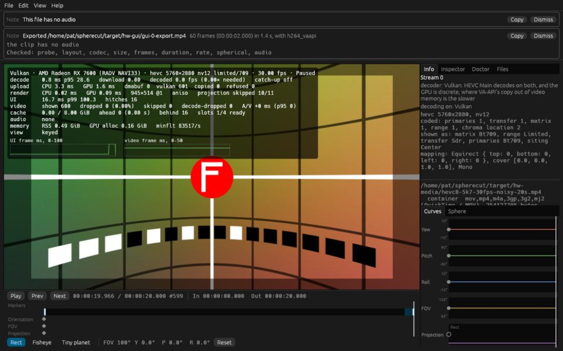
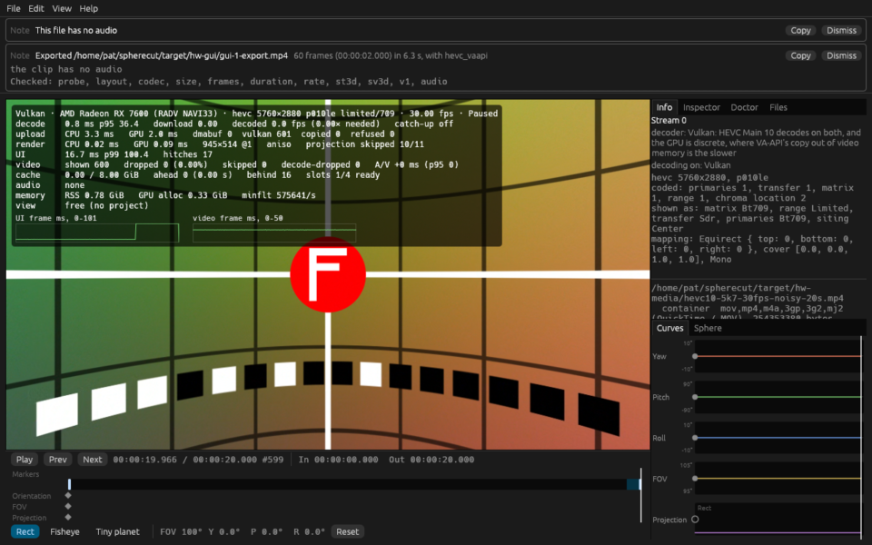
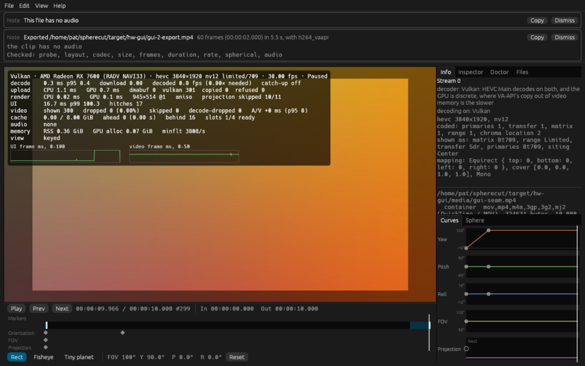
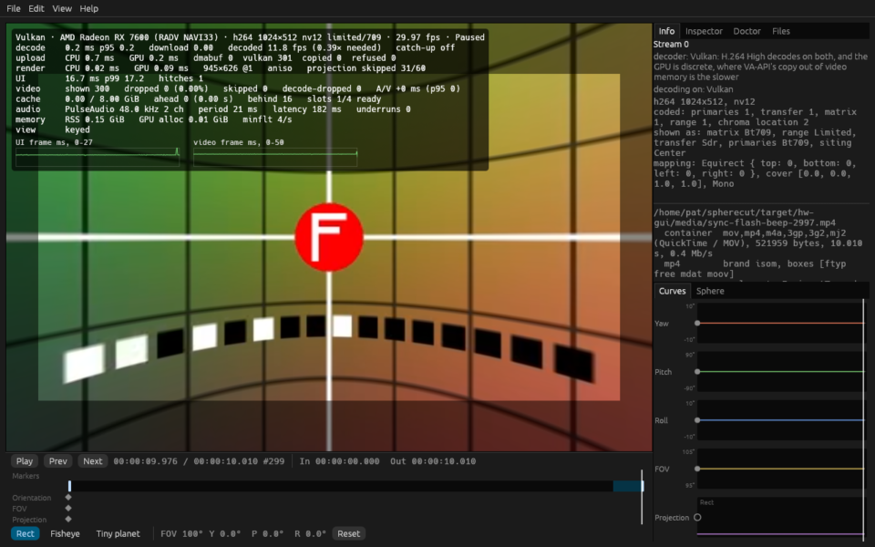
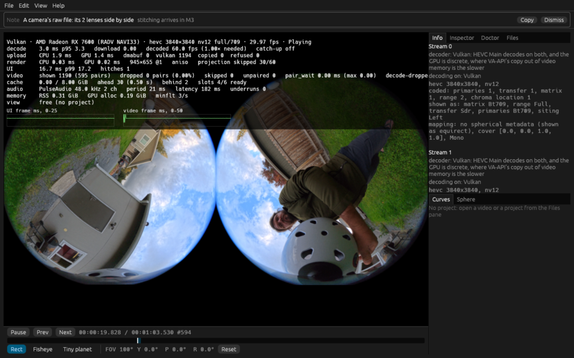

# Hardware report: odin @ 04d15becd4

Generated by `cargo xtask hw-test --only bench_playback_x5_raw --only samples_lens_pairs_frame_locked --only zero_copy_pair_matches_copy --only zero_copy_matches_copy_path --only shared_vulkan_matches_copy_path --only bench_playback_realtime --only bench_x5_8k30_zero_copy_vs_copy --only goldens_on_gpu_match_reference --only yuv_on_gpu_matches_reference --only bench_upload_5k7 --only gui_smoke` in 2897 s.

## Summary

| | |
|---|---|
| Host | odin |
| OS | Fedora Linux 44 (Workstation Edition) |
| Kernel | Linux 7.2.9-200.fc44.x86_64 #1 SMP PREEMPT_DYNAMIC Sat Oct  3 19:59:55 UTC 2026 x86_64 |
| Session | wayland / GNOME |
| GUI display | WAYLAND_DISPLAY set: WAYLAND_DISPLAY=wayland-0 |
| Screen locked at the end | no |
| Audio server | PulseAudio (on PipeWire 1.6.9) |
| GNOME mutter experimental features | @as [] |
| GPU (Vulkan) | AMD Radeon RX 7600 (RADV NAVI33) |
| Mesa | Mesa 26.2.5 |
| FFmpeg | ffmpeg version 8.1.3 Copyright (c) 2000-2026 the FFmpeg developers |
| FFmpeg libs | 62.28.103, 62.12.103, 60.26.103, 9.5.103, 6.3.103 |
| x265 | 4.1+1-1d117be (build 215) (the info SEI of a frame hw-test coded; `pkg-config` has no x265) |
| Rust | rustc 1.99.0 (b940084d7 2026-09-28) |
| VA-API HEVC | decode: yes, encode: yes |
| FFmpeg hwaccels | vdpau, cuda, vaapi, qsv, drm, opencl, vulkan, amf |
| Samples dir | /home/pat/spherecut/samples (present) |

**Tier 2: 13 passed, 0 failed, 0 skipped, 44 left out by `--only`, 0 did not run (57 tests).**

**Tier 1 on this machine: 1575 passed, 2 failed, in 117 test binaries (548 s).**

**This run FAILED:** 2 Tier 1 test(s) failed on this machine.

## Prerequisites

Nothing missing.

## Build

Succeeded (release) in 79 s.

## Power profile

Read once, before the build, and never changed: decode speed moves with these.

| Setting | Value |
|---|---|
| power-profiles-daemon | not available (no `powerprofilesctl`) |
| ACPI platform profile | not available (no /sys/firmware/acpi/platform_profile) |
| CPU frequency driver | amd-pstate-epp |
| CPU governor | performance |
| CPU energy preference | performance |
| card0 (amdgpu) performance level | auto |
| card0 (amdgpu) power profile | not available (unreadable) |

## Render nodes

| Node | PCI slot | Vendor | Device | Driver | Opens |
|---|---|---|---|---|---|
| renderD128 | 0000:0c:00.0 | AMD (0x1002) | 0x7480 | amdgpu | yes |

## Perf clips

synth's noisy grid in HEVC at about a camera's bitrate, made once and kept in `/home/pat/spherecut/target/hw-media` for the playback benchmarks. Software decode over 150 fps would make a clip too easy to say anything about footage. A two-track clip has a row a lens: its bitrate from that lens's samples, its decode that lens's alone, and its coding read back from the file, its IDR interval from `stss` and its pictures by NAL type, in bold where a picture is neither an IDR nor a TRAIL_R, an IDR is off the interval, a place on it has none, or `stss` and the coding disagree.

| Clip | Size | Bitrate | Made | Software decode | Coding |
|---|---:|---:|---|---|---|
| `hevc8-5k7-30fps-noisy-20s.mp4` | 254 MB | 101.7 Mbit/s | cached | not measured |  |
| `hevc10-5k7-30fps-noisy-20s.mp4` | 254 MB | 101.7 Mbit/s | cached | not measured |  |
| `hevc8-8k-30fps-noisy-20s.mp4` | 305 MB | 122.1 Mbit/s | cached | not measured |  |
| `pair-hevc8-3840-2997-noisy-20s.mp4` lens 0 | 163 MB | 65.3 Mbit/s | cached | not measured | IDR every 60; TRAIL_R 590, IDR_N_LP 10 |
| `pair-hevc8-3840-2997-noisy-20s.mp4` lens 1 | 163 MB | 65.3 Mbit/s | cached | not measured | IDR every 60; TRAIL_R 590, IDR_N_LP 10 |
| `pair-hevc8-2880-5994-noisy-10s.mp4` lens 0 | 100 MB | 80.2 Mbit/s | cached | not measured | IDR every 120; TRAIL_R 595, IDR_N_LP 5; P only: the X5 codes TSA_N on every other picture, and every picture here but the IDRs is a reference P frame |
| `pair-hevc8-2880-5994-noisy-10s.mp4` lens 1 | 100 MB | 80.2 Mbit/s | cached | not measured | IDR every 120; TRAIL_R 595, IDR_N_LP 5; P only: the X5 codes TSA_N on every other picture, and every picture here but the IDRs is a reference P frame |
| `pair-hevc8-2880-2997-noisy-20s.mp4` lens 0 | 201 MB | 80.2 Mbit/s | cached | not measured | IDR every 60; TRAIL_R 590, IDR_N_LP 10 |
| `pair-hevc8-2880-2997-noisy-20s.mp4` lens 1 | 201 MB | 80.2 Mbit/s | cached | not measured | IDR every 60; TRAIL_R 590, IDR_N_LP 10 |

## Tier 2 tests

| Test | Result |
|---|---|
| `adapters::list_adapters_and_features` | left out by `--only` |
| `goldens::goldens_on_gpu_match_reference` | pass |
| `goldens::goldens_on_host_llvmpipe` | left out by `--only` |
| `samples_roles::samples_every_present_role_resolves` | left out by `--only` |
| `spherecut-camera/tier2_samples::samples_calib_print_is_identity` | left out by `--only` |
| `spherecut-camera/tier2_samples::samples_insv_trailer_parses` | left out by `--only` |
| `spherecut-media/doctor::doctor_decodes_hevc_main_on_vaapi` | left out by `--only` |
| `spherecut-media/tier2_samples::bench_samples_realtime_decode` | left out by `--only` |
| `spherecut-media/tier2_samples::samples_probe_cleanly` | left out by `--only` |
| `spherecut-media/tier2_samples::samples_vaapi_decode_matches_software` | left out by `--only` |
| `spherecut-media/tier2_samples::samples_vulkan_decode_matches_software` | left out by `--only` |
| `spherecut_synth::lens::tests::bench_render_lens_x5_like_pair` | left out by `--only` |
| `tier2_backend::bench_seek_latency` | left out by `--only` |
| `tier2_backend::vaapi_colorinfo_matches_software` | left out by `--only` |
| `tier2_backend::vaapi_exports_match_downloads` | left out by `--only` |
| `tier2_backend::vaapi_seek_matches_software` | left out by `--only` |
| `tier2_backend::vulkan_colorinfo_matches_software` | left out by `--only` |
| `tier2_backend::vulkan_seek_matches_software` | left out by `--only` |
| `tier2_device::audio_output_device_plays` | left out by `--only` |
| `tier2_download_pool::vaapi_download_pool_reuses_buffers` | left out by `--only` |
| `tier2_download_pool::vulkan_download_pool_reuses_buffers` | left out by `--only` |
| `tier2_export::bench_export_4k30_vaapi` | left out by `--only` |
| `tier2_export::bench_export_vaapi_levels` | left out by `--only` |
| `tier2_export::export_360_8k_vaapi` | left out by `--only` |
| `tier2_export::export_vaapi_matches_software` | left out by `--only` |
| `tier2_frame::doctor_and_the_renderer_agree_on_sharing` | left out by `--only` |
| `tier2_frame::shared_vulkan_frame_matches_the_copy` | left out by `--only` |
| `tier2_frame::vaapi_render_matches_software` | left out by `--only` |
| `tier2_frame::vulkan_render_matches_software` | left out by `--only` |
| `tier2_frame::zero_copy_frame_matches_the_copy` | left out by `--only` |
| `tier2_gui::gui_proto` | left out by `--only` |
| `tier2_gui::gui_smoke` | pass |
| `tier2_hw_decode::bench_decode_hevc_4k_and_5k7` | left out by `--only` |
| `tier2_hw_decode::vaapi_h264_matches_software` | left out by `--only` |
| `tier2_hw_decode::vaapi_hevc_main10_matches_software` | left out by `--only` |
| `tier2_hw_decode::vaapi_hevc_main_matches_software` | left out by `--only` |
| `tier2_hw_decode::vulkan_h264_matches_software` | left out by `--only` |
| `tier2_hw_decode::vulkan_hevc_main10_matches_software` | left out by `--only` |
| `tier2_hw_decode::vulkan_hevc_main_matches_software` | left out by `--only` |
| `tier2_mcp::mcp_render_vaapi` | left out by `--only` |
| `tier2_mcp::mcp_session_decodes_with_vaapi` | left out by `--only` |
| `tier2_pair_decode::bench_export_pair_decode` | left out by `--only` |
| `tier2_playback::bench_perf_clips_software_decode` | left out by `--only` |
| `tier2_playback::bench_playback_realtime_5k7_10bit` | pass |
| `tier2_playback::bench_playback_realtime_5k7_8bit` | pass |
| `tier2_playback::bench_playback_realtime_8k_8bit` | pass |
| `tier2_playback::bench_playback_stitched_samples` | left out by `--only` |
| `tier2_playback::bench_playback_x5_raw` | pass |
| `tier2_playback::bench_x5_8k30_zero_copy_vs_copy` | pass |
| `tier2_playback::samples_lens_pairs_frame_locked` | pass |
| `tier2_playback::shared_vulkan_matches_copy_path` | pass |
| `tier2_playback::zero_copy_matches_copy_path` | pass |
| `tier2_playback::zero_copy_pair_matches_copy` | pass |
| `tier2_probe::samples_probe_names_the_camera` | left out by `--only` |
| `tier2_tracks::samples_x5_tracks_equal` | left out by `--only` |
| `upload::bench_upload_5k7` | pass |
| `yuv::yuv_on_gpu_matches_reference` | pass |

## Benchmarks

Release build. Each benchmark runs once to warm up, then 3 times (`SPHERECUT_BENCH_RUNS`); the result is the median. Spread is the range over the median: over 10% means the machine was busy or changing clocks, so take that result with care. A row marked "per second" is one run's seconds instead: Runs counts the seconds, and the range is the slowest and the fastest.

| Benchmark | Median | Range | Runs | Spread |
|---|---:|---:|---:|---:|
| hevc10-5k7-30fps-noisy-20s, Vulkan (Auto, zero copy): decoded per second, unthrottled | 129.00 fps | 128.00 to 129.00 | 4 | 1% |
| hevc10-5k7-30fps-noisy-20s, Vulkan (Auto, zero copy): decoded per second, real time | 30.00 fps | 12.00 to 46.00 | 60 | 113% **unstable** |
| hevc10-5k7-30fps-noisy-20s, Vulkan (Auto, zero copy): shown per second, real time | 30.00 fps | 22.00 to 31.00 | 60 | 30% **unstable** |
| hevc10-5k7-30fps-noisy-20s, Vulkan (Auto, zero copy): dropped after 1 s | 0.00 frames | | 1 | |
| hevc10-5k7-30fps-noisy-20s, Vulkan (Auto, zero copy): skipped after 1 s | 0.00 frames | | 1 | |
| hevc10-5k7-30fps-noisy-20s, Vulkan (Auto, zero copy): decode-dropped after 1 s | 0.00 frames | | 1 | |
| hevc10-5k7-30fps-noisy-20s, Vulkan (Auto, zero copy): late presents after 1 s | 0.00 presents | | 1 | |
| hevc10-5k7-30fps-noisy-20s, Vulkan (Auto): decoded per second, unthrottled | 17.00 fps | 9.00 to 103.00 | 14 | 553% **unstable** |
| hevc10-5k7-30fps-noisy-20s, Vulkan (Auto): decoded per second, real time | 28.00 fps | 0.00 to 71.00 | 20 | 254% **unstable** |
| hevc10-5k7-30fps-noisy-20s, Vulkan (Auto): shown per second, real time | 30.00 fps | 3.00 to 30.00 | 20 | 90% **unstable** |
| hevc10-5k7-30fps-noisy-20s, Vulkan (Auto): dropped after 1 s | 138.00 frames | | 1 | |
| hevc10-5k7-30fps-noisy-20s, Vulkan (Auto): skipped after 1 s | 0.00 frames | | 1 | |
| hevc10-5k7-30fps-noisy-20s, Vulkan (Auto): decode-dropped after 1 s | 138.00 frames | | 1 | |
| hevc10-5k7-30fps-noisy-20s, Vulkan (Auto): late presents after 1 s | 333.00 presents | | 1 | |
| hevc10-5k7-30fps-noisy-20s, VA-API: decoded per second, unthrottled | 14.00 fps | 12.00 to 17.00 | 20 | 36% **unstable** |
| hevc10-5k7-30fps-noisy-20s, VA-API: decoded per second, real time | 24.00 fps | 21.00 to 28.00 | 20 | 29% **unstable** |
| hevc10-5k7-30fps-noisy-20s, VA-API: shown per second, real time | 6.00 fps | 4.00 to 11.00 | 20 | 117% **unstable** |
| hevc10-5k7-30fps-noisy-20s, VA-API: dropped after 1 s | 460.00 frames | | 1 | |
| hevc10-5k7-30fps-noisy-20s, VA-API: skipped after 1 s | 0.00 frames | | 1 | |
| hevc10-5k7-30fps-noisy-20s, VA-API: decode-dropped after 1 s | 460.00 frames | | 1 | |
| hevc10-5k7-30fps-noisy-20s, VA-API: late presents after 1 s | 1138.00 presents | | 1 | |
| hevc10-5k7-30fps-noisy-20s, software: decoded per second, unthrottled | 31.50 fps | 27.00 to 38.00 | 18 | 35% **unstable** |
| hevc10-5k7-30fps-noisy-20s, software: decoded per second, real time | 30.00 fps | 0.00 to 38.00 | 20 | 127% **unstable** |
| hevc10-5k7-30fps-noisy-20s, software: shown per second, real time | 30.00 fps | 23.00 to 30.00 | 20 | 23% **unstable** |
| hevc10-5k7-30fps-noisy-20s, software: dropped after 1 s | 22.00 frames | | 1 | |
| hevc10-5k7-30fps-noisy-20s, software: skipped after 1 s | 0.00 frames | | 1 | |
| hevc10-5k7-30fps-noisy-20s, software: decode-dropped after 1 s | 14.00 frames | | 1 | |
| hevc10-5k7-30fps-noisy-20s, software: late presents after 1 s | 317.00 presents | | 1 | |
| hevc8-5k7-30fps-noisy-20s, Vulkan (Auto, zero copy): decoded per second, unthrottled | 129.00 fps | 128.00 to 130.00 | 4 | 2% |
| hevc8-5k7-30fps-noisy-20s, Vulkan (Auto, zero copy): decoded per second, real time | 30.00 fps | 12.00 to 46.00 | 60 | 113% **unstable** |
| hevc8-5k7-30fps-noisy-20s, Vulkan (Auto, zero copy): shown per second, real time | 30.00 fps | 20.00 to 31.00 | 60 | 37% **unstable** |
| hevc8-5k7-30fps-noisy-20s, Vulkan (Auto, zero copy): dropped after 1 s | 0.00 frames | | 1 | |
| hevc8-5k7-30fps-noisy-20s, Vulkan (Auto, zero copy): skipped after 1 s | 0.00 frames | | 1 | |
| hevc8-5k7-30fps-noisy-20s, Vulkan (Auto, zero copy): decode-dropped after 1 s | 0.00 frames | | 1 | |
| hevc8-5k7-30fps-noisy-20s, Vulkan (Auto, zero copy): late presents after 1 s | 0.00 presents | | 1 | |
| hevc8-5k7-30fps-noisy-20s, Vulkan (Auto): decoded per second, unthrottled | 45.00 fps | 14.00 to 130.00 | 8 | 258% **unstable** |
| hevc8-5k7-30fps-noisy-20s, Vulkan (Auto): decoded per second, real time | 29.00 fps | 0.00 to 61.00 | 20 | 210% **unstable** |
| hevc8-5k7-30fps-noisy-20s, Vulkan (Auto): shown per second, real time | 30.00 fps | 6.00 to 30.00 | 20 | 80% **unstable** |
| hevc8-5k7-30fps-noisy-20s, Vulkan (Auto): dropped after 1 s | 61.00 frames | | 1 | |
| hevc8-5k7-30fps-noisy-20s, Vulkan (Auto): skipped after 1 s | 0.00 frames | | 1 | |
| hevc8-5k7-30fps-noisy-20s, Vulkan (Auto): decode-dropped after 1 s | 61.00 frames | | 1 | |
| hevc8-5k7-30fps-noisy-20s, Vulkan (Auto): late presents after 1 s | 183.00 presents | | 1 | |
| hevc8-5k7-30fps-noisy-20s, VA-API: decoded per second, unthrottled | 26.00 fps | 23.00 to 35.00 | 20 | 46% **unstable** |
| hevc8-5k7-30fps-noisy-20s, VA-API: decoded per second, real time | 28.00 fps | 25.00 to 36.00 | 20 | 39% **unstable** |
| hevc8-5k7-30fps-noisy-20s, VA-API: shown per second, real time | 21.00 fps | 12.00 to 30.00 | 20 | 86% **unstable** |
| hevc8-5k7-30fps-noisy-20s, VA-API: dropped after 1 s | 171.00 frames | | 1 | |
| hevc8-5k7-30fps-noisy-20s, VA-API: skipped after 1 s | 0.00 frames | | 1 | |
| hevc8-5k7-30fps-noisy-20s, VA-API: decode-dropped after 1 s | 169.00 frames | | 1 | |
| hevc8-5k7-30fps-noisy-20s, VA-API: late presents after 1 s | 1012.00 presents | | 1 | |
| hevc8-5k7-30fps-noisy-20s, software: decoded per second, unthrottled | 45.00 fps | 36.00 to 50.00 | 13 | 31% **unstable** |
| hevc8-5k7-30fps-noisy-20s, software: decoded per second, real time | 30.00 fps | 0.00 to 52.00 | 20 | 173% **unstable** |
| hevc8-5k7-30fps-noisy-20s, software: shown per second, real time | 30.00 fps | 29.00 to 30.00 | 20 | 3% |
| hevc8-5k7-30fps-noisy-20s, software: dropped after 1 s | 0.00 frames | | 1 | |
| hevc8-5k7-30fps-noisy-20s, software: skipped after 1 s | 0.00 frames | | 1 | |
| hevc8-5k7-30fps-noisy-20s, software: decode-dropped after 1 s | 0.00 frames | | 1 | |
| hevc8-5k7-30fps-noisy-20s, software: late presents after 1 s | 0.00 presents | | 1 | |
| hevc8-8k-30fps-noisy-20s, Vulkan (Auto): decoded per second, unthrottled | 62.50 fps | 11.00 to 83.00 | 10 | 115% **unstable** |
| hevc8-8k-30fps-noisy-20s, Vulkan (Auto): decoded per second, real time | 30.00 fps | 0.00 to 61.00 | 20 | 203% **unstable** |
| hevc8-8k-30fps-noisy-20s, Vulkan (Auto): shown per second, real time | 30.00 fps | 3.00 to 30.00 | 20 | 90% **unstable** |
| hevc8-8k-30fps-noisy-20s, Vulkan (Auto): dropped after 1 s | 67.00 frames | | 1 | |
| hevc8-8k-30fps-noisy-20s, Vulkan (Auto): skipped after 1 s | 0.00 frames | | 1 | |
| hevc8-8k-30fps-noisy-20s, Vulkan (Auto): decode-dropped after 1 s | 56.00 frames | | 1 | |
| hevc8-8k-30fps-noisy-20s, Vulkan (Auto): late presents after 1 s | 169.00 presents | | 1 | |
| hevc8-8k-30fps-noisy-20s, VA-API: decoded per second, unthrottled | 12.00 fps | 10.00 to 15.00 | 20 | 42% **unstable** |
| hevc8-8k-30fps-noisy-20s, VA-API: decoded per second, real time | 23.00 fps | 15.00 to 33.00 | 20 | 78% **unstable** |
| hevc8-8k-30fps-noisy-20s, VA-API: shown per second, real time | 5.50 fps | 3.00 to 14.00 | 20 | 200% **unstable** |
| hevc8-8k-30fps-noisy-20s, VA-API: dropped after 1 s | 454.00 frames | | 1 | |
| hevc8-8k-30fps-noisy-20s, VA-API: skipped after 1 s | 0.00 frames | | 1 | |
| hevc8-8k-30fps-noisy-20s, VA-API: decode-dropped after 1 s | 454.00 frames | | 1 | |
| hevc8-8k-30fps-noisy-20s, VA-API: late presents after 1 s | 1138.00 presents | | 1 | |
| hevc8-8k-30fps-noisy-20s, software: decoded per second, unthrottled | 29.00 fps | 21.00 to 33.00 | 20 | 41% **unstable** |
| hevc8-8k-30fps-noisy-20s, software: decoded per second, real time | 30.00 fps | 21.00 to 34.00 | 20 | 43% **unstable** |
| hevc8-8k-30fps-noisy-20s, software: shown per second, real time | 18.00 fps | 8.00 to 31.00 | 20 | 128% **unstable** |
| hevc8-8k-30fps-noisy-20s, software: dropped after 1 s | 207.00 frames | | 1 | |
| hevc8-8k-30fps-noisy-20s, software: skipped after 1 s | 0.00 frames | | 1 | |
| hevc8-8k-30fps-noisy-20s, software: decode-dropped after 1 s | 160.00 frames | | 1 | |
| hevc8-8k-30fps-noisy-20s, software: late presents after 1 s | 722.00 presents | | 1 | |
| X5 raw 2× 1920x1920 at 119.88 fps, Vulkan (Auto): decoded per second, unthrottled | 236.25 fps | 233.50 to 239.00 | 2 | 2% |
| X5 raw 2× 1920x1920 at 119.88 fps, Vulkan (Auto): decoded per second, real time | 0.00 fps | 0.00 to 237.00 | 20 | n/a |
| X5 raw 2× 1920x1920 at 119.88 fps, Vulkan (Auto): shown per second, real time | 60.00 fps | 60.00 to 60.00 | 20 | 0% |
| X5 raw 2× 1920x1920 at 119.88 fps, Vulkan (Auto): dropped after 1 s | 0.00 frames | | 1 | |
| X5 raw 2× 1920x1920 at 119.88 fps, Vulkan (Auto): skipped after 1 s | 2248.00 frames | | 1 | |
| X5 raw 2× 1920x1920 at 119.88 fps, Vulkan (Auto): decode-dropped after 1 s | 0.00 frames | | 1 | |
| X5 raw 2× 1920x1920 at 119.88 fps, Vulkan (Auto): late presents after 1 s | 1128.00 presents | | 1 | |
| X5 raw 2× 1920x1920 at 119.88 fps, Vulkan (Auto): unpaired presents | 4711.00 presents | | 1 | |
| X5 raw 2× 1920x1920 at 119.88 fps, Vulkan (Auto): lens 0 decoded since the open, real time | 586.00 frames | | 1 | |
| X5 raw 2× 1920x1920 at 119.88 fps, Vulkan (Auto): lens 1 decoded since the open, real time | 586.00 frames | | 1 | |
| X5 raw 2× 1920x1920 at 119.88 fps, Vulkan (Auto): slots | 4.00 slots | | 1 | |
| X5 raw 2× 1920x1920 at 119.88 fps, Vulkan (Auto): presented after 1 s | 100.35 % | | 1 | |
| X5 raw 2× 1920x1920 at 119.88 fps, Vulkan (Auto): dropped a lens after 1 s | 0.00 % | | 1 | |
| X5 raw 2× 1920x1920 at 119.88 fps, Vulkan (Auto): skipped a lens after 1 s | 98.94 % | | 1 | |
| X5 raw 2× 1920x1920 at 119.88 fps, Vulkan (Auto): MemAvailable as the real-time pass began | 35213.41 MiB | | 1 | |
| X5 raw 2× 1920x1920 at 119.88 fps, Vulkan (Auto, zero copy): decoded per second, unthrottled | 277.75 fps | 276.50 to 279.00 | 2 | 1% |
| X5 raw 2× 1920x1920 at 119.88 fps, Vulkan (Auto, zero copy): decoded per second, real time | 120.00 fps | 112.00 to 136.00 | 20 | 20% **unstable** |
| X5 raw 2× 1920x1920 at 119.88 fps, Vulkan (Auto, zero copy): shown per second, real time | 60.00 fps | 60.00 to 60.00 | 20 | 0% |
| X5 raw 2× 1920x1920 at 119.88 fps, Vulkan (Auto, zero copy): dropped after 1 s | 0.00 frames | | 1 | |
| X5 raw 2× 1920x1920 at 119.88 fps, Vulkan (Auto, zero copy): skipped after 1 s | 2248.00 frames | | 1 | |
| X5 raw 2× 1920x1920 at 119.88 fps, Vulkan (Auto, zero copy): decode-dropped after 1 s | 0.00 frames | | 1 | |
| X5 raw 2× 1920x1920 at 119.88 fps, Vulkan (Auto, zero copy): late presents after 1 s | 1128.00 presents | | 1 | |
| X5 raw 2× 1920x1920 at 119.88 fps, Vulkan (Auto, zero copy): unpaired presents | 2920.00 presents | | 1 | |
| X5 raw 2× 1920x1920 at 119.88 fps, Vulkan (Auto, zero copy): lens 0 decoded since the open, real time | 2402.00 frames | | 1 | |
| X5 raw 2× 1920x1920 at 119.88 fps, Vulkan (Auto, zero copy): lens 1 decoded since the open, real time | 2402.00 frames | | 1 | |
| X5 raw 2× 1920x1920 at 119.88 fps, Vulkan (Auto, zero copy): path B pool, lens 0, real time | 84.38 MiB | | 1 | |
| X5 raw 2× 1920x1920 at 119.88 fps, Vulkan (Auto, zero copy): path B pool, lens 1, real time | 89.65 MiB | | 1 | |
| X5 raw 2× 1920x1920 at 119.88 fps, Vulkan (Auto, zero copy): slots | 4.00 slots | | 1 | |
| X5 raw 2× 1920x1920 at 119.88 fps, Vulkan (Auto, zero copy): presented after 1 s | 100.35 % | | 1 | |
| X5 raw 2× 1920x1920 at 119.88 fps, Vulkan (Auto, zero copy): dropped a lens after 1 s | 0.00 % | | 1 | |
| X5 raw 2× 1920x1920 at 119.88 fps, Vulkan (Auto, zero copy): skipped a lens after 1 s | 98.94 % | | 1 | |
| X5 raw 2× 1920x1920 at 119.88 fps, Vulkan (Auto, zero copy): MemAvailable as the real-time pass began | 35171.09 MiB | | 1 | |
| X5 raw 2× 1920x1920 at 119.88 fps, Vulkan (Auto, zero copy), locked: decoded per second, unthrottled | 276.50 fps | 276.00 to 277.00 | 2 | 0% |
| X5 raw 2× 1920x1920 at 119.88 fps, Vulkan (Auto, zero copy), locked: decoded per second, real time | 120.00 fps | 111.50 to 136.00 | 20 | 20% **unstable** |
| X5 raw 2× 1920x1920 at 119.88 fps, Vulkan (Auto, zero copy), locked: shown per second, real time | 60.00 fps | 58.00 to 60.00 | 20 | 3% |
| X5 raw 2× 1920x1920 at 119.88 fps, Vulkan (Auto, zero copy), locked: dropped after 1 s | 0.00 frames | | 1 | |
| X5 raw 2× 1920x1920 at 119.88 fps, Vulkan (Auto, zero copy), locked: skipped after 1 s | 1124.00 frames | | 1 | |
| X5 raw 2× 1920x1920 at 119.88 fps, Vulkan (Auto, zero copy), locked: decode-dropped after 1 s | 0.00 frames | | 1 | |
| X5 raw 2× 1920x1920 at 119.88 fps, Vulkan (Auto, zero copy), locked: late presents after 1 s | 232.00 presents | | 1 | |
| X5 raw 2× 1920x1920 at 119.88 fps, Vulkan (Auto, zero copy), locked: unpaired presents | 0.00 presents | | 1 | |
| X5 raw 2× 1920x1920 at 119.88 fps, Vulkan (Auto, zero copy), locked: lens 0 decoded since the open, real time | 2394.00 frames | | 1 | |
| X5 raw 2× 1920x1920 at 119.88 fps, Vulkan (Auto, zero copy), locked: lens 1 decoded since the open, real time | 2394.00 frames | | 1 | |
| X5 raw 2× 1920x1920 at 119.88 fps, Vulkan (Auto, zero copy), locked: path B pool, lens 0, real time | 94.92 MiB | | 1 | |
| X5 raw 2× 1920x1920 at 119.88 fps, Vulkan (Auto, zero copy), locked: path B pool, lens 1, real time | 94.92 MiB | | 1 | |
| X5 raw 2× 1920x1920 at 119.88 fps, Vulkan (Auto, zero copy), locked: slots | 6.00 slots | | 1 | |
| X5 raw 2× 1920x1920 at 119.88 fps, Vulkan (Auto, zero copy), locked: presented after 1 s | 100.09 % | | 1 | |
| X5 raw 2× 1920x1920 at 119.88 fps, Vulkan (Auto, zero copy), locked: dropped a lens after 1 s | 0.00 % | | 1 | |
| X5 raw 2× 1920x1920 at 119.88 fps, Vulkan (Auto, zero copy), locked: skipped a lens after 1 s | 99.29 % | | 1 | |
| X5 raw 2× 1920x1920 at 119.88 fps, Vulkan (Auto, zero copy), locked: MemAvailable as the real-time pass began | 35267.29 MiB | | 1 | |
| X5 raw 2× 1920x1920 at 119.88 fps, Vulkan (Auto, zero copy), locked: pair resyncs | 0.00 resyncs | | 1 | |
| X5 raw 2× 1920x1920 at 119.88 fps, Vulkan (Auto, zero copy), locked: pairs presented, real time | 1193.00 pairs | | 1 | |
| X5 raw 2× 1920x1920 at 119.88 fps, Vulkan (Auto, zero copy), locked: pair_wait p50, real time | 0.00 ms | | 1 | |
| X5 raw 2× 1920x1920 at 119.88 fps, Vulkan (Auto, zero copy), locked: pair_wait p95, real time | 7.14 ms | | 1 | |
| X5 raw 2× 1920x1920 at 119.88 fps, VA-API: decoded per second, unthrottled | 84.00 fps | 79.50 to 85.00 | 7 | 7% |
| X5 raw 2× 1920x1920 at 119.88 fps, VA-API: decoded per second, real time | 109.50 fps | 0.00 to 119.00 | 20 | 109% **unstable** |
| X5 raw 2× 1920x1920 at 119.88 fps, VA-API: shown per second, real time | 60.00 fps | 40.00 to 60.00 | 20 | 33% **unstable** |
| X5 raw 2× 1920x1920 at 119.88 fps, VA-API: dropped after 1 s | 586.00 frames | | 1 | |
| X5 raw 2× 1920x1920 at 119.88 fps, VA-API: skipped after 1 s | 1854.00 frames | | 1 | |
| X5 raw 2× 1920x1920 at 119.88 fps, VA-API: decode-dropped after 1 s | 386.00 frames | | 1 | |
| X5 raw 2× 1920x1920 at 119.88 fps, VA-API: late presents after 1 s | 1128.00 presents | | 1 | |
| X5 raw 2× 1920x1920 at 119.88 fps, VA-API: unpaired presents | 19097.00 presents | | 1 | |
| X5 raw 2× 1920x1920 at 119.88 fps, VA-API: lens 0 decoded since the open, real time | 1472.00 frames | | 1 | |
| X5 raw 2× 1920x1920 at 119.88 fps, VA-API: lens 1 decoded since the open, real time | 1464.00 frames | | 1 | |
| X5 raw 2× 1920x1920 at 119.88 fps, VA-API: slots | 4.00 slots | | 1 | |
| X5 raw 2× 1920x1920 at 119.88 fps, VA-API: presented after 1 s | 92.08 % | | 1 | |
| X5 raw 2× 1920x1920 at 119.88 fps, VA-API: dropped a lens after 1 s | 25.79 % | | 1 | |
| X5 raw 2× 1920x1920 at 119.88 fps, VA-API: skipped a lens after 1 s | 81.60 % | | 1 | |
| X5 raw 2× 1920x1920 at 119.88 fps, VA-API: MemAvailable as the real-time pass began | 33962.32 MiB | | 1 | |
| X5 raw 2× 1920x1920 at 119.88 fps, software: decoded per second, unthrottled | 83.50 fps | 62.50 to 91.50 | 7 | 35% **unstable** |
| X5 raw 2× 1920x1920 at 119.88 fps, software: decoded per second, real time | 61.25 fps | 0.00 to 99.00 | 20 | 162% **unstable** |
| X5 raw 2× 1920x1920 at 119.88 fps, software: shown per second, real time | 4.00 fps | 0.00 to 10.00 | 20 | 250% **unstable** |
| X5 raw 2× 1920x1920 at 119.88 fps, software: dropped after 1 s | 2716.00 frames | | 1 | |
| X5 raw 2× 1920x1920 at 119.88 fps, software: skipped after 1 s | 155.00 frames | | 1 | |
| X5 raw 2× 1920x1920 at 119.88 fps, software: decode-dropped after 1 s | 2758.00 frames | | 1 | |
| X5 raw 2× 1920x1920 at 119.88 fps, software: late presents after 1 s | 1126.00 presents | | 1 | |
| X5 raw 2× 1920x1920 at 119.88 fps, software: unpaired presents | 19357.00 presents | | 1 | |
| X5 raw 2× 1920x1920 at 119.88 fps, software: lens 0 decoded since the open, real time | 1081.00 frames | | 1 | |
| X5 raw 2× 1920x1920 at 119.88 fps, software: lens 1 decoded since the open, real time | 1218.00 frames | | 1 | |
| X5 raw 2× 1920x1920 at 119.88 fps, software: slots | 4.00 slots | | 1 | |
| X5 raw 2× 1920x1920 at 119.88 fps, software: presented after 1 s | 6.70 % | | 1 | |
| X5 raw 2× 1920x1920 at 119.88 fps, software: dropped a lens after 1 s | 119.75 % | | 1 | |
| X5 raw 2× 1920x1920 at 119.88 fps, software: skipped a lens after 1 s | 6.83 % | | 1 | |
| X5 raw 2× 1920x1920 at 119.88 fps, software: MemAvailable as the real-time pass began | 32762.97 MiB | | 1 | |
| X5 raw 2× 2880x2880 at 59.94 fps, Vulkan (Auto): decoded per second, unthrottled | 132.00 fps | | 1 | |
| X5 raw 2× 2880x2880 at 59.94 fps, Vulkan (Auto): decoded per second, real time | 0.00 fps | 0.00 to 118.00 | 20 | n/a |
| X5 raw 2× 2880x2880 at 59.94 fps, Vulkan (Auto): shown per second, real time | 60.00 fps | 58.00 to 60.00 | 20 | 3% |
| X5 raw 2× 2880x2880 at 59.94 fps, Vulkan (Auto): dropped after 1 s | 0.00 frames | | 1 | |
| X5 raw 2× 2880x2880 at 59.94 fps, Vulkan (Auto): skipped after 1 s | 0.00 frames | | 1 | |
| X5 raw 2× 2880x2880 at 59.94 fps, Vulkan (Auto): decode-dropped after 1 s | 0.00 frames | | 1 | |
| X5 raw 2× 2880x2880 at 59.94 fps, Vulkan (Auto): late presents after 1 s | 0.00 presents | | 1 | |
| X5 raw 2× 2880x2880 at 59.94 fps, Vulkan (Auto): unpaired presents | 2212.00 presents | | 1 | |
| X5 raw 2× 2880x2880 at 59.94 fps, Vulkan (Auto): lens 0 decoded since the open, real time | 190.00 frames | | 1 | |
| X5 raw 2× 2880x2880 at 59.94 fps, Vulkan (Auto): lens 1 decoded since the open, real time | 190.00 frames | | 1 | |
| X5 raw 2× 2880x2880 at 59.94 fps, Vulkan (Auto): slots | 4.00 slots | | 1 | |
| X5 raw 2× 2880x2880 at 59.94 fps, Vulkan (Auto): presented after 1 s | 100.00 % | | 1 | |
| X5 raw 2× 2880x2880 at 59.94 fps, Vulkan (Auto): dropped a lens after 1 s | 0.00 % | | 1 | |
| X5 raw 2× 2880x2880 at 59.94 fps, Vulkan (Auto): skipped a lens after 1 s | 0.00 % | | 1 | |
| X5 raw 2× 2880x2880 at 59.94 fps, Vulkan (Auto): MemAvailable as the real-time pass began | 33457.80 MiB | | 1 | |
| X5 raw 2× 2880x2880 at 59.94 fps, Vulkan (Auto, zero copy): decoded per second, unthrottled | 142.50 fps | | 1 | |
| X5 raw 2× 2880x2880 at 59.94 fps, Vulkan (Auto, zero copy): decoded per second, real time | 60.00 fps | 44.00 to 75.50 | 20 | 52% **unstable** |
| X5 raw 2× 2880x2880 at 59.94 fps, Vulkan (Auto, zero copy): shown per second, real time | 60.00 fps | 56.00 to 60.00 | 20 | 7% |
| X5 raw 2× 2880x2880 at 59.94 fps, Vulkan (Auto, zero copy): dropped after 1 s | 0.00 frames | | 1 | |
| X5 raw 2× 2880x2880 at 59.94 fps, Vulkan (Auto, zero copy): skipped after 1 s | 0.00 frames | | 1 | |
| X5 raw 2× 2880x2880 at 59.94 fps, Vulkan (Auto, zero copy): decode-dropped after 1 s | 0.00 frames | | 1 | |
| X5 raw 2× 2880x2880 at 59.94 fps, Vulkan (Auto, zero copy): late presents after 1 s | 184.00 presents | | 1 | |
| X5 raw 2× 2880x2880 at 59.94 fps, Vulkan (Auto, zero copy): unpaired presents | 1922.00 presents | | 1 | |
| X5 raw 2× 2880x2880 at 59.94 fps, Vulkan (Auto, zero copy): lens 0 decoded since the open, real time | 1200.00 frames | | 1 | |
| X5 raw 2× 2880x2880 at 59.94 fps, Vulkan (Auto, zero copy): lens 1 decoded since the open, real time | 1200.00 frames | | 1 | |
| X5 raw 2× 2880x2880 at 59.94 fps, Vulkan (Auto, zero copy): path B pool, lens 0, real time | 213.57 MiB | | 1 | |
| X5 raw 2× 2880x2880 at 59.94 fps, Vulkan (Auto, zero copy): path B pool, lens 1, real time | 213.57 MiB | | 1 | |
| X5 raw 2× 2880x2880 at 59.94 fps, Vulkan (Auto, zero copy): slots | 4.00 slots | | 1 | |
| X5 raw 2× 2880x2880 at 59.94 fps, Vulkan (Auto, zero copy): presented after 1 s | 100.00 % | | 1 | |
| X5 raw 2× 2880x2880 at 59.94 fps, Vulkan (Auto, zero copy): dropped a lens after 1 s | 0.00 % | | 1 | |
| X5 raw 2× 2880x2880 at 59.94 fps, Vulkan (Auto, zero copy): skipped a lens after 1 s | 0.00 % | | 1 | |
| X5 raw 2× 2880x2880 at 59.94 fps, Vulkan (Auto, zero copy): MemAvailable as the real-time pass began | 33760.06 MiB | | 1 | |
| X5 raw 2× 2880x2880 at 59.94 fps, Vulkan (Auto, zero copy), locked: decoded per second, unthrottled | 142.50 fps | | 1 | |
| X5 raw 2× 2880x2880 at 59.94 fps, Vulkan (Auto, zero copy), locked: decoded per second, real time | 60.00 fps | 48.00 to 75.50 | 20 | 46% **unstable** |
| X5 raw 2× 2880x2880 at 59.94 fps, Vulkan (Auto, zero copy), locked: shown per second, real time | 60.00 fps | 56.00 to 60.00 | 20 | 7% |
| X5 raw 2× 2880x2880 at 59.94 fps, Vulkan (Auto, zero copy), locked: dropped after 1 s | 0.00 frames | | 1 | |
| X5 raw 2× 2880x2880 at 59.94 fps, Vulkan (Auto, zero copy), locked: skipped after 1 s | 0.00 frames | | 1 | |
| X5 raw 2× 2880x2880 at 59.94 fps, Vulkan (Auto, zero copy), locked: decode-dropped after 1 s | 0.00 frames | | 1 | |
| X5 raw 2× 2880x2880 at 59.94 fps, Vulkan (Auto, zero copy), locked: late presents after 1 s | 0.00 presents | | 1 | |
| X5 raw 2× 2880x2880 at 59.94 fps, Vulkan (Auto, zero copy), locked: unpaired presents | 0.00 presents | | 1 | |
| X5 raw 2× 2880x2880 at 59.94 fps, Vulkan (Auto, zero copy), locked: lens 0 decoded since the open, real time | 1194.00 frames | | 1 | |
| X5 raw 2× 2880x2880 at 59.94 fps, Vulkan (Auto, zero copy), locked: lens 1 decoded since the open, real time | 1194.00 frames | | 1 | |
| X5 raw 2× 2880x2880 at 59.94 fps, Vulkan (Auto, zero copy), locked: path B pool, lens 0, real time | 213.57 MiB | | 1 | |
| X5 raw 2× 2880x2880 at 59.94 fps, Vulkan (Auto, zero copy), locked: path B pool, lens 1, real time | 213.57 MiB | | 1 | |
| X5 raw 2× 2880x2880 at 59.94 fps, Vulkan (Auto, zero copy), locked: slots | 6.00 slots | | 1 | |
| X5 raw 2× 2880x2880 at 59.94 fps, Vulkan (Auto, zero copy), locked: presented after 1 s | 100.00 % | | 1 | |
| X5 raw 2× 2880x2880 at 59.94 fps, Vulkan (Auto, zero copy), locked: dropped a lens after 1 s | 0.00 % | | 1 | |
| X5 raw 2× 2880x2880 at 59.94 fps, Vulkan (Auto, zero copy), locked: skipped a lens after 1 s | 0.00 % | | 1 | |
| X5 raw 2× 2880x2880 at 59.94 fps, Vulkan (Auto, zero copy), locked: MemAvailable as the real-time pass began | 33733.86 MiB | | 1 | |
| X5 raw 2× 2880x2880 at 59.94 fps, Vulkan (Auto, zero copy), locked: pair resyncs | 0.00 resyncs | | 1 | |
| X5 raw 2× 2880x2880 at 59.94 fps, Vulkan (Auto, zero copy), locked: pairs presented, real time | 1176.00 pairs | | 1 | |
| X5 raw 2× 2880x2880 at 59.94 fps, Vulkan (Auto, zero copy), locked: pair_wait p50, real time | 0.00 ms | | 1 | |
| X5 raw 2× 2880x2880 at 59.94 fps, Vulkan (Auto, zero copy), locked: pair_wait p95, real time | 0.00 ms | | 1 | |
| X5 raw 2× 2880x2880 at 59.94 fps, VA-API: decoded per second, unthrottled | 60.00 fps | 56.50 to 60.00 | 3 | 6% |
| X5 raw 2× 2880x2880 at 59.94 fps, VA-API: decoded per second, real time | 0.00 fps | 0.00 to 60.00 | 20 | n/a |
| X5 raw 2× 2880x2880 at 59.94 fps, VA-API: shown per second, real time | 60.00 fps | 58.00 to 60.00 | 20 | 3% |
| X5 raw 2× 2880x2880 at 59.94 fps, VA-API: dropped after 1 s | 0.00 frames | | 1 | |
| X5 raw 2× 2880x2880 at 59.94 fps, VA-API: skipped after 1 s | 0.00 frames | | 1 | |
| X5 raw 2× 2880x2880 at 59.94 fps, VA-API: decode-dropped after 1 s | 0.00 frames | | 1 | |
| X5 raw 2× 2880x2880 at 59.94 fps, VA-API: late presents after 1 s | 28.00 presents | | 1 | |
| X5 raw 2× 2880x2880 at 59.94 fps, VA-API: unpaired presents | 4415.00 presents | | 1 | |
| X5 raw 2× 2880x2880 at 59.94 fps, VA-API: lens 0 decoded since the open, real time | 190.00 frames | | 1 | |
| X5 raw 2× 2880x2880 at 59.94 fps, VA-API: lens 1 decoded since the open, real time | 190.00 frames | | 1 | |
| X5 raw 2× 2880x2880 at 59.94 fps, VA-API: slots | 4.00 slots | | 1 | |
| X5 raw 2× 2880x2880 at 59.94 fps, VA-API: presented after 1 s | 100.00 % | | 1 | |
| X5 raw 2× 2880x2880 at 59.94 fps, VA-API: dropped a lens after 1 s | 0.00 % | | 1 | |
| X5 raw 2× 2880x2880 at 59.94 fps, VA-API: skipped a lens after 1 s | 0.00 % | | 1 | |
| X5 raw 2× 2880x2880 at 59.94 fps, VA-API: MemAvailable as the real-time pass began | 32657.45 MiB | | 1 | |
| X5 raw 2× 2880x2880 at 59.94 fps, software: decoded per second, unthrottled | 37.00 fps | 35.50 to 47.50 | 4 | 32% **unstable** |
| X5 raw 2× 2880x2880 at 59.94 fps, software: decoded per second, real time | 24.25 fps | 0.00 to 46.50 | 20 | 192% **unstable** |
| X5 raw 2× 2880x2880 at 59.94 fps, software: shown per second, real time | 2.50 fps | 0.00 to 12.00 | 20 | 480% **unstable** |
| X5 raw 2× 2880x2880 at 59.94 fps, software: dropped after 1 s | 1243.00 frames | | 1 | |
| X5 raw 2× 2880x2880 at 59.94 fps, software: skipped after 1 s | 0.00 frames | | 1 | |
| X5 raw 2× 2880x2880 at 59.94 fps, software: decode-dropped after 1 s | 831.00 frames | | 1 | |
| X5 raw 2× 2880x2880 at 59.94 fps, software: late presents after 1 s | 1089.00 presents | | 1 | |
| X5 raw 2× 2880x2880 at 59.94 fps, software: unpaired presents | 12806.00 presents | | 1 | |
| X5 raw 2× 2880x2880 at 59.94 fps, software: lens 0 decoded since the open, real time | 430.00 frames | | 1 | |
| X5 raw 2× 2880x2880 at 59.94 fps, software: lens 1 decoded since the open, real time | 558.00 frames | | 1 | |
| X5 raw 2× 2880x2880 at 59.94 fps, software: slots | 4.00 slots | | 1 | |
| X5 raw 2× 2880x2880 at 59.94 fps, software: presented after 1 s | 6.97 % | | 1 | |
| X5 raw 2× 2880x2880 at 59.94 fps, software: dropped a lens after 1 s | 55.54 % | | 1 | |
| X5 raw 2× 2880x2880 at 59.94 fps, software: skipped a lens after 1 s | 0.00 % | | 1 | |
| X5 raw 2× 2880x2880 at 59.94 fps, software: MemAvailable as the real-time pass began | 32692.35 MiB | | 1 | |
| X5 raw 2× 3840x3840 at 25.00 fps, Vulkan (Auto): decoded per second, unthrottled | 71.50 fps | | 1 | |
| X5 raw 2× 3840x3840 at 25.00 fps, Vulkan (Auto): decoded per second, real time | 0.00 fps | 0.00 to 49.50 | 20 | n/a |
| X5 raw 2× 3840x3840 at 25.00 fps, Vulkan (Auto): shown per second, real time | 25.00 fps | 24.00 to 25.00 | 20 | 4% |
| X5 raw 2× 3840x3840 at 25.00 fps, Vulkan (Auto): dropped after 1 s | 0.00 frames | | 1 | |
| X5 raw 2× 3840x3840 at 25.00 fps, Vulkan (Auto): skipped after 1 s | 0.00 frames | | 1 | |
| X5 raw 2× 3840x3840 at 25.00 fps, Vulkan (Auto): decode-dropped after 1 s | 0.00 frames | | 1 | |
| X5 raw 2× 3840x3840 at 25.00 fps, Vulkan (Auto): late presents after 1 s | 0.00 presents | | 1 | |
| X5 raw 2× 3840x3840 at 25.00 fps, Vulkan (Auto): unpaired presents | 2161.00 presents | | 1 | |
| X5 raw 2× 3840x3840 at 25.00 fps, Vulkan (Auto): lens 0 decoded since the open, real time | 116.00 frames | | 1 | |
| X5 raw 2× 3840x3840 at 25.00 fps, Vulkan (Auto): lens 1 decoded since the open, real time | 116.00 frames | | 1 | |
| X5 raw 2× 3840x3840 at 25.00 fps, Vulkan (Auto): slots | 4.00 slots | | 1 | |
| X5 raw 2× 3840x3840 at 25.00 fps, Vulkan (Auto): presented after 1 s | 100.00 % | | 1 | |
| X5 raw 2× 3840x3840 at 25.00 fps, Vulkan (Auto): dropped a lens after 1 s | 0.00 % | | 1 | |
| X5 raw 2× 3840x3840 at 25.00 fps, Vulkan (Auto): skipped a lens after 1 s | 0.00 % | | 1 | |
| X5 raw 2× 3840x3840 at 25.00 fps, Vulkan (Auto): MemAvailable as the real-time pass began | 33314.17 MiB | | 1 | |
| X5 raw 2× 3840x3840 at 25.00 fps, Vulkan (Auto, zero copy): decoded per second, unthrottled | 78.00 fps | | 1 | |
| X5 raw 2× 3840x3840 at 25.00 fps, Vulkan (Auto, zero copy): decoded per second, real time | 25.00 fps | 6.50 to 42.50 | 20 | 144% **unstable** |
| X5 raw 2× 3840x3840 at 25.00 fps, Vulkan (Auto, zero copy): shown per second, real time | 25.00 fps | 9.00 to 26.00 | 20 | 68% **unstable** |
| X5 raw 2× 3840x3840 at 25.00 fps, Vulkan (Auto, zero copy): dropped after 1 s | 19.00 frames | | 1 | |
| X5 raw 2× 3840x3840 at 25.00 fps, Vulkan (Auto, zero copy): skipped after 1 s | 0.00 frames | | 1 | |
| X5 raw 2× 3840x3840 at 25.00 fps, Vulkan (Auto, zero copy): decode-dropped after 1 s | 19.00 frames | | 1 | |
| X5 raw 2× 3840x3840 at 25.00 fps, Vulkan (Auto, zero copy): late presents after 1 s | 79.00 presents | | 1 | |
| X5 raw 2× 3840x3840 at 25.00 fps, Vulkan (Auto, zero copy): unpaired presents | 2258.00 presents | | 1 | |
| X5 raw 2× 3840x3840 at 25.00 fps, Vulkan (Auto, zero copy): lens 0 decoded since the open, real time | 477.00 frames | | 1 | |
| X5 raw 2× 3840x3840 at 25.00 fps, Vulkan (Auto, zero copy): lens 1 decoded since the open, real time | 477.00 frames | | 1 | |
| X5 raw 2× 3840x3840 at 25.00 fps, Vulkan (Auto, zero copy): path B pool, lens 0, real time | 400.78 MiB | | 1 | |
| X5 raw 2× 3840x3840 at 25.00 fps, Vulkan (Auto, zero copy): path B pool, lens 1, real time | 400.78 MiB | | 1 | |
| X5 raw 2× 3840x3840 at 25.00 fps, Vulkan (Auto, zero copy): slots | 4.00 slots | | 1 | |
| X5 raw 2× 3840x3840 at 25.00 fps, Vulkan (Auto, zero copy): presented after 1 s | 96.93 % | | 1 | |
| X5 raw 2× 3840x3840 at 25.00 fps, Vulkan (Auto, zero copy): dropped a lens after 1 s | 2.08 % | | 1 | |
| X5 raw 2× 3840x3840 at 25.00 fps, Vulkan (Auto, zero copy): skipped a lens after 1 s | 0.00 % | | 1 | |
| X5 raw 2× 3840x3840 at 25.00 fps, Vulkan (Auto, zero copy): MemAvailable as the real-time pass began | 33557.61 MiB | | 1 | |
| X5 raw 2× 3840x3840 at 25.00 fps, Vulkan (Auto, zero copy), locked: decoded per second, unthrottled | 78.00 fps | | 1 | |
| X5 raw 2× 3840x3840 at 25.00 fps, Vulkan (Auto, zero copy), locked: decoded per second, real time | 25.00 fps | 6.00 to 41.00 | 20 | 140% **unstable** |
| X5 raw 2× 3840x3840 at 25.00 fps, Vulkan (Auto, zero copy), locked: shown per second, real time | 25.00 fps | 15.00 to 25.00 | 20 | 40% **unstable** |
| X5 raw 2× 3840x3840 at 25.00 fps, Vulkan (Auto, zero copy), locked: dropped after 1 s | 1.00 frames | | 1 | |
| X5 raw 2× 3840x3840 at 25.00 fps, Vulkan (Auto, zero copy), locked: skipped after 1 s | 0.00 frames | | 1 | |
| X5 raw 2× 3840x3840 at 25.00 fps, Vulkan (Auto, zero copy), locked: decode-dropped after 1 s | 0.00 frames | | 1 | |
| X5 raw 2× 3840x3840 at 25.00 fps, Vulkan (Auto, zero copy), locked: late presents after 1 s | 26.00 presents | | 1 | |
| X5 raw 2× 3840x3840 at 25.00 fps, Vulkan (Auto, zero copy), locked: unpaired presents | 0.00 presents | | 1 | |
| X5 raw 2× 3840x3840 at 25.00 fps, Vulkan (Auto, zero copy), locked: lens 0 decoded since the open, real time | 488.00 frames | | 1 | |
| X5 raw 2× 3840x3840 at 25.00 fps, Vulkan (Auto, zero copy), locked: lens 1 decoded since the open, real time | 489.00 frames | | 1 | |
| X5 raw 2× 3840x3840 at 25.00 fps, Vulkan (Auto, zero copy), locked: path B pool, lens 0, real time | 379.69 MiB | | 1 | |
| X5 raw 2× 3840x3840 at 25.00 fps, Vulkan (Auto, zero copy), locked: path B pool, lens 1, real time | 379.69 MiB | | 1 | |
| X5 raw 2× 3840x3840 at 25.00 fps, Vulkan (Auto, zero copy), locked: slots | 6.00 slots | | 1 | |
| X5 raw 2× 3840x3840 at 25.00 fps, Vulkan (Auto, zero copy), locked: presented after 1 s | 99.78 % | | 1 | |
| X5 raw 2× 3840x3840 at 25.00 fps, Vulkan (Auto, zero copy), locked: dropped a lens after 1 s | 0.22 % | | 1 | |
| X5 raw 2× 3840x3840 at 25.00 fps, Vulkan (Auto, zero copy), locked: skipped a lens after 1 s | 0.00 % | | 1 | |
| X5 raw 2× 3840x3840 at 25.00 fps, Vulkan (Auto, zero copy), locked: MemAvailable as the real-time pass began | 33504.20 MiB | | 1 | |
| X5 raw 2× 3840x3840 at 25.00 fps, Vulkan (Auto, zero copy), locked: pair resyncs | 0.00 resyncs | | 1 | |
| X5 raw 2× 3840x3840 at 25.00 fps, Vulkan (Auto, zero copy), locked: pairs presented, real time | 472.00 pairs | | 1 | |
| X5 raw 2× 3840x3840 at 25.00 fps, Vulkan (Auto, zero copy), locked: pair_wait p50, real time | 0.00 ms | | 1 | |
| X5 raw 2× 3840x3840 at 25.00 fps, Vulkan (Auto, zero copy), locked: pair_wait p95, real time | 0.00 ms | | 1 | |
| X5 raw 2× 3840x3840 at 25.00 fps, VA-API: decoded per second, unthrottled | 38.25 fps | 38.00 to 38.50 | 2 | 1% |
| X5 raw 2× 3840x3840 at 25.00 fps, VA-API: decoded per second, real time | 0.00 fps | 0.00 to 38.50 | 20 | n/a |
| X5 raw 2× 3840x3840 at 25.00 fps, VA-API: shown per second, real time | 25.00 fps | 24.00 to 25.00 | 20 | 4% |
| X5 raw 2× 3840x3840 at 25.00 fps, VA-API: dropped after 1 s | 0.00 frames | | 1 | |
| X5 raw 2× 3840x3840 at 25.00 fps, VA-API: skipped after 1 s | 0.00 frames | | 1 | |
| X5 raw 2× 3840x3840 at 25.00 fps, VA-API: decode-dropped after 1 s | 0.00 frames | | 1 | |
| X5 raw 2× 3840x3840 at 25.00 fps, VA-API: late presents after 1 s | 0.00 presents | | 1 | |
| X5 raw 2× 3840x3840 at 25.00 fps, VA-API: unpaired presents | 4271.00 presents | | 1 | |
| X5 raw 2× 3840x3840 at 25.00 fps, VA-API: lens 0 decoded since the open, real time | 116.00 frames | | 1 | |
| X5 raw 2× 3840x3840 at 25.00 fps, VA-API: lens 1 decoded since the open, real time | 116.00 frames | | 1 | |
| X5 raw 2× 3840x3840 at 25.00 fps, VA-API: slots | 4.00 slots | | 1 | |
| X5 raw 2× 3840x3840 at 25.00 fps, VA-API: presented after 1 s | 100.00 % | | 1 | |
| X5 raw 2× 3840x3840 at 25.00 fps, VA-API: dropped a lens after 1 s | 0.00 % | | 1 | |
| X5 raw 2× 3840x3840 at 25.00 fps, VA-API: skipped a lens after 1 s | 0.00 % | | 1 | |
| X5 raw 2× 3840x3840 at 25.00 fps, VA-API: MemAvailable as the real-time pass began | 32182.88 MiB | | 1 | |
| X5 raw 2× 3840x3840 at 25.00 fps, software: decoded per second, unthrottled | 10.25 fps | 9.00 to 24.00 | 8 | 146% **unstable** |
| X5 raw 2× 3840x3840 at 25.00 fps, software: decoded per second, real time | 0.00 fps | 0.00 to 30.50 | 20 | n/a |
| X5 raw 2× 3840x3840 at 25.00 fps, software: shown per second, real time | 1.00 fps | 0.00 to 4.00 | 20 | 400% **unstable** |
| X5 raw 2× 3840x3840 at 25.00 fps, software: dropped after 1 s | 381.00 frames | | 1 | |
| X5 raw 2× 3840x3840 at 25.00 fps, software: skipped after 1 s | 0.00 frames | | 1 | |
| X5 raw 2× 3840x3840 at 25.00 fps, software: decode-dropped after 1 s | 81.00 frames | | 1 | |
| X5 raw 2× 3840x3840 at 25.00 fps, software: late presents after 1 s | 1093.00 presents | | 1 | |
| X5 raw 2× 3840x3840 at 25.00 fps, software: unpaired presents | 7219.00 presents | | 1 | |
| X5 raw 2× 3840x3840 at 25.00 fps, software: lens 0 decoded since the open, real time | 131.00 frames | | 1 | |
| X5 raw 2× 3840x3840 at 25.00 fps, software: lens 1 decoded since the open, real time | 130.00 frames | | 1 | |
| X5 raw 2× 3840x3840 at 25.00 fps, software: slots | 4.00 slots | | 1 | |
| X5 raw 2× 3840x3840 at 25.00 fps, software: presented after 1 s | 5.15 % | | 1 | |
| X5 raw 2× 3840x3840 at 25.00 fps, software: dropped a lens after 1 s | 40.88 % | | 1 | |
| X5 raw 2× 3840x3840 at 25.00 fps, software: skipped a lens after 1 s | 0.00 % | | 1 | |
| X5 raw 2× 3840x3840 at 25.00 fps, software: MemAvailable as the real-time pass began | 32838.62 MiB | | 1 | |
| X5 raw 2× 3840x3840 at 29.97 fps, Vulkan (Auto): decoded per second, unthrottled | 73.75 fps | 12.00 to 79.50 | 20 | 92% **unstable** |
| X5 raw 2× 3840x3840 at 29.97 fps, Vulkan (Auto): decoded per second, real time | 30.00 fps | 10.50 to 59.50 | 20 | 163% **unstable** |
| X5 raw 2× 3840x3840 at 29.97 fps, Vulkan (Auto): shown per second, real time | 30.00 fps | 9.00 to 30.00 | 20 | 70% **unstable** |
| X5 raw 2× 3840x3840 at 29.97 fps, Vulkan (Auto): dropped after 1 s | 73.00 frames | | 1 | |
| X5 raw 2× 3840x3840 at 29.97 fps, Vulkan (Auto): skipped after 1 s | 0.00 frames | | 1 | |
| X5 raw 2× 3840x3840 at 29.97 fps, Vulkan (Auto): decode-dropped after 1 s | 72.00 frames | | 1 | |
| X5 raw 2× 3840x3840 at 29.97 fps, Vulkan (Auto): late presents after 1 s | 97.00 presents | | 1 | |
| X5 raw 2× 3840x3840 at 29.97 fps, Vulkan (Auto): unpaired presents | 31167.00 presents | | 1 | |
| X5 raw 2× 3840x3840 at 29.97 fps, Vulkan (Auto): lens 0 decoded since the open, real time | 632.00 frames | | 1 | |
| X5 raw 2× 3840x3840 at 29.97 fps, Vulkan (Auto): lens 1 decoded since the open, real time | 632.00 frames | | 1 | |
| X5 raw 2× 3840x3840 at 29.97 fps, Vulkan (Auto): slots | 4.00 slots | | 1 | |
| X5 raw 2× 3840x3840 at 29.97 fps, Vulkan (Auto): presented after 1 s | 93.67 % | | 1 | |
| X5 raw 2× 3840x3840 at 29.97 fps, Vulkan (Auto): dropped a lens after 1 s | 6.41 % | | 1 | |
| X5 raw 2× 3840x3840 at 29.97 fps, Vulkan (Auto): skipped a lens after 1 s | 0.00 % | | 1 | |
| X5 raw 2× 3840x3840 at 29.97 fps, Vulkan (Auto): MemAvailable as the real-time pass began | 33411.53 MiB | | 1 | |
| X5 raw 2× 3840x3840 at 29.97 fps, Vulkan (Auto, zero copy): decoded per second, unthrottled | 81.00 fps | 80.00 to 82.50 | 20 | 3% |
| X5 raw 2× 3840x3840 at 29.97 fps, Vulkan (Auto, zero copy): decoded per second, real time | 30.00 fps | 29.50 to 45.00 | 20 | 52% **unstable** |
| X5 raw 2× 3840x3840 at 29.97 fps, Vulkan (Auto, zero copy): shown per second, real time | 30.00 fps | 29.00 to 30.00 | 20 | 3% |
| X5 raw 2× 3840x3840 at 29.97 fps, Vulkan (Auto, zero copy): dropped after 1 s | 0.00 frames | | 1 | |
| X5 raw 2× 3840x3840 at 29.97 fps, Vulkan (Auto, zero copy): skipped after 1 s | 0.00 frames | | 1 | |
| X5 raw 2× 3840x3840 at 29.97 fps, Vulkan (Auto, zero copy): decode-dropped after 1 s | 0.00 frames | | 1 | |
| X5 raw 2× 3840x3840 at 29.97 fps, Vulkan (Auto, zero copy): late presents after 1 s | 0.00 presents | | 1 | |
| X5 raw 2× 3840x3840 at 29.97 fps, Vulkan (Auto, zero copy): unpaired presents | 28280.00 presents | | 1 | |
| X5 raw 2× 3840x3840 at 29.97 fps, Vulkan (Auto, zero copy): lens 0 decoded since the open, real time | 617.00 frames | | 1 | |
| X5 raw 2× 3840x3840 at 29.97 fps, Vulkan (Auto, zero copy): lens 1 decoded since the open, real time | 617.00 frames | | 1 | |
| X5 raw 2× 3840x3840 at 29.97 fps, Vulkan (Auto, zero copy): path B pool, lens 0, real time | 379.69 MiB | | 1 | |
| X5 raw 2× 3840x3840 at 29.97 fps, Vulkan (Auto, zero copy): path B pool, lens 1, real time | 379.69 MiB | | 1 | |
| X5 raw 2× 3840x3840 at 29.97 fps, Vulkan (Auto, zero copy): slots | 4.00 slots | | 1 | |
| X5 raw 2× 3840x3840 at 29.97 fps, Vulkan (Auto, zero copy): presented after 1 s | 100.00 % | | 1 | |
| X5 raw 2× 3840x3840 at 29.97 fps, Vulkan (Auto, zero copy): dropped a lens after 1 s | 0.00 % | | 1 | |
| X5 raw 2× 3840x3840 at 29.97 fps, Vulkan (Auto, zero copy): skipped a lens after 1 s | 0.00 % | | 1 | |
| X5 raw 2× 3840x3840 at 29.97 fps, Vulkan (Auto, zero copy): MemAvailable as the real-time pass began | 33522.39 MiB | | 1 | |
| X5 raw 2× 3840x3840 at 29.97 fps, Vulkan (Auto, zero copy), locked: decoded per second, unthrottled | 81.00 fps | 80.00 to 82.50 | 20 | 3% |
| X5 raw 2× 3840x3840 at 29.97 fps, Vulkan (Auto, zero copy), locked: decoded per second, real time | 30.00 fps | 29.00 to 45.00 | 20 | 53% **unstable** |
| X5 raw 2× 3840x3840 at 29.97 fps, Vulkan (Auto, zero copy), locked: shown per second, real time | 30.00 fps | 29.00 to 30.00 | 20 | 3% |
| X5 raw 2× 3840x3840 at 29.97 fps, Vulkan (Auto, zero copy), locked: dropped after 1 s | 0.00 frames | | 1 | |
| X5 raw 2× 3840x3840 at 29.97 fps, Vulkan (Auto, zero copy), locked: skipped after 1 s | 0.00 frames | | 1 | |
| X5 raw 2× 3840x3840 at 29.97 fps, Vulkan (Auto, zero copy), locked: decode-dropped after 1 s | 0.00 frames | | 1 | |
| X5 raw 2× 3840x3840 at 29.97 fps, Vulkan (Auto, zero copy), locked: late presents after 1 s | 0.00 presents | | 1 | |
| X5 raw 2× 3840x3840 at 29.97 fps, Vulkan (Auto, zero copy), locked: unpaired presents | 0.00 presents | | 1 | |
| X5 raw 2× 3840x3840 at 29.97 fps, Vulkan (Auto, zero copy), locked: lens 0 decoded since the open, real time | 617.00 frames | | 1 | |
| X5 raw 2× 3840x3840 at 29.97 fps, Vulkan (Auto, zero copy), locked: lens 1 decoded since the open, real time | 617.00 frames | | 1 | |
| X5 raw 2× 3840x3840 at 29.97 fps, Vulkan (Auto, zero copy), locked: path B pool, lens 0, real time | 379.69 MiB | | 1 | |
| X5 raw 2× 3840x3840 at 29.97 fps, Vulkan (Auto, zero copy), locked: path B pool, lens 1, real time | 379.69 MiB | | 1 | |
| X5 raw 2× 3840x3840 at 29.97 fps, Vulkan (Auto, zero copy), locked: slots | 6.00 slots | | 1 | |
| X5 raw 2× 3840x3840 at 29.97 fps, Vulkan (Auto, zero copy), locked: presented after 1 s | 100.00 % | | 1 | |
| X5 raw 2× 3840x3840 at 29.97 fps, Vulkan (Auto, zero copy), locked: dropped a lens after 1 s | 0.00 % | | 1 | |
| X5 raw 2× 3840x3840 at 29.97 fps, Vulkan (Auto, zero copy), locked: skipped a lens after 1 s | 0.00 % | | 1 | |
| X5 raw 2× 3840x3840 at 29.97 fps, Vulkan (Auto, zero copy), locked: MemAvailable as the real-time pass began | 33509.42 MiB | | 1 | |
| X5 raw 2× 3840x3840 at 29.97 fps, Vulkan (Auto, zero copy), locked: pair resyncs | 0.00 resyncs | | 1 | |
| X5 raw 2× 3840x3840 at 29.97 fps, Vulkan (Auto, zero copy), locked: pairs presented, real time | 599.00 pairs | | 1 | |
| X5 raw 2× 3840x3840 at 29.97 fps, Vulkan (Auto, zero copy), locked: pair_wait p50, real time | 0.00 ms | | 1 | |
| X5 raw 2× 3840x3840 at 29.97 fps, Vulkan (Auto, zero copy), locked: pair_wait p95, real time | 0.00 ms | | 1 | |
| X5 raw 2× 3840x3840 at 29.97 fps, VA-API: decoded per second, unthrottled | 21.75 fps | 16.50 to 38.50 | 20 | 101% **unstable** |
| X5 raw 2× 3840x3840 at 29.97 fps, VA-API: decoded per second, real time | 30.00 fps | 27.00 to 40.50 | 20 | 45% **unstable** |
| X5 raw 2× 3840x3840 at 29.97 fps, VA-API: shown per second, real time | 22.50 fps | 16.00 to 30.00 | 20 | 62% **unstable** |
| X5 raw 2× 3840x3840 at 29.97 fps, VA-API: dropped after 1 s | 232.00 frames | | 1 | |
| X5 raw 2× 3840x3840 at 29.97 fps, VA-API: skipped after 1 s | 0.00 frames | | 1 | |
| X5 raw 2× 3840x3840 at 29.97 fps, VA-API: decode-dropped after 1 s | 232.00 frames | | 1 | |
| X5 raw 2× 3840x3840 at 29.97 fps, VA-API: late presents after 1 s | 597.00 presents | | 1 | |
| X5 raw 2× 3840x3840 at 29.97 fps, VA-API: unpaired presents | 28766.00 presents | | 1 | |
| X5 raw 2× 3840x3840 at 29.97 fps, VA-API: lens 0 decoded since the open, real time | 631.00 frames | | 1 | |
| X5 raw 2× 3840x3840 at 29.97 fps, VA-API: lens 1 decoded since the open, real time | 630.00 frames | | 1 | |
| X5 raw 2× 3840x3840 at 29.97 fps, VA-API: slots | 4.00 slots | | 1 | |
| X5 raw 2× 3840x3840 at 29.97 fps, VA-API: presented after 1 s | 80.14 % | | 1 | |
| X5 raw 2× 3840x3840 at 29.97 fps, VA-API: dropped a lens after 1 s | 20.39 % | | 1 | |
| X5 raw 2× 3840x3840 at 29.97 fps, VA-API: skipped a lens after 1 s | 0.00 % | | 1 | |
| X5 raw 2× 3840x3840 at 29.97 fps, VA-API: MemAvailable as the real-time pass began | 33140.65 MiB | | 1 | |
| X5 raw 2× 3840x3840 at 29.97 fps, software: decoded per second, unthrottled | 11.25 fps | 10.50 to 24.50 | 20 | 124% **unstable** |
| X5 raw 2× 3840x3840 at 29.97 fps, software: decoded per second, real time | 0.00 fps | 0.00 to 56.50 | 20 | n/a |
| X5 raw 2× 3840x3840 at 29.97 fps, software: shown per second, real time | 0.00 fps | 0.00 to 3.00 | 20 | n/a |
| X5 raw 2× 3840x3840 at 29.97 fps, software: dropped after 1 s | 361.00 frames | | 1 | |
| X5 raw 2× 3840x3840 at 29.97 fps, software: skipped after 1 s | 0.00 frames | | 1 | |
| X5 raw 2× 3840x3840 at 29.97 fps, software: decode-dropped after 1 s | 361.00 frames | | 1 | |
| X5 raw 2× 3840x3840 at 29.97 fps, software: late presents after 1 s | 1140.00 presents | | 1 | |
| X5 raw 2× 3840x3840 at 29.97 fps, software: unpaired presents | 51438.00 presents | | 1 | |
| X5 raw 2× 3840x3840 at 29.97 fps, software: lens 0 decoded since the open, real time | 176.00 frames | | 1 | |
| X5 raw 2× 3840x3840 at 29.97 fps, software: lens 1 decoded since the open, real time | 208.00 frames | | 1 | |
| X5 raw 2× 3840x3840 at 29.97 fps, software: slots | 4.00 slots | | 1 | |
| X5 raw 2× 3840x3840 at 29.97 fps, software: presented after 1 s | 0.70 % | | 1 | |
| X5 raw 2× 3840x3840 at 29.97 fps, software: dropped a lens after 1 s | 31.72 % | | 1 | |
| X5 raw 2× 3840x3840 at 29.97 fps, software: skipped a lens after 1 s | 0.00 % | | 1 | |
| X5 raw 2× 3840x3840 at 29.97 fps, software: MemAvailable as the real-time pass began | 30571.86 MiB | | 1 | |
| perf clip pair-hevc8-3840-2997-noisy-20s, Vulkan (Auto, zero copy): decoded per second, unthrottled | 84.50 fps | 82.00 to 85.00 | 7 | 4% |
| perf clip pair-hevc8-3840-2997-noisy-20s, Vulkan (Auto, zero copy): unpaired presents | 10264.00 presents | | 1 | |
| perf clip pair-hevc8-3840-2997-noisy-20s, Vulkan (Auto, zero copy): lens 0 decoded since the open, unthrottled | 600.00 frames | | 1 | |
| perf clip pair-hevc8-3840-2997-noisy-20s, Vulkan (Auto, zero copy): lens 1 decoded since the open, unthrottled | 600.00 frames | | 1 | |
| perf clip pair-hevc8-3840-2997-noisy-20s, Vulkan (Auto, zero copy): path B pool, lens 0, unthrottled | 379.69 MiB | | 1 | |
| perf clip pair-hevc8-3840-2997-noisy-20s, Vulkan (Auto, zero copy): path B pool, lens 1, unthrottled | 379.69 MiB | | 1 | |
| perf clip pair-hevc8-3840-2997-noisy-20s, Vulkan (Auto, zero copy): slots | 4.00 slots | | 1 | |
| perf clip pair-hevc8-3840-2997-noisy-20s, Vulkan (Auto, zero copy), locked: decoded per second, unthrottled | 84.00 fps | 82.00 to 85.00 | 7 | 4% |
| perf clip pair-hevc8-3840-2997-noisy-20s, Vulkan (Auto, zero copy), locked: unpaired presents | 0.00 presents | | 1 | |
| perf clip pair-hevc8-3840-2997-noisy-20s, Vulkan (Auto, zero copy), locked: lens 0 decoded since the open, unthrottled | 600.00 frames | | 1 | |
| perf clip pair-hevc8-3840-2997-noisy-20s, Vulkan (Auto, zero copy), locked: lens 1 decoded since the open, unthrottled | 600.00 frames | | 1 | |
| perf clip pair-hevc8-3840-2997-noisy-20s, Vulkan (Auto, zero copy), locked: path B pool, lens 0, unthrottled | 379.69 MiB | | 1 | |
| perf clip pair-hevc8-3840-2997-noisy-20s, Vulkan (Auto, zero copy), locked: path B pool, lens 1, unthrottled | 379.69 MiB | | 1 | |
| perf clip pair-hevc8-3840-2997-noisy-20s, Vulkan (Auto, zero copy), locked: slots | 6.00 slots | | 1 | |
| perf clip pair-hevc8-3840-2997-noisy-20s, Vulkan (Auto, zero copy), locked: pair resyncs | 0.00 resyncs | | 1 | |
| perf clip pair-hevc8-3840-2997-noisy-20s, Vulkan (Auto, zero copy), locked: pairs presented, unthrottled | 599.00 pairs | | 1 | |
| perf clip pair-hevc8-3840-2997-noisy-20s, Vulkan (Auto, zero copy), locked: pair_wait p50, unthrottled | 0.00 ms | | 1 | |
| perf clip pair-hevc8-3840-2997-noisy-20s, Vulkan (Auto, zero copy), locked: pair_wait p95, unthrottled | 0.00 ms | | 1 | |
| perf clip pair-hevc8-2880-5994-noisy-10s, Vulkan (Auto, zero copy): decoded per second, unthrottled | 145.00 fps | 144.00 to 145.50 | 4 | 1% |
| perf clip pair-hevc8-2880-5994-noisy-10s, Vulkan (Auto, zero copy): unpaired presents | 5755.00 presents | | 1 | |
| perf clip pair-hevc8-2880-5994-noisy-10s, Vulkan (Auto, zero copy): lens 0 decoded since the open, unthrottled | 600.00 frames | | 1 | |
| perf clip pair-hevc8-2880-5994-noisy-10s, Vulkan (Auto, zero copy): lens 1 decoded since the open, unthrottled | 600.00 frames | | 1 | |
| perf clip pair-hevc8-2880-5994-noisy-10s, Vulkan (Auto, zero copy): path B pool, lens 0, unthrottled | 213.57 MiB | | 1 | |
| perf clip pair-hevc8-2880-5994-noisy-10s, Vulkan (Auto, zero copy): path B pool, lens 1, unthrottled | 213.57 MiB | | 1 | |
| perf clip pair-hevc8-2880-5994-noisy-10s, Vulkan (Auto, zero copy): slots | 4.00 slots | | 1 | |
| perf clip pair-hevc8-2880-5994-noisy-10s, Vulkan (Auto, zero copy), locked: decoded per second, unthrottled | 145.50 fps | 144.00 to 145.50 | 4 | 1% |
| perf clip pair-hevc8-2880-5994-noisy-10s, Vulkan (Auto, zero copy), locked: unpaired presents | 0.00 presents | | 1 | |
| perf clip pair-hevc8-2880-5994-noisy-10s, Vulkan (Auto, zero copy), locked: lens 0 decoded since the open, unthrottled | 600.00 frames | | 1 | |
| perf clip pair-hevc8-2880-5994-noisy-10s, Vulkan (Auto, zero copy), locked: lens 1 decoded since the open, unthrottled | 600.00 frames | | 1 | |
| perf clip pair-hevc8-2880-5994-noisy-10s, Vulkan (Auto, zero copy), locked: path B pool, lens 0, unthrottled | 213.57 MiB | | 1 | |
| perf clip pair-hevc8-2880-5994-noisy-10s, Vulkan (Auto, zero copy), locked: path B pool, lens 1, unthrottled | 213.57 MiB | | 1 | |
| perf clip pair-hevc8-2880-5994-noisy-10s, Vulkan (Auto, zero copy), locked: slots | 6.00 slots | | 1 | |
| perf clip pair-hevc8-2880-5994-noisy-10s, Vulkan (Auto, zero copy), locked: pair resyncs | 0.00 resyncs | | 1 | |
| perf clip pair-hevc8-2880-5994-noisy-10s, Vulkan (Auto, zero copy), locked: pairs presented, unthrottled | 599.00 pairs | | 1 | |
| perf clip pair-hevc8-2880-5994-noisy-10s, Vulkan (Auto, zero copy), locked: pair_wait p50, unthrottled | 0.00 ms | | 1 | |
| perf clip pair-hevc8-2880-5994-noisy-10s, Vulkan (Auto, zero copy), locked: pair_wait p95, unthrottled | 0.00 ms | | 1 | |
| perf clip pair-hevc8-2880-2997-noisy-20s, Vulkan (Auto, zero copy): decoded per second, unthrottled | 119.50 fps | 118.00 to 120.00 | 5 | 2% |
| perf clip pair-hevc8-2880-2997-noisy-20s, Vulkan (Auto, zero copy): unpaired presents | 7181.00 presents | | 1 | |
| perf clip pair-hevc8-2880-2997-noisy-20s, Vulkan (Auto, zero copy): lens 0 decoded since the open, unthrottled | 600.00 frames | | 1 | |
| perf clip pair-hevc8-2880-2997-noisy-20s, Vulkan (Auto, zero copy): lens 1 decoded since the open, unthrottled | 600.00 frames | | 1 | |
| perf clip pair-hevc8-2880-2997-noisy-20s, Vulkan (Auto, zero copy): path B pool, lens 0, unthrottled | 213.57 MiB | | 1 | |
| perf clip pair-hevc8-2880-2997-noisy-20s, Vulkan (Auto, zero copy): path B pool, lens 1, unthrottled | 213.57 MiB | | 1 | |
| perf clip pair-hevc8-2880-2997-noisy-20s, Vulkan (Auto, zero copy): slots | 4.00 slots | | 1 | |
| perf clip pair-hevc8-2880-2997-noisy-20s, Vulkan (Auto, zero copy), locked: decoded per second, unthrottled | 119.50 fps | 117.00 to 120.00 | 5 | 3% |
| perf clip pair-hevc8-2880-2997-noisy-20s, Vulkan (Auto, zero copy), locked: unpaired presents | 0.00 presents | | 1 | |
| perf clip pair-hevc8-2880-2997-noisy-20s, Vulkan (Auto, zero copy), locked: lens 0 decoded since the open, unthrottled | 600.00 frames | | 1 | |
| perf clip pair-hevc8-2880-2997-noisy-20s, Vulkan (Auto, zero copy), locked: lens 1 decoded since the open, unthrottled | 600.00 frames | | 1 | |
| perf clip pair-hevc8-2880-2997-noisy-20s, Vulkan (Auto, zero copy), locked: path B pool, lens 0, unthrottled | 213.57 MiB | | 1 | |
| perf clip pair-hevc8-2880-2997-noisy-20s, Vulkan (Auto, zero copy), locked: path B pool, lens 1, unthrottled | 213.57 MiB | | 1 | |
| perf clip pair-hevc8-2880-2997-noisy-20s, Vulkan (Auto, zero copy), locked: slots | 6.00 slots | | 1 | |
| perf clip pair-hevc8-2880-2997-noisy-20s, Vulkan (Auto, zero copy), locked: pair resyncs | 0.00 resyncs | | 1 | |
| perf clip pair-hevc8-2880-2997-noisy-20s, Vulkan (Auto, zero copy), locked: pairs presented, unthrottled | 599.00 pairs | | 1 | |
| perf clip pair-hevc8-2880-2997-noisy-20s, Vulkan (Auto, zero copy), locked: pair_wait p50, unthrottled | 0.00 ms | | 1 | |
| perf clip pair-hevc8-2880-2997-noisy-20s, Vulkan (Auto, zero copy), locked: pair_wait p95, unthrottled | 0.00 ms | | 1 | |
| X5 raw 2× 1920x1920 at 119.88 fps, VA-API: decoded per second, unthrottled | 82.50 fps | 81.50 to 84.50 | 7 | 4% |
| X5 raw 2× 1920x1920 at 119.88 fps, VA-API: decoded per second, real time | 110.50 fps | 0.00 to 136.50 | 20 | 124% **unstable** |
| X5 raw 2× 1920x1920 at 119.88 fps, VA-API: shown per second, real time | 59.00 fps | 42.00 to 60.00 | 20 | 31% **unstable** |
| X5 raw 2× 1920x1920 at 119.88 fps, VA-API: dropped after 1 s | 737.00 frames | | 1 | |
| X5 raw 2× 1920x1920 at 119.88 fps, VA-API: skipped after 1 s | 1754.00 frames | | 1 | |
| X5 raw 2× 1920x1920 at 119.88 fps, VA-API: decode-dropped after 1 s | 447.00 frames | | 1 | |
| X5 raw 2× 1920x1920 at 119.88 fps, VA-API: late presents after 1 s | 1128.00 presents | | 1 | |
| X5 raw 2× 1920x1920 at 119.88 fps, VA-API: unpaired presents | 9295.00 presents | | 1 | |
| X5 raw 2× 1920x1920 at 119.88 fps, VA-API: lens 0 decoded since the open, real time | 1695.00 frames | | 1 | |
| X5 raw 2× 1920x1920 at 119.88 fps, VA-API: lens 1 decoded since the open, real time | 1700.00 frames | | 1 | |
| X5 raw 2× 1920x1920 at 119.88 fps, VA-API: slots | 4.00 slots | | 1 | |
| X5 raw 2× 1920x1920 at 119.88 fps, VA-API: presented after 1 s | 89.26 % | | 1 | |
| X5 raw 2× 1920x1920 at 119.88 fps, VA-API: dropped a lens after 1 s | 32.44 % | | 1 | |
| X5 raw 2× 1920x1920 at 119.88 fps, VA-API: skipped a lens after 1 s | 77.20 % | | 1 | |
| X5 raw 2× 1920x1920 at 119.88 fps, VA-API: MemAvailable as the real-time pass began | 28606.37 MiB | | 1 | |
| X5 raw 2× 1920x1920 at 119.88 fps, VA-API: upload_cpu p50 | 1.65 ms | | 1 | |
| X5 raw 2× 1920x1920 at 119.88 fps, VA-API: upload_cpu p99 | 2.74 ms | | 1 | |
| X5 raw 2× 1920x1920 at 119.88 fps, VA-API: upload_gpu p50 | 0.32 ms | | 1 | |
| X5 raw 2× 1920x1920 at 119.88 fps, VA-API: upload_gpu p99 | 0.72 ms | | 1 | |
| X5 raw 2× 1920x1920 at 119.88 fps, VA-API, zero copy: decoded per second, unthrottled | 260.00 fps | 259.00 to 261.00 | 2 | 1% |
| X5 raw 2× 1920x1920 at 119.88 fps, VA-API, zero copy: decoded per second, real time | 120.00 fps | 114.00 to 136.00 | 20 | 18% **unstable** |
| X5 raw 2× 1920x1920 at 119.88 fps, VA-API, zero copy: shown per second, real time | 60.00 fps | 45.00 to 60.00 | 20 | 25% **unstable** |
| X5 raw 2× 1920x1920 at 119.88 fps, VA-API, zero copy: dropped after 1 s | 64.00 frames | | 1 | |
| X5 raw 2× 1920x1920 at 119.88 fps, VA-API, zero copy: skipped after 1 s | 2216.00 frames | | 1 | |
| X5 raw 2× 1920x1920 at 119.88 fps, VA-API, zero copy: decode-dropped after 1 s | 30.00 frames | | 1 | |
| X5 raw 2× 1920x1920 at 119.88 fps, VA-API, zero copy: late presents after 1 s | 1114.00 presents | | 1 | |
| X5 raw 2× 1920x1920 at 119.88 fps, VA-API, zero copy: unpaired presents | 4623.00 presents | | 1 | |
| X5 raw 2× 1920x1920 at 119.88 fps, VA-API, zero copy: lens 0 decoded since the open, real time | 2397.00 frames | | 1 | |
| X5 raw 2× 1920x1920 at 119.88 fps, VA-API, zero copy: lens 1 decoded since the open, real time | 2397.00 frames | | 1 | |
| X5 raw 2× 1920x1920 at 119.88 fps, VA-API, zero copy: slots | 4.00 slots | | 1 | |
| X5 raw 2× 1920x1920 at 119.88 fps, VA-API, zero copy: presented after 1 s | 100.27 % | | 1 | |
| X5 raw 2× 1920x1920 at 119.88 fps, VA-API, zero copy: dropped a lens after 1 s | 2.85 % | | 1 | |
| X5 raw 2× 1920x1920 at 119.88 fps, VA-API, zero copy: skipped a lens after 1 s | 98.75 % | | 1 | |
| X5 raw 2× 1920x1920 at 119.88 fps, VA-API, zero copy: MemAvailable as the real-time pass began | 26776.50 MiB | | 1 | |
| X5 raw 2× 1920x1920 at 119.88 fps, VA-API, zero copy: upload_cpu p50 | 0.30 ms | | 1 | |
| X5 raw 2× 1920x1920 at 119.88 fps, VA-API, zero copy: upload_cpu p99 | 0.57 ms | | 1 | |
| X5 raw 2× 1920x1920 at 119.88 fps, VA-API, zero copy: upload_gpu p50 | 0.40 ms | | 1 | |
| X5 raw 2× 1920x1920 at 119.88 fps, VA-API, zero copy: upload_gpu p99 | 0.68 ms | | 1 | |
| X5 raw 2× 1920x1920 at 119.88 fps, Vulkan: decoded per second, unthrottled | 197.50 fps | 85.50 to 229.00 | 3 | 73% **unstable** |
| X5 raw 2× 1920x1920 at 119.88 fps, Vulkan: decoded per second, real time | 0.00 fps | 0.00 to 238.50 | 20 | n/a |
| X5 raw 2× 1920x1920 at 119.88 fps, Vulkan: shown per second, real time | 60.00 fps | 60.00 to 60.00 | 20 | 0% |
| X5 raw 2× 1920x1920 at 119.88 fps, Vulkan: dropped after 1 s | 0.00 frames | | 1 | |
| X5 raw 2× 1920x1920 at 119.88 fps, Vulkan: skipped after 1 s | 2248.00 frames | | 1 | |
| X5 raw 2× 1920x1920 at 119.88 fps, Vulkan: decode-dropped after 1 s | 0.00 frames | | 1 | |
| X5 raw 2× 1920x1920 at 119.88 fps, Vulkan: late presents after 1 s | 1128.00 presents | | 1 | |
| X5 raw 2× 1920x1920 at 119.88 fps, Vulkan: unpaired presents | 8672.00 presents | | 1 | |
| X5 raw 2× 1920x1920 at 119.88 fps, Vulkan: lens 0 decoded since the open, real time | 586.00 frames | | 1 | |
| X5 raw 2× 1920x1920 at 119.88 fps, Vulkan: lens 1 decoded since the open, real time | 586.00 frames | | 1 | |
| X5 raw 2× 1920x1920 at 119.88 fps, Vulkan: slots | 4.00 slots | | 1 | |
| X5 raw 2× 1920x1920 at 119.88 fps, Vulkan: presented after 1 s | 100.35 % | | 1 | |
| X5 raw 2× 1920x1920 at 119.88 fps, Vulkan: dropped a lens after 1 s | 0.00 % | | 1 | |
| X5 raw 2× 1920x1920 at 119.88 fps, Vulkan: skipped a lens after 1 s | 98.94 % | | 1 | |
| X5 raw 2× 1920x1920 at 119.88 fps, Vulkan: MemAvailable as the real-time pass began | 29296.66 MiB | | 1 | |
| X5 raw 2× 1920x1920 at 119.88 fps, Vulkan: upload_cpu p50 | 1.19 ms | | 1 | |
| X5 raw 2× 1920x1920 at 119.88 fps, Vulkan: upload_cpu p99 | 2.32 ms | | 1 | |
| X5 raw 2× 1920x1920 at 119.88 fps, Vulkan: upload_gpu p50 | 0.31 ms | | 1 | |
| X5 raw 2× 1920x1920 at 119.88 fps, Vulkan: upload_gpu p99 | 0.55 ms | | 1 | |
| X5 raw 2× 1920x1920 at 119.88 fps, Vulkan, zero copy: decoded per second, unthrottled | 277.25 fps | 276.50 to 278.00 | 2 | 1% |
| X5 raw 2× 1920x1920 at 119.88 fps, Vulkan, zero copy: decoded per second, real time | 120.00 fps | 111.50 to 136.00 | 20 | 20% **unstable** |
| X5 raw 2× 1920x1920 at 119.88 fps, Vulkan, zero copy: shown per second, real time | 60.00 fps | 58.00 to 60.00 | 20 | 3% |
| X5 raw 2× 1920x1920 at 119.88 fps, Vulkan, zero copy: dropped after 1 s | 14.00 frames | | 1 | |
| X5 raw 2× 1920x1920 at 119.88 fps, Vulkan, zero copy: skipped after 1 s | 2241.00 frames | | 1 | |
| X5 raw 2× 1920x1920 at 119.88 fps, Vulkan, zero copy: decode-dropped after 1 s | 0.00 frames | | 1 | |
| X5 raw 2× 1920x1920 at 119.88 fps, Vulkan, zero copy: late presents after 1 s | 1127.00 presents | | 1 | |
| X5 raw 2× 1920x1920 at 119.88 fps, Vulkan, zero copy: unpaired presents | 2916.00 presents | | 1 | |
| X5 raw 2× 1920x1920 at 119.88 fps, Vulkan, zero copy: lens 0 decoded since the open, real time | 2404.00 frames | | 1 | |
| X5 raw 2× 1920x1920 at 119.88 fps, Vulkan, zero copy: lens 1 decoded since the open, real time | 2404.00 frames | | 1 | |
| X5 raw 2× 1920x1920 at 119.88 fps, Vulkan, zero copy: path B pool, lens 0, real time | 94.92 MiB | | 1 | |
| X5 raw 2× 1920x1920 at 119.88 fps, Vulkan, zero copy: path B pool, lens 1, real time | 100.20 MiB | | 1 | |
| X5 raw 2× 1920x1920 at 119.88 fps, Vulkan, zero copy: slots | 4.00 slots | | 1 | |
| X5 raw 2× 1920x1920 at 119.88 fps, Vulkan, zero copy: presented after 1 s | 100.26 % | | 1 | |
| X5 raw 2× 1920x1920 at 119.88 fps, Vulkan, zero copy: dropped a lens after 1 s | 0.62 % | | 1 | |
| X5 raw 2× 1920x1920 at 119.88 fps, Vulkan, zero copy: skipped a lens after 1 s | 98.72 % | | 1 | |
| X5 raw 2× 1920x1920 at 119.88 fps, Vulkan, zero copy: MemAvailable as the real-time pass began | 29301.13 MiB | | 1 | |
| X5 raw 2× 1920x1920 at 119.88 fps, Vulkan, zero copy: upload_cpu p50 | 0.64 ms | | 1 | |
| X5 raw 2× 1920x1920 at 119.88 fps, Vulkan, zero copy: upload_cpu p99 | 1.23 ms | | 1 | |
| X5 raw 2× 1920x1920 at 119.88 fps, Vulkan, zero copy: upload_gpu p50 | 0.39 ms | | 1 | |
| X5 raw 2× 1920x1920 at 119.88 fps, Vulkan, zero copy: upload_gpu p99 | 0.52 ms | | 1 | |
| X5 raw 2× 2880x2880 at 59.94 fps, VA-API: decoded per second, unthrottled | 59.50 fps | 58.50 to 60.50 | 3 | 3% |
| X5 raw 2× 2880x2880 at 59.94 fps, VA-API: decoded per second, real time | 0.00 fps | 0.00 to 112.50 | 20 | n/a |
| X5 raw 2× 2880x2880 at 59.94 fps, VA-API: shown per second, real time | 60.00 fps | 48.00 to 60.00 | 20 | 20% **unstable** |
| X5 raw 2× 2880x2880 at 59.94 fps, VA-API: dropped after 1 s | 51.00 frames | | 1 | |
| X5 raw 2× 2880x2880 at 59.94 fps, VA-API: skipped after 1 s | 0.00 frames | | 1 | |
| X5 raw 2× 2880x2880 at 59.94 fps, VA-API: decode-dropped after 1 s | 16.00 frames | | 1 | |
| X5 raw 2× 2880x2880 at 59.94 fps, VA-API: late presents after 1 s | 129.00 presents | | 1 | |
| X5 raw 2× 2880x2880 at 59.94 fps, VA-API: unpaired presents | 4526.00 presents | | 1 | |
| X5 raw 2× 2880x2880 at 59.94 fps, VA-API: lens 0 decoded since the open, real time | 376.00 frames | | 1 | |
| X5 raw 2× 2880x2880 at 59.94 fps, VA-API: lens 1 decoded since the open, real time | 377.00 frames | | 1 | |
| X5 raw 2× 2880x2880 at 59.94 fps, VA-API: slots | 4.00 slots | | 1 | |
| X5 raw 2× 2880x2880 at 59.94 fps, VA-API: presented after 1 s | 98.23 % | | 1 | |
| X5 raw 2× 2880x2880 at 59.94 fps, VA-API: dropped a lens after 1 s | 2.26 % | | 1 | |
| X5 raw 2× 2880x2880 at 59.94 fps, VA-API: skipped a lens after 1 s | 0.00 % | | 1 | |
| X5 raw 2× 2880x2880 at 59.94 fps, VA-API: MemAvailable as the real-time pass began | 28809.64 MiB | | 1 | |
| X5 raw 2× 2880x2880 at 59.94 fps, VA-API: upload_cpu p50 | 2.54 ms | | 1 | |
| X5 raw 2× 2880x2880 at 59.94 fps, VA-API: upload_cpu p99 | 4.92 ms | | 1 | |
| X5 raw 2× 2880x2880 at 59.94 fps, VA-API: upload_gpu p50 | 0.63 ms | | 1 | |
| X5 raw 2× 2880x2880 at 59.94 fps, VA-API: upload_gpu p99 | 0.66 ms | | 1 | |
| X5 raw 2× 2880x2880 at 59.94 fps, VA-API, zero copy: decoded per second, unthrottled | 132.00 fps | | 1 | |
| X5 raw 2× 2880x2880 at 59.94 fps, VA-API, zero copy: decoded per second, real time | 59.50 fps | 45.00 to 76.00 | 20 | 52% **unstable** |
| X5 raw 2× 2880x2880 at 59.94 fps, VA-API, zero copy: shown per second, real time | 60.00 fps | 57.00 to 60.00 | 20 | 5% |
| X5 raw 2× 2880x2880 at 59.94 fps, VA-API, zero copy: dropped after 1 s | 0.00 frames | | 1 | |
| X5 raw 2× 2880x2880 at 59.94 fps, VA-API, zero copy: skipped after 1 s | 0.00 frames | | 1 | |
| X5 raw 2× 2880x2880 at 59.94 fps, VA-API, zero copy: decode-dropped after 1 s | 0.00 frames | | 1 | |
| X5 raw 2× 2880x2880 at 59.94 fps, VA-API, zero copy: late presents after 1 s | 0.00 presents | | 1 | |
| X5 raw 2× 2880x2880 at 59.94 fps, VA-API, zero copy: unpaired presents | 2002.00 presents | | 1 | |
| X5 raw 2× 2880x2880 at 59.94 fps, VA-API, zero copy: lens 0 decoded since the open, real time | 1199.00 frames | | 1 | |
| X5 raw 2× 2880x2880 at 59.94 fps, VA-API, zero copy: lens 1 decoded since the open, real time | 1199.00 frames | | 1 | |
| X5 raw 2× 2880x2880 at 59.94 fps, VA-API, zero copy: slots | 4.00 slots | | 1 | |
| X5 raw 2× 2880x2880 at 59.94 fps, VA-API, zero copy: presented after 1 s | 100.00 % | | 1 | |
| X5 raw 2× 2880x2880 at 59.94 fps, VA-API, zero copy: dropped a lens after 1 s | 0.00 % | | 1 | |
| X5 raw 2× 2880x2880 at 59.94 fps, VA-API, zero copy: skipped a lens after 1 s | 0.00 % | | 1 | |
| X5 raw 2× 2880x2880 at 59.94 fps, VA-API, zero copy: MemAvailable as the real-time pass began | 29587.38 MiB | | 1 | |
| X5 raw 2× 2880x2880 at 59.94 fps, VA-API, zero copy: upload_cpu p50 | 0.36 ms | | 1 | |
| X5 raw 2× 2880x2880 at 59.94 fps, VA-API, zero copy: upload_cpu p99 | 0.59 ms | | 1 | |
| X5 raw 2× 2880x2880 at 59.94 fps, VA-API, zero copy: upload_gpu p50 | 0.83 ms | | 1 | |
| X5 raw 2× 2880x2880 at 59.94 fps, VA-API, zero copy: upload_gpu p99 | 1.13 ms | | 1 | |
| X5 raw 2× 2880x2880 at 59.94 fps, Vulkan: decoded per second, unthrottled | 129.50 fps | | 1 | |
| X5 raw 2× 2880x2880 at 59.94 fps, Vulkan: decoded per second, real time | 0.00 fps | 0.00 to 118.50 | 20 | n/a |
| X5 raw 2× 2880x2880 at 59.94 fps, Vulkan: shown per second, real time | 60.00 fps | 58.00 to 60.00 | 20 | 3% |
| X5 raw 2× 2880x2880 at 59.94 fps, Vulkan: dropped after 1 s | 0.00 frames | | 1 | |
| X5 raw 2× 2880x2880 at 59.94 fps, Vulkan: skipped after 1 s | 0.00 frames | | 1 | |
| X5 raw 2× 2880x2880 at 59.94 fps, Vulkan: decode-dropped after 1 s | 0.00 frames | | 1 | |
| X5 raw 2× 2880x2880 at 59.94 fps, Vulkan: late presents after 1 s | 0.00 presents | | 1 | |
| X5 raw 2× 2880x2880 at 59.94 fps, Vulkan: unpaired presents | 2282.00 presents | | 1 | |
| X5 raw 2× 2880x2880 at 59.94 fps, Vulkan: lens 0 decoded since the open, real time | 190.00 frames | | 1 | |
| X5 raw 2× 2880x2880 at 59.94 fps, Vulkan: lens 1 decoded since the open, real time | 190.00 frames | | 1 | |
| X5 raw 2× 2880x2880 at 59.94 fps, Vulkan: slots | 4.00 slots | | 1 | |
| X5 raw 2× 2880x2880 at 59.94 fps, Vulkan: presented after 1 s | 100.00 % | | 1 | |
| X5 raw 2× 2880x2880 at 59.94 fps, Vulkan: dropped a lens after 1 s | 0.00 % | | 1 | |
| X5 raw 2× 2880x2880 at 59.94 fps, Vulkan: skipped a lens after 1 s | 0.00 % | | 1 | |
| X5 raw 2× 2880x2880 at 59.94 fps, Vulkan: MemAvailable as the real-time pass began | 29723.71 MiB | | 1 | |
| X5 raw 2× 2880x2880 at 59.94 fps, Vulkan: upload_cpu p50 | 2.50 ms | | 1 | |
| X5 raw 2× 2880x2880 at 59.94 fps, Vulkan: upload_cpu p99 | 4.38 ms | | 1 | |
| X5 raw 2× 2880x2880 at 59.94 fps, Vulkan: upload_gpu p50 | 0.63 ms | | 1 | |
| X5 raw 2× 2880x2880 at 59.94 fps, Vulkan: upload_gpu p99 | 1.18 ms | | 1 | |
| X5 raw 2× 2880x2880 at 59.94 fps, Vulkan, zero copy: decoded per second, unthrottled | 142.50 fps | | 1 | |
| X5 raw 2× 2880x2880 at 59.94 fps, Vulkan, zero copy: decoded per second, real time | 60.00 fps | 45.00 to 76.00 | 20 | 52% **unstable** |
| X5 raw 2× 2880x2880 at 59.94 fps, Vulkan, zero copy: shown per second, real time | 60.00 fps | 57.00 to 60.00 | 20 | 5% |
| X5 raw 2× 2880x2880 at 59.94 fps, Vulkan, zero copy: dropped after 1 s | 0.00 frames | | 1 | |
| X5 raw 2× 2880x2880 at 59.94 fps, Vulkan, zero copy: skipped after 1 s | 0.00 frames | | 1 | |
| X5 raw 2× 2880x2880 at 59.94 fps, Vulkan, zero copy: decode-dropped after 1 s | 0.00 frames | | 1 | |
| X5 raw 2× 2880x2880 at 59.94 fps, Vulkan, zero copy: late presents after 1 s | 0.00 presents | | 1 | |
| X5 raw 2× 2880x2880 at 59.94 fps, Vulkan, zero copy: unpaired presents | 1909.00 presents | | 1 | |
| X5 raw 2× 2880x2880 at 59.94 fps, Vulkan, zero copy: lens 0 decoded since the open, real time | 1200.00 frames | | 1 | |
| X5 raw 2× 2880x2880 at 59.94 fps, Vulkan, zero copy: lens 1 decoded since the open, real time | 1200.00 frames | | 1 | |
| X5 raw 2× 2880x2880 at 59.94 fps, Vulkan, zero copy: path B pool, lens 0, real time | 213.57 MiB | | 1 | |
| X5 raw 2× 2880x2880 at 59.94 fps, Vulkan, zero copy: path B pool, lens 1, real time | 213.57 MiB | | 1 | |
| X5 raw 2× 2880x2880 at 59.94 fps, Vulkan, zero copy: slots | 4.00 slots | | 1 | |
| X5 raw 2× 2880x2880 at 59.94 fps, Vulkan, zero copy: presented after 1 s | 100.00 % | | 1 | |
| X5 raw 2× 2880x2880 at 59.94 fps, Vulkan, zero copy: dropped a lens after 1 s | 0.00 % | | 1 | |
| X5 raw 2× 2880x2880 at 59.94 fps, Vulkan, zero copy: skipped a lens after 1 s | 0.00 % | | 1 | |
| X5 raw 2× 2880x2880 at 59.94 fps, Vulkan, zero copy: MemAvailable as the real-time pass began | 30005.04 MiB | | 1 | |
| X5 raw 2× 2880x2880 at 59.94 fps, Vulkan, zero copy: upload_cpu p50 | 0.85 ms | | 1 | |
| X5 raw 2× 2880x2880 at 59.94 fps, Vulkan, zero copy: upload_cpu p99 | 1.37 ms | | 1 | |
| X5 raw 2× 2880x2880 at 59.94 fps, Vulkan, zero copy: upload_gpu p50 | 0.80 ms | | 1 | |
| X5 raw 2× 2880x2880 at 59.94 fps, Vulkan, zero copy: upload_gpu p99 | 1.18 ms | | 1 | |
| X5 raw 2× 3840x3840 at 25.00 fps, VA-API: decoded per second, unthrottled | 25.25 fps | 24.50 to 27.00 | 4 | 10% |
| X5 raw 2× 3840x3840 at 25.00 fps, VA-API: decoded per second, real time | 0.00 fps | 0.00 to 45.00 | 20 | n/a |
| X5 raw 2× 3840x3840 at 25.00 fps, VA-API: shown per second, real time | 25.00 fps | 17.00 to 26.00 | 20 | 36% **unstable** |
| X5 raw 2× 3840x3840 at 25.00 fps, VA-API: dropped after 1 s | 54.00 frames | | 1 | |
| X5 raw 2× 3840x3840 at 25.00 fps, VA-API: skipped after 1 s | 0.00 frames | | 1 | |
| X5 raw 2× 3840x3840 at 25.00 fps, VA-API: decode-dropped after 1 s | 54.00 frames | | 1 | |
| X5 raw 2× 3840x3840 at 25.00 fps, VA-API: late presents after 1 s | 217.00 presents | | 1 | |
| X5 raw 2× 3840x3840 at 25.00 fps, VA-API: unpaired presents | 7781.00 presents | | 1 | |
| X5 raw 2× 3840x3840 at 25.00 fps, VA-API: lens 0 decoded since the open, real time | 232.00 frames | | 1 | |
| X5 raw 2× 3840x3840 at 25.00 fps, VA-API: lens 1 decoded since the open, real time | 232.00 frames | | 1 | |
| X5 raw 2× 3840x3840 at 25.00 fps, VA-API: slots | 4.00 slots | | 1 | |
| X5 raw 2× 3840x3840 at 25.00 fps, VA-API: presented after 1 s | 94.28 % | | 1 | |
| X5 raw 2× 3840x3840 at 25.00 fps, VA-API: dropped a lens after 1 s | 5.72 % | | 1 | |
| X5 raw 2× 3840x3840 at 25.00 fps, VA-API: skipped a lens after 1 s | 0.00 % | | 1 | |
| X5 raw 2× 3840x3840 at 25.00 fps, VA-API: MemAvailable as the real-time pass began | 29561.87 MiB | | 1 | |
| X5 raw 2× 3840x3840 at 25.00 fps, VA-API: upload_cpu p50 | 3.25 ms | | 1 | |
| X5 raw 2× 3840x3840 at 25.00 fps, VA-API: upload_cpu p99 | 7.03 ms | | 1 | |
| X5 raw 2× 3840x3840 at 25.00 fps, VA-API: upload_gpu p50 | 1.01 ms | | 1 | |
| X5 raw 2× 3840x3840 at 25.00 fps, VA-API: upload_gpu p99 | 2.66 ms | | 1 | |
| X5 raw 2× 3840x3840 at 25.00 fps, VA-API, zero copy: decoded per second, unthrottled | 75.00 fps | | 1 | |
| X5 raw 2× 3840x3840 at 25.00 fps, VA-API, zero copy: decoded per second, real time | 25.00 fps | 4.00 to 42.00 | 20 | 152% **unstable** |
| X5 raw 2× 3840x3840 at 25.00 fps, VA-API, zero copy: shown per second, real time | 25.00 fps | 14.00 to 25.00 | 20 | 44% **unstable** |
| X5 raw 2× 3840x3840 at 25.00 fps, VA-API, zero copy: dropped after 1 s | 25.00 frames | | 1 | |
| X5 raw 2× 3840x3840 at 25.00 fps, VA-API, zero copy: skipped after 1 s | 0.00 frames | | 1 | |
| X5 raw 2× 3840x3840 at 25.00 fps, VA-API, zero copy: decode-dropped after 1 s | 24.00 frames | | 1 | |
| X5 raw 2× 3840x3840 at 25.00 fps, VA-API, zero copy: late presents after 1 s | 83.00 presents | | 1 | |
| X5 raw 2× 3840x3840 at 25.00 fps, VA-API, zero copy: unpaired presents | 2330.00 presents | | 1 | |
| X5 raw 2× 3840x3840 at 25.00 fps, VA-API, zero copy: lens 0 decoded since the open, real time | 479.00 frames | | 1 | |
| X5 raw 2× 3840x3840 at 25.00 fps, VA-API, zero copy: lens 1 decoded since the open, real time | 479.00 frames | | 1 | |
| X5 raw 2× 3840x3840 at 25.00 fps, VA-API, zero copy: slots | 4.00 slots | | 1 | |
| X5 raw 2× 3840x3840 at 25.00 fps, VA-API, zero copy: presented after 1 s | 95.84 % | | 1 | |
| X5 raw 2× 3840x3840 at 25.00 fps, VA-API, zero copy: dropped a lens after 1 s | 2.74 % | | 1 | |
| X5 raw 2× 3840x3840 at 25.00 fps, VA-API, zero copy: skipped a lens after 1 s | 0.00 % | | 1 | |
| X5 raw 2× 3840x3840 at 25.00 fps, VA-API, zero copy: MemAvailable as the real-time pass began | 29786.29 MiB | | 1 | |
| X5 raw 2× 3840x3840 at 25.00 fps, VA-API, zero copy: upload_cpu p50 | 0.38 ms | | 1 | |
| X5 raw 2× 3840x3840 at 25.00 fps, VA-API, zero copy: upload_cpu p99 | 0.72 ms | | 1 | |
| X5 raw 2× 3840x3840 at 25.00 fps, VA-API, zero copy: upload_gpu p50 | 1.60 ms | | 1 | |
| X5 raw 2× 3840x3840 at 25.00 fps, VA-API, zero copy: upload_gpu p99 | 1.76 ms | | 1 | |
| X5 raw 2× 3840x3840 at 25.00 fps, Vulkan: decoded per second, unthrottled | 71.50 fps | | 1 | |
| X5 raw 2× 3840x3840 at 25.00 fps, Vulkan: decoded per second, real time | 0.00 fps | 0.00 to 50.50 | 20 | n/a |
| X5 raw 2× 3840x3840 at 25.00 fps, Vulkan: shown per second, real time | 25.00 fps | 24.00 to 25.00 | 20 | 4% |
| X5 raw 2× 3840x3840 at 25.00 fps, Vulkan: dropped after 1 s | 0.00 frames | | 1 | |
| X5 raw 2× 3840x3840 at 25.00 fps, Vulkan: skipped after 1 s | 0.00 frames | | 1 | |
| X5 raw 2× 3840x3840 at 25.00 fps, Vulkan: decode-dropped after 1 s | 0.00 frames | | 1 | |
| X5 raw 2× 3840x3840 at 25.00 fps, Vulkan: late presents after 1 s | 0.00 presents | | 1 | |
| X5 raw 2× 3840x3840 at 25.00 fps, Vulkan: unpaired presents | 2221.00 presents | | 1 | |
| X5 raw 2× 3840x3840 at 25.00 fps, Vulkan: lens 0 decoded since the open, real time | 116.00 frames | | 1 | |
| X5 raw 2× 3840x3840 at 25.00 fps, Vulkan: lens 1 decoded since the open, real time | 116.00 frames | | 1 | |
| X5 raw 2× 3840x3840 at 25.00 fps, Vulkan: slots | 4.00 slots | | 1 | |
| X5 raw 2× 3840x3840 at 25.00 fps, Vulkan: presented after 1 s | 100.00 % | | 1 | |
| X5 raw 2× 3840x3840 at 25.00 fps, Vulkan: dropped a lens after 1 s | 0.00 % | | 1 | |
| X5 raw 2× 3840x3840 at 25.00 fps, Vulkan: skipped a lens after 1 s | 0.00 % | | 1 | |
| X5 raw 2× 3840x3840 at 25.00 fps, Vulkan: MemAvailable as the real-time pass began | 29675.42 MiB | | 1 | |
| X5 raw 2× 3840x3840 at 25.00 fps, Vulkan: upload_cpu p50 | 3.34 ms | | 1 | |
| X5 raw 2× 3840x3840 at 25.00 fps, Vulkan: upload_cpu p99 | 6.29 ms | | 1 | |
| X5 raw 2× 3840x3840 at 25.00 fps, Vulkan: upload_gpu p50 | 1.01 ms | | 1 | |
| X5 raw 2× 3840x3840 at 25.00 fps, Vulkan: upload_gpu p99 | 1.60 ms | | 1 | |
| X5 raw 2× 3840x3840 at 25.00 fps, Vulkan, zero copy: decoded per second, unthrottled | 79.00 fps | | 1 | |
| X5 raw 2× 3840x3840 at 25.00 fps, Vulkan, zero copy: decoded per second, real time | 25.00 fps | 4.00 to 41.50 | 20 | 150% **unstable** |
| X5 raw 2× 3840x3840 at 25.00 fps, Vulkan, zero copy: shown per second, real time | 25.00 fps | 10.00 to 25.00 | 20 | 60% **unstable** |
| X5 raw 2× 3840x3840 at 25.00 fps, Vulkan, zero copy: dropped after 1 s | 40.00 frames | | 1 | |
| X5 raw 2× 3840x3840 at 25.00 fps, Vulkan, zero copy: skipped after 1 s | 0.00 frames | | 1 | |
| X5 raw 2× 3840x3840 at 25.00 fps, Vulkan, zero copy: decode-dropped after 1 s | 37.00 frames | | 1 | |
| X5 raw 2× 3840x3840 at 25.00 fps, Vulkan, zero copy: late presents after 1 s | 124.00 presents | | 1 | |
| X5 raw 2× 3840x3840 at 25.00 fps, Vulkan, zero copy: unpaired presents | 2287.00 presents | | 1 | |
| X5 raw 2× 3840x3840 at 25.00 fps, Vulkan, zero copy: lens 0 decoded since the open, real time | 478.00 frames | | 1 | |
| X5 raw 2× 3840x3840 at 25.00 fps, Vulkan, zero copy: lens 1 decoded since the open, real time | 476.00 frames | | 1 | |
| X5 raw 2× 3840x3840 at 25.00 fps, Vulkan, zero copy: path B pool, lens 0, real time | 400.78 MiB | | 1 | |
| X5 raw 2× 3840x3840 at 25.00 fps, Vulkan, zero copy: path B pool, lens 1, real time | 400.78 MiB | | 1 | |
| X5 raw 2× 3840x3840 at 25.00 fps, Vulkan, zero copy: slots | 4.00 slots | | 1 | |
| X5 raw 2× 3840x3840 at 25.00 fps, Vulkan, zero copy: presented after 1 s | 93.87 % | | 1 | |
| X5 raw 2× 3840x3840 at 25.00 fps, Vulkan, zero copy: dropped a lens after 1 s | 4.38 % | | 1 | |
| X5 raw 2× 3840x3840 at 25.00 fps, Vulkan, zero copy: skipped a lens after 1 s | 0.00 % | | 1 | |
| X5 raw 2× 3840x3840 at 25.00 fps, Vulkan, zero copy: MemAvailable as the real-time pass began | 29924.86 MiB | | 1 | |
| X5 raw 2× 3840x3840 at 25.00 fps, Vulkan, zero copy: upload_cpu p50 | 1.17 ms | | 1 | |
| X5 raw 2× 3840x3840 at 25.00 fps, Vulkan, zero copy: upload_cpu p99 | 2.47 ms | | 1 | |
| X5 raw 2× 3840x3840 at 25.00 fps, Vulkan, zero copy: upload_gpu p50 | 1.42 ms | | 1 | |
| X5 raw 2× 3840x3840 at 25.00 fps, Vulkan, zero copy: upload_gpu p99 | 1.71 ms | | 1 | |
| X5 raw 2× 3840x3840 at 29.97 fps, VA-API: decoded per second, unthrottled | 21.50 fps | 16.50 to 38.00 | 20 | 100% **unstable** |
| X5 raw 2× 3840x3840 at 29.97 fps, VA-API: decoded per second, real time | 30.25 fps | 27.50 to 41.00 | 20 | 45% **unstable** |
| X5 raw 2× 3840x3840 at 29.97 fps, VA-API: shown per second, real time | 29.50 fps | 17.00 to 31.00 | 20 | 47% **unstable** |
| X5 raw 2× 3840x3840 at 29.97 fps, VA-API: dropped after 1 s | 186.00 frames | | 1 | |
| X5 raw 2× 3840x3840 at 29.97 fps, VA-API: skipped after 1 s | 0.00 frames | | 1 | |
| X5 raw 2× 3840x3840 at 29.97 fps, VA-API: decode-dropped after 1 s | 186.00 frames | | 1 | |
| X5 raw 2× 3840x3840 at 29.97 fps, VA-API: late presents after 1 s | 485.00 presents | | 1 | |
| X5 raw 2× 3840x3840 at 29.97 fps, VA-API: unpaired presents | 28602.00 presents | | 1 | |
| X5 raw 2× 3840x3840 at 29.97 fps, VA-API: lens 0 decoded since the open, real time | 631.00 frames | | 1 | |
| X5 raw 2× 3840x3840 at 29.97 fps, VA-API: lens 1 decoded since the open, real time | 631.00 frames | | 1 | |
| X5 raw 2× 3840x3840 at 29.97 fps, VA-API: slots | 4.00 slots | | 1 | |
| X5 raw 2× 3840x3840 at 29.97 fps, VA-API: presented after 1 s | 83.83 % | | 1 | |
| X5 raw 2× 3840x3840 at 29.97 fps, VA-API: dropped a lens after 1 s | 16.34 % | | 1 | |
| X5 raw 2× 3840x3840 at 29.97 fps, VA-API: skipped a lens after 1 s | 0.00 % | | 1 | |
| X5 raw 2× 3840x3840 at 29.97 fps, VA-API: MemAvailable as the real-time pass began | 26661.89 MiB | | 1 | |
| X5 raw 2× 3840x3840 at 29.97 fps, VA-API: upload_cpu p50 | 5.08 ms | | 1 | |
| X5 raw 2× 3840x3840 at 29.97 fps, VA-API: upload_cpu p99 | 7.73 ms | | 1 | |
| X5 raw 2× 3840x3840 at 29.97 fps, VA-API: upload_gpu p50 | 1.02 ms | | 1 | |
| X5 raw 2× 3840x3840 at 29.97 fps, VA-API: upload_gpu p99 | 2.67 ms | | 1 | |
| X5 raw 2× 3840x3840 at 29.97 fps, VA-API, zero copy: decoded per second, unthrottled | 78.00 fps | 77.00 to 80.00 | 20 | 4% |
| X5 raw 2× 3840x3840 at 29.97 fps, VA-API, zero copy: decoded per second, real time | 30.00 fps | 29.00 to 45.50 | 20 | 55% **unstable** |
| X5 raw 2× 3840x3840 at 29.97 fps, VA-API, zero copy: shown per second, real time | 30.00 fps | 29.00 to 30.00 | 20 | 3% |
| X5 raw 2× 3840x3840 at 29.97 fps, VA-API, zero copy: dropped after 1 s | 0.00 frames | | 1 | |
| X5 raw 2× 3840x3840 at 29.97 fps, VA-API, zero copy: skipped after 1 s | 0.00 frames | | 1 | |
| X5 raw 2× 3840x3840 at 29.97 fps, VA-API, zero copy: decode-dropped after 1 s | 0.00 frames | | 1 | |
| X5 raw 2× 3840x3840 at 29.97 fps, VA-API, zero copy: late presents after 1 s | 0.00 presents | | 1 | |
| X5 raw 2× 3840x3840 at 29.97 fps, VA-API, zero copy: unpaired presents | 30647.00 presents | | 1 | |
| X5 raw 2× 3840x3840 at 29.97 fps, VA-API, zero copy: lens 0 decoded since the open, real time | 617.00 frames | | 1 | |
| X5 raw 2× 3840x3840 at 29.97 fps, VA-API, zero copy: lens 1 decoded since the open, real time | 617.00 frames | | 1 | |
| X5 raw 2× 3840x3840 at 29.97 fps, VA-API, zero copy: slots | 4.00 slots | | 1 | |
| X5 raw 2× 3840x3840 at 29.97 fps, VA-API, zero copy: presented after 1 s | 100.00 % | | 1 | |
| X5 raw 2× 3840x3840 at 29.97 fps, VA-API, zero copy: dropped a lens after 1 s | 0.00 % | | 1 | |
| X5 raw 2× 3840x3840 at 29.97 fps, VA-API, zero copy: skipped a lens after 1 s | 0.00 % | | 1 | |
| X5 raw 2× 3840x3840 at 29.97 fps, VA-API, zero copy: MemAvailable as the real-time pass began | 27166.85 MiB | | 1 | |
| X5 raw 2× 3840x3840 at 29.97 fps, VA-API, zero copy: upload_cpu p50 | 0.41 ms | | 1 | |
| X5 raw 2× 3840x3840 at 29.97 fps, VA-API, zero copy: upload_cpu p99 | 0.67 ms | | 1 | |
| X5 raw 2× 3840x3840 at 29.97 fps, VA-API, zero copy: upload_gpu p50 | 1.61 ms | | 1 | |
| X5 raw 2× 3840x3840 at 29.97 fps, VA-API, zero copy: upload_gpu p99 | 1.72 ms | | 1 | |
| X5 raw 2× 3840x3840 at 29.97 fps, Vulkan: decoded per second, unthrottled | 75.75 fps | 12.50 to 79.00 | 20 | 88% **unstable** |
| X5 raw 2× 3840x3840 at 29.97 fps, Vulkan: decoded per second, real time | 30.00 fps | 9.50 to 59.50 | 20 | 167% **unstable** |
| X5 raw 2× 3840x3840 at 29.97 fps, Vulkan: shown per second, real time | 30.00 fps | 16.00 to 30.00 | 20 | 47% **unstable** |
| X5 raw 2× 3840x3840 at 29.97 fps, Vulkan: dropped after 1 s | 33.00 frames | | 1 | |
| X5 raw 2× 3840x3840 at 29.97 fps, Vulkan: skipped after 1 s | 0.00 frames | | 1 | |
| X5 raw 2× 3840x3840 at 29.97 fps, Vulkan: decode-dropped after 1 s | 28.00 frames | | 1 | |
| X5 raw 2× 3840x3840 at 29.97 fps, Vulkan: late presents after 1 s | 46.00 presents | | 1 | |
| X5 raw 2× 3840x3840 at 29.97 fps, Vulkan: unpaired presents | 33933.00 presents | | 1 | |
| X5 raw 2× 3840x3840 at 29.97 fps, Vulkan: lens 0 decoded since the open, real time | 632.00 frames | | 1 | |
| X5 raw 2× 3840x3840 at 29.97 fps, Vulkan: lens 1 decoded since the open, real time | 632.00 frames | | 1 | |
| X5 raw 2× 3840x3840 at 29.97 fps, Vulkan: slots | 4.00 slots | | 1 | |
| X5 raw 2× 3840x3840 at 29.97 fps, Vulkan: presented after 1 s | 97.36 % | | 1 | |
| X5 raw 2× 3840x3840 at 29.97 fps, Vulkan: dropped a lens after 1 s | 2.90 % | | 1 | |
| X5 raw 2× 3840x3840 at 29.97 fps, Vulkan: skipped a lens after 1 s | 0.00 % | | 1 | |
| X5 raw 2× 3840x3840 at 29.97 fps, Vulkan: MemAvailable as the real-time pass began | 26991.11 MiB | | 1 | |
| X5 raw 2× 3840x3840 at 29.97 fps, Vulkan: upload_cpu p50 | 3.74 ms | | 1 | |
| X5 raw 2× 3840x3840 at 29.97 fps, Vulkan: upload_cpu p99 | 6.16 ms | | 1 | |
| X5 raw 2× 3840x3840 at 29.97 fps, Vulkan: upload_gpu p50 | 1.03 ms | | 1 | |
| X5 raw 2× 3840x3840 at 29.97 fps, Vulkan: upload_gpu p99 | 2.09 ms | | 1 | |
| X5 raw 2× 3840x3840 at 29.97 fps, Vulkan, zero copy: decoded per second, unthrottled | 81.00 fps | 80.00 to 82.50 | 20 | 3% |
| X5 raw 2× 3840x3840 at 29.97 fps, Vulkan, zero copy: decoded per second, real time | 30.00 fps | 29.00 to 45.00 | 20 | 53% **unstable** |
| X5 raw 2× 3840x3840 at 29.97 fps, Vulkan, zero copy: shown per second, real time | 30.00 fps | 29.00 to 30.00 | 20 | 3% |
| X5 raw 2× 3840x3840 at 29.97 fps, Vulkan, zero copy: dropped after 1 s | 0.00 frames | | 1 | |
| X5 raw 2× 3840x3840 at 29.97 fps, Vulkan, zero copy: skipped after 1 s | 0.00 frames | | 1 | |
| X5 raw 2× 3840x3840 at 29.97 fps, Vulkan, zero copy: decode-dropped after 1 s | 0.00 frames | | 1 | |
| X5 raw 2× 3840x3840 at 29.97 fps, Vulkan, zero copy: late presents after 1 s | 0.00 presents | | 1 | |
| X5 raw 2× 3840x3840 at 29.97 fps, Vulkan, zero copy: unpaired presents | 28291.00 presents | | 1 | |
| X5 raw 2× 3840x3840 at 29.97 fps, Vulkan, zero copy: lens 0 decoded since the open, real time | 617.00 frames | | 1 | |
| X5 raw 2× 3840x3840 at 29.97 fps, Vulkan, zero copy: lens 1 decoded since the open, real time | 617.00 frames | | 1 | |
| X5 raw 2× 3840x3840 at 29.97 fps, Vulkan, zero copy: path B pool, lens 0, real time | 379.69 MiB | | 1 | |
| X5 raw 2× 3840x3840 at 29.97 fps, Vulkan, zero copy: path B pool, lens 1, real time | 379.69 MiB | | 1 | |
| X5 raw 2× 3840x3840 at 29.97 fps, Vulkan, zero copy: slots | 4.00 slots | | 1 | |
| X5 raw 2× 3840x3840 at 29.97 fps, Vulkan, zero copy: presented after 1 s | 100.00 % | | 1 | |
| X5 raw 2× 3840x3840 at 29.97 fps, Vulkan, zero copy: dropped a lens after 1 s | 0.00 % | | 1 | |
| X5 raw 2× 3840x3840 at 29.97 fps, Vulkan, zero copy: skipped a lens after 1 s | 0.00 % | | 1 | |
| X5 raw 2× 3840x3840 at 29.97 fps, Vulkan, zero copy: MemAvailable as the real-time pass began | 29796.96 MiB | | 1 | |
| X5 raw 2× 3840x3840 at 29.97 fps, Vulkan, zero copy: upload_cpu p50 | 1.12 ms | | 1 | |
| X5 raw 2× 3840x3840 at 29.97 fps, Vulkan, zero copy: upload_cpu p99 | 1.69 ms | | 1 | |
| X5 raw 2× 3840x3840 at 29.97 fps, Vulkan, zero copy: upload_gpu p50 | 1.42 ms | | 1 | |
| X5 raw 2× 3840x3840 at 29.97 fps, Vulkan, zero copy: upload_gpu p99 | 1.62 ms | | 1 | |
| upload 5760x2880 8-bit NV12, WriteTexture: CPU per step | 2.67 ms | 2.66 to 2.74 | 3 | 3% |
| upload 5760x2880 8-bit NV12, WriteTexture: GPU ingest and mips | 1.10 ms | 1.10 to 1.10 | 3 | 0% |
| upload 5760x2880 8-bit NV12, WriteTexture: steps that made or freed allocator blocks | 0.00 steps | 0.00 to 0.00 | 3 | n/a |
| upload 5760x2880 8-bit NV12, WriteTexture, 2 in flight: CPU per step | 2.74 ms | 2.72 to 2.76 | 3 | 1% |
| upload 5760x2880 8-bit NV12, WriteTexture, 2 in flight: steps that made or freed allocator blocks | 0.00 steps | 0.00 to 0.00 | 3 | n/a |
| upload 5760x2880 8-bit NV12, StagingBelt: CPU per step | 16.11 ms | 15.97 to 16.26 | 3 | 2% |
| upload 5760x2880 8-bit NV12, StagingBelt: GPU ingest and mips | 1.11 ms | 1.11 to 1.11 | 3 | 0% |
| upload 5760x2880 8-bit NV12, StagingBelt: steps that made or freed allocator blocks | 300.00 steps | 300.00 to 300.00 | 3 | 0% |
| upload 5760x2880 8-bit NV12, StagingBelt, 2 in flight: CPU per step | 3.73 ms | 3.72 to 3.79 | 3 | 2% |
| upload 5760x2880 8-bit NV12, StagingBelt, 2 in flight: steps that made or freed allocator blocks | 0.00 steps | 0.00 to 0.00 | 3 | n/a |
| upload 5760x2880 10-bit P010, WriteTexture: CPU per step | 4.37 ms | 4.37 to 4.56 | 3 | 4% |
| upload 5760x2880 10-bit P010, WriteTexture: GPU ingest and mips | 1.18 ms | 1.18 to 1.18 | 3 | 0% |
| upload 5760x2880 10-bit P010, WriteTexture: steps that made or freed allocator blocks | 0.00 steps | 0.00 to 0.00 | 3 | n/a |
| upload 5760x2880 10-bit P010, WriteTexture, 2 in flight: CPU per step | 5.95 ms | 5.86 to 6.11 | 3 | 4% |
| upload 5760x2880 10-bit P010, WriteTexture, 2 in flight: steps that made or freed allocator blocks | 0.00 steps | 0.00 to 0.00 | 3 | n/a |
| upload 5760x2880 10-bit P010, StagingBelt: CPU per step | 4.42 ms | 4.31 to 4.47 | 3 | 4% |
| upload 5760x2880 10-bit P010, StagingBelt: GPU ingest and mips | 1.19 ms | 1.19 to 1.19 | 3 | 0% |
| upload 5760x2880 10-bit P010, StagingBelt: steps that made or freed allocator blocks | 0.00 steps | 0.00 to 0.00 | 3 | n/a |
| upload 5760x2880 10-bit P010, StagingBelt, 2 in flight: CPU per step | 6.41 ms | 6.26 to 6.90 | 3 | 10% |
| upload 5760x2880 10-bit P010, StagingBelt, 2 in flight: steps that made or freed allocator blocks | 0.00 steps | 0.00 to 0.00 | 3 | n/a |
| upload 3840x3840 8-bit NV12 pair, WriteTexture: CPU per step | 6.09 ms | 5.93 to 6.16 | 3 | 4% |
| upload 3840x3840 8-bit NV12 pair, WriteTexture: GPU ingest and mips per frame | 0.95 ms | 0.95 to 0.95 | 3 | 0% |
| upload 3840x3840 8-bit NV12 pair, WriteTexture: steps that made or freed allocator blocks | 0.00 steps | 0.00 to 0.00 | 3 | n/a |
| upload 3840x3840 8-bit NV12 pair, WriteTexture, 2 in flight: CPU per step | 6.84 ms | 6.66 to 6.92 | 3 | 4% |
| upload 3840x3840 8-bit NV12 pair, WriteTexture, 2 in flight: steps that made or freed allocator blocks | 0.00 steps | 0.00 to 0.00 | 3 | n/a |
| upload 3840x3840 8-bit NV12 pair, StagingBelt: CPU per step | 6.08 ms | 6.05 to 6.08 | 3 | 1% |
| upload 3840x3840 8-bit NV12 pair, StagingBelt: GPU ingest and mips per frame | 0.96 ms | 0.96 to 0.96 | 3 | 0% |
| upload 3840x3840 8-bit NV12 pair, StagingBelt: steps that made or freed allocator blocks | 0.00 steps | 0.00 to 0.00 | 3 | n/a |
| upload 3840x3840 8-bit NV12 pair, StagingBelt, 2 in flight: CPU per step | 6.70 ms | 6.68 to 6.98 | 3 | 4% |
| upload 3840x3840 8-bit NV12 pair, StagingBelt, 2 in flight: steps that made or freed allocator blocks | 0.00 steps | 0.00 to 0.00 | 3 | n/a |
| upload 3840x3840 10-bit P010 pair, WriteTexture: CPU per step | 9.55 ms | 9.37 to 9.82 | 3 | 5% |
| upload 3840x3840 10-bit P010 pair, WriteTexture: GPU ingest and mips per frame | 1.04 ms | 1.04 to 1.04 | 3 | 0% |
| upload 3840x3840 10-bit P010 pair, WriteTexture: steps that made or freed allocator blocks | 0.00 steps | 0.00 to 0.00 | 3 | n/a |
| upload 3840x3840 10-bit P010 pair, WriteTexture, 2 in flight: CPU per step | 10.94 ms | 10.53 to 11.13 | 3 | 5% |
| upload 3840x3840 10-bit P010 pair, WriteTexture, 2 in flight: steps that made or freed allocator blocks | 0.00 steps | 0.00 to 0.00 | 3 | n/a |
| upload 3840x3840 10-bit P010 pair, StagingBelt: CPU per step | 9.65 ms | 9.59 to 9.68 | 3 | 1% |
| upload 3840x3840 10-bit P010 pair, StagingBelt: GPU ingest and mips per frame | 1.07 ms | 1.07 to 1.07 | 3 | 0% |
| upload 3840x3840 10-bit P010 pair, StagingBelt: steps that made or freed allocator blocks | 0.00 steps | 0.00 to 0.00 | 3 | n/a |
| upload 3840x3840 10-bit P010 pair, StagingBelt, 2 in flight: CPU per step | 10.85 ms | 10.72 to 11.19 | 3 | 4% |
| upload 3840x3840 10-bit P010 pair, StagingBelt, 2 in flight: steps that made or freed allocator blocks | 0.00 steps | 0.00 to 0.00 | 3 | n/a |
| mips 5760x2880 8-bit NV12: GPU | 0.70 ms | 0.67 to 0.73 | 3 | 9% |
| project 5760x2880 8-bit NV12, rectilinear 90° to 1920x1080: GPU | 0.22 ms | 0.21 to 0.22 | 3 | 6% |
| project 5760x2880 8-bit NV12, tiny planet 300° to 1920x1080: GPU | 0.24 ms | 0.24 to 0.25 | 3 | 5% |
| project 5760x2880 8-bit NV12, rectilinear 90° to 3840x2160: GPU | 0.77 ms | 0.76 to 0.77 | 3 | 2% |
| project 5760x2880 8-bit NV12, tiny planet 300° to 3840x2160: GPU | 0.77 ms | 0.77 to 0.77 | 3 | 1% |
| mips 5760x2880 10-bit P010: GPU | 0.48 ms | 0.47 to 0.48 | 3 | 2% |
| project 5760x2880 10-bit P010, rectilinear 90° to 1920x1080: GPU | 0.21 ms | 0.20 to 0.21 | 3 | 5% |
| project 5760x2880 10-bit P010, tiny planet 300° to 1920x1080: GPU | 0.22 ms | 0.22 to 0.23 | 3 | 3% |
| project 5760x2880 10-bit P010, rectilinear 90° to 3840x2160: GPU | 0.76 ms | 0.76 to 0.76 | 3 | 1% |
| project 5760x2880 10-bit P010, tiny planet 300° to 3840x2160: GPU | 0.76 ms | 0.76 to 0.77 | 3 | 1% |

Notes from the benchmarks:

- hevc10-5k7-30fps-noisy-20s: rendered on AMD Radeon RX 7600 (RADV NAVI33) (radv Mesa 26.2.5), decoded on /dev/dri/renderD128, the GPU at PCI 0000:0c:00.0
- hevc10-5k7-30fps-noisy-20s, Vulkan (Auto, zero copy): 60 s in real time, 2 loops, 0 UI ticks missed; stream 0 on Vulkan; stage p50/p95 ms: decode 0.72/23.77, download 0.00/0.00, upload_cpu 1.84/2.22, upload_gpu 2.56/2.78, render_cpu 0.41/0.52, render_gpu 0.99/1.20, ui_frame 16.67/16.67, shown_interval 33.33/49.99, av_offset 0.00/0.00
- hevc10-5k7-30fps-noisy-20s, Vulkan (Auto, zero copy): 2386 frames taken on the GPU, 0 refused
- hevc10-5k7-30fps-noisy-20s, Vulkan (Auto): 20 s in real time, 1 loops, 0 UI ticks missed; stream 0 on Vulkan; stage p50/p95 ms: decode 1.31/24.77, download 6.00/67.64, upload_cpu 6.34/8.07, upload_gpu 1.71/3.94, render_cpu 0.74/1.02, render_gpu 0.33/1.87, ui_frame 16.67/16.67, shown_interval 33.33/116.67, av_offset 0.00/400.07
- hevc10-5k7-30fps-noisy-20s, VA-API: 20 s in real time, 1 loops, 0 UI ticks missed; stream 0 on VA-API; stage p50/p95 ms: decode 1.12/42.05, download 152.35/192.55, upload_cpu 5.94/6.88, upload_gpu 1.80/4.94, render_cpu 0.29/0.69, render_gpu 0.32/0.56, ui_frame 16.67/16.67, shown_interval 166.66/233.33, av_offset 233.39/366.73
- hevc10-5k7-30fps-noisy-20s, software: 20 s in real time, 1 loops, 0 UI ticks missed; stream 0 in software; stage p50/p95 ms: decode 5.60/48.42, upload_cpu 11.01/15.26, upload_gpu 1.43/1.44, render_cpu 0.91/2.52, render_gpu 0.33/0.33, ui_frame 16.67/17.39, shown_interval 33.33/49.99, av_offset 0.00/83.41
- hevc8-5k7-30fps-noisy-20s: rendered on AMD Radeon RX 7600 (RADV NAVI33) (radv Mesa 26.2.5), decoded on /dev/dri/renderD128, the GPU at PCI 0000:0c:00.0
- hevc8-5k7-30fps-noisy-20s, Vulkan (Auto, zero copy): 60 s in real time, 2 loops, 0 UI ticks missed; stream 0 on Vulkan; stage p50/p95 ms: decode 0.71/33.67, download 0.00/0.00, upload_cpu 1.39/1.56, upload_gpu 1.90/2.00, render_cpu 0.42/0.53, render_gpu 0.57/0.65, ui_frame 16.67/16.67, shown_interval 33.33/50.00, av_offset 0.00/0.00
- hevc8-5k7-30fps-noisy-20s, Vulkan (Auto, zero copy): 2384 frames taken on the GPU, 0 refused
- hevc8-5k7-30fps-noisy-20s, Vulkan (Auto): 20 s in real time, 1 loops, 2 UI ticks missed; stream 0 on Vulkan; stage p50/p95 ms: decode 1.36/26.52, download 6.85/46.30, upload_cpu 3.70/4.33, upload_gpu 1.17/2.56, render_cpu 0.72/0.96, render_gpu 0.33/0.86, ui_frame 16.67/16.67, shown_interval 33.33/33.37, av_offset 0.00/201.49
- hevc8-5k7-30fps-noisy-20s, VA-API: 20 s in real time, 1 loops, 0 UI ticks missed; stream 0 on VA-API; stage p50/p95 ms: decode 1.20/2.25, download 33.52/100.04, upload_cpu 4.39/5.33, upload_gpu 1.16/2.97, render_cpu 0.39/0.87, render_gpu 0.33/0.92, ui_frame 16.67/16.68, shown_interval 33.34/100.00, av_offset 66.73/166.73
- hevc8-5k7-30fps-noisy-20s, software: 20 s in real time, 1 loops, 0 UI ticks missed; stream 0 in software; stage p50/p95 ms: decode 0.16/16.71, upload_cpu 5.89/7.77, upload_gpu 1.35/1.35, render_cpu 0.84/1.10, render_gpu 0.33/0.33, ui_frame 16.67/16.68, shown_interval 33.33/33.34, av_offset 0.00/0.00
- hevc8-8k-30fps-noisy-20s: rendered on AMD Radeon RX 7600 (RADV NAVI33) (radv Mesa 26.2.5), decoded on /dev/dri/renderD128, the GPU at PCI 0000:0c:00.0
- hevc8-8k-30fps-noisy-20s, Vulkan (Auto): 20 s in real time, 1 loops, 0 UI ticks missed; stream 0 on Vulkan; stage p50/p95 ms: decode 2.00/20.13, download 5.20/36.23, upload_cpu 5.38/6.71, upload_gpu 1.90/2.75, render_cpu 0.76/1.06, render_gpu 0.34/0.81, ui_frame 16.67/16.67, shown_interval 33.33/33.34, av_offset 0.00/400.06
- hevc8-8k-30fps-noisy-20s, VA-API: 20 s in real time, 1 loops, 0 UI ticks missed; stream 0 on VA-API; stage p50/p95 ms: decode 1.91/40.72, download 115.06/238.44, upload_cpu 5.95/7.11, upload_gpu 1.91/5.29, render_cpu 0.38/0.63, render_gpu 0.33/3.53, ui_frame 16.67/16.67, shown_interval 116.68/333.33, av_offset 266.73/516.87
- hevc8-8k-30fps-noisy-20s, software: 20 s in real time, 1 loops, 0 UI ticks missed; stream 0 in software; stage p50/p95 ms: decode 23.09/147.76, upload_cpu 10.25/14.42, upload_gpu 2.16/2.18, render_cpu 0.74/1.52, render_gpu 0.33/0.33, ui_frame 16.67/17.45, shown_interval 33.33/150.08, av_offset 33.40/316.74
- X5 raw: rendered on AMD Radeon RX 7600 (RADV NAVI33) (radv Mesa 26.2.5), decoded on /dev/dri/renderD128, the GPU at PCI 0000:0c:00.0
- X5 raw 2× 1920x1920 at 119.88 fps: VID_20261022_165613_00_007.insv
- X5 raw 2× 1920x1920 at 119.88 fps, Vulkan (Auto): 20 s in real time, 4 loops, 0 UI ticks missed; stream 0 on Vulkan; stream 1 on Vulkan; stage p50/p95 ms: decode 0.39/1.33, download 2.73/5.21, upload_cpu 1.14/1.81, upload_gpu 0.32/0.37, render_cpu 0.45/0.61, render_gpu 0.35/0.36, ui_frame 16.67/16.67, shown_interval 16.67/16.67, av_offset 14.20/16.40
- X5 raw 2× 1920x1920 at 119.88 fps, Vulkan (Auto): MemAvailable as each pass began: 34726 MiB unthrottled, 35213 MiB real time
- X5 raw 2× 1920x1920 at 119.88 fps, Vulkan (Auto, zero copy): 20 s in real time, 4 loops, 0 UI ticks missed; stream 0 on Vulkan; stream 1 on Vulkan; stage p50/p95 ms: decode 2.20/4.53, download 0.00/0.00, upload_cpu 0.64/1.09, upload_gpu 0.39/0.50, render_cpu 0.43/0.55, render_gpu 0.38/0.70, ui_frame 16.67/16.67, shown_interval 16.67/16.67, av_offset 14.19/16.41
- X5 raw 2× 1920x1920 at 119.88 fps, Vulkan (Auto, zero copy): 3574 frames taken on the GPU, 0 refused
- X5 raw 2× 1920x1920 at 119.88 fps, Vulkan (Auto, zero copy): MemAvailable as each pass began: 35232 MiB unthrottled, 35171 MiB real time
- X5 raw 2× 1920x1920 at 119.88 fps, Vulkan (Auto, zero copy): lens 0's frames shown were in 16 Vulkan images, real time
- X5 raw 2× 1920x1920 at 119.88 fps, Vulkan (Auto, zero copy): lens 1's frames shown were in 17 Vulkan images, real time
- X5 raw 2× 1920x1920 at 119.88 fps, Vulkan (Auto, zero copy), locked: 20 s in real time, 4 loops, 0 UI ticks missed; stream 0 on Vulkan; stream 1 on Vulkan; stage p50/p95 ms: decode 2.15/4.41, download 0.00/0.00, upload_cpu 0.48/0.80, upload_gpu 0.46/0.78, render_cpu 0.44/0.58, render_gpu 0.35/0.39, ui_frame 16.67/16.67, shown_interval 16.67/16.67, av_offset 0.00/7.14, pair_wait 0.00/7.14
- X5 raw 2× 1920x1920 at 119.88 fps, Vulkan (Auto, zero copy), locked: 5925 frames taken on the GPU, 0 refused
- X5 raw 2× 1920x1920 at 119.88 fps, Vulkan (Auto, zero copy), locked: MemAvailable as each pass began: 35289 MiB unthrottled, 35267 MiB real time
- X5 raw 2× 1920x1920 at 119.88 fps, Vulkan (Auto, zero copy), locked: lens 0's frames shown were in 18 Vulkan images, real time
- X5 raw 2× 1920x1920 at 119.88 fps, Vulkan (Auto, zero copy), locked: lens 1's frames shown were in 18 Vulkan images, real time
- X5 raw 2× 1920x1920 at 119.88 fps, Vulkan (Auto, zero copy), locked: the lock held; 6 slots in use, 0 dead, at the end
- X5 raw 2× 1920x1920 at 119.88 fps, VA-API: 20 s in real time, 4 loops, 0 UI ticks missed; stream 0 on VA-API; stream 1 on VA-API; stage p50/p95 ms: decode 0.40/0.71, download 8.13/17.89, upload_cpu 1.52/2.23, upload_gpu 0.32/0.33, render_cpu 0.49/0.84, render_gpu 0.35/0.71, ui_frame 16.67/16.68, shown_interval 16.67/33.33, av_offset 15.33/40.44
- X5 raw 2× 1920x1920 at 119.88 fps, VA-API: MemAvailable as each pass began: 35255 MiB unthrottled, 33962 MiB real time
- X5 raw 2× 1920x1920 at 119.88 fps, software: 20 s in real time, 4 loops, 0 UI ticks missed; stream 0 in software; stream 1 in software; stage p50/p95 ms: decode 13.14/62.38, upload_cpu 1.51/1.97, upload_gpu 0.40/0.51, render_cpu 0.45/0.58, render_gpu 0.35/0.36, ui_frame 16.67/16.68, shown_interval 100.00/616.68, av_offset 274.30/1505.45
- X5 raw 2× 1920x1920 at 119.88 fps, software: MemAvailable as each pass began: 34586 MiB unthrottled, 32762 MiB real time
- X5 raw 2× 2880x2880 at 59.94 fps: VID_20261022_165545_00_006.insv
- X5 raw 2× 2880x2880 at 59.94 fps, Vulkan (Auto): 20 s in real time, 6 loops, 0 UI ticks missed; stream 0 on Vulkan; stream 1 on Vulkan; stage p50/p95 ms: decode 0.79/1.87, download 6.69/8.77, upload_cpu 2.46/3.40, upload_gpu 0.63/0.65, render_cpu 0.47/0.72, render_gpu 0.35/0.36, ui_frame 16.67/16.69, shown_interval 16.67/16.69, av_offset 0.00/0.00
- X5 raw 2× 2880x2880 at 59.94 fps, Vulkan (Auto): MemAvailable as each pass began: 33480 MiB unthrottled, 33457 MiB real time
- X5 raw 2× 2880x2880 at 59.94 fps, Vulkan (Auto, zero copy): 20 s in real time, 6 loops, 0 UI ticks missed; stream 0 on Vulkan; stream 1 on Vulkan; stage p50/p95 ms: decode 0.53/7.16, download 0.00/0.00, upload_cpu 0.87/1.20, upload_gpu 0.80/1.13, render_cpu 0.51/0.72, render_gpu 0.37/0.66, ui_frame 16.67/16.67, shown_interval 16.67/16.67, av_offset 0.00/15.59
- X5 raw 2× 2880x2880 at 59.94 fps, Vulkan (Auto, zero copy): 2747 frames taken on the GPU, 0 refused
- X5 raw 2× 2880x2880 at 59.94 fps, Vulkan (Auto, zero copy): MemAvailable as each pass began: 33764 MiB unthrottled, 33760 MiB real time
- X5 raw 2× 2880x2880 at 59.94 fps, Vulkan (Auto, zero copy): lens 0's frames shown were in 18 Vulkan images, real time
- X5 raw 2× 2880x2880 at 59.94 fps, Vulkan (Auto, zero copy): lens 1's frames shown were in 18 Vulkan images, real time
- X5 raw 2× 2880x2880 at 59.94 fps, Vulkan (Auto, zero copy), locked: 20 s in real time, 6 loops, 0 UI ticks missed; stream 0 on Vulkan; stream 1 on Vulkan; stage p50/p95 ms: decode 0.53/7.16, download 0.00/0.00, upload_cpu 0.85/1.20, upload_gpu 0.80/1.13, render_cpu 0.53/0.68, render_gpu 0.38/0.67, ui_frame 16.67/16.67, shown_interval 16.67/16.67, av_offset 0.00/0.00, pair_wait 0.00/0.00
- X5 raw 2× 2880x2880 at 59.94 fps, Vulkan (Auto, zero copy), locked: 2736 frames taken on the GPU, 0 refused
- X5 raw 2× 2880x2880 at 59.94 fps, Vulkan (Auto, zero copy), locked: MemAvailable as each pass began: 33769 MiB unthrottled, 33733 MiB real time
- X5 raw 2× 2880x2880 at 59.94 fps, Vulkan (Auto, zero copy), locked: lens 0's frames shown were in 18 Vulkan images, real time
- X5 raw 2× 2880x2880 at 59.94 fps, Vulkan (Auto, zero copy), locked: lens 1's frames shown were in 18 Vulkan images, real time
- X5 raw 2× 2880x2880 at 59.94 fps, Vulkan (Auto, zero copy), locked: the lock held; 6 slots in use, 0 dead, at the end
- X5 raw 2× 2880x2880 at 59.94 fps, VA-API: 20 s in real time, 6 loops, 0 UI ticks missed; stream 0 on VA-API; stream 1 on VA-API; stage p50/p95 ms: decode 0.72/0.99, download 15.96/16.96, upload_cpu 2.50/4.08, upload_gpu 0.63/0.65, render_cpu 0.46/0.88, render_gpu 0.35/0.36, ui_frame 16.67/16.67, shown_interval 16.67/16.67, av_offset 0.00/0.00
- X5 raw 2× 2880x2880 at 59.94 fps, VA-API: MemAvailable as each pass began: 33590 MiB unthrottled, 32657 MiB real time
- X5 raw 2× 2880x2880 at 59.94 fps, software: 20 s in real time, 6 loops, 0 UI ticks missed; stream 0 in software; stream 1 in software; stage p50/p95 ms: decode 37.57/65.10, upload_cpu 2.88/3.85, upload_gpu 0.77/0.97, render_cpu 0.49/0.73, render_gpu 0.35/0.35, ui_frame 16.67/16.68, shown_interval 100.00/583.34, av_offset 315.01/1365.00
- X5 raw 2× 2880x2880 at 59.94 fps, software: MemAvailable as each pass began: 33372 MiB unthrottled, 32692 MiB real time
- X5 raw 2× 3840x3840 at 25.00 fps: VID_20261022_165513_00_005.insv
- X5 raw 2× 3840x3840 at 25.00 fps, Vulkan (Auto): 20 s in real time, 4 loops, 0 UI ticks missed; stream 0 on Vulkan; stream 1 on Vulkan; stage p50/p95 ms: decode 1.50/4.21, download 9.72/27.29, upload_cpu 3.33/5.29, upload_gpu 1.01/1.04, render_cpu 0.70/1.23, render_gpu 0.35/0.36, ui_frame 16.67/16.67, shown_interval 33.34/50.00, av_offset 0.00/0.00
- X5 raw 2× 3840x3840 at 25.00 fps, Vulkan (Auto): MemAvailable as each pass began: 33391 MiB unthrottled, 33314 MiB real time
- X5 raw 2× 3840x3840 at 25.00 fps, Vulkan (Auto, zero copy): 20 s in real time, 4 loops, 0 UI ticks missed; stream 0 on Vulkan; stream 1 on Vulkan; stage p50/p95 ms: decode 0.95/48.17, download 0.00/0.00, upload_cpu 1.19/1.69, upload_gpu 1.42/1.66, render_cpu 0.64/0.98, render_gpu 0.40/0.66, ui_frame 16.67/16.67, shown_interval 33.34/50.00, av_offset 0.00/36.67
- X5 raw 2× 3840x3840 at 25.00 fps, Vulkan (Auto, zero copy): 1162 frames taken on the GPU, 0 refused
- X5 raw 2× 3840x3840 at 25.00 fps, Vulkan (Auto, zero copy): MemAvailable as each pass began: 33545 MiB unthrottled, 33557 MiB real time
- X5 raw 2× 3840x3840 at 25.00 fps, Vulkan (Auto, zero copy): lens 0's frames shown were in 19 Vulkan images, real time
- X5 raw 2× 3840x3840 at 25.00 fps, Vulkan (Auto, zero copy): lens 1's frames shown were in 19 Vulkan images, real time
- X5 raw 2× 3840x3840 at 25.00 fps, Vulkan (Auto, zero copy), locked: 20 s in real time, 4 loops, 0 UI ticks missed; stream 0 on Vulkan; stream 1 on Vulkan; stage p50/p95 ms: decode 0.86/41.74, download 0.00/0.00, upload_cpu 1.16/1.51, upload_gpu 1.42/1.61, render_cpu 0.61/0.87, render_gpu 0.44/0.69, ui_frame 16.67/16.71, shown_interval 33.37/50.00, av_offset 0.00/0.00, pair_wait 0.00/0.00
- X5 raw 2× 3840x3840 at 25.00 fps, Vulkan (Auto, zero copy), locked: 1182 frames taken on the GPU, 0 refused
- X5 raw 2× 3840x3840 at 25.00 fps, Vulkan (Auto, zero copy), locked: MemAvailable as each pass began: 33467 MiB unthrottled, 33504 MiB real time
- X5 raw 2× 3840x3840 at 25.00 fps, Vulkan (Auto, zero copy), locked: lens 0's frames shown were in 18 Vulkan images, real time
- X5 raw 2× 3840x3840 at 25.00 fps, Vulkan (Auto, zero copy), locked: lens 1's frames shown were in 18 Vulkan images, real time
- X5 raw 2× 3840x3840 at 25.00 fps, Vulkan (Auto, zero copy), locked: the lock held; 6 slots in use, 0 dead, at the end
- X5 raw 2× 3840x3840 at 25.00 fps, VA-API: 20 s in real time, 4 loops, 0 UI ticks missed; stream 0 on VA-API; stream 1 on VA-API; stage p50/p95 ms: decode 0.98/2.33, download 26.20/45.66, upload_cpu 3.20/5.90, upload_gpu 1.01/1.04, render_cpu 0.63/1.21, render_gpu 0.35/0.36, ui_frame 16.67/16.67, shown_interval 33.34/50.00, av_offset 0.00/0.00
- X5 raw 2× 3840x3840 at 25.00 fps, VA-API: MemAvailable as each pass began: 33509 MiB unthrottled, 32182 MiB real time
- X5 raw 2× 3840x3840 at 25.00 fps, software: 20 s in real time, 4 loops, 0 UI ticks missed; stream 0 in software; stream 1 in software; stage p50/p95 ms: decode 136.33/273.46, upload_cpu 3.07/5.31, upload_gpu 1.19/1.78, render_cpu 0.45/0.81, render_gpu 0.35/0.35, ui_frame 16.67/16.69, shown_interval 550.00/2516.64, av_offset 843.34/2693.37
- X5 raw 2× 3840x3840 at 25.00 fps, software: MemAvailable as each pass began: 33242 MiB unthrottled, 32838 MiB real time
- X5 raw 2× 3840x3840 at 29.97 fps: VID_20261022_170245_00_009.insv
- X5 raw 2× 3840x3840 at 29.97 fps, Vulkan (Auto): 20 s in real time, 0 loops, 0 UI ticks missed; stream 0 on Vulkan; stream 1 on Vulkan; stage p50/p95 ms: decode 1.42/4.75, download 4.78/40.99, upload_cpu 3.86/5.53, upload_gpu 1.04/1.39, render_cpu 1.00/1.33, render_gpu 0.36/1.16, ui_frame 16.67/16.67, shown_interval 33.33/33.34, av_offset 0.00/209.43
- X5 raw 2× 3840x3840 at 29.97 fps, Vulkan (Auto): MemAvailable as each pass began: 33177 MiB unthrottled, 33411 MiB real time
- X5 raw 2× 3840x3840 at 29.97 fps, Vulkan (Auto, zero copy): 20 s in real time, 0 loops, 0 UI ticks missed; stream 0 on Vulkan; stream 1 on Vulkan; stage p50/p95 ms: decode 0.86/1.28, download 0.00/0.00, upload_cpu 1.13/1.60, upload_gpu 1.42/1.44, render_cpu 0.70/0.88, render_gpu 0.42/0.65, ui_frame 16.67/16.67, shown_interval 33.33/33.34, av_offset 0.00/0.00
- X5 raw 2× 3840x3840 at 29.97 fps, Vulkan (Auto, zero copy): 4440 frames taken on the GPU, 0 refused
- X5 raw 2× 3840x3840 at 29.97 fps, Vulkan (Auto, zero copy): MemAvailable as each pass began: 33524 MiB unthrottled, 33522 MiB real time
- X5 raw 2× 3840x3840 at 29.97 fps, Vulkan (Auto, zero copy): lens 0's frames shown were in 18 Vulkan images, real time
- X5 raw 2× 3840x3840 at 29.97 fps, Vulkan (Auto, zero copy): lens 1's frames shown were in 18 Vulkan images, real time
- X5 raw 2× 3840x3840 at 29.97 fps, Vulkan (Auto, zero copy), locked: 20 s in real time, 0 loops, 0 UI ticks missed; stream 0 on Vulkan; stream 1 on Vulkan; stage p50/p95 ms: decode 0.83/1.25, download 0.00/0.00, upload_cpu 1.13/1.59, upload_gpu 1.42/1.52, render_cpu 0.66/0.88, render_gpu 0.44/0.69, ui_frame 16.67/16.69, shown_interval 33.33/33.35, av_offset 0.00/0.00, pair_wait 0.00/0.00
- X5 raw 2× 3840x3840 at 29.97 fps, Vulkan (Auto, zero copy), locked: 4441 frames taken on the GPU, 0 refused
- X5 raw 2× 3840x3840 at 29.97 fps, Vulkan (Auto, zero copy), locked: MemAvailable as each pass began: 33527 MiB unthrottled, 33509 MiB real time
- X5 raw 2× 3840x3840 at 29.97 fps, Vulkan (Auto, zero copy), locked: lens 0's frames shown were in 18 Vulkan images, real time
- X5 raw 2× 3840x3840 at 29.97 fps, Vulkan (Auto, zero copy), locked: lens 1's frames shown were in 18 Vulkan images, real time
- X5 raw 2× 3840x3840 at 29.97 fps, Vulkan (Auto, zero copy), locked: the lock held; 6 slots in use, 0 dead, at the end
- X5 raw 2× 3840x3840 at 29.97 fps, VA-API: 20 s in real time, 0 loops, 0 UI ticks missed; stream 0 on VA-API; stream 1 on VA-API; stage p50/p95 ms: decode 1.47/14.19, download 26.75/71.04, upload_cpu 5.02/6.65, upload_gpu 1.02/1.06, render_cpu 0.59/1.41, render_gpu 0.36/0.87, ui_frame 16.67/16.69, shown_interval 33.34/83.33, av_offset 41.57/123.54
- X5 raw 2× 3840x3840 at 29.97 fps, VA-API: MemAvailable as each pass began: 33432 MiB unthrottled, 33140 MiB real time
- X5 raw 2× 3840x3840 at 29.97 fps, software: 20 s in real time, 0 loops, 0 UI ticks missed; stream 0 in software; stream 1 in software; stage p50/p95 ms: decode 90.47/172.49, upload_cpu 4.50/5.31, upload_gpu 1.36/1.90, render_cpu 0.49/0.63, render_gpu 0.35/0.36, ui_frame 16.67/16.67, shown_interval 583.33/7550.00, av_offset 7314.04/13177.56
- X5 raw 2× 3840x3840 at 29.97 fps, software: the real-time pass stood still: no new frame for 5.000010383s while the clock ran, at 10.783 s
- X5 raw 2× 3840x3840 at 29.97 fps, software: MemAvailable as each pass began: 30620 MiB unthrottled, 30571 MiB real time
- perf clip pair-hevc8-3840-2997-noisy-20s, SPHERECUT_ZERO_COPY=1: not measured: the same as the default: it imports only VA-API's frames, and Auto decodes on Vulkan
- perf clip pair-hevc8-3840-2997-noisy-20s, Vulkan (Auto, zero copy): 600 frames a lens shown in 7.1 s unthrottled; stream 0 on Vulkan; stream 1 on Vulkan; stage p50/p95 ms: decode 11.48/11.96, download 0.00/0.00, upload_cpu 0.87/1.18, upload_gpu 1.20/1.21, ui_frame 0.37/0.39, shown_interval 11.50/12.16, av_offset 0.00/0.00
- perf clip pair-hevc8-3840-2997-noisy-20s, Vulkan (Auto, zero copy): 1199 frames taken on the GPU, 0 refused
- perf clip pair-hevc8-3840-2997-noisy-20s, Vulkan (Auto, zero copy): MemAvailable as each pass began: 32483 MiB unthrottled
- perf clip pair-hevc8-3840-2997-noisy-20s, Vulkan (Auto, zero copy): lens 0's frames shown were in 18 Vulkan images, unthrottled
- perf clip pair-hevc8-3840-2997-noisy-20s, Vulkan (Auto, zero copy): lens 1's frames shown were in 18 Vulkan images, unthrottled
- perf clip pair-hevc8-3840-2997-noisy-20s, Vulkan (Auto, zero copy), locked: 600 frames a lens shown in 7.1 s unthrottled; stream 0 on Vulkan; stream 1 on Vulkan; stage p50/p95 ms: decode 11.50/11.95, download 0.00/0.00, upload_cpu 0.86/1.65, upload_gpu 1.20/1.21, ui_frame 0.37/0.41, shown_interval 11.55/12.47, av_offset 0.00/0.00, pair_wait 0.00/0.00
- perf clip pair-hevc8-3840-2997-noisy-20s, Vulkan (Auto, zero copy), locked: 1198 frames taken on the GPU, 0 refused
- perf clip pair-hevc8-3840-2997-noisy-20s, Vulkan (Auto, zero copy), locked: MemAvailable as each pass began: 32413 MiB unthrottled
- perf clip pair-hevc8-3840-2997-noisy-20s, Vulkan (Auto, zero copy), locked: lens 0's frames shown were in 18 Vulkan images, unthrottled
- perf clip pair-hevc8-3840-2997-noisy-20s, Vulkan (Auto, zero copy), locked: lens 1's frames shown were in 18 Vulkan images, unthrottled
- perf clip pair-hevc8-3840-2997-noisy-20s, Vulkan (Auto, zero copy), locked: the lock held; 6 slots in use, 0 dead, at the end
- perf clip pair-hevc8-3840-2997-noisy-20s, Vulkan (Auto, zero copy), locked: P-LOCK recorded: 0 unpaired, the lock held
- perf clip pair-hevc8-2880-5994-noisy-10s: P only: the X5 codes TSA_N on every other picture, and every picture here but the IDRs is a reference P frame
- perf clip pair-hevc8-2880-5994-noisy-10s, SPHERECUT_ZERO_COPY=1: not measured: the same as the default: it imports only VA-API's frames, and Auto decodes on Vulkan
- perf clip pair-hevc8-2880-5994-noisy-10s, Vulkan (Auto, zero copy): 600 frames a lens shown in 4.1 s unthrottled; stream 0 on Vulkan; stream 1 on Vulkan; stage p50/p95 ms: decode 6.74/7.00, download 0.00/0.00, upload_cpu 0.66/0.86, upload_gpu 0.74/0.75, ui_frame 0.37/0.39, shown_interval 6.72/7.19, av_offset 0.00/0.00
- perf clip pair-hevc8-2880-5994-noisy-10s, Vulkan (Auto, zero copy): 1198 frames taken on the GPU, 0 refused
- perf clip pair-hevc8-2880-5994-noisy-10s, Vulkan (Auto, zero copy): MemAvailable as each pass began: 32400 MiB unthrottled
- perf clip pair-hevc8-2880-5994-noisy-10s, Vulkan (Auto, zero copy): lens 0's frames shown were in 18 Vulkan images, unthrottled
- perf clip pair-hevc8-2880-5994-noisy-10s, Vulkan (Auto, zero copy): lens 1's frames shown were in 18 Vulkan images, unthrottled
- perf clip pair-hevc8-2880-5994-noisy-10s, Vulkan (Auto, zero copy), locked: 600 frames a lens shown in 4.1 s unthrottled; stream 0 on Vulkan; stream 1 on Vulkan; stage p50/p95 ms: decode 6.74/6.94, download 0.00/0.00, upload_cpu 0.67/0.92, upload_gpu 0.74/0.75, ui_frame 0.37/0.40, shown_interval 6.75/7.23, av_offset 0.00/0.00, pair_wait 0.00/0.00
- perf clip pair-hevc8-2880-5994-noisy-10s, Vulkan (Auto, zero copy), locked: 1198 frames taken on the GPU, 0 refused
- perf clip pair-hevc8-2880-5994-noisy-10s, Vulkan (Auto, zero copy), locked: MemAvailable as each pass began: 32473 MiB unthrottled
- perf clip pair-hevc8-2880-5994-noisy-10s, Vulkan (Auto, zero copy), locked: lens 0's frames shown were in 18 Vulkan images, unthrottled
- perf clip pair-hevc8-2880-5994-noisy-10s, Vulkan (Auto, zero copy), locked: lens 1's frames shown were in 18 Vulkan images, unthrottled
- perf clip pair-hevc8-2880-5994-noisy-10s, Vulkan (Auto, zero copy), locked: the lock held; 6 slots in use, 0 dead, at the end
- perf clip pair-hevc8-2880-5994-noisy-10s, Vulkan (Auto, zero copy), locked: P-LOCK recorded: 0 unpaired, the lock held
- perf clip pair-hevc8-2880-2997-noisy-20s, SPHERECUT_ZERO_COPY=1: not measured: the same as the default: it imports only VA-API's frames, and Auto decodes on Vulkan
- perf clip pair-hevc8-2880-2997-noisy-20s, Vulkan (Auto, zero copy): 600 frames a lens shown in 5.0 s unthrottled; stream 0 on Vulkan; stream 1 on Vulkan; stage p50/p95 ms: decode 8.05/9.23, download 0.00/0.00, upload_cpu 0.67/0.95, upload_gpu 0.74/0.75, ui_frame 0.37/0.39, shown_interval 8.10/9.63, av_offset 0.00/0.00
- perf clip pair-hevc8-2880-2997-noisy-20s, Vulkan (Auto, zero copy): 1198 frames taken on the GPU, 0 refused
- perf clip pair-hevc8-2880-2997-noisy-20s, Vulkan (Auto, zero copy): MemAvailable as each pass began: 32488 MiB unthrottled
- perf clip pair-hevc8-2880-2997-noisy-20s, Vulkan (Auto, zero copy): lens 0's frames shown were in 18 Vulkan images, unthrottled
- perf clip pair-hevc8-2880-2997-noisy-20s, Vulkan (Auto, zero copy): lens 1's frames shown were in 18 Vulkan images, unthrottled
- perf clip pair-hevc8-2880-2997-noisy-20s, Vulkan (Auto, zero copy), locked: 600 frames a lens shown in 5.0 s unthrottled; stream 0 on Vulkan; stream 1 on Vulkan; stage p50/p95 ms: decode 8.05/9.18, download 0.00/0.00, upload_cpu 0.67/0.94, upload_gpu 0.74/0.75, ui_frame 0.37/0.39, shown_interval 8.04/9.38, av_offset 0.00/0.00, pair_wait 0.00/0.00
- perf clip pair-hevc8-2880-2997-noisy-20s, Vulkan (Auto, zero copy), locked: 1198 frames taken on the GPU, 0 refused
- perf clip pair-hevc8-2880-2997-noisy-20s, Vulkan (Auto, zero copy), locked: MemAvailable as each pass began: 32530 MiB unthrottled
- perf clip pair-hevc8-2880-2997-noisy-20s, Vulkan (Auto, zero copy), locked: lens 0's frames shown were in 18 Vulkan images, unthrottled
- perf clip pair-hevc8-2880-2997-noisy-20s, Vulkan (Auto, zero copy), locked: lens 1's frames shown were in 18 Vulkan images, unthrottled
- perf clip pair-hevc8-2880-2997-noisy-20s, Vulkan (Auto, zero copy), locked: the lock held; 6 slots in use, 0 dead, at the end
- perf clip pair-hevc8-2880-2997-noisy-20s, Vulkan (Auto, zero copy), locked: P-LOCK recorded: 0 unpaired, the lock held
- K2's rule for its engine half (huginn's 5.7K30), on this machine: not decided here: Auto plays perf clip pair-hevc8-2880-2997-noisy-20s on Vulkan (Auto, zero copy), and K2 asks VA-API's with its frames copied
- P-LOCK, X5 raw 2× 1920x1920 at 119.88 fps, Vulkan (Auto, zero copy), locked: Pass: 0 unpaired, presented 100.09 % of the presents that owed a frame after 1 s against 100.35 % unlocked, dropped 0.00 % a lens against 0.00 % (skipped 99.29 % against 98.94 %); 6 slots locked, 4 unlocked
- P-LOCK, X5 raw 2× 2880x2880 at 59.94 fps, Vulkan (Auto, zero copy), locked: Pass: 0 unpaired, presented 100.00 % of the presents that owed a frame after 1 s against 100.00 % unlocked, dropped 0.00 % a lens against 0.00 % (skipped 0.00 % against 0.00 %); 6 slots locked, 4 unlocked
- P-LOCK, X5 raw 2× 3840x3840 at 25.00 fps, Vulkan (Auto, zero copy), locked: Pass: 0 unpaired, the pacing rule met (Paced { pairs: 70, handed_out: 70, trailed: 0 }); second 15: 1.0 dropped a lens (0.0 decode-dropped a lens), 25 pairs, pair_wait 90.0 ms at most; 6 slots locked, 4 unlocked
- P-LOCK, X5 raw 2× 3840x3840 at 29.97 fps, Vulkan (Auto, zero copy), locked: Pass: 0 unpaired, presented 100.00 % of the presents that owed a frame after 1 s against 100.00 % unlocked, dropped 0.00 % a lens against 0.00 % (skipped 0.00 % against 0.00 %); 6 slots locked, 4 unlocked
- P-LOCK on this machine: X5 raw 2× 1920x1920 at 119.88 fps Pass, X5 raw 2× 2880x2880 at 59.94 fps Pass, X5 raw 2× 3840x3840 at 25.00 fps Pass, X5 raw 2× 3840x3840 at 29.97 fps Pass
- X5 zero copy against the copy: rendered on AMD Radeon RX 7600 (RADV NAVI33) (radv Mesa 26.2.5), decoded on /dev/dri/renderD128, the GPU at PCI 0000:0c:00.0
- X5 raw 2× 1920x1920 at 119.88 fps, VA-API: 20 s in real time, 4 loops, 0 UI ticks missed; stream 0 on VA-API; stream 1 on VA-API; stage p50/p95 ms: decode 0.42/0.77, download 8.05/17.59, upload_cpu 1.65/2.38, upload_gpu 0.32/0.33, render_cpu 0.51/0.95, render_gpu 0.35/0.71, ui_frame 16.67/16.68, shown_interval 16.67/33.33, av_offset 15.25/39.74
- X5 raw 2× 1920x1920 at 119.88 fps, VA-API: MemAvailable as each pass began: 33787 MiB unthrottled, 28606 MiB real time
- X5 raw 2× 1920x1920 at 119.88 fps, VA-API, zero copy: 20 s in real time, 4 loops, 14 UI ticks missed; stream 0 on VA-API; stream 1 on VA-API; stage p50/p95 ms: decode 0.33/0.66, download 1.64/4.45, upload_cpu 0.30/0.49, upload_gpu 0.40/0.41, render_cpu 0.64/0.89, render_gpu 0.35/0.36, ui_frame 16.67/16.67, shown_interval 16.67/16.67, av_offset 14.24/16.43
- X5 raw 2× 1920x1920 at 119.88 fps, VA-API, zero copy: 3553 frames taken on the GPU, 0 refused
- X5 raw 2× 1920x1920 at 119.88 fps, VA-API, zero copy: MemAvailable as each pass began: 26757 MiB unthrottled, 26776 MiB real time
- X5 raw 2× 1920x1920 at 119.88 fps, Vulkan: 20 s in real time, 4 loops, 0 UI ticks missed; stream 0 on Vulkan; stream 1 on Vulkan; stage p50/p95 ms: decode 0.39/1.03, download 2.98/5.22, upload_cpu 1.19/2.07, upload_gpu 0.31/0.33, render_cpu 0.45/0.64, render_gpu 0.35/0.36, ui_frame 16.67/16.67, shown_interval 16.67/16.67, av_offset 14.20/16.42
- X5 raw 2× 1920x1920 at 119.88 fps, Vulkan: MemAvailable as each pass began: 29135 MiB unthrottled, 29296 MiB real time
- X5 raw 2× 1920x1920 at 119.88 fps, Vulkan, zero copy: 20 s in real time, 4 loops, 1 UI ticks missed; stream 0 on Vulkan; stream 1 on Vulkan; stage p50/p95 ms: decode 2.21/4.50, download 0.00/0.00, upload_cpu 0.64/1.09, upload_gpu 0.39/0.50, render_cpu 0.44/0.56, render_gpu 0.38/0.70, ui_frame 16.67/16.67, shown_interval 16.67/16.67, av_offset 14.18/16.46
- X5 raw 2× 1920x1920 at 119.88 fps, Vulkan, zero copy: 3572 frames taken on the GPU, 0 refused
- X5 raw 2× 1920x1920 at 119.88 fps, Vulkan, zero copy: MemAvailable as each pass began: 29325 MiB unthrottled, 29301 MiB real time
- X5 raw 2× 1920x1920 at 119.88 fps, Vulkan, zero copy: lens 0's frames shown were in 18 Vulkan images, real time
- X5 raw 2× 1920x1920 at 119.88 fps, Vulkan, zero copy: lens 1's frames shown were in 19 Vulkan images, real time
- X5 raw 2× 2880x2880 at 59.94 fps, VA-API: 20 s in real time, 6 loops, 0 UI ticks missed; stream 0 on VA-API; stream 1 on VA-API; stage p50/p95 ms: decode 0.82/1.19, download 16.29/18.90, upload_cpu 2.54/4.24, upload_gpu 0.63/0.65, render_cpu 0.47/0.84, render_gpu 0.35/0.36, ui_frame 16.67/16.67, shown_interval 16.67/16.68, av_offset 0.00/32.60
- X5 raw 2× 2880x2880 at 59.94 fps, VA-API: MemAvailable as each pass began: 29713 MiB unthrottled, 28809 MiB real time
- X5 raw 2× 2880x2880 at 59.94 fps, VA-API, zero copy: 20 s in real time, 6 loops, 0 UI ticks missed; stream 0 on VA-API; stream 1 on VA-API; stage p50/p95 ms: decode 0.71/1.02, download 0.02/7.35, upload_cpu 0.36/0.52, upload_gpu 0.83/1.07, render_cpu 0.77/0.99, render_gpu 0.35/0.65, ui_frame 16.67/16.67, shown_interval 16.67/16.67, av_offset 0.00/0.00
- X5 raw 2× 2880x2880 at 59.94 fps, VA-API, zero copy: 2749 frames taken on the GPU, 0 refused
- X5 raw 2× 2880x2880 at 59.94 fps, VA-API, zero copy: MemAvailable as each pass began: 29558 MiB unthrottled, 29587 MiB real time
- X5 raw 2× 2880x2880 at 59.94 fps, Vulkan: 20 s in real time, 6 loops, 0 UI ticks missed; stream 0 on Vulkan; stream 1 on Vulkan; stage p50/p95 ms: decode 0.87/1.83, download 6.45/8.79, upload_cpu 2.50/3.79, upload_gpu 0.63/0.64, render_cpu 0.46/0.79, render_gpu 0.35/0.36, ui_frame 16.67/16.67, shown_interval 16.67/16.67, av_offset 0.00/0.00
- X5 raw 2× 2880x2880 at 59.94 fps, Vulkan: MemAvailable as each pass began: 29781 MiB unthrottled, 29723 MiB real time
- X5 raw 2× 2880x2880 at 59.94 fps, Vulkan, zero copy: 20 s in real time, 6 loops, 0 UI ticks missed; stream 0 on Vulkan; stream 1 on Vulkan; stage p50/p95 ms: decode 0.51/7.16, download 0.00/0.00, upload_cpu 0.85/1.21, upload_gpu 0.80/1.13, render_cpu 0.51/0.66, render_gpu 0.37/0.65, ui_frame 16.67/16.67, shown_interval 16.67/16.67, av_offset 0.00/0.00
- X5 raw 2× 2880x2880 at 59.94 fps, Vulkan, zero copy: 2747 frames taken on the GPU, 0 refused
- X5 raw 2× 2880x2880 at 59.94 fps, Vulkan, zero copy: MemAvailable as each pass began: 30013 MiB unthrottled, 30005 MiB real time
- X5 raw 2× 2880x2880 at 59.94 fps, Vulkan, zero copy: lens 0's frames shown were in 18 Vulkan images, real time
- X5 raw 2× 2880x2880 at 59.94 fps, Vulkan, zero copy: lens 1's frames shown were in 18 Vulkan images, real time
- X5 raw 2× 3840x3840 at 25.00 fps, VA-API: 20 s in real time, 4 loops, 0 UI ticks missed; stream 0 on VA-API; stream 1 on VA-API; stage p50/p95 ms: decode 1.42/13.58, download 27.82/79.18, upload_cpu 3.25/6.25, upload_gpu 1.01/1.05, render_cpu 0.57/1.08, render_gpu 0.35/0.87, ui_frame 16.67/16.68, shown_interval 33.34/66.67, av_offset 0.00/96.73
- X5 raw 2× 3840x3840 at 25.00 fps, VA-API: MemAvailable as each pass began: 29821 MiB unthrottled, 29561 MiB real time
- X5 raw 2× 3840x3840 at 25.00 fps, VA-API, zero copy: 20 s in real time, 4 loops, 0 UI ticks missed; stream 0 on VA-API; stream 1 on VA-API; stage p50/p95 ms: decode 1.08/1.56, download 0.03/48.55, upload_cpu 0.38/0.62, upload_gpu 1.60/1.69, render_cpu 0.89/1.08, render_gpu 0.36/0.36, ui_frame 16.67/16.67, shown_interval 33.34/50.00, av_offset 0.00/66.67
- X5 raw 2× 3840x3840 at 25.00 fps, VA-API, zero copy: 1162 frames taken on the GPU, 0 refused
- X5 raw 2× 3840x3840 at 25.00 fps, VA-API, zero copy: MemAvailable as each pass began: 29778 MiB unthrottled, 29786 MiB real time
- X5 raw 2× 3840x3840 at 25.00 fps, Vulkan: 20 s in real time, 4 loops, 0 UI ticks missed; stream 0 on Vulkan; stream 1 on Vulkan; stage p50/p95 ms: decode 1.52/3.19, download 10.81/29.15, upload_cpu 3.34/5.62, upload_gpu 1.01/1.04, render_cpu 0.66/1.12, render_gpu 0.35/0.36, ui_frame 16.67/16.67, shown_interval 33.34/50.00, av_offset 0.00/0.00
- X5 raw 2× 3840x3840 at 25.00 fps, Vulkan: MemAvailable as each pass began: 29778 MiB unthrottled, 29675 MiB real time
- X5 raw 2× 3840x3840 at 25.00 fps, Vulkan, zero copy: 20 s in real time, 4 loops, 0 UI ticks missed; stream 0 on Vulkan; stream 1 on Vulkan; stage p50/p95 ms: decode 0.88/48.65, download 0.00/0.00, upload_cpu 1.17/1.50, upload_gpu 1.42/1.68, render_cpu 0.65/0.85, render_gpu 0.42/0.62, ui_frame 16.67/16.67, shown_interval 33.34/50.01, av_offset 0.00/123.34
- X5 raw 2× 3840x3840 at 25.00 fps, Vulkan, zero copy: 1146 frames taken on the GPU, 0 refused
- X5 raw 2× 3840x3840 at 25.00 fps, Vulkan, zero copy: MemAvailable as each pass began: 29925 MiB unthrottled, 29924 MiB real time
- X5 raw 2× 3840x3840 at 25.00 fps, Vulkan, zero copy: lens 0's frames shown were in 19 Vulkan images, real time
- X5 raw 2× 3840x3840 at 25.00 fps, Vulkan, zero copy: lens 1's frames shown were in 19 Vulkan images, real time
- X5 raw 2× 3840x3840 at 29.97 fps, VA-API: 20 s in real time, 0 loops, 0 UI ticks missed; stream 0 on VA-API; stream 1 on VA-API; stage p50/p95 ms: decode 1.61/14.91, download 26.26/66.86, upload_cpu 5.08/6.86, upload_gpu 1.02/1.06, render_cpu 0.80/1.50, render_gpu 0.36/0.87, ui_frame 16.67/16.69, shown_interval 33.34/66.73, av_offset 0.00/114.63
- X5 raw 2× 3840x3840 at 29.97 fps, VA-API: MemAvailable as each pass began: 29548 MiB unthrottled, 26661 MiB real time
- X5 raw 2× 3840x3840 at 29.97 fps, VA-API, zero copy: 20 s in real time, 0 loops, 0 UI ticks missed; stream 0 on VA-API; stream 1 on VA-API; stage p50/p95 ms: decode 1.06/1.39, download 0.02/0.26, upload_cpu 0.41/0.62, upload_gpu 1.61/1.66, render_cpu 0.88/1.08, render_gpu 0.36/0.36, ui_frame 16.67/16.70, shown_interval 33.33/33.36, av_offset 0.00/0.00
- X5 raw 2× 3840x3840 at 29.97 fps, VA-API, zero copy: 4331 frames taken on the GPU, 0 refused
- X5 raw 2× 3840x3840 at 29.97 fps, VA-API, zero copy: MemAvailable as each pass began: 27044 MiB unthrottled, 27166 MiB real time
- X5 raw 2× 3840x3840 at 29.97 fps, Vulkan: 20 s in real time, 0 loops, 0 UI ticks missed; stream 0 on Vulkan; stream 1 on Vulkan; stage p50/p95 ms: decode 1.41/4.65, download 4.01/23.34, upload_cpu 3.74/5.46, upload_gpu 1.03/1.26, render_cpu 0.94/1.35, render_gpu 0.36/1.02, ui_frame 16.67/16.67, shown_interval 33.33/33.34, av_offset 0.00/0.00
- X5 raw 2× 3840x3840 at 29.97 fps, Vulkan: MemAvailable as each pass began: 26918 MiB unthrottled, 26991 MiB real time
- X5 raw 2× 3840x3840 at 29.97 fps, Vulkan, zero copy: 20 s in real time, 0 loops, 0 UI ticks missed; stream 0 on Vulkan; stream 1 on Vulkan; stage p50/p95 ms: decode 0.85/1.22, download 0.00/0.00, upload_cpu 1.12/1.55, upload_gpu 1.42/1.56, render_cpu 0.68/0.85, render_gpu 0.40/0.66, ui_frame 16.67/16.67, shown_interval 33.33/33.34, av_offset 0.00/0.00
- X5 raw 2× 3840x3840 at 29.97 fps, Vulkan, zero copy: 4439 frames taken on the GPU, 0 refused
- X5 raw 2× 3840x3840 at 29.97 fps, Vulkan, zero copy: MemAvailable as each pass began: 29826 MiB unthrottled, 29796 MiB real time
- X5 raw 2× 3840x3840 at 29.97 fps, Vulkan, zero copy: lens 0's frames shown were in 18 Vulkan images, real time
- X5 raw 2× 3840x3840 at 29.97 fps, Vulkan, zero copy: lens 1's frames shown were in 18 Vulkan images, real time
- rendered on AMD Radeon RX 7600 (RADV NAVI33) (radv Mesa 26.2.5), decoded on /dev/dri/renderD128, the GPU at PCI 0000:0c:00.0
- clip 9 (handheld_flips): the truth, 64 and 64 frames a lens decoded in software in 6.3 s
- perf clip pair-hevc8-3840-2997-noisy-20s: the truth, 64 and 64 frames a lens decoded in software in 2.5 s
- zero-copy pair check: file, path, variant, pass: frames, wrong, verdict; the engine's counts
- clip 9 (handheld_flips), path B, locked, copy 1: 96 frames, 0 wrong: right; resyncs 0, unpaired 0, decoded 79+79, uploaded 100 (0 copied, 0 imported, 100 downloaded, 0 refused), shown twice: none; 2.6 s
- clip 9 (handheld_flips), path B, locked, kept 1: 96 frames, 0 wrong: right; resyncs 0, unpaired 0, decoded 65+65, uploaded 100 (100 copied, 0 imported, 0 downloaded, 0 refused), shown twice: none; 1.8 s
- clip 9 (handheld_flips), path B, locked, copy 2: 96 frames, 0 wrong: right; resyncs 0, unpaired 0, decoded 79+79, uploaded 100 (0 copied, 0 imported, 100 downloaded, 0 refused), shown twice: none; 2.7 s
- clip 9 (handheld_flips), path B, locked, kept 2: 96 frames, 0 wrong: right; resyncs 0, unpaired 0, decoded 65+65, uploaded 100 (100 copied, 0 imported, 0 downloaded, 0 refused), shown twice: none; 1.8 s
- clip 9 (handheld_flips), path B, locked: copy 1 against copy 2: the same 96 frames; kept 1 against kept 2: the same 96 frames
- clip 9 (handheld_flips), path B, unlocked, copy 1: 96 frames, 0 wrong: right; resyncs 0, unpaired 0, decoded 79+79, uploaded 98 (0 copied, 0 imported, 98 downloaded, 0 refused), shown twice: none; 2.7 s
- clip 9 (handheld_flips), path B, unlocked, kept 1: 96 frames, 0 wrong: right; resyncs 0, unpaired 0, decoded 65+65, uploaded 98 (98 copied, 0 imported, 0 downloaded, 0 refused), shown twice: none; 1.8 s
- clip 9 (handheld_flips), path B, unlocked, copy 2: 96 frames, 0 wrong: right; resyncs 0, unpaired 0, decoded 79+79, uploaded 98 (0 copied, 0 imported, 98 downloaded, 0 refused), shown twice: none; 2.8 s
- clip 9 (handheld_flips), path B, unlocked, kept 2: 96 frames, 0 wrong: right; resyncs 0, unpaired 0, decoded 65+65, uploaded 98 (98 copied, 0 imported, 0 downloaded, 0 refused), shown twice: none; 1.8 s
- clip 9 (handheld_flips), path B, unlocked: copy 1 against copy 2: the same 96 frames; kept 1 against kept 2: the same 96 frames
- clip 9 (handheld_flips), path B, lens 0 alone, copy 1: 48 frames, 0 wrong: right; resyncs 0, unpaired 0, decoded 79, uploaded 51 (0 copied, 0 imported, 51 downloaded, 0 refused), shown twice: none; 1.2 s
- clip 9 (handheld_flips), path B, lens 0 alone, kept 1: 48 frames, 0 wrong: right; resyncs 0, unpaired 0, decoded 65, uploaded 51 (51 copied, 0 imported, 0 downloaded, 0 refused), shown twice: none; 0.9 s
- clip 9 (handheld_flips), path B, lens 0 alone, copy 2: 48 frames, 0 wrong: right; resyncs 0, unpaired 0, decoded 79, uploaded 51 (0 copied, 0 imported, 51 downloaded, 0 refused), shown twice: none; 1.3 s
- clip 9 (handheld_flips), path B, lens 0 alone, kept 2: 48 frames, 0 wrong: right; resyncs 0, unpaired 0, decoded 65, uploaded 51 (51 copied, 0 imported, 0 downloaded, 0 refused), shown twice: none; 0.9 s
- clip 9 (handheld_flips), path B, lens 0 alone: copy 1 against copy 2: the same 48 frames; kept 1 against kept 2: the same 48 frames
- clip 9 (handheld_flips), path B, lens 1 alone, copy 1: 48 frames, 0 wrong: right; resyncs 0, unpaired 0, decoded 79, uploaded 51 (0 copied, 0 imported, 51 downloaded, 0 refused), shown twice: none; 1.2 s
- clip 9 (handheld_flips), path B, lens 1 alone, kept 1: 48 frames, 0 wrong: right; resyncs 0, unpaired 0, decoded 65, uploaded 51 (51 copied, 0 imported, 0 downloaded, 0 refused), shown twice: none; 0.9 s
- clip 9 (handheld_flips), path B, lens 1 alone, copy 2: 48 frames, 0 wrong: right; resyncs 0, unpaired 0, decoded 79, uploaded 51 (0 copied, 0 imported, 51 downloaded, 0 refused), shown twice: none; 1.2 s
- clip 9 (handheld_flips), path B, lens 1 alone, kept 2: 48 frames, 0 wrong: right; resyncs 0, unpaired 0, decoded 65, uploaded 51 (51 copied, 0 imported, 0 downloaded, 0 refused), shown twice: none; 0.9 s
- clip 9 (handheld_flips), path B, lens 1 alone: copy 1 against copy 2: the same 48 frames; kept 1 against kept 2: the same 48 frames
- clip 9 (handheld_flips), path B, locked, read idle, copy 1: 96 frames, 0 wrong: right; resyncs 0, unpaired 0, decoded 79+79, uploaded 100 (0 copied, 0 imported, 100 downloaded, 0 refused), shown twice: none; 2.6 s
- clip 9 (handheld_flips), path B, locked, read idle, kept 1: 96 frames, 0 wrong: right; resyncs 0, unpaired 0, decoded 65+65, uploaded 100 (100 copied, 0 imported, 0 downloaded, 0 refused), shown twice: none; 1.8 s
- clip 9 (handheld_flips), path B, locked, read idle, copy 2: 96 frames, 0 wrong: right; resyncs 0, unpaired 0, decoded 79+79, uploaded 100 (0 copied, 0 imported, 100 downloaded, 0 refused), shown twice: none; 2.7 s
- clip 9 (handheld_flips), path B, locked, read idle, kept 2: 96 frames, 0 wrong: right; resyncs 0, unpaired 0, decoded 65+65, uploaded 100 (100 copied, 0 imported, 0 downloaded, 0 refused), shown twice: none; 1.8 s
- clip 9 (handheld_flips), path B, locked, read idle: copy 1 against copy 2: the same 96 frames; kept 1 against kept 2: the same 96 frames
- clip 9 (handheld_flips), path B, locked, read quiet, copy 1: 96 frames, 0 wrong: right; resyncs 0, unpaired 0, decoded 79+79, uploaded 100 (0 copied, 0 imported, 100 downloaded, 0 refused), shown twice: none, quiet 48 of 48; 3.3 s
- clip 9 (handheld_flips), path B, locked, read quiet, kept 1: 96 frames, 0 wrong: right; resyncs 0, unpaired 0, decoded 65+65, uploaded 100 (100 copied, 0 imported, 0 downloaded, 0 refused), shown twice: none, quiet 48 of 48; 1.9 s
- clip 9 (handheld_flips), path B, locked, read quiet, copy 2: 96 frames, 0 wrong: right; resyncs 0, unpaired 0, decoded 79+79, uploaded 100 (0 copied, 0 imported, 100 downloaded, 0 refused), shown twice: none, quiet 48 of 48; 3.5 s
- clip 9 (handheld_flips), path B, locked, read quiet, kept 2: 96 frames, 0 wrong: right; resyncs 0, unpaired 0, decoded 65+65, uploaded 100 (100 copied, 0 imported, 0 downloaded, 0 refused), shown twice: none, quiet 48 of 48; 2.0 s
- clip 9 (handheld_flips), path B, locked, read quiet: copy 1 against copy 2: the same 96 frames; kept 1 against kept 2: the same 96 frames
- clip 9 (handheld_flips), path B, locked, pool watched, copy 1: 96 frames, 0 wrong: right; resyncs 0, unpaired 0, decoded 79+79, uploaded 100 (0 copied, 0 imported, 100 downloaded, 0 refused), shown twice: none; 2.5 s
- clip 9 (handheld_flips), path B, locked, pool watched, kept 1: 96 frames, 0 wrong: right; resyncs 0, unpaired 0, decoded 65+65, uploaded 100 (100 copied, 0 imported, 0 downloaded, 0 refused), shown twice: none, pool 18+18 images; 1.8 s
- clip 9 (handheld_flips), path B, locked, pool watched, copy 2: 96 frames, 0 wrong: right; resyncs 0, unpaired 0, decoded 79+79, uploaded 100 (0 copied, 0 imported, 100 downloaded, 0 refused), shown twice: none; 2.7 s
- clip 9 (handheld_flips), path B, locked, pool watched, kept 2: 96 frames, 0 wrong: right; resyncs 0, unpaired 0, decoded 65+65, uploaded 100 (100 copied, 0 imported, 0 downloaded, 0 refused), shown twice: none, pool 18+18 images; 1.8 s
- clip 9 (handheld_flips), path B, locked, pool watched: copy 1 against copy 2: the same 96 frames; kept 1 against kept 2: the same 96 frames
- clip 9 (handheld_flips), path A, locked, copy 1: 96 frames, 0 wrong: right; resyncs 0, unpaired 0, decoded 79+79, uploaded 100 (0 copied, 0 imported, 100 downloaded, 0 refused), shown twice: none; 2.9 s
- clip 9 (handheld_flips), path A, locked, kept 1: 96 frames, 0 wrong: right; resyncs 0, unpaired 0, decoded 65+65, uploaded 100 (0 copied, 100 imported, 0 downloaded, 0 refused), shown twice: none; 3.1 s
- clip 9 (handheld_flips), path A, locked, copy 2: 96 frames, 0 wrong: right; resyncs 0, unpaired 0, decoded 51+49, uploaded 98 (0 copied, 0 imported, 98 downloaded, 0 refused), shown twice: none; 2.8 s
- clip 9 (handheld_flips), path A, locked, kept 2: 96 frames, 0 wrong: right; resyncs 0, unpaired 0, decoded 65+65, uploaded 100 (0 copied, 100 imported, 0 downloaded, 0 refused), shown twice: none; 3.2 s
- clip 9 (handheld_flips), path A, locked: copy 1 against copy 2: the same 96 frames; kept 1 against kept 2: the same 96 frames
- perf clip pair-hevc8-3840-2997-noisy-20s, path B, locked, copy 1: 96 frames, 0 wrong: right; resyncs 0, unpaired 0, decoded 79+79, uploaded 100 (0 copied, 0 imported, 100 downloaded, 0 refused), shown twice: none; 2.8 s
- perf clip pair-hevc8-3840-2997-noisy-20s, path B, locked, kept 1: 96 frames, 0 wrong: right; resyncs 0, unpaired 0, decoded 65+65, uploaded 100 (100 copied, 0 imported, 0 downloaded, 0 refused), shown twice: none; 1.8 s
- perf clip pair-hevc8-3840-2997-noisy-20s, path B, locked, copy 2: 96 frames, 0 wrong: right; resyncs 0, unpaired 0, decoded 79+79, uploaded 100 (0 copied, 0 imported, 100 downloaded, 0 refused), shown twice: none; 2.7 s
- perf clip pair-hevc8-3840-2997-noisy-20s, path B, locked, kept 2: 96 frames, 0 wrong: right; resyncs 0, unpaired 0, decoded 65+65, uploaded 100 (100 copied, 0 imported, 0 downloaded, 0 refused), shown twice: none; 1.9 s
- perf clip pair-hevc8-3840-2997-noisy-20s, path B, locked: copy 1 against copy 2: the same 96 frames; kept 1 against kept 2: the same 96 frames
- perf clip pair-hevc8-3840-2997-noisy-20s, path A, locked, copy 1: 96 frames, 0 wrong: right; resyncs 0, unpaired 0, decoded 50+49, uploaded 97 (0 copied, 0 imported, 97 downloaded, 0 refused), shown twice: none; 2.8 s
- perf clip pair-hevc8-3840-2997-noisy-20s, path A, locked, kept 1: 96 frames, 0 wrong: right; resyncs 0, unpaired 0, decoded 65+65, uploaded 100 (0 copied, 100 imported, 0 downloaded, 0 refused), shown twice: none; 3.3 s
- perf clip pair-hevc8-3840-2997-noisy-20s, path A, locked, copy 2: 96 frames, 0 wrong: right; resyncs 0, unpaired 0, decoded 50+49, uploaded 97 (0 copied, 0 imported, 97 downloaded, 0 refused), shown twice: none; 2.7 s
- perf clip pair-hevc8-3840-2997-noisy-20s, path A, locked, kept 2: 96 frames, 0 wrong: right; resyncs 0, unpaired 0, decoded 65+65, uploaded 100 (0 copied, 100 imported, 0 downloaded, 0 refused), shown twice: none; 3.2 s
- perf clip pair-hevc8-3840-2997-noisy-20s, path A, locked: copy 1 against copy 2: the same 96 frames; kept 1 against kept 2: the same 96 frames
- the zero-copy pair check took 97 s
- golden rect_forward on AMD Radeon RX 7600 (RADV NAVI33) (radv Mesa 26.2.5): cpu_lod_1_to_2.5_error_share 0.0, cpu_lod_1_to_2.5_pixels 0.0, cpu_lod_below_1_error_share 1.0, cpu_lod_below_1_pixels 36864.0, cpu_lod_below_1_psnr_db 59.0987, cpu_lod_from_2.5_error_share 0.0, cpu_lod_from_2.5_pixels 0.0, cpu_max_channel 0.0033, cpu_psnr_db 59.0987
- golden rect_ypr on AMD Radeon RX 7600 (RADV NAVI33) (radv Mesa 26.2.5): control_signs_misplaced 3.0, cpu_lod_1_to_2.5_error_share 0.0, cpu_lod_1_to_2.5_pixels 0.0, cpu_lod_below_1_error_share 1.0, cpu_lod_below_1_pixels 36864.0, cpu_lod_below_1_psnr_db 58.8998, cpu_lod_from_2.5_error_share 0.0, cpu_lod_from_2.5_pixels 0.0, cpu_max_channel 0.0034, cpu_psnr_db 58.8998, markers_found 3.0
- golden fisheye_180 on AMD Radeon RX 7600 (RADV NAVI33) (radv Mesa 26.2.5): cpu_lod_1_to_2.5_error_share 0.9204, cpu_lod_1_to_2.5_pixels 33920.0, cpu_lod_1_to_2.5_psnr_db 58.9014, cpu_lod_below_1_error_share 0.0, cpu_lod_below_1_pixels 0.0, cpu_lod_from_2.5_error_share 0.0796, cpu_lod_from_2.5_pixels 2944.0, cpu_lod_from_2.5_psnr_db 58.9187, cpu_max_channel 0.0029, cpu_psnr_db 58.9027, pixels_past_pi 0.0, pixels_past_pi_not_black 0.0
- golden fisheye_360 on AMD Radeon RX 7600 (RADV NAVI33) (radv Mesa 26.2.5): cpu_lod_1_to_2.5_error_share 0.5879, cpu_lod_1_to_2.5_pixels 17098.0, cpu_lod_1_to_2.5_psnr_db 58.9019, cpu_lod_below_1_error_share 0.0, cpu_lod_below_1_pixels 0.0, cpu_lod_from_2.5_error_share 0.4121, cpu_lod_from_2.5_pixels 11878.0, cpu_lod_from_2.5_psnr_db 58.8636, cpu_max_channel 0.0035, cpu_psnr_db 59.9318, pixels_past_pi 7888.0, pixels_past_pi_checked 7888.0, pixels_past_pi_not_black 0.0
- golden stereo_tinyplanet on AMD Radeon RX 7600 (RADV NAVI33) (radv Mesa 26.2.5): control_level0_ideal_psnr_db 23.8635, cpu_lod_1_to_2.5_error_share 0.2552, cpu_lod_1_to_2.5_pixels 16604.0, cpu_lod_1_to_2.5_psnr_db 58.8711, cpu_lod_below_1_error_share 0.7052, cpu_lod_below_1_pixels 46332.0, cpu_lod_below_1_psnr_db 58.9129, cpu_lod_from_2.5_error_share 0.0396, cpu_lod_from_2.5_pixels 2600.0, cpu_lod_from_2.5_psnr_db 58.9134, cpu_max_channel 0.0034, cpu_psnr_db 58.9023, ideal_over_level0_db 6.8957, ideal_pixels 2600.0, ideal_psnr_db 30.7593
- golden morph_half on AMD Radeon RX 7600 (RADV NAVI33) (radv Mesa 26.2.5): cpu_lod_1_to_2.5_error_share 0.3997, cpu_lod_1_to_2.5_pixels 14808.0, cpu_lod_1_to_2.5_psnr_db 58.899, cpu_lod_below_1_error_share 0.6003, cpu_lod_below_1_pixels 22056.0, cpu_lod_below_1_psnr_db 58.863, cpu_lod_from_2.5_error_share 0.0, cpu_lod_from_2.5_pixels 0.0, cpu_max_channel 0.0029, cpu_psnr_db 58.8775
- golden seam_quad on AMD Radeon RX 7600 (RADV NAVI33) (radv Mesa 26.2.5): bad_pixels 0.0, bad_pixels_max_lsb 1.0, control_implicit_bad_pixels 288.0, control_implicit_bad_pixels_max_lsb 88.0, yaw_deg 179.5524
- golden zenith_quad on AMD Radeon RX 7600 (RADV NAVI33) (radv Mesa 26.2.5): bad_pixels 0.0, bad_pixels_max_lsb 1.0, control_implicit_bad_pixels 181.0, control_implicit_bad_pixels_max_lsb 54.0
- golden nadir_quad on AMD Radeon RX 7600 (RADV NAVI33) (radv Mesa 26.2.5): bad_pixels 0.0, bad_pixels_max_lsb 1.0, control_implicit_bad_pixels 181.0, control_implicit_bad_pixels_max_lsb 54.0
- golden tinyplanet_pole on AMD Radeon RX 7600 (RADV NAVI33) (radv Mesa 26.2.5): bad_pixels 0.0, bad_pixels_max_lsb 1.0, control_implicit_bad_pixels 176.0, control_implicit_bad_pixels_max_lsb 101.0
- golden shimmer_tinyplanet on AMD Radeon RX 7600 (RADV NAVI33) (radv Mesa 26.2.5): control_level0_rms_change_over_ideal 5.0043, ideal_over_level0_db_worst 14.2987, ideal_pixels 10044.0, ideal_psnr_db 25.3053, ideal_rms_change_lsb 19.6523, rms_change_lsb 7.2845, rms_change_over_ideal_lsb_worst -11.8129
- golden shimmer_fisheye360 on AMD Radeon RX 7600 (RADV NAVI33) (radv Mesa 26.2.5): control_level0_rms_change_over_ideal 3.2632, ideal_over_level0_db_worst 9.3282, ideal_pixels 28532.0, ideal_psnr_db 19.5235, ideal_rms_change_lsb 30.1603, rms_change_lsb 2.1681, rms_change_over_ideal_lsb_worst -27.8856
- golden tenbit_ramp on AMD Radeon RX 7600 (RADV NAVI33) (radv Mesa 26.2.5): cpu_max_diff_10bit_codes 0.1411, decreasing_steps 0.0, layouts_identical 1.0, rise_per_row_codes 48.6956
- golden layout_invariance on AMD Radeon RX 7600 (RADV NAVI33) (radv Mesa 26.2.5): renders_not_identical 0.0
- golden passthrough_exact on AMD Radeon RX 7600 (RADV NAVI33) (radv Mesa 26.2.5): fields_seen 512.0, full_range_not_k 0.0, limited_one_code_off [86,159,165], model_ambiguous 0.0, off_the_model 0.0, problems 0.0
- golden range_full_vs_limited on AMD Radeon RX 7600 (RADV NAVI33) (radv Mesa 26.2.5): control_full_as_limited_max_lsb 21.0, max_lsb 1.0, nv12_control_full_as_limited_max_lsb 21.0, nv12_max_lsb 2.0
- golden matrix_601_709 on AMD Radeon RX 7600 (RADV NAVI33) (radv Mesa 26.2.5): 601_vs_709_max_lsb 13.0, 601_vs_709_psnr_db 47.9774, control_601_as_709_below_tolerance_db 19.4863, control_601_as_709_psnr_db 30.8537, cpu_601_lod_1_to_2.5_error_share 0.0, cpu_601_lod_1_to_2.5_pixels 0.0, cpu_601_lod_below_1_error_share 1.0, cpu_601_lod_below_1_pixels 36864.0, cpu_601_lod_below_1_psnr_db 58.9138, cpu_601_lod_from_2.5_error_share 0.0, cpu_601_lod_from_2.5_pixels 0.0, cpu_601_max_channel 0.0032, cpu_601_psnr_db 58.9138, cpu_709_lod_1_to_2.5_error_share 0.0, cpu_709_lod_1_to_2.5_pixels 0.0, cpu_709_lod_below_1_error_share 1.0, cpu_709_lod_below_1_pixels 36864.0, cpu_709_lod_below_1_psnr_db 58.9499, cpu_709_lod_from_2.5_error_share 0.0, cpu_709_lod_from_2.5_pixels 0.0, cpu_709_max_channel 0.0035, cpu_709_psnr_db 58.9499
- golden siting_left_center on AMD Radeon RX 7600 (RADV NAVI33) (radv Mesa 26.2.5): center_cpu_max_lsb 0.7728, control_left_as_center_max_lsb 53.0143, control_swing_center_as_other_psnr_db 34.0969, control_swing_left_as_other_psnr_db 33.827, left_cpu_max_lsb 0.881, nv12_center_cpu_max_lsb 0.7985, nv12_control_left_as_center_max_lsb 53.5713, nv12_left_cpu_max_lsb 0.8049, swing_center_max_lsb 2.0, swing_center_over_control_db 17.4453, swing_center_psnr_db 51.5422, swing_left_max_lsb 2.0, swing_left_over_control_db 17.6511, swing_left_psnr_db 51.4781
- golden crop_half on AMD Radeon RX 7600 (RADV NAVI33) (radv Mesa 26.2.5): cpu_lod_1_to_2.5_error_share 0.3164, cpu_lod_1_to_2.5_pixels 7560.0, cpu_lod_1_to_2.5_psnr_db 58.8632, cpu_lod_below_1_error_share 0.6836, cpu_lod_below_1_pixels 17064.0, cpu_lod_below_1_psnr_db 59.054, cpu_lod_from_2.5_error_share 0.0, cpu_lod_from_2.5_pixels 0.0, cpu_max_channel 0.0033, cpu_psnr_db 60.7469, pixels_outside 12096.0, pixels_outside_not_black 0.0
- golden lod_heatmap on AMD Radeon RX 7600 (RADV NAVI33) (radv Mesa 26.2.5): levels_off_by_more_than_half 0.0, max_level_error 0.002
- golden equirect_identity on AMD Radeon RX 7600 (RADV NAVI33) (radv Mesa 26.2.5): cpu_lod_1_to_2.5_error_share 1.0, cpu_lod_1_to_2.5_pixels 131072.0, cpu_lod_1_to_2.5_psnr_db 59.3407, cpu_lod_below_1_error_share 0.0, cpu_lod_below_1_pixels 0.0, cpu_lod_from_2.5_error_share 0.0, cpu_lod_from_2.5_pixels 0.0, cpu_max_channel 0.0022, cpu_psnr_db 59.3407, flat_max_codes 0.0
- golden equirect_yaw90 on AMD Radeon RX 7600 (RADV NAVI33) (radv Mesa 26.2.5): control_wrong_way_max_codes 255.0, cpu_lod_1_to_2.5_error_share 1.0, cpu_lod_1_to_2.5_pixels 131072.0, cpu_lod_1_to_2.5_psnr_db 59.3407, cpu_lod_below_1_error_share 0.0, cpu_lod_below_1_pixels 0.0, cpu_lod_from_2.5_error_share 0.0, cpu_lod_from_2.5_pixels 0.0, cpu_max_channel 0.0022, cpu_psnr_db 59.3407, quarter_turn_max_codes 0.0
- golden equirect_roll30 on AMD Radeon RX 7600 (RADV NAVI33) (radv Mesa 26.2.5): centre_red 1.0, cpu_lod_1_to_2.5_error_share 0.9484, cpu_lod_1_to_2.5_pixels 124300.0, cpu_lod_1_to_2.5_psnr_db 58.8743, cpu_lod_below_1_error_share 0.0, cpu_lod_below_1_pixels 0.0, cpu_lod_from_2.5_error_share 0.0516, cpu_lod_from_2.5_pixels 6772.0, cpu_lod_from_2.5_psnr_db 58.8801, cpu_max_channel 0.0041, cpu_psnr_db 58.8746
- golden blur_pan on AMD Radeon RX 7600 (RADV NAVI33) (radv Mesa 26.2.5): control_half_samples_fail 1.0, control_half_samples_psnr_db 51.4681, control_unblurred_psnr_db 20.3127, cpu_lod_1_to_2.5_error_share 0.0, cpu_lod_1_to_2.5_pixels 0.0, cpu_lod_below_1_error_share 1.0, cpu_lod_below_1_pixels 36864.0, cpu_lod_below_1_psnr_db 58.9034, cpu_lod_from_2.5_error_share 0.0, cpu_lod_from_2.5_pixels 0.0, cpu_max_channel 0.003, cpu_psnr_db 58.9034, samples 21.0, still_identical 1.0
- upload 5760x2880 8-bit NV12, WriteTexture: 3 to 3 allocator blocks over 3 runs of 300 steps, at most 256 MiB reserved and 68 MiB allocated (45 MiB settled)
- upload 5760x2880 8-bit NV12, WriteTexture, 2 in flight: 3 to 3 allocator blocks over 3 runs of 300 steps, at most 256 MiB reserved and 104 MiB allocated (80 MiB settled)
- upload 5760x2880 8-bit NV12, StagingBelt: 3 to 4 allocator blocks over 3 runs of 300 steps, at most 384 MiB reserved and 109 MiB allocated (109 MiB settled)
- upload 5760x2880 8-bit NV12, StagingBelt, 2 in flight: 4 to 4 allocator blocks over 3 runs of 300 steps, at most 384 MiB reserved and 208 MiB allocated (208 MiB settled)
- upload 5760x2880 10-bit P010, WriteTexture: 3 to 3 allocator blocks over 3 runs of 300 steps, at most 320 MiB reserved and 167 MiB allocated (120 MiB settled)
- upload 5760x2880 10-bit P010, WriteTexture, 2 in flight: 4 to 4 allocator blocks over 3 runs of 300 steps, at most 576 MiB reserved and 284 MiB allocated (189 MiB settled)
- upload 5760x2880 10-bit P010, StagingBelt: 3 to 3 allocator blocks over 3 runs of 300 steps, at most 320 MiB reserved and 184 MiB allocated (184 MiB settled)
- upload 5760x2880 10-bit P010, StagingBelt, 2 in flight: 5 to 5 allocator blocks over 3 runs of 300 steps, at most 704 MiB reserved and 317 MiB allocated (317 MiB settled)
- upload 3840x3840 8-bit NV12 pair, WriteTexture: 3 to 3 allocator blocks over 3 runs of 300 steps, at most 320 MiB reserved and 88 MiB allocated (67 MiB settled)
- upload 3840x3840 8-bit NV12 pair, WriteTexture, 2 in flight: 3 to 3 allocator blocks over 3 runs of 300 steps, at most 320 MiB reserved and 148 MiB allocated (127 MiB settled)
- upload 3840x3840 8-bit NV12 pair, StagingBelt: 4 to 4 allocator blocks over 3 runs of 300 steps, at most 448 MiB reserved and 195 MiB allocated (195 MiB settled)
- upload 3840x3840 8-bit NV12 pair, StagingBelt, 2 in flight: 4 to 4 allocator blocks over 3 runs of 300 steps, at most 448 MiB reserved and 255 MiB allocated (255 MiB settled)
- upload 3840x3840 10-bit P010 pair, WriteTexture: 4 to 4 allocator blocks over 3 runs of 300 steps, at most 576 MiB reserved and 243 MiB allocated (159 MiB settled)
- upload 3840x3840 10-bit P010 pair, WriteTexture, 2 in flight: 4 to 4 allocator blocks over 3 runs of 300 steps, at most 576 MiB reserved and 317 MiB allocated (275 MiB settled)
- upload 3840x3840 10-bit P010 pair, StagingBelt: 5 to 5 allocator blocks over 3 runs of 300 steps, at most 704 MiB reserved and 287 MiB allocated (287 MiB settled)
- upload 3840x3840 10-bit P010 pair, StagingBelt, 2 in flight: 5 to 5 allocator blocks over 3 runs of 300 steps, at most 704 MiB reserved and 467 MiB allocated (467 MiB settled)
- upload 5760x2880 8-bit NV12: write_texture neither makes nor frees allocator blocks within a step; the block trigger doesn't hold
- upload 5760x2880 10-bit P010: write_texture neither makes nor frees allocator blocks within a step; the block trigger doesn't hold
- upload 3840x3840 8-bit NV12 pair: write_texture neither makes nor frees allocator blocks within a step; the block trigger doesn't hold
- upload 3840x3840 10-bit P010 pair: write_texture neither makes nor frees allocator blocks within a step; the block trigger doesn't hold
- upload 5760x2880 8-bit NV12: write_texture 2.67 ms against the belt's 16.11 ms a frame; the CPU trigger (the belt under 0.9 times) doesn't hold
- upload 5760x2880 10-bit P010: write_texture 4.37 ms against the belt's 4.42 ms a frame; the CPU trigger (the belt under 0.9 times) doesn't hold
- bench_upload_5k7 ran on AMD Radeon RX 7600 (RADV NAVI33) (DiscreteGpu, radv Mesa 26.2.5) in 180 s

## Tier 1 on this machine

`cargo test --workspace --all-targets --no-fail-fast --color never -- --format pretty`, the debug build, as `cargo xtask check` runs it: Tier 1 on this machine: 1575 passed, 2 failed, in 117 test binaries (548 s).

### FAIL `upload::the_gpu_time_covers_the_ingest`

```
GPU 7.064 ms of 23.604 ms

thread 'the_gpu_time_covers_the_ingest' (3692638) panicked at crates/render/tests/upload.rs:1068:14:
a GPU time once idle
note: run with `RUST_BACKTRACE=1` environment variable to display a backtrace


```

### FAIL `viewer::an_unchanged_frame_and_view_only_encode`

```

thread 'an_unchanged_frame_and_view_only_encode' (3598639) panicked at crates/app/tests/viewer.rs:370:5:
assertion `left == right` failed: nothing changed, so nothing was projected
  left: 3
 right: 2
note: run with `RUST_BACKTRACE=1` environment variable to display a backtrace


```


## GUI smoke run

`gui_smoke` passed. The session: WAYLAND_DISPLAY set (WAYLAND_DISPLAY=wayland-0). VA-API decodes HEVC Main, HEVC Main 10 by doctor's check, so those clips must decode in hardware. The screen was unlocked when the runs began. Presented, the UI's intervals and the frames are counted after each run's first second, while the cache fills, as the playback benches count them.

| # | Clip | Verdict | Presented | UI p50 / p99 ms | Refresh | Shown / dropped / decode-dropped | Decoder | A/V median / p95 ms | Audio |
|---:|---|---|---:|---:|---:|---:|---|---:|---|
| 0 | noisy 5.7K 8-bit | pass | 100% | 16.7 / 17.2 | 60.00 Hz | 569 / 0 / 0 | Vulkan | 0.0 / 0.0 | none |
| 1 | noisy 5.7K 10-bit | pass | 100% | 16.7 / 17.2 | 60.00 Hz | 569 / 0 / 0 | Vulkan | 0.0 / 0.0 | none |
| 2 | seam 3840×1920 HEVC | pass | 100% | 16.7 / 17.2 | 60.00 Hz | 269 / 0 / 0 | Vulkan | 0.0 / 0.0 | none |
| 3 | sync flash and beep | pass | 100% | 16.7 / 17.2 | 60.00 Hz | 274 / 0 / 0 | Vulkan | 0.0 / 0.0 | PulseAudio, 182 ms |
| 4 | X5 raw view insta360-x5/VID_20261022_170245_00_009.insv | pass | 100% | 16.7 / 17.1 | 60.00 Hz | 1140 / 0 / 0 | Vulkan, Vulkan | 0.0 / 0.0 | PulseAudio, 182 ms |

### 0. noisy 5.7K 8-bit

`/home/pat/spherecut/target/hw-media/hevc8-5k7-30fps-noisy-20s.mp4`

AMD Radeon RX 7600 (RADV NAVI33) (radv, Mesa 26.2.5); Bgra8Unorm at 1.0 pixels a point (the window's own 1.0), the window 1280×800 and the viewer 945×514 pixels; p50 / p95: decode 0.9 / 27.5 ms, download 0.0 / 0.0 ms, render_cpu 0.0 / 0.0 ms, render_gpu 0.1 / 0.1 ms, shown_interval 33.3 / 33.7 ms, ui_frame 16.7 / 17.0 ms, upload_cpu 3.3 / 3.5 ms, upload_gpu 1.6 / 1.9 ms; 1199 UI passes of 1199, their own work 1.0 / 1.3 ms; 1 late UI pass after the first second, the longest 27.9 ms; the submit gate held 634 submissions back, the longest 2.2 ms; played 20.0 s, to the clip's end.

The export while it played (the project's output) on a device of its own: 60 frames at 1920×1080 in 1.4 s with h264_vaapi; busy decode 1.3 s, encode 0.2 s, finish 0.0 s, readback 0.1 s, render 0.7 s; 0 frames waited for a UI pass, the longest 0.0 ms; its stages waited 0 times for the viewer's frames, the longest 0.0 ms; its stages stood aside 1 time while the viewer played, 18988.1 ms in all, and it ran 1.5 s after the viewer stopped; while it ran and the viewer played 100% of the UI frames were presented, UI p50 / p99 16.7 / 17.2 ms, 569 frames shown and 0 dropped.



### 1. noisy 5.7K 10-bit

`/home/pat/spherecut/target/hw-media/hevc10-5k7-30fps-noisy-20s.mp4`

AMD Radeon RX 7600 (RADV NAVI33) (radv, Mesa 26.2.5); Bgra8Unorm at 1.0 pixels a point (the window's own 1.0), the window 1280×800 and the viewer 945×514 pixels; p50 / p95: decode 0.8 / 26.8 ms, download 0.0 / 0.0 ms, render_cpu 0.0 / 0.0 ms, render_gpu 0.1 / 0.1 ms, shown_interval 33.3 / 33.6 ms, ui_frame 16.7 / 27.1 ms, upload_cpu 3.3 / 3.6 ms, upload_gpu 2.0 / 3.1 ms; 1199 UI passes of 1199, their own work 1.0 / 1.4 ms; 1 late UI pass after the first second, the longest 27.3 ms; the slowest in their gaps decode 0.8 ms, download 0.0 ms, render_gpu 0.1 ms, upload_cpu 3.6 ms, upload_gpu 1.9 ms; the submit gate held 686 submissions back, the longest 2.2 ms; played 20.0 s, to the clip's end.

The export while it played (360-7680) on a device of its own: 60 frames at 7680×3840 in 6.3 s with hevc_vaapi; busy decode 4.3 s, encode 5.3 s, finish 0.1 s, readback 3.8 s, render 1.4 s; 0 frames waited for a UI pass, the longest 0.0 ms; its stages waited 0 times for the viewer's frames, the longest 0.0 ms; its stages stood aside 1 time while the viewer played, 18984.9 ms in all, and it ran 6.3 s after the viewer stopped; while it ran and the viewer played 100% of the UI frames were presented, UI p50 / p99 16.7 / 17.2 ms, 569 frames shown and 0 dropped.



### 2. seam 3840×1920 HEVC

`/home/pat/spherecut/target/hw-gui/media/gui-seam.mp4`

AMD Radeon RX 7600 (RADV NAVI33) (radv, Mesa 26.2.5); Bgra8Unorm at 1.0 pixels a point (the window's own 1.0), the window 1280×800 and the viewer 945×514 pixels; p50 / p95: decode 0.3 / 0.5 ms, download 0.0 / 0.0 ms, render_cpu 0.0 / 0.0 ms, render_gpu 0.1 / 0.3 ms, shown_interval 33.3 / 33.6 ms, ui_frame 16.7 / 100.1 ms, upload_cpu 1.1 / 3.4 ms, upload_gpu 0.7 / 1.3 ms; 599 UI passes of 599, their own work 1.1 / 1.4 ms; 1 late UI pass after the first second, the longest 28.8 ms; the slowest in their gaps decode 0.1 ms, download 0.0 ms, render_gpu 0.3 ms, upload_cpu 3.2 ms, upload_gpu 0.7 ms; the submit gate held 80 submissions back, the longest 2.1 ms; played 10.0 s, to the clip's end.

The export while it played (flat-16x9-2160, with motion blur) on a device of its own: 60 frames at 3840×2160 in 5.5 s with h264_vaapi; busy decode 1.8 s, encode 0.6 s, finish 0.0 s, readback 0.2 s, render 5.2 s; 0 frames waited for a UI pass, the longest 0.0 ms; its stages waited 0 times for the viewer's frames, the longest 0.0 ms; its stages stood aside 1 time while the viewer played, 9005.0 ms in all, and it ran 5.6 s after the viewer stopped; while it ran and the viewer played 100% of the UI frames were presented, UI p50 / p99 16.7 / 17.2 ms, 269 frames shown and 0 dropped.



### 3. sync flash and beep

`/home/pat/spherecut/target/hw-gui/media/sync-flash-beep-2997.mp4`

AMD Radeon RX 7600 (RADV NAVI33) (radv, Mesa 26.2.5); Bgra8Unorm at 1.0 pixels a point (the window's own 1.0), the window 1280×800 and the viewer 945×626 pixels; p50 / p95: decode 0.2 / 0.2 ms, download 0.0 / 0.0 ms, render_cpu 0.0 / 0.1 ms, render_gpu 0.1 / 0.1 ms, shown_interval 33.3 / 33.7 ms, ui_frame 16.7 / 16.9 ms, upload_cpu 0.8 / 1.1 ms, upload_gpu 0.2 / 0.2 ms; 611 UI passes of 611, their own work 1.0 / 1.3 ms; 1 late UI pass after the first second, the longest 27.1 ms; the slowest in their gaps render_gpu 0.1 ms; the submit gate held 8 submissions back, the longest 2.1 ms; played 10.2 s, to the clip's end.



### 4. X5 raw view insta360-x5/VID_20261022_170245_00_009.insv

`/home/pat/spherecut/samples/insta360-x5/VID_20261022_170245_00_009.insv`

AMD Radeon RX 7600 (RADV NAVI33) (radv, Mesa 26.2.5); Bgra8Unorm at 1.0 pixels a point (the window's own 1.0), the window 1280×800 and the viewer 945×655 pixels; p50 / p95: decode 3.0 / 3.4 ms, download 0.0 / 0.0 ms, pair_wait 0.0 / 0.0 ms, render_cpu 0.0 / 0.1 ms, render_gpu 0.0 / 0.0 ms, shown_interval 33.3 / 33.7 ms, ui_frame 16.7 / 17.0 ms, upload_cpu 2.0 / 3.5 ms, upload_gpu 1.4 / 1.7 ms; 1199 UI passes of 1199, their own work 1.0 / 1.4 ms; 1 late UI pass after the first second, the longest 28.6 ms; the submit gate held 1095 submissions back, the longest 2.3 ms; played 20.0 s.



Not run:

- stitched samples: none under /home/pat/spherecut/samples (clip 12 is still wanted)

## Timeline prototype

No run: `gui_proto` was left out by `--only`.

## Raw environment

<details><summary>spherecut doctor (<code>/home/pat/spherecut/target/release/spherecut doctor</code>)</summary>

```
FFmpeg 8.1.3
  libavcodec 62.28.103, libavformat 62.12.103, libavutil 60.26.103, libswresample 6.3.103, libswscale 9.5.103
  hardware device types: vdpau, cuda, vaapi, qsv, drm, opencl, vulkan, amf

Decoders
  h264       yes  (hw: cuda, vaapi, vdpau, vulkan)
  hevc       yes  (hw: cuda, vaapi, vdpau, vulkan)
  av1        yes  (hw: cuda, vaapi, vdpau, vulkan)
  libdav1d   yes
  prores     yes
  aac        yes
  opus       yes
  pcm_s16le  yes

Encoders
  libx264    yes
  libx265    yes
  libsvtav1  yes
  h264_vaapi yes
  hevc_vaapi yes
  av1_vaapi  yes
  prores_ks  yes
  aac        yes

Hardware devices
  vaapi   /dev/dri/renderD128    ok
  vulkan  (default)              ok, on AMD Radeon RX 7600 (RADV NAVI33)

Vulkan devices
  AMD Radeon RX 7600 (RADV NAVI33)  (FFmpeg uses this one)
    discrete GPU; driver radv (Mesa 26.2.5); Vulkan 1.4.354; vendor 0x1002 device 0x7480
    zero copy: DMA-BUF import yes; shared with FFmpeg's Vulkan Video yes
  llvmpipe (LLVM 22.1.8, 256 bits)
    CPU: no GPU acceleration; driver llvmpipe (Mesa 26.2.5 (LLVM 22.1.8)); Vulkan 1.4.354; vendor 0x10005 device 0x0000
    zero copy: DMA-BUF import yes; shared with FFmpeg's Vulkan Video no: the device lacks VK_KHR_video_queue

Zero copy: Vulkan Video's frames, decoded on the renderer's own device where it can be shared; VA-API's and the rest are copied through RAM (SPHERECUT_ZERO_COPY=1 imports VA-API's too, 0 copies every frame)

Decode check: one 256x256 frame each, no fallback to software; the hardware's
picture must match the software decoder's
                 software    vaapi       vulkan
  H.264 High     works       works       works
  HEVC Main      works       works       works
  HEVC Main 10   works       works       works
  AV1 Main       works       works       works

Encode check: one 256x256 frame each on VA-API, decoded back in software
                 vaapi
  H.264          works
  HEVC Main      works
  HEVC Main 10   works
  AV1            works

Export encoders (auto)
  H.264         h264_vaapi (libx264 above 4096 wide)
  HEVC Main     hevc_vaapi
  HEVC Main 10  hevc_vaapi
  AV1           av1_vaapi (libsvtav1 unless a multiple of 64x16)

No problems found.
```
</details>

<details><summary>rustc (<code>rustc -Vv</code>)</summary>

```
rustc 1.99.0 (b940084d7 2026-09-28)
binary: rustc
commit-hash: b940084d7eb6a299eb4bfeb8e34901bc051e7ac4
commit-date: 2026-09-28
host: x86_64-unknown-linux-gnu
release: 1.99.0
LLVM version: 23.1.1
```
</details>

<details><summary>pactl info (<code>pactl info</code>)</summary>

```
Server String: /run/user/1000/pulse/native
Library Protocol Version: 35
Server Protocol Version: 35
Is Local: yes
Client Index: 10393
Tile Size: 65472
User Name: pat
Host Name: odin
Server Name: PulseAudio (on PipeWire 1.6.9)
Server Version: 15.0.0
Default Sample Specification: float32le 2ch 48000Hz
Default Channel Map: front-left,front-right
Default Sink: bluez_output.CC_14_BC_63_40_50.1
Default Source: alsa_input.usb-0c76_USB_PnP_Audio_Device-00.pro-input-0
Cookie: 566c:5c45
```
</details>

<details><summary>GPUs (lspci) (<code>sh -c lspci -nn | grep -Ei 'vga|display|3d'</code>)</summary>

```
0c:00.0 VGA compatible controller [0300]: Advanced Micro Devices, Inc. [AMD/ATI] Navi 33 [Radeon RX 7600/7600 XT/7600M XT/7600S/7700S / PRO W7600] [1002:7480] (rev cf)
```
</details>

<details><summary>vulkaninfo --summary (<code>vulkaninfo --summary</code>)</summary>

```
==========
VULKANINFO
==========

Vulkan Instance Version: 1.4.341


Instance Extensions: count = 26
-------------------------------
VK_EXT_acquire_drm_display             : extension revision 1
VK_EXT_acquire_xlib_display            : extension revision 1
VK_EXT_debug_report                    : extension revision 10
VK_EXT_debug_utils                     : extension revision 2
VK_EXT_direct_mode_display             : extension revision 1
VK_EXT_display_surface_counter         : extension revision 1
VK_EXT_headless_surface                : extension revision 1
VK_EXT_layer_settings                  : extension revision 2
VK_EXT_surface_maintenance1            : extension revision 1
VK_EXT_swapchain_colorspace            : extension revision 5
VK_KHR_device_group_creation           : extension revision 1
VK_KHR_display                         : extension revision 23
VK_KHR_external_fence_capabilities     : extension revision 1
VK_KHR_external_memory_capabilities    : extension revision 1
VK_KHR_external_semaphore_capabilities : extension revision 1
VK_KHR_get_display_properties2         : extension revision 1
VK_KHR_get_physical_device_properties2 : extension revision 2
VK_KHR_get_surface_capabilities2       : extension revision 1
VK_KHR_portability_enumeration         : extension revision 1
VK_KHR_surface                         : extension revision 25
VK_KHR_surface_maintenance1            : extension revision 1
VK_KHR_surface_protected_capabilities  : extension revision 1
VK_KHR_wayland_surface                 : extension revision 6
VK_KHR_xcb_surface                     : extension revision 6
VK_KHR_xlib_surface                    : extension revision 6
VK_LUNARG_direct_driver_loading        : extension revision 1

Instance Layers: count = 6
--------------------------
VK_LAYER_MESA_anti_lag            Open-source implementation of the VK_AMD_anti_lag extension. 1.4.303  version 1
VK_LAYER_MESA_device_select       Linux device selection layer                                 1.4.303  version 1
VK_LAYER_VALVE_steam_fossilize_32 Steam Pipeline Caching Layer                                 1.3.207  version 1
VK_LAYER_VALVE_steam_fossilize_64 Steam Pipeline Caching Layer                                 1.3.207  version 1
VK_LAYER_VALVE_steam_overlay_32   Steam Overlay Layer                                          1.3.207  version 1
VK_LAYER_VALVE_steam_overlay_64   Steam Overlay Layer                                          1.3.207  version 1

Devices:
========
GPU0:
	apiVersion         = 1.4.354
	driverVersion      = 26.2.5
	vendorID           = 0x1002
	deviceID           = 0x7480
	deviceType         = PHYSICAL_DEVICE_TYPE_DISCRETE_GPU
	deviceName         = AMD Radeon RX 7600 (RADV NAVI33)
	driverID           = DRIVER_ID_MESA_RADV
	driverName         = radv
	driverInfo         = Mesa 26.2.5
	conformanceVersion = 1.4.5.3
	deviceUUID         = 00000000-0c00-0000-0000-000000000000
	driverUUID         = 414d442d-4d45-5341-2d44-525600000000
GPU1:
	apiVersion         = 1.4.354
	driverVersion      = 26.2.5
	vendorID           = 0x10005
	deviceID           = 0x0000
	deviceType         = PHYSICAL_DEVICE_TYPE_CPU
	deviceName         = llvmpipe (LLVM 22.1.8, 256 bits)
	driverID           = DRIVER_ID_MESA_LLVMPIPE
	driverName         = llvmpipe
	driverInfo         = Mesa 26.2.5 (LLVM 22.1.8)
	conformanceVersion = 1.3.1.1
	deviceUUID         = 6d657361-3236-2e32-2e35-000000000000
	driverUUID         = 6c6c766d-7069-7065-5555-494400000000
WARNING: [Loader Message] Code 0 : terminator_CreateInstance: Received return code -9 from call to vkCreateInstance in ICD /usr/lib64/dri-freeworld/libvulkan_dzn.so. Skipping this driver.
WARNING: [Loader Message] Code 0 : ICD for selected physical device does not export vkGetPhysicalDeviceDisplayPlanePropertiesKHR!
WARNING: [Loader Message] Code 0 : ICD for selected physical device does not export vkGetPhysicalDeviceDisplayPropertiesKHR!
```
</details>

<details><summary>vainfo (<code>vainfo --display drm --device /dev/dri/renderD128</code>)</summary>

```
Trying display: drm
vainfo: VA-API version: 1.23 (libva 2.23.0)
vainfo: Driver version: Mesa Gallium driver 26.2.5 for AMD Radeon RX 7600 (radeonsi, navi33, ACO, DRM 3.64, 7.2.9-200.fc44.x86_64)
vainfo: Supported profile and entrypoints
      VAProfileH264ConstrainedBaseline:	VAEntrypointVLD
      VAProfileH264ConstrainedBaseline:	VAEntrypointEncSlice
      VAProfileH264Main               :	VAEntrypointVLD
      VAProfileH264Main               :	VAEntrypointEncSlice
      VAProfileH264High               :	VAEntrypointVLD
      VAProfileH264High               :	VAEntrypointEncSlice
      VAProfileHEVCMain               :	VAEntrypointVLD
      VAProfileHEVCMain               :	VAEntrypointEncSlice
      VAProfileHEVCMain10             :	VAEntrypointVLD
      VAProfileHEVCMain10             :	VAEntrypointEncSlice
      VAProfileVP9Profile0            :	VAEntrypointVLD
      VAProfileVP9Profile2            :	VAEntrypointVLD
      VAProfileAV1Profile0            :	VAEntrypointVLD
      VAProfileAV1Profile0            :	VAEntrypointEncSlice
      VAProfileNone                   :	VAEntrypointVideoProc
libva info: VA-API version 1.23.0
libva info: Trying to open /usr/lib64/dri-nonfree/radeonsi_drv_video.so
libva info: Trying to open /usr/lib64/dri-freeworld/radeonsi_drv_video.so
libva info: Found init function __vaDriverInit_1_23
libva info: va_openDriver() returns 0
```
</details>

<details><summary>ffmpeg -version (<code>ffmpeg -hide_banner -version</code>)</summary>

```
ffmpeg version 8.1.3 Copyright (c) 2000-2026 the FFmpeg developers
built with gcc 16 (GCC)
configuration: --prefix=/usr --bindir=/usr/bin --datadir=/usr/share/ffmpeg --docdir=/usr/share/doc/ffmpeg --incdir=/usr/include/ffmpeg --libdir=/usr/lib64 --mandir=/usr/share/man --arch=x86_64 --optflags='-O2 -flto=auto -ffat-lto-objects -fexceptions -g -grecord-gcc-switches -pipe -Wall -Wno-complain-wrong-lang -Werror=format-security -Wp,-U_FORTIFY_SOURCE,-D_FORTIFY_SOURCE=3 -Wp,-D_GLIBCXX_ASSERTIONS -specs=/usr/lib/rpm/redhat/redhat-hardened-cc1 -fstack-protector-strong -specs=/usr/lib/rpm/redhat/redhat-annobin-cc1 -m64 -march=x86-64 -mtune=generic -fasynchronous-unwind-tables -fstack-clash-protection -fcf-protection -mtls-dialect=gnu2 -fno-omit-frame-pointer -mno-omit-leaf-frame-pointer' --extra-ldflags='-Wl,-z,relro -Wl,--as-needed -Wl,-z,pack-relative-relocs -Wl,-z,now -specs=/usr/lib/rpm/redhat/redhat-hardened-ld -specs=/usr/lib/rpm/redhat/redhat-hardened-ld-errors -specs=/usr/lib/rpm/redhat/redhat-annobin-cc1 -Wl,--build-id=sha1 -specs=/usr/lib/rpm/redhat/redhat-package-notes ' --extra-cflags=' -I/usr/include/rav1e' --enable-libopencore-amrnb --enable-libopencore-amrwb --enable-libvo-amrwbenc --enable-version3 --enable-bzlib --enable-chromaprint --enable-fontconfig --enable-frei0r --enable-gcrypt --enable-gnutls --enable-ladspa --enable-lcms2 --enable-libaom --enable-libaribb24 --enable-libaribcaption --enable-libdav1d --enable-libass --enable-libbluray --enable-libbs2b --enable-libcodec2 --enable-cuda --enable-cuda-llvm --enable-cuvid --enable-libcdio --enable-libdrm --enable-libfdk-aac --enable-libjack --enable-libjxl --enable-libklvanc --enable-libfreetype --enable-libfribidi --enable-libgme --enable-libgsm --enable-libharfbuzz --enable-libilbc --enable-liblc3 --enable-libmp3lame --enable-libmysofa --enable-nvenc --enable-nvdec --enable-openal --enable-liboapv --enable-opencl --enable-opengl --enable-libopenh264 --enable-libopenjpeg --enable-libopenmpt --enable-libopus --enable-libpulse --enable-libplacebo --enable-librsvg --enable-librav1e --enable-librubberband --enable-libqrencode --enable-libsmbclient --enable-version3 --enable-libsnappy --enable-libsoxr --enable-libspeex --enable-libsrt --enable-libssh --enable-libsvtav1 --enable-libtesseract --enable-libtheora --enable-libtwolame --enable-libvorbis --enable-libv4l2 --enable-libvidstab --enable-libvmaf --enable-version3 --enable-vapoursynth --enable-libvpx --enable-libvvenc --enable-vulkan --enable-libshaderc --enable-libwebp --enable-libx264 --enable-libx265 --enable-libxvid --enable-libxml2 --enable-libzimg --enable-libzmq --enable-libzvbi --enable-lv2 --enable-avfilter --enable-libmodplug --enable-pthreads --disable-static --enable-shared --enable-gpl --disable-debug --disable-stripping --shlibdir=/usr/lib64 --enable-lto --enable-libvpl --enable-runtime-cpudetect
libavutil      60. 26.103 / 60. 26.103
libavcodec     62. 28.103 / 62. 28.103
libavformat    62. 12.103 / 62. 12.103
libavdevice    62.  3.103 / 62.  3.103
libavfilter    11. 14.103 / 11. 14.103
libswscale      9.  5.103 /  9.  5.103
libswresample   6.  3.103 /  6.  3.103

Exiting with exit code 0
```
</details>

<details><summary>ffmpeg -hwaccels (<code>ffmpeg -hide_banner -hwaccels</code>)</summary>

```
Hardware acceleration methods:
vdpau
cuda
vaapi
qsv
drm
opencl
vulkan
amf
```
</details>

<details><summary>ffmpeg encoders (filtered) (<code>ffmpeg -hide_banner -encoders</code>)</summary>

```
 V....D libaom-av1           libaom AV1 (codec av1)
 V..... libsvtav1            SVT-AV1(Scalable Video Technology for AV1) encoder (codec av1)
 V....D av1_vaapi            AV1 (VAAPI) (codec av1)
 V....D av1_vulkan           AV1 (Vulkan) (codec av1)
 V....D libx264              libx264 H.264 / AVC / MPEG-4 AVC / MPEG-4 part 10 (codec h264)
 V....D libx264rgb           libx264 H.264 / AVC / MPEG-4 AVC / MPEG-4 part 10 RGB (codec h264)
 V....D h264_vaapi           H.264/AVC (VAAPI) (codec h264)
 V....D h264_vulkan          H.264/AVC (Vulkan) (codec h264)
 V....D libx265              libx265 H.265 / HEVC (codec hevc)
 V....D hevc_vaapi           H.265/HEVC (VAAPI) (codec hevc)
 V....D hevc_vulkan          H.265/HEVC (Vulkan) (codec hevc)
 V....D mjpeg_vaapi          MJPEG (VAAPI) (codec mjpeg)
 V....D mpeg2_vaapi          MPEG-2 (VAAPI) (codec mpeg2video)
 VF...D prores               Apple ProRes
 VF...D prores_aw            Apple ProRes (codec prores)
 VFS... prores_ks            Apple ProRes (iCodec Pro) (codec prores)
 V....D vp8_vaapi            VP8 (VAAPI) (codec vp8)
 V....D vp9_vaapi            VP9 (VAAPI) (codec vp9)
```
</details>

<details><summary>ffmpeg decoders (filtered) (<code>ffmpeg -hide_banner -decoders</code>)</summary>

```
 V..... libdav1d             dav1d AV1 decoder by VideoLAN (codec av1)
 V....D libaom-av1           libaom AV1 (codec av1)
 V....D av1                  Alliance for Open Media AV1
 V..... av1_cuvid            Nvidia CUVID AV1 decoder (codec av1)
 V....D av1_qsv              AV1 video (Intel Quick Sync Video acceleration) (codec av1)
 V..... av1_amf              AV1 AMD AMF video decoder (codec av1)
 VFS..D h264                 H.264 / AVC / MPEG-4 AVC / MPEG-4 part 10
 V..... h264_v4l2m2m         V4L2 mem2mem H.264 decoder wrapper (codec h264)
 V....D h264_qsv             H264 video (Intel Quick Sync Video acceleration) (codec h264)
 V....D libopenh264          OpenH264 H.264 / AVC / MPEG-4 AVC / MPEG-4 part 10 (codec h264)
 V..... h264_amf             H264 AMD AMF video decoder (codec h264)
 V..... h264_cuvid           Nvidia CUVID H264 decoder (codec h264)
 VFS..D hevc                 HEVC (High Efficiency Video Coding)
 V....D hevc_qsv             HEVC video (Intel Quick Sync Video acceleration) (codec hevc)
 V..... hevc_v4l2m2m         V4L2 mem2mem HEVC decoder wrapper (codec hevc)
 V..... hevc_amf             HEVC AMD AMF video decoder (codec hevc)
 V..... hevc_cuvid           Nvidia CUVID HEVC decoder (codec hevc)
 VFS..D prores               Apple ProRes (iCodec Pro)
 VFS..D prores_raw           Apple ProRes RAW
 A....D wmav1                Windows Media Audio 1
```
</details>

<details><summary>Tier 2 test list (<code>cargo test --workspace --no-fail-fast --color never --release -- --ignored --list --format pretty</code>)</summary>

```
    Finished `release` profile [optimized + debuginfo] target(s) in 0.19s
     Running unittests src/lib.rs (target/release/deps/spherecut_agent-983dc84f44f9a7b1)
0 tests, 0 benchmarks
     Running tests/analyze.rs (target/release/deps/analyze-40581cab3cc57b1d)
0 tests, 0 benchmarks
     Running tests/check.rs (target/release/deps/check-b1a07af175771613)
0 tests, 0 benchmarks
     Running tests/compare.rs (target/release/deps/compare-9f0408db3ed165b6)
0 tests, 0 benchmarks
     Running tests/docs.rs (target/release/deps/docs-eeb36fb4fa41c7b3)
0 tests, 0 benchmarks
     Running tests/doctor.rs (target/release/deps/doctor-a4e2ee0e9d1d6475)
0 tests, 0 benchmarks
     Running tests/fuzz.rs (target/release/deps/fuzz-789301dd15f259fa)
0 tests, 0 benchmarks
     Running tests/look.rs (target/release/deps/look-888c6efbe3ff7a37)
0 tests, 0 benchmarks
     Running tests/probe.rs (target/release/deps/probe-6c0d7a6b23a7a3c3)
0 tests, 0 benchmarks
     Running tests/project.rs (target/release/deps/project-9421fa393d7dfc54)
0 tests, 0 benchmarks
     Running tests/protocol.rs (target/release/deps/protocol-78be8492c41c5f49)
0 tests, 0 benchmarks
     Running tests/recipes.rs (target/release/deps/recipes-8dacc7bc7a36399f)
0 tests, 0 benchmarks
     Running tests/render.rs (target/release/deps/render-72e06bc3b71a65dc)
0 tests, 0 benchmarks
     Running tests/roots.rs (target/release/deps/roots-f3767edc3597028d)
0 tests, 0 benchmarks
     Running unittests src/lib.rs (target/release/deps/spherecut_app-4b79e1fc06a5d83d)
0 tests, 0 benchmarks
     Running tests/agents.rs (target/release/deps/agents-f6dbd50a1dfda0b6)
0 tests, 0 benchmarks
     Running tests/never_blocks.rs (target/release/deps/never_blocks-82ab2da0ebfb2019)
0 tests, 0 benchmarks
     Running tests/overlay.rs (target/release/deps/overlay-80e36b860dea5460)
0 tests, 0 benchmarks
     Running tests/panes.rs (target/release/deps/panes-9359be286c449323)
0 tests, 0 benchmarks
     Running tests/proto.rs (target/release/deps/proto-2ad6a3495a4cab65)
0 tests, 0 benchmarks
     Running tests/raw.rs (target/release/deps/raw-962755ecab811d5b)
0 tests, 0 benchmarks
     Running tests/reframe.rs (target/release/deps/reframe-b3cf0dafbfad359c)
0 tests, 0 benchmarks
     Running tests/reframe2.rs (target/release/deps/reframe2-69e0d2f220e712bb)
0 tests, 0 benchmarks
     Running tests/scrub.rs (target/release/deps/scrub-1ce110207d8f6518)
0 tests, 0 benchmarks
     Running tests/settings.rs (target/release/deps/settings-337a23ebbc483817)
0 tests, 0 benchmarks
     Running tests/smoke.rs (target/release/deps/smoke-29b5a258d1536a31)
0 tests, 0 benchmarks
     Running tests/viewer.rs (target/release/deps/viewer-9d004a7b929b1f44)
0 tests, 0 benchmarks
     Running unittests src/lib.rs (target/release/deps/spherecut_audio-be22567c0d76f794)
0 tests, 0 benchmarks
     Running tests/clock.rs (target/release/deps/clock-cdece32d88cd5f83)
0 tests, 0 benchmarks
     Running tests/tier2_device.rs (target/release/deps/tier2_device-3c423d8e558b6983)
audio_output_device_plays: test

1 test, 0 benchmarks
     Running unittests src/lib.rs (target/release/deps/spherecut_camera-8f5f9238acc68a78)
0 tests, 0 benchmarks
     Running tests/companions.rs (target/release/deps/companions-43e22cc36bcff763)
0 tests, 0 benchmarks
     Running tests/strings.rs (target/release/deps/strings-1526002404ce2687)
0 tests, 0 benchmarks
     Running tests/synth_insv.rs (target/release/deps/synth_insv-0cea3137e6436ca2)
0 tests, 0 benchmarks
     Running tests/tier2_samples.rs (target/release/deps/tier2_samples-f9fe6493d0f69839)
samples_calib_print_is_identity: test
samples_insv_trailer_parses: test

2 tests, 0 benchmarks
     Running tests/trailer.rs (target/release/deps/trailer-2912f4a7748f0352)
0 tests, 0 benchmarks
     Running unittests src/lib.rs (target/release/deps/spherecut_cli-f6db7e2a07fd77f0)
0 tests, 0 benchmarks
     Running unittests src/main.rs (target/release/deps/spherecut-36ed97204e7a80ef)
0 tests, 0 benchmarks
     Running tests/confinement.rs (target/release/deps/confinement-42bb3eba664f4b9b)
0 tests, 0 benchmarks
     Running tests/contract.rs (target/release/deps/contract-8d6b1445538e0f60)
0 tests, 0 benchmarks
     Running tests/doctor.rs (target/release/deps/doctor-0b437421d852d31b)
0 tests, 0 benchmarks
     Running tests/frame.rs (target/release/deps/frame-298375641e302a49)
0 tests, 0 benchmarks
     Running tests/logging.rs (target/release/deps/logging-fcd68540639c24f2)
0 tests, 0 benchmarks
     Running tests/mcp.rs (target/release/deps/mcp-57489c584f67176a)
0 tests, 0 benchmarks
     Running tests/probe.rs (target/release/deps/probe-867f915fdda7c93b)
0 tests, 0 benchmarks
     Running tests/probe_tags.rs (target/release/deps/probe_tags-555d77d844050d58)
0 tests, 0 benchmarks
     Running tests/render.rs (target/release/deps/render-03264700945f563d)
0 tests, 0 benchmarks
     Running tests/tier2_frame.rs (target/release/deps/tier2_frame-decdac7c3c48b60b)
doctor_and_the_renderer_agree_on_sharing: test
shared_vulkan_frame_matches_the_copy: test
vaapi_render_matches_software: test
vulkan_render_matches_software: test
zero_copy_frame_matches_the_copy: test

5 tests, 0 benchmarks
     Running tests/tier2_gui.rs (target/release/deps/tier2_gui-cf6d21963e3040eb)
gui_proto: test
gui_smoke: test

2 tests, 0 benchmarks
     Running tests/tier2_mcp.rs (target/release/deps/tier2_mcp-15c7f0b357a849f8)
mcp_render_vaapi: test
mcp_session_decodes_with_vaapi: test

2 tests, 0 benchmarks
     Running tests/tier2_probe.rs (target/release/deps/tier2_probe-fb5fbb1e21e67f8a)
samples_probe_names_the_camera: test

1 test, 0 benchmarks
     Running unittests src/lib.rs (target/release/deps/spherecut_core-96a854c7acadefbd)
0 tests, 0 benchmarks
     Running tests/project_edits.rs (target/release/deps/project_edits-3c1b5ba06ff0315b)
0 tests, 0 benchmarks
     Running tests/project_file.rs (target/release/deps/project_file-161ae5cbc8054679)
0 tests, 0 benchmarks
     Running tests/project_folder.rs (target/release/deps/project_folder-8a45c7bb47235125)
0 tests, 0 benchmarks
     Running tests/project_props.rs (target/release/deps/project_props-e60bb9f1b9ef91ef)
0 tests, 0 benchmarks
     Running tests/view_eval.rs (target/release/deps/view_eval-d9a035f702846233)
0 tests, 0 benchmarks
     Running tests/view_props.rs (target/release/deps/view_props-10f75153ab2b5e7f)
0 tests, 0 benchmarks
     Running unittests src/lib.rs (target/release/deps/spherecut_export-962a6167f78ccd8d)
0 tests, 0 benchmarks
     Running tests/audio.rs (target/release/deps/audio-5d811b9d3af89b50)
0 tests, 0 benchmarks
     Running tests/export.rs (target/release/deps/export-d6bfbda1b63838a3)
0 tests, 0 benchmarks
     Running tests/files.rs (target/release/deps/files-7b66b14151017c6f)
0 tests, 0 benchmarks
     Running tests/mp4.rs (target/release/deps/mp4-f87730c6b8cf4300)
0 tests, 0 benchmarks
     Running tests/parity.rs (target/release/deps/parity-f2887ba09169d06e)
0 tests, 0 benchmarks
     Running tests/tier2_export.rs (target/release/deps/tier2_export-eadae86f9aab857d)
bench_export_4k30_vaapi: test
bench_export_vaapi_levels: test
export_360_8k_vaapi: test
export_vaapi_matches_software: test

4 tests, 0 benchmarks
     Running tests/tier2_pair_decode.rs (target/release/deps/tier2_pair_decode-d7e1afb9792e1aba)
bench_export_pair_decode: test

1 test, 0 benchmarks
     Running unittests src/lib.rs (target/release/deps/spherecut_media-f21b776e748bce3b)
0 tests, 0 benchmarks
     Running tests/confinement.rs (target/release/deps/confinement-0d267cd2827c53f8)
0 tests, 0 benchmarks
     Running tests/doctor.rs (target/release/deps/doctor-87214ca80cfbd565)
doctor_decodes_hevc_main_on_vaapi: test

1 test, 0 benchmarks
     Running tests/ffmpeg_log_capture.rs (target/release/deps/ffmpeg_log_capture-0886c527bb738c3c)
0 tests, 0 benchmarks
     Running tests/hw_refusal.rs (target/release/deps/hw_refusal-d10f1feb79f75531)
0 tests, 0 benchmarks
     Running tests/mux.rs (target/release/deps/mux-db9d9e003c2e65f4)
0 tests, 0 benchmarks
     Running tests/non_utf8_names.rs (target/release/deps/non_utf8_names-f1a2bece7099a044)
0 tests, 0 benchmarks
     Running tests/source.rs (target/release/deps/source-febdc2860bbec847)
0 tests, 0 benchmarks
     Running tests/tier2_download_pool.rs (target/release/deps/tier2_download_pool-2ceb222f5ab85eed)
vaapi_download_pool_reuses_buffers: test
vulkan_download_pool_reuses_buffers: test

2 tests, 0 benchmarks
     Running tests/tier2_samples.rs (target/release/deps/tier2_samples-ca61cccfc1b443d6)
bench_samples_realtime_decode: test
samples_probe_cleanly: test
samples_vaapi_decode_matches_software: test
samples_vulkan_decode_matches_software: test

4 tests, 0 benchmarks
     Running tests/tier2_tracks.rs (target/release/deps/tier2_tracks-f348efbb3abc3ee4)
samples_x5_tracks_equal: test

1 test, 0 benchmarks
     Running tests/track_timing.rs (target/release/deps/track_timing-fe3fe5e5fb9b719e)
0 tests, 0 benchmarks
     Running tests/vulkan_device.rs (target/release/deps/vulkan_device-72b73bd72b1d7201)
0 tests, 0 benchmarks
     Running unittests src/lib.rs (target/release/deps/spherecut_playback-ec572e57eb8b6564)
0 tests, 0 benchmarks
     Running tests/av_sync.rs (target/release/deps/av_sync-dc8dde011c898109)
0 tests, 0 benchmarks
     Running tests/cache.rs (target/release/deps/cache-fb6a39d821d7615b)
0 tests, 0 benchmarks
     Running tests/engine.rs (target/release/deps/engine-61b1e122d11538a3)
0 tests, 0 benchmarks
     Running tests/lock/main.rs (target/release/deps/lock-19c0b44cd29fce28)
0 tests, 0 benchmarks
     Running tests/never_blocks.rs (target/release/deps/never_blocks-8f174ae143b66e66)
0 tests, 0 benchmarks
     Running tests/tier2_playback.rs (target/release/deps/tier2_playback-0c8045d287c684c5)
bench_perf_clips_software_decode: test
bench_playback_realtime_5k7_10bit: test
bench_playback_realtime_5k7_8bit: test
bench_playback_realtime_8k_8bit: test
bench_playback_stitched_samples: test
bench_playback_x5_raw: test
bench_x5_8k30_zero_copy_vs_copy: test
samples_lens_pairs_frame_locked: test
shared_vulkan_matches_copy_path: test
zero_copy_matches_copy_path: test
zero_copy_pair_matches_copy: test

11 tests, 0 benchmarks
     Running unittests src/lib.rs (target/release/deps/spherecut_render-ac6733a719f1ebe8)
0 tests, 0 benchmarks
     Running tests/adapters.rs (target/release/deps/adapters-e1c8aad975a7faf2)
list_adapters_and_features: test

1 test, 0 benchmarks
     Running tests/goldens.rs (target/release/deps/goldens-c052a8cf9b1c62ae)
goldens_on_gpu_match_reference: test
goldens_on_host_llvmpipe: test

2 tests, 0 benchmarks
     Running tests/instrument.rs (target/release/deps/instrument-ce7130dbb5729d49)
0 tests, 0 benchmarks
     Running tests/lost.rs (target/release/deps/lost-6e27b3c3e5207cdb)
0 tests, 0 benchmarks
     Running tests/pipelines.rs (target/release/deps/pipelines-73ccffc434eff978)
0 tests, 0 benchmarks
     Running tests/reference_rig.rs (target/release/deps/reference_rig-1726878a7fb08810)
0 tests, 0 benchmarks
     Running tests/render.rs (target/release/deps/render-ee49a9cec1e7bb2f)
0 tests, 0 benchmarks
     Running tests/seam.rs (target/release/deps/seam-872beae8ed9209e4)
0 tests, 0 benchmarks
     Running tests/shared_vulkan.rs (target/release/deps/shared_vulkan-dcf7552ca35e4fcc)
0 tests, 0 benchmarks
     Running tests/upload.rs (target/release/deps/upload-cdb44f8b231cf5c7)
bench_upload_5k7: test

1 test, 0 benchmarks
     Running tests/yuv.rs (target/release/deps/yuv-7bdc9244ab6b5644)
yuv_on_gpu_matches_reference: test

1 test, 0 benchmarks
     Running unittests src/lib.rs (target/release/deps/spherecut_sphere-2e799c62f8d9c9b0)
0 tests, 0 benchmarks
     Running tests/rig.rs (target/release/deps/rig-2f2a1faa1b3b94a9)
0 tests, 0 benchmarks
     Running tests/unified.rs (target/release/deps/unified-a9282bd12cd59451)
0 tests, 0 benchmarks
     Running unittests src/lib.rs (target/release/deps/spherecut_synth-033a66f7b7efd9f1)
lens::tests::bench_render_lens_x5_like_pair: test

1 test, 0 benchmarks
     Running tests/audio.rs (target/release/deps/audio-a3b206ceda0b8308)
0 tests, 0 benchmarks
     Running tests/code.rs (target/release/deps/code-5b1892d59997f875)
0 tests, 0 benchmarks
     Running tests/decode_errors.rs (target/release/deps/decode_errors-455c0de0b98e13e1)
0 tests, 0 benchmarks
     Running tests/fallback.rs (target/release/deps/fallback-8c1e0eb1ce17e785)
0 tests, 0 benchmarks
     Running tests/generated_media.rs (target/release/deps/generated_media-04cbac7ad5aafd74)
0 tests, 0 benchmarks
     Running tests/lens_against_sphere.rs (target/release/deps/lens_against_sphere-7b6f5f3ab79bfd77)
0 tests, 0 benchmarks
     Running tests/packets.rs (target/release/deps/packets-dd1727782caedfc4)
0 tests, 0 benchmarks
     Running tests/pairs.rs (target/release/deps/pairs-fa978bae85acd2fe)
0 tests, 0 benchmarks
     Running tests/seek.rs (target/release/deps/seek-c42aa511eaf603f1)
0 tests, 0 benchmarks
     Running tests/tier2_backend.rs (target/release/deps/tier2_backend-7a09d19ac0fb4ea0)
bench_seek_latency: test
vaapi_colorinfo_matches_software: test
vaapi_exports_match_downloads: test
vaapi_seek_matches_software: test
vulkan_colorinfo_matches_software: test
vulkan_seek_matches_software: test

6 tests, 0 benchmarks
     Running tests/tier2_hw_decode.rs (target/release/deps/tier2_hw_decode-cb2b2c743ce54a96)
bench_decode_hevc_4k_and_5k7: test
vaapi_h264_matches_software: test
vaapi_hevc_main10_matches_software: test
vaapi_hevc_main_matches_software: test
vulkan_h264_matches_software: test
vulkan_hevc_main10_matches_software: test
vulkan_hevc_main_matches_software: test

7 tests, 0 benchmarks
     Running tests/writers.rs (target/release/deps/writers-c3a6cab9cb8114a9)
0 tests, 0 benchmarks
     Running unittests src/lib.rs (target/release/deps/spherecut_testkit-4a2f3b19d1994696)
0 tests, 0 benchmarks
     Running tests/samples_roles.rs (target/release/deps/samples_roles-d0463929b0100279)
samples_every_present_role_resolves: test

1 test, 0 benchmarks
     Running unittests src/main.rs (target/release/deps/xtask-8dfee9196e848dac)
0 tests, 0 benchmarks
   Doc-tests spherecut_agent
0 tests, 0 benchmarks
   Doc-tests spherecut_app
0 tests, 0 benchmarks
   Doc-tests spherecut_audio
0 tests, 0 benchmarks
   Doc-tests spherecut_camera
0 tests, 0 benchmarks
   Doc-tests spherecut_cli
0 tests, 0 benchmarks
   Doc-tests spherecut_core
0 tests, 0 benchmarks
   Doc-tests spherecut_export
0 tests, 0 benchmarks
   Doc-tests spherecut_media
0 tests, 0 benchmarks
   Doc-tests spherecut_playback
0 tests, 0 benchmarks
   Doc-tests spherecut_render
0 tests, 0 benchmarks
   Doc-tests spherecut_sphere
0 tests, 0 benchmarks
   Doc-tests spherecut_synth
0 tests, 0 benchmarks
   Doc-tests spherecut_testkit
0 tests, 0 benchmarks
all doctests ran in 0.15s; merged doctests compilation took 0.15s
```
</details>

<details><summary>test output (<code>cargo test --workspace --no-fail-fast --color never --release -- --ignored --test-threads=1 --format pretty --exact goldens_on_gpu_match_reference gui_smoke bench_playback_realtime_5k7_10bit bench_playback_realtime_5k7_8bit bench_playback_realtime_8k_8bit bench_playback_x5_raw bench_x5_8k30_zero_copy_vs_copy samples_lens_pairs_frame_locked shared_vulkan_matches_copy_path zero_copy_matches_copy_path zero_copy_pair_matches_copy bench_upload_5k7 yuv_on_gpu_matches_reference</code>)</summary>

```

test result: ok. 0 passed; 0 failed; 0 ignored; 0 measured; 14 filtered out; finished in 0.00s

     Running unittests src/lib.rs (target/release/deps/spherecut_media-f21b776e748bce3b)

running 0 tests

test result: ok. 0 passed; 0 failed; 0 ignored; 0 measured; 170 filtered out; finished in 0.00s

     Running tests/confinement.rs (target/release/deps/confinement-0d267cd2827c53f8)

running 0 tests

test result: ok. 0 passed; 0 failed; 0 ignored; 0 measured; 2 filtered out; finished in 0.00s

     Running tests/doctor.rs (target/release/deps/doctor-87214ca80cfbd565)

running 0 tests

test result: ok. 0 passed; 0 failed; 0 ignored; 0 measured; 4 filtered out; finished in 0.00s

     Running tests/ffmpeg_log_capture.rs (target/release/deps/ffmpeg_log_capture-0886c527bb738c3c)

running 0 tests

test result: ok. 0 passed; 0 failed; 0 ignored; 0 measured; 1 filtered out; finished in 0.00s

     Running tests/hw_refusal.rs (target/release/deps/hw_refusal-d10f1feb79f75531)

running 0 tests

test result: ok. 0 passed; 0 failed; 0 ignored; 0 measured; 4 filtered out; finished in 0.00s

     Running tests/mux.rs (target/release/deps/mux-db9d9e003c2e65f4)

running 0 tests

test result: ok. 0 passed; 0 failed; 0 ignored; 0 measured; 3 filtered out; finished in 0.00s

     Running tests/non_utf8_names.rs (target/release/deps/non_utf8_names-f1a2bece7099a044)

running 0 tests

test result: ok. 0 passed; 0 failed; 0 ignored; 0 measured; 1 filtered out; finished in 0.00s

     Running tests/source.rs (target/release/deps/source-febdc2860bbec847)

running 0 tests

test result: ok. 0 passed; 0 failed; 0 ignored; 0 measured; 2 filtered out; finished in 0.00s

     Running tests/tier2_download_pool.rs (target/release/deps/tier2_download_pool-2ceb222f5ab85eed)

running 0 tests

test result: ok. 0 passed; 0 failed; 0 ignored; 0 measured; 2 filtered out; finished in 0.00s

     Running tests/tier2_samples.rs (target/release/deps/tier2_samples-ca61cccfc1b443d6)

running 0 tests

test result: ok. 0 passed; 0 failed; 0 ignored; 0 measured; 4 filtered out; finished in 0.00s

     Running tests/tier2_tracks.rs (target/release/deps/tier2_tracks-f348efbb3abc3ee4)

running 0 tests

test result: ok. 0 passed; 0 failed; 0 ignored; 0 measured; 1 filtered out; finished in 0.00s

     Running tests/track_timing.rs (target/release/deps/track_timing-fe3fe5e5fb9b719e)

running 0 tests

test result: ok. 0 passed; 0 failed; 0 ignored; 0 measured; 22 filtered out; finished in 0.00s

     Running tests/vulkan_device.rs (target/release/deps/vulkan_device-72b73bd72b1d7201)

running 0 tests

test result: ok. 0 passed; 0 failed; 0 ignored; 0 measured; 2 filtered out; finished in 0.00s

     Running unittests src/lib.rs (target/release/deps/spherecut_playback-ec572e57eb8b6564)

running 0 tests

test result: ok. 0 passed; 0 failed; 0 ignored; 0 measured; 43 filtered out; finished in 0.00s

     Running tests/av_sync.rs (target/release/deps/av_sync-dc8dde011c898109)

running 0 tests

test result: ok. 0 passed; 0 failed; 0 ignored; 0 measured; 10 filtered out; finished in 0.00s

     Running tests/cache.rs (target/release/deps/cache-fb6a39d821d7615b)

running 0 tests

test result: ok. 0 passed; 0 failed; 0 ignored; 0 measured; 20 filtered out; finished in 0.00s

     Running tests/engine.rs (target/release/deps/engine-61b1e122d11538a3)

running 0 tests

test result: ok. 0 passed; 0 failed; 0 ignored; 0 measured; 42 filtered out; finished in 0.00s

     Running tests/lock/main.rs (target/release/deps/lock-19c0b44cd29fce28)

running 0 tests

test result: ok. 0 passed; 0 failed; 0 ignored; 0 measured; 32 filtered out; finished in 0.00s

     Running tests/never_blocks.rs (target/release/deps/never_blocks-8f174ae143b66e66)

running 0 tests

test result: ok. 0 passed; 0 failed; 0 ignored; 0 measured; 6 filtered out; finished in 0.00s

     Running tests/tier2_playback.rs (target/release/deps/tier2_playback-0c8045d287c684c5)

running 9 tests
test bench_playback_realtime_5k7_10bit ... ok
test bench_playback_realtime_5k7_8bit ... ok
test bench_playback_realtime_8k_8bit ... ok
test bench_playback_x5_raw ... ok
test bench_x5_8k30_zero_copy_vs_copy ... ok
test samples_lens_pairs_frame_locked ... ok
test shared_vulkan_matches_copy_path ... ok
test zero_copy_matches_copy_path ... ok
test zero_copy_pair_matches_copy ... ok

test result: ok. 9 passed; 0 failed; 0 ignored; 0 measured; 11 filtered out; finished in 1781.70s

     Running unittests src/lib.rs (target/release/deps/spherecut_render-ac6733a719f1ebe8)

running 0 tests

test result: ok. 0 passed; 0 failed; 0 ignored; 0 measured; 66 filtered out; finished in 0.00s

     Running tests/adapters.rs (target/release/deps/adapters-e1c8aad975a7faf2)

running 0 tests

test result: ok. 0 passed; 0 failed; 0 ignored; 0 measured; 3 filtered out; finished in 0.00s

     Running tests/goldens.rs (target/release/deps/goldens-c052a8cf9b1c62ae)

running 1 test
test goldens_on_gpu_match_reference ... ok

test result: ok. 1 passed; 0 failed; 0 ignored; 0 measured; 13 filtered out; finished in 5.57s

     Running tests/instrument.rs (target/release/deps/instrument-ce7130dbb5729d49)

running 0 tests

test result: ok. 0 passed; 0 failed; 0 ignored; 0 measured; 7 filtered out; finished in 0.00s

     Running tests/lost.rs (target/release/deps/lost-6e27b3c3e5207cdb)

running 0 tests

test result: ok. 0 passed; 0 failed; 0 ignored; 0 measured; 2 filtered out; finished in 0.00s

     Running tests/pipelines.rs (target/release/deps/pipelines-73ccffc434eff978)

running 0 tests

test result: ok. 0 passed; 0 failed; 0 ignored; 0 measured; 5 filtered out; finished in 0.00s

     Running tests/reference_rig.rs (target/release/deps/reference_rig-1726878a7fb08810)

running 0 tests

test result: ok. 0 passed; 0 failed; 0 ignored; 0 measured; 10 filtered out; finished in 0.00s

     Running tests/render.rs (target/release/deps/render-ee49a9cec1e7bb2f)

running 0 tests

test result: ok. 0 passed; 0 failed; 0 ignored; 0 measured; 15 filtered out; finished in 0.00s

     Running tests/seam.rs (target/release/deps/seam-872beae8ed9209e4)

running 0 tests

test result: ok. 0 passed; 0 failed; 0 ignored; 0 measured; 19 filtered out; finished in 0.00s

     Running tests/shared_vulkan.rs (target/release/deps/shared_vulkan-dcf7552ca35e4fcc)

running 0 tests

test result: ok. 0 passed; 0 failed; 0 ignored; 0 measured; 1 filtered out; finished in 0.00s

     Running tests/upload.rs (target/release/deps/upload-cdb44f8b231cf5c7)

running 1 test
test bench_upload_5k7 ... ok

test result: ok. 1 passed; 0 failed; 0 ignored; 0 measured; 18 filtered out; finished in 180.29s

     Running tests/yuv.rs (target/release/deps/yuv-7bdc9244ab6b5644)

running 1 test
test yuv_on_gpu_matches_reference ... ok

test result: ok. 1 passed; 0 failed; 0 ignored; 0 measured; 4 filtered out; finished in 0.14s

     Running unittests src/lib.rs (target/release/deps/spherecut_sphere-2e799c62f8d9c9b0)

running 0 tests

test result: ok. 0 passed; 0 failed; 0 ignored; 0 measured; 47 filtered out; finished in 0.00s

     Running tests/rig.rs (target/release/deps/rig-2f2a1faa1b3b94a9)

running 0 tests

test result: ok. 0 passed; 0 failed; 0 ignored; 0 measured; 22 filtered out; finished in 0.00s

     Running tests/unified.rs (target/release/deps/unified-a9282bd12cd59451)

running 0 tests

test result: ok. 0 passed; 0 failed; 0 ignored; 0 measured; 17 filtered out; finished in 0.00s

     Running unittests src/lib.rs (target/release/deps/spherecut_synth-033a66f7b7efd9f1)

running 0 tests

test result: ok. 0 passed; 0 failed; 0 ignored; 0 measured; 64 filtered out; finished in 0.00s

     Running tests/audio.rs (target/release/deps/audio-a3b206ceda0b8308)

running 0 tests

test result: ok. 0 passed; 0 failed; 0 ignored; 0 measured; 15 filtered out; finished in 0.00s

     Running tests/code.rs (target/release/deps/code-5b1892d59997f875)

running 0 tests

test result: ok. 0 passed; 0 failed; 0 ignored; 0 measured; 6 filtered out; finished in 0.00s

     Running tests/decode_errors.rs (target/release/deps/decode_errors-455c0de0b98e13e1)

running 0 tests

test result: ok. 0 passed; 0 failed; 0 ignored; 0 measured; 6 filtered out; finished in 0.00s

     Running tests/fallback.rs (target/release/deps/fallback-8c1e0eb1ce17e785)

running 0 tests

test result: ok. 0 passed; 0 failed; 0 ignored; 0 measured; 6 filtered out; finished in 0.00s

     Running tests/generated_media.rs (target/release/deps/generated_media-04cbac7ad5aafd74)

running 0 tests

test result: ok. 0 passed; 0 failed; 0 ignored; 0 measured; 9 filtered out; finished in 0.00s

     Running tests/lens_against_sphere.rs (target/release/deps/lens_against_sphere-7b6f5f3ab79bfd77)

running 0 tests

test result: ok. 0 passed; 0 failed; 0 ignored; 0 measured; 2 filtered out; finished in 0.00s

     Running tests/packets.rs (target/release/deps/packets-dd1727782caedfc4)

running 0 tests

test result: ok. 0 passed; 0 failed; 0 ignored; 0 measured; 5 filtered out; finished in 0.00s

     Running tests/pairs.rs (target/release/deps/pairs-fa978bae85acd2fe)

running 0 tests

test result: ok. 0 passed; 0 failed; 0 ignored; 0 measured; 7 filtered out; finished in 0.00s

     Running tests/seek.rs (target/release/deps/seek-c42aa511eaf603f1)

running 0 tests

test result: ok. 0 passed; 0 failed; 0 ignored; 0 measured; 23 filtered out; finished in 0.00s

     Running tests/tier2_backend.rs (target/release/deps/tier2_backend-7a09d19ac0fb4ea0)

running 0 tests

test result: ok. 0 passed; 0 failed; 0 ignored; 0 measured; 9 filtered out; finished in 0.00s

     Running tests/tier2_hw_decode.rs (target/release/deps/tier2_hw_decode-cb2b2c743ce54a96)

running 0 tests

test result: ok. 0 passed; 0 failed; 0 ignored; 0 measured; 7 filtered out; finished in 0.00s

     Running tests/writers.rs (target/release/deps/writers-c3a6cab9cb8114a9)

running 0 tests

test result: ok. 0 passed; 0 failed; 0 ignored; 0 measured; 13 filtered out; finished in 0.00s

     Running unittests src/lib.rs (target/release/deps/spherecut_testkit-4a2f3b19d1994696)

running 0 tests

test result: ok. 0 passed; 0 failed; 0 ignored; 0 measured; 27 filtered out; finished in 0.00s

     Running tests/samples_roles.rs (target/release/deps/samples_roles-d0463929b0100279)

running 0 tests

test result: ok. 0 passed; 0 failed; 0 ignored; 0 measured; 1 filtered out; finished in 0.00s

     Running unittests src/main.rs (target/release/deps/xtask-8dfee9196e848dac)

running 0 tests

test result: ok. 0 passed; 0 failed; 0 ignored; 0 measured; 77 filtered out; finished in 0.00s

   Doc-tests spherecut_agent

running 0 tests

test result: ok. 0 passed; 0 failed; 0 ignored; 0 measured; 0 filtered out; finished in 0.00s

   Doc-tests spherecut_app

running 0 tests

test result: ok. 0 passed; 0 failed; 0 ignored; 0 measured; 0 filtered out; finished in 0.00s

   Doc-tests spherecut_audio

running 0 tests

test result: ok. 0 passed; 0 failed; 0 ignored; 0 measured; 0 filtered out; finished in 0.00s

   Doc-tests spherecut_camera

running 0 tests

test result: ok. 0 passed; 0 failed; 0 ignored; 0 measured; 0 filtered out; finished in 0.00s

   Doc-tests spherecut_cli

running 0 tests

test result: ok. 0 passed; 0 failed; 0 ignored; 0 measured; 0 filtered out; finished in 0.00s

   Doc-tests spherecut_core

running 0 tests

test result: ok. 0 passed; 0 failed; 0 ignored; 0 measured; 0 filtered out; finished in 0.00s

   Doc-tests spherecut_export

running 0 tests

test result: ok. 0 passed; 0 failed; 0 ignored; 0 measured; 0 filtered out; finished in 0.00s

   Doc-tests spherecut_media

running 0 tests

test result: ok. 0 passed; 0 failed; 0 ignored; 0 measured; 0 filtered out; finished in 0.00s

   Doc-tests spherecut_playback

running 0 tests

test result: ok. 0 passed; 0 failed; 0 ignored; 0 measured; 0 filtered out; finished in 0.00s

   Doc-tests spherecut_render

running 0 tests

test result: ok. 0 passed; 0 failed; 0 ignored; 0 measured; 0 filtered out; finished in 0.00s

   Doc-tests spherecut_sphere

running 0 tests

test result: ok. 0 passed; 0 failed; 0 ignored; 0 measured; 0 filtered out; finished in 0.00s

   Doc-tests spherecut_synth

running 0 tests

test result: ok. 0 passed; 0 failed; 0 ignored; 0 measured; 0 filtered out; finished in 0.00s

   Doc-tests spherecut_testkit

running 0 tests

test result: ok. 0 passed; 0 failed; 0 ignored; 0 measured; 1 filtered out; finished in 0.00s

all doctests ran in 0.20s; merged doctests compilation took 0.19s
```
</details>

