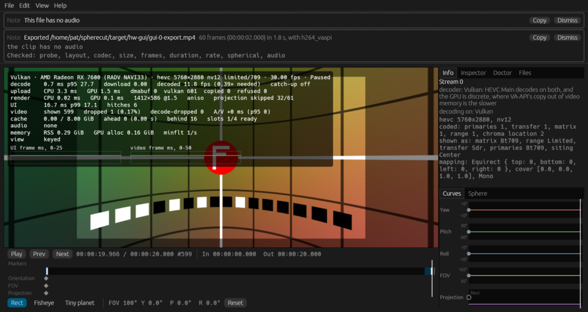
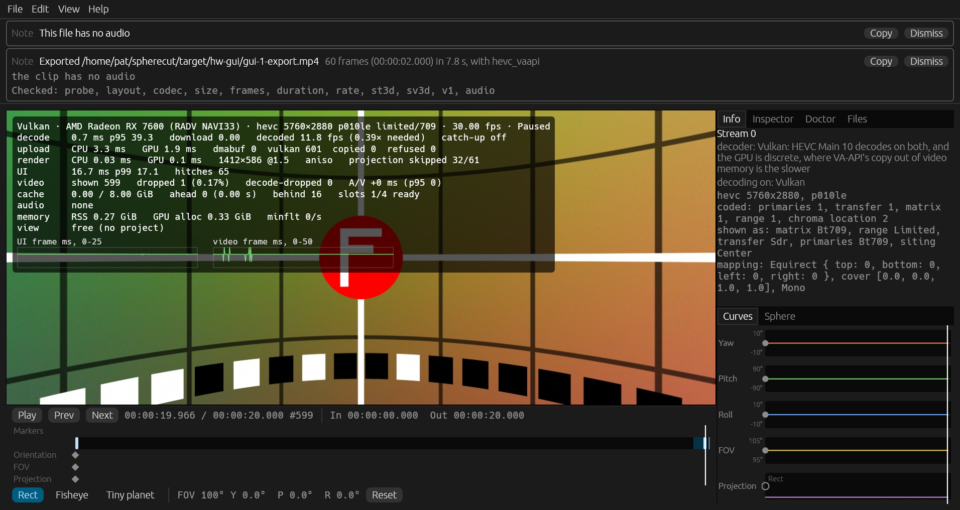
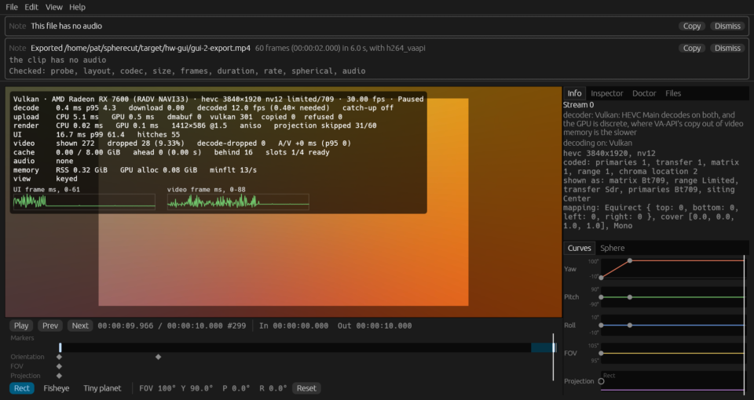
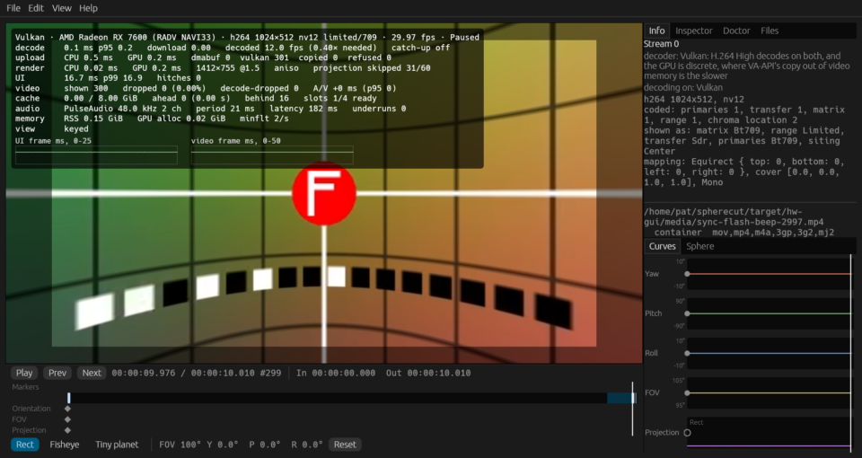
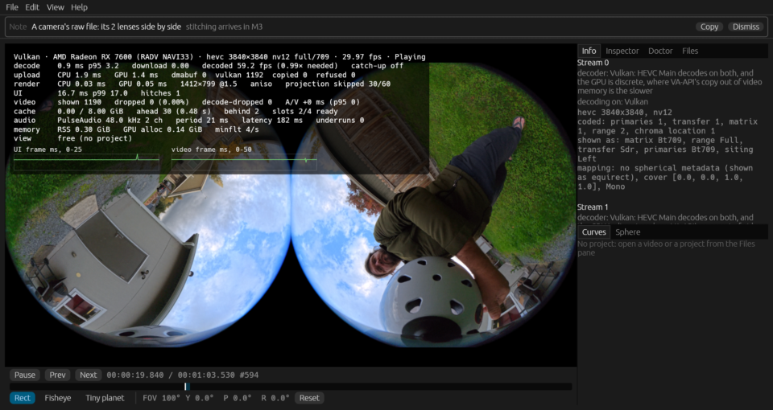
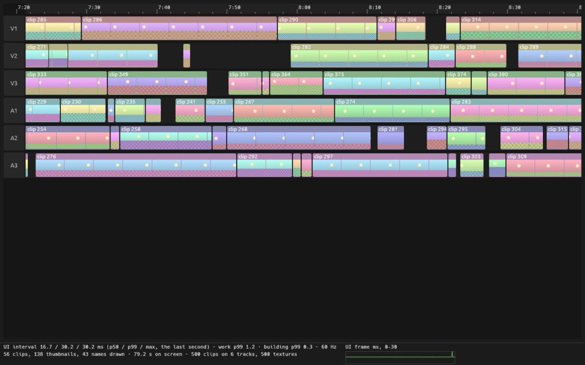
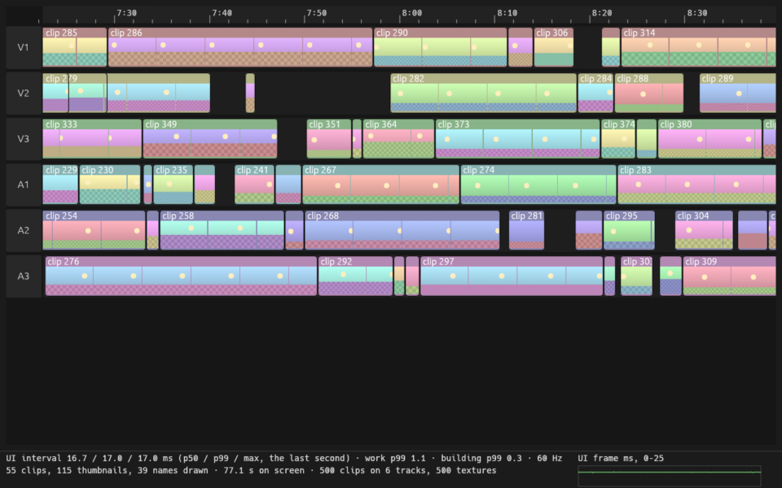
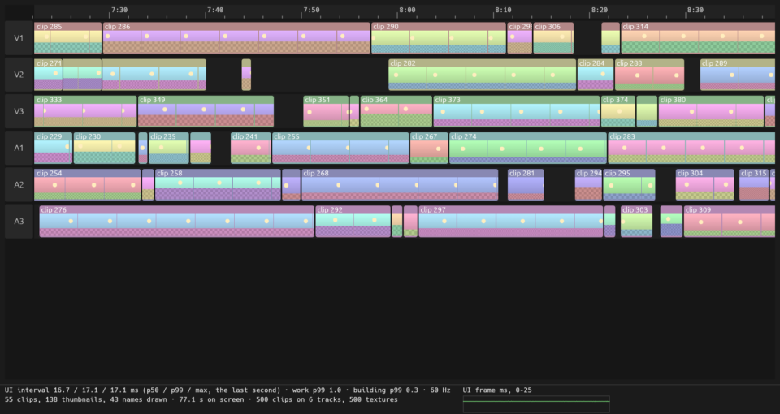

# Hardware report: odin @ 0663e057fe

Generated by `cargo xtask hw-test` in 6810 s.

## Summary

| | |
|---|---|
| Host | odin |
| OS | Fedora Linux 44 (Workstation Edition) |
| Kernel | Linux 7.2.9-200.fc44.x86_64 #1 SMP PREEMPT_DYNAMIC Sat Oct  3 19:59:55 UTC 2026 x86_64 |
| Session | wayland / GNOME |
| GUI display | WAYLAND_DISPLAY set: WAYLAND_DISPLAY=wayland-0 |
| Screen locked at the end | no |
| Audio server | PulseAudio (on PipeWire 1.6.9) |
| GNOME mutter experimental features | @as [] |
| GPU (Vulkan) | AMD Radeon RX 7600 (RADV NAVI33) |
| Mesa | Mesa 26.2.5 |
| FFmpeg | ffmpeg version 8.1.3 Copyright (c) 2000-2026 the FFmpeg developers |
| FFmpeg libs | 62.28.103, 62.12.103, 60.26.103, 9.5.103, 6.3.103 |
| Rust | rustc 1.99.0 (b940084d7 2026-09-28) |
| VA-API HEVC | decode: yes, encode: yes |
| FFmpeg hwaccels | vdpau, cuda, vaapi, qsv, drm, opencl, vulkan, amf |
| Samples dir | /home/pat/spherecut/samples (present) |

**Tier 2: 44 passed, 2 failed, 1 skipped, 0 did not run (47 tests).**

**Tier 1 on this machine: 1183 passed, 0 failed, in 91 test binaries (502 s).**

**This run FAILED:** 2 Tier 2 test(s) failed.

## Prerequisites

Nothing missing.

## Build

Succeeded (release) in 55 s.

## Power profile

Read once, before the build, and never changed: decode speed moves with these.

| Setting | Value |
|---|---|
| power-profiles-daemon | not available (no `powerprofilesctl`) |
| ACPI platform profile | not available (no /sys/firmware/acpi/platform_profile) |
| CPU frequency driver | amd-pstate-epp |
| CPU governor | performance |
| CPU energy preference | performance |
| card0 (amdgpu) performance level | auto |
| card0 (amdgpu) power profile | not available (unreadable) |

## Render nodes

| Node | PCI slot | Vendor | Device | Driver | Opens |
|---|---|---|---|---|---|
| renderD128 | 0000:0c:00.0 | AMD (0x1002) | 0x7480 | amdgpu | yes |

## Perf clips

synth's noisy grid in HEVC at about a camera's bitrate, made once and kept in `/home/pat/spherecut/target/hw-media` for the playback benchmarks. Software decode over 150 fps would make a clip too easy to say anything about footage.

| Clip | Size | Bitrate | Made | Software decode |
|---|---:|---:|---|---|
| `hevc8-5k7-30fps-noisy-20s.mp4` | 254 MB | 101.7 Mbit/s | cached | 46.6 fps |
| `hevc10-5k7-30fps-noisy-20s.mp4` | 254 MB | 101.7 Mbit/s | cached | 37.6 fps |
| `hevc8-8k-30fps-noisy-20s.mp4` | 305 MB | 122.1 Mbit/s | cached | 29.0 fps |

## Tier 2 tests

| Test | Result |
|---|---|
| `adapters::list_adapters_and_features` | pass |
| `goldens::goldens_on_gpu_match_reference` | pass |
| `goldens::goldens_on_host_llvmpipe` | pass |
| `spherecut-media/doctor::doctor_decodes_hevc_main_on_vaapi` | pass |
| `tier2_backend::bench_seek_latency` | pass |
| `tier2_backend::vaapi_colorinfo_matches_software` | pass |
| `tier2_backend::vaapi_exports_match_downloads` | pass |
| `tier2_backend::vaapi_seek_matches_software` | pass |
| `tier2_backend::vulkan_colorinfo_matches_software` | pass |
| `tier2_backend::vulkan_seek_matches_software` | pass |
| `tier2_device::audio_output_device_plays` | pass |
| `tier2_download_pool::vaapi_download_pool_reuses_buffers` | pass |
| `tier2_download_pool::vulkan_download_pool_reuses_buffers` | pass |
| `tier2_export::bench_export_4k30_vaapi` | pass |
| `tier2_export::bench_export_vaapi_levels` | pass |
| `tier2_export::export_360_8k_vaapi` | pass |
| `tier2_export::export_vaapi_matches_software` | pass |
| `tier2_frame::doctor_and_the_renderer_agree_on_sharing` | pass |
| `tier2_frame::shared_vulkan_frame_matches_the_copy` | pass |
| `tier2_frame::vaapi_render_matches_software` | pass |
| `tier2_frame::vulkan_render_matches_software` | pass |
| `tier2_frame::zero_copy_frame_matches_the_copy` | pass |
| `tier2_gui::gui_proto` | pass |
| `tier2_gui::gui_smoke` | **FAIL** |
| `tier2_hw_decode::bench_decode_hevc_4k_and_5k7` | pass |
| `tier2_hw_decode::vaapi_h264_matches_software` | pass |
| `tier2_hw_decode::vaapi_hevc_main10_matches_software` | pass |
| `tier2_hw_decode::vaapi_hevc_main_matches_software` | pass |
| `tier2_hw_decode::vulkan_h264_matches_software` | pass |
| `tier2_hw_decode::vulkan_hevc_main10_matches_software` | pass |
| `tier2_hw_decode::vulkan_hevc_main_matches_software` | pass |
| `tier2_mcp::mcp_session_decodes_with_vaapi` | pass |
| `tier2_playback::bench_perf_clips_software_decode` | pass |
| `tier2_playback::bench_playback_realtime_5k7_10bit` | pass |
| `tier2_playback::bench_playback_realtime_5k7_8bit` | pass |
| `tier2_playback::bench_playback_realtime_8k_8bit` | pass |
| `tier2_playback::bench_playback_stitched_samples` | skipped: no stitched equirect among the samples under /home/pat/spherecut/samples: clip 12 is still to come (docs/SAMPLES.md) |
| `tier2_playback::bench_playback_x5_raw` | pass |
| `tier2_playback::bench_x5_8k30_zero_copy_vs_copy` | pass |
| `tier2_playback::shared_vulkan_matches_copy_path` | pass |
| `tier2_playback::zero_copy_matches_copy_path` | **FAIL** |
| `tier2_samples::bench_samples_realtime_decode` | pass |
| `tier2_samples::samples_probe_cleanly` | pass |
| `tier2_samples::samples_vaapi_decode_matches_software` | pass |
| `tier2_samples::samples_vulkan_decode_matches_software` | pass |
| `upload::bench_upload_5k7` | pass |
| `yuv::yuv_on_gpu_matches_reference` | pass |

### FAIL `tier2_gui::gui_smoke`

```
==> noisy 5.7K 8-bit: /home/pat/spherecut/target/hw-media/hevc8-5k7-30fps-noisy-20s.mp4
==> noisy 5.7K 10-bit: /home/pat/spherecut/target/hw-media/hevc10-5k7-30fps-noisy-20s.mp4
==> seam 3840×1920 HEVC: /home/pat/spherecut/target/hw-gui/media/gui-seam.mp4
==> sync flash and beep: /home/pat/spherecut/target/hw-gui/media/sync-flash-beep-2997.mp4
==> X5 raw view insta360-x5/VID_20261022_170245_00_009.insv: /home/pat/spherecut/samples/insta360-x5/VID_20261022_170245_00_009.insv
not run: stitched samples: none under /home/pat/spherecut/samples (clip 12 is still wanted)

thread 'gui_smoke' (2302644) panicked at crates/cli/tests/tier2_gui.rs:520:5:
3 of 5 runs failed:
noisy 5.7K 8-bit: 1 of 569 frames dropped (0.18%, over 0.1%)
noisy 5.7K 8-bit: 1 of 54 frames dropped while the export ran
noisy 5.7K 8-bit: UI p99 82.8 ms while the export ran, over 1.5 × the 60 Hz period (25.0 ms)
noisy 5.7K 10-bit: 1 of 569 frames dropped (0.18%, over 0.1%)
noisy 5.7K 10-bit: UI p99 34.1 ms, over 1.5 × the 60 Hz period (25.0 ms)
noisy 5.7K 10-bit: 85% of the UI frames expected were presented while the export ran, under 90%
noisy 5.7K 10-bit: 1 of 233 frames dropped while the export ran
noisy 5.7K 10-bit: UI p99 40.9 ms while the export ran, over 1.5 × the 60 Hz period (25.0 ms)
seam 3840×1920 HEVC: 71% of the UI frames expected were presented, the window drawn (0 passes without the UI): the UI was slow, each pass's own work 5.1 ms at p95
seam 3840×1920 HEVC: 28 of 269 frames dropped (10.41%, over 0.1%)
seam 3840×1920 HEVC: UI p99 63.4 ms, over 1.5 × the 60 Hz period (25.0 ms)
seam 3840×1920 HEVC: 58% of the UI frames expected were presented while the export ran, under 90%
seam 3840×1920 HEVC: 28 of 182 frames dropped while the export ran
seam 3840×1920 HEVC: UI p99 65.1 ms while the export ran, over 1.5 × the 60 Hz period (25.0 ms)
note: run with `RUST_BACKTRACE=1` environment variable to display a backtrace


```

### FAIL `tier2_playback::zero_copy_matches_copy_path`

```
rendered on AMD Radeon RX 7600 (RADV NAVI33) (radv Mesa 26.2.5), decoded on /dev/dri/renderD128, the GPU at PCI 0000:0c:00.0
hevc-main: 48 frames, the import byte-identical to the copy
hevc-main10: 48 frames, the import byte-identical to the copy

thread 'zero_copy_matches_copy_path' (2330279) panicked at crates/playback/tests/tier2_playback.rs:1760:17:
/home/pat/spherecut/samples/insta360-x5/VID_20261022_165613_00_007.insv: frame 26, view 0: the import renders other bytes than the copy: 19 of 2764800 channel values differ, by 0.0863 at most; rendered again it renders as the copy, taken again as the copy, and downloaded again as the copy


```

## Benchmarks

Release build. Each benchmark runs once to warm up, then 3 times (`SPHERECUT_BENCH_RUNS`); the result is the median. Spread is the range over the median: over 10% means the machine was busy or changing clocks, so take that result with care. A row marked "per second" is one run's seconds instead: Runs counts the seconds, and the range is the slowest and the fastest.

| Benchmark | Median | Range | Runs | Spread |
|---|---:|---:|---:|---:|
| audio clock over 2 s of Instant | 1.99 s | | 1 | |
| audio latency (median) | 181.86 ms | | 1 | |
| audio callback gap, worst (× its buffer) | 1.01 x | | 1 | |
| export 4k30 h264_vaapi high | 33.96 fps | 33.96 to 33.97 | 3 | 0% |
| export 4k30 h264_vaapi high: decode | 28.53 ms/frame | 28.47 to 28.54 | 3 | 0% |
| export 4k30 h264_vaapi high: render | 9.85 ms/frame | 9.79 to 9.88 | 3 | 1% |
| export 4k30 h264_vaapi high: readback | 2.94 ms/frame | 2.93 to 3.01 | 3 | 3% |
| export 4k30 h264_vaapi high: encode | 6.70 ms/frame | 6.64 to 6.74 | 3 | 1% |
| export 4k30 h264_vaapi high: finish | 0.56 ms/frame | 0.54 to 0.58 | 3 | 7% |
| export 4k30 hevc_vaapi high | 44.05 fps | 43.99 to 44.05 | 3 | 0% |
| export 4k30 hevc_vaapi high: decode | 22.22 ms/frame | 22.18 to 22.23 | 3 | 0% |
| export 4k30 hevc_vaapi high: render | 10.30 ms/frame | 10.25 to 10.31 | 3 | 1% |
| export 4k30 hevc_vaapi high: readback | 3.03 ms/frame | 3.02 to 3.06 | 3 | 1% |
| export 4k30 hevc_vaapi high: encode | 6.91 ms/frame | 6.91 to 7.03 | 3 | 2% |
| export 4k30 hevc_vaapi high: finish | 0.20 ms/frame | 0.17 to 0.21 | 3 | 19% **unstable** |
| export 4k30 h264_vaapi draft | 53.76 fps | 53.69 to 54.09 | 3 | 1% |
| export 4k30 h264_vaapi draft: decode | 18.17 ms/frame | 18.03 to 18.18 | 3 | 1% |
| export 4k30 h264_vaapi draft: render | 9.08 ms/frame | 8.97 to 9.08 | 3 | 1% |
| export 4k30 h264_vaapi draft: readback | 3.30 ms/frame | 3.30 to 3.31 | 3 | 0% |
| export 4k30 h264_vaapi draft: encode | 2.70 ms/frame | 2.69 to 2.70 | 3 | 0% |
| export 4k30 h264_vaapi draft: finish | 0.15 ms/frame | 0.14 to 0.15 | 3 | 9% |
| export 4k30 from lrv h264_vaapi high | 46.84 fps | 46.67 to 47.81 | 3 | 2% |
| export 4k30 from lrv h264_vaapi high: decode | 15.72 ms/frame | 15.64 to 15.79 | 3 | 1% |
| export 4k30 from lrv h264_vaapi high: render | 4.89 ms/frame | 3.84 to 6.52 | 3 | 55% **unstable** |
| export 4k30 from lrv h264_vaapi high: readback | 14.41 ms/frame | 12.71 to 15.05 | 3 | 16% **unstable** |
| export 4k30 from lrv h264_vaapi high: encode | 16.11 ms/frame | 15.57 to 16.14 | 3 | 4% |
| export 4k30 from lrv h264_vaapi high: finish | 1.12 ms/frame | 1.10 to 1.15 | 3 | 5% |
| export levels h264_vaapi speed (1): speed | 35.17 fps | | 1 | |
| export levels h264_vaapi speed (1): worst luma PSNR | 45.20 dB | | 1 | |
| export levels h264_vaapi speed (1): bitrate | 36.60 Mb/s | | 1 | |
| export levels h264_vaapi balanced (3): speed | 37.37 fps | | 1 | |
| export levels h264_vaapi balanced (3): worst luma PSNR | 44.71 dB | | 1 | |
| export levels h264_vaapi balanced (3): bitrate | 28.52 Mb/s | | 1 | |
| export levels h264_vaapi balanced vbaq (19): speed | 37.28 fps | | 1 | |
| export levels h264_vaapi balanced vbaq (19): worst luma PSNR | 45.20 dB | | 1 | |
| export levels h264_vaapi balanced vbaq (19): bitrate | 33.50 Mb/s | | 1 | |
| export levels h264_vaapi quality (5): speed | 26.61 fps | | 1 | |
| export levels h264_vaapi quality (5): worst luma PSNR | 44.71 dB | | 1 | |
| export levels h264_vaapi quality (5): bitrate | 28.59 Mb/s | | 1 | |
| export levels h264_vaapi quality pre-encode (13): speed | 26.14 fps | | 1 | |
| export levels h264_vaapi quality pre-encode (13): worst luma PSNR | 44.71 dB | | 1 | |
| export levels h264_vaapi quality pre-encode (13): bitrate | 26.66 Mb/s | | 1 | |
| export levels h264_vaapi quality pre-encode vbaq (29): speed | 24.99 fps | | 1 | |
| export levels h264_vaapi quality pre-encode vbaq (29): worst luma PSNR | 45.20 dB | | 1 | |
| export levels h264_vaapi quality pre-encode vbaq (29): bitrate | 36.20 Mb/s | | 1 | |
| export levels h264_vaapi high quality pre-encode vbaq (31): speed | 30.64 fps | | 1 | |
| export levels h264_vaapi high quality pre-encode vbaq (31): worst luma PSNR | 45.20 dB | | 1 | |
| export levels h264_vaapi high quality pre-encode vbaq (31): bitrate | 36.20 Mb/s | | 1 | |
| export levels hevc_vaapi speed (1): speed | 40.03 fps | | 1 | |
| export levels hevc_vaapi speed (1): worst luma PSNR | 47.16 dB | | 1 | |
| export levels hevc_vaapi speed (1): bitrate | 28.91 Mb/s | | 1 | |
| export levels hevc_vaapi balanced (3): speed | 39.40 fps | | 1 | |
| export levels hevc_vaapi balanced (3): worst luma PSNR | 46.44 dB | | 1 | |
| export levels hevc_vaapi balanced (3): bitrate | 25.70 Mb/s | | 1 | |
| export levels hevc_vaapi balanced vbaq (19): speed | 39.37 fps | | 1 | |
| export levels hevc_vaapi balanced vbaq (19): worst luma PSNR | 47.16 dB | | 1 | |
| export levels hevc_vaapi balanced vbaq (19): bitrate | 27.98 Mb/s | | 1 | |
| export levels hevc_vaapi quality (5): speed | 39.25 fps | | 1 | |
| export levels hevc_vaapi quality (5): worst luma PSNR | 46.44 dB | | 1 | |
| export levels hevc_vaapi quality (5): bitrate | 25.60 Mb/s | | 1 | |
| export levels hevc_vaapi quality pre-encode (13): speed | 40.25 fps | | 1 | |
| export levels hevc_vaapi quality pre-encode (13): worst luma PSNR | 46.44 dB | | 1 | |
| export levels hevc_vaapi quality pre-encode (13): bitrate | 26.19 Mb/s | | 1 | |
| export levels hevc_vaapi quality pre-encode vbaq (29): speed | 37.08 fps | | 1 | |
| export levels hevc_vaapi quality pre-encode vbaq (29): worst luma PSNR | 47.16 dB | | 1 | |
| export levels hevc_vaapi quality pre-encode vbaq (29): bitrate | 27.44 Mb/s | | 1 | |
| export levels hevc_vaapi high quality pre-encode vbaq (31): speed | 39.92 fps | | 1 | |
| export levels hevc_vaapi high quality pre-encode vbaq (31): worst luma PSNR | 47.16 dB | | 1 | |
| export levels hevc_vaapi high quality pre-encode vbaq (31): bitrate | 27.90 Mb/s | | 1 | |
| export levels av1_vaapi speed (1): speed | 39.64 fps | | 1 | |
| export levels av1_vaapi speed (1): worst luma PSNR | 43.02 dB | | 1 | |
| export levels av1_vaapi speed (1): bitrate | 15.04 Mb/s | | 1 | |
| export levels av1_vaapi balanced (3): speed | 40.45 fps | | 1 | |
| export levels av1_vaapi balanced (3): worst luma PSNR | 43.55 dB | | 1 | |
| export levels av1_vaapi balanced (3): bitrate | 20.61 Mb/s | | 1 | |
| export levels av1_vaapi balanced vbaq (19): speed | 35.23 fps | | 1 | |
| export levels av1_vaapi balanced vbaq (19): worst luma PSNR | 43.65 dB | | 1 | |
| export levels av1_vaapi balanced vbaq (19): bitrate | 20.77 Mb/s | | 1 | |
| export levels av1_vaapi quality (5): speed | 33.04 fps | | 1 | |
| export levels av1_vaapi quality (5): worst luma PSNR | 43.56 dB | | 1 | |
| export levels av1_vaapi quality (5): bitrate | 20.66 Mb/s | | 1 | |
| export levels av1_vaapi quality pre-encode (13): speed | 31.62 fps | | 1 | |
| export levels av1_vaapi quality pre-encode (13): worst luma PSNR | 43.00 dB | | 1 | |
| export levels av1_vaapi quality pre-encode (13): bitrate | 14.84 Mb/s | | 1 | |
| export levels av1_vaapi quality pre-encode vbaq (29): speed | 31.50 fps | | 1 | |
| export levels av1_vaapi quality pre-encode vbaq (29): worst luma PSNR | 43.03 dB | | 1 | |
| export levels av1_vaapi quality pre-encode vbaq (29): bitrate | 15.74 Mb/s | | 1 | |
| export levels av1_vaapi high quality pre-encode vbaq (31): speed | 20.37 fps | | 1 | |
| export levels av1_vaapi high quality pre-encode vbaq (31): worst luma PSNR | 43.03 dB | | 1 | |
| export levels av1_vaapi high quality pre-encode vbaq (31): bitrate | 16.36 Mb/s | | 1 | |
| Insta360DualFisheye 2× 1920x1920 @ 119.88: VA-API decode | 1.07 × real time | 1.05 to 1.07 | 3 | 2% |
| Insta360DualFisheye 2× 1920x1920 @ 119.88: software decode | 0.73 × real time | 0.72 to 0.73 | 3 | 1% |
| Insta360DualFisheye 2× 1920x1920 @ 119.88: Vulkan Video decode | 1.67 × real time | 1.67 to 1.67 | 3 | 0% |
| Insta360DualFisheye 2× 2880x2880 @ 59.94: VA-API decode | 0.99 × real time | 0.99 to 1.00 | 3 | 1% |
| Insta360DualFisheye 2× 2880x2880 @ 59.94: software decode | 0.65 × real time | 0.65 to 0.65 | 3 | 0% |
| Insta360DualFisheye 2× 2880x2880 @ 59.94: Vulkan Video decode | 1.61 × real time | 1.61 to 1.61 | 3 | 0% |
| Insta360DualFisheye 2× 3840x3840 @ 25.00: VA-API decode | 1.30 × real time | 1.27 to 1.31 | 3 | 2% |
| Insta360DualFisheye 2× 3840x3840 @ 25.00: software decode | 0.52 × real time | 0.52 to 0.52 | 3 | 0% |
| Insta360DualFisheye 2× 3840x3840 @ 25.00: Vulkan Video decode | 2.23 × real time | 2.23 to 2.23 | 3 | 0% |
| Insta360DualFisheye 2× 3840x3840 @ 29.97: VA-API decode | 0.79 × real time | 0.47 to 0.94 | 3 | 60% **unstable** |
| Insta360DualFisheye 2× 3840x3840 @ 29.97: software decode | 0.44 × real time | 0.44 to 0.44 | 3 | 0% |
| Insta360DualFisheye 2× 3840x3840 @ 29.97: Vulkan Video decode | 1.94 × real time | 1.93 to 1.94 | 3 | 0% |
| LowResCompanion 1× 1664x832 @ 25.00: VA-API decode | 24.26 × real time | 24.18 to 24.45 | 3 | 1% |
| LowResCompanion 1× 1664x832 @ 25.00: software decode | 27.89 × real time | 27.58 to 27.94 | 3 | 1% |
| LowResCompanion 1× 1664x832 @ 25.00: Vulkan Video decode | 30.90 × real time | 30.43 to 30.93 | 3 | 2% |
| LowResCompanion 1× 1664x832 @ 29.97: VA-API decode | 25.48 × real time | 25.36 to 25.49 | 3 | 1% |
| LowResCompanion 1× 1664x832 @ 29.97: software decode | 32.04 × real time | 31.77 to 32.29 | 3 | 2% |
| LowResCompanion 1× 1664x832 @ 29.97: Vulkan Video decode | 35.06 × real time | 34.53 to 35.09 | 3 | 2% |
| perf clip hevc8-5k7-30fps-noisy-20s: software decode | 46.60 fps | 46.57 to 46.79 | 3 | 0% |
| perf clip hevc10-5k7-30fps-noisy-20s: software decode | 37.58 fps | 37.30 to 37.82 | 3 | 1% |
| perf clip hevc8-8k-30fps-noisy-20s: software decode | 29.05 fps | 28.83 to 29.59 | 3 | 3% |
| hevc10-5k7-30fps-noisy-20s, Vulkan (Auto, zero copy): decoded per second, unthrottled | 128.00 fps | 128.00 to 129.00 | 4 | 1% |
| hevc10-5k7-30fps-noisy-20s, Vulkan (Auto, zero copy): decoded per second, real time | 30.00 fps | 12.00 to 46.00 | 60 | 113% **unstable** |
| hevc10-5k7-30fps-noisy-20s, Vulkan (Auto, zero copy): shown per second, real time | 30.00 fps | 21.00 to 31.00 | 60 | 33% **unstable** |
| hevc10-5k7-30fps-noisy-20s, Vulkan (Auto, zero copy): dropped after 1 s | 0.00 frames | | 1 | |
| hevc10-5k7-30fps-noisy-20s, Vulkan (Auto, zero copy): decode-dropped after 1 s | 0.00 frames | | 1 | |
| hevc10-5k7-30fps-noisy-20s, Vulkan (Auto, zero copy): late presents after 1 s | 0.00 presents | | 1 | |
| hevc10-5k7-30fps-noisy-20s, Vulkan (Auto): decoded per second, unthrottled | 14.00 fps | 8.00 to 94.00 | 17 | 614% **unstable** |
| hevc10-5k7-30fps-noisy-20s, Vulkan (Auto): decoded per second, real time | 24.50 fps | 0.00 to 67.00 | 20 | 273% **unstable** |
| hevc10-5k7-30fps-noisy-20s, Vulkan (Auto): shown per second, real time | 24.50 fps | 2.00 to 30.00 | 20 | 114% **unstable** |
| hevc10-5k7-30fps-noisy-20s, Vulkan (Auto): dropped after 1 s | 228.00 frames | | 1 | |
| hevc10-5k7-30fps-noisy-20s, Vulkan (Auto): decode-dropped after 1 s | 227.00 frames | | 1 | |
| hevc10-5k7-30fps-noisy-20s, Vulkan (Auto): late presents after 1 s | 562.00 presents | | 1 | |
| hevc10-5k7-30fps-noisy-20s, VA-API: decoded per second, unthrottled | 14.00 fps | 12.00 to 18.00 | 20 | 43% **unstable** |
| hevc10-5k7-30fps-noisy-20s, VA-API: decoded per second, real time | 24.00 fps | 21.00 to 27.00 | 20 | 25% **unstable** |
| hevc10-5k7-30fps-noisy-20s, VA-API: shown per second, real time | 6.00 fps | 4.00 to 11.00 | 20 | 117% **unstable** |
| hevc10-5k7-30fps-noisy-20s, VA-API: dropped after 1 s | 453.00 frames | | 1 | |
| hevc10-5k7-30fps-noisy-20s, VA-API: decode-dropped after 1 s | 456.00 frames | | 1 | |
| hevc10-5k7-30fps-noisy-20s, VA-API: late presents after 1 s | 1138.00 presents | | 1 | |
| hevc10-5k7-30fps-noisy-20s, software: decoded per second, unthrottled | 35.00 fps | 25.00 to 39.00 | 18 | 40% **unstable** |
| hevc10-5k7-30fps-noisy-20s, software: decoded per second, real time | 30.00 fps | 0.00 to 37.00 | 20 | 123% **unstable** |
| hevc10-5k7-30fps-noisy-20s, software: shown per second, real time | 30.00 fps | 29.00 to 30.00 | 20 | 3% |
| hevc10-5k7-30fps-noisy-20s, software: dropped after 1 s | 0.00 frames | | 1 | |
| hevc10-5k7-30fps-noisy-20s, software: decode-dropped after 1 s | 0.00 frames | | 1 | |
| hevc10-5k7-30fps-noisy-20s, software: late presents after 1 s | 34.00 presents | | 1 | |
| hevc8-5k7-30fps-noisy-20s, Vulkan (Auto, zero copy): decoded per second, unthrottled | 129.00 fps | 128.00 to 130.00 | 4 | 2% |
| hevc8-5k7-30fps-noisy-20s, Vulkan (Auto, zero copy): decoded per second, real time | 30.00 fps | 12.00 to 46.00 | 60 | 113% **unstable** |
| hevc8-5k7-30fps-noisy-20s, Vulkan (Auto, zero copy): shown per second, real time | 30.00 fps | 22.00 to 30.00 | 60 | 27% **unstable** |
| hevc8-5k7-30fps-noisy-20s, Vulkan (Auto, zero copy): dropped after 1 s | 0.00 frames | | 1 | |
| hevc8-5k7-30fps-noisy-20s, Vulkan (Auto, zero copy): decode-dropped after 1 s | 0.00 frames | | 1 | |
| hevc8-5k7-30fps-noisy-20s, Vulkan (Auto, zero copy): late presents after 1 s | 0.00 presents | | 1 | |
| hevc8-5k7-30fps-noisy-20s, Vulkan (Auto): decoded per second, unthrottled | 78.00 fps | 17.00 to 124.00 | 7 | 137% **unstable** |
| hevc8-5k7-30fps-noisy-20s, Vulkan (Auto): decoded per second, real time | 29.00 fps | 0.00 to 60.00 | 20 | 207% **unstable** |
| hevc8-5k7-30fps-noisy-20s, Vulkan (Auto): shown per second, real time | 30.00 fps | 29.00 to 30.00 | 20 | 3% |
| hevc8-5k7-30fps-noisy-20s, Vulkan (Auto): dropped after 1 s | 1.00 frames | | 1 | |
| hevc8-5k7-30fps-noisy-20s, Vulkan (Auto): decode-dropped after 1 s | 0.00 frames | | 1 | |
| hevc8-5k7-30fps-noisy-20s, Vulkan (Auto): late presents after 1 s | 0.00 presents | | 1 | |
| hevc8-5k7-30fps-noisy-20s, VA-API: decoded per second, unthrottled | 26.00 fps | 24.00 to 31.00 | 20 | 27% **unstable** |
| hevc8-5k7-30fps-noisy-20s, VA-API: decoded per second, real time | 27.50 fps | 25.00 to 33.00 | 20 | 29% **unstable** |
| hevc8-5k7-30fps-noisy-20s, VA-API: shown per second, real time | 16.00 fps | 8.00 to 29.00 | 20 | 131% **unstable** |
| hevc8-5k7-30fps-noisy-20s, VA-API: dropped after 1 s | 265.00 frames | | 1 | |
| hevc8-5k7-30fps-noisy-20s, VA-API: decode-dropped after 1 s | 265.00 frames | | 1 | |
| hevc8-5k7-30fps-noisy-20s, VA-API: late presents after 1 s | 1138.00 presents | | 1 | |
| hevc8-5k7-30fps-noisy-20s, software: decoded per second, unthrottled | 48.00 fps | 39.00 to 57.00 | 12 | 38% **unstable** |
| hevc8-5k7-30fps-noisy-20s, software: decoded per second, real time | 30.00 fps | 0.00 to 52.00 | 20 | 173% **unstable** |
| hevc8-5k7-30fps-noisy-20s, software: shown per second, real time | 30.00 fps | 29.00 to 30.00 | 20 | 3% |
| hevc8-5k7-30fps-noisy-20s, software: dropped after 1 s | 0.00 frames | | 1 | |
| hevc8-5k7-30fps-noisy-20s, software: decode-dropped after 1 s | 0.00 frames | | 1 | |
| hevc8-5k7-30fps-noisy-20s, software: late presents after 1 s | 0.00 presents | | 1 | |
| hevc8-8k-30fps-noisy-20s, Vulkan (Auto): decoded per second, unthrottled | 77.50 fps | 59.00 to 83.00 | 8 | 31% **unstable** |
| hevc8-8k-30fps-noisy-20s, Vulkan (Auto): decoded per second, real time | 30.00 fps | 0.00 to 61.00 | 20 | 203% **unstable** |
| hevc8-8k-30fps-noisy-20s, Vulkan (Auto): shown per second, real time | 30.00 fps | 29.00 to 30.00 | 20 | 3% |
| hevc8-8k-30fps-noisy-20s, Vulkan (Auto): dropped after 1 s | 0.00 frames | | 1 | |
| hevc8-8k-30fps-noisy-20s, Vulkan (Auto): decode-dropped after 1 s | 0.00 frames | | 1 | |
| hevc8-8k-30fps-noisy-20s, Vulkan (Auto): late presents after 1 s | 0.00 presents | | 1 | |
| hevc8-8k-30fps-noisy-20s, VA-API: decoded per second, unthrottled | 12.00 fps | 10.00 to 16.00 | 20 | 50% **unstable** |
| hevc8-8k-30fps-noisy-20s, VA-API: decoded per second, real time | 24.00 fps | 15.00 to 36.00 | 20 | 88% **unstable** |
| hevc8-8k-30fps-noisy-20s, VA-API: shown per second, real time | 5.00 fps | 2.00 to 12.00 | 20 | 200% **unstable** |
| hevc8-8k-30fps-noisy-20s, VA-API: dropped after 1 s | 458.00 frames | | 1 | |
| hevc8-8k-30fps-noisy-20s, VA-API: decode-dropped after 1 s | 458.00 frames | | 1 | |
| hevc8-8k-30fps-noisy-20s, VA-API: late presents after 1 s | 1138.00 presents | | 1 | |
| hevc8-8k-30fps-noisy-20s, software: decoded per second, unthrottled | 30.00 fps | 25.00 to 34.00 | 19 | 30% **unstable** |
| hevc8-8k-30fps-noisy-20s, software: decoded per second, real time | 30.00 fps | 0.00 to 40.00 | 20 | 133% **unstable** |
| hevc8-8k-30fps-noisy-20s, software: shown per second, real time | 24.50 fps | 11.00 to 31.00 | 20 | 82% **unstable** |
| hevc8-8k-30fps-noisy-20s, software: dropped after 1 s | 143.00 frames | | 1 | |
| hevc8-8k-30fps-noisy-20s, software: decode-dropped after 1 s | 109.00 frames | | 1 | |
| hevc8-8k-30fps-noisy-20s, software: late presents after 1 s | 531.00 presents | | 1 | |
| X5 raw 2× 1920x1920 at 119.88 fps, Vulkan (Auto): decoded per second, unthrottled | 236.25 fps | 234.00 to 238.50 | 2 | 2% |
| X5 raw 2× 1920x1920 at 119.88 fps, Vulkan (Auto): decoded per second, real time | 0.00 fps | 0.00 to 237.00 | 20 | n/a |
| X5 raw 2× 1920x1920 at 119.88 fps, Vulkan (Auto): shown per second, real time | 60.00 fps | 60.00 to 60.00 | 20 | 0% |
| X5 raw 2× 1920x1920 at 119.88 fps, Vulkan (Auto): dropped after 1 s | 2248.00 frames | | 1 | |
| X5 raw 2× 1920x1920 at 119.88 fps, Vulkan (Auto): decode-dropped after 1 s | 0.00 frames | | 1 | |
| X5 raw 2× 1920x1920 at 119.88 fps, Vulkan (Auto): late presents after 1 s | 1128.00 presents | | 1 | |
| X5 raw 2× 1920x1920 at 119.88 fps, VA-API: decoded per second, unthrottled | 84.75 fps | 82.00 to 85.00 | 6 | 4% |
| X5 raw 2× 1920x1920 at 119.88 fps, VA-API: decoded per second, real time | 110.50 fps | 0.00 to 138.00 | 20 | 125% **unstable** |
| X5 raw 2× 1920x1920 at 119.88 fps, VA-API: shown per second, real time | 57.00 fps | 41.00 to 60.00 | 20 | 33% **unstable** |
| X5 raw 2× 1920x1920 at 119.88 fps, VA-API: dropped after 1 s | 2479.00 frames | | 1 | |
| X5 raw 2× 1920x1920 at 119.88 fps, VA-API: decode-dropped after 1 s | 410.00 frames | | 1 | |
| X5 raw 2× 1920x1920 at 119.88 fps, VA-API: late presents after 1 s | 1128.00 presents | | 1 | |
| X5 raw 2× 1920x1920 at 119.88 fps, software: decoded per second, unthrottled | 88.25 fps | 79.50 to 91.50 | 6 | 14% **unstable** |
| X5 raw 2× 1920x1920 at 119.88 fps, software: decoded per second, real time | 54.50 fps | 20.00 to 92.00 | 20 | 132% **unstable** |
| X5 raw 2× 1920x1920 at 119.88 fps, software: shown per second, real time | 4.00 fps | 0.00 to 11.00 | 20 | 275% **unstable** |
| X5 raw 2× 1920x1920 at 119.88 fps, software: dropped after 1 s | 2873.00 frames | | 1 | |
| X5 raw 2× 1920x1920 at 119.88 fps, software: decode-dropped after 1 s | 2868.00 frames | | 1 | |
| X5 raw 2× 1920x1920 at 119.88 fps, software: late presents after 1 s | 1126.00 presents | | 1 | |
| X5 raw 2× 2880x2880 at 59.94 fps, Vulkan (Auto): decoded per second, unthrottled | 129.00 fps | | 1 | |
| X5 raw 2× 2880x2880 at 59.94 fps, Vulkan (Auto): decoded per second, real time | 0.00 fps | 0.00 to 118.00 | 20 | n/a |
| X5 raw 2× 2880x2880 at 59.94 fps, Vulkan (Auto): shown per second, real time | 60.00 fps | 58.00 to 60.00 | 20 | 3% |
| X5 raw 2× 2880x2880 at 59.94 fps, Vulkan (Auto): dropped after 1 s | 0.00 frames | | 1 | |
| X5 raw 2× 2880x2880 at 59.94 fps, Vulkan (Auto): decode-dropped after 1 s | 0.00 frames | | 1 | |
| X5 raw 2× 2880x2880 at 59.94 fps, Vulkan (Auto): late presents after 1 s | 129.00 presents | | 1 | |
| X5 raw 2× 2880x2880 at 59.94 fps, VA-API: decoded per second, unthrottled | 60.50 fps | 59.50 to 61.00 | 3 | 2% |
| X5 raw 2× 2880x2880 at 59.94 fps, VA-API: decoded per second, real time | 0.00 fps | 0.00 to 60.50 | 20 | n/a |
| X5 raw 2× 2880x2880 at 59.94 fps, VA-API: shown per second, real time | 60.00 fps | 58.00 to 60.00 | 20 | 3% |
| X5 raw 2× 2880x2880 at 59.94 fps, VA-API: dropped after 1 s | 0.00 frames | | 1 | |
| X5 raw 2× 2880x2880 at 59.94 fps, VA-API: decode-dropped after 1 s | 0.00 frames | | 1 | |
| X5 raw 2× 2880x2880 at 59.94 fps, VA-API: late presents after 1 s | 0.00 presents | | 1 | |
| X5 raw 2× 2880x2880 at 59.94 fps, software: decoded per second, unthrottled | 36.50 fps | 36.00 to 40.50 | 5 | 12% **unstable** |
| X5 raw 2× 2880x2880 at 59.94 fps, software: decoded per second, real time | 28.00 fps | 0.00 to 46.00 | 20 | 164% **unstable** |
| X5 raw 2× 2880x2880 at 59.94 fps, software: shown per second, real time | 2.50 fps | 0.00 to 12.00 | 20 | 480% **unstable** |
| X5 raw 2× 2880x2880 at 59.94 fps, software: dropped after 1 s | 1144.00 frames | | 1 | |
| X5 raw 2× 2880x2880 at 59.94 fps, software: decode-dropped after 1 s | 819.00 frames | | 1 | |
| X5 raw 2× 2880x2880 at 59.94 fps, software: late presents after 1 s | 1088.00 presents | | 1 | |
| X5 raw 2× 3840x3840 at 25.00 fps, Vulkan (Auto): decoded per second, unthrottled | 71.50 fps | | 1 | |
| X5 raw 2× 3840x3840 at 25.00 fps, Vulkan (Auto): decoded per second, real time | 0.00 fps | 0.00 to 50.00 | 20 | n/a |
| X5 raw 2× 3840x3840 at 25.00 fps, Vulkan (Auto): shown per second, real time | 25.00 fps | 24.00 to 25.00 | 20 | 4% |
| X5 raw 2× 3840x3840 at 25.00 fps, Vulkan (Auto): dropped after 1 s | 0.00 frames | | 1 | |
| X5 raw 2× 3840x3840 at 25.00 fps, Vulkan (Auto): decode-dropped after 1 s | 0.00 frames | | 1 | |
| X5 raw 2× 3840x3840 at 25.00 fps, Vulkan (Auto): late presents after 1 s | 0.00 presents | | 1 | |
| X5 raw 2× 3840x3840 at 25.00 fps, VA-API: decoded per second, unthrottled | 38.75 fps | 38.50 to 39.00 | 2 | 1% |
| X5 raw 2× 3840x3840 at 25.00 fps, VA-API: decoded per second, real time | 0.00 fps | 0.00 to 39.50 | 20 | n/a |
| X5 raw 2× 3840x3840 at 25.00 fps, VA-API: shown per second, real time | 25.00 fps | 24.00 to 25.00 | 20 | 4% |
| X5 raw 2× 3840x3840 at 25.00 fps, VA-API: dropped after 1 s | 0.00 frames | | 1 | |
| X5 raw 2× 3840x3840 at 25.00 fps, VA-API: decode-dropped after 1 s | 0.00 frames | | 1 | |
| X5 raw 2× 3840x3840 at 25.00 fps, VA-API: late presents after 1 s | 0.00 presents | | 1 | |
| X5 raw 2× 3840x3840 at 25.00 fps, software: decoded per second, unthrottled | 10.75 fps | 9.00 to 24.00 | 8 | 140% **unstable** |
| X5 raw 2× 3840x3840 at 25.00 fps, software: decoded per second, real time | 0.00 fps | 0.00 to 31.50 | 20 | n/a |
| X5 raw 2× 3840x3840 at 25.00 fps, software: shown per second, real time | 1.00 fps | 0.00 to 5.00 | 20 | 500% **unstable** |
| X5 raw 2× 3840x3840 at 25.00 fps, software: dropped after 1 s | 364.00 frames | | 1 | |
| X5 raw 2× 3840x3840 at 25.00 fps, software: decode-dropped after 1 s | 77.00 frames | | 1 | |
| X5 raw 2× 3840x3840 at 25.00 fps, software: late presents after 1 s | 1093.00 presents | | 1 | |
| X5 raw 2× 3840x3840 at 29.97 fps, Vulkan (Auto): decoded per second, unthrottled | 76.00 fps | 10.00 to 79.00 | 20 | 91% **unstable** |
| X5 raw 2× 3840x3840 at 29.97 fps, Vulkan (Auto): decoded per second, real time | 30.00 fps | 10.50 to 59.50 | 20 | 163% **unstable** |
| X5 raw 2× 3840x3840 at 29.97 fps, Vulkan (Auto): shown per second, real time | 30.00 fps | 3.00 to 31.00 | 20 | 93% **unstable** |
| X5 raw 2× 3840x3840 at 29.97 fps, Vulkan (Auto): dropped after 1 s | 112.00 frames | | 1 | |
| X5 raw 2× 3840x3840 at 29.97 fps, Vulkan (Auto): decode-dropped after 1 s | 105.00 frames | | 1 | |
| X5 raw 2× 3840x3840 at 29.97 fps, Vulkan (Auto): late presents after 1 s | 155.00 presents | | 1 | |
| X5 raw 2× 3840x3840 at 29.97 fps, VA-API: decoded per second, unthrottled | 38.00 fps | 37.50 to 39.50 | 20 | 5% |
| X5 raw 2× 3840x3840 at 29.97 fps, VA-API: decoded per second, real time | 30.00 fps | 27.50 to 31.00 | 20 | 12% **unstable** |
| X5 raw 2× 3840x3840 at 29.97 fps, VA-API: shown per second, real time | 21.00 fps | 17.00 to 25.00 | 20 | 38% **unstable** |
| X5 raw 2× 3840x3840 at 29.97 fps, VA-API: dropped after 1 s | 347.00 frames | | 1 | |
| X5 raw 2× 3840x3840 at 29.97 fps, VA-API: decode-dropped after 1 s | 346.00 frames | | 1 | |
| X5 raw 2× 3840x3840 at 29.97 fps, VA-API: late presents after 1 s | 1140.00 presents | | 1 | |
| X5 raw 2× 3840x3840 at 29.97 fps, software: decoded per second, unthrottled | 11.25 fps | 10.00 to 24.50 | 20 | 129% **unstable** |
| X5 raw 2× 3840x3840 at 29.97 fps, software: decoded per second, real time | 0.00 fps | 0.00 to 63.00 | 20 | n/a |
| X5 raw 2× 3840x3840 at 29.97 fps, software: shown per second, real time | 0.00 fps | 0.00 to 3.00 | 20 | n/a |
| X5 raw 2× 3840x3840 at 29.97 fps, software: dropped after 1 s | 426.00 frames | | 1 | |
| X5 raw 2× 3840x3840 at 29.97 fps, software: decode-dropped after 1 s | 426.00 frames | | 1 | |
| X5 raw 2× 3840x3840 at 29.97 fps, software: late presents after 1 s | 1140.00 presents | | 1 | |
| X5 raw 2× 1920x1920 at 119.88 fps, VA-API: decoded per second, unthrottled | 83.50 fps | 82.50 to 84.50 | 6 | 2% |
| X5 raw 2× 1920x1920 at 119.88 fps, VA-API: decoded per second, real time | 111.50 fps | 0.00 to 143.00 | 20 | 128% **unstable** |
| X5 raw 2× 1920x1920 at 119.88 fps, VA-API: shown per second, real time | 59.50 fps | 42.00 to 60.00 | 20 | 30% **unstable** |
| X5 raw 2× 1920x1920 at 119.88 fps, VA-API: dropped after 1 s | 2436.00 frames | | 1 | |
| X5 raw 2× 1920x1920 at 119.88 fps, VA-API: decode-dropped after 1 s | 382.00 frames | | 1 | |
| X5 raw 2× 1920x1920 at 119.88 fps, VA-API: late presents after 1 s | 1128.00 presents | | 1 | |
| X5 raw 2× 1920x1920 at 119.88 fps, VA-API: upload_cpu p50 | 1.64 ms | | 1 | |
| X5 raw 2× 1920x1920 at 119.88 fps, VA-API: upload_cpu p99 | 2.54 ms | | 1 | |
| X5 raw 2× 1920x1920 at 119.88 fps, VA-API: upload_gpu p50 | 0.29 ms | | 1 | |
| X5 raw 2× 1920x1920 at 119.88 fps, VA-API: upload_gpu p99 | 0.67 ms | | 1 | |
| X5 raw 2× 1920x1920 at 119.88 fps, VA-API, zero copy: decoded per second, unthrottled | 257.75 fps | 256.00 to 259.50 | 2 | 1% |
| X5 raw 2× 1920x1920 at 119.88 fps, VA-API, zero copy: decoded per second, real time | 120.00 fps | 111.00 to 135.50 | 20 | 20% **unstable** |
| X5 raw 2× 1920x1920 at 119.88 fps, VA-API, zero copy: shown per second, real time | 60.00 fps | 59.00 to 60.00 | 20 | 2% |
| X5 raw 2× 1920x1920 at 119.88 fps, VA-API, zero copy: dropped after 1 s | 2248.00 frames | | 1 | |
| X5 raw 2× 1920x1920 at 119.88 fps, VA-API, zero copy: decode-dropped after 1 s | 0.00 frames | | 1 | |
| X5 raw 2× 1920x1920 at 119.88 fps, VA-API, zero copy: late presents after 1 s | 1128.00 presents | | 1 | |
| X5 raw 2× 1920x1920 at 119.88 fps, VA-API, zero copy: upload_cpu p50 | 0.28 ms | | 1 | |
| X5 raw 2× 1920x1920 at 119.88 fps, VA-API, zero copy: upload_cpu p99 | 0.65 ms | | 1 | |
| X5 raw 2× 1920x1920 at 119.88 fps, VA-API, zero copy: upload_gpu p50 | 0.40 ms | | 1 | |
| X5 raw 2× 1920x1920 at 119.88 fps, VA-API, zero copy: upload_gpu p99 | 0.62 ms | | 1 | |
| X5 raw 2× 1920x1920 at 119.88 fps, Vulkan: decoded per second, unthrottled | 58.50 fps | 50.00 to 237.00 | 5 | 320% **unstable** |
| X5 raw 2× 1920x1920 at 119.88 fps, Vulkan: decoded per second, real time | 0.00 fps | 0.00 to 236.00 | 20 | n/a |
| X5 raw 2× 1920x1920 at 119.88 fps, Vulkan: shown per second, real time | 60.00 fps | 44.00 to 60.00 | 20 | 27% **unstable** |
| X5 raw 2× 1920x1920 at 119.88 fps, Vulkan: dropped after 1 s | 2259.00 frames | | 1 | |
| X5 raw 2× 1920x1920 at 119.88 fps, Vulkan: decode-dropped after 1 s | 54.00 frames | | 1 | |
| X5 raw 2× 1920x1920 at 119.88 fps, Vulkan: late presents after 1 s | 1126.00 presents | | 1 | |
| X5 raw 2× 1920x1920 at 119.88 fps, Vulkan: upload_cpu p50 | 1.10 ms | | 1 | |
| X5 raw 2× 1920x1920 at 119.88 fps, Vulkan: upload_cpu p99 | 2.65 ms | | 1 | |
| X5 raw 2× 1920x1920 at 119.88 fps, Vulkan: upload_gpu p50 | 0.28 ms | | 1 | |
| X5 raw 2× 1920x1920 at 119.88 fps, Vulkan: upload_gpu p99 | 0.52 ms | | 1 | |
| X5 raw 2× 1920x1920 at 119.88 fps, Vulkan, zero copy: decoded per second, unthrottled | 277.75 fps | 277.00 to 278.50 | 2 | 1% |
| X5 raw 2× 1920x1920 at 119.88 fps, Vulkan, zero copy: decoded per second, real time | 120.00 fps | 104.50 to 136.00 | 20 | 26% **unstable** |
| X5 raw 2× 1920x1920 at 119.88 fps, Vulkan, zero copy: shown per second, real time | 60.00 fps | 60.00 to 60.00 | 20 | 0% |
| X5 raw 2× 1920x1920 at 119.88 fps, Vulkan, zero copy: dropped after 1 s | 2248.00 frames | | 1 | |
| X5 raw 2× 1920x1920 at 119.88 fps, Vulkan, zero copy: decode-dropped after 1 s | 0.00 frames | | 1 | |
| X5 raw 2× 1920x1920 at 119.88 fps, Vulkan, zero copy: late presents after 1 s | 1128.00 presents | | 1 | |
| X5 raw 2× 1920x1920 at 119.88 fps, Vulkan, zero copy: upload_cpu p50 | 0.58 ms | | 1 | |
| X5 raw 2× 1920x1920 at 119.88 fps, Vulkan, zero copy: upload_cpu p99 | 1.43 ms | | 1 | |
| X5 raw 2× 1920x1920 at 119.88 fps, Vulkan, zero copy: upload_gpu p50 | 0.37 ms | | 1 | |
| X5 raw 2× 1920x1920 at 119.88 fps, Vulkan, zero copy: upload_gpu p99 | 0.64 ms | | 1 | |
| X5 raw 2× 2880x2880 at 59.94 fps, VA-API: decoded per second, unthrottled | 39.00 fps | 37.50 to 39.50 | 4 | 5% |
| X5 raw 2× 2880x2880 at 59.94 fps, VA-API: decoded per second, real time | 0.00 fps | 0.00 to 61.50 | 20 | n/a |
| X5 raw 2× 2880x2880 at 59.94 fps, VA-API: shown per second, real time | 58.00 fps | 38.00 to 60.00 | 20 | 38% **unstable** |
| X5 raw 2× 2880x2880 at 59.94 fps, VA-API: dropped after 1 s | 144.00 frames | | 1 | |
| X5 raw 2× 2880x2880 at 59.94 fps, VA-API: decode-dropped after 1 s | 84.00 frames | | 1 | |
| X5 raw 2× 2880x2880 at 59.94 fps, VA-API: late presents after 1 s | 529.00 presents | | 1 | |
| X5 raw 2× 2880x2880 at 59.94 fps, VA-API: upload_cpu p50 | 2.49 ms | | 1 | |
| X5 raw 2× 2880x2880 at 59.94 fps, VA-API: upload_cpu p99 | 5.31 ms | | 1 | |
| X5 raw 2× 2880x2880 at 59.94 fps, VA-API: upload_gpu p50 | 0.56 ms | | 1 | |
| X5 raw 2× 2880x2880 at 59.94 fps, VA-API: upload_gpu p99 | 0.62 ms | | 1 | |
| X5 raw 2× 2880x2880 at 59.94 fps, VA-API, zero copy: decoded per second, unthrottled | 137.50 fps | | 1 | |
| X5 raw 2× 2880x2880 at 59.94 fps, VA-API, zero copy: decoded per second, real time | 59.75 fps | 45.00 to 76.00 | 20 | 52% **unstable** |
| X5 raw 2× 2880x2880 at 59.94 fps, VA-API, zero copy: shown per second, real time | 60.00 fps | 56.00 to 60.00 | 20 | 7% |
| X5 raw 2× 2880x2880 at 59.94 fps, VA-API, zero copy: dropped after 1 s | 0.00 frames | | 1 | |
| X5 raw 2× 2880x2880 at 59.94 fps, VA-API, zero copy: decode-dropped after 1 s | 0.00 frames | | 1 | |
| X5 raw 2× 2880x2880 at 59.94 fps, VA-API, zero copy: late presents after 1 s | 179.00 presents | | 1 | |
| X5 raw 2× 2880x2880 at 59.94 fps, VA-API, zero copy: upload_cpu p50 | 0.38 ms | | 1 | |
| X5 raw 2× 2880x2880 at 59.94 fps, VA-API, zero copy: upload_cpu p99 | 0.76 ms | | 1 | |
| X5 raw 2× 2880x2880 at 59.94 fps, VA-API, zero copy: upload_gpu p50 | 0.81 ms | | 1 | |
| X5 raw 2× 2880x2880 at 59.94 fps, VA-API, zero copy: upload_gpu p99 | 1.11 ms | | 1 | |
| X5 raw 2× 2880x2880 at 59.94 fps, Vulkan: decoded per second, unthrottled | 127.00 fps | | 1 | |
| X5 raw 2× 2880x2880 at 59.94 fps, Vulkan: decoded per second, real time | 0.00 fps | 0.00 to 117.50 | 20 | n/a |
| X5 raw 2× 2880x2880 at 59.94 fps, Vulkan: shown per second, real time | 60.00 fps | 58.00 to 60.00 | 20 | 3% |
| X5 raw 2× 2880x2880 at 59.94 fps, Vulkan: dropped after 1 s | 0.00 frames | | 1 | |
| X5 raw 2× 2880x2880 at 59.94 fps, Vulkan: decode-dropped after 1 s | 0.00 frames | | 1 | |
| X5 raw 2× 2880x2880 at 59.94 fps, Vulkan: late presents after 1 s | 129.00 presents | | 1 | |
| X5 raw 2× 2880x2880 at 59.94 fps, Vulkan: upload_cpu p50 | 2.55 ms | | 1 | |
| X5 raw 2× 2880x2880 at 59.94 fps, Vulkan: upload_cpu p99 | 4.30 ms | | 1 | |
| X5 raw 2× 2880x2880 at 59.94 fps, Vulkan: upload_gpu p50 | 0.56 ms | | 1 | |
| X5 raw 2× 2880x2880 at 59.94 fps, Vulkan: upload_gpu p99 | 1.18 ms | | 1 | |
| X5 raw 2× 2880x2880 at 59.94 fps, Vulkan, zero copy: decoded per second, unthrottled | 142.50 fps | | 1 | |
| X5 raw 2× 2880x2880 at 59.94 fps, Vulkan, zero copy: decoded per second, real time | 60.00 fps | 44.00 to 75.00 | 20 | 52% **unstable** |
| X5 raw 2× 2880x2880 at 59.94 fps, Vulkan, zero copy: shown per second, real time | 60.00 fps | 57.00 to 60.00 | 20 | 5% |
| X5 raw 2× 2880x2880 at 59.94 fps, Vulkan, zero copy: dropped after 1 s | 0.00 frames | | 1 | |
| X5 raw 2× 2880x2880 at 59.94 fps, Vulkan, zero copy: decode-dropped after 1 s | 0.00 frames | | 1 | |
| X5 raw 2× 2880x2880 at 59.94 fps, Vulkan, zero copy: late presents after 1 s | 0.00 presents | | 1 | |
| X5 raw 2× 2880x2880 at 59.94 fps, Vulkan, zero copy: upload_cpu p50 | 0.70 ms | | 1 | |
| X5 raw 2× 2880x2880 at 59.94 fps, Vulkan, zero copy: upload_cpu p99 | 1.19 ms | | 1 | |
| X5 raw 2× 2880x2880 at 59.94 fps, Vulkan, zero copy: upload_gpu p50 | 0.75 ms | | 1 | |
| X5 raw 2× 2880x2880 at 59.94 fps, Vulkan, zero copy: upload_gpu p99 | 1.10 ms | | 1 | |
| X5 raw 2× 3840x3840 at 25.00 fps, VA-API: decoded per second, unthrottled | 25.50 fps | 24.50 to 27.50 | 4 | 12% **unstable** |
| X5 raw 2× 3840x3840 at 25.00 fps, VA-API: decoded per second, real time | 0.00 fps | 0.00 to 56.00 | 20 | n/a |
| X5 raw 2× 3840x3840 at 25.00 fps, VA-API: shown per second, real time | 25.00 fps | 16.00 to 26.00 | 20 | 40% **unstable** |
| X5 raw 2× 3840x3840 at 25.00 fps, VA-API: dropped after 1 s | 54.00 frames | | 1 | |
| X5 raw 2× 3840x3840 at 25.00 fps, VA-API: decode-dropped after 1 s | 54.00 frames | | 1 | |
| X5 raw 2× 3840x3840 at 25.00 fps, VA-API: late presents after 1 s | 217.00 presents | | 1 | |
| X5 raw 2× 3840x3840 at 25.00 fps, VA-API: upload_cpu p50 | 3.18 ms | | 1 | |
| X5 raw 2× 3840x3840 at 25.00 fps, VA-API: upload_cpu p99 | 6.34 ms | | 1 | |
| X5 raw 2× 3840x3840 at 25.00 fps, VA-API: upload_gpu p50 | 0.92 ms | | 1 | |
| X5 raw 2× 3840x3840 at 25.00 fps, VA-API: upload_gpu p99 | 2.50 ms | | 1 | |
| X5 raw 2× 3840x3840 at 25.00 fps, VA-API, zero copy: decoded per second, unthrottled | 75.50 fps | | 1 | |
| X5 raw 2× 3840x3840 at 25.00 fps, VA-API, zero copy: decoded per second, real time | 25.00 fps | 6.00 to 45.00 | 20 | 156% **unstable** |
| X5 raw 2× 3840x3840 at 25.00 fps, VA-API, zero copy: shown per second, real time | 25.00 fps | 14.00 to 25.00 | 20 | 44% **unstable** |
| X5 raw 2× 3840x3840 at 25.00 fps, VA-API, zero copy: dropped after 1 s | 27.00 frames | | 1 | |
| X5 raw 2× 3840x3840 at 25.00 fps, VA-API, zero copy: decode-dropped after 1 s | 24.00 frames | | 1 | |
| X5 raw 2× 3840x3840 at 25.00 fps, VA-API, zero copy: late presents after 1 s | 49.00 presents | | 1 | |
| X5 raw 2× 3840x3840 at 25.00 fps, VA-API, zero copy: upload_cpu p50 | 0.43 ms | | 1 | |
| X5 raw 2× 3840x3840 at 25.00 fps, VA-API, zero copy: upload_cpu p99 | 0.93 ms | | 1 | |
| X5 raw 2× 3840x3840 at 25.00 fps, VA-API, zero copy: upload_gpu p50 | 1.57 ms | | 1 | |
| X5 raw 2× 3840x3840 at 25.00 fps, VA-API, zero copy: upload_gpu p99 | 1.72 ms | | 1 | |
| X5 raw 2× 3840x3840 at 25.00 fps, Vulkan: decoded per second, unthrottled | 71.50 fps | | 1 | |
| X5 raw 2× 3840x3840 at 25.00 fps, Vulkan: decoded per second, real time | 0.00 fps | 0.00 to 51.00 | 20 | n/a |
| X5 raw 2× 3840x3840 at 25.00 fps, Vulkan: shown per second, real time | 25.00 fps | 24.00 to 25.00 | 20 | 4% |
| X5 raw 2× 3840x3840 at 25.00 fps, Vulkan: dropped after 1 s | 0.00 frames | | 1 | |
| X5 raw 2× 3840x3840 at 25.00 fps, Vulkan: decode-dropped after 1 s | 0.00 frames | | 1 | |
| X5 raw 2× 3840x3840 at 25.00 fps, Vulkan: late presents after 1 s | 0.00 presents | | 1 | |
| X5 raw 2× 3840x3840 at 25.00 fps, Vulkan: upload_cpu p50 | 3.30 ms | | 1 | |
| X5 raw 2× 3840x3840 at 25.00 fps, Vulkan: upload_cpu p99 | 5.89 ms | | 1 | |
| X5 raw 2× 3840x3840 at 25.00 fps, Vulkan: upload_gpu p50 | 0.92 ms | | 1 | |
| X5 raw 2× 3840x3840 at 25.00 fps, Vulkan: upload_gpu p99 | 1.49 ms | | 1 | |
| X5 raw 2× 3840x3840 at 25.00 fps, Vulkan, zero copy: decoded per second, unthrottled | 78.00 fps | | 1 | |
| X5 raw 2× 3840x3840 at 25.00 fps, Vulkan, zero copy: decoded per second, real time | 25.00 fps | 4.00 to 42.00 | 20 | 152% **unstable** |
| X5 raw 2× 3840x3840 at 25.00 fps, Vulkan, zero copy: shown per second, real time | 25.00 fps | 16.00 to 25.00 | 20 | 36% **unstable** |
| X5 raw 2× 3840x3840 at 25.00 fps, Vulkan, zero copy: dropped after 1 s | 32.00 frames | | 1 | |
| X5 raw 2× 3840x3840 at 25.00 fps, Vulkan, zero copy: decode-dropped after 1 s | 30.00 frames | | 1 | |
| X5 raw 2× 3840x3840 at 25.00 fps, Vulkan, zero copy: late presents after 1 s | 122.00 presents | | 1 | |
| X5 raw 2× 3840x3840 at 25.00 fps, Vulkan, zero copy: upload_cpu p50 | 1.02 ms | | 1 | |
| X5 raw 2× 3840x3840 at 25.00 fps, Vulkan, zero copy: upload_cpu p99 | 2.47 ms | | 1 | |
| X5 raw 2× 3840x3840 at 25.00 fps, Vulkan, zero copy: upload_gpu p50 | 1.36 ms | | 1 | |
| X5 raw 2× 3840x3840 at 25.00 fps, Vulkan, zero copy: upload_gpu p99 | 1.62 ms | | 1 | |
| X5 raw 2× 3840x3840 at 29.97 fps, VA-API: decoded per second, unthrottled | 32.00 fps | 19.00 to 39.00 | 20 | 62% **unstable** |
| X5 raw 2× 3840x3840 at 29.97 fps, VA-API: decoded per second, real time | 30.00 fps | 29.50 to 40.50 | 20 | 37% **unstable** |
| X5 raw 2× 3840x3840 at 29.97 fps, VA-API: shown per second, real time | 30.00 fps | 29.00 to 30.00 | 20 | 3% |
| X5 raw 2× 3840x3840 at 29.97 fps, VA-API: dropped after 1 s | 0.00 frames | | 1 | |
| X5 raw 2× 3840x3840 at 29.97 fps, VA-API: decode-dropped after 1 s | 0.00 frames | | 1 | |
| X5 raw 2× 3840x3840 at 29.97 fps, VA-API: late presents after 1 s | 0.00 presents | | 1 | |
| X5 raw 2× 3840x3840 at 29.97 fps, VA-API: upload_cpu p50 | 5.21 ms | | 1 | |
| X5 raw 2× 3840x3840 at 29.97 fps, VA-API: upload_cpu p99 | 6.87 ms | | 1 | |
| X5 raw 2× 3840x3840 at 29.97 fps, VA-API: upload_gpu p50 | 0.93 ms | | 1 | |
| X5 raw 2× 3840x3840 at 29.97 fps, VA-API: upload_gpu p99 | 2.60 ms | | 1 | |
| X5 raw 2× 3840x3840 at 29.97 fps, VA-API, zero copy: decoded per second, unthrottled | 78.50 fps | 77.50 to 80.00 | 20 | 3% |
| X5 raw 2× 3840x3840 at 29.97 fps, VA-API, zero copy: decoded per second, real time | 30.00 fps | 29.50 to 45.50 | 20 | 53% **unstable** |
| X5 raw 2× 3840x3840 at 29.97 fps, VA-API, zero copy: shown per second, real time | 30.00 fps | 29.00 to 30.00 | 20 | 3% |
| X5 raw 2× 3840x3840 at 29.97 fps, VA-API, zero copy: dropped after 1 s | 0.00 frames | | 1 | |
| X5 raw 2× 3840x3840 at 29.97 fps, VA-API, zero copy: decode-dropped after 1 s | 0.00 frames | | 1 | |
| X5 raw 2× 3840x3840 at 29.97 fps, VA-API, zero copy: late presents after 1 s | 0.00 presents | | 1 | |
| X5 raw 2× 3840x3840 at 29.97 fps, VA-API, zero copy: upload_cpu p50 | 0.39 ms | | 1 | |
| X5 raw 2× 3840x3840 at 29.97 fps, VA-API, zero copy: upload_cpu p99 | 1.03 ms | | 1 | |
| X5 raw 2× 3840x3840 at 29.97 fps, VA-API, zero copy: upload_gpu p50 | 1.55 ms | | 1 | |
| X5 raw 2× 3840x3840 at 29.97 fps, VA-API, zero copy: upload_gpu p99 | 1.68 ms | | 1 | |
| X5 raw 2× 3840x3840 at 29.97 fps, Vulkan: decoded per second, unthrottled | 75.75 fps | 13.00 to 80.00 | 20 | 88% **unstable** |
| X5 raw 2× 3840x3840 at 29.97 fps, Vulkan: decoded per second, real time | 30.00 fps | 11.50 to 59.50 | 20 | 160% **unstable** |
| X5 raw 2× 3840x3840 at 29.97 fps, Vulkan: shown per second, real time | 30.00 fps | 19.00 to 30.00 | 20 | 37% **unstable** |
| X5 raw 2× 3840x3840 at 29.97 fps, Vulkan: dropped after 1 s | 41.00 frames | | 1 | |
| X5 raw 2× 3840x3840 at 29.97 fps, Vulkan: decode-dropped after 1 s | 38.00 frames | | 1 | |
| X5 raw 2× 3840x3840 at 29.97 fps, Vulkan: late presents after 1 s | 86.00 presents | | 1 | |
| X5 raw 2× 3840x3840 at 29.97 fps, Vulkan: upload_cpu p50 | 3.94 ms | | 1 | |
| X5 raw 2× 3840x3840 at 29.97 fps, Vulkan: upload_cpu p99 | 10.23 ms | | 1 | |
| X5 raw 2× 3840x3840 at 29.97 fps, Vulkan: upload_gpu p50 | 0.93 ms | | 1 | |
| X5 raw 2× 3840x3840 at 29.97 fps, Vulkan: upload_gpu p99 | 1.95 ms | | 1 | |
| X5 raw 2× 3840x3840 at 29.97 fps, Vulkan, zero copy: decoded per second, unthrottled | 81.00 fps | 79.50 to 82.50 | 20 | 4% |
| X5 raw 2× 3840x3840 at 29.97 fps, Vulkan, zero copy: decoded per second, real time | 30.00 fps | 29.50 to 45.00 | 20 | 52% **unstable** |
| X5 raw 2× 3840x3840 at 29.97 fps, Vulkan, zero copy: shown per second, real time | 30.00 fps | 29.00 to 30.00 | 20 | 3% |
| X5 raw 2× 3840x3840 at 29.97 fps, Vulkan, zero copy: dropped after 1 s | 0.00 frames | | 1 | |
| X5 raw 2× 3840x3840 at 29.97 fps, Vulkan, zero copy: decode-dropped after 1 s | 0.00 frames | | 1 | |
| X5 raw 2× 3840x3840 at 29.97 fps, Vulkan, zero copy: late presents after 1 s | 0.00 presents | | 1 | |
| X5 raw 2× 3840x3840 at 29.97 fps, Vulkan, zero copy: upload_cpu p50 | 1.09 ms | | 1 | |
| X5 raw 2× 3840x3840 at 29.97 fps, Vulkan, zero copy: upload_cpu p99 | 1.53 ms | | 1 | |
| X5 raw 2× 3840x3840 at 29.97 fps, Vulkan, zero copy: upload_gpu p50 | 1.36 ms | | 1 | |
| X5 raw 2× 3840x3840 at 29.97 fps, Vulkan, zero copy: upload_gpu p99 | 1.64 ms | | 1 | |
| upload 5760x2880 8-bit NV12, WriteTexture: CPU per step | 2.63 ms | 2.62 to 2.64 | 3 | 1% |
| upload 5760x2880 8-bit NV12, WriteTexture: GPU ingest and mips | 1.00 ms | 1.00 to 1.00 | 3 | 0% |
| upload 5760x2880 8-bit NV12, WriteTexture: steps that made or freed allocator blocks | 0.00 steps | 0.00 to 0.00 | 3 | n/a |
| upload 5760x2880 8-bit NV12, WriteTexture, 2 in flight: CPU per step | 2.69 ms | 2.68 to 2.71 | 3 | 1% |
| upload 5760x2880 8-bit NV12, WriteTexture, 2 in flight: steps that made or freed allocator blocks | 0.00 steps | 0.00 to 0.00 | 3 | n/a |
| upload 5760x2880 8-bit NV12, StagingBelt: CPU per step | 15.43 ms | 15.42 to 15.50 | 3 | 0% |
| upload 5760x2880 8-bit NV12, StagingBelt: GPU ingest and mips | 1.01 ms | 1.01 to 1.01 | 3 | 0% |
| upload 5760x2880 8-bit NV12, StagingBelt: steps that made or freed allocator blocks | 300.00 steps | 300.00 to 300.00 | 3 | 0% |
| upload 5760x2880 8-bit NV12, StagingBelt, 2 in flight: CPU per step | 3.70 ms | 3.68 to 3.70 | 3 | 1% |
| upload 5760x2880 8-bit NV12, StagingBelt, 2 in flight: steps that made or freed allocator blocks | 0.00 steps | 0.00 to 0.00 | 3 | n/a |
| upload 5760x2880 10-bit P010, WriteTexture: CPU per step | 4.32 ms | 4.28 to 4.42 | 3 | 3% |
| upload 5760x2880 10-bit P010, WriteTexture: GPU ingest and mips | 1.23 ms | 1.23 to 1.23 | 3 | 0% |
| upload 5760x2880 10-bit P010, WriteTexture: steps that made or freed allocator blocks | 0.00 steps | 0.00 to 0.00 | 3 | n/a |
| upload 5760x2880 10-bit P010, WriteTexture, 2 in flight: CPU per step | 5.90 ms | 5.84 to 5.91 | 3 | 1% |
| upload 5760x2880 10-bit P010, WriteTexture, 2 in flight: steps that made or freed allocator blocks | 0.00 steps | 0.00 to 0.00 | 3 | n/a |
| upload 5760x2880 10-bit P010, StagingBelt: CPU per step | 4.39 ms | 4.25 to 4.39 | 3 | 3% |
| upload 5760x2880 10-bit P010, StagingBelt: GPU ingest and mips | 1.23 ms | 1.23 to 1.23 | 3 | 0% |
| upload 5760x2880 10-bit P010, StagingBelt: steps that made or freed allocator blocks | 0.00 steps | 0.00 to 0.00 | 3 | n/a |
| upload 5760x2880 10-bit P010, StagingBelt, 2 in flight: CPU per step | 6.29 ms | 6.25 to 6.32 | 3 | 1% |
| upload 5760x2880 10-bit P010, StagingBelt, 2 in flight: steps that made or freed allocator blocks | 0.00 steps | 0.00 to 0.00 | 3 | n/a |
| upload 3840x3840 8-bit NV12 pair, WriteTexture: CPU per step | 5.76 ms | 5.75 to 5.82 | 3 | 1% |
| upload 3840x3840 8-bit NV12 pair, WriteTexture: GPU ingest and mips per frame | 0.88 ms | 0.88 to 0.88 | 3 | 0% |
| upload 3840x3840 8-bit NV12 pair, WriteTexture: steps that made or freed allocator blocks | 0.00 steps | 0.00 to 0.00 | 3 | n/a |
| upload 3840x3840 8-bit NV12 pair, WriteTexture, 2 in flight: CPU per step | 6.50 ms | 6.49 to 6.51 | 3 | 0% |
| upload 3840x3840 8-bit NV12 pair, WriteTexture, 2 in flight: steps that made or freed allocator blocks | 0.00 steps | 0.00 to 0.00 | 3 | n/a |
| upload 3840x3840 8-bit NV12 pair, StagingBelt: CPU per step | 5.76 ms | 5.74 to 5.76 | 3 | 0% |
| upload 3840x3840 8-bit NV12 pair, StagingBelt: GPU ingest and mips per frame | 0.88 ms | 0.88 to 0.88 | 3 | 0% |
| upload 3840x3840 8-bit NV12 pair, StagingBelt: steps that made or freed allocator blocks | 0.00 steps | 0.00 to 0.00 | 3 | n/a |
| upload 3840x3840 8-bit NV12 pair, StagingBelt, 2 in flight: CPU per step | 6.53 ms | 6.51 to 6.54 | 3 | 1% |
| upload 3840x3840 8-bit NV12 pair, StagingBelt, 2 in flight: steps that made or freed allocator blocks | 0.00 steps | 0.00 to 0.00 | 3 | n/a |
| upload 3840x3840 10-bit P010 pair, WriteTexture: CPU per step | 9.27 ms | 9.18 to 9.30 | 3 | 1% |
| upload 3840x3840 10-bit P010 pair, WriteTexture: GPU ingest and mips per frame | 1.09 ms | 1.09 to 1.09 | 3 | 0% |
| upload 3840x3840 10-bit P010 pair, WriteTexture: steps that made or freed allocator blocks | 0.00 steps | 0.00 to 0.00 | 3 | n/a |
| upload 3840x3840 10-bit P010 pair, WriteTexture, 2 in flight: CPU per step | 10.44 ms | 10.42 to 10.50 | 3 | 1% |
| upload 3840x3840 10-bit P010 pair, WriteTexture, 2 in flight: steps that made or freed allocator blocks | 0.00 steps | 0.00 to 0.00 | 3 | n/a |
| upload 3840x3840 10-bit P010 pair, StagingBelt: CPU per step | 9.24 ms | 9.18 to 9.29 | 3 | 1% |
| upload 3840x3840 10-bit P010 pair, StagingBelt: GPU ingest and mips per frame | 1.11 ms | 1.11 to 1.11 | 3 | 0% |
| upload 3840x3840 10-bit P010 pair, StagingBelt: steps that made or freed allocator blocks | 0.00 steps | 0.00 to 0.00 | 3 | n/a |
| upload 3840x3840 10-bit P010 pair, StagingBelt, 2 in flight: CPU per step | 10.67 ms | 10.63 to 10.72 | 3 | 1% |
| upload 3840x3840 10-bit P010 pair, StagingBelt, 2 in flight: steps that made or freed allocator blocks | 0.00 steps | 0.00 to 0.00 | 3 | n/a |
| mips 5760x2880 8-bit NV12: GPU | 0.63 ms | 0.61 to 0.65 | 3 | 7% |
| project 5760x2880 8-bit NV12, rectilinear 90° to 1920x1080: GPU | 0.22 ms | 0.21 to 0.23 | 3 | 7% |
| project 5760x2880 8-bit NV12, tiny planet 300° to 1920x1080: GPU | 0.25 ms | 0.24 to 0.26 | 3 | 5% |
| project 5760x2880 8-bit NV12, rectilinear 90° to 3840x2160: GPU | 0.81 ms | 0.80 to 0.81 | 3 | 1% |
| project 5760x2880 8-bit NV12, tiny planet 300° to 3840x2160: GPU | 0.81 ms | 0.81 to 0.81 | 3 | 0% |
| mips 5760x2880 10-bit P010: GPU | 0.50 ms | 0.49 to 0.52 | 3 | 6% |
| project 5760x2880 10-bit P010, rectilinear 90° to 1920x1080: GPU | 0.24 ms | 0.23 to 0.25 | 3 | 6% |
| project 5760x2880 10-bit P010, tiny planet 300° to 1920x1080: GPU | 0.26 ms | 0.26 to 0.27 | 3 | 4% |
| project 5760x2880 10-bit P010, rectilinear 90° to 3840x2160: GPU | 0.81 ms | 0.81 to 0.81 | 3 | 0% |
| project 5760x2880 10-bit P010, tiny planet 300° to 3840x2160: GPU | 0.82 ms | 0.82 to 0.82 | 3 | 1% |
| exact seek, noisy 5760x2880 HEVC 8-bit, software: median | 638.50 ms | 629.12 to 639.47 | 3 | 2% |
| exact seek, noisy 5760x2880 HEVC 8-bit, software: p95 | 841.16 ms | 830.38 to 871.55 | 3 | 5% |
| exact seek, noisy 5760x2880 HEVC 8-bit, VA-API: median | 132.31 ms | 131.58 to 133.09 | 3 | 1% |
| exact seek, noisy 5760x2880 HEVC 8-bit, VA-API: p95 | 255.89 ms | 255.33 to 255.90 | 3 | 0% |
| exact seek, noisy 5760x2880 HEVC 8-bit, Vulkan Video: median | 119.04 ms | 118.43 to 119.19 | 3 | 1% |
| exact seek, noisy 5760x2880 HEVC 8-bit, Vulkan Video: p95 | 244.02 ms | 243.91 to 244.06 | 3 | 0% |
| keyframe seek, noisy 5760x2880 HEVC 8-bit, software: median | 584.81 ms | 580.78 to 587.70 | 3 | 1% |
| keyframe seek, noisy 5760x2880 HEVC 8-bit, software: p95 | 693.33 ms | 691.51 to 694.60 | 3 | 0% |
| keyframe seek, noisy 5760x2880 HEVC 8-bit, VA-API: median | 50.33 ms | 49.38 to 55.62 | 3 | 12% **unstable** |
| keyframe seek, noisy 5760x2880 HEVC 8-bit, VA-API: p95 | 59.37 ms | 59.34 to 61.95 | 3 | 4% |
| keyframe seek, noisy 5760x2880 HEVC 8-bit, Vulkan Video: median | 45.44 ms | 44.65 to 45.47 | 3 | 2% |
| keyframe seek, noisy 5760x2880 HEVC 8-bit, Vulkan Video: p95 | 50.71 ms | 50.52 to 50.89 | 3 | 1% |
| exact seek, 3840x3840 hevc at 29.97 fps (stream 0 of VID_20261022_170245_00_009.insv), software: median | 3605.12 ms | 3600.61 to 3613.67 | 3 | 0% |
| exact seek, 3840x3840 hevc at 29.97 fps (stream 0 of VID_20261022_170245_00_009.insv), software: p95 | 6607.23 ms | 6603.53 to 6637.50 | 3 | 1% |
| exact seek, 3840x3840 hevc at 29.97 fps (stream 0 of VID_20261022_170245_00_009.insv), VA-API: median | 182.12 ms | 181.89 to 182.31 | 3 | 0% |
| exact seek, 3840x3840 hevc at 29.97 fps (stream 0 of VID_20261022_170245_00_009.insv), VA-API: p95 | 370.24 ms | 370.00 to 370.92 | 3 | 0% |
| exact seek, 3840x3840 hevc at 29.97 fps (stream 0 of VID_20261022_170245_00_009.insv), Vulkan Video: median | 183.73 ms | 183.33 to 183.75 | 3 | 0% |
| exact seek, 3840x3840 hevc at 29.97 fps (stream 0 of VID_20261022_170245_00_009.insv), Vulkan Video: p95 | 379.52 ms | 379.46 to 379.88 | 3 | 0% |
| keyframe seek, 3840x3840 hevc at 29.97 fps (stream 0 of VID_20261022_170245_00_009.insv), software: median | 1608.21 ms | 1608.06 to 1612.46 | 3 | 0% |
| keyframe seek, 3840x3840 hevc at 29.97 fps (stream 0 of VID_20261022_170245_00_009.insv), software: p95 | 1653.49 ms | 1652.23 to 1660.68 | 3 | 1% |
| keyframe seek, 3840x3840 hevc at 29.97 fps (stream 0 of VID_20261022_170245_00_009.insv), VA-API: median | 21.91 ms | 21.57 to 22.26 | 3 | 3% |
| keyframe seek, 3840x3840 hevc at 29.97 fps (stream 0 of VID_20261022_170245_00_009.insv), VA-API: p95 | 35.44 ms | 35.35 to 35.59 | 3 | 1% |
| keyframe seek, 3840x3840 hevc at 29.97 fps (stream 0 of VID_20261022_170245_00_009.insv), Vulkan Video: median | 16.84 ms | 16.74 to 17.25 | 3 | 3% |
| keyframe seek, 3840x3840 hevc at 29.97 fps (stream 0 of VID_20261022_170245_00_009.insv), Vulkan Video: p95 | 28.15 ms | 27.93 to 28.16 | 3 | 1% |
| exact seek, 1664x832 h264 at 29.97 fps (stream 0 of LRV_20261022_170245_01_009.lrv), software: median | 41.72 ms | 41.36 to 42.59 | 3 | 3% |
| exact seek, 1664x832 h264 at 29.97 fps (stream 0 of LRV_20261022_170245_01_009.lrv), software: p95 | 49.81 ms | 48.55 to 50.04 | 3 | 3% |
| exact seek, 1664x832 h264 at 29.97 fps (stream 0 of LRV_20261022_170245_01_009.lrv), VA-API: median | 17.74 ms | 17.66 to 17.83 | 3 | 1% |
| exact seek, 1664x832 h264 at 29.97 fps (stream 0 of LRV_20261022_170245_01_009.lrv), VA-API: p95 | 23.36 ms | 22.48 to 23.99 | 3 | 6% |
| exact seek, 1664x832 h264 at 29.97 fps (stream 0 of LRV_20261022_170245_01_009.lrv), Vulkan Video: median | 17.12 ms | 16.78 to 17.20 | 3 | 2% |
| exact seek, 1664x832 h264 at 29.97 fps (stream 0 of LRV_20261022_170245_01_009.lrv), Vulkan Video: p95 | 21.36 ms | 21.31 to 21.41 | 3 | 0% |
| keyframe seek, 1664x832 h264 at 29.97 fps (stream 0 of LRV_20261022_170245_01_009.lrv), software: median | 26.37 ms | 26.23 to 26.59 | 3 | 1% |
| keyframe seek, 1664x832 h264 at 29.97 fps (stream 0 of LRV_20261022_170245_01_009.lrv), software: p95 | 29.33 ms | 28.86 to 29.38 | 3 | 2% |
| keyframe seek, 1664x832 h264 at 29.97 fps (stream 0 of LRV_20261022_170245_01_009.lrv), VA-API: median | 4.35 ms | 4.33 to 4.40 | 3 | 2% |
| keyframe seek, 1664x832 h264 at 29.97 fps (stream 0 of LRV_20261022_170245_01_009.lrv), VA-API: p95 | 5.17 ms | 4.89 to 5.30 | 3 | 8% |
| keyframe seek, 1664x832 h264 at 29.97 fps (stream 0 of LRV_20261022_170245_01_009.lrv), Vulkan Video: median | 3.68 ms | 3.67 to 3.68 | 3 | 0% |
| keyframe seek, 1664x832 h264 at 29.97 fps (stream 0 of LRV_20261022_170245_01_009.lrv), Vulkan Video: p95 | 5.83 ms | 4.64 to 5.94 | 3 | 22% **unstable** |
| decode 3840x1920 HEVC 8-bit, software | 218.26 fps | 182.45 to 235.09 | 3 | 24% **unstable** |
| decode 3840x1920 HEVC 8-bit, VA-API (incl. copy to RAM) | 123.58 fps | 122.95 to 123.99 | 3 | 1% |
| decode 3840x1920 HEVC 8-bit, Vulkan Video (incl. copy to RAM) | 286.19 fps | 286.01 to 288.64 | 3 | 1% |
| decode 5760x2880 HEVC 8-bit, software | 95.89 fps | 93.79 to 96.31 | 3 | 3% |
| decode 5760x2880 HEVC 8-bit, VA-API (incl. copy to RAM) | 38.89 fps | 38.57 to 39.09 | 3 | 1% |
| decode 5760x2880 HEVC 8-bit, Vulkan Video (incl. copy to RAM) | 136.81 fps | 135.46 to 137.27 | 3 | 1% |

Notes from the benchmarks:

- audio output: host PulseAudio, device EDIFIER R1700BTs, f32 at 48000 Hz, 2 channels, buffer asked 1024 frames, last period 1024 frames, latency 181.9 ms (median; 169.7 to 182.1), 93 callbacks, 0 host xruns
- export on AMD Radeon RX 7600 (RADV NAVI33)
- export 4k30 h264_vaapi high: 300 frames at 3840x2160 through h264_vaapi, decoded on vaapi
- export 4k30 hevc_vaapi high: 300 frames at 3840x2160 through hevc_vaapi, decoded on vaapi
- export 4k30 h264_vaapi draft: 300 frames at 1920x1080 through h264_vaapi, decoded on vaapi
- the LRV is /home/pat/spherecut/samples/insta360-x5/LRV_20261022_165451_01_004.lrv
- export 4k30 from lrv h264_vaapi high: 114 frames at 3840x2160 through h264_vaapi, decoded on vaapi
- VA-API quality levels on AMD Radeon RX 7600 (RADV NAVI33): not []
- export parity on AMD Radeon RX 7600 (RADV NAVI33): VA-API encodes ["H.264", "HEVC Main", "HEVC Main 10", "AV1"]; not []
- H.264 from 8-bit through h264_vaapi: worst luma PSNR 50.78 dB, SSIM 0.99729 over 60 frames, 5.9 Mb/s
- H.264 from 8-bit through libx264: worst luma PSNR 52.32 dB, SSIM 0.99817 over 60 frames, 2.6 Mb/s
- HEVC Main from 8-bit through hevc_vaapi: worst luma PSNR 53.15 dB, SSIM 0.99808 over 60 frames, 5.8 Mb/s
- HEVC Main from 8-bit through libx265: worst luma PSNR 53.07 dB, SSIM 0.99834 over 60 frames, 1.0 Mb/s
- HEVC Main 10 from 10-bit through hevc_vaapi: worst luma PSNR 54.30 dB, SSIM 0.99914 over 15 frames, 9.3 Mb/s
- HEVC Main 10 from 10-bit through libx265: worst luma PSNR 58.95 dB, SSIM 0.99962 over 15 frames, 1.7 Mb/s
- AV1 from 8-bit through av1_vaapi: worst luma PSNR 49.95 dB, SSIM 0.99673 over 15 frames, 2.4 Mb/s
- AV1 from 8-bit through libsvtav1: worst luma PSNR 51.60 dB, SSIM 0.99778 over 15 frames, 1.6 Mb/s
- AV1 from 10-bit through av1_vaapi: worst luma PSNR 47.28 dB, SSIM 0.99663 over 15 frames, 2.5 Mb/s
- AV1 from 10-bit through libsvtav1: worst luma PSNR 60.37 dB, SSIM 0.99969 over 15 frames, 1.6 Mb/s
- VA-API on /dev/dri/renderD128, as given: 116.0 minor faults per 3840x1920 NV12 frame (10.5 per MB, transparent huge pages [madvise]), over 60 frames after 30; the download pool allocated 2 buffers in those 30 and 0 after
- VA-API on /dev/dri/renderD128, as given: 227.0 minor faults per 3840x1920 P010 frame (10.3 per MB, transparent huge pages [madvise]), over 60 frames after 30; the download pool allocated 2 buffers in those 30 and 0 after
- VA-API on /dev/dri/renderD128, as given: 509.1 minor faults per 5760x2880 P010 frame (10.2 per MB, transparent huge pages [madvise]), over 60 frames after 30; the download pool allocated 2 buffers in those 30 and 0 after
- Vulkan on AMD Radeon RX 7600 (RADV NAVI33) (discrete GPU, driver radv), the GPU behind /dev/dri/renderD128: 0.0 minor faults per 3840x1920 NV12 frame (0.0 per MB, transparent huge pages [madvise]), over 60 frames after 30; the download pool allocated 2 buffers in those 30 and 0 after
- Vulkan on AMD Radeon RX 7600 (RADV NAVI33) (discrete GPU, driver radv), the GPU behind /dev/dri/renderD128: 0.0 minor faults per 3840x1920 P010 frame (0.0 per MB, transparent huge pages [madvise]), over 60 frames after 30; the download pool allocated 2 buffers in those 30 and 0 after
- Vulkan on AMD Radeon RX 7600 (RADV NAVI33) (discrete GPU, driver radv), the GPU behind /dev/dri/renderD128: 0.0 minor faults per 5760x2880 P010 frame (0.0 per MB, transparent huge pages [madvise]), over 60 frames after 30; the download pool allocated 2 buffers in those 30 and 0 after
- Vulkan Video rows ran on AMD Radeon RX 7600 (RADV NAVI33) (discrete GPU, driver radv), the GPU behind /dev/dri/renderD128
- hevc10-5k7-30fps-noisy-20s: rendered on AMD Radeon RX 7600 (RADV NAVI33) (radv Mesa 26.2.5), decoded on /dev/dri/renderD128, the GPU at PCI 0000:0c:00.0
- hevc10-5k7-30fps-noisy-20s, Vulkan (Auto, zero copy): 60 s in real time, 2 loops, 0 UI ticks missed; stream 0 on Vulkan; stage p50/p95 ms: decode 0.70/23.62, download 0.00/0.00, upload_cpu 1.77/2.09, upload_gpu 2.48/2.72, render_cpu 0.41/0.47, render_gpu 1.02/1.11, ui_frame 16.67/16.68, shown_interval 33.33/50.00, av_offset 0.00/0.00
- hevc10-5k7-30fps-noisy-20s, Vulkan (Auto, zero copy): 2386 frames taken on the GPU, 0 refused
- hevc10-5k7-30fps-noisy-20s, Vulkan (Auto): 20 s in real time, 1 loops, 0 UI ticks missed; stream 0 on Vulkan; stage p50/p95 ms: decode 1.32/29.13, download 11.68/106.55, upload_cpu 5.61/7.73, upload_gpu 1.57/3.40, render_cpu 0.69/1.05, render_gpu 0.35/1.90, ui_frame 16.67/16.67, shown_interval 33.33/200.00, av_offset 0.00/533.39
- hevc10-5k7-30fps-noisy-20s, VA-API: 20 s in real time, 1 loops, 0 UI ticks missed; stream 0 on VA-API; stage p50/p95 ms: decode 1.04/39.50, download 148.71/189.60, upload_cpu 6.08/7.05, upload_gpu 1.62/5.23, render_cpu 0.35/0.73, render_gpu 0.35/0.59, ui_frame 16.67/16.67, shown_interval 150.00/233.33, av_offset 216.73/350.06
- hevc10-5k7-30fps-noisy-20s, software: 20 s in real time, 1 loops, 0 UI ticks missed; stream 0 in software; stage p50/p95 ms: decode 0.89/42.70, upload_cpu 10.40/13.87, upload_gpu 1.50/1.51, render_cpu 1.01/2.01, render_gpu 0.35/0.35, ui_frame 16.67/17.20, shown_interval 33.33/33.88, av_offset 0.00/0.07
- hevc8-5k7-30fps-noisy-20s: rendered on AMD Radeon RX 7600 (RADV NAVI33) (radv Mesa 26.2.5), decoded on /dev/dri/renderD128, the GPU at PCI 0000:0c:00.0
- hevc8-5k7-30fps-noisy-20s, Vulkan (Auto, zero copy): 60 s in real time, 2 loops, 0 UI ticks missed; stream 0 on Vulkan; stage p50/p95 ms: decode 0.64/29.79, download 0.00/0.00, upload_cpu 1.33/1.40, upload_gpu 1.80/1.89, render_cpu 0.40/0.46, render_gpu 0.60/0.64, ui_frame 16.67/16.67, shown_interval 33.33/33.34, av_offset 0.00/0.00
- hevc8-5k7-30fps-noisy-20s, Vulkan (Auto, zero copy): 2388 frames taken on the GPU, 0 refused
- hevc8-5k7-30fps-noisy-20s, Vulkan (Auto): 20 s in real time, 1 loops, 4 UI ticks missed; stream 0 on Vulkan; stage p50/p95 ms: decode 4.06/28.84, download 6.27/33.89, upload_cpu 4.07/18.93, upload_gpu 1.06/1.08, render_cpu 0.79/18.94, render_gpu 0.36/0.94, ui_frame 16.67/16.68, shown_interval 33.33/33.34, av_offset 0.00/0.00
- hevc8-5k7-30fps-noisy-20s, VA-API: 20 s in real time, 1 loops, 0 UI ticks missed; stream 0 on VA-API; stage p50/p95 ms: decode 1.23/2.61, download 43.37/111.39, upload_cpu 4.16/4.83, upload_gpu 1.06/2.86, render_cpu 0.36/0.45, render_gpu 0.36/0.93, ui_frame 16.67/16.69, shown_interval 50.00/116.67, av_offset 83.41/183.41
- hevc8-5k7-30fps-noisy-20s, software: 20 s in real time, 1 loops, 0 UI ticks missed; stream 0 in software; stage p50/p95 ms: decode 0.13/16.49, upload_cpu 5.62/7.67, upload_gpu 1.20/1.21, render_cpu 0.76/1.00, render_gpu 0.34/0.34, ui_frame 16.67/16.67, shown_interval 33.33/33.34, av_offset 0.00/0.00
- hevc8-8k-30fps-noisy-20s: rendered on AMD Radeon RX 7600 (RADV NAVI33) (radv Mesa 26.2.5), decoded on /dev/dri/renderD128, the GPU at PCI 0000:0c:00.0
- hevc8-8k-30fps-noisy-20s, Vulkan (Auto): 20 s in real time, 1 loops, 0 UI ticks missed; stream 0 on Vulkan; stage p50/p95 ms: decode 1.94/22.02, download 5.00/27.24, upload_cpu 5.52/6.13, upload_gpu 1.78/2.85, render_cpu 0.75/0.93, render_gpu 0.37/0.87, ui_frame 16.67/16.69, shown_interval 33.33/33.35, av_offset 0.00/0.00
- hevc8-8k-30fps-noisy-20s, VA-API: 20 s in real time, 1 loops, 0 UI ticks missed; stream 0 on VA-API; stage p50/p95 ms: decode 1.86/38.16, download 142.36/221.64, upload_cpu 5.75/6.40, upload_gpu 1.75/4.94, render_cpu 0.37/0.51, render_gpu 0.36/1.16, ui_frame 16.67/16.69, shown_interval 150.00/316.67, av_offset 266.73/533.38
- hevc8-8k-30fps-noisy-20s, software: 20 s in real time, 1 loops, 0 UI ticks missed; stream 0 in software; stage p50/p95 ms: decode 21.27/137.67, upload_cpu 9.40/13.17, upload_gpu 2.03/2.15, render_cpu 0.74/1.36, render_gpu 0.35/0.35, ui_frame 16.67/17.46, shown_interval 33.33/117.11, av_offset 0.00/266.73
- X5 raw: rendered on AMD Radeon RX 7600 (RADV NAVI33) (radv Mesa 26.2.5), decoded on /dev/dri/renderD128, the GPU at PCI 0000:0c:00.0
- X5 raw 2× 1920x1920 at 119.88 fps: VID_20261022_165613_00_007.insv
- X5 raw 2× 1920x1920 at 119.88 fps, Vulkan (Auto): 20 s in real time, 4 loops, 0 UI ticks missed; stream 0 on Vulkan; stream 1 on Vulkan; stage p50/p95 ms: decode 0.40/1.03, download 3.00/5.23, upload_cpu 1.10/1.72, upload_gpu 0.29/0.30, render_cpu 0.44/0.60, render_gpu 0.37/0.39, ui_frame 16.67/16.71, shown_interval 16.67/16.71, av_offset 14.18/16.40
- X5 raw 2× 1920x1920 at 119.88 fps, VA-API: 20 s in real time, 4 loops, 0 UI ticks missed; stream 0 on VA-API; stream 1 on VA-API; stage p50/p95 ms: decode 0.37/0.75, download 7.65/17.36, upload_cpu 1.64/2.34, upload_gpu 0.29/0.30, render_cpu 0.46/0.89, render_gpu 0.38/0.75, ui_frame 16.67/16.68, shown_interval 16.67/33.34, av_offset 15.40/40.69
- X5 raw 2× 1920x1920 at 119.88 fps, software: 20 s in real time, 4 loops, 0 UI ticks missed; stream 0 in software; stream 1 in software; stage p50/p95 ms: decode 8.17/63.68, upload_cpu 1.39/1.80, upload_gpu 0.35/0.40, render_cpu 0.48/0.61, render_gpu 0.37/0.45, ui_frame 16.67/16.68, shown_interval 116.67/549.99, av_offset 280.91/1605.28
- X5 raw 2× 2880x2880 at 59.94 fps: VID_20261022_165545_00_006.insv
- X5 raw 2× 2880x2880 at 59.94 fps, Vulkan (Auto): 20 s in real time, 6 loops, 0 UI ticks missed; stream 0 on Vulkan; stream 1 on Vulkan; stage p50/p95 ms: decode 0.81/1.86, download 6.15/8.64, upload_cpu 2.40/3.80, upload_gpu 0.57/0.58, render_cpu 0.46/0.65, render_gpu 0.37/0.38, ui_frame 16.67/16.67, shown_interval 16.67/16.67, av_offset 0.00/0.00
- X5 raw 2× 2880x2880 at 59.94 fps, VA-API: 20 s in real time, 6 loops, 0 UI ticks missed; stream 0 on VA-API; stream 1 on VA-API; stage p50/p95 ms: decode 0.74/0.99, download 15.89/16.81, upload_cpu 2.36/4.00, upload_gpu 0.56/0.58, render_cpu 0.44/0.88, render_gpu 0.37/0.40, ui_frame 16.67/16.67, shown_interval 16.67/16.67, av_offset 0.00/0.00
- X5 raw 2× 2880x2880 at 59.94 fps, software: 20 s in real time, 6 loops, 0 UI ticks missed; stream 0 in software; stream 1 in software; stage p50/p95 ms: decode 33.42/63.71, upload_cpu 2.63/3.51, upload_gpu 0.67/0.76, render_cpu 0.46/0.59, render_gpu 0.37/0.38, ui_frame 16.67/16.68, shown_interval 100.00/533.34, av_offset 331.77/1448.42
- X5 raw 2× 3840x3840 at 25.00 fps: VID_20261022_165513_00_005.insv
- X5 raw 2× 3840x3840 at 25.00 fps, Vulkan (Auto): 20 s in real time, 4 loops, 0 UI ticks missed; stream 0 on Vulkan; stream 1 on Vulkan; stage p50/p95 ms: decode 1.43/3.08, download 10.75/29.08, upload_cpu 3.35/5.57, upload_gpu 0.93/0.94, render_cpu 0.66/1.06, render_gpu 0.38/0.40, ui_frame 16.67/16.67, shown_interval 33.34/50.00, av_offset 0.00/0.00
- X5 raw 2× 3840x3840 at 25.00 fps, VA-API: 20 s in real time, 4 loops, 0 UI ticks missed; stream 0 on VA-API; stream 1 on VA-API; stage p50/p95 ms: decode 0.87/2.34, download 25.06/44.30, upload_cpu 3.18/5.41, upload_gpu 0.91/0.94, render_cpu 0.62/1.11, render_gpu 0.38/0.40, ui_frame 16.67/16.67, shown_interval 33.34/50.00, av_offset 0.00/0.00
- X5 raw 2× 3840x3840 at 25.00 fps, software: 20 s in real time, 4 loops, 0 UI ticks missed; stream 0 in software; stream 1 in software; stage p50/p95 ms: decode 131.52/271.05, upload_cpu 3.15/4.53, upload_gpu 1.05/1.63, render_cpu 0.45/0.79, render_gpu 0.38/0.38, ui_frame 16.67/16.67, shown_interval 550.00/2383.35, av_offset 843.33/2686.74
- X5 raw 2× 3840x3840 at 29.97 fps: VID_20261022_170245_00_009.insv
- X5 raw 2× 3840x3840 at 29.97 fps, Vulkan (Auto): 20 s in real time, 0 loops, 0 UI ticks missed; stream 0 on Vulkan; stream 1 on Vulkan; stage p50/p95 ms: decode 1.37/4.77, download 7.38/29.02, upload_cpu 3.76/5.68, upload_gpu 0.94/0.95, render_cpu 0.92/1.34, render_gpu 0.39/1.12, ui_frame 16.67/16.68, shown_interval 33.33/33.34, av_offset 0.00/376.76
- X5 raw 2× 3840x3840 at 29.97 fps, VA-API: 20 s in real time, 0 loops, 0 UI ticks missed; stream 0 on VA-API; stream 1 on VA-API; stage p50/p95 ms: decode 1.74/21.12, download 40.15/72.80, upload_cpu 4.92/6.21, upload_gpu 0.93/0.95, render_cpu 0.39/1.00, render_gpu 0.39/0.90, ui_frame 16.67/16.70, shown_interval 50.00/83.32, av_offset 65.97/120.63
- X5 raw 2× 3840x3840 at 29.97 fps, software: 20 s in real time, 0 loops, 0 UI ticks missed; stream 0 in software; stream 1 in software; stage p50/p95 ms: decode 90.17/172.58, upload_cpu 3.93/4.59, upload_gpu 1.29/1.66, render_cpu 0.44/0.53, render_gpu 0.37/0.61, ui_frame 16.67/16.67, shown_interval 783.33/9016.68, av_offset 6613.33/12292.47
- X5 zero copy against the copy: rendered on AMD Radeon RX 7600 (RADV NAVI33) (radv Mesa 26.2.5), decoded on /dev/dri/renderD128, the GPU at PCI 0000:0c:00.0
- X5 raw 2× 1920x1920 at 119.88 fps, VA-API: 20 s in real time, 4 loops, 0 UI ticks missed; stream 0 on VA-API; stream 1 on VA-API; stage p50/p95 ms: decode 0.36/0.75, download 7.56/17.38, upload_cpu 1.64/2.31, upload_gpu 0.29/0.30, render_cpu 0.45/0.93, render_gpu 0.38/0.74, ui_frame 16.67/16.68, shown_interval 16.67/33.33, av_offset 15.38/39.75
- X5 raw 2× 1920x1920 at 119.88 fps, VA-API, zero copy: 20 s in real time, 4 loops, 0 UI ticks missed; stream 0 on VA-API; stream 1 on VA-API; stage p50/p95 ms: decode 0.31/0.60, download 1.68/4.31, upload_cpu 0.28/0.57, upload_gpu 0.40/0.41, render_cpu 0.62/0.73, render_gpu 0.38/0.39, ui_frame 16.67/16.67, shown_interval 16.67/16.67, av_offset 14.20/16.41
- X5 raw 2× 1920x1920 at 119.88 fps, VA-API, zero copy: 3579 frames taken on the GPU, 0 refused
- X5 raw 2× 1920x1920 at 119.88 fps, Vulkan: 20 s in real time, 4 loops, 2 UI ticks missed; stream 0 on Vulkan; stream 1 on Vulkan; stage p50/p95 ms: decode 0.32/1.06, download 3.76/24.57, upload_cpu 1.10/2.04, upload_gpu 0.28/0.30, render_cpu 0.45/0.70, render_gpu 0.37/0.67, ui_frame 16.67/16.67, shown_interval 16.67/16.67, av_offset 14.29/16.50
- X5 raw 2× 1920x1920 at 119.88 fps, Vulkan, zero copy: 20 s in real time, 4 loops, 0 UI ticks missed; stream 0 on Vulkan; stream 1 on Vulkan; stage p50/p95 ms: decode 2.20/4.47, download 0.00/0.00, upload_cpu 0.58/1.03, upload_gpu 0.37/0.45, render_cpu 0.45/0.67, render_gpu 0.41/0.72, ui_frame 16.67/16.67, shown_interval 16.67/16.67, av_offset 14.19/16.41
- X5 raw 2× 1920x1920 at 119.88 fps, Vulkan, zero copy: 3574 frames taken on the GPU, 0 refused
- X5 raw 2× 2880x2880 at 59.94 fps, VA-API: 20 s in real time, 6 loops, 0 UI ticks missed; stream 0 on VA-API; stream 1 on VA-API; stage p50/p95 ms: decode 0.85/1.25, download 18.65/32.36, upload_cpu 2.49/4.65, upload_gpu 0.56/0.57, render_cpu 0.40/0.95, render_gpu 0.37/0.65, ui_frame 16.67/16.68, shown_interval 16.67/33.33, av_offset 0.00/48.41
- X5 raw 2× 2880x2880 at 59.94 fps, VA-API, zero copy: 20 s in real time, 6 loops, 0 UI ticks missed; stream 0 on VA-API; stream 1 on VA-API; stage p50/p95 ms: decode 0.67/0.96, download 0.02/7.26, upload_cpu 0.38/0.68, upload_gpu 0.81/1.06, render_cpu 0.70/0.88, render_gpu 0.37/0.67, ui_frame 16.67/16.67, shown_interval 16.67/16.67, av_offset 0.00/15.50
- X5 raw 2× 2880x2880 at 59.94 fps, VA-API, zero copy: 2748 frames taken on the GPU, 0 refused
- X5 raw 2× 2880x2880 at 59.94 fps, Vulkan: 20 s in real time, 6 loops, 0 UI ticks missed; stream 0 on Vulkan; stream 1 on Vulkan; stage p50/p95 ms: decode 0.79/1.76, download 6.01/8.83, upload_cpu 2.55/3.86, upload_gpu 0.56/0.57, render_cpu 0.42/0.57, render_gpu 0.37/0.38, ui_frame 16.67/16.67, shown_interval 16.67/16.67, av_offset 0.00/0.00
- X5 raw 2× 2880x2880 at 59.94 fps, Vulkan, zero copy: 20 s in real time, 6 loops, 0 UI ticks missed; stream 0 on Vulkan; stream 1 on Vulkan; stage p50/p95 ms: decode 0.46/7.21, download 0.00/0.00, upload_cpu 0.70/1.00, upload_gpu 0.75/1.05, render_cpu 0.43/0.73, render_gpu 0.41/0.70, ui_frame 16.67/16.67, shown_interval 16.67/16.67, av_offset 0.00/0.00
- X5 raw 2× 2880x2880 at 59.94 fps, Vulkan, zero copy: 2745 frames taken on the GPU, 0 refused
- X5 raw 2× 3840x3840 at 25.00 fps, VA-API: 20 s in real time, 4 loops, 0 UI ticks missed; stream 0 on VA-API; stream 1 on VA-API; stage p50/p95 ms: decode 1.45/13.84, download 38.35/81.69, upload_cpu 3.18/5.92, upload_gpu 0.92/0.94, render_cpu 0.58/1.01, render_gpu 0.38/0.47, ui_frame 16.67/16.68, shown_interval 33.34/66.66, av_offset 0.00/96.73
- X5 raw 2× 3840x3840 at 25.00 fps, VA-API, zero copy: 20 s in real time, 4 loops, 8 UI ticks missed; stream 0 on VA-API; stream 1 on VA-API; stage p50/p95 ms: decode 0.96/1.39, download 0.03/27.53, upload_cpu 0.43/0.76, upload_gpu 1.57/1.62, render_cpu 0.80/0.94, render_gpu 0.39/0.40, ui_frame 16.67/16.68, shown_interval 33.34/50.00, av_offset 0.00/0.00
- X5 raw 2× 3840x3840 at 25.00 fps, VA-API, zero copy: 1172 frames taken on the GPU, 0 refused
- X5 raw 2× 3840x3840 at 25.00 fps, Vulkan: 20 s in real time, 4 loops, 0 UI ticks missed; stream 0 on Vulkan; stream 1 on Vulkan; stage p50/p95 ms: decode 1.52/3.20, download 10.69/25.78, upload_cpu 3.30/5.52, upload_gpu 0.92/0.93, render_cpu 0.67/1.08, render_gpu 0.38/0.40, ui_frame 16.67/16.67, shown_interval 33.34/50.00, av_offset 0.00/0.00
- X5 raw 2× 3840x3840 at 25.00 fps, Vulkan, zero copy: 20 s in real time, 4 loops, 0 UI ticks missed; stream 0 on Vulkan; stream 1 on Vulkan; stage p50/p95 ms: decode 0.85/49.21, download 0.00/0.00, upload_cpu 1.02/1.33, upload_gpu 1.36/1.53, render_cpu 0.59/0.76, render_gpu 0.44/0.59, ui_frame 16.67/16.67, shown_interval 33.34/50.00, av_offset 0.00/66.67
- X5 raw 2× 3840x3840 at 25.00 fps, Vulkan, zero copy: 1156 frames taken on the GPU, 0 refused
- X5 raw 2× 3840x3840 at 29.97 fps, VA-API: 20 s in real time, 0 loops, 0 UI ticks missed; stream 0 on VA-API; stream 1 on VA-API; stage p50/p95 ms: decode 1.45/14.11, download 26.14/47.42, upload_cpu 5.21/6.40, upload_gpu 0.93/2.57, render_cpu 1.03/1.41, render_gpu 0.39/0.53, ui_frame 16.67/16.68, shown_interval 33.33/33.34, av_offset 0.00/0.00
- X5 raw 2× 3840x3840 at 29.97 fps, VA-API, zero copy: 20 s in real time, 0 loops, 0 UI ticks missed; stream 0 on VA-API; stream 1 on VA-API; stage p50/p95 ms: decode 1.16/1.48, download 0.02/0.31, upload_cpu 0.39/0.92, upload_gpu 1.55/1.61, render_cpu 0.89/1.14, render_gpu 0.39/0.40, ui_frame 16.67/16.67, shown_interval 33.33/33.34, av_offset 0.00/0.00
- X5 raw 2× 3840x3840 at 29.97 fps, VA-API, zero copy: 4336 frames taken on the GPU, 0 refused
- X5 raw 2× 3840x3840 at 29.97 fps, Vulkan: 20 s in real time, 0 loops, 2 UI ticks missed; stream 0 on Vulkan; stream 1 on Vulkan; stage p50/p95 ms: decode 1.38/4.75, download 4.31/23.55, upload_cpu 3.94/5.92, upload_gpu 0.93/1.18, render_cpu 0.96/1.58, render_gpu 0.39/2.20, ui_frame 16.67/16.67, shown_interval 33.33/33.34, av_offset 0.00/21.53
- X5 raw 2× 3840x3840 at 29.97 fps, Vulkan, zero copy: 20 s in real time, 0 loops, 0 UI ticks missed; stream 0 on Vulkan; stream 1 on Vulkan; stage p50/p95 ms: decode 0.80/1.14, download 0.00/0.00, upload_cpu 1.09/1.36, upload_gpu 1.36/1.50, render_cpu 0.64/0.72, render_gpu 0.44/0.68, ui_frame 16.67/16.71, shown_interval 33.33/33.38, av_offset 0.00/0.00
- X5 raw 2× 3840x3840 at 29.97 fps, Vulkan, zero copy: 4443 frames taken on the GPU, 0 refused
- adapter AMD Radeon RX 7600 (RADV NAVI33) (DiscreteGpu): driver radv Mesa 26.2.5, vendor 0x1002, device 0x7480, PCI bus id 0000:0c:00.0, backend Vulkan; timestamp period: 10 ns per tick, timestamps true and inside encoders true
- adapter AMD Radeon RX 7600 (RADV NAVI33) (DiscreteGpu) formats: R8Unorm: TextureUsages(COPY_SRC | COPY_DST | TEXTURE_BINDING | STORAGE_BINDING | RENDER_ATTACHMENT | TRANSIENT_ATTACHMENT), TextureFormatFeatureFlags(FILTERABLE | MULTISAMPLE_X2 | MULTISAMPLE_X4 | MULTISAMPLE_X8 | MULTISAMPLE_RESOLVE | STORAGE_READ_ONLY | STORAGE_WRITE_ONLY | STORAGE_READ_WRITE | BLENDABLE); Rg8Unorm: TextureUsages(COPY_SRC | COPY_DST | TEXTURE_BINDING | STORAGE_BINDING | RENDER_ATTACHMENT | TRANSIENT_ATTACHMENT), TextureFormatFeatureFlags(FILTERABLE | MULTISAMPLE_X2 | MULTISAMPLE_X4 | MULTISAMPLE_X8 | MULTISAMPLE_RESOLVE | STORAGE_READ_ONLY | STORAGE_WRITE_ONLY | STORAGE_READ_WRITE | BLENDABLE); R16Uint: TextureUsages(COPY_SRC | COPY_DST | TEXTURE_BINDING | STORAGE_BINDING | RENDER_ATTACHMENT | TRANSIENT_ATTACHMENT), TextureFormatFeatureFlags(MULTISAMPLE_X2 | MULTISAMPLE_X4 | MULTISAMPLE_X8 | MULTISAMPLE_RESOLVE | STORAGE_READ_ONLY | STORAGE_WRITE_ONLY | STORAGE_READ_WRITE); R16Float: TextureUsages(COPY_SRC | COPY_DST | TEXTURE_BINDING | STORAGE_BINDING | RENDER_ATTACHMENT | TRANSIENT_ATTACHMENT), TextureFormatFeatureFlags(FILTERABLE | MULTISAMPLE_X2 | MULTISAMPLE_X4 | MULTISAMPLE_X8 | MULTISAMPLE_RESOLVE | STORAGE_READ_ONLY | STORAGE_WRITE_ONLY | STORAGE_READ_WRITE | BLENDABLE); Rg16Float: TextureUsages(COPY_SRC | COPY_DST | TEXTURE_BINDING | STORAGE_BINDING | RENDER_ATTACHMENT | TRANSIENT_ATTACHMENT), TextureFormatFeatureFlags(FILTERABLE | MULTISAMPLE_X2 | MULTISAMPLE_X4 | MULTISAMPLE_X8 | MULTISAMPLE_RESOLVE | STORAGE_READ_ONLY | STORAGE_WRITE_ONLY | STORAGE_READ_WRITE | BLENDABLE); Rgba16Float: TextureUsages(COPY_SRC | COPY_DST | TEXTURE_BINDING | STORAGE_BINDING | RENDER_ATTACHMENT | TRANSIENT_ATTACHMENT), TextureFormatFeatureFlags(FILTERABLE | MULTISAMPLE_X2 | MULTISAMPLE_X4 | MULTISAMPLE_X8 | MULTISAMPLE_RESOLVE | STORAGE_READ_ONLY | STORAGE_WRITE_ONLY | STORAGE_READ_WRITE | BLENDABLE); NV12: TextureUsages(COPY_SRC | COPY_DST | TEXTURE_BINDING), TextureFormatFeatureFlags(FILTERABLE | MULTISAMPLE_X2 | MULTISAMPLE_X4 | MULTISAMPLE_X8 | MULTISAMPLE_RESOLVE); P010: TextureUsages(COPY_SRC | COPY_DST | TEXTURE_BINDING), TextureFormatFeatureFlags(FILTERABLE | MULTISAMPLE_X2 | MULTISAMPLE_X4 | MULTISAMPLE_X8 | MULTISAMPLE_RESOLVE)
- adapter AMD Radeon RX 7600 (RADV NAVI33) (DiscreteGpu) features: Features { features_wgpu: FeaturesWGPU(SHADER_FLOAT32_ATOMIC | TEXTURE_FORMAT_16BIT_NORM | TEXTURE_ADAPTER_SPECIFIC_FORMAT_FEATURES | PIPELINE_STATISTICS_QUERY | TIMESTAMP_QUERY_INSIDE_ENCODERS | TIMESTAMP_QUERY_INSIDE_PASSES | MAPPABLE_PRIMARY_BUFFERS | TEXTURE_BINDING_ARRAY | BUFFER_BINDING_ARRAY | STORAGE_RESOURCE_BINDING_ARRAY | SAMPLED_TEXTURE_AND_STORAGE_BUFFER_ARRAY_NON_UNIFORM_INDEXING | STORAGE_TEXTURE_ARRAY_NON_UNIFORM_INDEXING | PARTIALLY_BOUND_BINDING_ARRAY | MULTI_DRAW_INDIRECT_COUNT | ADDRESS_MODE_CLAMP_TO_ZERO | ADDRESS_MODE_CLAMP_TO_BORDER | POLYGON_MODE_LINE | POLYGON_MODE_POINT | CONSERVATIVE_RASTERIZATION | VERTEX_WRITABLE_STORAGE | CLEAR_TEXTURE | MULTIVIEW | TEXTURE_ATOMIC | TEXTURE_FORMAT_NV12 | TEXTURE_FORMAT_P010 | EXPERIMENTAL_RAY_QUERY | SHADER_F64 | SHADER_I16 | SHADER_EARLY_DEPTH_TEST | SHADER_INT64 | SUBGROUP | SUBGROUP_VERTEX | SUBGROUP_BARRIER | PIPELINE_CACHE | SHADER_INT64_ATOMIC_MIN_MAX | SHADER_INT64_ATOMIC_ALL_OPS | VULKAN_EXTERNAL_MEMORY_FD | VULKAN_EXTERNAL_MEMORY_DMA_BUF | TEXTURE_INT64_ATOMIC | EXPERIMENTAL_MESH_SHADER | EXPERIMENTAL_RAY_HIT_VERTEX_RETURN | EXPERIMENTAL_MESH_SHADER_MULTIVIEW | EXTENDED_ACCELERATION_STRUCTURE_VERTEX_FORMATS | PASSTHROUGH_SHADERS | SHADER_BARYCENTRICS | SELECTIVE_MULTIVIEW | EXPERIMENTAL_MESH_SHADER_POINTS | MULTISAMPLE_ARRAY | EXPERIMENTAL_COOPERATIVE_MATRIX | SHADER_PER_VERTEX | SHADER_DRAW_INDEX | ACCELERATION_STRUCTURE_BINDING_ARRAY | MEMORY_DECORATION_COHERENT | MEMORY_DECORATION_VOLATILE | EXPERIMENTAL_RAY_TRACING_PIPELINES), features_webgpu: FeaturesWebGPU(DEPTH_CLIP_CONTROL | DEPTH32FLOAT_STENCIL8 | TEXTURE_COMPRESSION_BC | TEXTURE_COMPRESSION_BC_SLICED_3D | TIMESTAMP_QUERY | INDIRECT_FIRST_INSTANCE | SHADER_F16 | RG11B10UFLOAT_RENDERABLE | BGRA8UNORM_STORAGE | FLOAT32_FILTERABLE | FLOAT32_BLENDABLE | DUAL_SOURCE_BLENDING | CLIP_DISTANCES | IMMEDIATES | PRIMITIVE_INDEX) }
- adapter AMD Radeon RX 7600 (RADV NAVI33) (DiscreteGpu) downlevel: DownlevelFlags(COMPUTE_SHADERS | FRAGMENT_WRITABLE_STORAGE | INDIRECT_EXECUTION | BASE_VERTEX | READ_ONLY_DEPTH_STENCIL | NON_POWER_OF_TWO_MIPMAPPED_TEXTURES | CUBE_ARRAY_TEXTURES | COMPARISON_SAMPLERS | INDEPENDENT_BLEND | VERTEX_STORAGE | ANISOTROPIC_FILTERING | FRAGMENT_STORAGE | MULTISAMPLED_SHADING | DEPTH_TEXTURE_AND_BUFFER_COPIES | WEBGPU_TEXTURE_FORMAT_SUPPORT | BUFFER_BINDINGS_NOT_16_BYTE_ALIGNED | UNRESTRICTED_INDEX_BUFFER | FULL_DRAW_INDEX_UINT32 | DEPTH_BIAS_CLAMP | VIEW_FORMATS | UNRESTRICTED_EXTERNAL_TEXTURE_COPIES | SURFACE_VIEW_FORMATS | NONBLOCKING_QUERY_RESOLVE | SHADER_F16_IN_F32 | MSL2_1 | TEXTURE_COMPRESSION), shader model Sm5
- adapter AMD Radeon RX 7600 (RADV NAVI33) (DiscreteGpu) limits: Limits { max_texture_dimension_1d: 16384, max_texture_dimension_2d: 16384, max_texture_dimension_3d: 8192, max_texture_array_layers: 8192, max_bind_groups: 8, max_bind_groups_plus_vertex_buffers: 24, max_bindings_per_bind_group: 22369621, max_dynamic_uniform_buffers_per_pipeline_layout: 16, max_dynamic_storage_buffers_per_pipeline_layout: 8, max_sampled_textures_per_shader_stage: 1864135, max_samplers_per_shader_stage: 1864135, max_storage_buffers_per_shader_stage: 1864135, max_storage_textures_per_shader_stage: 1864135, max_uniform_buffers_per_shader_stage: 1864135, max_binding_array_elements_per_shader_stage: 8388606, max_binding_array_acceleration_structure_elements_per_shader_stage: 1864135, max_binding_array_sampler_elements_per_shader_stage: 8388606, max_uniform_buffer_binding_size: 2147483647, max_storage_buffer_binding_size: 2147483644, max_vertex_buffers: 16, max_buffer_size: 2147483647, max_vertex_attributes: 32, max_vertex_buffer_array_stride: 2048, max_inter_stage_shader_variables: 31, min_uniform_buffer_offset_alignment: 32, min_storage_buffer_offset_alignment: 32, max_color_attachments: 8, max_color_attachment_bytes_per_sample: 128, max_compute_workgroup_storage_size: 65536, max_compute_invocations_per_workgroup: 1024, max_compute_workgroup_size_x: 1024, max_compute_workgroup_size_y: 1024, max_compute_workgroup_size_z: 1024, max_compute_workgroups_per_dimension: 65535, max_immediate_size: 256, max_non_sampler_bindings: 4294967295, max_task_workgroup_total_count: 4194304, max_task_workgroups_per_dimension: 65535, max_mesh_workgroup_total_count: 4194304, max_mesh_workgroups_per_dimension: 65535, max_task_invocations_per_workgroup: 1024, max_task_invocations_per_dimension: 1024, max_mesh_invocations_per_workgroup: 256, max_mesh_invocations_per_dimension: 256, max_task_payload_size: 16384, max_mesh_output_vertices: 256, max_mesh_output_primitives: 256, max_mesh_output_layers: 8, max_mesh_multiview_view_count: 8, max_blas_primitive_count: 536870911, max_blas_geometry_count: 16777215, max_tlas_instance_count: 16777215, max_acceleration_structures_per_shader_stage: 1864135, max_buffers_and_acceleration_structures_per_shader_stage: 4294967295, max_multiview_view_count: 8, max_ray_dispatch_count: 1073741824, max_ray_recursion_depth: 31 }
- adapter llvmpipe (LLVM 22.1.8, 256 bits) (Cpu): driver llvmpipe Mesa 26.2.5 (LLVM 22.1.8), vendor 0x10005, device 0x0000, PCI bus id (none), backend Vulkan; timestamp period: 1 ns per tick, timestamps true and inside encoders true
- adapter llvmpipe (LLVM 22.1.8, 256 bits) (Cpu) formats: R8Unorm: TextureUsages(COPY_SRC | COPY_DST | TEXTURE_BINDING | STORAGE_BINDING | RENDER_ATTACHMENT | TRANSIENT_ATTACHMENT), TextureFormatFeatureFlags(FILTERABLE | MULTISAMPLE_X4 | MULTISAMPLE_X8 | MULTISAMPLE_RESOLVE | STORAGE_READ_ONLY | STORAGE_WRITE_ONLY | STORAGE_READ_WRITE | BLENDABLE); Rg8Unorm: TextureUsages(COPY_SRC | COPY_DST | TEXTURE_BINDING | STORAGE_BINDING | RENDER_ATTACHMENT | TRANSIENT_ATTACHMENT), TextureFormatFeatureFlags(FILTERABLE | MULTISAMPLE_X4 | MULTISAMPLE_X8 | MULTISAMPLE_RESOLVE | STORAGE_READ_ONLY | STORAGE_WRITE_ONLY | STORAGE_READ_WRITE | BLENDABLE); R16Uint: TextureUsages(COPY_SRC | COPY_DST | TEXTURE_BINDING | STORAGE_BINDING | RENDER_ATTACHMENT | TRANSIENT_ATTACHMENT), TextureFormatFeatureFlags(MULTISAMPLE_X4 | MULTISAMPLE_X8 | MULTISAMPLE_RESOLVE | STORAGE_READ_ONLY | STORAGE_WRITE_ONLY | STORAGE_READ_WRITE); R16Float: TextureUsages(COPY_SRC | COPY_DST | TEXTURE_BINDING | STORAGE_BINDING | RENDER_ATTACHMENT | TRANSIENT_ATTACHMENT), TextureFormatFeatureFlags(FILTERABLE | MULTISAMPLE_X4 | MULTISAMPLE_X8 | MULTISAMPLE_RESOLVE | STORAGE_READ_ONLY | STORAGE_WRITE_ONLY | STORAGE_READ_WRITE | BLENDABLE); Rg16Float: TextureUsages(COPY_SRC | COPY_DST | TEXTURE_BINDING | STORAGE_BINDING | RENDER_ATTACHMENT | TRANSIENT_ATTACHMENT), TextureFormatFeatureFlags(FILTERABLE | MULTISAMPLE_X4 | MULTISAMPLE_X8 | MULTISAMPLE_RESOLVE | STORAGE_READ_ONLY | STORAGE_WRITE_ONLY | STORAGE_READ_WRITE | BLENDABLE); Rgba16Float: TextureUsages(COPY_SRC | COPY_DST | TEXTURE_BINDING | STORAGE_BINDING | RENDER_ATTACHMENT | TRANSIENT_ATTACHMENT), TextureFormatFeatureFlags(FILTERABLE | MULTISAMPLE_X4 | MULTISAMPLE_X8 | MULTISAMPLE_RESOLVE | STORAGE_READ_ONLY | STORAGE_WRITE_ONLY | STORAGE_READ_WRITE | BLENDABLE); NV12: TextureUsages(COPY_SRC | COPY_DST | TEXTURE_BINDING), TextureFormatFeatureFlags(FILTERABLE | MULTISAMPLE_X4 | MULTISAMPLE_X8 | MULTISAMPLE_RESOLVE); P010: TextureUsages(COPY_SRC | COPY_DST | TEXTURE_BINDING), TextureFormatFeatureFlags(FILTERABLE | MULTISAMPLE_X4 | MULTISAMPLE_X8 | MULTISAMPLE_RESOLVE)
- adapter llvmpipe (LLVM 22.1.8, 256 bits) (Cpu) features: Features { features_wgpu: FeaturesWGPU(SHADER_FLOAT32_ATOMIC | TEXTURE_FORMAT_16BIT_NORM | TEXTURE_ADAPTER_SPECIFIC_FORMAT_FEATURES | PIPELINE_STATISTICS_QUERY | TIMESTAMP_QUERY_INSIDE_ENCODERS | TIMESTAMP_QUERY_INSIDE_PASSES | MAPPABLE_PRIMARY_BUFFERS | TEXTURE_BINDING_ARRAY | BUFFER_BINDING_ARRAY | STORAGE_RESOURCE_BINDING_ARRAY | SAMPLED_TEXTURE_AND_STORAGE_BUFFER_ARRAY_NON_UNIFORM_INDEXING | STORAGE_TEXTURE_ARRAY_NON_UNIFORM_INDEXING | PARTIALLY_BOUND_BINDING_ARRAY | MULTI_DRAW_INDIRECT_COUNT | ADDRESS_MODE_CLAMP_TO_ZERO | ADDRESS_MODE_CLAMP_TO_BORDER | POLYGON_MODE_LINE | POLYGON_MODE_POINT | VERTEX_WRITABLE_STORAGE | CLEAR_TEXTURE | MULTIVIEW | TEXTURE_ATOMIC | TEXTURE_FORMAT_NV12 | TEXTURE_FORMAT_P010 | EXPERIMENTAL_RAY_QUERY | SHADER_F64 | SHADER_I16 | SHADER_EARLY_DEPTH_TEST | SHADER_INT64 | SUBGROUP | SUBGROUP_BARRIER | PIPELINE_CACHE | SHADER_INT64_ATOMIC_MIN_MAX | SHADER_INT64_ATOMIC_ALL_OPS | VULKAN_EXTERNAL_MEMORY_FD | VULKAN_EXTERNAL_MEMORY_DMA_BUF | TEXTURE_INT64_ATOMIC | EXPERIMENTAL_MESH_SHADER | EXPERIMENTAL_RAY_HIT_VERTEX_RETURN | EXTENDED_ACCELERATION_STRUCTURE_VERTEX_FORMATS | PASSTHROUGH_SHADERS | SELECTIVE_MULTIVIEW | EXPERIMENTAL_MESH_SHADER_POINTS | MULTISAMPLE_ARRAY | EXPERIMENTAL_COOPERATIVE_MATRIX | SHADER_DRAW_INDEX | ACCELERATION_STRUCTURE_BINDING_ARRAY | MEMORY_DECORATION_COHERENT | MEMORY_DECORATION_VOLATILE | EXPERIMENTAL_RAY_TRACING_PIPELINES), features_webgpu: FeaturesWebGPU(DEPTH_CLIP_CONTROL | DEPTH32FLOAT_STENCIL8 | TEXTURE_COMPRESSION_BC | TEXTURE_COMPRESSION_BC_SLICED_3D | TIMESTAMP_QUERY | INDIRECT_FIRST_INSTANCE | SHADER_F16 | RG11B10UFLOAT_RENDERABLE | BGRA8UNORM_STORAGE | FLOAT32_FILTERABLE | FLOAT32_BLENDABLE | DUAL_SOURCE_BLENDING | CLIP_DISTANCES | IMMEDIATES | PRIMITIVE_INDEX) }
- adapter llvmpipe (LLVM 22.1.8, 256 bits) (Cpu) downlevel: DownlevelFlags(COMPUTE_SHADERS | FRAGMENT_WRITABLE_STORAGE | INDIRECT_EXECUTION | BASE_VERTEX | READ_ONLY_DEPTH_STENCIL | NON_POWER_OF_TWO_MIPMAPPED_TEXTURES | CUBE_ARRAY_TEXTURES | COMPARISON_SAMPLERS | INDEPENDENT_BLEND | VERTEX_STORAGE | ANISOTROPIC_FILTERING | FRAGMENT_STORAGE | MULTISAMPLED_SHADING | DEPTH_TEXTURE_AND_BUFFER_COPIES | WEBGPU_TEXTURE_FORMAT_SUPPORT | BUFFER_BINDINGS_NOT_16_BYTE_ALIGNED | UNRESTRICTED_INDEX_BUFFER | FULL_DRAW_INDEX_UINT32 | DEPTH_BIAS_CLAMP | VIEW_FORMATS | UNRESTRICTED_EXTERNAL_TEXTURE_COPIES | SURFACE_VIEW_FORMATS | NONBLOCKING_QUERY_RESOLVE | SHADER_F16_IN_F32 | MSL2_1 | TEXTURE_COMPRESSION), shader model Sm5
- adapter llvmpipe (LLVM 22.1.8, 256 bits) (Cpu) limits: Limits { max_texture_dimension_1d: 16384, max_texture_dimension_2d: 16384, max_texture_dimension_3d: 4096, max_texture_array_layers: 2048, max_bind_groups: 8, max_bind_groups_plus_vertex_buffers: 24, max_bindings_per_bind_group: 1015808, max_dynamic_uniform_buffers_per_pipeline_layout: 126952, max_dynamic_storage_buffers_per_pipeline_layout: 48, max_sampled_textures_per_shader_stage: 126952, max_samplers_per_shader_stage: 126952, max_storage_buffers_per_shader_stage: 48, max_storage_textures_per_shader_stage: 48, max_uniform_buffers_per_shader_stage: 126952, max_binding_array_elements_per_shader_stage: 1015808, max_binding_array_acceleration_structure_elements_per_shader_stage: 126952, max_binding_array_sampler_elements_per_shader_stage: 1015808, max_uniform_buffer_binding_size: 65536, max_storage_buffer_binding_size: 134217728, max_vertex_buffers: 16, max_buffer_size: 2147483647, max_vertex_attributes: 32, max_vertex_buffer_array_stride: 2048, max_inter_stage_shader_variables: 31, min_uniform_buffer_offset_alignment: 32, min_storage_buffer_offset_alignment: 32, max_color_attachments: 8, max_color_attachment_bytes_per_sample: 128, max_compute_workgroup_storage_size: 32768, max_compute_invocations_per_workgroup: 1024, max_compute_workgroup_size_x: 1024, max_compute_workgroup_size_y: 1024, max_compute_workgroup_size_z: 1024, max_compute_workgroups_per_dimension: 65535, max_immediate_size: 256, max_non_sampler_bindings: 4294967295, max_task_workgroup_total_count: 4194304, max_task_workgroups_per_dimension: 65536, max_mesh_workgroup_total_count: 4194304, max_mesh_workgroups_per_dimension: 65536, max_task_invocations_per_workgroup: 1024, max_task_invocations_per_dimension: 1024, max_mesh_invocations_per_workgroup: 1024, max_mesh_invocations_per_dimension: 1024, max_task_payload_size: 16384, max_mesh_output_vertices: 256, max_mesh_output_primitives: 256, max_mesh_output_layers: 9, max_mesh_multiview_view_count: 1, max_blas_primitive_count: 536870911, max_blas_geometry_count: 16777215, max_tlas_instance_count: 16777215, max_acceleration_structures_per_shader_stage: 126952, max_buffers_and_acceleration_structures_per_shader_stage: 4294967295, max_multiview_view_count: 6, max_ray_dispatch_count: 1073741824, max_ray_recursion_depth: 31 }
- golden rect_forward on AMD Radeon RX 7600 (RADV NAVI33) (radv Mesa 26.2.5): cpu_lod_1_to_2.5_error_share 0.0, cpu_lod_1_to_2.5_pixels 0.0, cpu_lod_below_1_error_share 1.0, cpu_lod_below_1_pixels 36864.0, cpu_lod_below_1_psnr_db 59.0987, cpu_lod_from_2.5_error_share 0.0, cpu_lod_from_2.5_pixels 0.0, cpu_max_channel 0.0033, cpu_psnr_db 59.0987
- golden rect_ypr on AMD Radeon RX 7600 (RADV NAVI33) (radv Mesa 26.2.5): control_signs_misplaced 3.0, cpu_lod_1_to_2.5_error_share 0.0, cpu_lod_1_to_2.5_pixels 0.0, cpu_lod_below_1_error_share 1.0, cpu_lod_below_1_pixels 36864.0, cpu_lod_below_1_psnr_db 58.8998, cpu_lod_from_2.5_error_share 0.0, cpu_lod_from_2.5_pixels 0.0, cpu_max_channel 0.0034, cpu_psnr_db 58.8998, markers_found 3.0
- golden fisheye_180 on AMD Radeon RX 7600 (RADV NAVI33) (radv Mesa 26.2.5): cpu_lod_1_to_2.5_error_share 0.9204, cpu_lod_1_to_2.5_pixels 33920.0, cpu_lod_1_to_2.5_psnr_db 58.9014, cpu_lod_below_1_error_share 0.0, cpu_lod_below_1_pixels 0.0, cpu_lod_from_2.5_error_share 0.0796, cpu_lod_from_2.5_pixels 2944.0, cpu_lod_from_2.5_psnr_db 58.9187, cpu_max_channel 0.0029, cpu_psnr_db 58.9027, pixels_past_pi 0.0, pixels_past_pi_not_black 0.0
- golden fisheye_360 on AMD Radeon RX 7600 (RADV NAVI33) (radv Mesa 26.2.5): cpu_lod_1_to_2.5_error_share 0.5879, cpu_lod_1_to_2.5_pixels 17098.0, cpu_lod_1_to_2.5_psnr_db 58.9019, cpu_lod_below_1_error_share 0.0, cpu_lod_below_1_pixels 0.0, cpu_lod_from_2.5_error_share 0.4121, cpu_lod_from_2.5_pixels 11878.0, cpu_lod_from_2.5_psnr_db 58.8636, cpu_max_channel 0.0035, cpu_psnr_db 59.9318, pixels_past_pi 7888.0, pixels_past_pi_checked 7888.0, pixels_past_pi_not_black 0.0
- golden stereo_tinyplanet on AMD Radeon RX 7600 (RADV NAVI33) (radv Mesa 26.2.5): control_level0_ideal_psnr_db 23.8635, cpu_lod_1_to_2.5_error_share 0.2552, cpu_lod_1_to_2.5_pixels 16604.0, cpu_lod_1_to_2.5_psnr_db 58.8711, cpu_lod_below_1_error_share 0.7052, cpu_lod_below_1_pixels 46332.0, cpu_lod_below_1_psnr_db 58.9129, cpu_lod_from_2.5_error_share 0.0396, cpu_lod_from_2.5_pixels 2600.0, cpu_lod_from_2.5_psnr_db 58.9134, cpu_max_channel 0.0034, cpu_psnr_db 58.9023, ideal_over_level0_db 6.8957, ideal_pixels 2600.0, ideal_psnr_db 30.7593
- golden morph_half on AMD Radeon RX 7600 (RADV NAVI33) (radv Mesa 26.2.5): cpu_lod_1_to_2.5_error_share 0.3997, cpu_lod_1_to_2.5_pixels 14808.0, cpu_lod_1_to_2.5_psnr_db 58.899, cpu_lod_below_1_error_share 0.6003, cpu_lod_below_1_pixels 22056.0, cpu_lod_below_1_psnr_db 58.863, cpu_lod_from_2.5_error_share 0.0, cpu_lod_from_2.5_pixels 0.0, cpu_max_channel 0.0029, cpu_psnr_db 58.8775
- golden seam_quad on AMD Radeon RX 7600 (RADV NAVI33) (radv Mesa 26.2.5): bad_pixels 0.0, bad_pixels_max_lsb 1.0, control_implicit_bad_pixels 288.0, control_implicit_bad_pixels_max_lsb 88.0, yaw_deg 179.5524
- golden zenith_quad on AMD Radeon RX 7600 (RADV NAVI33) (radv Mesa 26.2.5): bad_pixels 0.0, bad_pixels_max_lsb 1.0, control_implicit_bad_pixels 181.0, control_implicit_bad_pixels_max_lsb 54.0
- golden nadir_quad on AMD Radeon RX 7600 (RADV NAVI33) (radv Mesa 26.2.5): bad_pixels 0.0, bad_pixels_max_lsb 1.0, control_implicit_bad_pixels 181.0, control_implicit_bad_pixels_max_lsb 54.0
- golden tinyplanet_pole on AMD Radeon RX 7600 (RADV NAVI33) (radv Mesa 26.2.5): bad_pixels 0.0, bad_pixels_max_lsb 1.0, control_implicit_bad_pixels 176.0, control_implicit_bad_pixels_max_lsb 101.0
- golden shimmer_tinyplanet on AMD Radeon RX 7600 (RADV NAVI33) (radv Mesa 26.2.5): control_level0_rms_change_over_ideal 5.0043, ideal_over_level0_db_worst 14.2987, ideal_pixels 10044.0, ideal_psnr_db 25.3053, ideal_rms_change_lsb 19.6523, rms_change_lsb 7.2845, rms_change_over_ideal_lsb_worst -11.8129
- golden shimmer_fisheye360 on AMD Radeon RX 7600 (RADV NAVI33) (radv Mesa 26.2.5): control_level0_rms_change_over_ideal 3.2632, ideal_over_level0_db_worst 9.3282, ideal_pixels 28532.0, ideal_psnr_db 19.5235, ideal_rms_change_lsb 30.1603, rms_change_lsb 2.1681, rms_change_over_ideal_lsb_worst -27.8856
- golden tenbit_ramp on AMD Radeon RX 7600 (RADV NAVI33) (radv Mesa 26.2.5): cpu_max_diff_10bit_codes 0.1411, decreasing_steps 0.0, layouts_identical 1.0, rise_per_row_codes 48.6956
- golden layout_invariance on AMD Radeon RX 7600 (RADV NAVI33) (radv Mesa 26.2.5): renders_not_identical 0.0
- golden passthrough_exact on AMD Radeon RX 7600 (RADV NAVI33) (radv Mesa 26.2.5): fields_seen 512.0, full_range_not_k 0.0, limited_one_code_off [86,159,165], model_ambiguous 0.0, off_the_model 0.0, problems 0.0
- golden range_full_vs_limited on AMD Radeon RX 7600 (RADV NAVI33) (radv Mesa 26.2.5): control_full_as_limited_max_lsb 21.0, max_lsb 1.0, nv12_control_full_as_limited_max_lsb 21.0, nv12_max_lsb 2.0
- golden matrix_601_709 on AMD Radeon RX 7600 (RADV NAVI33) (radv Mesa 26.2.5): 601_vs_709_max_lsb 13.0, 601_vs_709_psnr_db 47.9774, control_601_as_709_below_tolerance_db 19.4863, control_601_as_709_psnr_db 30.8537, cpu_601_lod_1_to_2.5_error_share 0.0, cpu_601_lod_1_to_2.5_pixels 0.0, cpu_601_lod_below_1_error_share 1.0, cpu_601_lod_below_1_pixels 36864.0, cpu_601_lod_below_1_psnr_db 58.9138, cpu_601_lod_from_2.5_error_share 0.0, cpu_601_lod_from_2.5_pixels 0.0, cpu_601_max_channel 0.0032, cpu_601_psnr_db 58.9138, cpu_709_lod_1_to_2.5_error_share 0.0, cpu_709_lod_1_to_2.5_pixels 0.0, cpu_709_lod_below_1_error_share 1.0, cpu_709_lod_below_1_pixels 36864.0, cpu_709_lod_below_1_psnr_db 58.9499, cpu_709_lod_from_2.5_error_share 0.0, cpu_709_lod_from_2.5_pixels 0.0, cpu_709_max_channel 0.0035, cpu_709_psnr_db 58.9499
- golden siting_left_center on AMD Radeon RX 7600 (RADV NAVI33) (radv Mesa 26.2.5): center_cpu_max_lsb 0.7728, control_left_as_center_max_lsb 53.0143, control_swing_center_as_other_psnr_db 34.0969, control_swing_left_as_other_psnr_db 33.827, left_cpu_max_lsb 0.881, nv12_center_cpu_max_lsb 0.7985, nv12_control_left_as_center_max_lsb 53.5713, nv12_left_cpu_max_lsb 0.8049, swing_center_max_lsb 2.0, swing_center_over_control_db 17.4453, swing_center_psnr_db 51.5422, swing_left_max_lsb 2.0, swing_left_over_control_db 17.6511, swing_left_psnr_db 51.4781
- golden crop_half on AMD Radeon RX 7600 (RADV NAVI33) (radv Mesa 26.2.5): cpu_lod_1_to_2.5_error_share 0.3164, cpu_lod_1_to_2.5_pixels 7560.0, cpu_lod_1_to_2.5_psnr_db 58.8632, cpu_lod_below_1_error_share 0.6836, cpu_lod_below_1_pixels 17064.0, cpu_lod_below_1_psnr_db 59.054, cpu_lod_from_2.5_error_share 0.0, cpu_lod_from_2.5_pixels 0.0, cpu_max_channel 0.0033, cpu_psnr_db 60.7469, pixels_outside 12096.0, pixels_outside_not_black 0.0
- golden lod_heatmap on AMD Radeon RX 7600 (RADV NAVI33) (radv Mesa 26.2.5): levels_off_by_more_than_half 0.0, max_level_error 0.002
- golden equirect_identity on AMD Radeon RX 7600 (RADV NAVI33) (radv Mesa 26.2.5): cpu_lod_1_to_2.5_error_share 1.0, cpu_lod_1_to_2.5_pixels 131072.0, cpu_lod_1_to_2.5_psnr_db 59.3407, cpu_lod_below_1_error_share 0.0, cpu_lod_below_1_pixels 0.0, cpu_lod_from_2.5_error_share 0.0, cpu_lod_from_2.5_pixels 0.0, cpu_max_channel 0.0022, cpu_psnr_db 59.3407, flat_max_codes 0.0
- golden equirect_yaw90 on AMD Radeon RX 7600 (RADV NAVI33) (radv Mesa 26.2.5): control_wrong_way_max_codes 255.0, cpu_lod_1_to_2.5_error_share 1.0, cpu_lod_1_to_2.5_pixels 131072.0, cpu_lod_1_to_2.5_psnr_db 59.3407, cpu_lod_below_1_error_share 0.0, cpu_lod_below_1_pixels 0.0, cpu_lod_from_2.5_error_share 0.0, cpu_lod_from_2.5_pixels 0.0, cpu_max_channel 0.0022, cpu_psnr_db 59.3407, quarter_turn_max_codes 0.0
- golden equirect_roll30 on AMD Radeon RX 7600 (RADV NAVI33) (radv Mesa 26.2.5): centre_red 1.0, cpu_lod_1_to_2.5_error_share 0.9484, cpu_lod_1_to_2.5_pixels 124300.0, cpu_lod_1_to_2.5_psnr_db 58.8743, cpu_lod_below_1_error_share 0.0, cpu_lod_below_1_pixels 0.0, cpu_lod_from_2.5_error_share 0.0516, cpu_lod_from_2.5_pixels 6772.0, cpu_lod_from_2.5_psnr_db 58.8801, cpu_max_channel 0.0041, cpu_psnr_db 58.8746
- golden blur_pan on AMD Radeon RX 7600 (RADV NAVI33) (radv Mesa 26.2.5): control_half_samples_fail 1.0, control_half_samples_psnr_db 51.4681, control_unblurred_psnr_db 20.3127, cpu_lod_1_to_2.5_error_share 0.0, cpu_lod_1_to_2.5_pixels 0.0, cpu_lod_below_1_error_share 1.0, cpu_lod_below_1_pixels 36864.0, cpu_lod_below_1_psnr_db 58.9034, cpu_lod_from_2.5_error_share 0.0, cpu_lod_from_2.5_pixels 0.0, cpu_max_channel 0.003, cpu_psnr_db 58.9034, samples 21.0, still_identical 1.0
- golden rect_forward on llvmpipe (LLVM 22.1.8, 256 bits) (llvmpipe Mesa 26.2.5 (LLVM 22.1.8)): cpu_max_channel 0.0116, cpu_psnr_db 53.1454, golden_identical 0.0, golden_max_lsb 3.0, golden_pixels_past_4_lsb 0.0, golden_psnr_db 68.3894, golden_ssim 1.0
- golden rect_ypr on llvmpipe (LLVM 22.1.8, 256 bits) (llvmpipe Mesa 26.2.5 (LLVM 22.1.8)): control_signs_misplaced 3.0, cpu_max_channel 0.0109, cpu_psnr_db 53.2561, golden_identical 0.0, golden_max_lsb 4.0, golden_pixels_past_4_lsb 0.0, golden_psnr_db 66.3227, golden_ssim 1.0, markers_found 3.0
- golden fisheye_180 on llvmpipe (LLVM 22.1.8, 256 bits) (llvmpipe Mesa 26.2.5 (LLVM 22.1.8)): cpu_max_channel 0.0154, cpu_psnr_db 51.2442, golden_identical 0.0, golden_max_lsb 4.0, golden_pixels_past_4_lsb 0.0, golden_psnr_db 63.1685, golden_ssim 1.0, pixels_past_pi 0.0, pixels_past_pi_not_black 0.0
- golden fisheye_360 on llvmpipe (LLVM 22.1.8, 256 bits) (llvmpipe Mesa 26.2.5 (LLVM 22.1.8)): cpu_max_channel 0.0143, cpu_psnr_db 51.1808, golden_identical 0.0, golden_max_lsb 4.0, golden_pixels_past_4_lsb 0.0, golden_psnr_db 63.2278, golden_ssim 0.9999, pixels_past_pi 7888.0, pixels_past_pi_checked 7888.0, pixels_past_pi_not_black 0.0
- golden stereo_tinyplanet on llvmpipe (LLVM 22.1.8, 256 bits) (llvmpipe Mesa 26.2.5 (LLVM 22.1.8)): control_level0_ideal_psnr_db 23.8611, cpu_max_channel 0.0141, cpu_psnr_db 52.5252, golden_identical 0.0, golden_max_lsb 4.0, golden_pixels_past_4_lsb 0.0, golden_psnr_db 66.413, golden_ssim 1.0, ideal_over_level0_db 6.8557, ideal_pixels 2600.0, ideal_psnr_db 30.7169
- golden morph_half on llvmpipe (LLVM 22.1.8, 256 bits) (llvmpipe Mesa 26.2.5 (LLVM 22.1.8)): cpu_max_channel 0.0124, cpu_psnr_db 52.2883, golden_identical 0.0, golden_max_lsb 4.0, golden_pixels_past_4_lsb 0.0, golden_psnr_db 65.5059, golden_ssim 1.0
- golden seam_quad on llvmpipe (LLVM 22.1.8, 256 bits) (llvmpipe Mesa 26.2.5 (LLVM 22.1.8)): bad_pixels 0.0, bad_pixels_max_lsb 1.0, control_implicit_bad_pixels 288.0, control_implicit_bad_pixels_max_lsb 90.0, yaw_deg 179.5524
- golden zenith_quad on llvmpipe (LLVM 22.1.8, 256 bits) (llvmpipe Mesa 26.2.5 (LLVM 22.1.8)): bad_pixels 0.0, bad_pixels_max_lsb 1.0, control_implicit_bad_pixels 186.0, control_implicit_bad_pixels_max_lsb 58.0
- golden nadir_quad on llvmpipe (LLVM 22.1.8, 256 bits) (llvmpipe Mesa 26.2.5 (LLVM 22.1.8)): bad_pixels 0.0, bad_pixels_max_lsb 1.0, control_implicit_bad_pixels 186.0, control_implicit_bad_pixels_max_lsb 58.0
- golden tinyplanet_pole on llvmpipe (LLVM 22.1.8, 256 bits) (llvmpipe Mesa 26.2.5 (LLVM 22.1.8)): bad_pixels 0.0, bad_pixels_max_lsb 1.0, control_implicit_bad_pixels 179.0, control_implicit_bad_pixels_max_lsb 102.0
- golden shimmer_tinyplanet on llvmpipe (LLVM 22.1.8, 256 bits) (llvmpipe Mesa 26.2.5 (LLVM 22.1.8)): control_level0_rms_change_over_ideal 5.0042, ideal_over_level0_db_worst 14.3142, ideal_pixels 10044.0, ideal_psnr_db 25.3163, ideal_rms_change_lsb 19.6523, rms_change_lsb 7.3303, rms_change_over_ideal_lsb_worst -11.7709
- golden shimmer_fisheye360 on llvmpipe (LLVM 22.1.8, 256 bits) (llvmpipe Mesa 26.2.5 (LLVM 22.1.8)): control_level0_rms_change_over_ideal 3.2632, ideal_over_level0_db_worst 9.3268, ideal_pixels 28532.0, ideal_psnr_db 19.5223, ideal_rms_change_lsb 30.1603, rms_change_lsb 2.2076, rms_change_over_ideal_lsb_worst -27.8441
- golden tenbit_ramp on llvmpipe (LLVM 22.1.8, 256 bits) (llvmpipe Mesa 26.2.5 (LLVM 22.1.8)): cpu_max_diff_10bit_codes 0.1358, decreasing_steps 0.0, layouts_identical 1.0, rise_per_row_codes 48.6956
- golden layout_invariance on llvmpipe (LLVM 22.1.8, 256 bits) (llvmpipe Mesa 26.2.5 (LLVM 22.1.8)): renders_not_identical 0.0
- golden passthrough_exact on llvmpipe (LLVM 22.1.8, 256 bits) (llvmpipe Mesa 26.2.5 (LLVM 22.1.8)): fields_seen 512.0, full_range_not_k 0.0, limited_one_code_off [86,159,165], model_ambiguous 0.0, off_the_model 0.0, problems 0.0
- golden range_full_vs_limited on llvmpipe (LLVM 22.1.8, 256 bits) (llvmpipe Mesa 26.2.5 (LLVM 22.1.8)): control_full_as_limited_max_lsb 22.0, max_lsb 1.0, nv12_control_full_as_limited_max_lsb 21.0, nv12_max_lsb 4.0
- golden matrix_601_709 on llvmpipe (LLVM 22.1.8, 256 bits) (llvmpipe Mesa 26.2.5 (LLVM 22.1.8)): 601_vs_709_max_lsb 13.0, 601_vs_709_psnr_db 46.3462, control_601_as_709_below_tolerance_db 19.5031, control_601_as_709_psnr_db 30.8369, cpu_601_max_channel 0.0108, cpu_601_psnr_db 53.3525, cpu_709_max_channel 0.012, cpu_709_psnr_db 53.1962
- golden siting_left_center on llvmpipe (LLVM 22.1.8, 256 bits) (llvmpipe Mesa 26.2.5 (LLVM 22.1.8)): center_cpu_max_lsb 0.517, control_left_as_center_max_lsb 52.9556, control_swing_center_as_other_psnr_db 34.0847, control_swing_left_as_other_psnr_db 33.8523, left_cpu_max_lsb 0.5614, nv12_center_cpu_max_lsb 1.7591, nv12_control_left_as_center_max_lsb 54.5713, nv12_left_cpu_max_lsb 1.9932, swing_center_max_lsb 2.0, swing_center_over_control_db 17.4096, swing_center_psnr_db 51.4944, swing_left_max_lsb 2.0, swing_left_over_control_db 17.5331, swing_left_psnr_db 51.3853
- golden crop_half on llvmpipe (LLVM 22.1.8, 256 bits) (llvmpipe Mesa 26.2.5 (LLVM 22.1.8)): cpu_max_channel 0.0123, cpu_psnr_db 54.6077, pixels_outside 12096.0, pixels_outside_not_black 0.0
- golden lod_heatmap on llvmpipe (LLVM 22.1.8, 256 bits) (llvmpipe Mesa 26.2.5 (LLVM 22.1.8)): levels_off_by_more_than_half 0.0, max_level_error 0.002
- golden equirect_identity on llvmpipe (LLVM 22.1.8, 256 bits) (llvmpipe Mesa 26.2.5 (LLVM 22.1.8)): cpu_max_channel 0.0063, cpu_psnr_db 56.9913, flat_max_codes 0.0, golden_identical 0.0, golden_max_lsb 3.0, golden_pixels_past_4_lsb 0.0, golden_psnr_db 62.2248, golden_ssim 1.0
- golden equirect_yaw90 on llvmpipe (LLVM 22.1.8, 256 bits) (llvmpipe Mesa 26.2.5 (LLVM 22.1.8)): control_wrong_way_max_codes 255.0, cpu_max_channel 0.0063, cpu_psnr_db 56.9913, golden_identical 0.0, golden_max_lsb 3.0, golden_pixels_past_4_lsb 0.0, golden_psnr_db 62.2248, golden_ssim 1.0, quarter_turn_max_codes 0.0
- golden equirect_roll30 on llvmpipe (LLVM 22.1.8, 256 bits) (llvmpipe Mesa 26.2.5 (LLVM 22.1.8)): centre_red 1.0, cpu_max_channel 0.0144, cpu_psnr_db 52.0325, golden_identical 0.0, golden_max_lsb 4.0, golden_pixels_past_4_lsb 0.0, golden_psnr_db 65.712, golden_ssim 1.0
- golden blur_pan on llvmpipe (LLVM 22.1.8, 256 bits) (llvmpipe Mesa 26.2.5 (LLVM 22.1.8)): control_half_samples_fail 1.0, control_half_samples_psnr_db 51.1632, control_unblurred_psnr_db 20.3089, cpu_max_channel 0.0073, cpu_psnr_db 56.7731, golden_identical 0.0, golden_max_lsb 2.0, golden_pixels_past_4_lsb 0.0, golden_psnr_db 68.6161, golden_ssim 1.0, samples 21.0, still_identical 1.0
- upload 5760x2880 8-bit NV12, WriteTexture: 3 to 3 allocator blocks over 3 runs of 300 steps, at most 256 MiB reserved and 60 MiB allocated (36 MiB settled)
- upload 5760x2880 8-bit NV12, WriteTexture, 2 in flight: 3 to 3 allocator blocks over 3 runs of 300 steps, at most 256 MiB reserved and 96 MiB allocated (72 MiB settled)
- upload 5760x2880 8-bit NV12, StagingBelt: 3 to 4 allocator blocks over 3 runs of 300 steps, at most 384 MiB reserved and 100 MiB allocated (100 MiB settled)
- upload 5760x2880 8-bit NV12, StagingBelt, 2 in flight: 4 to 4 allocator blocks over 3 runs of 300 steps, at most 384 MiB reserved and 200 MiB allocated (200 MiB settled)
- upload 5760x2880 10-bit P010, WriteTexture: 3 to 3 allocator blocks over 3 runs of 300 steps, at most 320 MiB reserved and 167 MiB allocated (120 MiB settled)
- upload 5760x2880 10-bit P010, WriteTexture, 2 in flight: 4 to 4 allocator blocks over 3 runs of 300 steps, at most 576 MiB reserved and 284 MiB allocated (189 MiB settled)
- upload 5760x2880 10-bit P010, StagingBelt: 3 to 3 allocator blocks over 3 runs of 300 steps, at most 320 MiB reserved and 184 MiB allocated (184 MiB settled)
- upload 5760x2880 10-bit P010, StagingBelt, 2 in flight: 5 to 5 allocator blocks over 3 runs of 300 steps, at most 704 MiB reserved and 317 MiB allocated (317 MiB settled)
- upload 3840x3840 8-bit NV12 pair, WriteTexture: 3 to 3 allocator blocks over 3 runs of 300 steps, at most 320 MiB reserved and 81 MiB allocated (60 MiB settled)
- upload 3840x3840 8-bit NV12 pair, WriteTexture, 2 in flight: 3 to 3 allocator blocks over 3 runs of 300 steps, at most 320 MiB reserved and 141 MiB allocated (120 MiB settled)
- upload 3840x3840 8-bit NV12 pair, StagingBelt: 4 to 4 allocator blocks over 3 runs of 300 steps, at most 448 MiB reserved and 188 MiB allocated (188 MiB settled)
- upload 3840x3840 8-bit NV12 pair, StagingBelt, 2 in flight: 4 to 4 allocator blocks over 3 runs of 300 steps, at most 448 MiB reserved and 248 MiB allocated (248 MiB settled)
- upload 3840x3840 10-bit P010 pair, WriteTexture: 4 to 4 allocator blocks over 3 runs of 300 steps, at most 576 MiB reserved and 243 MiB allocated (159 MiB settled)
- upload 3840x3840 10-bit P010 pair, WriteTexture, 2 in flight: 4 to 4 allocator blocks over 3 runs of 300 steps, at most 576 MiB reserved and 317 MiB allocated (275 MiB settled)
- upload 3840x3840 10-bit P010 pair, StagingBelt: 5 to 5 allocator blocks over 3 runs of 300 steps, at most 704 MiB reserved and 287 MiB allocated (287 MiB settled)
- upload 3840x3840 10-bit P010 pair, StagingBelt, 2 in flight: 5 to 5 allocator blocks over 3 runs of 300 steps, at most 704 MiB reserved and 467 MiB allocated (467 MiB settled)
- upload 5760x2880 8-bit NV12: write_texture neither makes nor frees allocator blocks within a step; the block trigger doesn't hold
- upload 5760x2880 10-bit P010: write_texture neither makes nor frees allocator blocks within a step; the block trigger doesn't hold
- upload 3840x3840 8-bit NV12 pair: write_texture neither makes nor frees allocator blocks within a step; the block trigger doesn't hold
- upload 3840x3840 10-bit P010 pair: write_texture neither makes nor frees allocator blocks within a step; the block trigger doesn't hold
- upload 5760x2880 8-bit NV12: write_texture 2.63 ms against the belt's 15.43 ms a frame; the CPU trigger (the belt under 0.9 times) doesn't hold
- upload 5760x2880 10-bit P010: write_texture 4.32 ms against the belt's 4.39 ms a frame; the CPU trigger (the belt under 0.9 times) doesn't hold
- bench_upload_5k7 ran on AMD Radeon RX 7600 (RADV NAVI33) (DiscreteGpu, radv Mesa 26.2.5) in 175 s
- Vulkan Video rows ran on Vulkan on AMD Radeon RX 7600 (RADV NAVI33) (discrete GPU, driver radv), the GPU behind /dev/dri/renderD128

## Tier 1 on this machine

`cargo test --workspace --all-targets --no-fail-fast --color never -- --format pretty`, the debug build, as `cargo xtask check` runs it: Tier 1 on this machine: 1183 passed, 0 failed, in 91 test binaries (502 s).


## GUI smoke run

`gui_smoke` **FAILED** (its output is under Tier 2 tests). The session: WAYLAND_DISPLAY set (WAYLAND_DISPLAY=wayland-0). VA-API decodes HEVC Main, HEVC Main 10 by doctor's check, so those clips must decode in hardware. The screen was unlocked when the runs began. Presented, the UI's intervals and the frames are counted after each run's first second, while the cache fills, as the playback benches count them.

| # | Clip | Verdict | Presented | UI p50 / p99 ms | Refresh | Shown / dropped / decode-dropped | Decoder | A/V median / p95 ms | Audio |
|---:|---|---|---:|---:|---:|---:|---|---:|---|
| 0 | noisy 5.7K 8-bit | **FAILED**: 1 of 569 frames dropped (0.18%, over 0.1%); 1 of 54 frames dropped while the export ran; UI p99 82.8 ms while the export ran, over 1.5 × the 60 Hz period (25.0 ms) | 99% | 16.7 / 17.9 | 60.00 Hz | 568 / 1 / 0 | Vulkan | 0.0 / 0.0 | none |
| 1 | noisy 5.7K 10-bit | **FAILED**: 1 of 569 frames dropped (0.18%, over 0.1%); UI p99 34.1 ms, over 1.5 × the 60 Hz period (25.0 ms); 85% of the UI frames expected were presented while the export ran, under 90%; 1 of 233 frames dropped while the export ran; UI p99 40.9 ms while the export ran, over 1.5 × the 60 Hz period (25.0 ms) | 94% | 16.7 / 34.1 | 60.00 Hz | 568 / 1 / 0 | Vulkan | 0.0 / 0.0 | none |
| 2 | seam 3840×1920 HEVC | **FAILED**: 71% of the UI frames expected were presented, the window drawn (0 passes without the UI): the UI was slow, each pass's own work 5.1 ms at p95; 28 of 269 frames dropped (10.41%, over 0.1%); UI p99 63.4 ms, over 1.5 × the 60 Hz period (25.0 ms); 58% of the UI frames expected were presented while the export ran, under 90%; 28 of 182 frames dropped while the export ran; UI p99 65.1 ms while the export ran, over 1.5 × the 60 Hz period (25.0 ms) | 71% | 16.7 / 63.4 | 60.00 Hz | 241 / 28 / 0 | Vulkan | 0.0 / 0.0 | none |
| 3 | sync flash and beep | pass | 100% | 16.7 / 17.0 | 60.00 Hz | 274 / 0 / 0 | Vulkan | 0.0 / 0.0 | PulseAudio, 182 ms |
| 4 | X5 raw view insta360-x5/VID_20261022_170245_00_009.insv | pass | 100% | 16.7 / 17.1 | 60.00 Hz | 1138 / 0 / 0 | Vulkan, Vulkan | 0.0 / 0.0 | PulseAudio, 182 ms |

### 0. noisy 5.7K 8-bit

`/home/pat/spherecut/target/hw-media/hevc8-5k7-30fps-noisy-20s.mp4`

AMD Radeon RX 7600 (RADV NAVI33) (radv, Mesa 26.2.5); Bgra8Unorm at 1.5 pixels a point (the window's own 1.0), the window 1912×1016 and the viewer 1412×586 pixels; p50 / p95: decode 0.7 / 25.8 ms, download 0.0 / 0.0 ms, render_cpu 0.0 / 0.0 ms, render_gpu 0.1 / 0.3 ms, shown_interval 33.3 / 33.6 ms, ui_frame 16.7 / 16.9 ms, upload_cpu 3.3 / 4.6 ms, upload_gpu 1.4 / 1.8 ms; 1191 UI passes of 1191, their own work 1.1 / 1.4 ms; 6 late UI passes after the first second, the longest 82.9 ms; the slowest in their gaps decode 62.7 ms, download 0.0 ms, render_gpu 0.2 ms, upload_cpu 77.2 ms, upload_gpu 3.2 ms; the submit gate held 558 submissions back, the longest 2.2 ms; played 20.0 s, to the clip's end.

The export while it played (the project's output): 60 frames at 1920×1080 in 1.8 s with h264_vaapi; busy decode 1.6 s, encode 0.1 s, finish 0.0 s, readback 0.1 s, render 0.6 s; 3 frames waited for a UI pass, the longest 4.3 ms; while it ran 91% of the UI frames were presented, UI p50 / p99 16.7 / 82.8 ms, 53 frames shown and 1 dropped.



### 1. noisy 5.7K 10-bit

`/home/pat/spherecut/target/hw-media/hevc10-5k7-30fps-noisy-20s.mp4`

AMD Radeon RX 7600 (RADV NAVI33) (radv, Mesa 26.2.5); Bgra8Unorm at 1.5 pixels a point (the window's own 1.0), the window 1912×1016 and the viewer 1412×586 pixels; p50 / p95: decode 1.0 / 25.3 ms, download 0.0 / 0.0 ms, render_cpu 0.0 / 0.0 ms, render_gpu 0.1 / 0.3 ms, shown_interval 33.3 / 46.7 ms, ui_frame 16.7 / 30.8 ms, upload_cpu 3.4 / 25.2 ms, upload_gpu 1.9 / 2.9 ms; 1130 UI passes of 1130, their own work 1.1 / 5.2 ms; 64 late UI passes after the first second, the longest 68.9 ms; the slowest in their gaps decode 45.6 ms, download 0.0 ms, render_gpu 3.6 ms, upload_cpu 68.5 ms, upload_gpu 5.3 ms; the submit gate held 546 submissions back, the longest 2.8 ms; played 20.0 s, to the clip's end.

The export while it played (360-7680): 60 frames at 7680×3840 in 7.8 s with hevc_vaapi; busy decode 4.7 s, encode 5.4 s, finish 0.1 s, readback 6.0 s, render 1.3 s; 0 frames waited for a UI pass, the longest 0.0 ms; while it ran 85% of the UI frames were presented, UI p50 / p99 16.7 / 40.9 ms, 232 frames shown and 1 dropped.



### 2. seam 3840×1920 HEVC

`/home/pat/spherecut/target/hw-gui/media/gui-seam.mp4`

AMD Radeon RX 7600 (RADV NAVI33) (radv, Mesa 26.2.5); Bgra8Unorm at 1.5 pixels a point (the window's own 1.0), the window 1912×1016 and the viewer 1412×586 pixels; p50 / p95: decode 0.4 / 4.2 ms, download 0.0 / 0.0 ms, render_cpu 0.0 / 0.0 ms, render_gpu 0.1 / 0.2 ms, shown_interval 33.3 / 66.7 ms, ui_frame 16.7 / 49.6 ms, upload_cpu 4.7 / 42.4 ms, upload_gpu 0.5 / 0.9 ms; 447 UI passes of 447, their own work 1.2 / 5.1 ms; 64 late UI passes after the first second, the longest 70.0 ms; the slowest in their gaps decode 25.8 ms, download 0.0 ms, render_gpu 1.1 ms, upload_cpu 69.0 ms, upload_gpu 1.3 ms; the submit gate held 107 submissions back, the longest 3.9 ms; played 10.0 s, to the clip's end.

The export while it played (flat-16x9-2160, with motion blur): 60 frames at 3840×2160 in 6.0 s with h264_vaapi; busy decode 1.2 s, encode 0.7 s, finish 0.1 s, readback 0.3 s, render 5.5 s; 0 frames waited for a UI pass, the longest 0.0 ms; while it ran 58% of the UI frames were presented, UI p50 / p99 23.8 / 65.1 ms, 154 frames shown and 28 dropped.



### 3. sync flash and beep

`/home/pat/spherecut/target/hw-gui/media/sync-flash-beep-2997.mp4`

AMD Radeon RX 7600 (RADV NAVI33) (radv, Mesa 26.2.5); Bgra8Unorm at 1.5 pixels a point (the window's own 1.0), the window 1912×1016 and the viewer 1412×755 pixels; p50 / p95: decode 0.1 / 0.2 ms, download 0.0 / 0.0 ms, render_cpu 0.0 / 0.0 ms, render_gpu 0.2 / 0.2 ms, shown_interval 33.3 / 33.5 ms, ui_frame 16.7 / 16.8 ms, upload_cpu 0.6 / 1.2 ms, upload_gpu 0.2 / 0.2 ms; 612 UI passes of 612, their own work 1.0 / 1.3 ms; no late UI pass after the first second; the submit gate held 9 submissions back, the longest 2.1 ms; played 10.2 s, to the clip's end.



### 4. X5 raw view insta360-x5/VID_20261022_170245_00_009.insv

`/home/pat/spherecut/samples/insta360-x5/VID_20261022_170245_00_009.insv`

AMD Radeon RX 7600 (RADV NAVI33) (radv, Mesa 26.2.5); Bgra8Unorm at 1.5 pixels a point (the window's own 1.0), the window 1912×1016 and the viewer 1412×799 pixels; p50 / p95: decode 1.0 / 3.3 ms, download 0.0 / 0.0 ms, render_cpu 0.0 / 0.1 ms, render_gpu 0.1 / 0.1 ms, shown_interval 33.3 / 33.6 ms, ui_frame 16.7 / 16.8 ms, upload_cpu 2.2 / 3.4 ms, upload_gpu 1.4 / 1.6 ms; 1200 UI passes of 1200, their own work 1.0 / 1.4 ms; 1 late UI pass after the first second, the longest 25.5 ms; the slowest in their gaps decode 3.1 ms, download 0.0 ms, render_gpu 0.1 ms, upload_cpu 3.4 ms, upload_gpu 1.4 ms; the submit gate held 982 submissions back, the longest 2.5 ms; played 20.0 s.



Not run:

- stitched samples: none under /home/pat/spherecut/samples (clip 12 is still wanted)

## Timeline prototype

`gui_proto` passed. The session: WAYLAND_DISPLAY set (WAYLAND_DISPLAY=wayland-0). The screen was unlocked when the runs began. Each run plays the prototype's script (zoom, drag, ripple trim, pan; 500 clips on 6 tracks) for 20.0 s; after its first second it must present 99% of the frames, each pass's own work must have a p99 under the refresh period and the interval between passes a p99 of at most 1.5 periods, and every action must land.

| # | Run | Verdict | Pixels a point | Presented | Late | Interval p50 / p99 ms | Work p50 / p99 ms | Building p99 ms | Refresh |
|---:|---|---|---:|---:|---:|---:|---:|---:|---:|
| 0 | egui zoom 1 | pass | 1 | 99.9% | 1 | 16.7 / 17.0 | 0.9 / 2.5 | 0.5 | 60.00 Hz |
| 1 | egui zoom 1.25 | pass | 1.25 | 100.0% | 0 | 16.7 / 17.0 | 0.9 / 2.1 | 0.4 | 60.00 Hz |
| 2 | egui zoom 1.5 | pass | 1.5 | 100.0% | 0 | 16.7 / 17.0 | 0.9 / 2.4 | 0.4 | 60.00 Hz |

### Prototype 0. egui zoom 1

AMD Radeon RX 7600 (RADV NAVI33) (radv, Mesa 26.2.5); Bgra8Unorm at 1.0 pixels a point (the window's own 1.0, egui's zoom 1.0), the window 1280×800 pixels; 1139 UI passes of 1139; at most 499 clips, 248 thumbnails, 82 names and 4 snap lines in a pass; 2 moves (55 snapped), 2 trims, 420 passes zooming and 181 panning, from 2.0 to 963 s on screen; played 20.0 s.



### Prototype 1. egui zoom 1.25

AMD Radeon RX 7600 (RADV NAVI33) (radv, Mesa 26.2.5); Bgra8Unorm at 1.25 pixels a point (the window's own 1.0, egui's zoom 1.25), the window 1280×800 pixels; 1139 UI passes of 1139; at most 500 clips, 223 thumbnails, 66 names and 4 snap lines in a pass; 2 moves (35 snapped), 2 trims, 479 passes zooming and 181 panning, from 2.0 to 963 s on screen; played 20.0 s.



### Prototype 2. egui zoom 1.5

AMD Radeon RX 7600 (RADV NAVI33) (radv, Mesa 26.2.5); Bgra8Unorm at 1.5 pixels a point (the window's own 1.0, egui's zoom 1.5), the window 1912×1016 pixels; 1139 UI passes of 1139; at most 500 clips, 248 thumbnails, 80 names and 4 snap lines in a pass; 2 moves (57 snapped), 2 trims, 479 passes zooming and 181 panning, from 2.0 to 963 s on screen; played 20.0 s.



## Raw environment

<details><summary>spherecut doctor (<code>/home/pat/spherecut/target/release/spherecut doctor</code>)</summary>

```
FFmpeg 8.1.3
  libavcodec 62.28.103, libavformat 62.12.103, libavutil 60.26.103, libswresample 6.3.103, libswscale 9.5.103
  hardware device types: vdpau, cuda, vaapi, qsv, drm, opencl, vulkan, amf

Decoders
  h264       yes  (hw: cuda, vaapi, vdpau, vulkan)
  hevc       yes  (hw: cuda, vaapi, vdpau, vulkan)
  av1        yes  (hw: cuda, vaapi, vdpau, vulkan)
  libdav1d   yes
  prores     yes
  aac        yes
  opus       yes
  pcm_s16le  yes

Encoders
  libx264    yes
  libx265    yes
  libsvtav1  yes
  h264_vaapi yes
  hevc_vaapi yes
  av1_vaapi  yes
  prores_ks  yes
  aac        yes

Hardware devices
  vaapi   /dev/dri/renderD128    ok
  vulkan  (default)              ok, on AMD Radeon RX 7600 (RADV NAVI33)

Vulkan devices
  AMD Radeon RX 7600 (RADV NAVI33)  (FFmpeg uses this one)
    discrete GPU; driver radv (Mesa 26.2.5); Vulkan 1.4.354; vendor 0x1002 device 0x7480
    zero copy: DMA-BUF import yes; shared with FFmpeg's Vulkan Video yes
  llvmpipe (LLVM 22.1.8, 256 bits)
    CPU: no GPU acceleration; driver llvmpipe (Mesa 26.2.5 (LLVM 22.1.8)); Vulkan 1.4.354; vendor 0x10005 device 0x0000
    zero copy: DMA-BUF import yes; shared with FFmpeg's Vulkan Video no: the device lacks VK_KHR_video_queue

Zero copy: Vulkan Video's frames, decoded on the renderer's own device where it can be shared; VA-API's and the rest are copied through RAM (SPHERECUT_ZERO_COPY=1 imports VA-API's too, 0 copies every frame)

Decode check: one 256x256 frame each, no fallback to software; the hardware's
picture must match the software decoder's
                 software    vaapi       vulkan
  H.264 High     works       works       works
  HEVC Main      works       works       works
  HEVC Main 10   works       works       works
  AV1 Main       works       works       works

Encode check: one 256x256 frame each on VA-API, decoded back in software
                 vaapi
  H.264          works
  HEVC Main      works
  HEVC Main 10   works
  AV1            works

Export encoders (auto)
  H.264         h264_vaapi (libx264 above 4096 wide)
  HEVC Main     hevc_vaapi
  HEVC Main 10  hevc_vaapi
  AV1           av1_vaapi

No problems found.
```
</details>

<details><summary>rustc (<code>rustc -Vv</code>)</summary>

```
rustc 1.99.0 (b940084d7 2026-09-28)
binary: rustc
commit-hash: b940084d7eb6a299eb4bfeb8e34901bc051e7ac4
commit-date: 2026-09-28
host: x86_64-unknown-linux-gnu
release: 1.99.0
LLVM version: 23.1.1
```
</details>

<details><summary>pactl info (<code>pactl info</code>)</summary>

```
Server String: /run/user/1000/pulse/native
Library Protocol Version: 35
Server Protocol Version: 35
Is Local: yes
Client Index: 6640
Tile Size: 65472
User Name: pat
Host Name: odin
Server Name: PulseAudio (on PipeWire 1.6.9)
Server Version: 15.0.0
Default Sample Specification: float32le 2ch 48000Hz
Default Channel Map: front-left,front-right
Default Sink: bluez_output.CC_14_BC_63_40_50.1
Default Source: alsa_input.usb-0c76_USB_PnP_Audio_Device-00.pro-input-0
Cookie: 566c:5c45
```
</details>

<details><summary>GPUs (lspci) (<code>sh -c lspci -nn | grep -Ei 'vga|display|3d'</code>)</summary>

```
0c:00.0 VGA compatible controller [0300]: Advanced Micro Devices, Inc. [AMD/ATI] Navi 33 [Radeon RX 7600/7600 XT/7600M XT/7600S/7700S / PRO W7600] [1002:7480] (rev cf)
```
</details>

<details><summary>vulkaninfo --summary (<code>vulkaninfo --summary</code>)</summary>

```
==========
VULKANINFO
==========

Vulkan Instance Version: 1.4.341


Instance Extensions: count = 26
-------------------------------
VK_EXT_acquire_drm_display             : extension revision 1
VK_EXT_acquire_xlib_display            : extension revision 1
VK_EXT_debug_report                    : extension revision 10
VK_EXT_debug_utils                     : extension revision 2
VK_EXT_direct_mode_display             : extension revision 1
VK_EXT_display_surface_counter         : extension revision 1
VK_EXT_headless_surface                : extension revision 1
VK_EXT_layer_settings                  : extension revision 2
VK_EXT_surface_maintenance1            : extension revision 1
VK_EXT_swapchain_colorspace            : extension revision 5
VK_KHR_device_group_creation           : extension revision 1
VK_KHR_display                         : extension revision 23
VK_KHR_external_fence_capabilities     : extension revision 1
VK_KHR_external_memory_capabilities    : extension revision 1
VK_KHR_external_semaphore_capabilities : extension revision 1
VK_KHR_get_display_properties2         : extension revision 1
VK_KHR_get_physical_device_properties2 : extension revision 2
VK_KHR_get_surface_capabilities2       : extension revision 1
VK_KHR_portability_enumeration         : extension revision 1
VK_KHR_surface                         : extension revision 25
VK_KHR_surface_maintenance1            : extension revision 1
VK_KHR_surface_protected_capabilities  : extension revision 1
VK_KHR_wayland_surface                 : extension revision 6
VK_KHR_xcb_surface                     : extension revision 6
VK_KHR_xlib_surface                    : extension revision 6
VK_LUNARG_direct_driver_loading        : extension revision 1

Instance Layers: count = 6
--------------------------
VK_LAYER_MESA_anti_lag            Open-source implementation of the VK_AMD_anti_lag extension. 1.4.303  version 1
VK_LAYER_MESA_device_select       Linux device selection layer                                 1.4.303  version 1
VK_LAYER_VALVE_steam_fossilize_32 Steam Pipeline Caching Layer                                 1.3.207  version 1
VK_LAYER_VALVE_steam_fossilize_64 Steam Pipeline Caching Layer                                 1.3.207  version 1
VK_LAYER_VALVE_steam_overlay_32   Steam Overlay Layer                                          1.3.207  version 1
VK_LAYER_VALVE_steam_overlay_64   Steam Overlay Layer                                          1.3.207  version 1

Devices:
========
GPU0:
	apiVersion         = 1.4.354
	driverVersion      = 26.2.5
	vendorID           = 0x1002
	deviceID           = 0x7480
	deviceType         = PHYSICAL_DEVICE_TYPE_DISCRETE_GPU
	deviceName         = AMD Radeon RX 7600 (RADV NAVI33)
	driverID           = DRIVER_ID_MESA_RADV
	driverName         = radv
	driverInfo         = Mesa 26.2.5
	conformanceVersion = 1.4.5.3
	deviceUUID         = 00000000-0c00-0000-0000-000000000000
	driverUUID         = 414d442d-4d45-5341-2d44-525600000000
GPU1:
	apiVersion         = 1.4.354
	driverVersion      = 26.2.5
	vendorID           = 0x10005
	deviceID           = 0x0000
	deviceType         = PHYSICAL_DEVICE_TYPE_CPU
	deviceName         = llvmpipe (LLVM 22.1.8, 256 bits)
	driverID           = DRIVER_ID_MESA_LLVMPIPE
	driverName         = llvmpipe
	driverInfo         = Mesa 26.2.5 (LLVM 22.1.8)
	conformanceVersion = 1.3.1.1
	deviceUUID         = 6d657361-3236-2e32-2e35-000000000000
	driverUUID         = 6c6c766d-7069-7065-5555-494400000000
WARNING: [Loader Message] Code 0 : terminator_CreateInstance: Received return code -9 from call to vkCreateInstance in ICD /usr/lib64/dri-freeworld/libvulkan_dzn.so. Skipping this driver.
WARNING: [Loader Message] Code 0 : ICD for selected physical device does not export vkGetPhysicalDeviceDisplayPlanePropertiesKHR!
WARNING: [Loader Message] Code 0 : ICD for selected physical device does not export vkGetPhysicalDeviceDisplayPropertiesKHR!
```
</details>

<details><summary>vainfo (<code>vainfo --display drm --device /dev/dri/renderD128</code>)</summary>

```
Trying display: drm
vainfo: VA-API version: 1.23 (libva 2.23.0)
vainfo: Driver version: Mesa Gallium driver 26.2.5 for AMD Radeon RX 7600 (radeonsi, navi33, ACO, DRM 3.64, 7.2.9-200.fc44.x86_64)
vainfo: Supported profile and entrypoints
      VAProfileH264ConstrainedBaseline:	VAEntrypointVLD
      VAProfileH264ConstrainedBaseline:	VAEntrypointEncSlice
      VAProfileH264Main               :	VAEntrypointVLD
      VAProfileH264Main               :	VAEntrypointEncSlice
      VAProfileH264High               :	VAEntrypointVLD
      VAProfileH264High               :	VAEntrypointEncSlice
      VAProfileHEVCMain               :	VAEntrypointVLD
      VAProfileHEVCMain               :	VAEntrypointEncSlice
      VAProfileHEVCMain10             :	VAEntrypointVLD
      VAProfileHEVCMain10             :	VAEntrypointEncSlice
      VAProfileVP9Profile0            :	VAEntrypointVLD
      VAProfileVP9Profile2            :	VAEntrypointVLD
      VAProfileAV1Profile0            :	VAEntrypointVLD
      VAProfileAV1Profile0            :	VAEntrypointEncSlice
      VAProfileNone                   :	VAEntrypointVideoProc
libva info: VA-API version 1.23.0
libva info: Trying to open /usr/lib64/dri-nonfree/radeonsi_drv_video.so
libva info: Trying to open /usr/lib64/dri-freeworld/radeonsi_drv_video.so
libva info: Found init function __vaDriverInit_1_23
libva info: va_openDriver() returns 0
```
</details>

<details><summary>ffmpeg -version (<code>ffmpeg -hide_banner -version</code>)</summary>

```
ffmpeg version 8.1.3 Copyright (c) 2000-2026 the FFmpeg developers
built with gcc 16 (GCC)
configuration: --prefix=/usr --bindir=/usr/bin --datadir=/usr/share/ffmpeg --docdir=/usr/share/doc/ffmpeg --incdir=/usr/include/ffmpeg --libdir=/usr/lib64 --mandir=/usr/share/man --arch=x86_64 --optflags='-O2 -flto=auto -ffat-lto-objects -fexceptions -g -grecord-gcc-switches -pipe -Wall -Wno-complain-wrong-lang -Werror=format-security -Wp,-U_FORTIFY_SOURCE,-D_FORTIFY_SOURCE=3 -Wp,-D_GLIBCXX_ASSERTIONS -specs=/usr/lib/rpm/redhat/redhat-hardened-cc1 -fstack-protector-strong -specs=/usr/lib/rpm/redhat/redhat-annobin-cc1 -m64 -march=x86-64 -mtune=generic -fasynchronous-unwind-tables -fstack-clash-protection -fcf-protection -mtls-dialect=gnu2 -fno-omit-frame-pointer -mno-omit-leaf-frame-pointer' --extra-ldflags='-Wl,-z,relro -Wl,--as-needed -Wl,-z,pack-relative-relocs -Wl,-z,now -specs=/usr/lib/rpm/redhat/redhat-hardened-ld -specs=/usr/lib/rpm/redhat/redhat-hardened-ld-errors -specs=/usr/lib/rpm/redhat/redhat-annobin-cc1 -Wl,--build-id=sha1 -specs=/usr/lib/rpm/redhat/redhat-package-notes ' --extra-cflags=' -I/usr/include/rav1e' --enable-libopencore-amrnb --enable-libopencore-amrwb --enable-libvo-amrwbenc --enable-version3 --enable-bzlib --enable-chromaprint --enable-fontconfig --enable-frei0r --enable-gcrypt --enable-gnutls --enable-ladspa --enable-lcms2 --enable-libaom --enable-libaribb24 --enable-libaribcaption --enable-libdav1d --enable-libass --enable-libbluray --enable-libbs2b --enable-libcodec2 --enable-cuda --enable-cuda-llvm --enable-cuvid --enable-libcdio --enable-libdrm --enable-libfdk-aac --enable-libjack --enable-libjxl --enable-libklvanc --enable-libfreetype --enable-libfribidi --enable-libgme --enable-libgsm --enable-libharfbuzz --enable-libilbc --enable-liblc3 --enable-libmp3lame --enable-libmysofa --enable-nvenc --enable-nvdec --enable-openal --enable-liboapv --enable-opencl --enable-opengl --enable-libopenh264 --enable-libopenjpeg --enable-libopenmpt --enable-libopus --enable-libpulse --enable-libplacebo --enable-librsvg --enable-librav1e --enable-librubberband --enable-libqrencode --enable-libsmbclient --enable-version3 --enable-libsnappy --enable-libsoxr --enable-libspeex --enable-libsrt --enable-libssh --enable-libsvtav1 --enable-libtesseract --enable-libtheora --enable-libtwolame --enable-libvorbis --enable-libv4l2 --enable-libvidstab --enable-libvmaf --enable-version3 --enable-vapoursynth --enable-libvpx --enable-libvvenc --enable-vulkan --enable-libshaderc --enable-libwebp --enable-libx264 --enable-libx265 --enable-libxvid --enable-libxml2 --enable-libzimg --enable-libzmq --enable-libzvbi --enable-lv2 --enable-avfilter --enable-libmodplug --enable-pthreads --disable-static --enable-shared --enable-gpl --disable-debug --disable-stripping --shlibdir=/usr/lib64 --enable-lto --enable-libvpl --enable-runtime-cpudetect
libavutil      60. 26.103 / 60. 26.103
libavcodec     62. 28.103 / 62. 28.103
libavformat    62. 12.103 / 62. 12.103
libavdevice    62.  3.103 / 62.  3.103
libavfilter    11. 14.103 / 11. 14.103
libswscale      9.  5.103 /  9.  5.103
libswresample   6.  3.103 /  6.  3.103

Exiting with exit code 0
```
</details>

<details><summary>ffmpeg -hwaccels (<code>ffmpeg -hide_banner -hwaccels</code>)</summary>

```
Hardware acceleration methods:
vdpau
cuda
vaapi
qsv
drm
opencl
vulkan
amf
```
</details>

<details><summary>ffmpeg encoders (filtered) (<code>ffmpeg -hide_banner -encoders</code>)</summary>

```
 V....D libaom-av1           libaom AV1 (codec av1)
 V..... libsvtav1            SVT-AV1(Scalable Video Technology for AV1) encoder (codec av1)
 V....D av1_vaapi            AV1 (VAAPI) (codec av1)
 V....D av1_vulkan           AV1 (Vulkan) (codec av1)
 V....D libx264              libx264 H.264 / AVC / MPEG-4 AVC / MPEG-4 part 10 (codec h264)
 V....D libx264rgb           libx264 H.264 / AVC / MPEG-4 AVC / MPEG-4 part 10 RGB (codec h264)
 V....D h264_vaapi           H.264/AVC (VAAPI) (codec h264)
 V....D h264_vulkan          H.264/AVC (Vulkan) (codec h264)
 V....D libx265              libx265 H.265 / HEVC (codec hevc)
 V....D hevc_vaapi           H.265/HEVC (VAAPI) (codec hevc)
 V....D hevc_vulkan          H.265/HEVC (Vulkan) (codec hevc)
 V....D mjpeg_vaapi          MJPEG (VAAPI) (codec mjpeg)
 V....D mpeg2_vaapi          MPEG-2 (VAAPI) (codec mpeg2video)
 VF...D prores               Apple ProRes
 VF...D prores_aw            Apple ProRes (codec prores)
 VFS... prores_ks            Apple ProRes (iCodec Pro) (codec prores)
 V....D vp8_vaapi            VP8 (VAAPI) (codec vp8)
 V....D vp9_vaapi            VP9 (VAAPI) (codec vp9)
```
</details>

<details><summary>ffmpeg decoders (filtered) (<code>ffmpeg -hide_banner -decoders</code>)</summary>

```
 V..... libdav1d             dav1d AV1 decoder by VideoLAN (codec av1)
 V....D libaom-av1           libaom AV1 (codec av1)
 V....D av1                  Alliance for Open Media AV1
 V..... av1_cuvid            Nvidia CUVID AV1 decoder (codec av1)
 V....D av1_qsv              AV1 video (Intel Quick Sync Video acceleration) (codec av1)
 V..... av1_amf              AV1 AMD AMF video decoder (codec av1)
 VFS..D h264                 H.264 / AVC / MPEG-4 AVC / MPEG-4 part 10
 V..... h264_v4l2m2m         V4L2 mem2mem H.264 decoder wrapper (codec h264)
 V....D h264_qsv             H264 video (Intel Quick Sync Video acceleration) (codec h264)
 V....D libopenh264          OpenH264 H.264 / AVC / MPEG-4 AVC / MPEG-4 part 10 (codec h264)
 V..... h264_amf             H264 AMD AMF video decoder (codec h264)
 V..... h264_cuvid           Nvidia CUVID H264 decoder (codec h264)
 VFS..D hevc                 HEVC (High Efficiency Video Coding)
 V....D hevc_qsv             HEVC video (Intel Quick Sync Video acceleration) (codec hevc)
 V..... hevc_v4l2m2m         V4L2 mem2mem HEVC decoder wrapper (codec hevc)
 V..... hevc_amf             HEVC AMD AMF video decoder (codec hevc)
 V..... hevc_cuvid           Nvidia CUVID HEVC decoder (codec hevc)
 VFS..D prores               Apple ProRes (iCodec Pro)
 VFS..D prores_raw           Apple ProRes RAW
 A....D wmav1                Windows Media Audio 1
```
</details>

<details><summary>Tier 2 test list (<code>cargo test --workspace --no-fail-fast --color never --release -- --ignored --list --format pretty</code>)</summary>

```
    Finished `release` profile [optimized + debuginfo] target(s) in 0.16s
     Running unittests src/lib.rs (target/release/deps/spherecut_agent-544b4aca480e9dd3)
0 tests, 0 benchmarks
     Running tests/analyze.rs (target/release/deps/analyze-18c1c6797516ad8b)
0 tests, 0 benchmarks
     Running tests/check.rs (target/release/deps/check-66976591f53b48bc)
0 tests, 0 benchmarks
     Running tests/docs.rs (target/release/deps/docs-1f33f8062a1439b0)
0 tests, 0 benchmarks
     Running tests/doctor.rs (target/release/deps/doctor-8128c2a232740c26)
0 tests, 0 benchmarks
     Running tests/fuzz.rs (target/release/deps/fuzz-af3b4ae4e9e07c28)
0 tests, 0 benchmarks
     Running tests/look.rs (target/release/deps/look-8380216feacc91ff)
0 tests, 0 benchmarks
     Running tests/probe.rs (target/release/deps/probe-17a129391adb4b5d)
0 tests, 0 benchmarks
     Running tests/protocol.rs (target/release/deps/protocol-96be7272faf86bfb)
0 tests, 0 benchmarks
     Running tests/recipes.rs (target/release/deps/recipes-d8e075aee37bc897)
0 tests, 0 benchmarks
     Running tests/roots.rs (target/release/deps/roots-e84642d8a8760ec1)
0 tests, 0 benchmarks
     Running unittests src/lib.rs (target/release/deps/spherecut_app-dd7d324b587c0ae4)
0 tests, 0 benchmarks
     Running tests/never_blocks.rs (target/release/deps/never_blocks-a961510447b39778)
0 tests, 0 benchmarks
     Running tests/overlay.rs (target/release/deps/overlay-758b7cf0415085cf)
0 tests, 0 benchmarks
     Running tests/panes.rs (target/release/deps/panes-5e91e6afc924f67c)
0 tests, 0 benchmarks
     Running tests/proto.rs (target/release/deps/proto-ab0c68e644509913)
0 tests, 0 benchmarks
     Running tests/raw.rs (target/release/deps/raw-43f2e664874f6f7c)
0 tests, 0 benchmarks
     Running tests/reframe.rs (target/release/deps/reframe-a99c4acf1cf68eea)
0 tests, 0 benchmarks
     Running tests/reframe2.rs (target/release/deps/reframe2-4480e3dc71caeaa1)
0 tests, 0 benchmarks
     Running tests/scrub.rs (target/release/deps/scrub-d963681dca74daed)
0 tests, 0 benchmarks
     Running tests/settings.rs (target/release/deps/settings-6309a04c27a65b0a)
0 tests, 0 benchmarks
     Running tests/smoke.rs (target/release/deps/smoke-a158b51af25cf9e9)
0 tests, 0 benchmarks
     Running tests/viewer.rs (target/release/deps/viewer-c6c88e377637be1f)
0 tests, 0 benchmarks
     Running unittests src/lib.rs (target/release/deps/spherecut_audio-be22567c0d76f794)
0 tests, 0 benchmarks
     Running tests/clock.rs (target/release/deps/clock-cdece32d88cd5f83)
0 tests, 0 benchmarks
     Running tests/tier2_device.rs (target/release/deps/tier2_device-3c423d8e558b6983)
audio_output_device_plays: test

1 test, 0 benchmarks
     Running unittests src/lib.rs (target/release/deps/spherecut_cli-dc769967f295af00)
0 tests, 0 benchmarks
     Running unittests src/main.rs (target/release/deps/spherecut-fa56ddcc059d745b)
0 tests, 0 benchmarks
     Running tests/confinement.rs (target/release/deps/confinement-0323e00c4d0ad09a)
0 tests, 0 benchmarks
     Running tests/contract.rs (target/release/deps/contract-fac6d609612d72e5)
0 tests, 0 benchmarks
     Running tests/doctor.rs (target/release/deps/doctor-30619413861fc4e8)
0 tests, 0 benchmarks
     Running tests/frame.rs (target/release/deps/frame-fa996e483255f5ed)
0 tests, 0 benchmarks
     Running tests/logging.rs (target/release/deps/logging-518409c4685a06d3)
0 tests, 0 benchmarks
     Running tests/mcp.rs (target/release/deps/mcp-655bb89287162287)
0 tests, 0 benchmarks
     Running tests/probe.rs (target/release/deps/probe-dfcbdda322d00130)
0 tests, 0 benchmarks
     Running tests/probe_tags.rs (target/release/deps/probe_tags-f3383d364a34313d)
0 tests, 0 benchmarks
     Running tests/render.rs (target/release/deps/render-aa7090dbad0c42c3)
0 tests, 0 benchmarks
     Running tests/tier2_frame.rs (target/release/deps/tier2_frame-2637ca075d2d8cc3)
doctor_and_the_renderer_agree_on_sharing: test
shared_vulkan_frame_matches_the_copy: test
vaapi_render_matches_software: test
vulkan_render_matches_software: test
zero_copy_frame_matches_the_copy: test

5 tests, 0 benchmarks
     Running tests/tier2_gui.rs (target/release/deps/tier2_gui-058845a1b3012791)
gui_proto: test
gui_smoke: test

2 tests, 0 benchmarks
     Running tests/tier2_mcp.rs (target/release/deps/tier2_mcp-481f343dd4c0d148)
mcp_session_decodes_with_vaapi: test

1 test, 0 benchmarks
     Running unittests src/lib.rs (target/release/deps/spherecut_core-96a854c7acadefbd)
0 tests, 0 benchmarks
     Running tests/project_edits.rs (target/release/deps/project_edits-3c1b5ba06ff0315b)
0 tests, 0 benchmarks
     Running tests/project_file.rs (target/release/deps/project_file-161ae5cbc8054679)
0 tests, 0 benchmarks
     Running tests/project_props.rs (target/release/deps/project_props-e60bb9f1b9ef91ef)
0 tests, 0 benchmarks
     Running tests/view_eval.rs (target/release/deps/view_eval-d9a035f702846233)
0 tests, 0 benchmarks
     Running tests/view_props.rs (target/release/deps/view_props-10f75153ab2b5e7f)
0 tests, 0 benchmarks
     Running unittests src/lib.rs (target/release/deps/spherecut_export-1fa498a0e00d5735)
0 tests, 0 benchmarks
     Running tests/audio.rs (target/release/deps/audio-797dea73bacddeb8)
0 tests, 0 benchmarks
     Running tests/export.rs (target/release/deps/export-b2364eca175041e6)
0 tests, 0 benchmarks
     Running tests/files.rs (target/release/deps/files-5bce915458d6daa5)
0 tests, 0 benchmarks
     Running tests/mp4.rs (target/release/deps/mp4-2667fa282fd45a4a)
0 tests, 0 benchmarks
     Running tests/parity.rs (target/release/deps/parity-e1f04e2c0b681ba2)
0 tests, 0 benchmarks
     Running tests/tier2_export.rs (target/release/deps/tier2_export-55c3c505c0c5a58d)
bench_export_4k30_vaapi: test
bench_export_vaapi_levels: test
export_360_8k_vaapi: test
export_vaapi_matches_software: test

4 tests, 0 benchmarks
     Running unittests src/lib.rs (target/release/deps/spherecut_media-d0b831eb554055e5)
0 tests, 0 benchmarks
     Running tests/confinement.rs (target/release/deps/confinement-6df81e874d9f1bc3)
0 tests, 0 benchmarks
     Running tests/doctor.rs (target/release/deps/doctor-5b34b6b3764f53a5)
doctor_decodes_hevc_main_on_vaapi: test

1 test, 0 benchmarks
     Running tests/ffmpeg_log_capture.rs (target/release/deps/ffmpeg_log_capture-6f15df7367ee6d32)
0 tests, 0 benchmarks
     Running tests/hw_refusal.rs (target/release/deps/hw_refusal-f49d81ac4ede14e9)
0 tests, 0 benchmarks
     Running tests/non_utf8_names.rs (target/release/deps/non_utf8_names-a3e6bd051c834d86)
0 tests, 0 benchmarks
     Running tests/source.rs (target/release/deps/source-8da0aef37303194f)
0 tests, 0 benchmarks
     Running tests/tier2_download_pool.rs (target/release/deps/tier2_download_pool-9a342c1ee31d3676)
vaapi_download_pool_reuses_buffers: test
vulkan_download_pool_reuses_buffers: test

2 tests, 0 benchmarks
     Running tests/tier2_samples.rs (target/release/deps/tier2_samples-4ec8a8bffb739f99)
bench_samples_realtime_decode: test
samples_probe_cleanly: test
samples_vaapi_decode_matches_software: test
samples_vulkan_decode_matches_software: test

4 tests, 0 benchmarks
     Running tests/vulkan_device.rs (target/release/deps/vulkan_device-9fe20e0fb1d4dc44)
0 tests, 0 benchmarks
     Running unittests src/lib.rs (target/release/deps/spherecut_playback-413b23c170c8bf82)
0 tests, 0 benchmarks
     Running tests/av_sync.rs (target/release/deps/av_sync-ed8f12e777623024)
0 tests, 0 benchmarks
     Running tests/cache.rs (target/release/deps/cache-5a4696d201cc9fff)
0 tests, 0 benchmarks
     Running tests/engine.rs (target/release/deps/engine-da243b10c1dbe2d3)
0 tests, 0 benchmarks
     Running tests/never_blocks.rs (target/release/deps/never_blocks-279654d1ac3a50b6)
0 tests, 0 benchmarks
     Running tests/tier2_playback.rs (target/release/deps/tier2_playback-0f29db573cc17c36)
bench_perf_clips_software_decode: test
bench_playback_realtime_5k7_10bit: test
bench_playback_realtime_5k7_8bit: test
bench_playback_realtime_8k_8bit: test
bench_playback_stitched_samples: test
bench_playback_x5_raw: test
bench_x5_8k30_zero_copy_vs_copy: test
shared_vulkan_matches_copy_path: test
zero_copy_matches_copy_path: test

9 tests, 0 benchmarks
     Running unittests src/lib.rs (target/release/deps/spherecut_render-3d6399b540024c86)
0 tests, 0 benchmarks
     Running tests/adapters.rs (target/release/deps/adapters-16c07731afad0605)
list_adapters_and_features: test

1 test, 0 benchmarks
     Running tests/goldens.rs (target/release/deps/goldens-fe9cffea9334e5cc)
goldens_on_gpu_match_reference: test
goldens_on_host_llvmpipe: test

2 tests, 0 benchmarks
     Running tests/lost.rs (target/release/deps/lost-58d2253fc12010c2)
0 tests, 0 benchmarks
     Running tests/pipelines.rs (target/release/deps/pipelines-7a1b156fdc50483d)
0 tests, 0 benchmarks
     Running tests/render.rs (target/release/deps/render-fa1881be6f0073f6)
0 tests, 0 benchmarks
     Running tests/shared_vulkan.rs (target/release/deps/shared_vulkan-186c464e364e6362)
0 tests, 0 benchmarks
     Running tests/upload.rs (target/release/deps/upload-4bc03d65f8977aae)
bench_upload_5k7: test

1 test, 0 benchmarks
     Running tests/yuv.rs (target/release/deps/yuv-c99776b2b8cd4cc0)
yuv_on_gpu_matches_reference: test

1 test, 0 benchmarks
     Running unittests src/lib.rs (target/release/deps/spherecut_sphere-02161d0f2346a1c8)
0 tests, 0 benchmarks
     Running unittests src/lib.rs (target/release/deps/spherecut_synth-b3d642b3955ecd79)
0 tests, 0 benchmarks
     Running tests/audio.rs (target/release/deps/audio-93db3281edc82b6e)
0 tests, 0 benchmarks
     Running tests/decode_errors.rs (target/release/deps/decode_errors-6ebca5558d8850e2)
0 tests, 0 benchmarks
     Running tests/fallback.rs (target/release/deps/fallback-59a480bcdfa7683d)
0 tests, 0 benchmarks
     Running tests/generated_media.rs (target/release/deps/generated_media-372ecb5782141c3f)
0 tests, 0 benchmarks
     Running tests/packets.rs (target/release/deps/packets-68cdb317821eb0b5)
0 tests, 0 benchmarks
     Running tests/seek.rs (target/release/deps/seek-2ba59fd53b8aa454)
0 tests, 0 benchmarks
     Running tests/tier2_backend.rs (target/release/deps/tier2_backend-cdd67362df6c3387)
bench_seek_latency: test
vaapi_colorinfo_matches_software: test
vaapi_exports_match_downloads: test
vaapi_seek_matches_software: test
vulkan_colorinfo_matches_software: test
vulkan_seek_matches_software: test

6 tests, 0 benchmarks
     Running tests/tier2_hw_decode.rs (target/release/deps/tier2_hw_decode-f5f6d7171cdc697a)
bench_decode_hevc_4k_and_5k7: test
vaapi_h264_matches_software: test
vaapi_hevc_main10_matches_software: test
vaapi_hevc_main_matches_software: test
vulkan_h264_matches_software: test
vulkan_hevc_main10_matches_software: test
vulkan_hevc_main_matches_software: test

7 tests, 0 benchmarks
     Running tests/writers.rs (target/release/deps/writers-22c2d55dee6e9de0)
0 tests, 0 benchmarks
     Running unittests src/lib.rs (target/release/deps/spherecut_testkit-4a2f3b19d1994696)
0 tests, 0 benchmarks
     Running unittests src/main.rs (target/release/deps/xtask-59cb9e8d2dc87d2c)
0 tests, 0 benchmarks
   Doc-tests spherecut_agent
0 tests, 0 benchmarks
   Doc-tests spherecut_app
0 tests, 0 benchmarks
   Doc-tests spherecut_audio
0 tests, 0 benchmarks
   Doc-tests spherecut_cli
0 tests, 0 benchmarks
   Doc-tests spherecut_core
0 tests, 0 benchmarks
   Doc-tests spherecut_export
0 tests, 0 benchmarks
   Doc-tests spherecut_media
0 tests, 0 benchmarks
   Doc-tests spherecut_playback
0 tests, 0 benchmarks
   Doc-tests spherecut_render
0 tests, 0 benchmarks
   Doc-tests spherecut_sphere
0 tests, 0 benchmarks
   Doc-tests spherecut_synth
0 tests, 0 benchmarks
   Doc-tests spherecut_testkit
0 tests, 0 benchmarks
```
</details>

<details><summary>test output (<code>cargo test --workspace --no-fail-fast --color never --release -- --ignored --test-threads=1 --format pretty</code>, failed)</summary>

```
Svt[info]: -------------------------------------------
Svt[info]: -------------------------------------------
Svt[info]: SVT [version]:	SVT-AV1 Encoder Lib v3.1.2
Svt[info]: SVT [build]  :	GCC 16.0.1 20260115 (Red Hat 16.0.1-0)	 64 bit
Svt[info]: -------------------------------------------
Svt[info]: Level of Parallelism: 5
Svt[info]: Number of PPCS 76
Svt[info]: [asm level on system : up to avx2]
Svt[info]: [asm level selected : up to avx2]
Svt[info]: -------------------------------------------
Svt[info]: SVT [config]: main profile	tier (auto)	level (auto)
Svt[info]: SVT [config]: width / height / fps numerator / fps denominator 		: 3840 / 1920 / 30 / 1
Svt[info]: SVT [config]: bit-depth / color format 					: 10 / YUV420
Svt[info]: SVT [config]: preset / tune / pred struct 					: 8 / PSNR / random access
Svt[info]: SVT [config]: gop size / mini-gop size / key-frame type 			: 30 / 16 / key frame
Svt[info]: SVT [config]: BRC mode / rate factor / max bitrate (kbps)			: capped CRF / 28 / 40500
Svt[info]: SVT [config]: AQ mode / Variance Boost 					: 2 / 0
Svt[info]: SVT [config]: sharpness / luminance-based QP bias 				: 0 / 0
Svt[info]: -------------------------------------------
Svt[info]: -------------------------------------------
Svt[info]: SVT [version]:	SVT-AV1 Encoder Lib v3.1.2
Svt[info]: SVT [build]  :	GCC 16.0.1 20260115 (Red Hat 16.0.1-0)	 64 bit
Svt[info]: -------------------------------------------
Svt[info]: Level of Parallelism: 5
Svt[info]: Number of PPCS 140
Svt[info]: [asm level on system : up to avx2]
Svt[info]: [asm level selected : up to avx2]
Svt[info]: -------------------------------------------
Svt[info]: SVT [config]: main profile	tier (auto)	level (auto)
Svt[info]: SVT [config]: width / height / fps numerator / fps denominator 		: 1080 / 1080 / 30 / 1
Svt[info]: SVT [config]: bit-depth / color format 					: 8 / YUV420
Svt[info]: SVT [config]: preset / tune / pred struct 					: 8 / PSNR / random access
Svt[info]: SVT [config]: gop size / mini-gop size / key-frame type 			: 30 / 32 / key frame
Svt[info]: SVT [config]: BRC mode / rate factor / max bitrate (kbps)			: capped CRF / 28 / 6480
Svt[info]: SVT [config]: AQ mode / Variance Boost 					: 2 / 0
Svt[info]: SVT [config]: sharpness / luminance-based QP bias 				: 0 / 0
Svt[info]: -------------------------------------------
ok

test result: ok. 4 passed; 0 failed; 0 ignored; 0 measured; 0 filtered out; finished in 362.09s

     Running unittests src/lib.rs (target/release/deps/spherecut_media-d0b831eb554055e5)

running 0 tests

test result: ok. 0 passed; 0 failed; 0 ignored; 0 measured; 166 filtered out; finished in 0.00s

     Running tests/confinement.rs (target/release/deps/confinement-6df81e874d9f1bc3)

running 0 tests

test result: ok. 0 passed; 0 failed; 0 ignored; 0 measured; 2 filtered out; finished in 0.00s

     Running tests/doctor.rs (target/release/deps/doctor-5b34b6b3764f53a5)

running 1 test
test doctor_decodes_hevc_main_on_vaapi ... ok

test result: ok. 1 passed; 0 failed; 0 ignored; 0 measured; 3 filtered out; finished in 0.15s

     Running tests/ffmpeg_log_capture.rs (target/release/deps/ffmpeg_log_capture-6f15df7367ee6d32)

running 0 tests

test result: ok. 0 passed; 0 failed; 0 ignored; 0 measured; 1 filtered out; finished in 0.00s

     Running tests/hw_refusal.rs (target/release/deps/hw_refusal-f49d81ac4ede14e9)

running 0 tests

test result: ok. 0 passed; 0 failed; 0 ignored; 0 measured; 4 filtered out; finished in 0.00s

     Running tests/non_utf8_names.rs (target/release/deps/non_utf8_names-a3e6bd051c834d86)

running 0 tests

test result: ok. 0 passed; 0 failed; 0 ignored; 0 measured; 1 filtered out; finished in 0.00s

     Running tests/source.rs (target/release/deps/source-8da0aef37303194f)

running 0 tests

test result: ok. 0 passed; 0 failed; 0 ignored; 0 measured; 2 filtered out; finished in 0.00s

     Running tests/tier2_download_pool.rs (target/release/deps/tier2_download_pool-9a342c1ee31d3676)

running 2 tests
test vaapi_download_pool_reuses_buffers ... ok
test vulkan_download_pool_reuses_buffers ... ok

test result: ok. 2 passed; 0 failed; 0 ignored; 0 measured; 0 filtered out; finished in 31.48s

     Running tests/tier2_samples.rs (target/release/deps/tier2_samples-4ec8a8bffb739f99)

running 4 tests
test bench_samples_realtime_decode ... ok
test samples_probe_cleanly ... ok
test samples_vaapi_decode_matches_software ... ok
test samples_vulkan_decode_matches_software ... ok

test result: ok. 4 passed; 0 failed; 0 ignored; 0 measured; 0 filtered out; finished in 530.40s

     Running tests/vulkan_device.rs (target/release/deps/vulkan_device-9fe20e0fb1d4dc44)

running 0 tests

test result: ok. 0 passed; 0 failed; 0 ignored; 0 measured; 2 filtered out; finished in 0.00s

     Running unittests src/lib.rs (target/release/deps/spherecut_playback-413b23c170c8bf82)

running 0 tests

test result: ok. 0 passed; 0 failed; 0 ignored; 0 measured; 43 filtered out; finished in 0.00s

     Running tests/av_sync.rs (target/release/deps/av_sync-ed8f12e777623024)

running 0 tests

test result: ok. 0 passed; 0 failed; 0 ignored; 0 measured; 10 filtered out; finished in 0.00s

     Running tests/cache.rs (target/release/deps/cache-5a4696d201cc9fff)

running 0 tests

test result: ok. 0 passed; 0 failed; 0 ignored; 0 measured; 16 filtered out; finished in 0.00s

     Running tests/engine.rs (target/release/deps/engine-da243b10c1dbe2d3)

running 0 tests

test result: ok. 0 passed; 0 failed; 0 ignored; 0 measured; 34 filtered out; finished in 0.00s

     Running tests/never_blocks.rs (target/release/deps/never_blocks-279654d1ac3a50b6)

running 0 tests

test result: ok. 0 passed; 0 failed; 0 ignored; 0 measured; 6 filtered out; finished in 0.00s

     Running tests/tier2_playback.rs (target/release/deps/tier2_playback-0f29db573cc17c36)

running 9 tests
test bench_perf_clips_software_decode ... ok
test bench_playback_realtime_5k7_10bit ... ok
test bench_playback_realtime_5k7_8bit ... ok
test bench_playback_realtime_8k_8bit ... ok
test bench_playback_stitched_samples ... FAILED
test bench_playback_x5_raw ... ok
test bench_x5_8k30_zero_copy_vs_copy ... ok
test shared_vulkan_matches_copy_path ... ok
test zero_copy_matches_copy_path ... FAILED

failures:

---- bench_playback_stitched_samples stdout ----

thread 'bench_playback_stitched_samples' (2324435) panicked at crates/playback/tests/tier2_playback.rs:1444:9:
TIER2-SKIP: no stitched equirect among the samples under /home/pat/spherecut/samples: clip 12 is still to come (docs/SAMPLES.md)
note: run with `RUST_BACKTRACE=1` environment variable to display a backtrace

---- zero_copy_matches_copy_path stdout ----
rendered on AMD Radeon RX 7600 (RADV NAVI33) (radv Mesa 26.2.5), decoded on /dev/dri/renderD128, the GPU at PCI 0000:0c:00.0
hevc-main: 48 frames, the import byte-identical to the copy
hevc-main10: 48 frames, the import byte-identical to the copy

thread 'zero_copy_matches_copy_path' (2330279) panicked at crates/playback/tests/tier2_playback.rs:1760:17:
/home/pat/spherecut/samples/insta360-x5/VID_20261022_165613_00_007.insv: frame 26, view 0: the import renders other bytes than the copy: 19 of 2764800 channel values differ, by 0.0863 at most; rendered again it renders as the copy, taken again as the copy, and downloaded again as the copy


failures:
    bench_playback_stitched_samples
    zero_copy_matches_copy_path

test result: FAILED. 7 passed; 2 failed; 0 ignored; 0 measured; 1 filtered out; finished in 1411.12s

error: test failed, to rerun pass `-p spherecut-playback --test tier2_playback`
     Running unittests src/lib.rs (target/release/deps/spherecut_render-3d6399b540024c86)

running 0 tests

test result: ok. 0 passed; 0 failed; 0 ignored; 0 measured; 52 filtered out; finished in 0.00s

     Running tests/adapters.rs (target/release/deps/adapters-16c07731afad0605)

running 1 test
test list_adapters_and_features ... ok

test result: ok. 1 passed; 0 failed; 0 ignored; 0 measured; 2 filtered out; finished in 0.18s

     Running tests/goldens.rs (target/release/deps/goldens-fe9cffea9334e5cc)

running 2 tests
test goldens_on_gpu_match_reference ... ok
test goldens_on_host_llvmpipe ... ok

test result: ok. 2 passed; 0 failed; 0 ignored; 0 measured; 12 filtered out; finished in 11.61s

     Running tests/lost.rs (target/release/deps/lost-58d2253fc12010c2)

running 0 tests

test result: ok. 0 passed; 0 failed; 0 ignored; 0 measured; 2 filtered out; finished in 0.00s

     Running tests/pipelines.rs (target/release/deps/pipelines-7a1b156fdc50483d)

running 0 tests

test result: ok. 0 passed; 0 failed; 0 ignored; 0 measured; 5 filtered out; finished in 0.00s

     Running tests/render.rs (target/release/deps/render-fa1881be6f0073f6)

running 0 tests

test result: ok. 0 passed; 0 failed; 0 ignored; 0 measured; 14 filtered out; finished in 0.00s

     Running tests/shared_vulkan.rs (target/release/deps/shared_vulkan-186c464e364e6362)

running 0 tests

test result: ok. 0 passed; 0 failed; 0 ignored; 0 measured; 1 filtered out; finished in 0.00s

     Running tests/upload.rs (target/release/deps/upload-4bc03d65f8977aae)

running 1 test
test bench_upload_5k7 ... ok

test result: ok. 1 passed; 0 failed; 0 ignored; 0 measured; 16 filtered out; finished in 175.20s

     Running tests/yuv.rs (target/release/deps/yuv-c99776b2b8cd4cc0)

running 1 test
test yuv_on_gpu_matches_reference ... ok

test result: ok. 1 passed; 0 failed; 0 ignored; 0 measured; 3 filtered out; finished in 0.13s

     Running unittests src/lib.rs (target/release/deps/spherecut_sphere-02161d0f2346a1c8)

running 0 tests

test result: ok. 0 passed; 0 failed; 0 ignored; 0 measured; 46 filtered out; finished in 0.00s

     Running unittests src/lib.rs (target/release/deps/spherecut_synth-b3d642b3955ecd79)

running 0 tests

test result: ok. 0 passed; 0 failed; 0 ignored; 0 measured; 21 filtered out; finished in 0.00s

     Running tests/audio.rs (target/release/deps/audio-93db3281edc82b6e)

running 0 tests

test result: ok. 0 passed; 0 failed; 0 ignored; 0 measured; 15 filtered out; finished in 0.00s

     Running tests/decode_errors.rs (target/release/deps/decode_errors-6ebca5558d8850e2)

running 0 tests

test result: ok. 0 passed; 0 failed; 0 ignored; 0 measured; 6 filtered out; finished in 0.00s

     Running tests/fallback.rs (target/release/deps/fallback-59a480bcdfa7683d)

running 0 tests

test result: ok. 0 passed; 0 failed; 0 ignored; 0 measured; 6 filtered out; finished in 0.00s

     Running tests/generated_media.rs (target/release/deps/generated_media-372ecb5782141c3f)

running 0 tests

test result: ok. 0 passed; 0 failed; 0 ignored; 0 measured; 9 filtered out; finished in 0.00s

     Running tests/packets.rs (target/release/deps/packets-68cdb317821eb0b5)

running 0 tests

test result: ok. 0 passed; 0 failed; 0 ignored; 0 measured; 5 filtered out; finished in 0.00s

     Running tests/seek.rs (target/release/deps/seek-2ba59fd53b8aa454)

running 0 tests

test result: ok. 0 passed; 0 failed; 0 ignored; 0 measured; 23 filtered out; finished in 0.00s

     Running tests/tier2_backend.rs (target/release/deps/tier2_backend-cdd67362df6c3387)

running 6 tests
test bench_seek_latency ... ok
test vaapi_colorinfo_matches_software ... ok
test vaapi_exports_match_downloads ... ok
test vaapi_seek_matches_software ... ok
test vulkan_colorinfo_matches_software ... ok
test vulkan_seek_matches_software ... ok

test result: ok. 6 passed; 0 failed; 0 ignored; 0 measured; 3 filtered out; finished in 3287.82s

     Running tests/tier2_hw_decode.rs (target/release/deps/tier2_hw_decode-f5f6d7171cdc697a)

running 7 tests
test bench_decode_hevc_4k_and_5k7 ... ok
test vaapi_h264_matches_software ... ok
test vaapi_hevc_main10_matches_software ... ok
test vaapi_hevc_main_matches_software ... ok
test vulkan_h264_matches_software ... ok
test vulkan_hevc_main10_matches_software ... ok
test vulkan_hevc_main_matches_software ... ok

test result: ok. 7 passed; 0 failed; 0 ignored; 0 measured; 0 filtered out; finished in 16.04s

     Running tests/writers.rs (target/release/deps/writers-22c2d55dee6e9de0)

running 0 tests

test result: ok. 0 passed; 0 failed; 0 ignored; 0 measured; 13 filtered out; finished in 0.00s

     Running unittests src/lib.rs (target/release/deps/spherecut_testkit-4a2f3b19d1994696)

running 0 tests

test result: ok. 0 passed; 0 failed; 0 ignored; 0 measured; 11 filtered out; finished in 0.00s

     Running unittests src/main.rs (target/release/deps/xtask-59cb9e8d2dc87d2c)

running 0 tests

test result: ok. 0 passed; 0 failed; 0 ignored; 0 measured; 71 filtered out; finished in 0.00s

   Doc-tests spherecut_agent

running 0 tests

test result: ok. 0 passed; 0 failed; 0 ignored; 0 measured; 0 filtered out; finished in 0.00s

   Doc-tests spherecut_app

running 0 tests

test result: ok. 0 passed; 0 failed; 0 ignored; 0 measured; 0 filtered out; finished in 0.00s

   Doc-tests spherecut_audio

running 0 tests

test result: ok. 0 passed; 0 failed; 0 ignored; 0 measured; 0 filtered out; finished in 0.00s

   Doc-tests spherecut_cli

running 0 tests

test result: ok. 0 passed; 0 failed; 0 ignored; 0 measured; 0 filtered out; finished in 0.00s

   Doc-tests spherecut_core

running 0 tests

test result: ok. 0 passed; 0 failed; 0 ignored; 0 measured; 0 filtered out; finished in 0.00s

   Doc-tests spherecut_export

running 0 tests

test result: ok. 0 passed; 0 failed; 0 ignored; 0 measured; 0 filtered out; finished in 0.00s

   Doc-tests spherecut_media

running 0 tests

test result: ok. 0 passed; 0 failed; 0 ignored; 0 measured; 0 filtered out; finished in 0.00s

   Doc-tests spherecut_playback

running 0 tests

test result: ok. 0 passed; 0 failed; 0 ignored; 0 measured; 0 filtered out; finished in 0.00s

   Doc-tests spherecut_render

running 0 tests

test result: ok. 0 passed; 0 failed; 0 ignored; 0 measured; 0 filtered out; finished in 0.00s

   Doc-tests spherecut_sphere

running 0 tests

test result: ok. 0 passed; 0 failed; 0 ignored; 0 measured; 0 filtered out; finished in 0.00s

   Doc-tests spherecut_synth

running 0 tests

test result: ok. 0 passed; 0 failed; 0 ignored; 0 measured; 0 filtered out; finished in 0.00s

   Doc-tests spherecut_testkit

running 0 tests

test result: ok. 0 passed; 0 failed; 0 ignored; 0 measured; 0 filtered out; finished in 0.00s

error: 2 targets failed:
    `-p spherecut-cli --test tier2_gui`
    `-p spherecut-playback --test tier2_playback`
```
</details>

