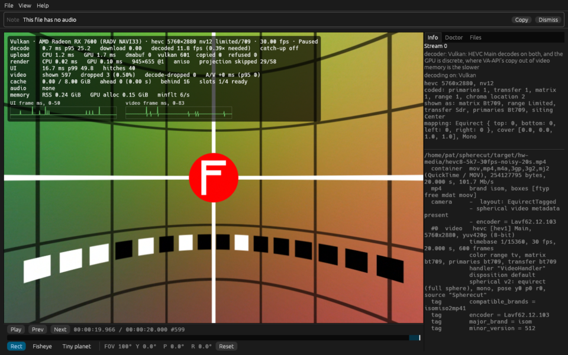
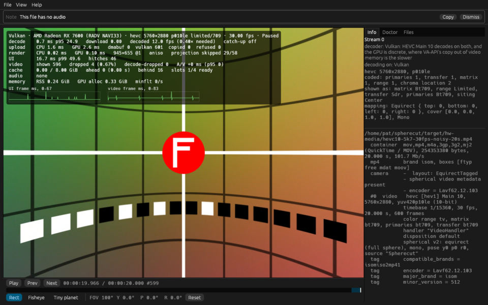
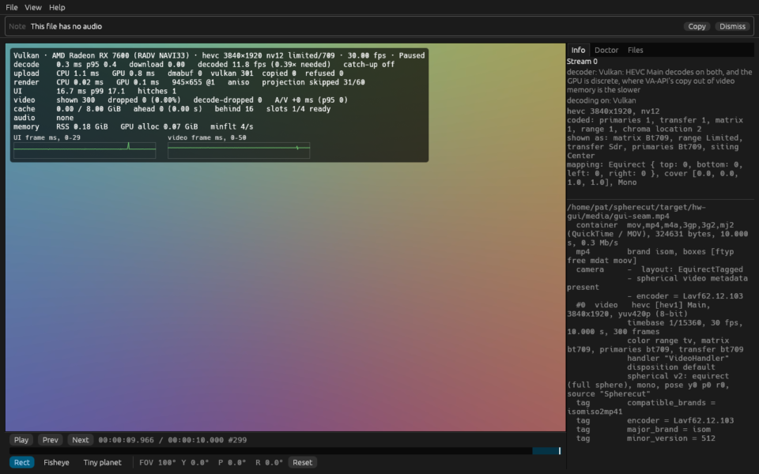
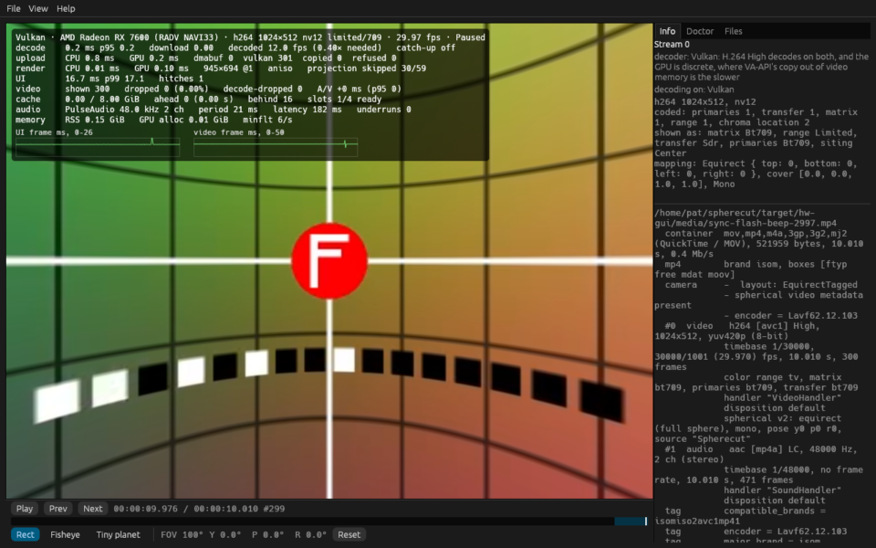
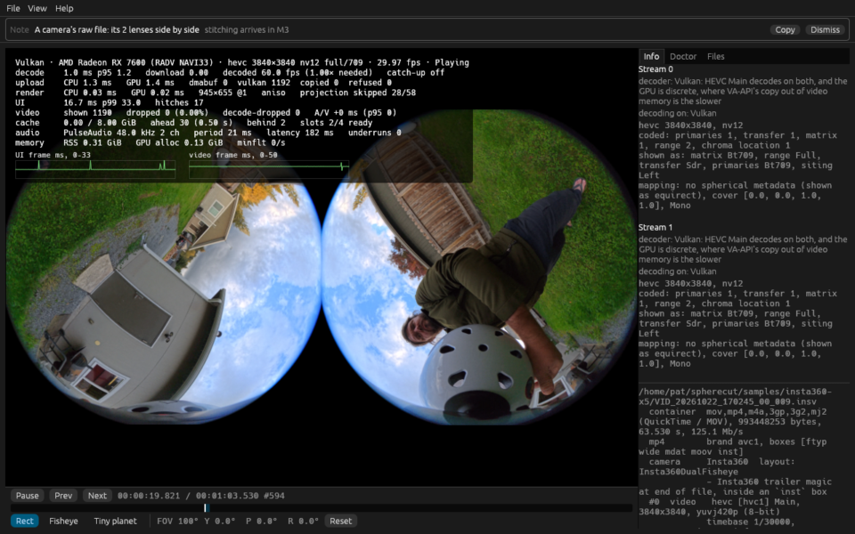

# Hardware report: odin @ 36041f7c5c

Generated by `cargo xtask hw-test --only gui_smoke` in 250 s.

## Summary

| | |
|---|---|
| Host | odin |
| OS | Fedora Linux 44 (Workstation Edition) |
| Kernel | Linux 7.2.9-200.fc44.x86_64 #1 SMP PREEMPT_DYNAMIC Sat Oct  3 19:59:55 UTC 2026 x86_64 |
| Session | wayland / GNOME |
| GUI display | WAYLAND_DISPLAY set: WAYLAND_DISPLAY=wayland-0 |
| Screen locked at the end | no |
| Audio server | PulseAudio (on PipeWire 1.6.9) |
| GNOME mutter experimental features | @as [] |
| GPU (Vulkan) | AMD Radeon RX 7600 (RADV NAVI33) |
| Mesa | Mesa 26.2.5 |
| FFmpeg | ffmpeg version 8.1.3 Copyright (c) 2000-2026 the FFmpeg developers |
| FFmpeg libs | 62.28.103, 62.12.103, 60.26.103, 9.5.103, 6.3.103 |
| Rust | rustc 1.99.0 (b940084d7 2026-09-28) |
| VA-API HEVC | decode: yes, encode: yes |
| FFmpeg hwaccels | vdpau, cuda, vaapi, qsv, drm, opencl, vulkan, amf |
| Samples dir | /home/pat/spherecut/samples (present) |

**Tier 2: 0 passed, 1 failed, 0 skipped, 39 left out by `--only`, 0 did not run (40 tests).**

**Tier 1 on this machine: left out by `--no-tier1`.**

**This run FAILED:** 1 Tier 2 test(s) failed.

## Prerequisites

Nothing missing.

## Build

Succeeded (release) in 34 s.

## Power profile

Read once, before the build, and never changed: decode speed moves with these.

| Setting | Value |
|---|---|
| power-profiles-daemon | not available (no `powerprofilesctl`) |
| ACPI platform profile | not available (no /sys/firmware/acpi/platform_profile) |
| CPU frequency driver | amd-pstate-epp |
| CPU governor | performance |
| CPU energy preference | performance |
| card0 (amdgpu) performance level | auto |
| card0 (amdgpu) power profile | not available (unreadable) |

## Render nodes

| Node | PCI slot | Vendor | Device | Driver | Opens |
|---|---|---|---|---|---|
| renderD128 | 0000:0c:00.0 | AMD (0x1002) | 0x7480 | amdgpu | yes |

## Perf clips

synth's noisy grid in HEVC at about a camera's bitrate, made once and kept in `/home/pat/spherecut/target/hw-media` for the playback benchmarks. Software decode over 150 fps would make a clip too easy to say anything about footage.

| Clip | Size | Bitrate | Made | Software decode |
|---|---:|---:|---|---|
| `hevc8-5k7-30fps-noisy-20s.mp4` | 254 MB | 101.7 Mbit/s | cached | not measured |
| `hevc10-5k7-30fps-noisy-20s.mp4` | 254 MB | 101.7 Mbit/s | cached | not measured |
| `hevc8-8k-30fps-noisy-20s.mp4` | 305 MB | 122.1 Mbit/s | cached | not measured |

## Tier 2 tests

| Test | Result |
|---|---|
| `adapters::list_adapters_and_features` | left out by `--only` |
| `goldens::goldens_on_gpu_match_reference` | left out by `--only` |
| `goldens::goldens_on_host_llvmpipe` | left out by `--only` |
| `spherecut-media/doctor::doctor_decodes_hevc_main_on_vaapi` | left out by `--only` |
| `tier2_backend::bench_seek_latency` | left out by `--only` |
| `tier2_backend::vaapi_colorinfo_matches_software` | left out by `--only` |
| `tier2_backend::vaapi_exports_match_downloads` | left out by `--only` |
| `tier2_backend::vaapi_seek_matches_software` | left out by `--only` |
| `tier2_backend::vulkan_colorinfo_matches_software` | left out by `--only` |
| `tier2_backend::vulkan_seek_matches_software` | left out by `--only` |
| `tier2_device::audio_output_device_plays` | left out by `--only` |
| `tier2_download_pool::vaapi_download_pool_reuses_buffers` | left out by `--only` |
| `tier2_download_pool::vulkan_download_pool_reuses_buffers` | left out by `--only` |
| `tier2_frame::doctor_and_the_renderer_agree_on_sharing` | left out by `--only` |
| `tier2_frame::shared_vulkan_frame_matches_the_copy` | left out by `--only` |
| `tier2_frame::vaapi_render_matches_software` | left out by `--only` |
| `tier2_frame::vulkan_render_matches_software` | left out by `--only` |
| `tier2_frame::zero_copy_frame_matches_the_copy` | left out by `--only` |
| `tier2_gui::gui_smoke` | **FAIL** |
| `tier2_hw_decode::bench_decode_hevc_4k_and_5k7` | left out by `--only` |
| `tier2_hw_decode::vaapi_h264_matches_software` | left out by `--only` |
| `tier2_hw_decode::vaapi_hevc_main10_matches_software` | left out by `--only` |
| `tier2_hw_decode::vaapi_hevc_main_matches_software` | left out by `--only` |
| `tier2_hw_decode::vulkan_h264_matches_software` | left out by `--only` |
| `tier2_hw_decode::vulkan_hevc_main10_matches_software` | left out by `--only` |
| `tier2_hw_decode::vulkan_hevc_main_matches_software` | left out by `--only` |
| `tier2_playback::bench_perf_clips_software_decode` | left out by `--only` |
| `tier2_playback::bench_playback_realtime_5k7_10bit` | left out by `--only` |
| `tier2_playback::bench_playback_realtime_5k7_8bit` | left out by `--only` |
| `tier2_playback::bench_playback_realtime_8k_8bit` | left out by `--only` |
| `tier2_playback::bench_playback_stitched_samples` | left out by `--only` |
| `tier2_playback::bench_playback_x5_raw` | left out by `--only` |
| `tier2_playback::bench_x5_8k30_zero_copy_vs_copy` | left out by `--only` |
| `tier2_playback::shared_vulkan_matches_copy_path` | left out by `--only` |
| `tier2_playback::zero_copy_matches_copy_path` | left out by `--only` |
| `tier2_samples::bench_samples_realtime_decode` | left out by `--only` |
| `tier2_samples::samples_probe_cleanly` | left out by `--only` |
| `tier2_samples::samples_vaapi_decode_matches_software` | left out by `--only` |
| `tier2_samples::samples_vulkan_decode_matches_software` | left out by `--only` |
| `upload::bench_upload_5k7` | left out by `--only` |

### FAIL `tier2_gui::gui_smoke`

```
==> noisy 5.7K 8-bit: /home/pat/spherecut/target/hw-media/hevc8-5k7-30fps-noisy-20s.mp4
==> noisy 5.7K 10-bit: /home/pat/spherecut/target/hw-media/hevc10-5k7-30fps-noisy-20s.mp4
==> seam 3840×1920 HEVC: /home/pat/spherecut/target/hw-gui/media/gui-seam.mp4
==> sync flash and beep: /home/pat/spherecut/target/hw-gui/media/sync-flash-beep-2997.mp4
==> X5 raw view insta360-x5/VID_20261022_170245_00_009.insv: /home/pat/spherecut/samples/insta360-x5/VID_20261022_170245_00_009.insv
not run: stitched samples: none under /home/pat/spherecut/samples (clip 12 is still wanted)

thread 'gui_smoke' (1532002) panicked at crates/cli/tests/tier2_gui.rs:443:5:
3 of 5 runs failed:
noisy 5.7K 8-bit: 3 of 569 frames dropped (0.53%, over 0.1%)
noisy 5.7K 8-bit: UI p99 49.9 ms, over 1.5 × the 60 Hz period (25.0 ms)
noisy 5.7K 10-bit: 4 of 569 frames dropped (0.70%, over 0.1%)
noisy 5.7K 10-bit: UI p99 49.9 ms, over 1.5 × the 60 Hz period (25.0 ms)
X5 raw view insta360-x5/VID_20261022_170245_00_009.insv: UI p99 33.0 ms, over 1.5 × the 60 Hz period (25.0 ms)
note: run with `RUST_BACKTRACE=1` environment variable to display a backtrace


```

## Benchmarks

None recorded (benchmarks need the hardware the Tier 2 tests above need).

## Tier 1 on this machine

Left out by `--no-tier1`.

## GUI smoke run

`gui_smoke` **FAILED** (its output is under Tier 2 tests). The session: WAYLAND_DISPLAY set (WAYLAND_DISPLAY=wayland-0). VA-API decodes HEVC Main, HEVC Main 10 by doctor's check, so those clips must decode in hardware. The screen was unlocked when the runs began. Presented, the UI's intervals and the frames are counted after each run's first second, while the cache fills, as the playback benches count them.

| # | Clip | Verdict | Presented | UI p50 / p99 ms | Refresh | Shown / dropped / decode-dropped | Decoder | A/V median / p95 ms | Audio |
|---:|---|---|---:|---:|---:|---:|---|---:|---|
| 0 | noisy 5.7K 8-bit | **FAILED**: 3 of 569 frames dropped (0.53%, over 0.1%); UI p99 49.9 ms, over 1.5 × the 60 Hz period (25.0 ms) | 95% | 16.7 / 49.9 | 60.00 Hz | 566 / 3 / 0 | Vulkan | 0.0 / 0.0 | none |
| 1 | noisy 5.7K 10-bit | **FAILED**: 4 of 569 frames dropped (0.70%, over 0.1%); UI p99 49.9 ms, over 1.5 × the 60 Hz period (25.0 ms) | 94% | 16.7 / 49.9 | 60.00 Hz | 565 / 4 / 0 | Vulkan | 0.0 / 0.0 | none |
| 2 | seam 3840×1920 HEVC | pass | 100% | 16.7 / 17.1 | 60.00 Hz | 269 / 0 / 0 | Vulkan | 0.0 / 0.0 | none |
| 3 | sync flash and beep | pass | 100% | 16.7 / 17.0 | 60.00 Hz | 274 / 0 / 0 | Vulkan | 0.0 / 0.0 | PulseAudio, 182 ms |
| 4 | X5 raw view insta360-x5/VID_20261022_170245_00_009.insv | **FAILED**: UI p99 33.0 ms, over 1.5 × the 60 Hz period (25.0 ms) | 99% | 16.7 / 33.0 | 60.00 Hz | 1140 / 0 / 0 | Vulkan, Vulkan | 0.0 / 0.0 | PulseAudio, 182 ms |

### 0. noisy 5.7K 8-bit

`/home/pat/spherecut/target/hw-media/hevc8-5k7-30fps-noisy-20s.mp4`

AMD Radeon RX 7600 (RADV NAVI33) (radv, Mesa 26.2.5); Bgra8Unorm at 1.0 pixels a point (the window's own 1.0), the window 1280×800 and the viewer 945×655 pixels; p50 / p95: decode 0.7 / 24.3 ms, download 0.0 / 0.0 ms, render_cpu 0.0 / 0.0 ms, render_gpu 0.1 / 0.1 ms, shown_interval 33.3 / 33.7 ms, ui_frame 16.7 / 17.0 ms, upload_cpu 1.2 / 1.6 ms, upload_gpu 1.7 / 1.8 ms; 1139 UI passes of 1139, their own work 0.9 / 1.1 ms; 39 late UI passes after the first second, the longest 83.3 ms; the slowest in their gaps decode 48.1 ms, download 0.0 ms, render_gpu 0.1 ms, upload_cpu 1.6 ms, upload_gpu 2.0 ms; played 20.0 s, to the clip's end.



### 1. noisy 5.7K 10-bit

`/home/pat/spherecut/target/hw-media/hevc10-5k7-30fps-noisy-20s.mp4`

AMD Radeon RX 7600 (RADV NAVI33) (radv, Mesa 26.2.5); Bgra8Unorm at 1.0 pixels a point (the window's own 1.0), the window 1280×800 and the viewer 945×655 pixels; p50 / p95: decode 0.8 / 23.9 ms, download 0.0 / 0.0 ms, render_cpu 0.0 / 0.0 ms, render_gpu 0.1 / 0.3 ms, shown_interval 33.3 / 49.6 ms, ui_frame 16.7 / 17.0 ms, upload_cpu 1.6 / 1.9 ms, upload_gpu 2.6 / 2.9 ms; 1130 UI passes of 1130, their own work 0.9 / 1.1 ms; 44 late UI passes after the first second, the longest 67.1 ms; the slowest in their gaps decode 17.8 ms, download 0.0 ms, render_gpu 0.3 ms, upload_cpu 1.8 ms, upload_gpu 2.9 ms; played 20.0 s, to the clip's end.



### 2. seam 3840×1920 HEVC

`/home/pat/spherecut/target/hw-gui/media/gui-seam.mp4`

AMD Radeon RX 7600 (RADV NAVI33) (radv, Mesa 26.2.5); Bgra8Unorm at 1.0 pixels a point (the window's own 1.0), the window 1280×800 and the viewer 945×655 pixels; p50 / p95: decode 0.3 / 0.4 ms, download 0.0 / 0.0 ms, render_cpu 0.0 / 0.0 ms, render_gpu 0.1 / 0.5 ms, shown_interval 33.3 / 33.5 ms, ui_frame 16.7 / 16.9 ms, upload_cpu 1.1 / 2.1 ms, upload_gpu 0.8 / 1.2 ms; 599 UI passes of 599, their own work 0.8 / 1.2 ms; 1 late UI pass after the first second, the longest 28.7 ms; the slowest in their gaps decode 0.3 ms, download 0.0 ms, render_gpu 0.1 ms, upload_cpu 1.9 ms, upload_gpu 0.8 ms; played 10.0 s, to the clip's end.



### 3. sync flash and beep

`/home/pat/spherecut/target/hw-gui/media/sync-flash-beep-2997.mp4`

AMD Radeon RX 7600 (RADV NAVI33) (radv, Mesa 26.2.5); Bgra8Unorm at 1.0 pixels a point (the window's own 1.0), the window 1280×800 and the viewer 945×694 pixels; p50 / p95: decode 0.2 / 0.2 ms, download 0.0 / 0.0 ms, render_cpu 0.0 / 0.0 ms, render_gpu 0.1 / 0.1 ms, shown_interval 33.3 / 33.6 ms, ui_frame 16.7 / 16.9 ms, upload_cpu 0.8 / 1.0 ms, upload_gpu 0.2 / 0.2 ms; 611 UI passes of 611, their own work 0.8 / 1.1 ms; 1 late UI pass after the first second, the longest 26.3 ms; played 10.2 s, to the clip's end.



### 4. X5 raw view insta360-x5/VID_20261022_170245_00_009.insv

`/home/pat/spherecut/samples/insta360-x5/VID_20261022_170245_00_009.insv`

AMD Radeon RX 7600 (RADV NAVI33) (radv, Mesa 26.2.5); Bgra8Unorm at 1.0 pixels a point (the window's own 1.0), the window 1280×800 and the viewer 945×655 pixels; p50 / p95: decode 1.0 / 1.2 ms, download 0.0 / 0.0 ms, render_cpu 0.0 / 0.1 ms, render_gpu 0.0 / 0.0 ms, shown_interval 33.3 / 33.6 ms, ui_frame 16.7 / 16.9 ms, upload_cpu 1.3 / 1.6 ms, upload_gpu 1.4 / 1.5 ms; 1183 UI passes of 1183, their own work 1.0 / 1.4 ms; 16 late UI passes after the first second, the longest 34.1 ms; the slowest in their gaps decode 1.4 ms, download 0.0 ms, render_gpu 0.0 ms, upload_cpu 4.9 ms, upload_gpu 1.6 ms; played 20.0 s.



Not run:

- stitched samples: none under /home/pat/spherecut/samples (clip 12 is still wanted)

## Raw environment

<details><summary>spherecut doctor (<code>/home/pat/spherecut/target/release/spherecut doctor</code>)</summary>

```
FFmpeg 8.1.3
  libavcodec 62.28.103, libavformat 62.12.103, libavutil 60.26.103, libswresample 6.3.103, libswscale 9.5.103
  hardware device types: vdpau, cuda, vaapi, qsv, drm, opencl, vulkan, amf

Decoders
  h264       yes  (hw: cuda, vaapi, vdpau, vulkan)
  hevc       yes  (hw: cuda, vaapi, vdpau, vulkan)
  av1        yes  (hw: cuda, vaapi, vdpau, vulkan)
  libdav1d   yes
  prores     yes
  aac        yes
  opus       yes
  pcm_s16le  yes

Encoders
  libx264    yes
  libx265    yes
  libsvtav1  yes
  h264_vaapi yes
  hevc_vaapi yes
  av1_vaapi  yes
  prores_ks  yes
  aac        yes

Hardware devices
  vaapi   /dev/dri/renderD128    ok
  vulkan  (default)              ok, on AMD Radeon RX 7600 (RADV NAVI33)

Vulkan devices
  AMD Radeon RX 7600 (RADV NAVI33)  (FFmpeg uses this one)
    discrete GPU; driver radv (Mesa 26.2.5); Vulkan 1.4.354; vendor 0x1002 device 0x7480
    zero copy: DMA-BUF import yes; shared with FFmpeg's Vulkan Video yes
  llvmpipe (LLVM 22.1.8, 256 bits)
    CPU: no GPU acceleration; driver llvmpipe (Mesa 26.2.5 (LLVM 22.1.8)); Vulkan 1.4.354; vendor 0x10005 device 0x0000
    zero copy: DMA-BUF import yes; shared with FFmpeg's Vulkan Video no: the device lacks VK_KHR_video_queue

Zero copy: Vulkan Video's frames, decoded on the renderer's own device where it can be shared; VA-API's and the rest are copied through RAM (SPHERECUT_ZERO_COPY=1 imports VA-API's too, 0 copies every frame)

Decode check: one 256x256 frame each, no fallback to software; the hardware's
picture must match the software decoder's
                 software    vaapi       vulkan
  H.264 High     works       works       works
  HEVC Main      works       works       works
  HEVC Main 10   works       works       works
  AV1 Main       works       works       works

Encode check: one 256x256 frame each on VA-API, decoded back in software
                 vaapi
  H.264          works
  HEVC Main      works
  HEVC Main 10   works
  AV1            works

No problems found.
```
</details>

<details><summary>rustc (<code>rustc -Vv</code>)</summary>

```
rustc 1.99.0 (b940084d7 2026-09-28)
binary: rustc
commit-hash: b940084d7eb6a299eb4bfeb8e34901bc051e7ac4
commit-date: 2026-09-28
host: x86_64-unknown-linux-gnu
release: 1.99.0
LLVM version: 23.1.1
```
</details>

<details><summary>pactl info (<code>pactl info</code>)</summary>

```
Server String: /run/user/1000/pulse/native
Library Protocol Version: 35
Server Protocol Version: 35
Is Local: yes
Client Index: 6194
Tile Size: 65472
User Name: pat
Host Name: odin
Server Name: PulseAudio (on PipeWire 1.6.9)
Server Version: 15.0.0
Default Sample Specification: float32le 2ch 48000Hz
Default Channel Map: front-left,front-right
Default Sink: bluez_output.CC_14_BC_63_40_50.1
Default Source: alsa_input.usb-0c76_USB_PnP_Audio_Device-00.pro-input-0
Cookie: 566c:5c45
```
</details>

<details><summary>GPUs (lspci) (<code>sh -c lspci -nn | grep -Ei 'vga|display|3d'</code>)</summary>

```
0c:00.0 VGA compatible controller [0300]: Advanced Micro Devices, Inc. [AMD/ATI] Navi 33 [Radeon RX 7600/7600 XT/7600M XT/7600S/7700S / PRO W7600] [1002:7480] (rev cf)
```
</details>

<details><summary>vulkaninfo --summary (<code>vulkaninfo --summary</code>)</summary>

```
==========
VULKANINFO
==========

Vulkan Instance Version: 1.4.341


Instance Extensions: count = 26
-------------------------------
VK_EXT_acquire_drm_display             : extension revision 1
VK_EXT_acquire_xlib_display            : extension revision 1
VK_EXT_debug_report                    : extension revision 10
VK_EXT_debug_utils                     : extension revision 2
VK_EXT_direct_mode_display             : extension revision 1
VK_EXT_display_surface_counter         : extension revision 1
VK_EXT_headless_surface                : extension revision 1
VK_EXT_layer_settings                  : extension revision 2
VK_EXT_surface_maintenance1            : extension revision 1
VK_EXT_swapchain_colorspace            : extension revision 5
VK_KHR_device_group_creation           : extension revision 1
VK_KHR_display                         : extension revision 23
VK_KHR_external_fence_capabilities     : extension revision 1
VK_KHR_external_memory_capabilities    : extension revision 1
VK_KHR_external_semaphore_capabilities : extension revision 1
VK_KHR_get_display_properties2         : extension revision 1
VK_KHR_get_physical_device_properties2 : extension revision 2
VK_KHR_get_surface_capabilities2       : extension revision 1
VK_KHR_portability_enumeration         : extension revision 1
VK_KHR_surface                         : extension revision 25
VK_KHR_surface_maintenance1            : extension revision 1
VK_KHR_surface_protected_capabilities  : extension revision 1
VK_KHR_wayland_surface                 : extension revision 6
VK_KHR_xcb_surface                     : extension revision 6
VK_KHR_xlib_surface                    : extension revision 6
VK_LUNARG_direct_driver_loading        : extension revision 1

Instance Layers: count = 6
--------------------------
VK_LAYER_MESA_anti_lag            Open-source implementation of the VK_AMD_anti_lag extension. 1.4.303  version 1
VK_LAYER_MESA_device_select       Linux device selection layer                                 1.4.303  version 1
VK_LAYER_VALVE_steam_fossilize_32 Steam Pipeline Caching Layer                                 1.3.207  version 1
VK_LAYER_VALVE_steam_fossilize_64 Steam Pipeline Caching Layer                                 1.3.207  version 1
VK_LAYER_VALVE_steam_overlay_32   Steam Overlay Layer                                          1.3.207  version 1
VK_LAYER_VALVE_steam_overlay_64   Steam Overlay Layer                                          1.3.207  version 1

Devices:
========
GPU0:
	apiVersion         = 1.4.354
	driverVersion      = 26.2.5
	vendorID           = 0x1002
	deviceID           = 0x7480
	deviceType         = PHYSICAL_DEVICE_TYPE_DISCRETE_GPU
	deviceName         = AMD Radeon RX 7600 (RADV NAVI33)
	driverID           = DRIVER_ID_MESA_RADV
	driverName         = radv
	driverInfo         = Mesa 26.2.5
	conformanceVersion = 1.4.5.3
	deviceUUID         = 00000000-0c00-0000-0000-000000000000
	driverUUID         = 414d442d-4d45-5341-2d44-525600000000
GPU1:
	apiVersion         = 1.4.354
	driverVersion      = 26.2.5
	vendorID           = 0x10005
	deviceID           = 0x0000
	deviceType         = PHYSICAL_DEVICE_TYPE_CPU
	deviceName         = llvmpipe (LLVM 22.1.8, 256 bits)
	driverID           = DRIVER_ID_MESA_LLVMPIPE
	driverName         = llvmpipe
	driverInfo         = Mesa 26.2.5 (LLVM 22.1.8)
	conformanceVersion = 1.3.1.1
	deviceUUID         = 6d657361-3236-2e32-2e35-000000000000
	driverUUID         = 6c6c766d-7069-7065-5555-494400000000
WARNING: [Loader Message] Code 0 : terminator_CreateInstance: Received return code -9 from call to vkCreateInstance in ICD /usr/lib64/dri-freeworld/libvulkan_dzn.so. Skipping this driver.
WARNING: [Loader Message] Code 0 : ICD for selected physical device does not export vkGetPhysicalDeviceDisplayPlanePropertiesKHR!
WARNING: [Loader Message] Code 0 : ICD for selected physical device does not export vkGetPhysicalDeviceDisplayPropertiesKHR!
```
</details>

<details><summary>vainfo (<code>vainfo --display drm --device /dev/dri/renderD128</code>)</summary>

```
Trying display: drm
vainfo: VA-API version: 1.23 (libva 2.23.0)
vainfo: Driver version: Mesa Gallium driver 26.2.5 for AMD Radeon RX 7600 (radeonsi, navi33, ACO, DRM 3.64, 7.2.9-200.fc44.x86_64)
vainfo: Supported profile and entrypoints
      VAProfileH264ConstrainedBaseline:	VAEntrypointVLD
      VAProfileH264ConstrainedBaseline:	VAEntrypointEncSlice
      VAProfileH264Main               :	VAEntrypointVLD
      VAProfileH264Main               :	VAEntrypointEncSlice
      VAProfileH264High               :	VAEntrypointVLD
      VAProfileH264High               :	VAEntrypointEncSlice
      VAProfileHEVCMain               :	VAEntrypointVLD
      VAProfileHEVCMain               :	VAEntrypointEncSlice
      VAProfileHEVCMain10             :	VAEntrypointVLD
      VAProfileHEVCMain10             :	VAEntrypointEncSlice
      VAProfileVP9Profile0            :	VAEntrypointVLD
      VAProfileVP9Profile2            :	VAEntrypointVLD
      VAProfileAV1Profile0            :	VAEntrypointVLD
      VAProfileAV1Profile0            :	VAEntrypointEncSlice
      VAProfileNone                   :	VAEntrypointVideoProc
libva info: VA-API version 1.23.0
libva info: Trying to open /usr/lib64/dri-nonfree/radeonsi_drv_video.so
libva info: Trying to open /usr/lib64/dri-freeworld/radeonsi_drv_video.so
libva info: Found init function __vaDriverInit_1_23
libva info: va_openDriver() returns 0
```
</details>

<details><summary>ffmpeg -version (<code>ffmpeg -hide_banner -version</code>)</summary>

```
ffmpeg version 8.1.3 Copyright (c) 2000-2026 the FFmpeg developers
built with gcc 16 (GCC)
configuration: --prefix=/usr --bindir=/usr/bin --datadir=/usr/share/ffmpeg --docdir=/usr/share/doc/ffmpeg --incdir=/usr/include/ffmpeg --libdir=/usr/lib64 --mandir=/usr/share/man --arch=x86_64 --optflags='-O2 -flto=auto -ffat-lto-objects -fexceptions -g -grecord-gcc-switches -pipe -Wall -Wno-complain-wrong-lang -Werror=format-security -Wp,-U_FORTIFY_SOURCE,-D_FORTIFY_SOURCE=3 -Wp,-D_GLIBCXX_ASSERTIONS -specs=/usr/lib/rpm/redhat/redhat-hardened-cc1 -fstack-protector-strong -specs=/usr/lib/rpm/redhat/redhat-annobin-cc1 -m64 -march=x86-64 -mtune=generic -fasynchronous-unwind-tables -fstack-clash-protection -fcf-protection -mtls-dialect=gnu2 -fno-omit-frame-pointer -mno-omit-leaf-frame-pointer' --extra-ldflags='-Wl,-z,relro -Wl,--as-needed -Wl,-z,pack-relative-relocs -Wl,-z,now -specs=/usr/lib/rpm/redhat/redhat-hardened-ld -specs=/usr/lib/rpm/redhat/redhat-hardened-ld-errors -specs=/usr/lib/rpm/redhat/redhat-annobin-cc1 -Wl,--build-id=sha1 -specs=/usr/lib/rpm/redhat/redhat-package-notes ' --extra-cflags=' -I/usr/include/rav1e' --enable-libopencore-amrnb --enable-libopencore-amrwb --enable-libvo-amrwbenc --enable-version3 --enable-bzlib --enable-chromaprint --enable-fontconfig --enable-frei0r --enable-gcrypt --enable-gnutls --enable-ladspa --enable-lcms2 --enable-libaom --enable-libaribb24 --enable-libaribcaption --enable-libdav1d --enable-libass --enable-libbluray --enable-libbs2b --enable-libcodec2 --enable-cuda --enable-cuda-llvm --enable-cuvid --enable-libcdio --enable-libdrm --enable-libfdk-aac --enable-libjack --enable-libjxl --enable-libklvanc --enable-libfreetype --enable-libfribidi --enable-libgme --enable-libgsm --enable-libharfbuzz --enable-libilbc --enable-liblc3 --enable-libmp3lame --enable-libmysofa --enable-nvenc --enable-nvdec --enable-openal --enable-liboapv --enable-opencl --enable-opengl --enable-libopenh264 --enable-libopenjpeg --enable-libopenmpt --enable-libopus --enable-libpulse --enable-libplacebo --enable-librsvg --enable-librav1e --enable-librubberband --enable-libqrencode --enable-libsmbclient --enable-version3 --enable-libsnappy --enable-libsoxr --enable-libspeex --enable-libsrt --enable-libssh --enable-libsvtav1 --enable-libtesseract --enable-libtheora --enable-libtwolame --enable-libvorbis --enable-libv4l2 --enable-libvidstab --enable-libvmaf --enable-version3 --enable-vapoursynth --enable-libvpx --enable-libvvenc --enable-vulkan --enable-libshaderc --enable-libwebp --enable-libx264 --enable-libx265 --enable-libxvid --enable-libxml2 --enable-libzimg --enable-libzmq --enable-libzvbi --enable-lv2 --enable-avfilter --enable-libmodplug --enable-pthreads --disable-static --enable-shared --enable-gpl --disable-debug --disable-stripping --shlibdir=/usr/lib64 --enable-lto --enable-libvpl --enable-runtime-cpudetect
libavutil      60. 26.103 / 60. 26.103
libavcodec     62. 28.103 / 62. 28.103
libavformat    62. 12.103 / 62. 12.103
libavdevice    62.  3.103 / 62.  3.103
libavfilter    11. 14.103 / 11. 14.103
libswscale      9.  5.103 /  9.  5.103
libswresample   6.  3.103 /  6.  3.103

Exiting with exit code 0
```
</details>

<details><summary>ffmpeg -hwaccels (<code>ffmpeg -hide_banner -hwaccels</code>)</summary>

```
Hardware acceleration methods:
vdpau
cuda
vaapi
qsv
drm
opencl
vulkan
amf
```
</details>

<details><summary>ffmpeg encoders (filtered) (<code>ffmpeg -hide_banner -encoders</code>)</summary>

```
 V....D libaom-av1           libaom AV1 (codec av1)
 V..... libsvtav1            SVT-AV1(Scalable Video Technology for AV1) encoder (codec av1)
 V....D av1_vaapi            AV1 (VAAPI) (codec av1)
 V....D av1_vulkan           AV1 (Vulkan) (codec av1)
 V....D libx264              libx264 H.264 / AVC / MPEG-4 AVC / MPEG-4 part 10 (codec h264)
 V....D libx264rgb           libx264 H.264 / AVC / MPEG-4 AVC / MPEG-4 part 10 RGB (codec h264)
 V....D h264_vaapi           H.264/AVC (VAAPI) (codec h264)
 V....D h264_vulkan          H.264/AVC (Vulkan) (codec h264)
 V....D libx265              libx265 H.265 / HEVC (codec hevc)
 V....D hevc_vaapi           H.265/HEVC (VAAPI) (codec hevc)
 V....D hevc_vulkan          H.265/HEVC (Vulkan) (codec hevc)
 V....D mjpeg_vaapi          MJPEG (VAAPI) (codec mjpeg)
 V....D mpeg2_vaapi          MPEG-2 (VAAPI) (codec mpeg2video)
 VF...D prores               Apple ProRes
 VF...D prores_aw            Apple ProRes (codec prores)
 VFS... prores_ks            Apple ProRes (iCodec Pro) (codec prores)
 V....D vp8_vaapi            VP8 (VAAPI) (codec vp8)
 V....D vp9_vaapi            VP9 (VAAPI) (codec vp9)
```
</details>

<details><summary>ffmpeg decoders (filtered) (<code>ffmpeg -hide_banner -decoders</code>)</summary>

```
 V..... libdav1d             dav1d AV1 decoder by VideoLAN (codec av1)
 V....D libaom-av1           libaom AV1 (codec av1)
 V....D av1                  Alliance for Open Media AV1
 V..... av1_cuvid            Nvidia CUVID AV1 decoder (codec av1)
 V....D av1_qsv              AV1 video (Intel Quick Sync Video acceleration) (codec av1)
 V..... av1_amf              AV1 AMD AMF video decoder (codec av1)
 VFS..D h264                 H.264 / AVC / MPEG-4 AVC / MPEG-4 part 10
 V..... h264_v4l2m2m         V4L2 mem2mem H.264 decoder wrapper (codec h264)
 V....D h264_qsv             H264 video (Intel Quick Sync Video acceleration) (codec h264)
 V....D libopenh264          OpenH264 H.264 / AVC / MPEG-4 AVC / MPEG-4 part 10 (codec h264)
 V..... h264_amf             H264 AMD AMF video decoder (codec h264)
 V..... h264_cuvid           Nvidia CUVID H264 decoder (codec h264)
 VFS..D hevc                 HEVC (High Efficiency Video Coding)
 V....D hevc_qsv             HEVC video (Intel Quick Sync Video acceleration) (codec hevc)
 V..... hevc_v4l2m2m         V4L2 mem2mem HEVC decoder wrapper (codec hevc)
 V..... hevc_amf             HEVC AMD AMF video decoder (codec hevc)
 V..... hevc_cuvid           Nvidia CUVID HEVC decoder (codec hevc)
 VFS..D prores               Apple ProRes (iCodec Pro)
 VFS..D prores_raw           Apple ProRes RAW
 A....D wmav1                Windows Media Audio 1
```
</details>

<details><summary>Tier 2 test list (<code>cargo test --workspace --no-fail-fast --color never --release -- --ignored --list --format pretty</code>)</summary>

```
    Finished `release` profile [optimized + debuginfo] target(s) in 0.16s
     Running unittests src/lib.rs (target/release/deps/spherecut_app-6034479b73c6a23d)
0 tests, 0 benchmarks
     Running tests/never_blocks.rs (target/release/deps/never_blocks-b9134845d1a1bbf5)
0 tests, 0 benchmarks
     Running tests/overlay.rs (target/release/deps/overlay-16ecf99af0b30ac5)
0 tests, 0 benchmarks
     Running tests/panes.rs (target/release/deps/panes-1b18fbf85c03ab60)
0 tests, 0 benchmarks
     Running tests/raw.rs (target/release/deps/raw-8852a11d7efd69cf)
0 tests, 0 benchmarks
     Running tests/scrub.rs (target/release/deps/scrub-f1aab3ee9e210f95)
0 tests, 0 benchmarks
     Running tests/settings.rs (target/release/deps/settings-ea2761339a220204)
0 tests, 0 benchmarks
     Running tests/smoke.rs (target/release/deps/smoke-624bbb329dd0358a)
0 tests, 0 benchmarks
     Running tests/viewer.rs (target/release/deps/viewer-b299a7af5ad13d2a)
0 tests, 0 benchmarks
     Running unittests src/lib.rs (target/release/deps/spherecut_audio-76973c2fb5a7185e)
0 tests, 0 benchmarks
     Running tests/clock.rs (target/release/deps/clock-fdff8106b1a0655d)
0 tests, 0 benchmarks
     Running tests/tier2_device.rs (target/release/deps/tier2_device-c2f0395f571a3b41)
audio_output_device_plays: test

1 test, 0 benchmarks
     Running unittests src/lib.rs (target/release/deps/spherecut_cli-bb9c3d1ba954c2dd)
0 tests, 0 benchmarks
     Running unittests src/main.rs (target/release/deps/spherecut-58c6b7b256e33234)
0 tests, 0 benchmarks
     Running tests/confinement.rs (target/release/deps/confinement-f25c414d78ed7086)
0 tests, 0 benchmarks
     Running tests/contract.rs (target/release/deps/contract-4d8689507f597319)
0 tests, 0 benchmarks
     Running tests/doctor.rs (target/release/deps/doctor-3c72863499e4c732)
0 tests, 0 benchmarks
     Running tests/frame.rs (target/release/deps/frame-6d8d684e31de77d8)
0 tests, 0 benchmarks
     Running tests/logging.rs (target/release/deps/logging-ffaf597a849c5a3c)
0 tests, 0 benchmarks
     Running tests/probe.rs (target/release/deps/probe-898d909acab319ca)
0 tests, 0 benchmarks
     Running tests/probe_tags.rs (target/release/deps/probe_tags-153623650ceec960)
0 tests, 0 benchmarks
     Running tests/tier2_frame.rs (target/release/deps/tier2_frame-740ed818f0a3c04c)
doctor_and_the_renderer_agree_on_sharing: test
shared_vulkan_frame_matches_the_copy: test
vaapi_render_matches_software: test
vulkan_render_matches_software: test
zero_copy_frame_matches_the_copy: test

5 tests, 0 benchmarks
     Running tests/tier2_gui.rs (target/release/deps/tier2_gui-65e1668cd82b7f30)
gui_smoke: test

1 test, 0 benchmarks
     Running unittests src/lib.rs (target/release/deps/spherecut_core-e788f4f1141c8d9e)
0 tests, 0 benchmarks
     Running unittests src/lib.rs (target/release/deps/spherecut_media-6771d0d6e800b7ab)
0 tests, 0 benchmarks
     Running tests/confinement.rs (target/release/deps/confinement-42fa8f8c3eb275f6)
0 tests, 0 benchmarks
     Running tests/doctor.rs (target/release/deps/doctor-f2216d07f76b0471)
doctor_decodes_hevc_main_on_vaapi: test

1 test, 0 benchmarks
     Running tests/ffmpeg_log_capture.rs (target/release/deps/ffmpeg_log_capture-cf463267a50ed045)
0 tests, 0 benchmarks
     Running tests/hw_refusal.rs (target/release/deps/hw_refusal-94477ad93ba24933)
0 tests, 0 benchmarks
     Running tests/non_utf8_names.rs (target/release/deps/non_utf8_names-863e6a49db1e4870)
0 tests, 0 benchmarks
     Running tests/tier2_download_pool.rs (target/release/deps/tier2_download_pool-146773ff6d01068a)
vaapi_download_pool_reuses_buffers: test
vulkan_download_pool_reuses_buffers: test

2 tests, 0 benchmarks
     Running tests/tier2_samples.rs (target/release/deps/tier2_samples-03fe4376290f97d1)
bench_samples_realtime_decode: test
samples_probe_cleanly: test
samples_vaapi_decode_matches_software: test
samples_vulkan_decode_matches_software: test

4 tests, 0 benchmarks
     Running tests/vulkan_device.rs (target/release/deps/vulkan_device-00874aac69149912)
0 tests, 0 benchmarks
     Running unittests src/lib.rs (target/release/deps/spherecut_playback-d2b5d0f41f036031)
0 tests, 0 benchmarks
     Running tests/av_sync.rs (target/release/deps/av_sync-5e02bd5198ec0cc9)
0 tests, 0 benchmarks
     Running tests/cache.rs (target/release/deps/cache-583cfe018619bb5d)
0 tests, 0 benchmarks
     Running tests/engine.rs (target/release/deps/engine-dd36d60baafbd039)
0 tests, 0 benchmarks
     Running tests/never_blocks.rs (target/release/deps/never_blocks-5c797ef85bbeb644)
0 tests, 0 benchmarks
     Running tests/tier2_playback.rs (target/release/deps/tier2_playback-db73b73f315ab009)
bench_perf_clips_software_decode: test
bench_playback_realtime_5k7_10bit: test
bench_playback_realtime_5k7_8bit: test
bench_playback_realtime_8k_8bit: test
bench_playback_stitched_samples: test
bench_playback_x5_raw: test
bench_x5_8k30_zero_copy_vs_copy: test
shared_vulkan_matches_copy_path: test
zero_copy_matches_copy_path: test

9 tests, 0 benchmarks
     Running unittests src/lib.rs (target/release/deps/spherecut_render-11a3ab8e2adc6931)
0 tests, 0 benchmarks
     Running tests/adapters.rs (target/release/deps/adapters-738e9c6efd8ed647)
list_adapters_and_features: test

1 test, 0 benchmarks
     Running tests/goldens.rs (target/release/deps/goldens-1e5711de87fcc0f5)
goldens_on_gpu_match_reference: test
goldens_on_host_llvmpipe: test

2 tests, 0 benchmarks
     Running tests/lost.rs (target/release/deps/lost-6d9d67a2934c3a8b)
0 tests, 0 benchmarks
     Running tests/pipelines.rs (target/release/deps/pipelines-c3b30e34a5f74937)
0 tests, 0 benchmarks
     Running tests/render.rs (target/release/deps/render-ab11de852ceea8fa)
0 tests, 0 benchmarks
     Running tests/shared_vulkan.rs (target/release/deps/shared_vulkan-6b3685cd717a05e2)
0 tests, 0 benchmarks
     Running tests/upload.rs (target/release/deps/upload-3980adbbb88128ed)
bench_upload_5k7: test

1 test, 0 benchmarks
     Running unittests src/lib.rs (target/release/deps/spherecut_sphere-cbfe218e15a8b7e0)
0 tests, 0 benchmarks
     Running unittests src/lib.rs (target/release/deps/spherecut_synth-7ae180313d484598)
0 tests, 0 benchmarks
     Running tests/audio.rs (target/release/deps/audio-a4fc7ce99678d736)
0 tests, 0 benchmarks
     Running tests/decode_errors.rs (target/release/deps/decode_errors-af3bd1c3e3487872)
0 tests, 0 benchmarks
     Running tests/fallback.rs (target/release/deps/fallback-5fd2ab2e35823ea1)
0 tests, 0 benchmarks
     Running tests/generated_media.rs (target/release/deps/generated_media-6ebfcafdf90e3da9)
0 tests, 0 benchmarks
     Running tests/seek.rs (target/release/deps/seek-7392820fccdb85da)
0 tests, 0 benchmarks
     Running tests/tier2_backend.rs (target/release/deps/tier2_backend-defcfe50da9ffdf0)
bench_seek_latency: test
vaapi_colorinfo_matches_software: test
vaapi_exports_match_downloads: test
vaapi_seek_matches_software: test
vulkan_colorinfo_matches_software: test
vulkan_seek_matches_software: test

6 tests, 0 benchmarks
     Running tests/tier2_hw_decode.rs (target/release/deps/tier2_hw_decode-211b00e2273211e2)
bench_decode_hevc_4k_and_5k7: test
vaapi_h264_matches_software: test
vaapi_hevc_main10_matches_software: test
vaapi_hevc_main_matches_software: test
vulkan_h264_matches_software: test
vulkan_hevc_main10_matches_software: test
vulkan_hevc_main_matches_software: test

7 tests, 0 benchmarks
     Running tests/writers.rs (target/release/deps/writers-64b355527cf48c43)
0 tests, 0 benchmarks
     Running unittests src/lib.rs (target/release/deps/spherecut_testkit-4a2f3b19d1994696)
0 tests, 0 benchmarks
     Running unittests src/main.rs (target/release/deps/xtask-f55a1c2f31e8c47b)
0 tests, 0 benchmarks
   Doc-tests spherecut_app
0 tests, 0 benchmarks
   Doc-tests spherecut_audio
0 tests, 0 benchmarks
   Doc-tests spherecut_cli
0 tests, 0 benchmarks
   Doc-tests spherecut_core
0 tests, 0 benchmarks
   Doc-tests spherecut_media
0 tests, 0 benchmarks
   Doc-tests spherecut_playback
0 tests, 0 benchmarks
   Doc-tests spherecut_render
0 tests, 0 benchmarks
   Doc-tests spherecut_sphere
0 tests, 0 benchmarks
   Doc-tests spherecut_synth
0 tests, 0 benchmarks
   Doc-tests spherecut_testkit
0 tests, 0 benchmarks
```
</details>

<details><summary>test output (<code>cargo test --workspace --no-fail-fast --color never --release -- --ignored --test-threads=1 --format pretty --exact gui_smoke</code>, failed)</summary>

```

     Running tests/smoke.rs (target/release/deps/smoke-624bbb329dd0358a)

running 0 tests

test result: ok. 0 passed; 0 failed; 0 ignored; 0 measured; 6 filtered out; finished in 0.00s

     Running tests/viewer.rs (target/release/deps/viewer-b299a7af5ad13d2a)

running 0 tests

test result: ok. 0 passed; 0 failed; 0 ignored; 0 measured; 10 filtered out; finished in 0.00s

     Running unittests src/lib.rs (target/release/deps/spherecut_audio-76973c2fb5a7185e)

running 0 tests

test result: ok. 0 passed; 0 failed; 0 ignored; 0 measured; 10 filtered out; finished in 0.00s

     Running tests/clock.rs (target/release/deps/clock-fdff8106b1a0655d)

running 0 tests

test result: ok. 0 passed; 0 failed; 0 ignored; 0 measured; 13 filtered out; finished in 0.00s

     Running tests/tier2_device.rs (target/release/deps/tier2_device-c2f0395f571a3b41)

running 0 tests

test result: ok. 0 passed; 0 failed; 0 ignored; 0 measured; 1 filtered out; finished in 0.00s

     Running unittests src/lib.rs (target/release/deps/spherecut_cli-bb9c3d1ba954c2dd)

running 0 tests

test result: ok. 0 passed; 0 failed; 0 ignored; 0 measured; 4 filtered out; finished in 0.00s

     Running unittests src/main.rs (target/release/deps/spherecut-58c6b7b256e33234)

running 0 tests

test result: ok. 0 passed; 0 failed; 0 ignored; 0 measured; 0 filtered out; finished in 0.00s

     Running tests/confinement.rs (target/release/deps/confinement-f25c414d78ed7086)

running 0 tests

test result: ok. 0 passed; 0 failed; 0 ignored; 0 measured; 5 filtered out; finished in 0.00s

     Running tests/contract.rs (target/release/deps/contract-4d8689507f597319)

running 0 tests

test result: ok. 0 passed; 0 failed; 0 ignored; 0 measured; 21 filtered out; finished in 0.00s

     Running tests/doctor.rs (target/release/deps/doctor-3c72863499e4c732)

running 0 tests

test result: ok. 0 passed; 0 failed; 0 ignored; 0 measured; 4 filtered out; finished in 0.00s

     Running tests/frame.rs (target/release/deps/frame-6d8d684e31de77d8)

running 0 tests

test result: ok. 0 passed; 0 failed; 0 ignored; 0 measured; 12 filtered out; finished in 0.00s

     Running tests/logging.rs (target/release/deps/logging-ffaf597a849c5a3c)

running 0 tests

test result: ok. 0 passed; 0 failed; 0 ignored; 0 measured; 1 filtered out; finished in 0.00s

     Running tests/probe.rs (target/release/deps/probe-898d909acab319ca)

running 0 tests

test result: ok. 0 passed; 0 failed; 0 ignored; 0 measured; 18 filtered out; finished in 0.00s

     Running tests/probe_tags.rs (target/release/deps/probe_tags-153623650ceec960)

running 0 tests

test result: ok. 0 passed; 0 failed; 0 ignored; 0 measured; 1 filtered out; finished in 0.00s

     Running tests/tier2_frame.rs (target/release/deps/tier2_frame-740ed818f0a3c04c)

running 0 tests

test result: ok. 0 passed; 0 failed; 0 ignored; 0 measured; 6 filtered out; finished in 0.00s

     Running tests/tier2_gui.rs (target/release/deps/tier2_gui-65e1668cd82b7f30)

running 1 test
test gui_smoke ... FAILED

failures:

---- gui_smoke stdout ----
==> noisy 5.7K 8-bit: /home/pat/spherecut/target/hw-media/hevc8-5k7-30fps-noisy-20s.mp4
==> noisy 5.7K 10-bit: /home/pat/spherecut/target/hw-media/hevc10-5k7-30fps-noisy-20s.mp4
==> seam 3840×1920 HEVC: /home/pat/spherecut/target/hw-gui/media/gui-seam.mp4
==> sync flash and beep: /home/pat/spherecut/target/hw-gui/media/sync-flash-beep-2997.mp4
==> X5 raw view insta360-x5/VID_20261022_170245_00_009.insv: /home/pat/spherecut/samples/insta360-x5/VID_20261022_170245_00_009.insv
not run: stitched samples: none under /home/pat/spherecut/samples (clip 12 is still wanted)

thread 'gui_smoke' (1532002) panicked at crates/cli/tests/tier2_gui.rs:443:5:
3 of 5 runs failed:
noisy 5.7K 8-bit: 3 of 569 frames dropped (0.53%, over 0.1%)
noisy 5.7K 8-bit: UI p99 49.9 ms, over 1.5 × the 60 Hz period (25.0 ms)
noisy 5.7K 10-bit: 4 of 569 frames dropped (0.70%, over 0.1%)
noisy 5.7K 10-bit: UI p99 49.9 ms, over 1.5 × the 60 Hz period (25.0 ms)
X5 raw view insta360-x5/VID_20261022_170245_00_009.insv: UI p99 33.0 ms, over 1.5 × the 60 Hz period (25.0 ms)
note: run with `RUST_BACKTRACE=1` environment variable to display a backtrace


failures:
    gui_smoke

test result: FAILED. 0 passed; 1 failed; 0 ignored; 0 measured; 1 filtered out; finished in 207.79s

error: test failed, to rerun pass `-p spherecut-cli --test tier2_gui`
     Running unittests src/lib.rs (target/release/deps/spherecut_core-e788f4f1141c8d9e)

running 0 tests

test result: ok. 0 passed; 0 failed; 0 ignored; 0 measured; 57 filtered out; finished in 0.00s

     Running unittests src/lib.rs (target/release/deps/spherecut_media-6771d0d6e800b7ab)

running 0 tests

test result: ok. 0 passed; 0 failed; 0 ignored; 0 measured; 152 filtered out; finished in 0.00s

     Running tests/confinement.rs (target/release/deps/confinement-42fa8f8c3eb275f6)

running 0 tests

test result: ok. 0 passed; 0 failed; 0 ignored; 0 measured; 2 filtered out; finished in 0.00s

     Running tests/doctor.rs (target/release/deps/doctor-f2216d07f76b0471)

running 0 tests

test result: ok. 0 passed; 0 failed; 0 ignored; 0 measured; 4 filtered out; finished in 0.00s

     Running tests/ffmpeg_log_capture.rs (target/release/deps/ffmpeg_log_capture-cf463267a50ed045)

running 0 tests

test result: ok. 0 passed; 0 failed; 0 ignored; 0 measured; 1 filtered out; finished in 0.00s

     Running tests/hw_refusal.rs (target/release/deps/hw_refusal-94477ad93ba24933)

running 0 tests

test result: ok. 0 passed; 0 failed; 0 ignored; 0 measured; 4 filtered out; finished in 0.00s

     Running tests/non_utf8_names.rs (target/release/deps/non_utf8_names-863e6a49db1e4870)

running 0 tests

test result: ok. 0 passed; 0 failed; 0 ignored; 0 measured; 1 filtered out; finished in 0.00s

     Running tests/tier2_download_pool.rs (target/release/deps/tier2_download_pool-146773ff6d01068a)

running 0 tests

test result: ok. 0 passed; 0 failed; 0 ignored; 0 measured; 2 filtered out; finished in 0.00s

     Running tests/tier2_samples.rs (target/release/deps/tier2_samples-03fe4376290f97d1)

running 0 tests

test result: ok. 0 passed; 0 failed; 0 ignored; 0 measured; 4 filtered out; finished in 0.00s

     Running tests/vulkan_device.rs (target/release/deps/vulkan_device-00874aac69149912)

running 0 tests

test result: ok. 0 passed; 0 failed; 0 ignored; 0 measured; 2 filtered out; finished in 0.00s

     Running unittests src/lib.rs (target/release/deps/spherecut_playback-d2b5d0f41f036031)

running 0 tests

test result: ok. 0 passed; 0 failed; 0 ignored; 0 measured; 43 filtered out; finished in 0.00s

     Running tests/av_sync.rs (target/release/deps/av_sync-5e02bd5198ec0cc9)

running 0 tests

test result: ok. 0 passed; 0 failed; 0 ignored; 0 measured; 10 filtered out; finished in 0.00s

     Running tests/cache.rs (target/release/deps/cache-583cfe018619bb5d)

running 0 tests

test result: ok. 0 passed; 0 failed; 0 ignored; 0 measured; 16 filtered out; finished in 0.00s

     Running tests/engine.rs (target/release/deps/engine-dd36d60baafbd039)

running 0 tests

test result: ok. 0 passed; 0 failed; 0 ignored; 0 measured; 28 filtered out; finished in 0.00s

     Running tests/never_blocks.rs (target/release/deps/never_blocks-5c797ef85bbeb644)

running 0 tests

test result: ok. 0 passed; 0 failed; 0 ignored; 0 measured; 6 filtered out; finished in 0.00s

     Running tests/tier2_playback.rs (target/release/deps/tier2_playback-db73b73f315ab009)

running 0 tests

test result: ok. 0 passed; 0 failed; 0 ignored; 0 measured; 10 filtered out; finished in 0.00s

     Running unittests src/lib.rs (target/release/deps/spherecut_render-11a3ab8e2adc6931)

running 0 tests

test result: ok. 0 passed; 0 failed; 0 ignored; 0 measured; 35 filtered out; finished in 0.00s

     Running tests/adapters.rs (target/release/deps/adapters-738e9c6efd8ed647)

running 0 tests

test result: ok. 0 passed; 0 failed; 0 ignored; 0 measured; 3 filtered out; finished in 0.00s

     Running tests/goldens.rs (target/release/deps/goldens-1e5711de87fcc0f5)

running 0 tests

test result: ok. 0 passed; 0 failed; 0 ignored; 0 measured; 14 filtered out; finished in 0.00s

     Running tests/lost.rs (target/release/deps/lost-6d9d67a2934c3a8b)

running 0 tests

test result: ok. 0 passed; 0 failed; 0 ignored; 0 measured; 2 filtered out; finished in 0.00s

     Running tests/pipelines.rs (target/release/deps/pipelines-c3b30e34a5f74937)

running 0 tests

test result: ok. 0 passed; 0 failed; 0 ignored; 0 measured; 5 filtered out; finished in 0.00s

     Running tests/render.rs (target/release/deps/render-ab11de852ceea8fa)

running 0 tests

test result: ok. 0 passed; 0 failed; 0 ignored; 0 measured; 13 filtered out; finished in 0.00s

     Running tests/shared_vulkan.rs (target/release/deps/shared_vulkan-6b3685cd717a05e2)

running 0 tests

test result: ok. 0 passed; 0 failed; 0 ignored; 0 measured; 1 filtered out; finished in 0.00s

     Running tests/upload.rs (target/release/deps/upload-3980adbbb88128ed)

running 0 tests

test result: ok. 0 passed; 0 failed; 0 ignored; 0 measured; 17 filtered out; finished in 0.00s

     Running unittests src/lib.rs (target/release/deps/spherecut_sphere-cbfe218e15a8b7e0)

running 0 tests

test result: ok. 0 passed; 0 failed; 0 ignored; 0 measured; 29 filtered out; finished in 0.00s

     Running unittests src/lib.rs (target/release/deps/spherecut_synth-7ae180313d484598)

running 0 tests

test result: ok. 0 passed; 0 failed; 0 ignored; 0 measured; 20 filtered out; finished in 0.00s

     Running tests/audio.rs (target/release/deps/audio-a4fc7ce99678d736)

running 0 tests

test result: ok. 0 passed; 0 failed; 0 ignored; 0 measured; 13 filtered out; finished in 0.00s

     Running tests/decode_errors.rs (target/release/deps/decode_errors-af3bd1c3e3487872)

running 0 tests

test result: ok. 0 passed; 0 failed; 0 ignored; 0 measured; 6 filtered out; finished in 0.00s

     Running tests/fallback.rs (target/release/deps/fallback-5fd2ab2e35823ea1)

running 0 tests

test result: ok. 0 passed; 0 failed; 0 ignored; 0 measured; 6 filtered out; finished in 0.00s

     Running tests/generated_media.rs (target/release/deps/generated_media-6ebfcafdf90e3da9)

running 0 tests

test result: ok. 0 passed; 0 failed; 0 ignored; 0 measured; 7 filtered out; finished in 0.00s

     Running tests/seek.rs (target/release/deps/seek-7392820fccdb85da)

running 0 tests

test result: ok. 0 passed; 0 failed; 0 ignored; 0 measured; 23 filtered out; finished in 0.00s

     Running tests/tier2_backend.rs (target/release/deps/tier2_backend-defcfe50da9ffdf0)

running 0 tests

test result: ok. 0 passed; 0 failed; 0 ignored; 0 measured; 9 filtered out; finished in 0.00s

     Running tests/tier2_hw_decode.rs (target/release/deps/tier2_hw_decode-211b00e2273211e2)

running 0 tests

test result: ok. 0 passed; 0 failed; 0 ignored; 0 measured; 7 filtered out; finished in 0.00s

     Running tests/writers.rs (target/release/deps/writers-64b355527cf48c43)

running 0 tests

test result: ok. 0 passed; 0 failed; 0 ignored; 0 measured; 12 filtered out; finished in 0.00s

     Running unittests src/lib.rs (target/release/deps/spherecut_testkit-4a2f3b19d1994696)

running 0 tests

test result: ok. 0 passed; 0 failed; 0 ignored; 0 measured; 17 filtered out; finished in 0.00s

     Running unittests src/main.rs (target/release/deps/xtask-f55a1c2f31e8c47b)

running 0 tests

test result: ok. 0 passed; 0 failed; 0 ignored; 0 measured; 70 filtered out; finished in 0.00s

   Doc-tests spherecut_app

running 0 tests

test result: ok. 0 passed; 0 failed; 0 ignored; 0 measured; 0 filtered out; finished in 0.00s

   Doc-tests spherecut_audio

running 0 tests

test result: ok. 0 passed; 0 failed; 0 ignored; 0 measured; 0 filtered out; finished in 0.00s

   Doc-tests spherecut_cli

running 0 tests

test result: ok. 0 passed; 0 failed; 0 ignored; 0 measured; 0 filtered out; finished in 0.00s

   Doc-tests spherecut_core

running 0 tests

test result: ok. 0 passed; 0 failed; 0 ignored; 0 measured; 0 filtered out; finished in 0.00s

   Doc-tests spherecut_media

running 0 tests

test result: ok. 0 passed; 0 failed; 0 ignored; 0 measured; 0 filtered out; finished in 0.00s

   Doc-tests spherecut_playback

running 0 tests

test result: ok. 0 passed; 0 failed; 0 ignored; 0 measured; 0 filtered out; finished in 0.00s

   Doc-tests spherecut_render

running 0 tests

test result: ok. 0 passed; 0 failed; 0 ignored; 0 measured; 0 filtered out; finished in 0.00s

   Doc-tests spherecut_sphere

running 0 tests

test result: ok. 0 passed; 0 failed; 0 ignored; 0 measured; 0 filtered out; finished in 0.00s

   Doc-tests spherecut_synth

running 0 tests

test result: ok. 0 passed; 0 failed; 0 ignored; 0 measured; 0 filtered out; finished in 0.00s

   Doc-tests spherecut_testkit

running 0 tests

test result: ok. 0 passed; 0 failed; 0 ignored; 0 measured; 0 filtered out; finished in 0.00s

error: 1 target failed:
    `-p spherecut-cli --test tier2_gui`
```
</details>

