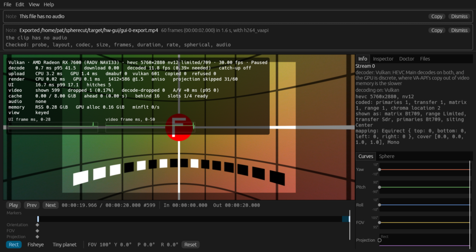
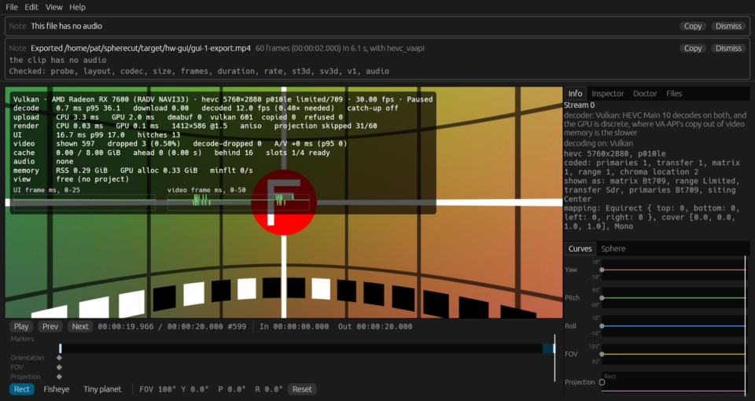
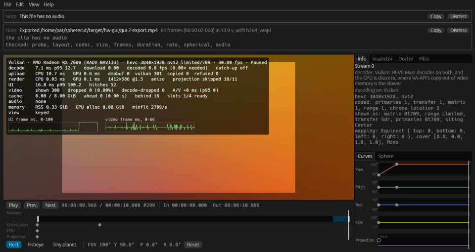
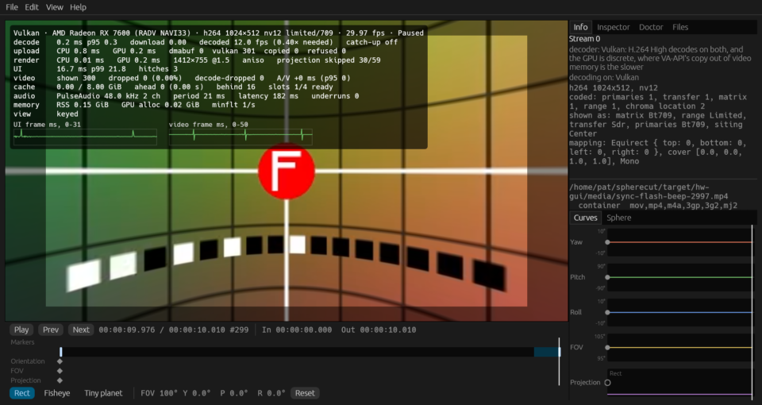
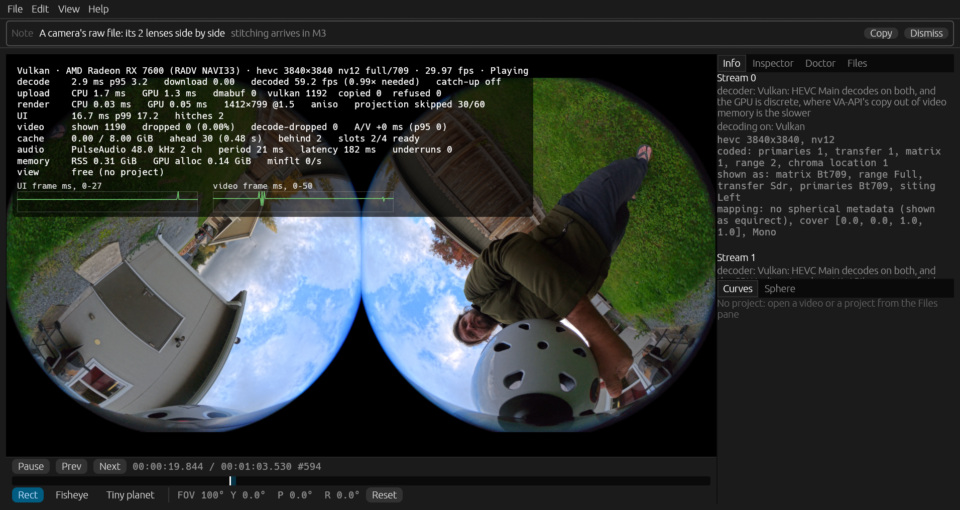
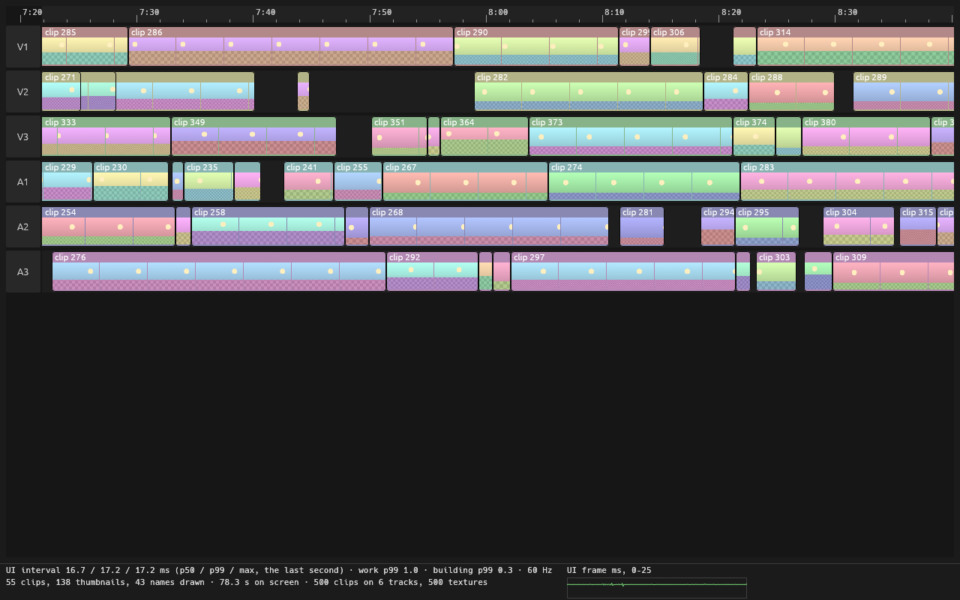
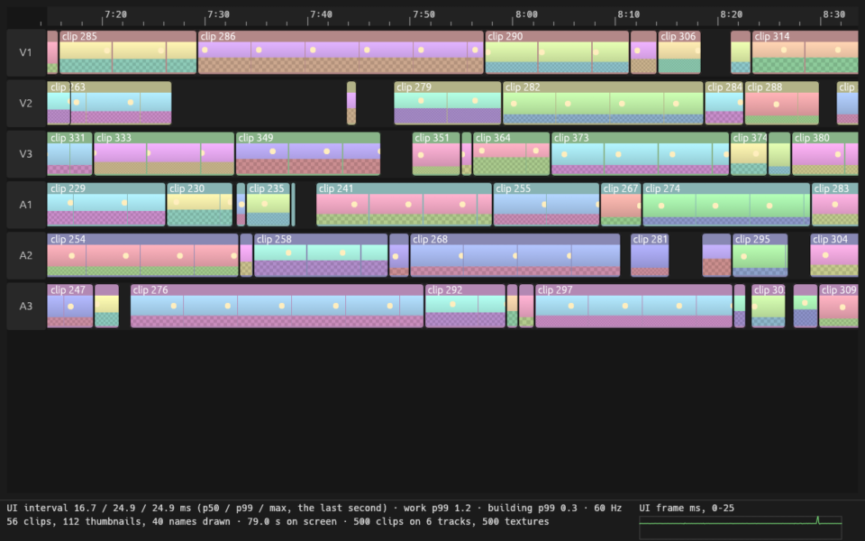
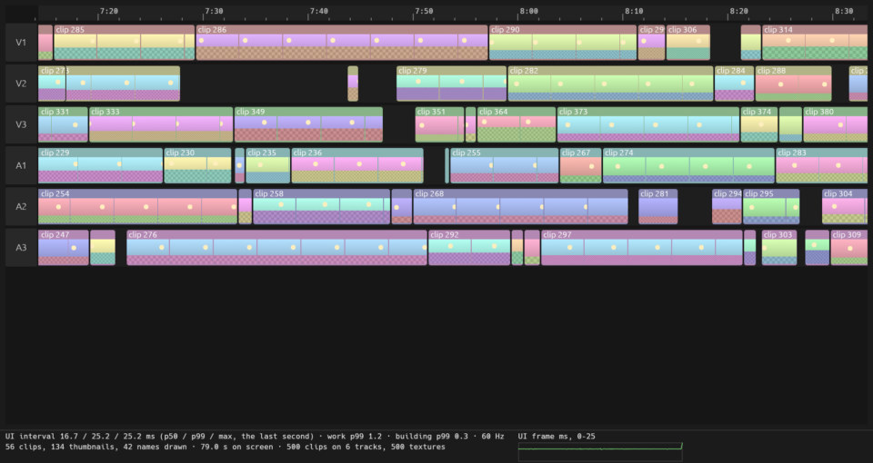

# Hardware report: odin @ 53161765f0

Generated by `cargo xtask hw-test --only gui_smoke --only gui_proto --only bench_export_4k30_vaapi --only export_360_8k_vaapi --only export_vaapi_matches_software` in 643 s.

## Summary

| | |
|---|---|
| Host | odin |
| OS | Fedora Linux 44 (Workstation Edition) |
| Kernel | Linux 7.2.9-200.fc44.x86_64 #1 SMP PREEMPT_DYNAMIC Sat Oct  3 19:59:55 UTC 2026 x86_64 |
| Session | wayland / GNOME |
| GUI display | WAYLAND_DISPLAY set: WAYLAND_DISPLAY=wayland-0 |
| Screen locked at the end | no |
| Audio server | PulseAudio (on PipeWire 1.6.9) |
| GNOME mutter experimental features | @as [] |
| GPU (Vulkan) | AMD Radeon RX 7600 (RADV NAVI33) |
| Mesa | Mesa 26.2.5 |
| FFmpeg | ffmpeg version 8.1.3 Copyright (c) 2000-2026 the FFmpeg developers |
| FFmpeg libs | 62.28.103, 62.12.103, 60.26.103, 9.5.103, 6.3.103 |
| Rust | rustc 1.99.0 (b940084d7 2026-09-28) |
| VA-API HEVC | decode: yes, encode: yes |
| FFmpeg hwaccels | vdpau, cuda, vaapi, qsv, drm, opencl, vulkan, amf |
| Samples dir | /home/pat/spherecut/samples (present) |

**Tier 2: 4 passed, 1 failed, 0 skipped, 42 left out by `--only`, 0 did not run (47 tests).**

**Tier 1 on this machine: left out by `--no-tier1`.**

**This run FAILED:** 1 Tier 2 test(s) failed.

## Prerequisites

Nothing missing.

## Build

Succeeded (release) in 56 s.

## Power profile

Read once, before the build, and never changed: decode speed moves with these.

| Setting | Value |
|---|---|
| power-profiles-daemon | not available (no `powerprofilesctl`) |
| ACPI platform profile | not available (no /sys/firmware/acpi/platform_profile) |
| CPU frequency driver | amd-pstate-epp |
| CPU governor | performance |
| CPU energy preference | performance |
| card0 (amdgpu) performance level | auto |
| card0 (amdgpu) power profile | not available (unreadable) |

## Render nodes

| Node | PCI slot | Vendor | Device | Driver | Opens |
|---|---|---|---|---|---|
| renderD128 | 0000:0c:00.0 | AMD (0x1002) | 0x7480 | amdgpu | yes |

## Perf clips

synth's noisy grid in HEVC at about a camera's bitrate, made once and kept in `/home/pat/spherecut/target/hw-media` for the playback benchmarks. Software decode over 150 fps would make a clip too easy to say anything about footage.

| Clip | Size | Bitrate | Made | Software decode |
|---|---:|---:|---|---|
| `hevc8-5k7-30fps-noisy-20s.mp4` | 254 MB | 101.7 Mbit/s | cached | not measured |
| `hevc10-5k7-30fps-noisy-20s.mp4` | 254 MB | 101.7 Mbit/s | cached | not measured |
| `hevc8-8k-30fps-noisy-20s.mp4` | 305 MB | 122.1 Mbit/s | cached | not measured |

## Tier 2 tests

| Test | Result |
|---|---|
| `adapters::list_adapters_and_features` | left out by `--only` |
| `goldens::goldens_on_gpu_match_reference` | left out by `--only` |
| `goldens::goldens_on_host_llvmpipe` | left out by `--only` |
| `spherecut-media/doctor::doctor_decodes_hevc_main_on_vaapi` | left out by `--only` |
| `tier2_backend::bench_seek_latency` | left out by `--only` |
| `tier2_backend::vaapi_colorinfo_matches_software` | left out by `--only` |
| `tier2_backend::vaapi_exports_match_downloads` | left out by `--only` |
| `tier2_backend::vaapi_seek_matches_software` | left out by `--only` |
| `tier2_backend::vulkan_colorinfo_matches_software` | left out by `--only` |
| `tier2_backend::vulkan_seek_matches_software` | left out by `--only` |
| `tier2_device::audio_output_device_plays` | left out by `--only` |
| `tier2_download_pool::vaapi_download_pool_reuses_buffers` | left out by `--only` |
| `tier2_download_pool::vulkan_download_pool_reuses_buffers` | left out by `--only` |
| `tier2_export::bench_export_4k30_vaapi` | pass |
| `tier2_export::bench_export_vaapi_levels` | left out by `--only` |
| `tier2_export::export_360_8k_vaapi` | pass |
| `tier2_export::export_vaapi_matches_software` | pass |
| `tier2_frame::doctor_and_the_renderer_agree_on_sharing` | left out by `--only` |
| `tier2_frame::shared_vulkan_frame_matches_the_copy` | left out by `--only` |
| `tier2_frame::vaapi_render_matches_software` | left out by `--only` |
| `tier2_frame::vulkan_render_matches_software` | left out by `--only` |
| `tier2_frame::zero_copy_frame_matches_the_copy` | left out by `--only` |
| `tier2_gui::gui_proto` | pass |
| `tier2_gui::gui_smoke` | **FAIL** |
| `tier2_hw_decode::bench_decode_hevc_4k_and_5k7` | left out by `--only` |
| `tier2_hw_decode::vaapi_h264_matches_software` | left out by `--only` |
| `tier2_hw_decode::vaapi_hevc_main10_matches_software` | left out by `--only` |
| `tier2_hw_decode::vaapi_hevc_main_matches_software` | left out by `--only` |
| `tier2_hw_decode::vulkan_h264_matches_software` | left out by `--only` |
| `tier2_hw_decode::vulkan_hevc_main10_matches_software` | left out by `--only` |
| `tier2_hw_decode::vulkan_hevc_main_matches_software` | left out by `--only` |
| `tier2_mcp::mcp_session_decodes_with_vaapi` | left out by `--only` |
| `tier2_playback::bench_perf_clips_software_decode` | left out by `--only` |
| `tier2_playback::bench_playback_realtime_5k7_10bit` | left out by `--only` |
| `tier2_playback::bench_playback_realtime_5k7_8bit` | left out by `--only` |
| `tier2_playback::bench_playback_realtime_8k_8bit` | left out by `--only` |
| `tier2_playback::bench_playback_stitched_samples` | left out by `--only` |
| `tier2_playback::bench_playback_x5_raw` | left out by `--only` |
| `tier2_playback::bench_x5_8k30_zero_copy_vs_copy` | left out by `--only` |
| `tier2_playback::shared_vulkan_matches_copy_path` | left out by `--only` |
| `tier2_playback::zero_copy_matches_copy_path` | left out by `--only` |
| `tier2_samples::bench_samples_realtime_decode` | left out by `--only` |
| `tier2_samples::samples_probe_cleanly` | left out by `--only` |
| `tier2_samples::samples_vaapi_decode_matches_software` | left out by `--only` |
| `tier2_samples::samples_vulkan_decode_matches_software` | left out by `--only` |
| `upload::bench_upload_5k7` | left out by `--only` |
| `yuv::yuv_on_gpu_matches_reference` | left out by `--only` |

### FAIL `tier2_gui::gui_smoke`

```
==> noisy 5.7K 8-bit: /home/pat/spherecut/target/hw-media/hevc8-5k7-30fps-noisy-20s.mp4
==> noisy 5.7K 10-bit: /home/pat/spherecut/target/hw-media/hevc10-5k7-30fps-noisy-20s.mp4
==> seam 3840×1920 HEVC: /home/pat/spherecut/target/hw-gui/media/gui-seam.mp4
==> sync flash and beep: /home/pat/spherecut/target/hw-gui/media/sync-flash-beep-2997.mp4
==> X5 raw view insta360-x5/VID_20261022_170245_00_009.insv: /home/pat/spherecut/samples/insta360-x5/VID_20261022_170245_00_009.insv
not run: stitched samples: none under /home/pat/spherecut/samples (clip 12 is still wanted)

thread 'gui_smoke' (2709701) panicked at crates/cli/tests/tier2_gui.rs:520:5:
3 of 5 runs failed:
noisy 5.7K 8-bit: 1 of 569 frames dropped (0.18%, over 0.1%)
noisy 5.7K 8-bit: 1 of 50 frames dropped while the export ran
noisy 5.7K 8-bit: UI p99 83.2 ms while the export ran, over 1.5 × the 60 Hz period (25.0 ms)
noisy 5.7K 10-bit: 3 of 569 frames dropped (0.53%, over 0.1%)
noisy 5.7K 10-bit: UI p99 28.1 ms, over 1.5 × the 60 Hz period (25.0 ms)
noisy 5.7K 10-bit: 3 of 185 frames dropped while the export ran
noisy 5.7K 10-bit: UI p99 33.6 ms while the export ran, over 1.5 × the 60 Hz period (25.0 ms)
seam 3840×1920 HEVC: 66% of the UI frames expected were presented, the window drawn (0 passes without the UI): the UI was slow, each pass's own work 14.2 ms at p95
seam 3840×1920 HEVC: UI p99 100.2 ms, over 1.5 × the 60 Hz period (25.0 ms)
seam 3840×1920 HEVC: 66% of the UI frames expected were presented while the export ran, under 90%
seam 3840×1920 HEVC: UI p99 100.2 ms while the export ran, over 1.5 × the 60 Hz period (25.0 ms)
note: run with `RUST_BACKTRACE=1` environment variable to display a backtrace


```

## Benchmarks

Release build. Each benchmark runs once to warm up, then 3 times (`SPHERECUT_BENCH_RUNS`); the result is the median. Spread is the range over the median: over 10% means the machine was busy or changing clocks, so take that result with care. A row marked "per second" is one run's seconds instead: Runs counts the seconds, and the range is the slowest and the fastest.

| Benchmark | Median | Range | Runs | Spread |
|---|---:|---:|---:|---:|
| export 4k30 h264_vaapi high | 33.92 fps | 32.69 to 33.92 | 3 | 4% |
| export 4k30 h264_vaapi high: decode | 28.58 ms/frame | 28.56 to 29.71 | 3 | 4% |
| export 4k30 h264_vaapi high: render | 9.95 ms/frame | 9.90 to 10.42 | 3 | 5% |
| export 4k30 h264_vaapi high: readback | 3.17 ms/frame | 3.15 to 3.60 | 3 | 14% **unstable** |
| export 4k30 h264_vaapi high: encode | 6.95 ms/frame | 6.84 to 14.01 | 3 | 103% **unstable** |
| export 4k30 h264_vaapi high: finish | 0.36 ms/frame | 0.36 to 0.37 | 3 | 2% |
| export 4k30 hevc_vaapi high | 44.16 fps | 44.12 to 44.38 | 3 | 1% |
| export 4k30 hevc_vaapi high: decode | 22.19 ms/frame | 22.09 to 22.21 | 3 | 1% |
| export 4k30 hevc_vaapi high: render | 10.31 ms/frame | 10.20 to 10.38 | 3 | 2% |
| export 4k30 hevc_vaapi high: readback | 3.15 ms/frame | 3.15 to 3.16 | 3 | 1% |
| export 4k30 hevc_vaapi high: encode | 6.88 ms/frame | 6.86 to 6.96 | 3 | 1% |
| export 4k30 hevc_vaapi high: finish | 0.16 ms/frame | 0.16 to 0.17 | 3 | 6% |
| export 4k30 h264_vaapi draft | 53.13 fps | 52.93 to 53.81 | 3 | 2% |
| export 4k30 h264_vaapi draft: decode | 18.43 ms/frame | 18.21 to 18.51 | 3 | 2% |
| export 4k30 h264_vaapi draft: render | 7.99 ms/frame | 7.93 to 8.02 | 3 | 1% |
| export 4k30 h264_vaapi draft: readback | 1.23 ms/frame | 1.22 to 1.24 | 3 | 1% |
| export 4k30 h264_vaapi draft: encode | 2.08 ms/frame | 2.04 to 2.13 | 3 | 4% |
| export 4k30 h264_vaapi draft: finish | 0.11 ms/frame | 0.11 to 0.11 | 3 | 3% |
| export 4k30 from lrv h264_vaapi high | 47.42 fps | 46.82 to 47.82 | 3 | 2% |
| export 4k30 from lrv h264_vaapi high: decode | 15.53 ms/frame | 15.52 to 15.57 | 3 | 0% |
| export 4k30 from lrv h264_vaapi high: render | 6.13 ms/frame | 4.55 to 8.02 | 3 | 57% **unstable** |
| export 4k30 from lrv h264_vaapi high: readback | 12.97 ms/frame | 11.33 to 14.37 | 3 | 23% **unstable** |
| export 4k30 from lrv h264_vaapi high: encode | 15.92 ms/frame | 15.81 to 16.05 | 3 | 2% |
| export 4k30 from lrv h264_vaapi high: finish | 0.62 ms/frame | 0.62 to 0.63 | 3 | 1% |

Notes from the benchmarks:

- export on AMD Radeon RX 7600 (RADV NAVI33)
- export 4k30 h264_vaapi high: 300 frames at 3840x2160 through h264_vaapi, decoded on vaapi
- export 4k30 hevc_vaapi high: 300 frames at 3840x2160 through hevc_vaapi, decoded on vaapi
- export 4k30 h264_vaapi draft: 300 frames at 1920x1080 through h264_vaapi, decoded on vaapi
- the LRV is /home/pat/spherecut/samples/insta360-x5/LRV_20261022_165451_01_004.lrv
- export 4k30 from lrv h264_vaapi high: 114 frames at 3840x2160 through h264_vaapi, decoded on vaapi
- export parity on AMD Radeon RX 7600 (RADV NAVI33): VA-API encodes ["H.264", "HEVC Main", "HEVC Main 10", "AV1"]; not []
- H.264 from 8-bit through h264_vaapi: worst luma PSNR 50.78 dB, SSIM 0.99729 over 60 frames, 5.9 Mb/s
- H.264 from 8-bit through libx264: worst luma PSNR 52.32 dB, SSIM 0.99817 over 60 frames, 2.6 Mb/s
- HEVC Main from 8-bit through hevc_vaapi: worst luma PSNR 53.15 dB, SSIM 0.99808 over 60 frames, 5.8 Mb/s
- HEVC Main from 8-bit through libx265: worst luma PSNR 53.07 dB, SSIM 0.99834 over 60 frames, 1.0 Mb/s
- HEVC Main 10 from 10-bit through hevc_vaapi: worst luma PSNR 54.30 dB, SSIM 0.99914 over 15 frames, 9.3 Mb/s
- HEVC Main 10 from 10-bit through libx265: worst luma PSNR 58.95 dB, SSIM 0.99962 over 15 frames, 1.7 Mb/s
- AV1 from 8-bit through av1_vaapi: worst luma PSNR 49.95 dB, SSIM 0.99673 over 15 frames, 2.4 Mb/s
- AV1 from 8-bit through libsvtav1: worst luma PSNR 51.60 dB, SSIM 0.99778 over 15 frames, 1.6 Mb/s
- AV1 from 10-bit through av1_vaapi: worst luma PSNR 47.28 dB, SSIM 0.99663 over 15 frames, 2.5 Mb/s
- AV1 from 10-bit through libsvtav1: worst luma PSNR 60.37 dB, SSIM 0.99969 over 15 frames, 1.6 Mb/s

## Tier 1 on this machine

Left out by `--no-tier1`.

## GUI smoke run

`gui_smoke` **FAILED** (its output is under Tier 2 tests). The session: WAYLAND_DISPLAY set (WAYLAND_DISPLAY=wayland-0). VA-API decodes HEVC Main, HEVC Main 10 by doctor's check, so those clips must decode in hardware. The screen was unlocked when the runs began. Presented, the UI's intervals and the frames are counted after each run's first second, while the cache fills, as the playback benches count them.

| # | Clip | Verdict | Presented | UI p50 / p99 ms | Refresh | Shown / dropped / decode-dropped | Decoder | A/V median / p95 ms | Audio |
|---:|---|---|---:|---:|---:|---:|---|---:|---|
| 0 | noisy 5.7K 8-bit | **FAILED**: 1 of 569 frames dropped (0.18%, over 0.1%); 1 of 50 frames dropped while the export ran; UI p99 83.2 ms while the export ran, over 1.5 × the 60 Hz period (25.0 ms) | 99% | 16.7 / 19.0 | 60.00 Hz | 568 / 1 / 0 | Vulkan | 0.0 / 0.0 | none |
| 1 | noisy 5.7K 10-bit | **FAILED**: 3 of 569 frames dropped (0.53%, over 0.1%); UI p99 28.1 ms, over 1.5 × the 60 Hz period (25.0 ms); 3 of 185 frames dropped while the export ran; UI p99 33.6 ms while the export ran, over 1.5 × the 60 Hz period (25.0 ms) | 98% | 16.7 / 28.1 | 60.00 Hz | 566 / 3 / 0 | Vulkan | 0.0 / 0.0 | none |
| 2 | seam 3840×1920 HEVC | **FAILED**: 66% of the UI frames expected were presented, the window drawn (0 passes without the UI): the UI was slow, each pass's own work 14.2 ms at p95; UI p99 100.2 ms, over 1.5 × the 60 Hz period (25.0 ms); 66% of the UI frames expected were presented while the export ran, under 90%; UI p99 100.2 ms while the export ran, over 1.5 × the 60 Hz period (25.0 ms) | 66% | 16.7 / 100.2 | 60.00 Hz | 269 / 0 / 0 | Vulkan | 0.0 / 0.0 | none |
| 3 | sync flash and beep | pass | 99% | 16.7 / 18.5 | 60.00 Hz | 275 / 0 / 0 | Vulkan | 0.0 / 0.0 | PulseAudio, 182 ms |
| 4 | X5 raw view insta360-x5/VID_20261022_170245_00_009.insv | pass | 100% | 16.7 / 17.2 | 60.00 Hz | 1138 / 0 / 0 | Vulkan, Vulkan | 0.0 / 0.0 | PulseAudio, 182 ms |

### 0. noisy 5.7K 8-bit

`/home/pat/spherecut/target/hw-media/hevc8-5k7-30fps-noisy-20s.mp4`

AMD Radeon RX 7600 (RADV NAVI33) (radv, Mesa 26.2.5); Bgra8Unorm at 1.5 pixels a point (the window's own 1.0), the window 1912×1016 and the viewer 1412×586 pixels; p50 / p95: decode 0.8 / 33.5 ms, download 0.0 / 0.0 ms, render_cpu 0.0 / 0.0 ms, render_gpu 0.1 / 0.4 ms, shown_interval 33.3 / 33.7 ms, ui_frame 16.7 / 17.0 ms, upload_cpu 3.2 / 3.5 ms, upload_gpu 1.4 / 1.8 ms; 1192 UI passes of 1192, their own work 1.1 / 1.4 ms; 5 late UI passes after the first second, the longest 83.5 ms; the slowest in their gaps decode 63.0 ms, download 0.0 ms, render_gpu 0.1 ms, upload_cpu 77.2 ms, upload_gpu 1.7 ms; the submit gate held 607 submissions back, the longest 2.2 ms; played 20.0 s, to the clip's end.

The export while it played (the project's output): 60 frames at 1920×1080 in 1.6 s with h264_vaapi; busy decode 1.5 s, encode 0.1 s, finish 0.0 s, readback 0.1 s, render 0.7 s; 0 frames waited for a UI pass, the longest 0.0 ms; while it ran 94% of the UI frames were presented, UI p50 / p99 16.7 / 83.2 ms, 49 frames shown and 1 dropped.



### 1. noisy 5.7K 10-bit

`/home/pat/spherecut/target/hw-media/hevc10-5k7-30fps-noisy-20s.mp4`

AMD Radeon RX 7600 (RADV NAVI33) (radv, Mesa 26.2.5); Bgra8Unorm at 1.5 pixels a point (the window's own 1.0), the window 1912×1016 and the viewer 1412×586 pixels; p50 / p95: decode 1.0 / 24.4 ms, download 0.0 / 0.0 ms, render_cpu 0.0 / 0.1 ms, render_gpu 0.1 / 0.3 ms, shown_interval 33.3 / 35.1 ms, ui_frame 16.7 / 17.4 ms, upload_cpu 3.3 / 5.5 ms, upload_gpu 2.0 / 3.0 ms; 1182 UI passes of 1182, their own work 1.1 / 2.1 ms; 13 late UI passes after the first second, the longest 83.4 ms; the slowest in their gaps decode 39.5 ms, download 0.0 ms, render_gpu 0.5 ms, upload_cpu 21.8 ms, upload_gpu 2.2 ms; the submit gate held 661 submissions back, the longest 2.3 ms; played 20.0 s.

The export while it played (360-7680): 60 frames at 7680×3840 in 6.1 s with hevc_vaapi; busy decode 4.9 s, encode 5.1 s, finish 0.0 s, readback 3.9 s, render 1.8 s; 0 frames waited for a UI pass, the longest 0.0 ms; while it ran 95% of the UI frames were presented, UI p50 / p99 16.7 / 33.6 ms, 182 frames shown and 3 dropped.



### 2. seam 3840×1920 HEVC

`/home/pat/spherecut/target/hw-gui/media/gui-seam.mp4`

AMD Radeon RX 7600 (RADV NAVI33) (radv, Mesa 26.2.5); Bgra8Unorm at 1.5 pixels a point (the window's own 1.0), the window 1912×1016 and the viewer 1412×586 pixels; p50 / p95: decode 6.2 / 12.5 ms, download 0.0 / 0.0 ms, render_cpu 0.0 / 0.1 ms, render_gpu 0.1 / 0.1 ms, shown_interval 33.4 / 49.7 ms, ui_frame 16.7 / 100.2 ms, upload_cpu 10.1 / 15.4 ms, upload_gpu 0.6 / 0.8 ms; 615 UI passes of 615, their own work 7.6 / 14.2 ms; 64 late UI passes after the first second, the longest 100.4 ms; the slowest in their gaps decode 16.2 ms, download 0.0 ms, render_gpu 0.1 ms, upload_cpu 17.8 ms, upload_gpu 0.9 ms; the submit gate held 709 submissions back, the longest 2.2 ms; played 15.0 s, to the clip's end.

The export while it played (flat-16x9-2160, with motion blur): 60 frames at 3840×2160 in 13.9 s with h264_vaapi; busy decode 2.7 s, encode 1.4 s, finish 0.0 s, readback 0.2 s, render 13.5 s; 0 frames waited for a UI pass, the longest 0.0 ms; while it ran 66% of the UI frames were presented, UI p50 / p99 16.7 / 100.2 ms, 269 frames shown and 0 dropped.



### 3. sync flash and beep

`/home/pat/spherecut/target/hw-gui/media/sync-flash-beep-2997.mp4`

AMD Radeon RX 7600 (RADV NAVI33) (radv, Mesa 26.2.5); Bgra8Unorm at 1.5 pixels a point (the window's own 1.0), the window 1912×1016 and the viewer 1412×755 pixels; p50 / p95: decode 0.2 / 0.3 ms, download 0.0 / 0.0 ms, render_cpu 0.0 / 0.1 ms, render_gpu 0.2 / 0.2 ms, shown_interval 33.3 / 33.9 ms, ui_frame 16.7 / 17.0 ms, upload_cpu 0.8 / 2.9 ms, upload_gpu 0.2 / 0.2 ms; 609 UI passes of 609, their own work 1.0 / 1.4 ms; 3 late UI passes after the first second, the longest 30.5 ms; the slowest in their gaps decode 0.2 ms, download 0.0 ms, render_gpu 0.2 ms, upload_cpu 0.8 ms, upload_gpu 0.1 ms; the submit gate held 14 submissions back, the longest 2.1 ms; played 10.2 s, to the clip's end.



### 4. X5 raw view insta360-x5/VID_20261022_170245_00_009.insv

`/home/pat/spherecut/samples/insta360-x5/VID_20261022_170245_00_009.insv`

AMD Radeon RX 7600 (RADV NAVI33) (radv, Mesa 26.2.5); Bgra8Unorm at 1.5 pixels a point (the window's own 1.0), the window 1912×1016 and the viewer 1412×799 pixels; p50 / p95: decode 3.0 / 3.3 ms, download 0.0 / 0.0 ms, render_cpu 0.0 / 0.1 ms, render_gpu 0.0 / 0.1 ms, shown_interval 33.3 / 33.6 ms, ui_frame 16.7 / 16.9 ms, upload_cpu 2.3 / 3.4 ms, upload_gpu 1.3 / 1.6 ms; 1199 UI passes of 1199, their own work 1.1 / 1.4 ms; 2 late UI passes after the first second, the longest 27.3 ms; the slowest in their gaps decode 3.1 ms, download 0.0 ms, render_gpu 0.0 ms, upload_cpu 3.3 ms, upload_gpu 1.5 ms; the submit gate held 1026 submissions back, the longest 2.3 ms; played 20.0 s.



Not run:

- stitched samples: none under /home/pat/spherecut/samples (clip 12 is still wanted)

## Timeline prototype

`gui_proto` passed. The session: WAYLAND_DISPLAY set (WAYLAND_DISPLAY=wayland-0). The screen was unlocked when the runs began. Each run plays the prototype's script (zoom, drag, ripple trim, pan; 500 clips on 6 tracks) for 20.0 s; after its first second it must present 99% of the frames, each pass's own work must have a p99 under the refresh period and the interval between passes a p99 of at most 1.5 periods, and every action must land.

| # | Run | Verdict | Pixels a point | Presented | Late | Interval p50 / p99 ms | Work p50 / p99 ms | Building p99 ms | Refresh |
|---:|---|---|---:|---:|---:|---:|---:|---:|---:|
| 0 | egui zoom 1 | pass | 1 | 99.8% | 2 | 16.7 / 17.2 | 0.9 / 2.5 | 0.4 | 60.00 Hz |
| 1 | egui zoom 1.25 | pass | 1.25 | 99.8% | 1 | 16.7 / 17.2 | 0.9 / 2.1 | 0.4 | 60.00 Hz |
| 2 | egui zoom 1.5 | pass | 1.5 | 99.8% | 2 | 16.7 / 17.1 | 0.9 / 2.3 | 0.4 | 60.00 Hz |

### Prototype 0. egui zoom 1

AMD Radeon RX 7600 (RADV NAVI33) (radv, Mesa 26.2.5); Bgra8Unorm at 1.0 pixels a point (the window's own 1.0, egui's zoom 1.0), the window 1280×800 pixels; 1138 UI passes of 1138; at most 498 clips, 249 thumbnails, 82 names and 4 snap lines in a pass; 2 moves (59 snapped), 2 trims, 420 passes zooming and 179 panning, from 2.0 to 963 s on screen; played 20.0 s.



### Prototype 1. egui zoom 1.25

AMD Radeon RX 7600 (RADV NAVI33) (radv, Mesa 26.2.5); Bgra8Unorm at 1.25 pixels a point (the window's own 1.0, egui's zoom 1.25), the window 1280×800 pixels; 1138 UI passes of 1138; at most 500 clips, 227 thumbnails, 64 names and 4 snap lines in a pass; 2 moves (33 snapped), 2 trims, 479 passes zooming and 180 panning, from 2.0 to 963 s on screen; played 20.0 s.



### Prototype 2. egui zoom 1.5

AMD Radeon RX 7600 (RADV NAVI33) (radv, Mesa 26.2.5); Bgra8Unorm at 1.5 pixels a point (the window's own 1.0, egui's zoom 1.5), the window 1912×1016 pixels; 1139 UI passes of 1139; at most 500 clips, 252 thumbnails, 80 names and 4 snap lines in a pass; 2 moves (50 snapped), 2 trims, 480 passes zooming and 181 panning, from 2.0 to 963 s on screen; played 20.0 s.



## Raw environment

<details><summary>spherecut doctor (<code>/home/pat/spherecut/target/release/spherecut doctor</code>)</summary>

```
FFmpeg 8.1.3
  libavcodec 62.28.103, libavformat 62.12.103, libavutil 60.26.103, libswresample 6.3.103, libswscale 9.5.103
  hardware device types: vdpau, cuda, vaapi, qsv, drm, opencl, vulkan, amf

Decoders
  h264       yes  (hw: cuda, vaapi, vdpau, vulkan)
  hevc       yes  (hw: cuda, vaapi, vdpau, vulkan)
  av1        yes  (hw: cuda, vaapi, vdpau, vulkan)
  libdav1d   yes
  prores     yes
  aac        yes
  opus       yes
  pcm_s16le  yes

Encoders
  libx264    yes
  libx265    yes
  libsvtav1  yes
  h264_vaapi yes
  hevc_vaapi yes
  av1_vaapi  yes
  prores_ks  yes
  aac        yes

Hardware devices
  vaapi   /dev/dri/renderD128    ok
  vulkan  (default)              ok, on AMD Radeon RX 7600 (RADV NAVI33)

Vulkan devices
  AMD Radeon RX 7600 (RADV NAVI33)  (FFmpeg uses this one)
    discrete GPU; driver radv (Mesa 26.2.5); Vulkan 1.4.354; vendor 0x1002 device 0x7480
    zero copy: DMA-BUF import yes; shared with FFmpeg's Vulkan Video yes
  llvmpipe (LLVM 22.1.8, 256 bits)
    CPU: no GPU acceleration; driver llvmpipe (Mesa 26.2.5 (LLVM 22.1.8)); Vulkan 1.4.354; vendor 0x10005 device 0x0000
    zero copy: DMA-BUF import yes; shared with FFmpeg's Vulkan Video no: the device lacks VK_KHR_video_queue

Zero copy: Vulkan Video's frames, decoded on the renderer's own device where it can be shared; VA-API's and the rest are copied through RAM (SPHERECUT_ZERO_COPY=1 imports VA-API's too, 0 copies every frame)

Decode check: one 256x256 frame each, no fallback to software; the hardware's
picture must match the software decoder's
                 software    vaapi       vulkan
  H.264 High     works       works       works
  HEVC Main      works       works       works
  HEVC Main 10   works       works       works
  AV1 Main       works       works       works

Encode check: one 256x256 frame each on VA-API, decoded back in software
                 vaapi
  H.264          works
  HEVC Main      works
  HEVC Main 10   works
  AV1            works

Export encoders (auto)
  H.264         h264_vaapi (libx264 above 4096 wide)
  HEVC Main     hevc_vaapi
  HEVC Main 10  hevc_vaapi
  AV1           av1_vaapi (libsvtav1 unless a multiple of 64x16)

No problems found.
```
</details>

<details><summary>rustc (<code>rustc -Vv</code>)</summary>

```
rustc 1.99.0 (b940084d7 2026-09-28)
binary: rustc
commit-hash: b940084d7eb6a299eb4bfeb8e34901bc051e7ac4
commit-date: 2026-09-28
host: x86_64-unknown-linux-gnu
release: 1.99.0
LLVM version: 23.1.1
```
</details>

<details><summary>pactl info (<code>pactl info</code>)</summary>

```
Server String: /run/user/1000/pulse/native
Library Protocol Version: 35
Server Protocol Version: 35
Is Local: yes
Client Index: 6720
Tile Size: 65472
User Name: pat
Host Name: odin
Server Name: PulseAudio (on PipeWire 1.6.9)
Server Version: 15.0.0
Default Sample Specification: float32le 2ch 48000Hz
Default Channel Map: front-left,front-right
Default Sink: bluez_output.CC_14_BC_63_40_50.1
Default Source: alsa_input.usb-0c76_USB_PnP_Audio_Device-00.pro-input-0
Cookie: 566c:5c45
```
</details>

<details><summary>GPUs (lspci) (<code>sh -c lspci -nn | grep -Ei 'vga|display|3d'</code>)</summary>

```
0c:00.0 VGA compatible controller [0300]: Advanced Micro Devices, Inc. [AMD/ATI] Navi 33 [Radeon RX 7600/7600 XT/7600M XT/7600S/7700S / PRO W7600] [1002:7480] (rev cf)
```
</details>

<details><summary>vulkaninfo --summary (<code>vulkaninfo --summary</code>)</summary>

```
==========
VULKANINFO
==========

Vulkan Instance Version: 1.4.341


Instance Extensions: count = 26
-------------------------------
VK_EXT_acquire_drm_display             : extension revision 1
VK_EXT_acquire_xlib_display            : extension revision 1
VK_EXT_debug_report                    : extension revision 10
VK_EXT_debug_utils                     : extension revision 2
VK_EXT_direct_mode_display             : extension revision 1
VK_EXT_display_surface_counter         : extension revision 1
VK_EXT_headless_surface                : extension revision 1
VK_EXT_layer_settings                  : extension revision 2
VK_EXT_surface_maintenance1            : extension revision 1
VK_EXT_swapchain_colorspace            : extension revision 5
VK_KHR_device_group_creation           : extension revision 1
VK_KHR_display                         : extension revision 23
VK_KHR_external_fence_capabilities     : extension revision 1
VK_KHR_external_memory_capabilities    : extension revision 1
VK_KHR_external_semaphore_capabilities : extension revision 1
VK_KHR_get_display_properties2         : extension revision 1
VK_KHR_get_physical_device_properties2 : extension revision 2
VK_KHR_get_surface_capabilities2       : extension revision 1
VK_KHR_portability_enumeration         : extension revision 1
VK_KHR_surface                         : extension revision 25
VK_KHR_surface_maintenance1            : extension revision 1
VK_KHR_surface_protected_capabilities  : extension revision 1
VK_KHR_wayland_surface                 : extension revision 6
VK_KHR_xcb_surface                     : extension revision 6
VK_KHR_xlib_surface                    : extension revision 6
VK_LUNARG_direct_driver_loading        : extension revision 1

Instance Layers: count = 6
--------------------------
VK_LAYER_MESA_anti_lag            Open-source implementation of the VK_AMD_anti_lag extension. 1.4.303  version 1
VK_LAYER_MESA_device_select       Linux device selection layer                                 1.4.303  version 1
VK_LAYER_VALVE_steam_fossilize_32 Steam Pipeline Caching Layer                                 1.3.207  version 1
VK_LAYER_VALVE_steam_fossilize_64 Steam Pipeline Caching Layer                                 1.3.207  version 1
VK_LAYER_VALVE_steam_overlay_32   Steam Overlay Layer                                          1.3.207  version 1
VK_LAYER_VALVE_steam_overlay_64   Steam Overlay Layer                                          1.3.207  version 1

Devices:
========
GPU0:
	apiVersion         = 1.4.354
	driverVersion      = 26.2.5
	vendorID           = 0x1002
	deviceID           = 0x7480
	deviceType         = PHYSICAL_DEVICE_TYPE_DISCRETE_GPU
	deviceName         = AMD Radeon RX 7600 (RADV NAVI33)
	driverID           = DRIVER_ID_MESA_RADV
	driverName         = radv
	driverInfo         = Mesa 26.2.5
	conformanceVersion = 1.4.5.3
	deviceUUID         = 00000000-0c00-0000-0000-000000000000
	driverUUID         = 414d442d-4d45-5341-2d44-525600000000
GPU1:
	apiVersion         = 1.4.354
	driverVersion      = 26.2.5
	vendorID           = 0x10005
	deviceID           = 0x0000
	deviceType         = PHYSICAL_DEVICE_TYPE_CPU
	deviceName         = llvmpipe (LLVM 22.1.8, 256 bits)
	driverID           = DRIVER_ID_MESA_LLVMPIPE
	driverName         = llvmpipe
	driverInfo         = Mesa 26.2.5 (LLVM 22.1.8)
	conformanceVersion = 1.3.1.1
	deviceUUID         = 6d657361-3236-2e32-2e35-000000000000
	driverUUID         = 6c6c766d-7069-7065-5555-494400000000
WARNING: [Loader Message] Code 0 : terminator_CreateInstance: Received return code -9 from call to vkCreateInstance in ICD /usr/lib64/dri-freeworld/libvulkan_dzn.so. Skipping this driver.
WARNING: [Loader Message] Code 0 : ICD for selected physical device does not export vkGetPhysicalDeviceDisplayPlanePropertiesKHR!
WARNING: [Loader Message] Code 0 : ICD for selected physical device does not export vkGetPhysicalDeviceDisplayPropertiesKHR!
```
</details>

<details><summary>vainfo (<code>vainfo --display drm --device /dev/dri/renderD128</code>)</summary>

```
Trying display: drm
vainfo: VA-API version: 1.23 (libva 2.23.0)
vainfo: Driver version: Mesa Gallium driver 26.2.5 for AMD Radeon RX 7600 (radeonsi, navi33, ACO, DRM 3.64, 7.2.9-200.fc44.x86_64)
vainfo: Supported profile and entrypoints
      VAProfileH264ConstrainedBaseline:	VAEntrypointVLD
      VAProfileH264ConstrainedBaseline:	VAEntrypointEncSlice
      VAProfileH264Main               :	VAEntrypointVLD
      VAProfileH264Main               :	VAEntrypointEncSlice
      VAProfileH264High               :	VAEntrypointVLD
      VAProfileH264High               :	VAEntrypointEncSlice
      VAProfileHEVCMain               :	VAEntrypointVLD
      VAProfileHEVCMain               :	VAEntrypointEncSlice
      VAProfileHEVCMain10             :	VAEntrypointVLD
      VAProfileHEVCMain10             :	VAEntrypointEncSlice
      VAProfileVP9Profile0            :	VAEntrypointVLD
      VAProfileVP9Profile2            :	VAEntrypointVLD
      VAProfileAV1Profile0            :	VAEntrypointVLD
      VAProfileAV1Profile0            :	VAEntrypointEncSlice
      VAProfileNone                   :	VAEntrypointVideoProc
libva info: VA-API version 1.23.0
libva info: Trying to open /usr/lib64/dri-nonfree/radeonsi_drv_video.so
libva info: Trying to open /usr/lib64/dri-freeworld/radeonsi_drv_video.so
libva info: Found init function __vaDriverInit_1_23
libva info: va_openDriver() returns 0
```
</details>

<details><summary>ffmpeg -version (<code>ffmpeg -hide_banner -version</code>)</summary>

```
ffmpeg version 8.1.3 Copyright (c) 2000-2026 the FFmpeg developers
built with gcc 16 (GCC)
configuration: --prefix=/usr --bindir=/usr/bin --datadir=/usr/share/ffmpeg --docdir=/usr/share/doc/ffmpeg --incdir=/usr/include/ffmpeg --libdir=/usr/lib64 --mandir=/usr/share/man --arch=x86_64 --optflags='-O2 -flto=auto -ffat-lto-objects -fexceptions -g -grecord-gcc-switches -pipe -Wall -Wno-complain-wrong-lang -Werror=format-security -Wp,-U_FORTIFY_SOURCE,-D_FORTIFY_SOURCE=3 -Wp,-D_GLIBCXX_ASSERTIONS -specs=/usr/lib/rpm/redhat/redhat-hardened-cc1 -fstack-protector-strong -specs=/usr/lib/rpm/redhat/redhat-annobin-cc1 -m64 -march=x86-64 -mtune=generic -fasynchronous-unwind-tables -fstack-clash-protection -fcf-protection -mtls-dialect=gnu2 -fno-omit-frame-pointer -mno-omit-leaf-frame-pointer' --extra-ldflags='-Wl,-z,relro -Wl,--as-needed -Wl,-z,pack-relative-relocs -Wl,-z,now -specs=/usr/lib/rpm/redhat/redhat-hardened-ld -specs=/usr/lib/rpm/redhat/redhat-hardened-ld-errors -specs=/usr/lib/rpm/redhat/redhat-annobin-cc1 -Wl,--build-id=sha1 -specs=/usr/lib/rpm/redhat/redhat-package-notes ' --extra-cflags=' -I/usr/include/rav1e' --enable-libopencore-amrnb --enable-libopencore-amrwb --enable-libvo-amrwbenc --enable-version3 --enable-bzlib --enable-chromaprint --enable-fontconfig --enable-frei0r --enable-gcrypt --enable-gnutls --enable-ladspa --enable-lcms2 --enable-libaom --enable-libaribb24 --enable-libaribcaption --enable-libdav1d --enable-libass --enable-libbluray --enable-libbs2b --enable-libcodec2 --enable-cuda --enable-cuda-llvm --enable-cuvid --enable-libcdio --enable-libdrm --enable-libfdk-aac --enable-libjack --enable-libjxl --enable-libklvanc --enable-libfreetype --enable-libfribidi --enable-libgme --enable-libgsm --enable-libharfbuzz --enable-libilbc --enable-liblc3 --enable-libmp3lame --enable-libmysofa --enable-nvenc --enable-nvdec --enable-openal --enable-liboapv --enable-opencl --enable-opengl --enable-libopenh264 --enable-libopenjpeg --enable-libopenmpt --enable-libopus --enable-libpulse --enable-libplacebo --enable-librsvg --enable-librav1e --enable-librubberband --enable-libqrencode --enable-libsmbclient --enable-version3 --enable-libsnappy --enable-libsoxr --enable-libspeex --enable-libsrt --enable-libssh --enable-libsvtav1 --enable-libtesseract --enable-libtheora --enable-libtwolame --enable-libvorbis --enable-libv4l2 --enable-libvidstab --enable-libvmaf --enable-version3 --enable-vapoursynth --enable-libvpx --enable-libvvenc --enable-vulkan --enable-libshaderc --enable-libwebp --enable-libx264 --enable-libx265 --enable-libxvid --enable-libxml2 --enable-libzimg --enable-libzmq --enable-libzvbi --enable-lv2 --enable-avfilter --enable-libmodplug --enable-pthreads --disable-static --enable-shared --enable-gpl --disable-debug --disable-stripping --shlibdir=/usr/lib64 --enable-lto --enable-libvpl --enable-runtime-cpudetect
libavutil      60. 26.103 / 60. 26.103
libavcodec     62. 28.103 / 62. 28.103
libavformat    62. 12.103 / 62. 12.103
libavdevice    62.  3.103 / 62.  3.103
libavfilter    11. 14.103 / 11. 14.103
libswscale      9.  5.103 /  9.  5.103
libswresample   6.  3.103 /  6.  3.103

Exiting with exit code 0
```
</details>

<details><summary>ffmpeg -hwaccels (<code>ffmpeg -hide_banner -hwaccels</code>)</summary>

```
Hardware acceleration methods:
vdpau
cuda
vaapi
qsv
drm
opencl
vulkan
amf
```
</details>

<details><summary>ffmpeg encoders (filtered) (<code>ffmpeg -hide_banner -encoders</code>)</summary>

```
 V....D libaom-av1           libaom AV1 (codec av1)
 V..... libsvtav1            SVT-AV1(Scalable Video Technology for AV1) encoder (codec av1)
 V....D av1_vaapi            AV1 (VAAPI) (codec av1)
 V....D av1_vulkan           AV1 (Vulkan) (codec av1)
 V....D libx264              libx264 H.264 / AVC / MPEG-4 AVC / MPEG-4 part 10 (codec h264)
 V....D libx264rgb           libx264 H.264 / AVC / MPEG-4 AVC / MPEG-4 part 10 RGB (codec h264)
 V....D h264_vaapi           H.264/AVC (VAAPI) (codec h264)
 V....D h264_vulkan          H.264/AVC (Vulkan) (codec h264)
 V....D libx265              libx265 H.265 / HEVC (codec hevc)
 V....D hevc_vaapi           H.265/HEVC (VAAPI) (codec hevc)
 V....D hevc_vulkan          H.265/HEVC (Vulkan) (codec hevc)
 V....D mjpeg_vaapi          MJPEG (VAAPI) (codec mjpeg)
 V....D mpeg2_vaapi          MPEG-2 (VAAPI) (codec mpeg2video)
 VF...D prores               Apple ProRes
 VF...D prores_aw            Apple ProRes (codec prores)
 VFS... prores_ks            Apple ProRes (iCodec Pro) (codec prores)
 V....D vp8_vaapi            VP8 (VAAPI) (codec vp8)
 V....D vp9_vaapi            VP9 (VAAPI) (codec vp9)
```
</details>

<details><summary>ffmpeg decoders (filtered) (<code>ffmpeg -hide_banner -decoders</code>)</summary>

```
 V..... libdav1d             dav1d AV1 decoder by VideoLAN (codec av1)
 V....D libaom-av1           libaom AV1 (codec av1)
 V....D av1                  Alliance for Open Media AV1
 V..... av1_cuvid            Nvidia CUVID AV1 decoder (codec av1)
 V....D av1_qsv              AV1 video (Intel Quick Sync Video acceleration) (codec av1)
 V..... av1_amf              AV1 AMD AMF video decoder (codec av1)
 VFS..D h264                 H.264 / AVC / MPEG-4 AVC / MPEG-4 part 10
 V..... h264_v4l2m2m         V4L2 mem2mem H.264 decoder wrapper (codec h264)
 V....D h264_qsv             H264 video (Intel Quick Sync Video acceleration) (codec h264)
 V....D libopenh264          OpenH264 H.264 / AVC / MPEG-4 AVC / MPEG-4 part 10 (codec h264)
 V..... h264_amf             H264 AMD AMF video decoder (codec h264)
 V..... h264_cuvid           Nvidia CUVID H264 decoder (codec h264)
 VFS..D hevc                 HEVC (High Efficiency Video Coding)
 V....D hevc_qsv             HEVC video (Intel Quick Sync Video acceleration) (codec hevc)
 V..... hevc_v4l2m2m         V4L2 mem2mem HEVC decoder wrapper (codec hevc)
 V..... hevc_amf             HEVC AMD AMF video decoder (codec hevc)
 V..... hevc_cuvid           Nvidia CUVID HEVC decoder (codec hevc)
 VFS..D prores               Apple ProRes (iCodec Pro)
 VFS..D prores_raw           Apple ProRes RAW
 A....D wmav1                Windows Media Audio 1
```
</details>

<details><summary>Tier 2 test list (<code>cargo test --workspace --no-fail-fast --color never --release -- --ignored --list --format pretty</code>)</summary>

```
    Finished `release` profile [optimized + debuginfo] target(s) in 0.17s
     Running unittests src/lib.rs (target/release/deps/spherecut_agent-544b4aca480e9dd3)
0 tests, 0 benchmarks
     Running tests/analyze.rs (target/release/deps/analyze-18c1c6797516ad8b)
0 tests, 0 benchmarks
     Running tests/check.rs (target/release/deps/check-66976591f53b48bc)
0 tests, 0 benchmarks
     Running tests/docs.rs (target/release/deps/docs-1f33f8062a1439b0)
0 tests, 0 benchmarks
     Running tests/doctor.rs (target/release/deps/doctor-8128c2a232740c26)
0 tests, 0 benchmarks
     Running tests/fuzz.rs (target/release/deps/fuzz-af3b4ae4e9e07c28)
0 tests, 0 benchmarks
     Running tests/look.rs (target/release/deps/look-8380216feacc91ff)
0 tests, 0 benchmarks
     Running tests/probe.rs (target/release/deps/probe-17a129391adb4b5d)
0 tests, 0 benchmarks
     Running tests/protocol.rs (target/release/deps/protocol-96be7272faf86bfb)
0 tests, 0 benchmarks
     Running tests/recipes.rs (target/release/deps/recipes-d8e075aee37bc897)
0 tests, 0 benchmarks
     Running tests/roots.rs (target/release/deps/roots-e84642d8a8760ec1)
0 tests, 0 benchmarks
     Running unittests src/lib.rs (target/release/deps/spherecut_app-dd7d324b587c0ae4)
0 tests, 0 benchmarks
     Running tests/never_blocks.rs (target/release/deps/never_blocks-a961510447b39778)
0 tests, 0 benchmarks
     Running tests/overlay.rs (target/release/deps/overlay-758b7cf0415085cf)
0 tests, 0 benchmarks
     Running tests/panes.rs (target/release/deps/panes-5e91e6afc924f67c)
0 tests, 0 benchmarks
     Running tests/proto.rs (target/release/deps/proto-ab0c68e644509913)
0 tests, 0 benchmarks
     Running tests/raw.rs (target/release/deps/raw-43f2e664874f6f7c)
0 tests, 0 benchmarks
     Running tests/reframe.rs (target/release/deps/reframe-a99c4acf1cf68eea)
0 tests, 0 benchmarks
     Running tests/reframe2.rs (target/release/deps/reframe2-4480e3dc71caeaa1)
0 tests, 0 benchmarks
     Running tests/scrub.rs (target/release/deps/scrub-d963681dca74daed)
0 tests, 0 benchmarks
     Running tests/settings.rs (target/release/deps/settings-6309a04c27a65b0a)
0 tests, 0 benchmarks
     Running tests/smoke.rs (target/release/deps/smoke-a158b51af25cf9e9)
0 tests, 0 benchmarks
     Running tests/viewer.rs (target/release/deps/viewer-c6c88e377637be1f)
0 tests, 0 benchmarks
     Running unittests src/lib.rs (target/release/deps/spherecut_audio-be22567c0d76f794)
0 tests, 0 benchmarks
     Running tests/clock.rs (target/release/deps/clock-cdece32d88cd5f83)
0 tests, 0 benchmarks
     Running tests/tier2_device.rs (target/release/deps/tier2_device-3c423d8e558b6983)
audio_output_device_plays: test

1 test, 0 benchmarks
     Running unittests src/lib.rs (target/release/deps/spherecut_cli-dc769967f295af00)
0 tests, 0 benchmarks
     Running unittests src/main.rs (target/release/deps/spherecut-fa56ddcc059d745b)
0 tests, 0 benchmarks
     Running tests/confinement.rs (target/release/deps/confinement-0323e00c4d0ad09a)
0 tests, 0 benchmarks
     Running tests/contract.rs (target/release/deps/contract-fac6d609612d72e5)
0 tests, 0 benchmarks
     Running tests/doctor.rs (target/release/deps/doctor-30619413861fc4e8)
0 tests, 0 benchmarks
     Running tests/frame.rs (target/release/deps/frame-fa996e483255f5ed)
0 tests, 0 benchmarks
     Running tests/logging.rs (target/release/deps/logging-518409c4685a06d3)
0 tests, 0 benchmarks
     Running tests/mcp.rs (target/release/deps/mcp-655bb89287162287)
0 tests, 0 benchmarks
     Running tests/probe.rs (target/release/deps/probe-dfcbdda322d00130)
0 tests, 0 benchmarks
     Running tests/probe_tags.rs (target/release/deps/probe_tags-f3383d364a34313d)
0 tests, 0 benchmarks
     Running tests/render.rs (target/release/deps/render-aa7090dbad0c42c3)
0 tests, 0 benchmarks
     Running tests/tier2_frame.rs (target/release/deps/tier2_frame-2637ca075d2d8cc3)
doctor_and_the_renderer_agree_on_sharing: test
shared_vulkan_frame_matches_the_copy: test
vaapi_render_matches_software: test
vulkan_render_matches_software: test
zero_copy_frame_matches_the_copy: test

5 tests, 0 benchmarks
     Running tests/tier2_gui.rs (target/release/deps/tier2_gui-058845a1b3012791)
gui_proto: test
gui_smoke: test

2 tests, 0 benchmarks
     Running tests/tier2_mcp.rs (target/release/deps/tier2_mcp-481f343dd4c0d148)
mcp_session_decodes_with_vaapi: test

1 test, 0 benchmarks
     Running unittests src/lib.rs (target/release/deps/spherecut_core-96a854c7acadefbd)
0 tests, 0 benchmarks
     Running tests/project_edits.rs (target/release/deps/project_edits-3c1b5ba06ff0315b)
0 tests, 0 benchmarks
     Running tests/project_file.rs (target/release/deps/project_file-161ae5cbc8054679)
0 tests, 0 benchmarks
     Running tests/project_props.rs (target/release/deps/project_props-e60bb9f1b9ef91ef)
0 tests, 0 benchmarks
     Running tests/view_eval.rs (target/release/deps/view_eval-d9a035f702846233)
0 tests, 0 benchmarks
     Running tests/view_props.rs (target/release/deps/view_props-10f75153ab2b5e7f)
0 tests, 0 benchmarks
     Running unittests src/lib.rs (target/release/deps/spherecut_export-1fa498a0e00d5735)
0 tests, 0 benchmarks
     Running tests/audio.rs (target/release/deps/audio-797dea73bacddeb8)
0 tests, 0 benchmarks
     Running tests/export.rs (target/release/deps/export-b2364eca175041e6)
0 tests, 0 benchmarks
     Running tests/files.rs (target/release/deps/files-5bce915458d6daa5)
0 tests, 0 benchmarks
     Running tests/mp4.rs (target/release/deps/mp4-2667fa282fd45a4a)
0 tests, 0 benchmarks
     Running tests/parity.rs (target/release/deps/parity-e1f04e2c0b681ba2)
0 tests, 0 benchmarks
     Running tests/tier2_export.rs (target/release/deps/tier2_export-55c3c505c0c5a58d)
bench_export_4k30_vaapi: test
bench_export_vaapi_levels: test
export_360_8k_vaapi: test
export_vaapi_matches_software: test

4 tests, 0 benchmarks
     Running unittests src/lib.rs (target/release/deps/spherecut_media-d0b831eb554055e5)
0 tests, 0 benchmarks
     Running tests/confinement.rs (target/release/deps/confinement-6df81e874d9f1bc3)
0 tests, 0 benchmarks
     Running tests/doctor.rs (target/release/deps/doctor-5b34b6b3764f53a5)
doctor_decodes_hevc_main_on_vaapi: test

1 test, 0 benchmarks
     Running tests/ffmpeg_log_capture.rs (target/release/deps/ffmpeg_log_capture-6f15df7367ee6d32)
0 tests, 0 benchmarks
     Running tests/hw_refusal.rs (target/release/deps/hw_refusal-f49d81ac4ede14e9)
0 tests, 0 benchmarks
     Running tests/non_utf8_names.rs (target/release/deps/non_utf8_names-a3e6bd051c834d86)
0 tests, 0 benchmarks
     Running tests/source.rs (target/release/deps/source-8da0aef37303194f)
0 tests, 0 benchmarks
     Running tests/tier2_download_pool.rs (target/release/deps/tier2_download_pool-9a342c1ee31d3676)
vaapi_download_pool_reuses_buffers: test
vulkan_download_pool_reuses_buffers: test

2 tests, 0 benchmarks
     Running tests/tier2_samples.rs (target/release/deps/tier2_samples-4ec8a8bffb739f99)
bench_samples_realtime_decode: test
samples_probe_cleanly: test
samples_vaapi_decode_matches_software: test
samples_vulkan_decode_matches_software: test

4 tests, 0 benchmarks
     Running tests/vulkan_device.rs (target/release/deps/vulkan_device-9fe20e0fb1d4dc44)
0 tests, 0 benchmarks
     Running unittests src/lib.rs (target/release/deps/spherecut_playback-413b23c170c8bf82)
0 tests, 0 benchmarks
     Running tests/av_sync.rs (target/release/deps/av_sync-ed8f12e777623024)
0 tests, 0 benchmarks
     Running tests/cache.rs (target/release/deps/cache-5a4696d201cc9fff)
0 tests, 0 benchmarks
     Running tests/engine.rs (target/release/deps/engine-da243b10c1dbe2d3)
0 tests, 0 benchmarks
     Running tests/never_blocks.rs (target/release/deps/never_blocks-279654d1ac3a50b6)
0 tests, 0 benchmarks
     Running tests/tier2_playback.rs (target/release/deps/tier2_playback-0f29db573cc17c36)
bench_perf_clips_software_decode: test
bench_playback_realtime_5k7_10bit: test
bench_playback_realtime_5k7_8bit: test
bench_playback_realtime_8k_8bit: test
bench_playback_stitched_samples: test
bench_playback_x5_raw: test
bench_x5_8k30_zero_copy_vs_copy: test
shared_vulkan_matches_copy_path: test
zero_copy_matches_copy_path: test

9 tests, 0 benchmarks
     Running unittests src/lib.rs (target/release/deps/spherecut_render-3d6399b540024c86)
0 tests, 0 benchmarks
     Running tests/adapters.rs (target/release/deps/adapters-16c07731afad0605)
list_adapters_and_features: test

1 test, 0 benchmarks
     Running tests/goldens.rs (target/release/deps/goldens-fe9cffea9334e5cc)
goldens_on_gpu_match_reference: test
goldens_on_host_llvmpipe: test

2 tests, 0 benchmarks
     Running tests/lost.rs (target/release/deps/lost-58d2253fc12010c2)
0 tests, 0 benchmarks
     Running tests/pipelines.rs (target/release/deps/pipelines-7a1b156fdc50483d)
0 tests, 0 benchmarks
     Running tests/render.rs (target/release/deps/render-fa1881be6f0073f6)
0 tests, 0 benchmarks
     Running tests/shared_vulkan.rs (target/release/deps/shared_vulkan-186c464e364e6362)
0 tests, 0 benchmarks
     Running tests/upload.rs (target/release/deps/upload-4bc03d65f8977aae)
bench_upload_5k7: test

1 test, 0 benchmarks
     Running tests/yuv.rs (target/release/deps/yuv-c99776b2b8cd4cc0)
yuv_on_gpu_matches_reference: test

1 test, 0 benchmarks
     Running unittests src/lib.rs (target/release/deps/spherecut_sphere-02161d0f2346a1c8)
0 tests, 0 benchmarks
     Running unittests src/lib.rs (target/release/deps/spherecut_synth-b3d642b3955ecd79)
0 tests, 0 benchmarks
     Running tests/audio.rs (target/release/deps/audio-93db3281edc82b6e)
0 tests, 0 benchmarks
     Running tests/decode_errors.rs (target/release/deps/decode_errors-6ebca5558d8850e2)
0 tests, 0 benchmarks
     Running tests/fallback.rs (target/release/deps/fallback-59a480bcdfa7683d)
0 tests, 0 benchmarks
     Running tests/generated_media.rs (target/release/deps/generated_media-372ecb5782141c3f)
0 tests, 0 benchmarks
     Running tests/packets.rs (target/release/deps/packets-68cdb317821eb0b5)
0 tests, 0 benchmarks
     Running tests/seek.rs (target/release/deps/seek-2ba59fd53b8aa454)
0 tests, 0 benchmarks
     Running tests/tier2_backend.rs (target/release/deps/tier2_backend-cdd67362df6c3387)
bench_seek_latency: test
vaapi_colorinfo_matches_software: test
vaapi_exports_match_downloads: test
vaapi_seek_matches_software: test
vulkan_colorinfo_matches_software: test
vulkan_seek_matches_software: test

6 tests, 0 benchmarks
     Running tests/tier2_hw_decode.rs (target/release/deps/tier2_hw_decode-f5f6d7171cdc697a)
bench_decode_hevc_4k_and_5k7: test
vaapi_h264_matches_software: test
vaapi_hevc_main10_matches_software: test
vaapi_hevc_main_matches_software: test
vulkan_h264_matches_software: test
vulkan_hevc_main10_matches_software: test
vulkan_hevc_main_matches_software: test

7 tests, 0 benchmarks
     Running tests/writers.rs (target/release/deps/writers-22c2d55dee6e9de0)
0 tests, 0 benchmarks
     Running unittests src/lib.rs (target/release/deps/spherecut_testkit-4a2f3b19d1994696)
0 tests, 0 benchmarks
     Running unittests src/main.rs (target/release/deps/xtask-59cb9e8d2dc87d2c)
0 tests, 0 benchmarks
   Doc-tests spherecut_agent
0 tests, 0 benchmarks
   Doc-tests spherecut_app
0 tests, 0 benchmarks
   Doc-tests spherecut_audio
0 tests, 0 benchmarks
   Doc-tests spherecut_cli
0 tests, 0 benchmarks
   Doc-tests spherecut_core
0 tests, 0 benchmarks
   Doc-tests spherecut_export
0 tests, 0 benchmarks
   Doc-tests spherecut_media
0 tests, 0 benchmarks
   Doc-tests spherecut_playback
0 tests, 0 benchmarks
   Doc-tests spherecut_render
0 tests, 0 benchmarks
   Doc-tests spherecut_sphere
0 tests, 0 benchmarks
   Doc-tests spherecut_synth
0 tests, 0 benchmarks
   Doc-tests spherecut_testkit
0 tests, 0 benchmarks
```
</details>

<details><summary>test output (<code>cargo test --workspace --no-fail-fast --color never --release -- --ignored --test-threads=1 --format pretty --exact bench_export_4k30_vaapi export_360_8k_vaapi export_vaapi_matches_software gui_proto gui_smoke</code>, failed)</summary>

```

running 0 tests

test result: ok. 0 passed; 0 failed; 0 ignored; 0 measured; 32 filtered out; finished in 0.00s

     Running tests/audio.rs (target/release/deps/audio-797dea73bacddeb8)

running 0 tests

test result: ok. 0 passed; 0 failed; 0 ignored; 0 measured; 8 filtered out; finished in 0.00s

     Running tests/export.rs (target/release/deps/export-b2364eca175041e6)

running 0 tests

test result: ok. 0 passed; 0 failed; 0 ignored; 0 measured; 5 filtered out; finished in 0.00s

     Running tests/files.rs (target/release/deps/files-5bce915458d6daa5)

running 0 tests

test result: ok. 0 passed; 0 failed; 0 ignored; 0 measured; 4 filtered out; finished in 0.00s

     Running tests/mp4.rs (target/release/deps/mp4-2667fa282fd45a4a)

running 0 tests

test result: ok. 0 passed; 0 failed; 0 ignored; 0 measured; 2 filtered out; finished in 0.00s

     Running tests/parity.rs (target/release/deps/parity-e1f04e2c0b681ba2)

running 0 tests

test result: ok. 0 passed; 0 failed; 0 ignored; 0 measured; 5 filtered out; finished in 0.00s

     Running tests/tier2_export.rs (target/release/deps/tier2_export-55c3c505c0c5a58d)

running 3 tests
test bench_export_4k30_vaapi ... ok
test export_360_8k_vaapi ... ok
test export_vaapi_matches_software ... Svt[info]: -------------------------------------------
Svt[info]: SVT [version]:	SVT-AV1 Encoder Lib v3.1.2
Svt[info]: SVT [build]  :	GCC 16.0.1 20260115 (Red Hat 16.0.1-0)	 64 bit
Svt[info]: -------------------------------------------
Svt[info]: Level of Parallelism: 5
Svt[info]: Number of PPCS 76
Svt[info]: [asm level on system : up to avx2]
Svt[info]: [asm level selected : up to avx2]
Svt[info]: -------------------------------------------
Svt[info]: SVT [config]: main profile	tier (auto)	level (auto)
Svt[info]: SVT [config]: width / height / fps numerator / fps denominator 		: 2560 / 1440 / 30 / 1
Svt[info]: SVT [config]: bit-depth / color format 					: 8 / YUV420
Svt[info]: SVT [config]: preset / tune / pred struct 					: 8 / PSNR / random access
Svt[info]: SVT [config]: gop size / mini-gop size / key-frame type 			: 30 / 16 / key frame
Svt[info]: SVT [config]: BRC mode / rate factor / max bitrate (kbps)			: capped CRF / 28 / 21600
Svt[info]: SVT [config]: AQ mode / Variance Boost 					: 2 / 0
Svt[info]: SVT [config]: sharpness / luminance-based QP bias 				: 0 / 0
Svt[info]: -------------------------------------------
Svt[info]: -------------------------------------------
Svt[info]: SVT [version]:	SVT-AV1 Encoder Lib v3.1.2
Svt[info]: SVT [build]  :	GCC 16.0.1 20260115 (Red Hat 16.0.1-0)	 64 bit
Svt[info]: -------------------------------------------
Svt[info]: Level of Parallelism: 5
Svt[info]: Number of PPCS 76
Svt[info]: [asm level on system : up to avx2]
Svt[info]: [asm level selected : up to avx2]
Svt[info]: -------------------------------------------
Svt[info]: SVT [config]: main profile	tier (auto)	level (auto)
Svt[info]: SVT [config]: width / height / fps numerator / fps denominator 		: 3840 / 1920 / 30 / 1
Svt[info]: SVT [config]: bit-depth / color format 					: 10 / YUV420
Svt[info]: SVT [config]: preset / tune / pred struct 					: 8 / PSNR / random access
Svt[info]: SVT [config]: gop size / mini-gop size / key-frame type 			: 30 / 16 / key frame
Svt[info]: SVT [config]: BRC mode / rate factor / max bitrate (kbps)			: capped CRF / 28 / 40500
Svt[info]: SVT [config]: AQ mode / Variance Boost 					: 2 / 0
Svt[info]: SVT [config]: sharpness / luminance-based QP bias 				: 0 / 0
Svt[info]: -------------------------------------------
Svt[info]: -------------------------------------------
Svt[info]: SVT [version]:	SVT-AV1 Encoder Lib v3.1.2
Svt[info]: SVT [build]  :	GCC 16.0.1 20260115 (Red Hat 16.0.1-0)	 64 bit
Svt[info]: -------------------------------------------
Svt[info]: Level of Parallelism: 5
Svt[info]: Number of PPCS 140
Svt[info]: [asm level on system : up to avx2]
Svt[info]: [asm level selected : up to avx2]
Svt[info]: -------------------------------------------
Svt[info]: SVT [config]: main profile	tier (auto)	level (auto)
Svt[info]: SVT [config]: width / height / fps numerator / fps denominator 		: 1080 / 1080 / 30 / 1
Svt[info]: SVT [config]: bit-depth / color format 					: 8 / YUV420
Svt[info]: SVT [config]: preset / tune / pred struct 					: 8 / PSNR / random access
Svt[info]: SVT [config]: gop size / mini-gop size / key-frame type 			: 30 / 32 / key frame
Svt[info]: SVT [config]: BRC mode / rate factor / max bitrate (kbps)			: capped CRF / 28 / 6480
Svt[info]: SVT [config]: AQ mode / Variance Boost 					: 2 / 0
Svt[info]: SVT [config]: sharpness / luminance-based QP bias 				: 0 / 0
Svt[info]: -------------------------------------------
ok

test result: ok. 3 passed; 0 failed; 0 ignored; 0 measured; 1 filtered out; finished in 299.74s

     Running unittests src/lib.rs (target/release/deps/spherecut_media-d0b831eb554055e5)

running 0 tests

test result: ok. 0 passed; 0 failed; 0 ignored; 0 measured; 166 filtered out; finished in 0.00s

     Running tests/confinement.rs (target/release/deps/confinement-6df81e874d9f1bc3)

running 0 tests

test result: ok. 0 passed; 0 failed; 0 ignored; 0 measured; 2 filtered out; finished in 0.00s

     Running tests/doctor.rs (target/release/deps/doctor-5b34b6b3764f53a5)

running 0 tests

test result: ok. 0 passed; 0 failed; 0 ignored; 0 measured; 4 filtered out; finished in 0.00s

     Running tests/ffmpeg_log_capture.rs (target/release/deps/ffmpeg_log_capture-6f15df7367ee6d32)

running 0 tests

test result: ok. 0 passed; 0 failed; 0 ignored; 0 measured; 1 filtered out; finished in 0.00s

     Running tests/hw_refusal.rs (target/release/deps/hw_refusal-f49d81ac4ede14e9)

running 0 tests

test result: ok. 0 passed; 0 failed; 0 ignored; 0 measured; 4 filtered out; finished in 0.00s

     Running tests/non_utf8_names.rs (target/release/deps/non_utf8_names-a3e6bd051c834d86)

running 0 tests

test result: ok. 0 passed; 0 failed; 0 ignored; 0 measured; 1 filtered out; finished in 0.00s

     Running tests/source.rs (target/release/deps/source-8da0aef37303194f)

running 0 tests

test result: ok. 0 passed; 0 failed; 0 ignored; 0 measured; 2 filtered out; finished in 0.00s

     Running tests/tier2_download_pool.rs (target/release/deps/tier2_download_pool-9a342c1ee31d3676)

running 0 tests

test result: ok. 0 passed; 0 failed; 0 ignored; 0 measured; 2 filtered out; finished in 0.00s

     Running tests/tier2_samples.rs (target/release/deps/tier2_samples-4ec8a8bffb739f99)

running 0 tests

test result: ok. 0 passed; 0 failed; 0 ignored; 0 measured; 4 filtered out; finished in 0.00s

     Running tests/vulkan_device.rs (target/release/deps/vulkan_device-9fe20e0fb1d4dc44)

running 0 tests

test result: ok. 0 passed; 0 failed; 0 ignored; 0 measured; 2 filtered out; finished in 0.00s

     Running unittests src/lib.rs (target/release/deps/spherecut_playback-413b23c170c8bf82)

running 0 tests

test result: ok. 0 passed; 0 failed; 0 ignored; 0 measured; 43 filtered out; finished in 0.00s

     Running tests/av_sync.rs (target/release/deps/av_sync-ed8f12e777623024)

running 0 tests

test result: ok. 0 passed; 0 failed; 0 ignored; 0 measured; 10 filtered out; finished in 0.00s

     Running tests/cache.rs (target/release/deps/cache-5a4696d201cc9fff)

running 0 tests

test result: ok. 0 passed; 0 failed; 0 ignored; 0 measured; 16 filtered out; finished in 0.00s

     Running tests/engine.rs (target/release/deps/engine-da243b10c1dbe2d3)

running 0 tests

test result: ok. 0 passed; 0 failed; 0 ignored; 0 measured; 35 filtered out; finished in 0.00s

     Running tests/never_blocks.rs (target/release/deps/never_blocks-279654d1ac3a50b6)

running 0 tests

test result: ok. 0 passed; 0 failed; 0 ignored; 0 measured; 6 filtered out; finished in 0.00s

     Running tests/tier2_playback.rs (target/release/deps/tier2_playback-0f29db573cc17c36)

running 0 tests

test result: ok. 0 passed; 0 failed; 0 ignored; 0 measured; 10 filtered out; finished in 0.00s

     Running unittests src/lib.rs (target/release/deps/spherecut_render-3d6399b540024c86)

running 0 tests

test result: ok. 0 passed; 0 failed; 0 ignored; 0 measured; 52 filtered out; finished in 0.00s

     Running tests/adapters.rs (target/release/deps/adapters-16c07731afad0605)

running 0 tests

test result: ok. 0 passed; 0 failed; 0 ignored; 0 measured; 3 filtered out; finished in 0.00s

     Running tests/goldens.rs (target/release/deps/goldens-fe9cffea9334e5cc)

running 0 tests

test result: ok. 0 passed; 0 failed; 0 ignored; 0 measured; 14 filtered out; finished in 0.00s

     Running tests/lost.rs (target/release/deps/lost-58d2253fc12010c2)

running 0 tests

test result: ok. 0 passed; 0 failed; 0 ignored; 0 measured; 2 filtered out; finished in 0.00s

     Running tests/pipelines.rs (target/release/deps/pipelines-7a1b156fdc50483d)

running 0 tests

test result: ok. 0 passed; 0 failed; 0 ignored; 0 measured; 5 filtered out; finished in 0.00s

     Running tests/render.rs (target/release/deps/render-fa1881be6f0073f6)

running 0 tests

test result: ok. 0 passed; 0 failed; 0 ignored; 0 measured; 15 filtered out; finished in 0.00s

     Running tests/shared_vulkan.rs (target/release/deps/shared_vulkan-186c464e364e6362)

running 0 tests

test result: ok. 0 passed; 0 failed; 0 ignored; 0 measured; 1 filtered out; finished in 0.00s

     Running tests/upload.rs (target/release/deps/upload-4bc03d65f8977aae)

running 0 tests

test result: ok. 0 passed; 0 failed; 0 ignored; 0 measured; 17 filtered out; finished in 0.00s

     Running tests/yuv.rs (target/release/deps/yuv-c99776b2b8cd4cc0)

running 0 tests

test result: ok. 0 passed; 0 failed; 0 ignored; 0 measured; 5 filtered out; finished in 0.00s

     Running unittests src/lib.rs (target/release/deps/spherecut_sphere-02161d0f2346a1c8)

running 0 tests

test result: ok. 0 passed; 0 failed; 0 ignored; 0 measured; 47 filtered out; finished in 0.00s

     Running unittests src/lib.rs (target/release/deps/spherecut_synth-b3d642b3955ecd79)

running 0 tests

test result: ok. 0 passed; 0 failed; 0 ignored; 0 measured; 21 filtered out; finished in 0.00s

     Running tests/audio.rs (target/release/deps/audio-93db3281edc82b6e)

running 0 tests

test result: ok. 0 passed; 0 failed; 0 ignored; 0 measured; 15 filtered out; finished in 0.00s

     Running tests/decode_errors.rs (target/release/deps/decode_errors-6ebca5558d8850e2)

running 0 tests

test result: ok. 0 passed; 0 failed; 0 ignored; 0 measured; 6 filtered out; finished in 0.00s

     Running tests/fallback.rs (target/release/deps/fallback-59a480bcdfa7683d)

running 0 tests

test result: ok. 0 passed; 0 failed; 0 ignored; 0 measured; 6 filtered out; finished in 0.00s

     Running tests/generated_media.rs (target/release/deps/generated_media-372ecb5782141c3f)

running 0 tests

test result: ok. 0 passed; 0 failed; 0 ignored; 0 measured; 9 filtered out; finished in 0.00s

     Running tests/packets.rs (target/release/deps/packets-68cdb317821eb0b5)

running 0 tests

test result: ok. 0 passed; 0 failed; 0 ignored; 0 measured; 5 filtered out; finished in 0.00s

     Running tests/seek.rs (target/release/deps/seek-2ba59fd53b8aa454)

running 0 tests

test result: ok. 0 passed; 0 failed; 0 ignored; 0 measured; 23 filtered out; finished in 0.00s

     Running tests/tier2_backend.rs (target/release/deps/tier2_backend-cdd67362df6c3387)

running 0 tests

test result: ok. 0 passed; 0 failed; 0 ignored; 0 measured; 9 filtered out; finished in 0.00s

     Running tests/tier2_hw_decode.rs (target/release/deps/tier2_hw_decode-f5f6d7171cdc697a)

running 0 tests

test result: ok. 0 passed; 0 failed; 0 ignored; 0 measured; 7 filtered out; finished in 0.00s

     Running tests/writers.rs (target/release/deps/writers-22c2d55dee6e9de0)

running 0 tests

test result: ok. 0 passed; 0 failed; 0 ignored; 0 measured; 13 filtered out; finished in 0.00s

     Running unittests src/lib.rs (target/release/deps/spherecut_testkit-4a2f3b19d1994696)

running 0 tests

test result: ok. 0 passed; 0 failed; 0 ignored; 0 measured; 11 filtered out; finished in 0.00s

     Running unittests src/main.rs (target/release/deps/xtask-59cb9e8d2dc87d2c)

running 0 tests

test result: ok. 0 passed; 0 failed; 0 ignored; 0 measured; 71 filtered out; finished in 0.00s

   Doc-tests spherecut_agent

running 0 tests

test result: ok. 0 passed; 0 failed; 0 ignored; 0 measured; 0 filtered out; finished in 0.00s

   Doc-tests spherecut_app

running 0 tests

test result: ok. 0 passed; 0 failed; 0 ignored; 0 measured; 0 filtered out; finished in 0.00s

   Doc-tests spherecut_audio

running 0 tests

test result: ok. 0 passed; 0 failed; 0 ignored; 0 measured; 0 filtered out; finished in 0.00s

   Doc-tests spherecut_cli

running 0 tests

test result: ok. 0 passed; 0 failed; 0 ignored; 0 measured; 0 filtered out; finished in 0.00s

   Doc-tests spherecut_core

running 0 tests

test result: ok. 0 passed; 0 failed; 0 ignored; 0 measured; 0 filtered out; finished in 0.00s

   Doc-tests spherecut_export

running 0 tests

test result: ok. 0 passed; 0 failed; 0 ignored; 0 measured; 0 filtered out; finished in 0.00s

   Doc-tests spherecut_media

running 0 tests

test result: ok. 0 passed; 0 failed; 0 ignored; 0 measured; 0 filtered out; finished in 0.00s

   Doc-tests spherecut_playback

running 0 tests

test result: ok. 0 passed; 0 failed; 0 ignored; 0 measured; 0 filtered out; finished in 0.00s

   Doc-tests spherecut_render

running 0 tests

test result: ok. 0 passed; 0 failed; 0 ignored; 0 measured; 0 filtered out; finished in 0.00s

   Doc-tests spherecut_sphere

running 0 tests

test result: ok. 0 passed; 0 failed; 0 ignored; 0 measured; 0 filtered out; finished in 0.00s

   Doc-tests spherecut_synth

running 0 tests

test result: ok. 0 passed; 0 failed; 0 ignored; 0 measured; 0 filtered out; finished in 0.00s

   Doc-tests spherecut_testkit

running 0 tests

test result: ok. 0 passed; 0 failed; 0 ignored; 0 measured; 0 filtered out; finished in 0.00s

error: 1 target failed:
    `-p spherecut-cli --test tier2_gui`
```
</details>

