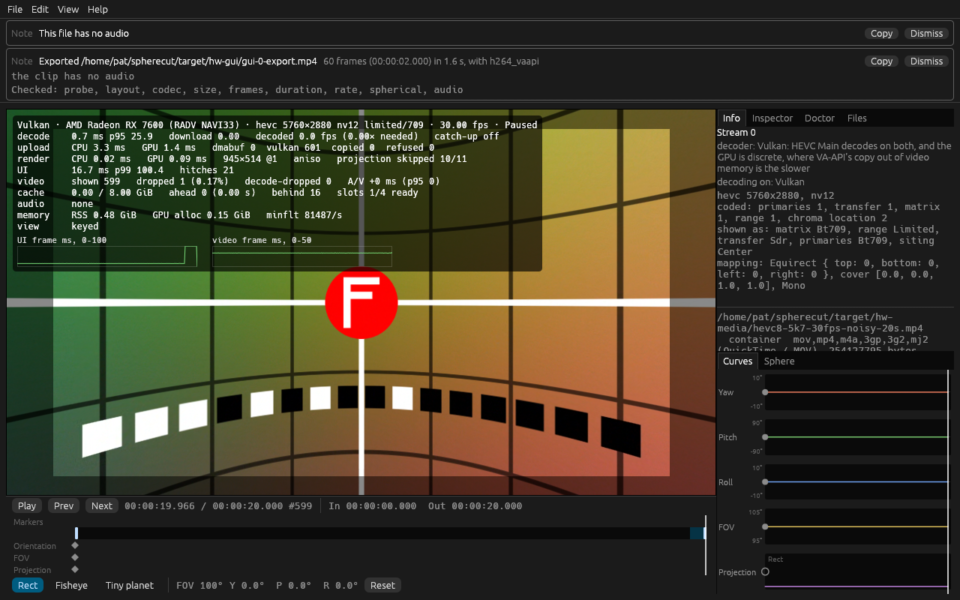
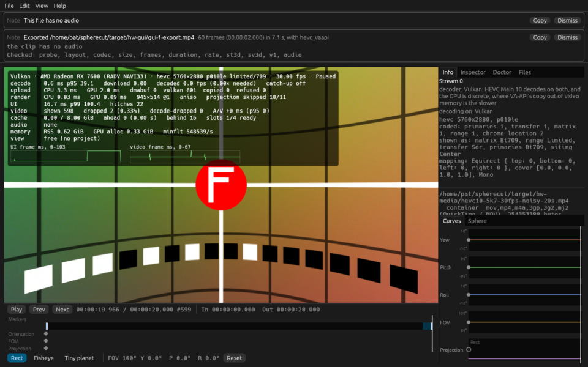
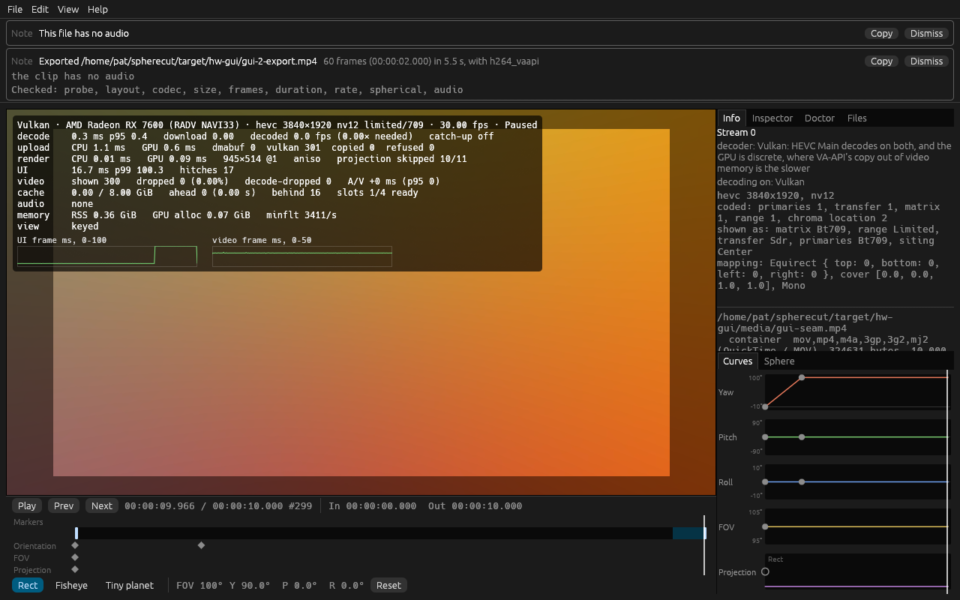
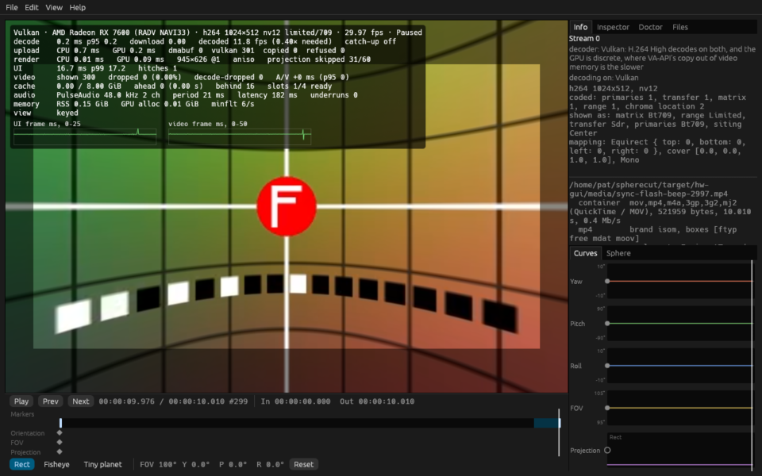
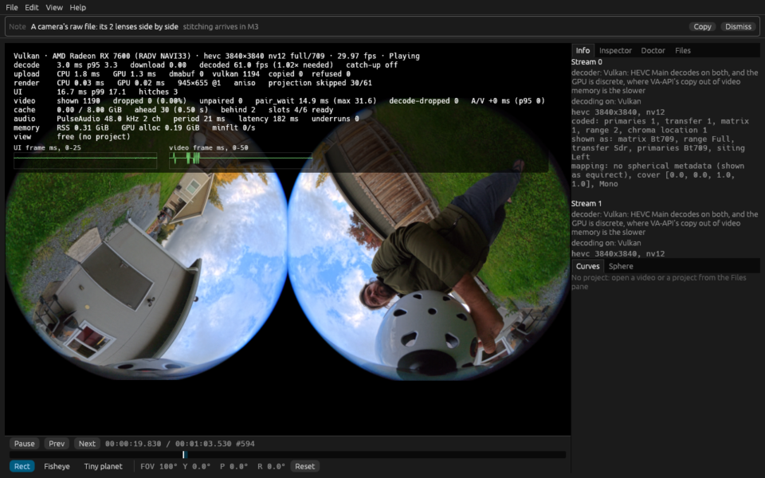

# Hardware report: odin @ 9ab8091166

Generated by `cargo xtask hw-test --only bench_playback_x5_raw --only samples_lens_pairs_frame_locked --only zero_copy_pair_matches_copy --only zero_copy_matches_copy_path --only shared_vulkan_matches_copy_path --only bench_playback_realtime --only gui_smoke` in 2110 s.

## Summary

| | |
|---|---|
| Host | odin |
| OS | Fedora Linux 44 (Workstation Edition) |
| Kernel | Linux 7.2.9-200.fc44.x86_64 #1 SMP PREEMPT_DYNAMIC Sat Oct  3 19:59:55 UTC 2026 x86_64 |
| Session | wayland / GNOME |
| GUI display | WAYLAND_DISPLAY set: WAYLAND_DISPLAY=wayland-0 |
| Screen locked at the end | no |
| Audio server | PulseAudio (on PipeWire 1.6.9) |
| GNOME mutter experimental features | @as [] |
| GPU (Vulkan) | AMD Radeon RX 7600 (RADV NAVI33) |
| Mesa | Mesa 26.2.5 |
| FFmpeg | ffmpeg version 8.1.3 Copyright (c) 2000-2026 the FFmpeg developers |
| FFmpeg libs | 62.28.103, 62.12.103, 60.26.103, 9.5.103, 6.3.103 |
| x265 | 4.1+1-1d117be (build 215) (the info SEI of a frame hw-test coded; `pkg-config` has no x265) |
| Rust | rustc 1.99.0 (b940084d7 2026-09-28) |
| VA-API HEVC | decode: yes, encode: yes |
| FFmpeg hwaccels | vdpau, cuda, vaapi, qsv, drm, opencl, vulkan, amf |
| Samples dir | /home/pat/spherecut/samples (present) |

**Tier 2: 7 passed, 2 failed, 0 skipped, 48 left out by `--only`, 0 did not run (57 tests).**

**Tier 1 on this machine: 1550 passed, 0 failed, in 117 test binaries (538 s).**

**This run FAILED:** 2 Tier 2 test(s) failed.

## Prerequisites

Nothing missing.

## Build

Succeeded (release) in 82 s.

## Power profile

Read once, before the build, and never changed: decode speed moves with these.

| Setting | Value |
|---|---|
| power-profiles-daemon | not available (no `powerprofilesctl`) |
| ACPI platform profile | not available (no /sys/firmware/acpi/platform_profile) |
| CPU frequency driver | amd-pstate-epp |
| CPU governor | performance |
| CPU energy preference | performance |
| card0 (amdgpu) performance level | auto |
| card0 (amdgpu) power profile | not available (unreadable) |

## Render nodes

| Node | PCI slot | Vendor | Device | Driver | Opens |
|---|---|---|---|---|---|
| renderD128 | 0000:0c:00.0 | AMD (0x1002) | 0x7480 | amdgpu | yes |

## Perf clips

synth's noisy grid in HEVC at about a camera's bitrate, made once and kept in `/home/pat/spherecut/target/hw-media` for the playback benchmarks. Software decode over 150 fps would make a clip too easy to say anything about footage. A two-track clip has a row a lens: its bitrate from that lens's samples, its decode that lens's alone, and its coding read back from the file, its IDR interval from `stss` and its pictures by NAL type, in bold where a picture is neither an IDR nor a TRAIL_R, an IDR is off the interval, a place on it has none, or `stss` and the coding disagree.

| Clip | Size | Bitrate | Made | Software decode | Coding |
|---|---:|---:|---|---|---|
| `hevc8-5k7-30fps-noisy-20s.mp4` | 254 MB | 101.7 Mbit/s | cached | not measured |  |
| `hevc10-5k7-30fps-noisy-20s.mp4` | 254 MB | 101.7 Mbit/s | cached | not measured |  |
| `hevc8-8k-30fps-noisy-20s.mp4` | 305 MB | 122.1 Mbit/s | cached | not measured |  |
| `pair-hevc8-3840-2997-noisy-20s.mp4` lens 0 | 163 MB | 65.3 Mbit/s | cached | not measured | IDR every 60; TRAIL_R 590, IDR_N_LP 10 |
| `pair-hevc8-3840-2997-noisy-20s.mp4` lens 1 | 163 MB | 65.3 Mbit/s | cached | not measured | IDR every 60; TRAIL_R 590, IDR_N_LP 10 |
| `pair-hevc8-2880-5994-noisy-10s.mp4` lens 0 | 100 MB | 80.2 Mbit/s | cached | not measured | IDR every 120; TRAIL_R 595, IDR_N_LP 5; P only: the X5 codes TSA_N on every other picture, and every picture here but the IDRs is a reference P frame |
| `pair-hevc8-2880-5994-noisy-10s.mp4` lens 1 | 100 MB | 80.2 Mbit/s | cached | not measured | IDR every 120; TRAIL_R 595, IDR_N_LP 5; P only: the X5 codes TSA_N on every other picture, and every picture here but the IDRs is a reference P frame |
| `pair-hevc8-2880-2997-noisy-20s.mp4` lens 0 | 201 MB | 80.2 Mbit/s | cached | not measured | IDR every 60; TRAIL_R 590, IDR_N_LP 10 |
| `pair-hevc8-2880-2997-noisy-20s.mp4` lens 1 | 201 MB | 80.2 Mbit/s | cached | not measured | IDR every 60; TRAIL_R 590, IDR_N_LP 10 |

## Tier 2 tests

| Test | Result |
|---|---|
| `adapters::list_adapters_and_features` | left out by `--only` |
| `goldens::goldens_on_gpu_match_reference` | left out by `--only` |
| `goldens::goldens_on_host_llvmpipe` | left out by `--only` |
| `samples_roles::samples_every_present_role_resolves` | left out by `--only` |
| `spherecut-camera/tier2_samples::samples_calib_print_is_identity` | left out by `--only` |
| `spherecut-camera/tier2_samples::samples_insv_trailer_parses` | left out by `--only` |
| `spherecut-media/doctor::doctor_decodes_hevc_main_on_vaapi` | left out by `--only` |
| `spherecut-media/tier2_samples::bench_samples_realtime_decode` | left out by `--only` |
| `spherecut-media/tier2_samples::samples_probe_cleanly` | left out by `--only` |
| `spherecut-media/tier2_samples::samples_vaapi_decode_matches_software` | left out by `--only` |
| `spherecut-media/tier2_samples::samples_vulkan_decode_matches_software` | left out by `--only` |
| `spherecut_synth::lens::tests::bench_render_lens_x5_like_pair` | left out by `--only` |
| `tier2_backend::bench_seek_latency` | left out by `--only` |
| `tier2_backend::vaapi_colorinfo_matches_software` | left out by `--only` |
| `tier2_backend::vaapi_exports_match_downloads` | left out by `--only` |
| `tier2_backend::vaapi_seek_matches_software` | left out by `--only` |
| `tier2_backend::vulkan_colorinfo_matches_software` | left out by `--only` |
| `tier2_backend::vulkan_seek_matches_software` | left out by `--only` |
| `tier2_device::audio_output_device_plays` | left out by `--only` |
| `tier2_download_pool::vaapi_download_pool_reuses_buffers` | left out by `--only` |
| `tier2_download_pool::vulkan_download_pool_reuses_buffers` | left out by `--only` |
| `tier2_export::bench_export_4k30_vaapi` | left out by `--only` |
| `tier2_export::bench_export_vaapi_levels` | left out by `--only` |
| `tier2_export::export_360_8k_vaapi` | left out by `--only` |
| `tier2_export::export_vaapi_matches_software` | left out by `--only` |
| `tier2_frame::doctor_and_the_renderer_agree_on_sharing` | left out by `--only` |
| `tier2_frame::shared_vulkan_frame_matches_the_copy` | left out by `--only` |
| `tier2_frame::vaapi_render_matches_software` | left out by `--only` |
| `tier2_frame::vulkan_render_matches_software` | left out by `--only` |
| `tier2_frame::zero_copy_frame_matches_the_copy` | left out by `--only` |
| `tier2_gui::gui_proto` | left out by `--only` |
| `tier2_gui::gui_smoke` | **FAIL** |
| `tier2_hw_decode::bench_decode_hevc_4k_and_5k7` | left out by `--only` |
| `tier2_hw_decode::vaapi_h264_matches_software` | left out by `--only` |
| `tier2_hw_decode::vaapi_hevc_main10_matches_software` | left out by `--only` |
| `tier2_hw_decode::vaapi_hevc_main_matches_software` | left out by `--only` |
| `tier2_hw_decode::vulkan_h264_matches_software` | left out by `--only` |
| `tier2_hw_decode::vulkan_hevc_main10_matches_software` | left out by `--only` |
| `tier2_hw_decode::vulkan_hevc_main_matches_software` | left out by `--only` |
| `tier2_mcp::mcp_render_vaapi` | left out by `--only` |
| `tier2_mcp::mcp_session_decodes_with_vaapi` | left out by `--only` |
| `tier2_pair_decode::bench_export_pair_decode` | left out by `--only` |
| `tier2_playback::bench_perf_clips_software_decode` | left out by `--only` |
| `tier2_playback::bench_playback_realtime_5k7_10bit` | pass |
| `tier2_playback::bench_playback_realtime_5k7_8bit` | pass |
| `tier2_playback::bench_playback_realtime_8k_8bit` | pass |
| `tier2_playback::bench_playback_stitched_samples` | left out by `--only` |
| `tier2_playback::bench_playback_x5_raw` | pass |
| `tier2_playback::bench_x5_8k30_zero_copy_vs_copy` | left out by `--only` |
| `tier2_playback::samples_lens_pairs_frame_locked` | pass |
| `tier2_playback::shared_vulkan_matches_copy_path` | pass |
| `tier2_playback::zero_copy_matches_copy_path` | pass |
| `tier2_playback::zero_copy_pair_matches_copy` | **FAIL** |
| `tier2_probe::samples_probe_names_the_camera` | left out by `--only` |
| `tier2_tracks::samples_x5_tracks_equal` | left out by `--only` |
| `upload::bench_upload_5k7` | left out by `--only` |
| `yuv::yuv_on_gpu_matches_reference` | left out by `--only` |

### FAIL `tier2_gui::gui_smoke`

```
==> noisy 5.7K 8-bit: /home/pat/spherecut/target/hw-media/hevc8-5k7-30fps-noisy-20s.mp4
==> noisy 5.7K 10-bit: /home/pat/spherecut/target/hw-media/hevc10-5k7-30fps-noisy-20s.mp4
==> seam 3840×1920 HEVC: /home/pat/spherecut/target/hw-gui/media/gui-seam.mp4
==> sync flash and beep: /home/pat/spherecut/target/hw-gui/media/sync-flash-beep-2997.mp4
==> X5 raw view insta360-x5/VID_20261022_170245_00_009.insv: /home/pat/spherecut/samples/insta360-x5/VID_20261022_170245_00_009.insv
not run: stitched samples: none under /home/pat/spherecut/samples (clip 12 is still wanted)

thread 'gui_smoke' (2852766) panicked at crates/cli/tests/tier2_gui.rs:520:5:
2 of 5 runs failed:
noisy 5.7K 8-bit: 1 of 569 frames dropped (0.18%, over 0.1%)
noisy 5.7K 8-bit: 1 of 569 frames dropped while the export ran
noisy 5.7K 10-bit: 2 of 569 frames dropped (0.35%, over 0.1%)
noisy 5.7K 10-bit: 2 of 569 frames dropped while the export ran
note: run with `RUST_BACKTRACE=1` environment variable to display a backtrace


```

### FAIL `tier2_playback::zero_copy_pair_matches_copy`

```
rendered on AMD Radeon RX 7600 (RADV NAVI33) (radv Mesa 26.2.5), decoded on /dev/dri/renderD128, the GPU at PCI 0000:0c:00.0

thread 'zero_copy_pair_matches_copy' (2873512) panicked at crates/playback/tests/tier2_playback.rs:3857:37:
clip 9 (handheld_flips), Vulkan, path B, locked against the copy: stream 0's frame at pts 28028 differs from the copy's
note: run with `RUST_BACKTRACE=1` environment variable to display a backtrace


```

## Benchmarks

Release build. Each benchmark runs once to warm up, then 3 times (`SPHERECUT_BENCH_RUNS`); the result is the median. Spread is the range over the median: over 10% means the machine was busy or changing clocks, so take that result with care. A row marked "per second" is one run's seconds instead: Runs counts the seconds, and the range is the slowest and the fastest.

| Benchmark | Median | Range | Runs | Spread |
|---|---:|---:|---:|---:|
| hevc10-5k7-30fps-noisy-20s, Vulkan (Auto, zero copy): decoded per second, unthrottled | 128.00 fps | 128.00 to 130.00 | 4 | 2% |
| hevc10-5k7-30fps-noisy-20s, Vulkan (Auto, zero copy): decoded per second, real time | 30.00 fps | 12.00 to 46.00 | 60 | 113% **unstable** |
| hevc10-5k7-30fps-noisy-20s, Vulkan (Auto, zero copy): shown per second, real time | 30.00 fps | 22.00 to 31.00 | 60 | 30% **unstable** |
| hevc10-5k7-30fps-noisy-20s, Vulkan (Auto, zero copy): dropped after 1 s | 0.00 frames | | 1 | |
| hevc10-5k7-30fps-noisy-20s, Vulkan (Auto, zero copy): decode-dropped after 1 s | 0.00 frames | | 1 | |
| hevc10-5k7-30fps-noisy-20s, Vulkan (Auto, zero copy): late presents after 1 s | 0.00 presents | | 1 | |
| hevc10-5k7-30fps-noisy-20s, Vulkan (Auto): decoded per second, unthrottled | 22.50 fps | 17.00 to 108.00 | 12 | 404% **unstable** |
| hevc10-5k7-30fps-noisy-20s, Vulkan (Auto): decoded per second, real time | 29.00 fps | 0.00 to 61.00 | 20 | 210% **unstable** |
| hevc10-5k7-30fps-noisy-20s, Vulkan (Auto): shown per second, real time | 30.00 fps | 29.00 to 30.00 | 20 | 3% |
| hevc10-5k7-30fps-noisy-20s, Vulkan (Auto): dropped after 1 s | 0.00 frames | | 1 | |
| hevc10-5k7-30fps-noisy-20s, Vulkan (Auto): decode-dropped after 1 s | 0.00 frames | | 1 | |
| hevc10-5k7-30fps-noisy-20s, Vulkan (Auto): late presents after 1 s | 0.00 presents | | 1 | |
| hevc10-5k7-30fps-noisy-20s, VA-API: decoded per second, unthrottled | 14.00 fps | 12.00 to 18.00 | 20 | 43% **unstable** |
| hevc10-5k7-30fps-noisy-20s, VA-API: decoded per second, real time | 23.00 fps | 22.00 to 29.00 | 20 | 30% **unstable** |
| hevc10-5k7-30fps-noisy-20s, VA-API: shown per second, real time | 6.00 fps | 5.00 to 10.00 | 20 | 83% **unstable** |
| hevc10-5k7-30fps-noisy-20s, VA-API: dropped after 1 s | 456.00 frames | | 1 | |
| hevc10-5k7-30fps-noisy-20s, VA-API: decode-dropped after 1 s | 459.00 frames | | 1 | |
| hevc10-5k7-30fps-noisy-20s, VA-API: late presents after 1 s | 1138.00 presents | | 1 | |
| hevc10-5k7-30fps-noisy-20s, software: decoded per second, unthrottled | 32.50 fps | 29.00 to 39.00 | 18 | 31% **unstable** |
| hevc10-5k7-30fps-noisy-20s, software: decoded per second, real time | 30.00 fps | 0.00 to 38.00 | 20 | 127% **unstable** |
| hevc10-5k7-30fps-noisy-20s, software: shown per second, real time | 30.00 fps | 22.00 to 30.00 | 20 | 27% **unstable** |
| hevc10-5k7-30fps-noisy-20s, software: dropped after 1 s | 30.00 frames | | 1 | |
| hevc10-5k7-30fps-noisy-20s, software: decode-dropped after 1 s | 21.00 frames | | 1 | |
| hevc10-5k7-30fps-noisy-20s, software: late presents after 1 s | 345.00 presents | | 1 | |
| hevc8-5k7-30fps-noisy-20s, Vulkan (Auto, zero copy): decoded per second, unthrottled | 129.00 fps | 127.00 to 129.00 | 4 | 2% |
| hevc8-5k7-30fps-noisy-20s, Vulkan (Auto, zero copy): decoded per second, real time | 30.00 fps | 12.00 to 46.00 | 60 | 113% **unstable** |
| hevc8-5k7-30fps-noisy-20s, Vulkan (Auto, zero copy): shown per second, real time | 30.00 fps | 20.00 to 31.00 | 60 | 37% **unstable** |
| hevc8-5k7-30fps-noisy-20s, Vulkan (Auto, zero copy): dropped after 1 s | 0.00 frames | | 1 | |
| hevc8-5k7-30fps-noisy-20s, Vulkan (Auto, zero copy): decode-dropped after 1 s | 0.00 frames | | 1 | |
| hevc8-5k7-30fps-noisy-20s, Vulkan (Auto, zero copy): late presents after 1 s | 0.00 presents | | 1 | |
| hevc8-5k7-30fps-noisy-20s, Vulkan (Auto): decoded per second, unthrottled | 106.00 fps | 27.00 to 129.00 | 7 | 96% **unstable** |
| hevc8-5k7-30fps-noisy-20s, Vulkan (Auto): decoded per second, real time | 30.00 fps | 0.00 to 61.00 | 20 | 203% **unstable** |
| hevc8-5k7-30fps-noisy-20s, Vulkan (Auto): shown per second, real time | 30.00 fps | 29.00 to 30.00 | 20 | 3% |
| hevc8-5k7-30fps-noisy-20s, Vulkan (Auto): dropped after 1 s | 0.00 frames | | 1 | |
| hevc8-5k7-30fps-noisy-20s, Vulkan (Auto): decode-dropped after 1 s | 0.00 frames | | 1 | |
| hevc8-5k7-30fps-noisy-20s, Vulkan (Auto): late presents after 1 s | 0.00 presents | | 1 | |
| hevc8-5k7-30fps-noisy-20s, VA-API: decoded per second, unthrottled | 26.00 fps | 23.00 to 35.00 | 20 | 46% **unstable** |
| hevc8-5k7-30fps-noisy-20s, VA-API: decoded per second, real time | 28.00 fps | 25.00 to 35.00 | 20 | 36% **unstable** |
| hevc8-5k7-30fps-noisy-20s, VA-API: shown per second, real time | 18.50 fps | 13.00 to 30.00 | 20 | 92% **unstable** |
| hevc8-5k7-30fps-noisy-20s, VA-API: dropped after 1 s | 199.00 frames | | 1 | |
| hevc8-5k7-30fps-noisy-20s, VA-API: decode-dropped after 1 s | 199.00 frames | | 1 | |
| hevc8-5k7-30fps-noisy-20s, VA-API: late presents after 1 s | 1027.00 presents | | 1 | |
| hevc8-5k7-30fps-noisy-20s, software: decoded per second, unthrottled | 45.00 fps | 37.00 to 56.00 | 13 | 42% **unstable** |
| hevc8-5k7-30fps-noisy-20s, software: decoded per second, real time | 30.00 fps | 0.00 to 51.00 | 20 | 170% **unstable** |
| hevc8-5k7-30fps-noisy-20s, software: shown per second, real time | 30.00 fps | 29.00 to 30.00 | 20 | 3% |
| hevc8-5k7-30fps-noisy-20s, software: dropped after 1 s | 0.00 frames | | 1 | |
| hevc8-5k7-30fps-noisy-20s, software: decode-dropped after 1 s | 0.00 frames | | 1 | |
| hevc8-5k7-30fps-noisy-20s, software: late presents after 1 s | 0.00 presents | | 1 | |
| hevc8-8k-30fps-noisy-20s, Vulkan (Auto): decoded per second, unthrottled | 72.50 fps | 49.00 to 84.00 | 8 | 48% **unstable** |
| hevc8-8k-30fps-noisy-20s, Vulkan (Auto): decoded per second, real time | 30.00 fps | 0.00 to 61.00 | 20 | 203% **unstable** |
| hevc8-8k-30fps-noisy-20s, Vulkan (Auto): shown per second, real time | 30.00 fps | 29.00 to 30.00 | 20 | 3% |
| hevc8-8k-30fps-noisy-20s, Vulkan (Auto): dropped after 1 s | 0.00 frames | | 1 | |
| hevc8-8k-30fps-noisy-20s, Vulkan (Auto): decode-dropped after 1 s | 0.00 frames | | 1 | |
| hevc8-8k-30fps-noisy-20s, Vulkan (Auto): late presents after 1 s | 0.00 presents | | 1 | |
| hevc8-8k-30fps-noisy-20s, VA-API: decoded per second, unthrottled | 12.00 fps | 10.00 to 15.00 | 20 | 42% **unstable** |
| hevc8-8k-30fps-noisy-20s, VA-API: decoded per second, real time | 24.00 fps | 17.00 to 31.00 | 20 | 58% **unstable** |
| hevc8-8k-30fps-noisy-20s, VA-API: shown per second, real time | 4.50 fps | 3.00 to 11.00 | 20 | 178% **unstable** |
| hevc8-8k-30fps-noisy-20s, VA-API: dropped after 1 s | 469.00 frames | | 1 | |
| hevc8-8k-30fps-noisy-20s, VA-API: decode-dropped after 1 s | 469.00 frames | | 1 | |
| hevc8-8k-30fps-noisy-20s, VA-API: late presents after 1 s | 1138.00 presents | | 1 | |
| hevc8-8k-30fps-noisy-20s, software: decoded per second, unthrottled | 29.00 fps | 23.00 to 34.00 | 20 | 38% **unstable** |
| hevc8-8k-30fps-noisy-20s, software: decoded per second, real time | 30.00 fps | 15.00 to 37.00 | 20 | 73% **unstable** |
| hevc8-8k-30fps-noisy-20s, software: shown per second, real time | 23.50 fps | 8.00 to 30.00 | 20 | 94% **unstable** |
| hevc8-8k-30fps-noisy-20s, software: dropped after 1 s | 178.00 frames | | 1 | |
| hevc8-8k-30fps-noisy-20s, software: decode-dropped after 1 s | 145.00 frames | | 1 | |
| hevc8-8k-30fps-noisy-20s, software: late presents after 1 s | 650.00 presents | | 1 | |
| X5 raw 2× 1920x1920 at 119.88 fps, Vulkan (Auto): decoded per second, unthrottled | 237.25 fps | 233.50 to 241.00 | 2 | 3% |
| X5 raw 2× 1920x1920 at 119.88 fps, Vulkan (Auto): decoded per second, real time | 0.00 fps | 0.00 to 238.50 | 20 | n/a |
| X5 raw 2× 1920x1920 at 119.88 fps, Vulkan (Auto): shown per second, real time | 60.00 fps | 60.00 to 60.00 | 20 | 0% |
| X5 raw 2× 1920x1920 at 119.88 fps, Vulkan (Auto): dropped after 1 s | 2248.00 frames | | 1 | |
| X5 raw 2× 1920x1920 at 119.88 fps, Vulkan (Auto): decode-dropped after 1 s | 0.00 frames | | 1 | |
| X5 raw 2× 1920x1920 at 119.88 fps, Vulkan (Auto): late presents after 1 s | 1128.00 presents | | 1 | |
| X5 raw 2× 1920x1920 at 119.88 fps, Vulkan (Auto): unpaired presents | 5518.00 presents | | 1 | |
| X5 raw 2× 1920x1920 at 119.88 fps, Vulkan (Auto): lens 0 decoded since the open, real time | 586.00 frames | | 1 | |
| X5 raw 2× 1920x1920 at 119.88 fps, Vulkan (Auto): lens 1 decoded since the open, real time | 586.00 frames | | 1 | |
| X5 raw 2× 1920x1920 at 119.88 fps, Vulkan (Auto, zero copy): decoded per second, unthrottled | 278.00 fps | 277.50 to 278.50 | 2 | 0% |
| X5 raw 2× 1920x1920 at 119.88 fps, Vulkan (Auto, zero copy): decoded per second, real time | 120.00 fps | 111.50 to 136.00 | 20 | 20% **unstable** |
| X5 raw 2× 1920x1920 at 119.88 fps, Vulkan (Auto, zero copy): shown per second, real time | 60.00 fps | 59.00 to 60.00 | 20 | 2% |
| X5 raw 2× 1920x1920 at 119.88 fps, Vulkan (Auto, zero copy): dropped after 1 s | 2246.00 frames | | 1 | |
| X5 raw 2× 1920x1920 at 119.88 fps, Vulkan (Auto, zero copy): decode-dropped after 1 s | 0.00 frames | | 1 | |
| X5 raw 2× 1920x1920 at 119.88 fps, Vulkan (Auto, zero copy): late presents after 1 s | 1127.00 presents | | 1 | |
| X5 raw 2× 1920x1920 at 119.88 fps, Vulkan (Auto, zero copy): unpaired presents | 2911.00 presents | | 1 | |
| X5 raw 2× 1920x1920 at 119.88 fps, Vulkan (Auto, zero copy): lens 0 decoded since the open, real time | 2400.00 frames | | 1 | |
| X5 raw 2× 1920x1920 at 119.88 fps, Vulkan (Auto, zero copy): lens 1 decoded since the open, real time | 2400.00 frames | | 1 | |
| X5 raw 2× 1920x1920 at 119.88 fps, Vulkan (Auto, zero copy): path B pool, lens 0, real time | 84.38 MiB | | 1 | |
| X5 raw 2× 1920x1920 at 119.88 fps, Vulkan (Auto, zero copy): path B pool, lens 1, real time | 89.65 MiB | | 1 | |
| X5 raw 2× 1920x1920 at 119.88 fps, Vulkan (Auto, zero copy), locked: decoded per second, unthrottled | 280.75 fps | 280.50 to 281.00 | 2 | 0% |
| X5 raw 2× 1920x1920 at 119.88 fps, Vulkan (Auto, zero copy), locked: decoded per second, real time | 120.00 fps | 112.00 to 136.00 | 20 | 20% **unstable** |
| X5 raw 2× 1920x1920 at 119.88 fps, Vulkan (Auto, zero copy), locked: shown per second, real time | 60.00 fps | 58.00 to 60.00 | 20 | 3% |
| X5 raw 2× 1920x1920 at 119.88 fps, Vulkan (Auto, zero copy), locked: dropped after 1 s | 1124.00 frames | | 1 | |
| X5 raw 2× 1920x1920 at 119.88 fps, Vulkan (Auto, zero copy), locked: decode-dropped after 1 s | 0.00 frames | | 1 | |
| X5 raw 2× 1920x1920 at 119.88 fps, Vulkan (Auto, zero copy), locked: late presents after 1 s | 232.00 presents | | 1 | |
| X5 raw 2× 1920x1920 at 119.88 fps, Vulkan (Auto, zero copy), locked: unpaired presents | 0.00 presents | | 1 | |
| X5 raw 2× 1920x1920 at 119.88 fps, Vulkan (Auto, zero copy), locked: lens 0 decoded since the open, real time | 2394.00 frames | | 1 | |
| X5 raw 2× 1920x1920 at 119.88 fps, Vulkan (Auto, zero copy), locked: lens 1 decoded since the open, real time | 2394.00 frames | | 1 | |
| X5 raw 2× 1920x1920 at 119.88 fps, Vulkan (Auto, zero copy), locked: path B pool, lens 0, real time | 94.92 MiB | | 1 | |
| X5 raw 2× 1920x1920 at 119.88 fps, Vulkan (Auto, zero copy), locked: path B pool, lens 1, real time | 94.92 MiB | | 1 | |
| X5 raw 2× 1920x1920 at 119.88 fps, Vulkan (Auto, zero copy), locked: pair resyncs | 0.00 resyncs | | 1 | |
| X5 raw 2× 1920x1920 at 119.88 fps, Vulkan (Auto, zero copy), locked: pairs presented, real time | 1193.00 pairs | | 1 | |
| X5 raw 2× 1920x1920 at 119.88 fps, Vulkan (Auto, zero copy), locked: presented after 1 s | 49.74 % | | 1 | |
| X5 raw 2× 1920x1920 at 119.88 fps, Vulkan (Auto, zero copy), locked: pair_wait p50, real time | 6.74 ms | | 1 | |
| X5 raw 2× 1920x1920 at 119.88 fps, Vulkan (Auto, zero copy), locked: pair_wait p95, real time | 15.48 ms | | 1 | |
| X5 raw 2× 1920x1920 at 119.88 fps, Vulkan (Auto, zero copy), locked: slots | 6.00 slots | | 1 | |
| X5 raw 2× 1920x1920 at 119.88 fps, VA-API: decoded per second, unthrottled | 88.75 fps | 88.00 to 93.50 | 6 | 6% |
| X5 raw 2× 1920x1920 at 119.88 fps, VA-API: decoded per second, real time | 0.00 fps | 0.00 to 113.00 | 20 | n/a |
| X5 raw 2× 1920x1920 at 119.88 fps, VA-API: shown per second, real time | 60.00 fps | 47.00 to 60.00 | 20 | 22% **unstable** |
| X5 raw 2× 1920x1920 at 119.88 fps, VA-API: dropped after 1 s | 2444.00 frames | | 1 | |
| X5 raw 2× 1920x1920 at 119.88 fps, VA-API: decode-dropped after 1 s | 334.00 frames | | 1 | |
| X5 raw 2× 1920x1920 at 119.88 fps, VA-API: late presents after 1 s | 1128.00 presents | | 1 | |
| X5 raw 2× 1920x1920 at 119.88 fps, VA-API: unpaired presents | 17874.00 presents | | 1 | |
| X5 raw 2× 1920x1920 at 119.88 fps, VA-API: lens 0 decoded since the open, real time | 1123.00 frames | | 1 | |
| X5 raw 2× 1920x1920 at 119.88 fps, VA-API: lens 1 decoded since the open, real time | 542.00 frames | | 1 | |
| X5 raw 2× 1920x1920 at 119.88 fps, software: decoded per second, unthrottled | 85.50 fps | 62.50 to 92.00 | 7 | 35% **unstable** |
| X5 raw 2× 1920x1920 at 119.88 fps, software: decoded per second, real time | 69.00 fps | 0.00 to 97.50 | 20 | 141% **unstable** |
| X5 raw 2× 1920x1920 at 119.88 fps, software: shown per second, real time | 4.00 fps | 1.00 to 9.00 | 20 | 200% **unstable** |
| X5 raw 2× 1920x1920 at 119.88 fps, software: dropped after 1 s | 2949.00 frames | | 1 | |
| X5 raw 2× 1920x1920 at 119.88 fps, software: decode-dropped after 1 s | 2790.00 frames | | 1 | |
| X5 raw 2× 1920x1920 at 119.88 fps, software: late presents after 1 s | 1127.00 presents | | 1 | |
| X5 raw 2× 1920x1920 at 119.88 fps, software: unpaired presents | 19330.00 presents | | 1 | |
| X5 raw 2× 1920x1920 at 119.88 fps, software: lens 0 decoded since the open, real time | 1102.00 frames | | 1 | |
| X5 raw 2× 1920x1920 at 119.88 fps, software: lens 1 decoded since the open, real time | 1229.00 frames | | 1 | |
| X5 raw 2× 2880x2880 at 59.94 fps, Vulkan (Auto): decoded per second, unthrottled | 129.00 fps | | 1 | |
| X5 raw 2× 2880x2880 at 59.94 fps, Vulkan (Auto): decoded per second, real time | 0.00 fps | 0.00 to 119.50 | 20 | n/a |
| X5 raw 2× 2880x2880 at 59.94 fps, Vulkan (Auto): shown per second, real time | 60.00 fps | 58.00 to 60.00 | 20 | 3% |
| X5 raw 2× 2880x2880 at 59.94 fps, Vulkan (Auto): dropped after 1 s | 0.00 frames | | 1 | |
| X5 raw 2× 2880x2880 at 59.94 fps, Vulkan (Auto): decode-dropped after 1 s | 0.00 frames | | 1 | |
| X5 raw 2× 2880x2880 at 59.94 fps, Vulkan (Auto): late presents after 1 s | 0.00 presents | | 1 | |
| X5 raw 2× 2880x2880 at 59.94 fps, Vulkan (Auto): unpaired presents | 2155.00 presents | | 1 | |
| X5 raw 2× 2880x2880 at 59.94 fps, Vulkan (Auto): lens 0 decoded since the open, real time | 190.00 frames | | 1 | |
| X5 raw 2× 2880x2880 at 59.94 fps, Vulkan (Auto): lens 1 decoded since the open, real time | 190.00 frames | | 1 | |
| X5 raw 2× 2880x2880 at 59.94 fps, Vulkan (Auto, zero copy): decoded per second, unthrottled | 142.50 fps | | 1 | |
| X5 raw 2× 2880x2880 at 59.94 fps, Vulkan (Auto, zero copy): decoded per second, real time | 59.50 fps | 45.00 to 74.50 | 20 | 50% **unstable** |
| X5 raw 2× 2880x2880 at 59.94 fps, Vulkan (Auto, zero copy): shown per second, real time | 60.00 fps | 57.00 to 60.00 | 20 | 5% |
| X5 raw 2× 2880x2880 at 59.94 fps, Vulkan (Auto, zero copy): dropped after 1 s | 0.00 frames | | 1 | |
| X5 raw 2× 2880x2880 at 59.94 fps, Vulkan (Auto, zero copy): decode-dropped after 1 s | 0.00 frames | | 1 | |
| X5 raw 2× 2880x2880 at 59.94 fps, Vulkan (Auto, zero copy): late presents after 1 s | 0.00 presents | | 1 | |
| X5 raw 2× 2880x2880 at 59.94 fps, Vulkan (Auto, zero copy): unpaired presents | 1921.00 presents | | 1 | |
| X5 raw 2× 2880x2880 at 59.94 fps, Vulkan (Auto, zero copy): lens 0 decoded since the open, real time | 1200.00 frames | | 1 | |
| X5 raw 2× 2880x2880 at 59.94 fps, Vulkan (Auto, zero copy): lens 1 decoded since the open, real time | 1199.00 frames | | 1 | |
| X5 raw 2× 2880x2880 at 59.94 fps, Vulkan (Auto, zero copy): path B pool, lens 0, real time | 213.57 MiB | | 1 | |
| X5 raw 2× 2880x2880 at 59.94 fps, Vulkan (Auto, zero copy): path B pool, lens 1, real time | 213.57 MiB | | 1 | |
| X5 raw 2× 2880x2880 at 59.94 fps, Vulkan (Auto, zero copy), locked: decoded per second, unthrottled | 142.50 fps | | 1 | |
| X5 raw 2× 2880x2880 at 59.94 fps, Vulkan (Auto, zero copy), locked: decoded per second, real time | 60.00 fps | 48.00 to 76.00 | 20 | 47% **unstable** |
| X5 raw 2× 2880x2880 at 59.94 fps, Vulkan (Auto, zero copy), locked: shown per second, real time | 60.00 fps | 56.00 to 60.00 | 20 | 7% |
| X5 raw 2× 2880x2880 at 59.94 fps, Vulkan (Auto, zero copy), locked: dropped after 1 s | 0.00 frames | | 1 | |
| X5 raw 2× 2880x2880 at 59.94 fps, Vulkan (Auto, zero copy), locked: decode-dropped after 1 s | 0.00 frames | | 1 | |
| X5 raw 2× 2880x2880 at 59.94 fps, Vulkan (Auto, zero copy), locked: late presents after 1 s | 0.00 presents | | 1 | |
| X5 raw 2× 2880x2880 at 59.94 fps, Vulkan (Auto, zero copy), locked: unpaired presents | 0.00 presents | | 1 | |
| X5 raw 2× 2880x2880 at 59.94 fps, Vulkan (Auto, zero copy), locked: lens 0 decoded since the open, real time | 1194.00 frames | | 1 | |
| X5 raw 2× 2880x2880 at 59.94 fps, Vulkan (Auto, zero copy), locked: lens 1 decoded since the open, real time | 1194.00 frames | | 1 | |
| X5 raw 2× 2880x2880 at 59.94 fps, Vulkan (Auto, zero copy), locked: path B pool, lens 0, real time | 213.57 MiB | | 1 | |
| X5 raw 2× 2880x2880 at 59.94 fps, Vulkan (Auto, zero copy), locked: path B pool, lens 1, real time | 213.57 MiB | | 1 | |
| X5 raw 2× 2880x2880 at 59.94 fps, Vulkan (Auto, zero copy), locked: pair resyncs | 0.00 resyncs | | 1 | |
| X5 raw 2× 2880x2880 at 59.94 fps, Vulkan (Auto, zero copy), locked: pairs presented, real time | 1176.00 pairs | | 1 | |
| X5 raw 2× 2880x2880 at 59.94 fps, Vulkan (Auto, zero copy), locked: presented after 1 s | 97.99 % | | 1 | |
| X5 raw 2× 2880x2880 at 59.94 fps, Vulkan (Auto, zero copy), locked: pair_wait p50, real time | 15.11 ms | | 1 | |
| X5 raw 2× 2880x2880 at 59.94 fps, Vulkan (Auto, zero copy), locked: pair_wait p95, real time | 16.52 ms | | 1 | |
| X5 raw 2× 2880x2880 at 59.94 fps, Vulkan (Auto, zero copy), locked: slots | 6.00 slots | | 1 | |
| X5 raw 2× 2880x2880 at 59.94 fps, VA-API: decoded per second, unthrottled | 38.75 fps | 38.50 to 42.00 | 4 | 9% |
| X5 raw 2× 2880x2880 at 59.94 fps, VA-API: decoded per second, real time | 0.00 fps | 0.00 to 60.50 | 20 | n/a |
| X5 raw 2× 2880x2880 at 59.94 fps, VA-API: shown per second, real time | 60.00 fps | 58.00 to 60.00 | 20 | 3% |
| X5 raw 2× 2880x2880 at 59.94 fps, VA-API: dropped after 1 s | 0.00 frames | | 1 | |
| X5 raw 2× 2880x2880 at 59.94 fps, VA-API: decode-dropped after 1 s | 0.00 frames | | 1 | |
| X5 raw 2× 2880x2880 at 59.94 fps, VA-API: late presents after 1 s | 0.00 presents | | 1 | |
| X5 raw 2× 2880x2880 at 59.94 fps, VA-API: unpaired presents | 6326.00 presents | | 1 | |
| X5 raw 2× 2880x2880 at 59.94 fps, VA-API: lens 0 decoded since the open, real time | 190.00 frames | | 1 | |
| X5 raw 2× 2880x2880 at 59.94 fps, VA-API: lens 1 decoded since the open, real time | 190.00 frames | | 1 | |
| X5 raw 2× 2880x2880 at 59.94 fps, software: decoded per second, unthrottled | 37.00 fps | 35.50 to 47.00 | 4 | 31% **unstable** |
| X5 raw 2× 2880x2880 at 59.94 fps, software: decoded per second, real time | 18.75 fps | 0.00 to 41.00 | 20 | 219% **unstable** |
| X5 raw 2× 2880x2880 at 59.94 fps, software: shown per second, real time | 3.00 fps | 0.00 to 12.00 | 20 | 400% **unstable** |
| X5 raw 2× 2880x2880 at 59.94 fps, software: dropped after 1 s | 1152.00 frames | | 1 | |
| X5 raw 2× 2880x2880 at 59.94 fps, software: decode-dropped after 1 s | 738.00 frames | | 1 | |
| X5 raw 2× 2880x2880 at 59.94 fps, software: late presents after 1 s | 1089.00 presents | | 1 | |
| X5 raw 2× 2880x2880 at 59.94 fps, software: unpaired presents | 13133.00 presents | | 1 | |
| X5 raw 2× 2880x2880 at 59.94 fps, software: lens 0 decoded since the open, real time | 429.00 frames | | 1 | |
| X5 raw 2× 2880x2880 at 59.94 fps, software: lens 1 decoded since the open, real time | 541.00 frames | | 1 | |
| X5 raw 2× 3840x3840 at 25.00 fps, Vulkan (Auto): decoded per second, unthrottled | 72.00 fps | | 1 | |
| X5 raw 2× 3840x3840 at 25.00 fps, Vulkan (Auto): decoded per second, real time | 0.00 fps | 0.00 to 51.00 | 20 | n/a |
| X5 raw 2× 3840x3840 at 25.00 fps, Vulkan (Auto): shown per second, real time | 25.00 fps | 24.00 to 25.00 | 20 | 4% |
| X5 raw 2× 3840x3840 at 25.00 fps, Vulkan (Auto): dropped after 1 s | 0.00 frames | | 1 | |
| X5 raw 2× 3840x3840 at 25.00 fps, Vulkan (Auto): decode-dropped after 1 s | 0.00 frames | | 1 | |
| X5 raw 2× 3840x3840 at 25.00 fps, Vulkan (Auto): late presents after 1 s | 0.00 presents | | 1 | |
| X5 raw 2× 3840x3840 at 25.00 fps, Vulkan (Auto): unpaired presents | 2292.00 presents | | 1 | |
| X5 raw 2× 3840x3840 at 25.00 fps, Vulkan (Auto): lens 0 decoded since the open, real time | 116.00 frames | | 1 | |
| X5 raw 2× 3840x3840 at 25.00 fps, Vulkan (Auto): lens 1 decoded since the open, real time | 116.00 frames | | 1 | |
| X5 raw 2× 3840x3840 at 25.00 fps, Vulkan (Auto, zero copy): decoded per second, unthrottled | 79.00 fps | | 1 | |
| X5 raw 2× 3840x3840 at 25.00 fps, Vulkan (Auto, zero copy): decoded per second, real time | 25.00 fps | 7.50 to 41.00 | 20 | 134% **unstable** |
| X5 raw 2× 3840x3840 at 25.00 fps, Vulkan (Auto, zero copy): shown per second, real time | 25.00 fps | 20.00 to 26.00 | 20 | 24% **unstable** |
| X5 raw 2× 3840x3840 at 25.00 fps, Vulkan (Auto, zero copy): dropped after 1 s | 0.00 frames | | 1 | |
| X5 raw 2× 3840x3840 at 25.00 fps, Vulkan (Auto, zero copy): decode-dropped after 1 s | 0.00 frames | | 1 | |
| X5 raw 2× 3840x3840 at 25.00 fps, Vulkan (Auto, zero copy): late presents after 1 s | 20.00 presents | | 1 | |
| X5 raw 2× 3840x3840 at 25.00 fps, Vulkan (Auto, zero copy): unpaired presents | 2235.00 presents | | 1 | |
| X5 raw 2× 3840x3840 at 25.00 fps, Vulkan (Auto, zero copy): lens 0 decoded since the open, real time | 500.00 frames | | 1 | |
| X5 raw 2× 3840x3840 at 25.00 fps, Vulkan (Auto, zero copy): lens 1 decoded since the open, real time | 500.00 frames | | 1 | |
| X5 raw 2× 3840x3840 at 25.00 fps, Vulkan (Auto, zero copy): path B pool, lens 0, real time | 379.69 MiB | | 1 | |
| X5 raw 2× 3840x3840 at 25.00 fps, Vulkan (Auto, zero copy): path B pool, lens 1, real time | 379.69 MiB | | 1 | |
| X5 raw 2× 3840x3840 at 25.00 fps, Vulkan (Auto, zero copy), locked: decoded per second, unthrottled | 78.00 fps | | 1 | |
| X5 raw 2× 3840x3840 at 25.00 fps, Vulkan (Auto, zero copy), locked: decoded per second, real time | 25.00 fps | 6.00 to 41.00 | 20 | 140% **unstable** |
| X5 raw 2× 3840x3840 at 25.00 fps, Vulkan (Auto, zero copy), locked: shown per second, real time | 25.00 fps | 15.00 to 25.00 | 20 | 40% **unstable** |
| X5 raw 2× 3840x3840 at 25.00 fps, Vulkan (Auto, zero copy), locked: dropped after 1 s | 1.00 frames | | 1 | |
| X5 raw 2× 3840x3840 at 25.00 fps, Vulkan (Auto, zero copy), locked: decode-dropped after 1 s | 0.00 frames | | 1 | |
| X5 raw 2× 3840x3840 at 25.00 fps, Vulkan (Auto, zero copy), locked: late presents after 1 s | 38.00 presents | | 1 | |
| X5 raw 2× 3840x3840 at 25.00 fps, Vulkan (Auto, zero copy), locked: unpaired presents | 0.00 presents | | 1 | |
| X5 raw 2× 3840x3840 at 25.00 fps, Vulkan (Auto, zero copy), locked: lens 0 decoded since the open, real time | 474.00 frames | | 1 | |
| X5 raw 2× 3840x3840 at 25.00 fps, Vulkan (Auto, zero copy), locked: lens 1 decoded since the open, real time | 475.00 frames | | 1 | |
| X5 raw 2× 3840x3840 at 25.00 fps, Vulkan (Auto, zero copy), locked: path B pool, lens 0, real time | 379.69 MiB | | 1 | |
| X5 raw 2× 3840x3840 at 25.00 fps, Vulkan (Auto, zero copy), locked: path B pool, lens 1, real time | 379.69 MiB | | 1 | |
| X5 raw 2× 3840x3840 at 25.00 fps, Vulkan (Auto, zero copy), locked: pair resyncs | 0.00 resyncs | | 1 | |
| X5 raw 2× 3840x3840 at 25.00 fps, Vulkan (Auto, zero copy), locked: pairs presented, real time | 471.00 pairs | | 1 | |
| X5 raw 2× 3840x3840 at 25.00 fps, Vulkan (Auto, zero copy), locked: presented after 1 s | 93.89 % | | 1 | |
| X5 raw 2× 3840x3840 at 25.00 fps, Vulkan (Auto, zero copy), locked: pair_wait p50, real time | 20.00 ms | | 1 | |
| X5 raw 2× 3840x3840 at 25.00 fps, Vulkan (Auto, zero copy), locked: pair_wait p95, real time | 40.00 ms | | 1 | |
| X5 raw 2× 3840x3840 at 25.00 fps, Vulkan (Auto, zero copy), locked: slots | 6.00 slots | | 1 | |
| X5 raw 2× 3840x3840 at 25.00 fps, VA-API: decoded per second, unthrottled | 38.75 fps | 38.50 to 39.00 | 2 | 1% |
| X5 raw 2× 3840x3840 at 25.00 fps, VA-API: decoded per second, real time | 0.00 fps | 0.00 to 40.00 | 20 | n/a |
| X5 raw 2× 3840x3840 at 25.00 fps, VA-API: shown per second, real time | 25.00 fps | 24.00 to 25.00 | 20 | 4% |
| X5 raw 2× 3840x3840 at 25.00 fps, VA-API: dropped after 1 s | 0.00 frames | | 1 | |
| X5 raw 2× 3840x3840 at 25.00 fps, VA-API: decode-dropped after 1 s | 0.00 frames | | 1 | |
| X5 raw 2× 3840x3840 at 25.00 fps, VA-API: late presents after 1 s | 0.00 presents | | 1 | |
| X5 raw 2× 3840x3840 at 25.00 fps, VA-API: unpaired presents | 4158.00 presents | | 1 | |
| X5 raw 2× 3840x3840 at 25.00 fps, VA-API: lens 0 decoded since the open, real time | 116.00 frames | | 1 | |
| X5 raw 2× 3840x3840 at 25.00 fps, VA-API: lens 1 decoded since the open, real time | 116.00 frames | | 1 | |
| X5 raw 2× 3840x3840 at 25.00 fps, software: decoded per second, unthrottled | 10.50 fps | 9.00 to 24.00 | 8 | 143% **unstable** |
| X5 raw 2× 3840x3840 at 25.00 fps, software: decoded per second, real time | 0.00 fps | 0.00 to 31.50 | 20 | n/a |
| X5 raw 2× 3840x3840 at 25.00 fps, software: shown per second, real time | 1.00 fps | 0.00 to 5.00 | 20 | 500% **unstable** |
| X5 raw 2× 3840x3840 at 25.00 fps, software: dropped after 1 s | 364.00 frames | | 1 | |
| X5 raw 2× 3840x3840 at 25.00 fps, software: decode-dropped after 1 s | 77.00 frames | | 1 | |
| X5 raw 2× 3840x3840 at 25.00 fps, software: late presents after 1 s | 1089.00 presents | | 1 | |
| X5 raw 2× 3840x3840 at 25.00 fps, software: unpaired presents | 8555.00 presents | | 1 | |
| X5 raw 2× 3840x3840 at 25.00 fps, software: lens 0 decoded since the open, real time | 132.00 frames | | 1 | |
| X5 raw 2× 3840x3840 at 25.00 fps, software: lens 1 decoded since the open, real time | 131.00 frames | | 1 | |
| X5 raw 2× 3840x3840 at 29.97 fps, Vulkan (Auto): decoded per second, unthrottled | 74.25 fps | 12.00 to 79.00 | 20 | 90% **unstable** |
| X5 raw 2× 3840x3840 at 29.97 fps, Vulkan (Auto): decoded per second, real time | 30.00 fps | 11.00 to 59.00 | 20 | 160% **unstable** |
| X5 raw 2× 3840x3840 at 29.97 fps, Vulkan (Auto): shown per second, real time | 30.00 fps | 18.00 to 30.00 | 20 | 40% **unstable** |
| X5 raw 2× 3840x3840 at 29.97 fps, Vulkan (Auto): dropped after 1 s | 28.00 frames | | 1 | |
| X5 raw 2× 3840x3840 at 29.97 fps, Vulkan (Auto): decode-dropped after 1 s | 26.00 frames | | 1 | |
| X5 raw 2× 3840x3840 at 29.97 fps, Vulkan (Auto): late presents after 1 s | 61.00 presents | | 1 | |
| X5 raw 2× 3840x3840 at 29.97 fps, Vulkan (Auto): unpaired presents | 33627.00 presents | | 1 | |
| X5 raw 2× 3840x3840 at 29.97 fps, Vulkan (Auto): lens 0 decoded since the open, real time | 632.00 frames | | 1 | |
| X5 raw 2× 3840x3840 at 29.97 fps, Vulkan (Auto): lens 1 decoded since the open, real time | 632.00 frames | | 1 | |
| X5 raw 2× 3840x3840 at 29.97 fps, Vulkan (Auto, zero copy): decoded per second, unthrottled | 80.75 fps | 80.00 to 82.50 | 20 | 3% |
| X5 raw 2× 3840x3840 at 29.97 fps, Vulkan (Auto, zero copy): decoded per second, real time | 30.00 fps | 29.50 to 45.00 | 20 | 52% **unstable** |
| X5 raw 2× 3840x3840 at 29.97 fps, Vulkan (Auto, zero copy): shown per second, real time | 30.00 fps | 29.00 to 30.00 | 20 | 3% |
| X5 raw 2× 3840x3840 at 29.97 fps, Vulkan (Auto, zero copy): dropped after 1 s | 0.00 frames | | 1 | |
| X5 raw 2× 3840x3840 at 29.97 fps, Vulkan (Auto, zero copy): decode-dropped after 1 s | 0.00 frames | | 1 | |
| X5 raw 2× 3840x3840 at 29.97 fps, Vulkan (Auto, zero copy): late presents after 1 s | 0.00 presents | | 1 | |
| X5 raw 2× 3840x3840 at 29.97 fps, Vulkan (Auto, zero copy): unpaired presents | 27677.00 presents | | 1 | |
| X5 raw 2× 3840x3840 at 29.97 fps, Vulkan (Auto, zero copy): lens 0 decoded since the open, real time | 617.00 frames | | 1 | |
| X5 raw 2× 3840x3840 at 29.97 fps, Vulkan (Auto, zero copy): lens 1 decoded since the open, real time | 617.00 frames | | 1 | |
| X5 raw 2× 3840x3840 at 29.97 fps, Vulkan (Auto, zero copy): path B pool, lens 0, real time | 379.69 MiB | | 1 | |
| X5 raw 2× 3840x3840 at 29.97 fps, Vulkan (Auto, zero copy): path B pool, lens 1, real time | 379.69 MiB | | 1 | |
| X5 raw 2× 3840x3840 at 29.97 fps, Vulkan (Auto, zero copy), locked: decoded per second, unthrottled | 81.00 fps | 80.00 to 82.50 | 20 | 3% |
| X5 raw 2× 3840x3840 at 29.97 fps, Vulkan (Auto, zero copy), locked: decoded per second, real time | 30.00 fps | 29.50 to 45.00 | 20 | 52% **unstable** |
| X5 raw 2× 3840x3840 at 29.97 fps, Vulkan (Auto, zero copy), locked: shown per second, real time | 30.00 fps | 29.00 to 30.00 | 20 | 3% |
| X5 raw 2× 3840x3840 at 29.97 fps, Vulkan (Auto, zero copy), locked: dropped after 1 s | 0.00 frames | | 1 | |
| X5 raw 2× 3840x3840 at 29.97 fps, Vulkan (Auto, zero copy), locked: decode-dropped after 1 s | 0.00 frames | | 1 | |
| X5 raw 2× 3840x3840 at 29.97 fps, Vulkan (Auto, zero copy), locked: late presents after 1 s | 0.00 presents | | 1 | |
| X5 raw 2× 3840x3840 at 29.97 fps, Vulkan (Auto, zero copy), locked: unpaired presents | 0.00 presents | | 1 | |
| X5 raw 2× 3840x3840 at 29.97 fps, Vulkan (Auto, zero copy), locked: lens 0 decoded since the open, real time | 617.00 frames | | 1 | |
| X5 raw 2× 3840x3840 at 29.97 fps, Vulkan (Auto, zero copy), locked: lens 1 decoded since the open, real time | 617.00 frames | | 1 | |
| X5 raw 2× 3840x3840 at 29.97 fps, Vulkan (Auto, zero copy), locked: path B pool, lens 0, real time | 379.69 MiB | | 1 | |
| X5 raw 2× 3840x3840 at 29.97 fps, Vulkan (Auto, zero copy), locked: path B pool, lens 1, real time | 379.69 MiB | | 1 | |
| X5 raw 2× 3840x3840 at 29.97 fps, Vulkan (Auto, zero copy), locked: pair resyncs | 0.00 resyncs | | 1 | |
| X5 raw 2× 3840x3840 at 29.97 fps, Vulkan (Auto, zero copy), locked: pairs presented, real time | 599.00 pairs | | 1 | |
| X5 raw 2× 3840x3840 at 29.97 fps, Vulkan (Auto, zero copy), locked: presented after 1 s | 99.92 % | | 1 | |
| X5 raw 2× 3840x3840 at 29.97 fps, Vulkan (Auto, zero copy), locked: pair_wait p50, real time | 16.70 ms | | 1 | |
| X5 raw 2× 3840x3840 at 29.97 fps, Vulkan (Auto, zero copy), locked: pair_wait p95, real time | 32.26 ms | | 1 | |
| X5 raw 2× 3840x3840 at 29.97 fps, Vulkan (Auto, zero copy), locked: slots | 6.00 slots | | 1 | |
| X5 raw 2× 3840x3840 at 29.97 fps, VA-API: decoded per second, unthrottled | 20.50 fps | 15.50 to 39.00 | 20 | 115% **unstable** |
| X5 raw 2× 3840x3840 at 29.97 fps, VA-API: decoded per second, real time | 30.00 fps | 29.00 to 40.50 | 20 | 38% **unstable** |
| X5 raw 2× 3840x3840 at 29.97 fps, VA-API: shown per second, real time | 30.00 fps | 29.00 to 30.00 | 20 | 3% |
| X5 raw 2× 3840x3840 at 29.97 fps, VA-API: dropped after 1 s | 0.00 frames | | 1 | |
| X5 raw 2× 3840x3840 at 29.97 fps, VA-API: decode-dropped after 1 s | 0.00 frames | | 1 | |
| X5 raw 2× 3840x3840 at 29.97 fps, VA-API: late presents after 1 s | 0.00 presents | | 1 | |
| X5 raw 2× 3840x3840 at 29.97 fps, VA-API: unpaired presents | 27979.00 presents | | 1 | |
| X5 raw 2× 3840x3840 at 29.97 fps, VA-API: lens 0 decoded since the open, real time | 631.00 frames | | 1 | |
| X5 raw 2× 3840x3840 at 29.97 fps, VA-API: lens 1 decoded since the open, real time | 631.00 frames | | 1 | |
| X5 raw 2× 3840x3840 at 29.97 fps, software: decoded per second, unthrottled | 11.00 fps | 10.00 to 25.00 | 20 | 136% **unstable** |
| X5 raw 2× 3840x3840 at 29.97 fps, software: decoded per second, real time | 0.00 fps | 0.00 to 56.50 | 20 | n/a |
| X5 raw 2× 3840x3840 at 29.97 fps, software: shown per second, real time | 0.00 fps | 0.00 to 3.00 | 20 | n/a |
| X5 raw 2× 3840x3840 at 29.97 fps, software: dropped after 1 s | 363.00 frames | | 1 | |
| X5 raw 2× 3840x3840 at 29.97 fps, software: decode-dropped after 1 s | 363.00 frames | | 1 | |
| X5 raw 2× 3840x3840 at 29.97 fps, software: late presents after 1 s | 1140.00 presents | | 1 | |
| X5 raw 2× 3840x3840 at 29.97 fps, software: unpaired presents | 45797.00 presents | | 1 | |
| X5 raw 2× 3840x3840 at 29.97 fps, software: lens 0 decoded since the open, real time | 208.00 frames | | 1 | |
| X5 raw 2× 3840x3840 at 29.97 fps, software: lens 1 decoded since the open, real time | 179.00 frames | | 1 | |
| perf clip pair-hevc8-3840-2997-noisy-20s, Vulkan (Auto, zero copy): decoded per second, unthrottled | 84.00 fps | 82.00 to 84.50 | 7 | 3% |
| perf clip pair-hevc8-3840-2997-noisy-20s, Vulkan (Auto, zero copy): unpaired presents | 10443.00 presents | | 1 | |
| perf clip pair-hevc8-3840-2997-noisy-20s, Vulkan (Auto, zero copy): lens 0 decoded since the open, unthrottled | 600.00 frames | | 1 | |
| perf clip pair-hevc8-3840-2997-noisy-20s, Vulkan (Auto, zero copy): lens 1 decoded since the open, unthrottled | 600.00 frames | | 1 | |
| perf clip pair-hevc8-3840-2997-noisy-20s, Vulkan (Auto, zero copy): path B pool, lens 0, unthrottled | 379.69 MiB | | 1 | |
| perf clip pair-hevc8-3840-2997-noisy-20s, Vulkan (Auto, zero copy): path B pool, lens 1, unthrottled | 379.69 MiB | | 1 | |
| perf clip pair-hevc8-3840-2997-noisy-20s, Vulkan (Auto, zero copy), locked: decoded per second, unthrottled | 84.50 fps | 81.50 to 85.00 | 7 | 4% |
| perf clip pair-hevc8-3840-2997-noisy-20s, Vulkan (Auto, zero copy), locked: unpaired presents | 0.00 presents | | 1 | |
| perf clip pair-hevc8-3840-2997-noisy-20s, Vulkan (Auto, zero copy), locked: lens 0 decoded since the open, unthrottled | 600.00 frames | | 1 | |
| perf clip pair-hevc8-3840-2997-noisy-20s, Vulkan (Auto, zero copy), locked: lens 1 decoded since the open, unthrottled | 600.00 frames | | 1 | |
| perf clip pair-hevc8-3840-2997-noisy-20s, Vulkan (Auto, zero copy), locked: path B pool, lens 0, unthrottled | 379.69 MiB | | 1 | |
| perf clip pair-hevc8-3840-2997-noisy-20s, Vulkan (Auto, zero copy), locked: path B pool, lens 1, unthrottled | 379.69 MiB | | 1 | |
| perf clip pair-hevc8-3840-2997-noisy-20s, Vulkan (Auto, zero copy), locked: pair resyncs | 0.00 resyncs | | 1 | |
| perf clip pair-hevc8-3840-2997-noisy-20s, Vulkan (Auto, zero copy), locked: pairs presented, unthrottled | 599.00 pairs | | 1 | |
| perf clip pair-hevc8-3840-2997-noisy-20s, Vulkan (Auto, zero copy), locked: presented after 1 s | 279.17 % | | 1 | |
| perf clip pair-hevc8-3840-2997-noisy-20s, Vulkan (Auto, zero copy), locked: pair_wait p50, unthrottled | 33.37 ms | | 1 | |
| perf clip pair-hevc8-3840-2997-noisy-20s, Vulkan (Auto, zero copy), locked: pair_wait p95, unthrottled | 33.37 ms | | 1 | |
| perf clip pair-hevc8-3840-2997-noisy-20s, Vulkan (Auto, zero copy), locked: slots | 6.00 slots | | 1 | |
| perf clip pair-hevc8-2880-5994-noisy-10s, Vulkan (Auto, zero copy): decoded per second, unthrottled | 145.50 fps | 144.50 to 145.50 | 4 | 1% |
| perf clip pair-hevc8-2880-5994-noisy-10s, Vulkan (Auto, zero copy): unpaired presents | 5787.00 presents | | 1 | |
| perf clip pair-hevc8-2880-5994-noisy-10s, Vulkan (Auto, zero copy): lens 0 decoded since the open, unthrottled | 600.00 frames | | 1 | |
| perf clip pair-hevc8-2880-5994-noisy-10s, Vulkan (Auto, zero copy): lens 1 decoded since the open, unthrottled | 600.00 frames | | 1 | |
| perf clip pair-hevc8-2880-5994-noisy-10s, Vulkan (Auto, zero copy): path B pool, lens 0, unthrottled | 213.57 MiB | | 1 | |
| perf clip pair-hevc8-2880-5994-noisy-10s, Vulkan (Auto, zero copy): path B pool, lens 1, unthrottled | 213.57 MiB | | 1 | |
| perf clip pair-hevc8-2880-5994-noisy-10s, Vulkan (Auto, zero copy), locked: decoded per second, unthrottled | 145.25 fps | 144.00 to 146.00 | 4 | 1% |
| perf clip pair-hevc8-2880-5994-noisy-10s, Vulkan (Auto, zero copy), locked: unpaired presents | 0.00 presents | | 1 | |
| perf clip pair-hevc8-2880-5994-noisy-10s, Vulkan (Auto, zero copy), locked: lens 0 decoded since the open, unthrottled | 600.00 frames | | 1 | |
| perf clip pair-hevc8-2880-5994-noisy-10s, Vulkan (Auto, zero copy), locked: lens 1 decoded since the open, unthrottled | 600.00 frames | | 1 | |
| perf clip pair-hevc8-2880-5994-noisy-10s, Vulkan (Auto, zero copy), locked: path B pool, lens 0, unthrottled | 213.57 MiB | | 1 | |
| perf clip pair-hevc8-2880-5994-noisy-10s, Vulkan (Auto, zero copy), locked: path B pool, lens 1, unthrottled | 213.57 MiB | | 1 | |
| perf clip pair-hevc8-2880-5994-noisy-10s, Vulkan (Auto, zero copy), locked: pair resyncs | 0.00 resyncs | | 1 | |
| perf clip pair-hevc8-2880-5994-noisy-10s, Vulkan (Auto, zero copy), locked: pairs presented, unthrottled | 599.00 pairs | | 1 | |
| perf clip pair-hevc8-2880-5994-noisy-10s, Vulkan (Auto, zero copy), locked: presented after 1 s | 242.46 % | | 1 | |
| perf clip pair-hevc8-2880-5994-noisy-10s, Vulkan (Auto, zero copy), locked: pair_wait p50, unthrottled | 16.68 ms | | 1 | |
| perf clip pair-hevc8-2880-5994-noisy-10s, Vulkan (Auto, zero copy), locked: pair_wait p95, unthrottled | 16.68 ms | | 1 | |
| perf clip pair-hevc8-2880-5994-noisy-10s, Vulkan (Auto, zero copy), locked: slots | 6.00 slots | | 1 | |
| perf clip pair-hevc8-2880-2997-noisy-20s, Vulkan (Auto, zero copy): decoded per second, unthrottled | 119.50 fps | 117.50 to 120.00 | 5 | 2% |
| perf clip pair-hevc8-2880-2997-noisy-20s, Vulkan (Auto, zero copy): unpaired presents | 7191.00 presents | | 1 | |
| perf clip pair-hevc8-2880-2997-noisy-20s, Vulkan (Auto, zero copy): lens 0 decoded since the open, unthrottled | 600.00 frames | | 1 | |
| perf clip pair-hevc8-2880-2997-noisy-20s, Vulkan (Auto, zero copy): lens 1 decoded since the open, unthrottled | 600.00 frames | | 1 | |
| perf clip pair-hevc8-2880-2997-noisy-20s, Vulkan (Auto, zero copy): path B pool, lens 0, unthrottled | 213.57 MiB | | 1 | |
| perf clip pair-hevc8-2880-2997-noisy-20s, Vulkan (Auto, zero copy): path B pool, lens 1, unthrottled | 213.57 MiB | | 1 | |
| perf clip pair-hevc8-2880-2997-noisy-20s, Vulkan (Auto, zero copy), locked: decoded per second, unthrottled | 119.50 fps | 118.00 to 120.00 | 5 | 2% |
| perf clip pair-hevc8-2880-2997-noisy-20s, Vulkan (Auto, zero copy), locked: unpaired presents | 0.00 presents | | 1 | |
| perf clip pair-hevc8-2880-2997-noisy-20s, Vulkan (Auto, zero copy), locked: lens 0 decoded since the open, unthrottled | 600.00 frames | | 1 | |
| perf clip pair-hevc8-2880-2997-noisy-20s, Vulkan (Auto, zero copy), locked: lens 1 decoded since the open, unthrottled | 600.00 frames | | 1 | |
| perf clip pair-hevc8-2880-2997-noisy-20s, Vulkan (Auto, zero copy), locked: path B pool, lens 0, unthrottled | 213.57 MiB | | 1 | |
| perf clip pair-hevc8-2880-2997-noisy-20s, Vulkan (Auto, zero copy), locked: path B pool, lens 1, unthrottled | 213.57 MiB | | 1 | |
| perf clip pair-hevc8-2880-2997-noisy-20s, Vulkan (Auto, zero copy), locked: pair resyncs | 0.00 resyncs | | 1 | |
| perf clip pair-hevc8-2880-2997-noisy-20s, Vulkan (Auto, zero copy), locked: pairs presented, unthrottled | 599.00 pairs | | 1 | |
| perf clip pair-hevc8-2880-2997-noisy-20s, Vulkan (Auto, zero copy), locked: presented after 1 s | 397.06 % | | 1 | |
| perf clip pair-hevc8-2880-2997-noisy-20s, Vulkan (Auto, zero copy), locked: pair_wait p50, unthrottled | 33.37 ms | | 1 | |
| perf clip pair-hevc8-2880-2997-noisy-20s, Vulkan (Auto, zero copy), locked: pair_wait p95, unthrottled | 33.37 ms | | 1 | |
| perf clip pair-hevc8-2880-2997-noisy-20s, Vulkan (Auto, zero copy), locked: slots | 6.00 slots | | 1 | |

Notes from the benchmarks:

- hevc10-5k7-30fps-noisy-20s: rendered on AMD Radeon RX 7600 (RADV NAVI33) (radv Mesa 26.2.5), decoded on /dev/dri/renderD128, the GPU at PCI 0000:0c:00.0
- hevc10-5k7-30fps-noisy-20s, Vulkan (Auto, zero copy): 60 s in real time, 2 loops, 0 UI ticks missed; stream 0 on Vulkan; stage p50/p95 ms: decode 0.59/24.54, download 0.00/0.00, upload_cpu 1.69/2.00, upload_gpu 2.61/3.07, render_cpu 0.24/0.46, render_gpu 0.94/1.17, ui_frame 16.67/16.67, shown_interval 33.33/49.98, av_offset 0.00/0.00
- hevc10-5k7-30fps-noisy-20s, Vulkan (Auto, zero copy): 2389 frames taken on the GPU, 0 refused
- hevc10-5k7-30fps-noisy-20s, Vulkan (Auto): 20 s in real time, 1 loops, 0 UI ticks missed; stream 0 on Vulkan; stage p50/p95 ms: decode 1.27/19.40, download 5.08/28.62, upload_cpu 6.51/7.97, upload_gpu 1.36/4.84, render_cpu 0.73/1.00, render_gpu 0.33/1.90, ui_frame 16.67/16.67, shown_interval 33.33/33.34, av_offset 0.00/0.00
- hevc10-5k7-30fps-noisy-20s, VA-API: 20 s in real time, 1 loops, 0 UI ticks missed; stream 0 on VA-API; stage p50/p95 ms: decode 0.98/38.13, download 151.67/191.15, upload_cpu 6.13/7.29, upload_gpu 1.82/5.48, render_cpu 0.36/0.72, render_gpu 0.32/0.56, ui_frame 16.67/16.68, shown_interval 166.64/233.33, av_offset 216.75/350.07
- hevc10-5k7-30fps-noisy-20s, software: 20 s in real time, 1 loops, 0 UI ticks missed; stream 0 in software; stage p50/p95 ms: decode 9.14/46.78, upload_cpu 11.09/15.18, upload_gpu 1.43/1.44, render_cpu 0.87/1.95, render_gpu 0.32/0.32, ui_frame 16.67/17.37, shown_interval 33.33/50.00, av_offset 0.00/83.50
- hevc8-5k7-30fps-noisy-20s: rendered on AMD Radeon RX 7600 (RADV NAVI33) (radv Mesa 26.2.5), decoded on /dev/dri/renderD128, the GPU at PCI 0000:0c:00.0
- hevc8-5k7-30fps-noisy-20s, Vulkan (Auto, zero copy): 60 s in real time, 2 loops, 0 UI ticks missed; stream 0 on Vulkan; stage p50/p95 ms: decode 0.70/27.66, download 0.00/0.00, upload_cpu 1.31/1.46, upload_gpu 1.74/1.85, render_cpu 0.40/0.51, render_gpu 0.58/0.65, ui_frame 16.67/16.67, shown_interval 33.33/50.00, av_offset 0.00/0.00
- hevc8-5k7-30fps-noisy-20s, Vulkan (Auto, zero copy): 2386 frames taken on the GPU, 0 refused
- hevc8-5k7-30fps-noisy-20s, Vulkan (Auto): 20 s in real time, 1 loops, 0 UI ticks missed; stream 0 on Vulkan; stage p50/p95 ms: decode 1.23/23.42, download 6.63/34.62, upload_cpu 3.63/4.28, upload_gpu 1.00/1.79, render_cpu 0.72/0.96, render_gpu 0.33/0.89, ui_frame 16.67/16.70, shown_interval 33.33/33.37, av_offset 0.00/0.00
- hevc8-5k7-30fps-noisy-20s, VA-API: 20 s in real time, 1 loops, 0 UI ticks missed; stream 0 on VA-API; stage p50/p95 ms: decode 1.21/2.45, download 34.82/102.77, upload_cpu 4.28/5.23, upload_gpu 1.00/2.79, render_cpu 0.38/0.75, render_gpu 0.33/0.91, ui_frame 16.67/16.68, shown_interval 33.34/100.01, av_offset 66.74/166.73
- hevc8-5k7-30fps-noisy-20s, software: 20 s in real time, 1 loops, 0 UI ticks missed; stream 0 in software; stage p50/p95 ms: decode 0.13/16.97, upload_cpu 5.60/7.99, upload_gpu 1.17/1.18, render_cpu 0.75/0.99, render_gpu 0.33/0.33, ui_frame 16.67/16.67, shown_interval 33.33/33.34, av_offset 0.00/0.00
- hevc8-8k-30fps-noisy-20s: rendered on AMD Radeon RX 7600 (RADV NAVI33) (radv Mesa 26.2.5), decoded on /dev/dri/renderD128, the GPU at PCI 0000:0c:00.0
- hevc8-8k-30fps-noisy-20s, Vulkan (Auto): 20 s in real time, 1 loops, 0 UI ticks missed; stream 0 on Vulkan; stage p50/p95 ms: decode 1.98/23.34, download 4.73/24.52, upload_cpu 5.91/7.60, upload_gpu 1.69/2.77, render_cpu 0.77/1.07, render_gpu 0.34/0.82, ui_frame 16.67/16.68, shown_interval 33.33/33.34, av_offset 0.00/0.00
- hevc8-8k-30fps-noisy-20s, VA-API: 20 s in real time, 1 loops, 0 UI ticks missed; stream 0 on VA-API; stage p50/p95 ms: decode 2.06/40.25, download 146.73/206.36, upload_cpu 5.73/6.40, upload_gpu 1.67/4.85, render_cpu 0.36/0.61, render_gpu 0.33/0.34, ui_frame 16.67/16.68, shown_interval 150.00/333.33, av_offset 283.40/533.40
- hevc8-8k-30fps-noisy-20s, software: 20 s in real time, 1 loops, 0 UI ticks missed; stream 0 in software; stage p50/p95 ms: decode 23.15/145.53, upload_cpu 9.59/13.82, upload_gpu 1.93/1.93, render_cpu 0.71/1.40, render_gpu 0.33/0.33, ui_frame 16.67/17.46, shown_interval 33.34/133.35, av_offset 16.74/316.73
- X5 raw: rendered on AMD Radeon RX 7600 (RADV NAVI33) (radv Mesa 26.2.5), decoded on /dev/dri/renderD128, the GPU at PCI 0000:0c:00.0
- X5 raw 2× 1920x1920 at 119.88 fps: VID_20261022_165613_00_007.insv
- X5 raw 2× 1920x1920 at 119.88 fps, Vulkan (Auto): 20 s in real time, 4 loops, 0 UI ticks missed; stream 0 on Vulkan; stream 1 on Vulkan; stage p50/p95 ms: decode 0.41/1.04, download 2.98/5.26, upload_cpu 1.06/1.81, upload_gpu 0.28/0.38, render_cpu 0.32/0.62, render_gpu 0.35/0.36, ui_frame 16.67/16.67, shown_interval 16.67/16.67, av_offset 14.19/16.41
- X5 raw 2× 1920x1920 at 119.88 fps, Vulkan (Auto, zero copy): 20 s in real time, 4 loops, 0 UI ticks missed; stream 0 on Vulkan; stream 1 on Vulkan; stage p50/p95 ms: decode 2.20/4.51, download 0.00/0.00, upload_cpu 0.58/0.98, upload_gpu 0.34/0.41, render_cpu 0.36/0.55, render_gpu 0.38/0.70, ui_frame 16.67/16.68, shown_interval 16.67/16.68, av_offset 14.20/16.41
- X5 raw 2× 1920x1920 at 119.88 fps, Vulkan (Auto, zero copy): 3573 frames taken on the GPU, 0 refused
- X5 raw 2× 1920x1920 at 119.88 fps, Vulkan (Auto, zero copy): lens 0's frames shown were in 16 Vulkan images, real time
- X5 raw 2× 1920x1920 at 119.88 fps, Vulkan (Auto, zero copy): lens 1's frames shown were in 17 Vulkan images, real time
- X5 raw 2× 1920x1920 at 119.88 fps, Vulkan (Auto, zero copy), locked: 20 s in real time, 4 loops, 0 UI ticks missed; stream 0 on Vulkan; stream 1 on Vulkan; stage p50/p95 ms: decode 2.17/4.38, download 0.00/0.00, upload_cpu 0.43/0.75, upload_gpu 0.41/0.71, render_cpu 0.35/0.57, render_gpu 0.37/0.69, ui_frame 16.67/16.67, shown_interval 16.67/16.67, av_offset 0.00/7.14, pair_wait 6.74/15.48
- X5 raw 2× 1920x1920 at 119.88 fps, Vulkan (Auto, zero copy), locked: 5925 frames taken on the GPU, 0 refused
- X5 raw 2× 1920x1920 at 119.88 fps, Vulkan (Auto, zero copy), locked: lens 0's frames shown were in 18 Vulkan images, real time
- X5 raw 2× 1920x1920 at 119.88 fps, Vulkan (Auto, zero copy), locked: lens 1's frames shown were in 18 Vulkan images, real time
- X5 raw 2× 1920x1920 at 119.88 fps, Vulkan (Auto, zero copy), locked: the lock held; 6 slots in use, 0 dead, at the end
- X5 raw 2× 1920x1920 at 119.88 fps, VA-API: 20 s in real time, 4 loops, 0 UI ticks missed; stream 0 on VA-API; stream 1 on VA-API; stage p50/p95 ms: decode 0.30/0.67, download 6.77/19.09, upload_cpu 1.27/2.05, upload_gpu 0.28/0.28, render_cpu 0.39/0.75, render_gpu 0.35/0.45, ui_frame 16.67/16.71, shown_interval 16.67/16.71, av_offset 14.57/40.00
- X5 raw 2× 1920x1920 at 119.88 fps, software: 20 s in real time, 4 loops, 0 UI ticks missed; stream 0 in software; stream 1 in software; stage p50/p95 ms: decode 10.19/60.51, upload_cpu 1.37/1.90, upload_gpu 0.33/0.35, render_cpu 0.43/0.56, render_gpu 0.35/0.35, ui_frame 16.67/16.70, shown_interval 116.64/533.36, av_offset 256.93/1329.91
- X5 raw 2× 2880x2880 at 59.94 fps: VID_20261022_165545_00_006.insv
- X5 raw 2× 2880x2880 at 59.94 fps, Vulkan (Auto): 20 s in real time, 6 loops, 0 UI ticks missed; stream 0 on Vulkan; stream 1 on Vulkan; stage p50/p95 ms: decode 0.77/1.88, download 6.30/8.66, upload_cpu 2.38/3.71, upload_gpu 0.54/0.55, render_cpu 0.34/0.62, render_gpu 0.35/0.36, ui_frame 16.67/16.67, shown_interval 16.67/16.67, av_offset 0.00/0.00
- X5 raw 2× 2880x2880 at 59.94 fps, Vulkan (Auto, zero copy): 20 s in real time, 6 loops, 0 UI ticks missed; stream 0 on Vulkan; stream 1 on Vulkan; stage p50/p95 ms: decode 0.50/7.17, download 0.00/0.00, upload_cpu 0.78/1.17, upload_gpu 0.73/1.06, render_cpu 0.40/0.65, render_gpu 0.39/0.66, ui_frame 16.67/16.67, shown_interval 16.67/16.67, av_offset 0.00/0.00
- X5 raw 2× 2880x2880 at 59.94 fps, Vulkan (Auto, zero copy): 2747 frames taken on the GPU, 0 refused
- X5 raw 2× 2880x2880 at 59.94 fps, Vulkan (Auto, zero copy): lens 0's frames shown were in 18 Vulkan images, real time
- X5 raw 2× 2880x2880 at 59.94 fps, Vulkan (Auto, zero copy): lens 1's frames shown were in 18 Vulkan images, real time
- X5 raw 2× 2880x2880 at 59.94 fps, Vulkan (Auto, zero copy), locked: 20 s in real time, 6 loops, 0 UI ticks missed; stream 0 on Vulkan; stream 1 on Vulkan; stage p50/p95 ms: decode 0.47/7.20, download 0.00/0.00, upload_cpu 0.76/1.12, upload_gpu 0.72/1.05, render_cpu 0.39/0.61, render_gpu 0.39/0.67, ui_frame 16.67/16.67, shown_interval 16.67/16.67, av_offset 0.00/0.00, pair_wait 15.11/16.52
- X5 raw 2× 2880x2880 at 59.94 fps, Vulkan (Auto, zero copy), locked: 2737 frames taken on the GPU, 0 refused
- X5 raw 2× 2880x2880 at 59.94 fps, Vulkan (Auto, zero copy), locked: lens 0's frames shown were in 18 Vulkan images, real time
- X5 raw 2× 2880x2880 at 59.94 fps, Vulkan (Auto, zero copy), locked: lens 1's frames shown were in 18 Vulkan images, real time
- X5 raw 2× 2880x2880 at 59.94 fps, Vulkan (Auto, zero copy), locked: the lock held; 6 slots in use, 0 dead, at the end
- X5 raw 2× 2880x2880 at 59.94 fps, VA-API: 20 s in real time, 6 loops, 0 UI ticks missed; stream 0 on VA-API; stream 1 on VA-API; stage p50/p95 ms: decode 0.63/1.04, download 15.89/16.73, upload_cpu 2.48/4.11, upload_gpu 0.54/0.55, render_cpu 0.29/0.92, render_gpu 0.35/0.36, ui_frame 16.67/16.67, shown_interval 16.67/16.67, av_offset 0.00/0.00
- X5 raw 2× 2880x2880 at 59.94 fps, software: 20 s in real time, 6 loops, 0 UI ticks missed; stream 0 in software; stream 1 in software; stage p50/p95 ms: decode 43.31/63.79, upload_cpu 2.67/3.52, upload_gpu 0.63/0.65, render_cpu 0.44/0.60, render_gpu 0.35/0.35, ui_frame 16.67/16.68, shown_interval 100.00/533.33, av_offset 332.32/1465.11
- X5 raw 2× 3840x3840 at 25.00 fps: VID_20261022_165513_00_005.insv
- X5 raw 2× 3840x3840 at 25.00 fps, Vulkan (Auto): 20 s in real time, 4 loops, 0 UI ticks missed; stream 0 on Vulkan; stream 1 on Vulkan; stage p50/p95 ms: decode 1.43/3.36, download 10.79/29.03, upload_cpu 3.29/5.09, upload_gpu 0.88/0.90, render_cpu 0.58/0.95, render_gpu 0.35/0.36, ui_frame 16.67/16.67, shown_interval 33.34/50.00, av_offset 0.00/0.00
- X5 raw 2× 3840x3840 at 25.00 fps, Vulkan (Auto, zero copy): 20 s in real time, 4 loops, 0 UI ticks missed; stream 0 on Vulkan; stream 1 on Vulkan; stage p50/p95 ms: decode 0.85/37.24, download 0.00/0.00, upload_cpu 1.07/1.36, upload_gpu 1.33/1.51, render_cpu 0.53/0.78, render_gpu 0.44/0.62, ui_frame 16.67/16.67, shown_interval 33.34/50.00, av_offset 0.00/0.00
- X5 raw 2× 3840x3840 at 25.00 fps, Vulkan (Auto, zero copy): 1198 frames taken on the GPU, 0 refused
- X5 raw 2× 3840x3840 at 25.00 fps, Vulkan (Auto, zero copy): lens 0's frames shown were in 18 Vulkan images, real time
- X5 raw 2× 3840x3840 at 25.00 fps, Vulkan (Auto, zero copy): lens 1's frames shown were in 18 Vulkan images, real time
- X5 raw 2× 3840x3840 at 25.00 fps, Vulkan (Auto, zero copy), locked: 20 s in real time, 4 loops, 0 UI ticks missed; stream 0 on Vulkan; stream 1 on Vulkan; stage p50/p95 ms: decode 0.85/49.20, download 0.00/0.00, upload_cpu 1.08/1.37, upload_gpu 1.32/1.52, render_cpu 0.55/0.74, render_gpu 0.44/0.64, ui_frame 16.67/16.67, shown_interval 33.34/50.00, av_offset 0.00/0.00, pair_wait 20.00/40.00
- X5 raw 2× 3840x3840 at 25.00 fps, Vulkan (Auto, zero copy), locked: 1178 frames taken on the GPU, 0 refused
- X5 raw 2× 3840x3840 at 25.00 fps, Vulkan (Auto, zero copy), locked: lens 0's frames shown were in 18 Vulkan images, real time
- X5 raw 2× 3840x3840 at 25.00 fps, Vulkan (Auto, zero copy), locked: lens 1's frames shown were in 18 Vulkan images, real time
- X5 raw 2× 3840x3840 at 25.00 fps, Vulkan (Auto, zero copy), locked: the lock held; 6 slots in use, 0 dead, at the end
- X5 raw 2× 3840x3840 at 25.00 fps, VA-API: 20 s in real time, 4 loops, 0 UI ticks missed; stream 0 on VA-API; stream 1 on VA-API; stage p50/p95 ms: decode 0.88/2.08, download 24.54/48.44, upload_cpu 3.21/5.01, upload_gpu 0.88/0.90, render_cpu 0.53/1.10, render_gpu 0.35/0.36, ui_frame 16.67/16.68, shown_interval 33.34/50.01, av_offset 0.00/0.00
- X5 raw 2× 3840x3840 at 25.00 fps, software: 20 s in real time, 4 loops, 0 UI ticks missed; stream 0 in software; stream 1 in software; stage p50/p95 ms: decode 130.12/280.55, upload_cpu 3.06/4.83, upload_gpu 1.02/1.31, render_cpu 0.45/0.74, render_gpu 0.35/0.35, ui_frame 16.67/16.67, shown_interval 549.99/2416.66, av_offset 843.34/2703.33
- X5 raw 2× 3840x3840 at 29.97 fps: VID_20261022_170245_00_009.insv
- X5 raw 2× 3840x3840 at 29.97 fps, Vulkan (Auto): 20 s in real time, 0 loops, 0 UI ticks missed; stream 0 on Vulkan; stream 1 on Vulkan; stage p50/p95 ms: decode 1.45/9.14, download 4.73/32.48, upload_cpu 3.69/5.52, upload_gpu 0.89/1.31, render_cpu 0.84/1.26, render_gpu 0.36/1.05, ui_frame 16.67/16.67, shown_interval 33.33/33.34, av_offset 0.00/0.00
- X5 raw 2× 3840x3840 at 29.97 fps, Vulkan (Auto, zero copy): 20 s in real time, 0 loops, 0 UI ticks missed; stream 0 on Vulkan; stream 1 on Vulkan; stage p50/p95 ms: decode 0.84/1.33, download 0.00/0.00, upload_cpu 0.99/1.33, upload_gpu 1.32/1.40, render_cpu 0.57/0.84, render_gpu 0.38/0.53, ui_frame 16.67/16.67, shown_interval 33.33/33.34, av_offset 0.00/0.00
- X5 raw 2× 3840x3840 at 29.97 fps, Vulkan (Auto, zero copy): 4440 frames taken on the GPU, 0 refused
- X5 raw 2× 3840x3840 at 29.97 fps, Vulkan (Auto, zero copy): lens 0's frames shown were in 18 Vulkan images, real time
- X5 raw 2× 3840x3840 at 29.97 fps, Vulkan (Auto, zero copy): lens 1's frames shown were in 18 Vulkan images, real time
- X5 raw 2× 3840x3840 at 29.97 fps, Vulkan (Auto, zero copy), locked: 20 s in real time, 0 loops, 0 UI ticks missed; stream 0 on Vulkan; stream 1 on Vulkan; stage p50/p95 ms: decode 0.83/1.31, download 0.00/0.00, upload_cpu 0.98/1.28, upload_gpu 1.32/1.35, render_cpu 0.56/0.82, render_gpu 0.38/0.53, ui_frame 16.67/16.67, shown_interval 33.33/33.34, av_offset 0.00/0.00, pair_wait 16.70/32.26
- X5 raw 2× 3840x3840 at 29.97 fps, Vulkan (Auto, zero copy), locked: 4443 frames taken on the GPU, 0 refused
- X5 raw 2× 3840x3840 at 29.97 fps, Vulkan (Auto, zero copy), locked: lens 0's frames shown were in 18 Vulkan images, real time
- X5 raw 2× 3840x3840 at 29.97 fps, Vulkan (Auto, zero copy), locked: lens 1's frames shown were in 18 Vulkan images, real time
- X5 raw 2× 3840x3840 at 29.97 fps, Vulkan (Auto, zero copy), locked: the lock held; 6 slots in use, 0 dead, at the end
- X5 raw 2× 3840x3840 at 29.97 fps, VA-API: 20 s in real time, 0 loops, 0 UI ticks missed; stream 0 on VA-API; stream 1 on VA-API; stage p50/p95 ms: decode 1.49/15.39, download 25.85/47.54, upload_cpu 4.98/6.50, upload_gpu 0.88/2.49, render_cpu 0.99/1.44, render_gpu 0.36/0.84, ui_frame 16.67/16.69, shown_interval 33.33/33.35, av_offset 0.00/0.00
- X5 raw 2× 3840x3840 at 29.97 fps, software: 20 s in real time, 0 loops, 0 UI ticks missed; stream 0 in software; stream 1 in software; stage p50/p95 ms: decode 86.56/168.98, upload_cpu 3.78/5.06, upload_gpu 1.02/1.27, render_cpu 0.45/0.55, render_gpu 0.35/0.53, ui_frame 16.67/16.67, shown_interval 683.32/7899.99, av_offset 6880.26/12109.83
- perf clip pair-hevc8-3840-2997-noisy-20s, SPHERECUT_ZERO_COPY=1: not measured: the same as the default: it imports only VA-API's frames, and Auto decodes on Vulkan
- perf clip pair-hevc8-3840-2997-noisy-20s, Vulkan (Auto, zero copy): 600 frames a lens shown in 7.1 s unthrottled; stream 0 on Vulkan; stream 1 on Vulkan; stage p50/p95 ms: decode 11.51/11.98, download 0.00/0.00, upload_cpu 0.81/1.05, upload_gpu 1.07/1.09, ui_frame 0.37/0.38, shown_interval 11.50/12.19, av_offset 0.00/0.00
- perf clip pair-hevc8-3840-2997-noisy-20s, Vulkan (Auto, zero copy): 1199 frames taken on the GPU, 0 refused
- perf clip pair-hevc8-3840-2997-noisy-20s, Vulkan (Auto, zero copy): lens 0's frames shown were in 18 Vulkan images, unthrottled
- perf clip pair-hevc8-3840-2997-noisy-20s, Vulkan (Auto, zero copy): lens 1's frames shown were in 18 Vulkan images, unthrottled
- perf clip pair-hevc8-3840-2997-noisy-20s, Vulkan (Auto, zero copy), locked: 600 frames a lens shown in 7.1 s unthrottled; stream 0 on Vulkan; stream 1 on Vulkan; stage p50/p95 ms: decode 11.51/11.98, download 0.00/0.00, upload_cpu 0.82/1.08, upload_gpu 1.07/1.10, ui_frame 0.37/0.39, shown_interval 11.56/12.31, av_offset 0.00/0.00, pair_wait 33.37/33.37
- perf clip pair-hevc8-3840-2997-noisy-20s, Vulkan (Auto, zero copy), locked: 1199 frames taken on the GPU, 0 refused
- perf clip pair-hevc8-3840-2997-noisy-20s, Vulkan (Auto, zero copy), locked: lens 0's frames shown were in 18 Vulkan images, unthrottled
- perf clip pair-hevc8-3840-2997-noisy-20s, Vulkan (Auto, zero copy), locked: lens 1's frames shown were in 18 Vulkan images, unthrottled
- perf clip pair-hevc8-3840-2997-noisy-20s, Vulkan (Auto, zero copy), locked: the lock held; 6 slots in use, 0 dead, at the end
- perf clip pair-hevc8-3840-2997-noisy-20s, Vulkan (Auto, zero copy), locked: P-LOCK recorded: 0 unpaired, the lock held
- perf clip pair-hevc8-2880-5994-noisy-10s: P only: the X5 codes TSA_N on every other picture, and every picture here but the IDRs is a reference P frame
- perf clip pair-hevc8-2880-5994-noisy-10s, SPHERECUT_ZERO_COPY=1: not measured: the same as the default: it imports only VA-API's frames, and Auto decodes on Vulkan
- perf clip pair-hevc8-2880-5994-noisy-10s, Vulkan (Auto, zero copy): 600 frames a lens shown in 4.1 s unthrottled; stream 0 on Vulkan; stream 1 on Vulkan; stage p50/p95 ms: decode 6.74/6.93, download 0.00/0.00, upload_cpu 0.63/0.75, upload_gpu 0.65/0.66, ui_frame 0.37/0.38, shown_interval 6.71/7.12, av_offset 0.00/0.00
- perf clip pair-hevc8-2880-5994-noisy-10s, Vulkan (Auto, zero copy): 1199 frames taken on the GPU, 0 refused
- perf clip pair-hevc8-2880-5994-noisy-10s, Vulkan (Auto, zero copy): lens 0's frames shown were in 18 Vulkan images, unthrottled
- perf clip pair-hevc8-2880-5994-noisy-10s, Vulkan (Auto, zero copy): lens 1's frames shown were in 18 Vulkan images, unthrottled
- perf clip pair-hevc8-2880-5994-noisy-10s, Vulkan (Auto, zero copy), locked: 600 frames a lens shown in 4.1 s unthrottled; stream 0 on Vulkan; stream 1 on Vulkan; stage p50/p95 ms: decode 6.73/6.92, download 0.00/0.00, upload_cpu 0.63/0.80, upload_gpu 0.65/0.66, ui_frame 0.37/0.39, shown_interval 6.75/7.15, av_offset 0.00/0.00, pair_wait 16.68/16.68
- perf clip pair-hevc8-2880-5994-noisy-10s, Vulkan (Auto, zero copy), locked: 1198 frames taken on the GPU, 0 refused
- perf clip pair-hevc8-2880-5994-noisy-10s, Vulkan (Auto, zero copy), locked: lens 0's frames shown were in 18 Vulkan images, unthrottled
- perf clip pair-hevc8-2880-5994-noisy-10s, Vulkan (Auto, zero copy), locked: lens 1's frames shown were in 18 Vulkan images, unthrottled
- perf clip pair-hevc8-2880-5994-noisy-10s, Vulkan (Auto, zero copy), locked: the lock held; 6 slots in use, 0 dead, at the end
- perf clip pair-hevc8-2880-5994-noisy-10s, Vulkan (Auto, zero copy), locked: P-LOCK recorded: 0 unpaired, the lock held
- perf clip pair-hevc8-2880-2997-noisy-20s, SPHERECUT_ZERO_COPY=1: not measured: the same as the default: it imports only VA-API's frames, and Auto decodes on Vulkan
- perf clip pair-hevc8-2880-2997-noisy-20s, Vulkan (Auto, zero copy): 600 frames a lens shown in 5.0 s unthrottled; stream 0 on Vulkan; stream 1 on Vulkan; stage p50/p95 ms: decode 8.05/9.19, download 0.00/0.00, upload_cpu 0.63/0.85, upload_gpu 0.65/0.66, ui_frame 0.37/0.38, shown_interval 8.09/9.52, av_offset 0.00/0.00
- perf clip pair-hevc8-2880-2997-noisy-20s, Vulkan (Auto, zero copy): 1198 frames taken on the GPU, 0 refused
- perf clip pair-hevc8-2880-2997-noisy-20s, Vulkan (Auto, zero copy): lens 0's frames shown were in 18 Vulkan images, unthrottled
- perf clip pair-hevc8-2880-2997-noisy-20s, Vulkan (Auto, zero copy): lens 1's frames shown were in 18 Vulkan images, unthrottled
- perf clip pair-hevc8-2880-2997-noisy-20s, Vulkan (Auto, zero copy), locked: 600 frames a lens shown in 5.0 s unthrottled; stream 0 on Vulkan; stream 1 on Vulkan; stage p50/p95 ms: decode 8.03/9.23, download 0.00/0.00, upload_cpu 0.63/0.90, upload_gpu 0.65/0.66, ui_frame 0.37/0.39, shown_interval 8.04/9.37, av_offset 0.00/0.00, pair_wait 33.37/33.37
- perf clip pair-hevc8-2880-2997-noisy-20s, Vulkan (Auto, zero copy), locked: 1198 frames taken on the GPU, 0 refused
- perf clip pair-hevc8-2880-2997-noisy-20s, Vulkan (Auto, zero copy), locked: lens 0's frames shown were in 18 Vulkan images, unthrottled
- perf clip pair-hevc8-2880-2997-noisy-20s, Vulkan (Auto, zero copy), locked: lens 1's frames shown were in 18 Vulkan images, unthrottled
- perf clip pair-hevc8-2880-2997-noisy-20s, Vulkan (Auto, zero copy), locked: the lock held; 6 slots in use, 0 dead, at the end
- perf clip pair-hevc8-2880-2997-noisy-20s, Vulkan (Auto, zero copy), locked: P-LOCK recorded: 0 unpaired, the lock held
- K2's rule for its engine half (huginn's 5.7K30), on this machine: not decided here: Auto plays perf clip pair-hevc8-2880-2997-noisy-20s on Vulkan (Auto, zero copy), and K2 asks VA-API's with its frames copied
- P-LOCK, X5 raw 2× 1920x1920 at 119.88 fps, Vulkan (Auto, zero copy), locked: Redirect: 0 unpaired, presented 49.74 % of the frames after 1 s, dropped 49.35 % against 98.61 % unlocked; 6 slots
- P-LOCK, X5 raw 2× 2880x2880 at 59.94 fps, Vulkan (Auto, zero copy), locked: Redirect: 0 unpaired, presented 97.99 % of the frames after 1 s, dropped 0.00 % against 0.00 % unlocked; 6 slots
- P-LOCK, X5 raw 2× 3840x3840 at 25.00 fps, Vulkan (Auto, zero copy), locked: Pass: 0 unpaired, the pacing rule met (Paced { pairs: 86, handed_out: 70, trailed: 0 }); second 10: 1 dropped (0 decode-dropped), 24 pairs, pair_wait 133.3 ms at most; 6 slots
- P-LOCK, X5 raw 2× 3840x3840 at 29.97 fps, Vulkan (Auto, zero copy), locked: Pass: 0 unpaired, presented 99.92 % of the frames after 1 s, dropped 0.00 % against 0.00 % unlocked; 6 slots

## Tier 1 on this machine

`cargo test --workspace --all-targets --no-fail-fast --color never -- --format pretty`, the debug build, as `cargo xtask check` runs it: Tier 1 on this machine: 1550 passed, 0 failed, in 117 test binaries (538 s).


## GUI smoke run

`gui_smoke` **FAILED** (its output is under Tier 2 tests). The session: WAYLAND_DISPLAY set (WAYLAND_DISPLAY=wayland-0). VA-API decodes HEVC Main, HEVC Main 10 by doctor's check, so those clips must decode in hardware. The screen was unlocked when the runs began. Presented, the UI's intervals and the frames are counted after each run's first second, while the cache fills, as the playback benches count them.

| # | Clip | Verdict | Presented | UI p50 / p99 ms | Refresh | Shown / dropped / decode-dropped | Decoder | A/V median / p95 ms | Audio |
|---:|---|---|---:|---:|---:|---:|---|---:|---|
| 0 | noisy 5.7K 8-bit | **FAILED**: 1 of 569 frames dropped (0.18%, over 0.1%); 1 of 569 frames dropped while the export ran | 99% | 16.7 / 17.2 | 60.00 Hz | 568 / 1 / 0 | Vulkan | 0.0 / 0.0 | none |
| 1 | noisy 5.7K 10-bit | **FAILED**: 2 of 569 frames dropped (0.35%, over 0.1%); 2 of 569 frames dropped while the export ran | 99% | 16.7 / 17.2 | 60.00 Hz | 567 / 2 / 0 | Vulkan | 0.0 / 0.0 | none |
| 2 | seam 3840×1920 HEVC | pass | 100% | 16.7 / 17.9 | 60.00 Hz | 269 / 0 / 0 | Vulkan | 0.0 / 0.0 | none |
| 3 | sync flash and beep | pass | 100% | 16.7 / 17.2 | 60.00 Hz | 275 / 0 / 0 | Vulkan | 0.0 / 0.0 | PulseAudio, 182 ms |
| 4 | X5 raw view insta360-x5/VID_20261022_170245_00_009.insv | pass | 100% | 16.7 / 17.2 | 60.00 Hz | 1138 / 0 / 0 | Vulkan, Vulkan | 0.0 / 0.0 | PulseAudio, 182 ms |

### 0. noisy 5.7K 8-bit

`/home/pat/spherecut/target/hw-media/hevc8-5k7-30fps-noisy-20s.mp4`

AMD Radeon RX 7600 (RADV NAVI33) (radv, Mesa 26.2.5); Bgra8Unorm at 1.0 pixels a point (the window's own 1.0), the window 1280×800 and the viewer 945×514 pixels; p50 / p95: decode 0.8 / 24.7 ms, download 0.0 / 0.0 ms, render_cpu 0.0 / 0.0 ms, render_gpu 0.1 / 0.1 ms, shown_interval 33.3 / 33.6 ms, ui_frame 16.7 / 17.0 ms, upload_cpu 3.3 / 6.3 ms, upload_gpu 1.5 / 1.7 ms; 1193 UI passes of 1193, their own work 1.1 / 1.3 ms; 5 late UI passes after the first second, the longest 50.5 ms; the slowest in their gaps decode 49.4 ms, download 0.0 ms, render_gpu 0.1 ms, upload_cpu 4.2 ms, upload_gpu 1.7 ms; the submit gate held 597 submissions back, the longest 2.5 ms; played 20.0 s, to the clip's end.

The export while it played (the project's output) on a device of its own: 60 frames at 1920×1080 in 1.6 s with h264_vaapi; busy decode 1.4 s, encode 0.2 s, finish 0.0 s, readback 0.1 s, render 0.7 s; 0 frames waited for a UI pass, the longest 0.0 ms; its stages waited 0 times for the viewer's frames, the longest 0.0 ms; its stages stood aside 1 time while the viewer played, 18987.1 ms in all, and it ran 1.6 s after the viewer stopped; while it ran and the viewer played 99% of the UI frames were presented, UI p50 / p99 16.7 / 17.2 ms, 568 frames shown and 1 dropped.



### 1. noisy 5.7K 10-bit

`/home/pat/spherecut/target/hw-media/hevc10-5k7-30fps-noisy-20s.mp4`

AMD Radeon RX 7600 (RADV NAVI33) (radv, Mesa 26.2.5); Bgra8Unorm at 1.0 pixels a point (the window's own 1.0), the window 1280×800 and the viewer 945×514 pixels; p50 / p95: decode 0.7 / 36.4 ms, download 0.0 / 0.0 ms, render_cpu 0.0 / 0.0 ms, render_gpu 0.1 / 0.2 ms, shown_interval 33.3 / 33.6 ms, ui_frame 16.7 / 100.2 ms, upload_cpu 3.3 / 6.6 ms, upload_gpu 2.0 / 3.0 ms; 1192 UI passes of 1192, their own work 1.1 / 1.4 ms; 6 late UI passes after the first second, the longest 50.4 ms; the slowest in their gaps decode 54.1 ms, download 0.0 ms, render_gpu 0.1 ms, upload_cpu 6.4 ms, upload_gpu 2.0 ms; the submit gate held 566 submissions back, the longest 9.0 ms; played 20.0 s, to the clip's end.

The export while it played (360-7680) on a device of its own: 60 frames at 7680×3840 in 7.1 s with hevc_vaapi; busy decode 4.7 s, encode 6.0 s, finish 0.0 s, readback 4.1 s, render 1.4 s; 0 frames waited for a UI pass, the longest 0.0 ms; its stages waited 0 times for the viewer's frames, the longest 0.0 ms; its stages stood aside 1 time while the viewer played, 19003.2 ms in all, and it ran 7.2 s after the viewer stopped; while it ran and the viewer played 99% of the UI frames were presented, UI p50 / p99 16.7 / 17.2 ms, 567 frames shown and 2 dropped.



### 2. seam 3840×1920 HEVC

`/home/pat/spherecut/target/hw-gui/media/gui-seam.mp4`

AMD Radeon RX 7600 (RADV NAVI33) (radv, Mesa 26.2.5); Bgra8Unorm at 1.0 pixels a point (the window's own 1.0), the window 1280×800 and the viewer 945×514 pixels; p50 / p95: decode 0.3 / 0.4 ms, download 0.0 / 0.0 ms, render_cpu 0.0 / 0.0 ms, render_gpu 0.1 / 0.2 ms, shown_interval 33.3 / 33.6 ms, ui_frame 16.7 / 100.1 ms, upload_cpu 1.1 / 3.4 ms, upload_gpu 0.6 / 0.8 ms; 599 UI passes of 599, their own work 1.0 / 1.4 ms; 1 late UI pass after the first second, the longest 26.0 ms; the submit gate held 80 submissions back, the longest 2.1 ms; played 10.0 s, to the clip's end.

The export while it played (flat-16x9-2160, with motion blur) on a device of its own: 60 frames at 3840×2160 in 5.5 s with h264_vaapi; busy decode 1.8 s, encode 0.6 s, finish 0.0 s, readback 0.2 s, render 5.1 s; 0 frames waited for a UI pass, the longest 0.0 ms; its stages waited 0 times for the viewer's frames, the longest 0.0 ms; its stages stood aside 1 time while the viewer played, 9007.2 ms in all, and it ran 5.6 s after the viewer stopped; while it ran and the viewer played 100% of the UI frames were presented, UI p50 / p99 16.7 / 17.9 ms, 269 frames shown and 0 dropped.



### 3. sync flash and beep

`/home/pat/spherecut/target/hw-gui/media/sync-flash-beep-2997.mp4`

AMD Radeon RX 7600 (RADV NAVI33) (radv, Mesa 26.2.5); Bgra8Unorm at 1.0 pixels a point (the window's own 1.0), the window 1280×800 and the viewer 945×626 pixels; p50 / p95: decode 0.2 / 0.2 ms, download 0.0 / 0.0 ms, render_cpu 0.0 / 0.1 ms, render_gpu 0.1 / 0.1 ms, shown_interval 33.3 / 33.6 ms, ui_frame 16.7 / 16.9 ms, upload_cpu 0.7 / 1.0 ms, upload_gpu 0.2 / 0.2 ms; 611 UI passes of 611, their own work 1.0 / 1.2 ms; 1 late UI pass after the first second, the longest 25.4 ms; the submit gate held 7 submissions back, the longest 2.1 ms; played 10.2 s, to the clip's end.



### 4. X5 raw view insta360-x5/VID_20261022_170245_00_009.insv

`/home/pat/spherecut/samples/insta360-x5/VID_20261022_170245_00_009.insv`

AMD Radeon RX 7600 (RADV NAVI33) (radv, Mesa 26.2.5); Bgra8Unorm at 1.0 pixels a point (the window's own 1.0), the window 1280×800 and the viewer 945×655 pixels; p50 / p95: decode 3.0 / 3.5 ms, download 0.0 / 0.0 ms, pair_wait 16.7 / 32.7 ms, render_cpu 0.0 / 0.1 ms, render_gpu 0.0 / 0.0 ms, shown_interval 33.3 / 33.7 ms, ui_frame 16.7 / 16.9 ms, upload_cpu 1.8 / 3.4 ms, upload_gpu 1.3 / 1.6 ms; 1197 UI passes of 1197, their own work 1.0 / 1.4 ms; 3 late UI passes after the first second, the longest 40.5 ms; the slowest in their gaps decode 3.1 ms, download 0.0 ms, render_gpu 0.0 ms, upload_cpu 3.3 ms, upload_gpu 1.5 ms; the submit gate held 1064 submissions back, the longest 2.4 ms; played 20.0 s.



Not run:

- stitched samples: none under /home/pat/spherecut/samples (clip 12 is still wanted)

## Timeline prototype

No run: `gui_proto` was left out by `--only`.

## Raw environment

<details><summary>spherecut doctor (<code>/home/pat/spherecut/target/release/spherecut doctor</code>)</summary>

```
FFmpeg 8.1.3
  libavcodec 62.28.103, libavformat 62.12.103, libavutil 60.26.103, libswresample 6.3.103, libswscale 9.5.103
  hardware device types: vdpau, cuda, vaapi, qsv, drm, opencl, vulkan, amf

Decoders
  h264       yes  (hw: cuda, vaapi, vdpau, vulkan)
  hevc       yes  (hw: cuda, vaapi, vdpau, vulkan)
  av1        yes  (hw: cuda, vaapi, vdpau, vulkan)
  libdav1d   yes
  prores     yes
  aac        yes
  opus       yes
  pcm_s16le  yes

Encoders
  libx264    yes
  libx265    yes
  libsvtav1  yes
  h264_vaapi yes
  hevc_vaapi yes
  av1_vaapi  yes
  prores_ks  yes
  aac        yes

Hardware devices
  vaapi   /dev/dri/renderD128    ok
  vulkan  (default)              ok, on AMD Radeon RX 7600 (RADV NAVI33)

Vulkan devices
  AMD Radeon RX 7600 (RADV NAVI33)  (FFmpeg uses this one)
    discrete GPU; driver radv (Mesa 26.2.5); Vulkan 1.4.354; vendor 0x1002 device 0x7480
    zero copy: DMA-BUF import yes; shared with FFmpeg's Vulkan Video yes
  llvmpipe (LLVM 22.1.8, 256 bits)
    CPU: no GPU acceleration; driver llvmpipe (Mesa 26.2.5 (LLVM 22.1.8)); Vulkan 1.4.354; vendor 0x10005 device 0x0000
    zero copy: DMA-BUF import yes; shared with FFmpeg's Vulkan Video no: the device lacks VK_KHR_video_queue

Zero copy: Vulkan Video's frames, decoded on the renderer's own device where it can be shared; VA-API's and the rest are copied through RAM (SPHERECUT_ZERO_COPY=1 imports VA-API's too, 0 copies every frame)

Decode check: one 256x256 frame each, no fallback to software; the hardware's
picture must match the software decoder's
                 software    vaapi       vulkan
  H.264 High     works       works       works
  HEVC Main      works       works       works
  HEVC Main 10   works       works       works
  AV1 Main       works       works       works

Encode check: one 256x256 frame each on VA-API, decoded back in software
                 vaapi
  H.264          works
  HEVC Main      works
  HEVC Main 10   works
  AV1            works

Export encoders (auto)
  H.264         h264_vaapi (libx264 above 4096 wide)
  HEVC Main     hevc_vaapi
  HEVC Main 10  hevc_vaapi
  AV1           av1_vaapi (libsvtav1 unless a multiple of 64x16)

No problems found.
```
</details>

<details><summary>rustc (<code>rustc -Vv</code>)</summary>

```
rustc 1.99.0 (b940084d7 2026-09-28)
binary: rustc
commit-hash: b940084d7eb6a299eb4bfeb8e34901bc051e7ac4
commit-date: 2026-09-28
host: x86_64-unknown-linux-gnu
release: 1.99.0
LLVM version: 23.1.1
```
</details>

<details><summary>pactl info (<code>pactl info</code>)</summary>

```
Server String: /run/user/1000/pulse/native
Library Protocol Version: 35
Server Protocol Version: 35
Is Local: yes
Client Index: 10265
Tile Size: 65472
User Name: pat
Host Name: odin
Server Name: PulseAudio (on PipeWire 1.6.9)
Server Version: 15.0.0
Default Sample Specification: float32le 2ch 48000Hz
Default Channel Map: front-left,front-right
Default Sink: bluez_output.CC_14_BC_63_40_50.1
Default Source: alsa_input.usb-0c76_USB_PnP_Audio_Device-00.pro-input-0
Cookie: 566c:5c45
```
</details>

<details><summary>GPUs (lspci) (<code>sh -c lspci -nn | grep -Ei 'vga|display|3d'</code>)</summary>

```
0c:00.0 VGA compatible controller [0300]: Advanced Micro Devices, Inc. [AMD/ATI] Navi 33 [Radeon RX 7600/7600 XT/7600M XT/7600S/7700S / PRO W7600] [1002:7480] (rev cf)
```
</details>

<details><summary>vulkaninfo --summary (<code>vulkaninfo --summary</code>)</summary>

```
==========
VULKANINFO
==========

Vulkan Instance Version: 1.4.341


Instance Extensions: count = 26
-------------------------------
VK_EXT_acquire_drm_display             : extension revision 1
VK_EXT_acquire_xlib_display            : extension revision 1
VK_EXT_debug_report                    : extension revision 10
VK_EXT_debug_utils                     : extension revision 2
VK_EXT_direct_mode_display             : extension revision 1
VK_EXT_display_surface_counter         : extension revision 1
VK_EXT_headless_surface                : extension revision 1
VK_EXT_layer_settings                  : extension revision 2
VK_EXT_surface_maintenance1            : extension revision 1
VK_EXT_swapchain_colorspace            : extension revision 5
VK_KHR_device_group_creation           : extension revision 1
VK_KHR_display                         : extension revision 23
VK_KHR_external_fence_capabilities     : extension revision 1
VK_KHR_external_memory_capabilities    : extension revision 1
VK_KHR_external_semaphore_capabilities : extension revision 1
VK_KHR_get_display_properties2         : extension revision 1
VK_KHR_get_physical_device_properties2 : extension revision 2
VK_KHR_get_surface_capabilities2       : extension revision 1
VK_KHR_portability_enumeration         : extension revision 1
VK_KHR_surface                         : extension revision 25
VK_KHR_surface_maintenance1            : extension revision 1
VK_KHR_surface_protected_capabilities  : extension revision 1
VK_KHR_wayland_surface                 : extension revision 6
VK_KHR_xcb_surface                     : extension revision 6
VK_KHR_xlib_surface                    : extension revision 6
VK_LUNARG_direct_driver_loading        : extension revision 1

Instance Layers: count = 6
--------------------------
VK_LAYER_MESA_anti_lag            Open-source implementation of the VK_AMD_anti_lag extension. 1.4.303  version 1
VK_LAYER_MESA_device_select       Linux device selection layer                                 1.4.303  version 1
VK_LAYER_VALVE_steam_fossilize_32 Steam Pipeline Caching Layer                                 1.3.207  version 1
VK_LAYER_VALVE_steam_fossilize_64 Steam Pipeline Caching Layer                                 1.3.207  version 1
VK_LAYER_VALVE_steam_overlay_32   Steam Overlay Layer                                          1.3.207  version 1
VK_LAYER_VALVE_steam_overlay_64   Steam Overlay Layer                                          1.3.207  version 1

Devices:
========
GPU0:
	apiVersion         = 1.4.354
	driverVersion      = 26.2.5
	vendorID           = 0x1002
	deviceID           = 0x7480
	deviceType         = PHYSICAL_DEVICE_TYPE_DISCRETE_GPU
	deviceName         = AMD Radeon RX 7600 (RADV NAVI33)
	driverID           = DRIVER_ID_MESA_RADV
	driverName         = radv
	driverInfo         = Mesa 26.2.5
	conformanceVersion = 1.4.5.3
	deviceUUID         = 00000000-0c00-0000-0000-000000000000
	driverUUID         = 414d442d-4d45-5341-2d44-525600000000
GPU1:
	apiVersion         = 1.4.354
	driverVersion      = 26.2.5
	vendorID           = 0x10005
	deviceID           = 0x0000
	deviceType         = PHYSICAL_DEVICE_TYPE_CPU
	deviceName         = llvmpipe (LLVM 22.1.8, 256 bits)
	driverID           = DRIVER_ID_MESA_LLVMPIPE
	driverName         = llvmpipe
	driverInfo         = Mesa 26.2.5 (LLVM 22.1.8)
	conformanceVersion = 1.3.1.1
	deviceUUID         = 6d657361-3236-2e32-2e35-000000000000
	driverUUID         = 6c6c766d-7069-7065-5555-494400000000
WARNING: [Loader Message] Code 0 : terminator_CreateInstance: Received return code -9 from call to vkCreateInstance in ICD /usr/lib64/dri-freeworld/libvulkan_dzn.so. Skipping this driver.
WARNING: [Loader Message] Code 0 : ICD for selected physical device does not export vkGetPhysicalDeviceDisplayPlanePropertiesKHR!
WARNING: [Loader Message] Code 0 : ICD for selected physical device does not export vkGetPhysicalDeviceDisplayPropertiesKHR!
```
</details>

<details><summary>vainfo (<code>vainfo --display drm --device /dev/dri/renderD128</code>)</summary>

```
Trying display: drm
vainfo: VA-API version: 1.23 (libva 2.23.0)
vainfo: Driver version: Mesa Gallium driver 26.2.5 for AMD Radeon RX 7600 (radeonsi, navi33, ACO, DRM 3.64, 7.2.9-200.fc44.x86_64)
vainfo: Supported profile and entrypoints
      VAProfileH264ConstrainedBaseline:	VAEntrypointVLD
      VAProfileH264ConstrainedBaseline:	VAEntrypointEncSlice
      VAProfileH264Main               :	VAEntrypointVLD
      VAProfileH264Main               :	VAEntrypointEncSlice
      VAProfileH264High               :	VAEntrypointVLD
      VAProfileH264High               :	VAEntrypointEncSlice
      VAProfileHEVCMain               :	VAEntrypointVLD
      VAProfileHEVCMain               :	VAEntrypointEncSlice
      VAProfileHEVCMain10             :	VAEntrypointVLD
      VAProfileHEVCMain10             :	VAEntrypointEncSlice
      VAProfileVP9Profile0            :	VAEntrypointVLD
      VAProfileVP9Profile2            :	VAEntrypointVLD
      VAProfileAV1Profile0            :	VAEntrypointVLD
      VAProfileAV1Profile0            :	VAEntrypointEncSlice
      VAProfileNone                   :	VAEntrypointVideoProc
libva info: VA-API version 1.23.0
libva info: Trying to open /usr/lib64/dri-nonfree/radeonsi_drv_video.so
libva info: Trying to open /usr/lib64/dri-freeworld/radeonsi_drv_video.so
libva info: Found init function __vaDriverInit_1_23
libva info: va_openDriver() returns 0
```
</details>

<details><summary>ffmpeg -version (<code>ffmpeg -hide_banner -version</code>)</summary>

```
ffmpeg version 8.1.3 Copyright (c) 2000-2026 the FFmpeg developers
built with gcc 16 (GCC)
configuration: --prefix=/usr --bindir=/usr/bin --datadir=/usr/share/ffmpeg --docdir=/usr/share/doc/ffmpeg --incdir=/usr/include/ffmpeg --libdir=/usr/lib64 --mandir=/usr/share/man --arch=x86_64 --optflags='-O2 -flto=auto -ffat-lto-objects -fexceptions -g -grecord-gcc-switches -pipe -Wall -Wno-complain-wrong-lang -Werror=format-security -Wp,-U_FORTIFY_SOURCE,-D_FORTIFY_SOURCE=3 -Wp,-D_GLIBCXX_ASSERTIONS -specs=/usr/lib/rpm/redhat/redhat-hardened-cc1 -fstack-protector-strong -specs=/usr/lib/rpm/redhat/redhat-annobin-cc1 -m64 -march=x86-64 -mtune=generic -fasynchronous-unwind-tables -fstack-clash-protection -fcf-protection -mtls-dialect=gnu2 -fno-omit-frame-pointer -mno-omit-leaf-frame-pointer' --extra-ldflags='-Wl,-z,relro -Wl,--as-needed -Wl,-z,pack-relative-relocs -Wl,-z,now -specs=/usr/lib/rpm/redhat/redhat-hardened-ld -specs=/usr/lib/rpm/redhat/redhat-hardened-ld-errors -specs=/usr/lib/rpm/redhat/redhat-annobin-cc1 -Wl,--build-id=sha1 -specs=/usr/lib/rpm/redhat/redhat-package-notes ' --extra-cflags=' -I/usr/include/rav1e' --enable-libopencore-amrnb --enable-libopencore-amrwb --enable-libvo-amrwbenc --enable-version3 --enable-bzlib --enable-chromaprint --enable-fontconfig --enable-frei0r --enable-gcrypt --enable-gnutls --enable-ladspa --enable-lcms2 --enable-libaom --enable-libaribb24 --enable-libaribcaption --enable-libdav1d --enable-libass --enable-libbluray --enable-libbs2b --enable-libcodec2 --enable-cuda --enable-cuda-llvm --enable-cuvid --enable-libcdio --enable-libdrm --enable-libfdk-aac --enable-libjack --enable-libjxl --enable-libklvanc --enable-libfreetype --enable-libfribidi --enable-libgme --enable-libgsm --enable-libharfbuzz --enable-libilbc --enable-liblc3 --enable-libmp3lame --enable-libmysofa --enable-nvenc --enable-nvdec --enable-openal --enable-liboapv --enable-opencl --enable-opengl --enable-libopenh264 --enable-libopenjpeg --enable-libopenmpt --enable-libopus --enable-libpulse --enable-libplacebo --enable-librsvg --enable-librav1e --enable-librubberband --enable-libqrencode --enable-libsmbclient --enable-version3 --enable-libsnappy --enable-libsoxr --enable-libspeex --enable-libsrt --enable-libssh --enable-libsvtav1 --enable-libtesseract --enable-libtheora --enable-libtwolame --enable-libvorbis --enable-libv4l2 --enable-libvidstab --enable-libvmaf --enable-version3 --enable-vapoursynth --enable-libvpx --enable-libvvenc --enable-vulkan --enable-libshaderc --enable-libwebp --enable-libx264 --enable-libx265 --enable-libxvid --enable-libxml2 --enable-libzimg --enable-libzmq --enable-libzvbi --enable-lv2 --enable-avfilter --enable-libmodplug --enable-pthreads --disable-static --enable-shared --enable-gpl --disable-debug --disable-stripping --shlibdir=/usr/lib64 --enable-lto --enable-libvpl --enable-runtime-cpudetect
libavutil      60. 26.103 / 60. 26.103
libavcodec     62. 28.103 / 62. 28.103
libavformat    62. 12.103 / 62. 12.103
libavdevice    62.  3.103 / 62.  3.103
libavfilter    11. 14.103 / 11. 14.103
libswscale      9.  5.103 /  9.  5.103
libswresample   6.  3.103 /  6.  3.103

Exiting with exit code 0
```
</details>

<details><summary>ffmpeg -hwaccels (<code>ffmpeg -hide_banner -hwaccels</code>)</summary>

```
Hardware acceleration methods:
vdpau
cuda
vaapi
qsv
drm
opencl
vulkan
amf
```
</details>

<details><summary>ffmpeg encoders (filtered) (<code>ffmpeg -hide_banner -encoders</code>)</summary>

```
 V....D libaom-av1           libaom AV1 (codec av1)
 V..... libsvtav1            SVT-AV1(Scalable Video Technology for AV1) encoder (codec av1)
 V....D av1_vaapi            AV1 (VAAPI) (codec av1)
 V....D av1_vulkan           AV1 (Vulkan) (codec av1)
 V....D libx264              libx264 H.264 / AVC / MPEG-4 AVC / MPEG-4 part 10 (codec h264)
 V....D libx264rgb           libx264 H.264 / AVC / MPEG-4 AVC / MPEG-4 part 10 RGB (codec h264)
 V....D h264_vaapi           H.264/AVC (VAAPI) (codec h264)
 V....D h264_vulkan          H.264/AVC (Vulkan) (codec h264)
 V....D libx265              libx265 H.265 / HEVC (codec hevc)
 V....D hevc_vaapi           H.265/HEVC (VAAPI) (codec hevc)
 V....D hevc_vulkan          H.265/HEVC (Vulkan) (codec hevc)
 V....D mjpeg_vaapi          MJPEG (VAAPI) (codec mjpeg)
 V....D mpeg2_vaapi          MPEG-2 (VAAPI) (codec mpeg2video)
 VF...D prores               Apple ProRes
 VF...D prores_aw            Apple ProRes (codec prores)
 VFS... prores_ks            Apple ProRes (iCodec Pro) (codec prores)
 V....D vp8_vaapi            VP8 (VAAPI) (codec vp8)
 V....D vp9_vaapi            VP9 (VAAPI) (codec vp9)
```
</details>

<details><summary>ffmpeg decoders (filtered) (<code>ffmpeg -hide_banner -decoders</code>)</summary>

```
 V..... libdav1d             dav1d AV1 decoder by VideoLAN (codec av1)
 V....D libaom-av1           libaom AV1 (codec av1)
 V....D av1                  Alliance for Open Media AV1
 V..... av1_cuvid            Nvidia CUVID AV1 decoder (codec av1)
 V....D av1_qsv              AV1 video (Intel Quick Sync Video acceleration) (codec av1)
 V..... av1_amf              AV1 AMD AMF video decoder (codec av1)
 VFS..D h264                 H.264 / AVC / MPEG-4 AVC / MPEG-4 part 10
 V..... h264_v4l2m2m         V4L2 mem2mem H.264 decoder wrapper (codec h264)
 V....D h264_qsv             H264 video (Intel Quick Sync Video acceleration) (codec h264)
 V....D libopenh264          OpenH264 H.264 / AVC / MPEG-4 AVC / MPEG-4 part 10 (codec h264)
 V..... h264_amf             H264 AMD AMF video decoder (codec h264)
 V..... h264_cuvid           Nvidia CUVID H264 decoder (codec h264)
 VFS..D hevc                 HEVC (High Efficiency Video Coding)
 V....D hevc_qsv             HEVC video (Intel Quick Sync Video acceleration) (codec hevc)
 V..... hevc_v4l2m2m         V4L2 mem2mem HEVC decoder wrapper (codec hevc)
 V..... hevc_amf             HEVC AMD AMF video decoder (codec hevc)
 V..... hevc_cuvid           Nvidia CUVID HEVC decoder (codec hevc)
 VFS..D prores               Apple ProRes (iCodec Pro)
 VFS..D prores_raw           Apple ProRes RAW
 A....D wmav1                Windows Media Audio 1
```
</details>

<details><summary>Tier 2 test list (<code>cargo test --workspace --no-fail-fast --color never --release -- --ignored --list --format pretty</code>)</summary>

```
warning: use of deprecated method `std::sync::atomic::Atomic::<u64>::fetch_update`: renamed to `try_update` for consistency
   --> crates/playback/src/shared.rs:529:14
    |
529 |             .fetch_update(Ordering::AcqRel, Ordering::Acquire, |n| n.checked_sub(1))
    |              ^^^^^^^^^^^^
    |
    = note: `#[warn(deprecated)]` on by default
help: replace the use of the deprecated method
    |
529 -             .fetch_update(Ordering::AcqRel, Ordering::Acquire, |n| n.checked_sub(1))
529 +             .try_update(Ordering::AcqRel, Ordering::Acquire, |n| n.checked_sub(1))
    |

warning: `spherecut-playback` (lib) generated 1 warning (run `cargo fix --lib -p spherecut-playback` to apply 1 suggestion)
warning: `spherecut-playback` (lib test) generated 1 warning (1 duplicate)
    Finished `release` profile [optimized + debuginfo] target(s) in 0.18s
     Running unittests src/lib.rs (target/release/deps/spherecut_agent-983dc84f44f9a7b1)
0 tests, 0 benchmarks
     Running tests/analyze.rs (target/release/deps/analyze-40581cab3cc57b1d)
0 tests, 0 benchmarks
     Running tests/check.rs (target/release/deps/check-b1a07af175771613)
0 tests, 0 benchmarks
     Running tests/compare.rs (target/release/deps/compare-9f0408db3ed165b6)
0 tests, 0 benchmarks
     Running tests/docs.rs (target/release/deps/docs-eeb36fb4fa41c7b3)
0 tests, 0 benchmarks
     Running tests/doctor.rs (target/release/deps/doctor-a4e2ee0e9d1d6475)
0 tests, 0 benchmarks
     Running tests/fuzz.rs (target/release/deps/fuzz-789301dd15f259fa)
0 tests, 0 benchmarks
     Running tests/look.rs (target/release/deps/look-888c6efbe3ff7a37)
0 tests, 0 benchmarks
     Running tests/probe.rs (target/release/deps/probe-6c0d7a6b23a7a3c3)
0 tests, 0 benchmarks
     Running tests/project.rs (target/release/deps/project-9421fa393d7dfc54)
0 tests, 0 benchmarks
     Running tests/protocol.rs (target/release/deps/protocol-78be8492c41c5f49)
0 tests, 0 benchmarks
     Running tests/recipes.rs (target/release/deps/recipes-8dacc7bc7a36399f)
0 tests, 0 benchmarks
     Running tests/render.rs (target/release/deps/render-72e06bc3b71a65dc)
0 tests, 0 benchmarks
     Running tests/roots.rs (target/release/deps/roots-f3767edc3597028d)
0 tests, 0 benchmarks
     Running unittests src/lib.rs (target/release/deps/spherecut_app-4b79e1fc06a5d83d)
0 tests, 0 benchmarks
     Running tests/agents.rs (target/release/deps/agents-f6dbd50a1dfda0b6)
0 tests, 0 benchmarks
     Running tests/never_blocks.rs (target/release/deps/never_blocks-82ab2da0ebfb2019)
0 tests, 0 benchmarks
     Running tests/overlay.rs (target/release/deps/overlay-80e36b860dea5460)
0 tests, 0 benchmarks
     Running tests/panes.rs (target/release/deps/panes-9359be286c449323)
0 tests, 0 benchmarks
     Running tests/proto.rs (target/release/deps/proto-2ad6a3495a4cab65)
0 tests, 0 benchmarks
     Running tests/raw.rs (target/release/deps/raw-962755ecab811d5b)
0 tests, 0 benchmarks
     Running tests/reframe.rs (target/release/deps/reframe-b3cf0dafbfad359c)
0 tests, 0 benchmarks
     Running tests/reframe2.rs (target/release/deps/reframe2-69e0d2f220e712bb)
0 tests, 0 benchmarks
     Running tests/scrub.rs (target/release/deps/scrub-1ce110207d8f6518)
0 tests, 0 benchmarks
     Running tests/settings.rs (target/release/deps/settings-337a23ebbc483817)
0 tests, 0 benchmarks
     Running tests/smoke.rs (target/release/deps/smoke-29b5a258d1536a31)
0 tests, 0 benchmarks
     Running tests/viewer.rs (target/release/deps/viewer-9d004a7b929b1f44)
0 tests, 0 benchmarks
     Running unittests src/lib.rs (target/release/deps/spherecut_audio-be22567c0d76f794)
0 tests, 0 benchmarks
     Running tests/clock.rs (target/release/deps/clock-cdece32d88cd5f83)
0 tests, 0 benchmarks
     Running tests/tier2_device.rs (target/release/deps/tier2_device-3c423d8e558b6983)
audio_output_device_plays: test

1 test, 0 benchmarks
     Running unittests src/lib.rs (target/release/deps/spherecut_camera-8f5f9238acc68a78)
0 tests, 0 benchmarks
     Running tests/companions.rs (target/release/deps/companions-43e22cc36bcff763)
0 tests, 0 benchmarks
     Running tests/strings.rs (target/release/deps/strings-1526002404ce2687)
0 tests, 0 benchmarks
     Running tests/synth_insv.rs (target/release/deps/synth_insv-0cea3137e6436ca2)
0 tests, 0 benchmarks
     Running tests/tier2_samples.rs (target/release/deps/tier2_samples-f9fe6493d0f69839)
samples_calib_print_is_identity: test
samples_insv_trailer_parses: test

2 tests, 0 benchmarks
     Running tests/trailer.rs (target/release/deps/trailer-2912f4a7748f0352)
0 tests, 0 benchmarks
     Running unittests src/lib.rs (target/release/deps/spherecut_cli-f6db7e2a07fd77f0)
0 tests, 0 benchmarks
     Running unittests src/main.rs (target/release/deps/spherecut-36ed97204e7a80ef)
0 tests, 0 benchmarks
     Running tests/confinement.rs (target/release/deps/confinement-42bb3eba664f4b9b)
0 tests, 0 benchmarks
     Running tests/contract.rs (target/release/deps/contract-8d6b1445538e0f60)
0 tests, 0 benchmarks
     Running tests/doctor.rs (target/release/deps/doctor-0b437421d852d31b)
0 tests, 0 benchmarks
     Running tests/frame.rs (target/release/deps/frame-298375641e302a49)
0 tests, 0 benchmarks
     Running tests/logging.rs (target/release/deps/logging-fcd68540639c24f2)
0 tests, 0 benchmarks
     Running tests/mcp.rs (target/release/deps/mcp-57489c584f67176a)
0 tests, 0 benchmarks
     Running tests/probe.rs (target/release/deps/probe-867f915fdda7c93b)
0 tests, 0 benchmarks
     Running tests/probe_tags.rs (target/release/deps/probe_tags-555d77d844050d58)
0 tests, 0 benchmarks
     Running tests/render.rs (target/release/deps/render-03264700945f563d)
0 tests, 0 benchmarks
     Running tests/tier2_frame.rs (target/release/deps/tier2_frame-decdac7c3c48b60b)
doctor_and_the_renderer_agree_on_sharing: test
shared_vulkan_frame_matches_the_copy: test
vaapi_render_matches_software: test
vulkan_render_matches_software: test
zero_copy_frame_matches_the_copy: test

5 tests, 0 benchmarks
     Running tests/tier2_gui.rs (target/release/deps/tier2_gui-cf6d21963e3040eb)
gui_proto: test
gui_smoke: test

2 tests, 0 benchmarks
     Running tests/tier2_mcp.rs (target/release/deps/tier2_mcp-15c7f0b357a849f8)
mcp_render_vaapi: test
mcp_session_decodes_with_vaapi: test

2 tests, 0 benchmarks
     Running tests/tier2_probe.rs (target/release/deps/tier2_probe-fb5fbb1e21e67f8a)
samples_probe_names_the_camera: test

1 test, 0 benchmarks
     Running unittests src/lib.rs (target/release/deps/spherecut_core-96a854c7acadefbd)
0 tests, 0 benchmarks
     Running tests/project_edits.rs (target/release/deps/project_edits-3c1b5ba06ff0315b)
0 tests, 0 benchmarks
     Running tests/project_file.rs (target/release/deps/project_file-161ae5cbc8054679)
0 tests, 0 benchmarks
     Running tests/project_folder.rs (target/release/deps/project_folder-8a45c7bb47235125)
0 tests, 0 benchmarks
     Running tests/project_props.rs (target/release/deps/project_props-e60bb9f1b9ef91ef)
0 tests, 0 benchmarks
     Running tests/view_eval.rs (target/release/deps/view_eval-d9a035f702846233)
0 tests, 0 benchmarks
     Running tests/view_props.rs (target/release/deps/view_props-10f75153ab2b5e7f)
0 tests, 0 benchmarks
     Running unittests src/lib.rs (target/release/deps/spherecut_export-962a6167f78ccd8d)
0 tests, 0 benchmarks
     Running tests/audio.rs (target/release/deps/audio-5d811b9d3af89b50)
0 tests, 0 benchmarks
     Running tests/export.rs (target/release/deps/export-d6bfbda1b63838a3)
0 tests, 0 benchmarks
     Running tests/files.rs (target/release/deps/files-7b66b14151017c6f)
0 tests, 0 benchmarks
     Running tests/mp4.rs (target/release/deps/mp4-f87730c6b8cf4300)
0 tests, 0 benchmarks
     Running tests/parity.rs (target/release/deps/parity-f2887ba09169d06e)
0 tests, 0 benchmarks
     Running tests/tier2_export.rs (target/release/deps/tier2_export-eadae86f9aab857d)
bench_export_4k30_vaapi: test
bench_export_vaapi_levels: test
export_360_8k_vaapi: test
export_vaapi_matches_software: test

4 tests, 0 benchmarks
     Running tests/tier2_pair_decode.rs (target/release/deps/tier2_pair_decode-d7e1afb9792e1aba)
bench_export_pair_decode: test

1 test, 0 benchmarks
     Running unittests src/lib.rs (target/release/deps/spherecut_media-f21b776e748bce3b)
0 tests, 0 benchmarks
     Running tests/confinement.rs (target/release/deps/confinement-0d267cd2827c53f8)
0 tests, 0 benchmarks
     Running tests/doctor.rs (target/release/deps/doctor-87214ca80cfbd565)
doctor_decodes_hevc_main_on_vaapi: test

1 test, 0 benchmarks
     Running tests/ffmpeg_log_capture.rs (target/release/deps/ffmpeg_log_capture-0886c527bb738c3c)
0 tests, 0 benchmarks
     Running tests/hw_refusal.rs (target/release/deps/hw_refusal-d10f1feb79f75531)
0 tests, 0 benchmarks
     Running tests/mux.rs (target/release/deps/mux-db9d9e003c2e65f4)
0 tests, 0 benchmarks
     Running tests/non_utf8_names.rs (target/release/deps/non_utf8_names-f1a2bece7099a044)
0 tests, 0 benchmarks
     Running tests/source.rs (target/release/deps/source-febdc2860bbec847)
0 tests, 0 benchmarks
     Running tests/tier2_download_pool.rs (target/release/deps/tier2_download_pool-2ceb222f5ab85eed)
vaapi_download_pool_reuses_buffers: test
vulkan_download_pool_reuses_buffers: test

2 tests, 0 benchmarks
     Running tests/tier2_samples.rs (target/release/deps/tier2_samples-ca61cccfc1b443d6)
bench_samples_realtime_decode: test
samples_probe_cleanly: test
samples_vaapi_decode_matches_software: test
samples_vulkan_decode_matches_software: test

4 tests, 0 benchmarks
     Running tests/tier2_tracks.rs (target/release/deps/tier2_tracks-f348efbb3abc3ee4)
samples_x5_tracks_equal: test

1 test, 0 benchmarks
     Running tests/track_timing.rs (target/release/deps/track_timing-fe3fe5e5fb9b719e)
0 tests, 0 benchmarks
     Running tests/vulkan_device.rs (target/release/deps/vulkan_device-72b73bd72b1d7201)
0 tests, 0 benchmarks
     Running unittests src/lib.rs (target/release/deps/spherecut_playback-ec572e57eb8b6564)
0 tests, 0 benchmarks
     Running tests/av_sync.rs (target/release/deps/av_sync-dc8dde011c898109)
0 tests, 0 benchmarks
     Running tests/cache.rs (target/release/deps/cache-fb6a39d821d7615b)
0 tests, 0 benchmarks
     Running tests/engine.rs (target/release/deps/engine-61b1e122d11538a3)
0 tests, 0 benchmarks
     Running tests/lock/main.rs (target/release/deps/lock-19c0b44cd29fce28)
0 tests, 0 benchmarks
     Running tests/never_blocks.rs (target/release/deps/never_blocks-8f174ae143b66e66)
0 tests, 0 benchmarks
     Running tests/tier2_playback.rs (target/release/deps/tier2_playback-0c8045d287c684c5)
bench_perf_clips_software_decode: test
bench_playback_realtime_5k7_10bit: test
bench_playback_realtime_5k7_8bit: test
bench_playback_realtime_8k_8bit: test
bench_playback_stitched_samples: test
bench_playback_x5_raw: test
bench_x5_8k30_zero_copy_vs_copy: test
samples_lens_pairs_frame_locked: test
shared_vulkan_matches_copy_path: test
zero_copy_matches_copy_path: test
zero_copy_pair_matches_copy: test

11 tests, 0 benchmarks
     Running unittests src/lib.rs (target/release/deps/spherecut_render-ac6733a719f1ebe8)
0 tests, 0 benchmarks
     Running tests/adapters.rs (target/release/deps/adapters-e1c8aad975a7faf2)
list_adapters_and_features: test

1 test, 0 benchmarks
     Running tests/goldens.rs (target/release/deps/goldens-c052a8cf9b1c62ae)
goldens_on_gpu_match_reference: test
goldens_on_host_llvmpipe: test

2 tests, 0 benchmarks
     Running tests/instrument.rs (target/release/deps/instrument-ce7130dbb5729d49)
0 tests, 0 benchmarks
     Running tests/lost.rs (target/release/deps/lost-6e27b3c3e5207cdb)
0 tests, 0 benchmarks
     Running tests/pipelines.rs (target/release/deps/pipelines-73ccffc434eff978)
0 tests, 0 benchmarks
     Running tests/reference_rig.rs (target/release/deps/reference_rig-1726878a7fb08810)
0 tests, 0 benchmarks
     Running tests/render.rs (target/release/deps/render-ee49a9cec1e7bb2f)
0 tests, 0 benchmarks
     Running tests/seam.rs (target/release/deps/seam-872beae8ed9209e4)
0 tests, 0 benchmarks
     Running tests/shared_vulkan.rs (target/release/deps/shared_vulkan-dcf7552ca35e4fcc)
0 tests, 0 benchmarks
     Running tests/upload.rs (target/release/deps/upload-cdb44f8b231cf5c7)
bench_upload_5k7: test

1 test, 0 benchmarks
     Running tests/yuv.rs (target/release/deps/yuv-7bdc9244ab6b5644)
yuv_on_gpu_matches_reference: test

1 test, 0 benchmarks
     Running unittests src/lib.rs (target/release/deps/spherecut_sphere-2e799c62f8d9c9b0)
0 tests, 0 benchmarks
     Running tests/rig.rs (target/release/deps/rig-2f2a1faa1b3b94a9)
0 tests, 0 benchmarks
     Running tests/unified.rs (target/release/deps/unified-a9282bd12cd59451)
0 tests, 0 benchmarks
     Running unittests src/lib.rs (target/release/deps/spherecut_synth-033a66f7b7efd9f1)
lens::tests::bench_render_lens_x5_like_pair: test

1 test, 0 benchmarks
     Running tests/audio.rs (target/release/deps/audio-a3b206ceda0b8308)
0 tests, 0 benchmarks
     Running tests/code.rs (target/release/deps/code-5b1892d59997f875)
0 tests, 0 benchmarks
     Running tests/decode_errors.rs (target/release/deps/decode_errors-455c0de0b98e13e1)
0 tests, 0 benchmarks
     Running tests/fallback.rs (target/release/deps/fallback-8c1e0eb1ce17e785)
0 tests, 0 benchmarks
     Running tests/generated_media.rs (target/release/deps/generated_media-04cbac7ad5aafd74)
0 tests, 0 benchmarks
     Running tests/lens_against_sphere.rs (target/release/deps/lens_against_sphere-7b6f5f3ab79bfd77)
0 tests, 0 benchmarks
     Running tests/packets.rs (target/release/deps/packets-dd1727782caedfc4)
0 tests, 0 benchmarks
     Running tests/pairs.rs (target/release/deps/pairs-fa978bae85acd2fe)
0 tests, 0 benchmarks
     Running tests/seek.rs (target/release/deps/seek-c42aa511eaf603f1)
0 tests, 0 benchmarks
     Running tests/tier2_backend.rs (target/release/deps/tier2_backend-7a09d19ac0fb4ea0)
bench_seek_latency: test
vaapi_colorinfo_matches_software: test
vaapi_exports_match_downloads: test
vaapi_seek_matches_software: test
vulkan_colorinfo_matches_software: test
vulkan_seek_matches_software: test

6 tests, 0 benchmarks
     Running tests/tier2_hw_decode.rs (target/release/deps/tier2_hw_decode-cb2b2c743ce54a96)
bench_decode_hevc_4k_and_5k7: test
vaapi_h264_matches_software: test
vaapi_hevc_main10_matches_software: test
vaapi_hevc_main_matches_software: test
vulkan_h264_matches_software: test
vulkan_hevc_main10_matches_software: test
vulkan_hevc_main_matches_software: test

7 tests, 0 benchmarks
     Running tests/writers.rs (target/release/deps/writers-c3a6cab9cb8114a9)
0 tests, 0 benchmarks
     Running unittests src/lib.rs (target/release/deps/spherecut_testkit-4a2f3b19d1994696)
0 tests, 0 benchmarks
     Running tests/samples_roles.rs (target/release/deps/samples_roles-d0463929b0100279)
samples_every_present_role_resolves: test

1 test, 0 benchmarks
     Running unittests src/main.rs (target/release/deps/xtask-8dfee9196e848dac)
0 tests, 0 benchmarks
   Doc-tests spherecut_agent
0 tests, 0 benchmarks
   Doc-tests spherecut_app
0 tests, 0 benchmarks
   Doc-tests spherecut_audio
0 tests, 0 benchmarks
   Doc-tests spherecut_camera
0 tests, 0 benchmarks
   Doc-tests spherecut_cli
0 tests, 0 benchmarks
   Doc-tests spherecut_core
0 tests, 0 benchmarks
   Doc-tests spherecut_export
0 tests, 0 benchmarks
   Doc-tests spherecut_media
0 tests, 0 benchmarks
   Doc-tests spherecut_playback
0 tests, 0 benchmarks
   Doc-tests spherecut_render
0 tests, 0 benchmarks
   Doc-tests spherecut_sphere
0 tests, 0 benchmarks
   Doc-tests spherecut_synth
0 tests, 0 benchmarks
   Doc-tests spherecut_testkit
0 tests, 0 benchmarks
all doctests ran in 0.16s; merged doctests compilation took 0.15s
```
</details>

<details><summary>test output (<code>cargo test --workspace --no-fail-fast --color never --release -- --ignored --test-threads=1 --format pretty --exact gui_smoke bench_playback_realtime_5k7_10bit bench_playback_realtime_5k7_8bit bench_playback_realtime_8k_8bit bench_playback_x5_raw samples_lens_pairs_frame_locked shared_vulkan_matches_copy_path zero_copy_matches_copy_path zero_copy_pair_matches_copy</code>, failed)</summary>

```
test result: ok. 0 passed; 0 failed; 0 ignored; 0 measured; 2 filtered out; finished in 0.00s

     Running tests/doctor.rs (target/release/deps/doctor-87214ca80cfbd565)

running 0 tests

test result: ok. 0 passed; 0 failed; 0 ignored; 0 measured; 4 filtered out; finished in 0.00s

     Running tests/ffmpeg_log_capture.rs (target/release/deps/ffmpeg_log_capture-0886c527bb738c3c)

running 0 tests

test result: ok. 0 passed; 0 failed; 0 ignored; 0 measured; 1 filtered out; finished in 0.00s

     Running tests/hw_refusal.rs (target/release/deps/hw_refusal-d10f1feb79f75531)

running 0 tests

test result: ok. 0 passed; 0 failed; 0 ignored; 0 measured; 4 filtered out; finished in 0.00s

     Running tests/mux.rs (target/release/deps/mux-db9d9e003c2e65f4)

running 0 tests

test result: ok. 0 passed; 0 failed; 0 ignored; 0 measured; 3 filtered out; finished in 0.00s

     Running tests/non_utf8_names.rs (target/release/deps/non_utf8_names-f1a2bece7099a044)

running 0 tests

test result: ok. 0 passed; 0 failed; 0 ignored; 0 measured; 1 filtered out; finished in 0.00s

     Running tests/source.rs (target/release/deps/source-febdc2860bbec847)

running 0 tests

test result: ok. 0 passed; 0 failed; 0 ignored; 0 measured; 2 filtered out; finished in 0.00s

     Running tests/tier2_download_pool.rs (target/release/deps/tier2_download_pool-2ceb222f5ab85eed)

running 0 tests

test result: ok. 0 passed; 0 failed; 0 ignored; 0 measured; 2 filtered out; finished in 0.00s

     Running tests/tier2_samples.rs (target/release/deps/tier2_samples-ca61cccfc1b443d6)

running 0 tests

test result: ok. 0 passed; 0 failed; 0 ignored; 0 measured; 4 filtered out; finished in 0.00s

     Running tests/tier2_tracks.rs (target/release/deps/tier2_tracks-f348efbb3abc3ee4)

running 0 tests

test result: ok. 0 passed; 0 failed; 0 ignored; 0 measured; 1 filtered out; finished in 0.00s

     Running tests/track_timing.rs (target/release/deps/track_timing-fe3fe5e5fb9b719e)

running 0 tests

test result: ok. 0 passed; 0 failed; 0 ignored; 0 measured; 22 filtered out; finished in 0.00s

     Running tests/vulkan_device.rs (target/release/deps/vulkan_device-72b73bd72b1d7201)

running 0 tests

test result: ok. 0 passed; 0 failed; 0 ignored; 0 measured; 2 filtered out; finished in 0.00s

     Running unittests src/lib.rs (target/release/deps/spherecut_playback-ec572e57eb8b6564)

running 0 tests

test result: ok. 0 passed; 0 failed; 0 ignored; 0 measured; 43 filtered out; finished in 0.00s

     Running tests/av_sync.rs (target/release/deps/av_sync-dc8dde011c898109)

running 0 tests

test result: ok. 0 passed; 0 failed; 0 ignored; 0 measured; 10 filtered out; finished in 0.00s

     Running tests/cache.rs (target/release/deps/cache-fb6a39d821d7615b)

running 0 tests

test result: ok. 0 passed; 0 failed; 0 ignored; 0 measured; 20 filtered out; finished in 0.00s

     Running tests/engine.rs (target/release/deps/engine-61b1e122d11538a3)

running 0 tests

test result: ok. 0 passed; 0 failed; 0 ignored; 0 measured; 36 filtered out; finished in 0.00s

     Running tests/lock/main.rs (target/release/deps/lock-19c0b44cd29fce28)

running 0 tests

test result: ok. 0 passed; 0 failed; 0 ignored; 0 measured; 24 filtered out; finished in 0.00s

     Running tests/never_blocks.rs (target/release/deps/never_blocks-8f174ae143b66e66)

running 0 tests

test result: ok. 0 passed; 0 failed; 0 ignored; 0 measured; 6 filtered out; finished in 0.00s

     Running tests/tier2_playback.rs (target/release/deps/tier2_playback-0c8045d287c684c5)

running 8 tests
test bench_playback_realtime_5k7_10bit ... ok
test bench_playback_realtime_5k7_8bit ... ok
test bench_playback_realtime_8k_8bit ... ok
test bench_playback_x5_raw ... ok
test samples_lens_pairs_frame_locked ... ok
test shared_vulkan_matches_copy_path ... ok
test zero_copy_matches_copy_path ... ok
test zero_copy_pair_matches_copy ... FAILED

failures:

---- zero_copy_pair_matches_copy stdout ----
rendered on AMD Radeon RX 7600 (RADV NAVI33) (radv Mesa 26.2.5), decoded on /dev/dri/renderD128, the GPU at PCI 0000:0c:00.0

thread 'zero_copy_pair_matches_copy' (2873512) panicked at crates/playback/tests/tier2_playback.rs:3857:37:
clip 9 (handheld_flips), Vulkan, path B, locked against the copy: stream 0's frame at pts 28028 differs from the copy's
note: run with `RUST_BACKTRACE=1` environment variable to display a backtrace


failures:
    zero_copy_pair_matches_copy

test result: FAILED. 7 passed; 1 failed; 0 ignored; 0 measured; 8 filtered out; finished in 1242.89s

error: test failed, to rerun pass `-p spherecut-playback --test tier2_playback`
     Running unittests src/lib.rs (target/release/deps/spherecut_render-ac6733a719f1ebe8)

running 0 tests

test result: ok. 0 passed; 0 failed; 0 ignored; 0 measured; 61 filtered out; finished in 0.00s

     Running tests/adapters.rs (target/release/deps/adapters-e1c8aad975a7faf2)

running 0 tests

test result: ok. 0 passed; 0 failed; 0 ignored; 0 measured; 3 filtered out; finished in 0.00s

     Running tests/goldens.rs (target/release/deps/goldens-c052a8cf9b1c62ae)

running 0 tests

test result: ok. 0 passed; 0 failed; 0 ignored; 0 measured; 14 filtered out; finished in 0.00s

     Running tests/instrument.rs (target/release/deps/instrument-ce7130dbb5729d49)

running 0 tests

test result: ok. 0 passed; 0 failed; 0 ignored; 0 measured; 7 filtered out; finished in 0.00s

     Running tests/lost.rs (target/release/deps/lost-6e27b3c3e5207cdb)

running 0 tests

test result: ok. 0 passed; 0 failed; 0 ignored; 0 measured; 2 filtered out; finished in 0.00s

     Running tests/pipelines.rs (target/release/deps/pipelines-73ccffc434eff978)

running 0 tests

test result: ok. 0 passed; 0 failed; 0 ignored; 0 measured; 5 filtered out; finished in 0.00s

     Running tests/reference_rig.rs (target/release/deps/reference_rig-1726878a7fb08810)

running 0 tests

test result: ok. 0 passed; 0 failed; 0 ignored; 0 measured; 10 filtered out; finished in 0.00s

     Running tests/render.rs (target/release/deps/render-ee49a9cec1e7bb2f)

running 0 tests

test result: ok. 0 passed; 0 failed; 0 ignored; 0 measured; 15 filtered out; finished in 0.00s

     Running tests/seam.rs (target/release/deps/seam-872beae8ed9209e4)

running 0 tests

test result: ok. 0 passed; 0 failed; 0 ignored; 0 measured; 19 filtered out; finished in 0.00s

     Running tests/shared_vulkan.rs (target/release/deps/shared_vulkan-dcf7552ca35e4fcc)

running 0 tests

test result: ok. 0 passed; 0 failed; 0 ignored; 0 measured; 1 filtered out; finished in 0.00s

     Running tests/upload.rs (target/release/deps/upload-cdb44f8b231cf5c7)

running 0 tests

test result: ok. 0 passed; 0 failed; 0 ignored; 0 measured; 17 filtered out; finished in 0.00s

     Running tests/yuv.rs (target/release/deps/yuv-7bdc9244ab6b5644)

running 0 tests

test result: ok. 0 passed; 0 failed; 0 ignored; 0 measured; 5 filtered out; finished in 0.00s

     Running unittests src/lib.rs (target/release/deps/spherecut_sphere-2e799c62f8d9c9b0)

running 0 tests

test result: ok. 0 passed; 0 failed; 0 ignored; 0 measured; 47 filtered out; finished in 0.00s

     Running tests/rig.rs (target/release/deps/rig-2f2a1faa1b3b94a9)

running 0 tests

test result: ok. 0 passed; 0 failed; 0 ignored; 0 measured; 22 filtered out; finished in 0.00s

     Running tests/unified.rs (target/release/deps/unified-a9282bd12cd59451)

running 0 tests

test result: ok. 0 passed; 0 failed; 0 ignored; 0 measured; 17 filtered out; finished in 0.00s

     Running unittests src/lib.rs (target/release/deps/spherecut_synth-033a66f7b7efd9f1)

running 0 tests

test result: ok. 0 passed; 0 failed; 0 ignored; 0 measured; 64 filtered out; finished in 0.00s

     Running tests/audio.rs (target/release/deps/audio-a3b206ceda0b8308)

running 0 tests

test result: ok. 0 passed; 0 failed; 0 ignored; 0 measured; 15 filtered out; finished in 0.00s

     Running tests/code.rs (target/release/deps/code-5b1892d59997f875)

running 0 tests

test result: ok. 0 passed; 0 failed; 0 ignored; 0 measured; 6 filtered out; finished in 0.00s

     Running tests/decode_errors.rs (target/release/deps/decode_errors-455c0de0b98e13e1)

running 0 tests

test result: ok. 0 passed; 0 failed; 0 ignored; 0 measured; 6 filtered out; finished in 0.00s

     Running tests/fallback.rs (target/release/deps/fallback-8c1e0eb1ce17e785)

running 0 tests

test result: ok. 0 passed; 0 failed; 0 ignored; 0 measured; 6 filtered out; finished in 0.00s

     Running tests/generated_media.rs (target/release/deps/generated_media-04cbac7ad5aafd74)

running 0 tests

test result: ok. 0 passed; 0 failed; 0 ignored; 0 measured; 9 filtered out; finished in 0.00s

     Running tests/lens_against_sphere.rs (target/release/deps/lens_against_sphere-7b6f5f3ab79bfd77)

running 0 tests

test result: ok. 0 passed; 0 failed; 0 ignored; 0 measured; 2 filtered out; finished in 0.00s

     Running tests/packets.rs (target/release/deps/packets-dd1727782caedfc4)

running 0 tests

test result: ok. 0 passed; 0 failed; 0 ignored; 0 measured; 5 filtered out; finished in 0.00s

     Running tests/pairs.rs (target/release/deps/pairs-fa978bae85acd2fe)

running 0 tests

test result: ok. 0 passed; 0 failed; 0 ignored; 0 measured; 7 filtered out; finished in 0.00s

     Running tests/seek.rs (target/release/deps/seek-c42aa511eaf603f1)

running 0 tests

test result: ok. 0 passed; 0 failed; 0 ignored; 0 measured; 23 filtered out; finished in 0.00s

     Running tests/tier2_backend.rs (target/release/deps/tier2_backend-7a09d19ac0fb4ea0)

running 0 tests

test result: ok. 0 passed; 0 failed; 0 ignored; 0 measured; 9 filtered out; finished in 0.00s

     Running tests/tier2_hw_decode.rs (target/release/deps/tier2_hw_decode-cb2b2c743ce54a96)

running 0 tests

test result: ok. 0 passed; 0 failed; 0 ignored; 0 measured; 7 filtered out; finished in 0.00s

     Running tests/writers.rs (target/release/deps/writers-c3a6cab9cb8114a9)

running 0 tests

test result: ok. 0 passed; 0 failed; 0 ignored; 0 measured; 13 filtered out; finished in 0.00s

     Running unittests src/lib.rs (target/release/deps/spherecut_testkit-4a2f3b19d1994696)

running 0 tests

test result: ok. 0 passed; 0 failed; 0 ignored; 0 measured; 27 filtered out; finished in 0.00s

     Running tests/samples_roles.rs (target/release/deps/samples_roles-d0463929b0100279)

running 0 tests

test result: ok. 0 passed; 0 failed; 0 ignored; 0 measured; 1 filtered out; finished in 0.00s

     Running unittests src/main.rs (target/release/deps/xtask-8dfee9196e848dac)

running 0 tests

test result: ok. 0 passed; 0 failed; 0 ignored; 0 measured; 77 filtered out; finished in 0.00s

   Doc-tests spherecut_agent

running 0 tests

test result: ok. 0 passed; 0 failed; 0 ignored; 0 measured; 0 filtered out; finished in 0.00s

   Doc-tests spherecut_app

running 0 tests

test result: ok. 0 passed; 0 failed; 0 ignored; 0 measured; 0 filtered out; finished in 0.00s

   Doc-tests spherecut_audio

running 0 tests

test result: ok. 0 passed; 0 failed; 0 ignored; 0 measured; 0 filtered out; finished in 0.00s

   Doc-tests spherecut_camera

running 0 tests

test result: ok. 0 passed; 0 failed; 0 ignored; 0 measured; 0 filtered out; finished in 0.00s

   Doc-tests spherecut_cli

running 0 tests

test result: ok. 0 passed; 0 failed; 0 ignored; 0 measured; 0 filtered out; finished in 0.00s

   Doc-tests spherecut_core

running 0 tests

test result: ok. 0 passed; 0 failed; 0 ignored; 0 measured; 0 filtered out; finished in 0.00s

   Doc-tests spherecut_export

running 0 tests

test result: ok. 0 passed; 0 failed; 0 ignored; 0 measured; 0 filtered out; finished in 0.00s

   Doc-tests spherecut_media

running 0 tests

test result: ok. 0 passed; 0 failed; 0 ignored; 0 measured; 0 filtered out; finished in 0.00s

   Doc-tests spherecut_playback

running 0 tests

test result: ok. 0 passed; 0 failed; 0 ignored; 0 measured; 0 filtered out; finished in 0.00s

   Doc-tests spherecut_render

running 0 tests

test result: ok. 0 passed; 0 failed; 0 ignored; 0 measured; 0 filtered out; finished in 0.00s

   Doc-tests spherecut_sphere

running 0 tests

test result: ok. 0 passed; 0 failed; 0 ignored; 0 measured; 0 filtered out; finished in 0.00s

   Doc-tests spherecut_synth

running 0 tests

test result: ok. 0 passed; 0 failed; 0 ignored; 0 measured; 0 filtered out; finished in 0.00s

   Doc-tests spherecut_testkit

running 0 tests

test result: ok. 0 passed; 0 failed; 0 ignored; 0 measured; 1 filtered out; finished in 0.00s

all doctests ran in 0.16s; merged doctests compilation took 0.16s
error: 2 targets failed:
    `-p spherecut-cli --test tier2_gui`
    `-p spherecut-playback --test tier2_playback`
```
</details>

